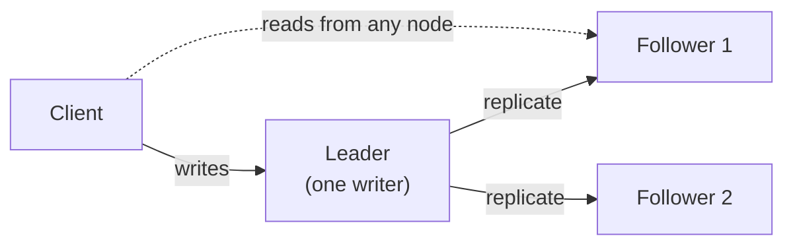
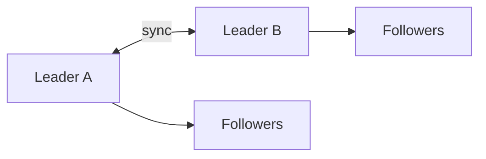
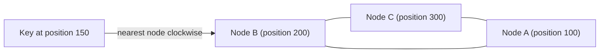
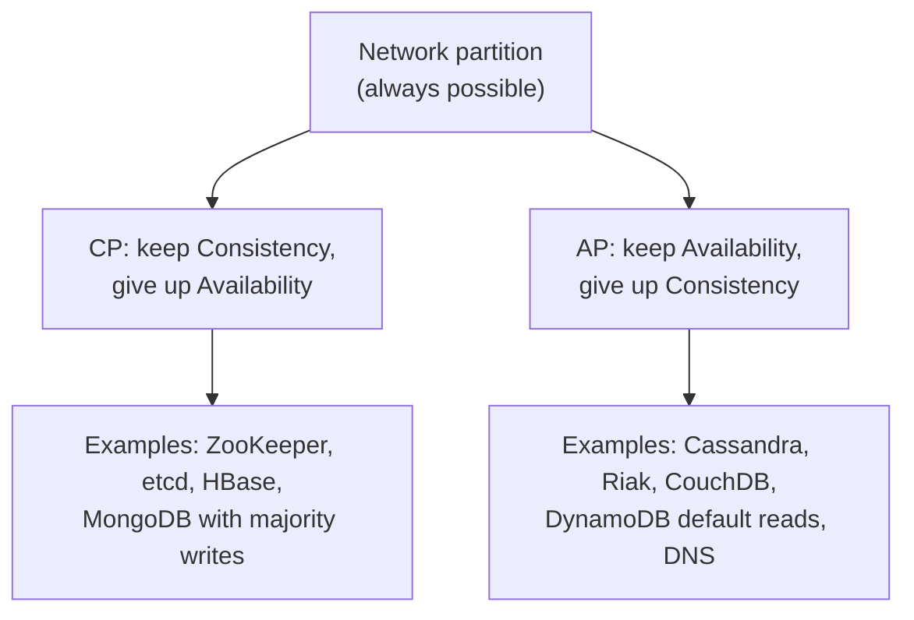
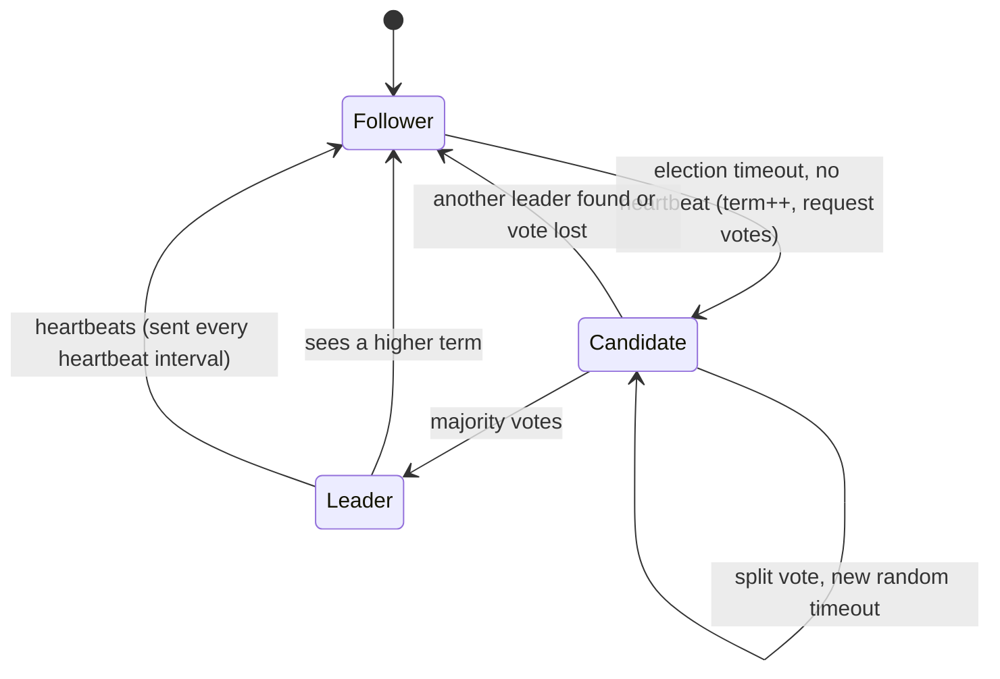
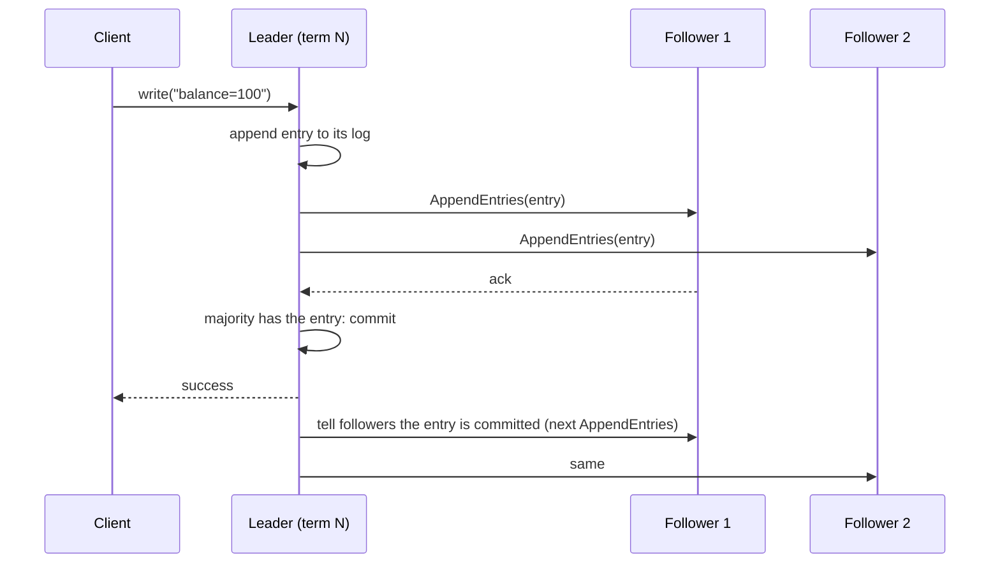
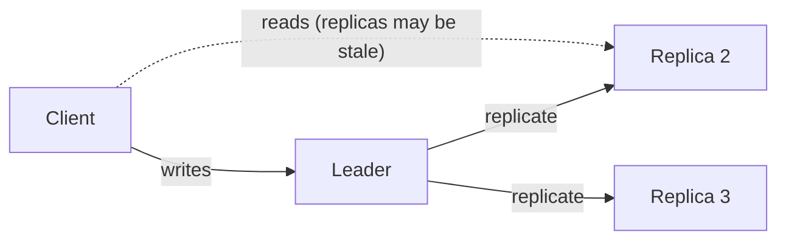
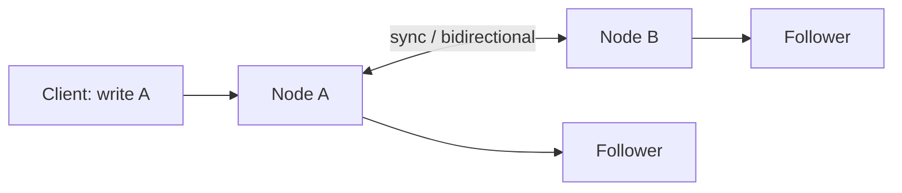

🧠 **Mental Model**: See [Distributed Systems Thinking](../14_Mental_Models/16_Distributed_Systems_Thinking.md)

---

# 🌐 Distributed Systems Fundamentals — CAP, Consistency, Partitioning

> **Navigation**: [← Chapter 05 - System Design…](05b_System_Design_Fundamentals.md) | [Chapter index](00_INDEX.md) | [System Design Interview Problems… →](05_SD_Interview_Problems.md)

Everything you need to reason about systems that span multiple machines

---

## 🔗 Bridge — Where This Chapter Fits

| Dimension | This chapter |
| --- | --- |
| **Builds on** | [System Design Fundamentals](05b_System_Design_Fundamentals.md), [Hash tables](../02_Data_Structures/01e_HashTable.md) |
| **You will learn** | Why distribute, CAP and PACELC, consistency models, replication, partitioning, consensus and common patterns |
| **Leads to** | [LLD Solved Problems](07_LLD_Solved_Problems.md), [Domain-Driven Design](09_Domain_Driven_Design_Essentials.md) (aggregates and eventual consistency) |
| **Abstraction level** | One machine → **many machines that fail independently** → **protocols that give guarantees despite failure** |

> [!NOTE]
> The full gap-free reading order and dependency graph are in the [Learning Path](00_LEARNING_PATH.md).

---

## 💬 Explain It Like a Study Partner — Distributed Systems Fundamentals

### 1. The bottom line

Machines and networks fail independently, so every distributed design chooses what to give up during a partition.

### 2. The textbook core

- **CAP**: during a network partition you must choose between consistency and availability (Gilbert and Lynch, 2002).
- **Consistency models** range from linearizable to eventual.
- **Replication** copies data for durability and read scale; **partitioning** splits data for write scale.
- **Consensus** (Paxos, Raft) lets nodes agree on a value despite crashes.
- Patterns: retries with idempotency, circuit breakers, bulkheads, sagas.

### 3. The real-world analogy

A **group of friends planning a dinner by text**: messages arrive late or out of order, someone's phone dies, and they still have to agree on one restaurant.

### 4. Walkthrough

1. Write goes to the leader; replicas follow.
2. The network between two data centres drops.
3. CP choice: the minority side refuses writes.
4. AP choice: both sides accept writes; reconcile later.
5. State the business rule that picks the side.

> [!NOTE]
> **Quick check:** When is eventual consistency acceptable? *When stale reads or briefly divergent copies are cheaper than refusing service, such as feeds and counters, but not for balances.*

### 5. Check yourself

**Q1.** A system refuses writes during a partition to keep replicas identical. CP or AP?

<details><summary>Answer</summary>

**CP**: it keeps consistency and gives up availability on the minority side.

</details>

**Q2.** Does Paxos tolerate Byzantine (arbitrary) faults?

<details><summary>Answer</summary>

No. Paxos and Raft assume nodes crash or are slow but do not lie; Byzantine fault tolerance needs different protocols.

</details>

---


## Part 1: Why Distributed Systems?

THE FUNDAMENTAL PROBLEM

Single machine: Simple, consistent, but limited

- CPU/Memory/Disk have hard ceilings
- Single point of failure (SPOF)

Distributed system: Multiple machines working together

- Scale beyond single machine limits
- Survive individual machine failures
- BUT: introduces network as unreliable component

REAL-WORLD ANALOGY: One chef vs a restaurant kitchen

- One chef: Perfect coordination, limited throughput
- Kitchen team: High throughput, but needs communication protocols
  - Miscommunication = wrong orders, duplicate dishes, lost tickets

---

## Part 2: CAP Theorem

```
                    Consistency (C)
                        /\
                       /  \
                      /    \
                     / CP   \
                    / systems \
                   /──────────\
                  /            \
                 / You can only  \
                /  pick 2 of 3    \
               /    (during a      \
              /     partition)       \
             /                        \
            /     CA        AP         \
           /   systems    systems       \
          /──────────────────────────────\
     Availability (A)               Partition Tolerance (P)

  REALITY: Network partitions WILL happen (P is not optional)
  → Real choice is: CP or AP

  CP (Consistency + Partition Tolerance):
    When partition happens → system blocks/errors rather than return stale data
    Examples: MongoDB (default), HBase, Redis Cluster, ZooKeeper
    Use when: Bank transfers, inventory counts, leader election

  AP (Availability + Partition Tolerance):
    When partition happens → system returns potentially stale data
    Examples: Cassandra, DynamoDB, CouchDB, DNS
    Use when: Social media feeds, product catalog, shopping cart
```

### CAP in Plain English

SCENARIO: You run 2 database replicas (Node A, Node B)
A network partition splits them — they can't talk to each other

[Node A] ✂️ network partition ✂️ [Node B]

A write comes to Node A: "Set balance = $100"
A read comes to Node B: "What's the balance?"

CHOICE 1 (CP): Node B says "Sorry, I can't answer — I might be stale"
→ Consistent ✅ Available ❌

CHOICE 2 (AP): Node B returns old value "$80"
→ Available ✅ Consistent ❌

You CANNOT have both during a partition. Period.

---

## Part 3: Consistency Models

**Spectrum: strong ← → weak**

| # | Model | What it guarantees | Cost / example |
| --- | --- | --- | --- |
| 1 | **Strong consistency (linearizability)** | Every read returns the most recent write, as if there were only one copy of the data | High latency, because replicas must coordinate. Examples: a single PostgreSQL instance, Google Spanner |
| 2 | **Sequential consistency** | All operations appear in some total order that every node observes, but the order need not match the wall clock | Cheaper than linearizability |
| 3 | **Causal consistency** | Operations that are causally related are seen in order; concurrent operations may be seen in different orders | Example: "I replied to your message" always appears after your message |
| 4 | **Eventual consistency** | Given enough time with no new writes, all replicas converge; reads may be stale temporarily | Cheapest and fastest. Examples: DNS, DynamoDB default reads |

**Real-world map**

| Model | Typical use |
| --- | --- |
| Strong | Banking, inventory, leader election |
| Causal | Social media comments, collaborative editing |
| Eventual | DNS, CDN, product catalogue, analytics |

---

## Part 4: Replication Strategies

**1. Single leader (master–follower)**



**How to read this diagram.** Arrows show the direction of flow from one step or component to the next.

- ✅ Simple; strong consistency is possible
- ❌ The leader is a bottleneck; failover is complex
- Examples: PostgreSQL streaming replication, MySQL

**2. Multi-leader**



**How to read this diagram.** Arrows show the direction of flow from one step or component to the next.

- ✅ Write to the nearest data centre (low latency)
- ❌ Conflict resolution is hard (last-writer-wins, merge, custom logic)
- Examples: CouchDB, multi-region DynamoDB global tables

**3. Leaderless (quorum-based)**

The client writes to N replicas at once and reads from R replicas, taking the most recent value. The rule `W + R > N` guarantees that a read quorum overlaps a write quorum, so strongly consistent reads are possible (not guaranteed in the presence of sloppy quorums or concurrent writes).

With `N = 3, W = 2, R = 2`, every read overlaps at least one replica that has the write.

- ✅ No single point of failure
- ❌ Complex conflict resolution and repair mechanisms
- Examples: Cassandra, Dynamo-style stores, Riak

---

## Part 5: Partitioning (Sharding)

**Why partition?** A single machine cannot hold all the data, so split it across machines.

**Strategy 1: range-based partitioning**

| Shard 1 | Shard 2 | Shard 3 |
| --- | --- | --- |
| Users A–F | Users G–M | Users N–Z |

- ✅ Range queries are efficient (all users A–C live on shard 1).
- ❌ Hot spots: if most users' names start with "S", shard 3 is overloaded.

**Strategy 2: hash-based partitioning**

`shard = hash(userId) % num_shards`

- ✅ Even distribution (no hot spots for a simple partition key).
- ❌ Range queries need scatter-gather (hit every shard).
- ❌ Adding or removing a shard moves most of the data.

**Strategy 3: consistent hashing** (common in distributed systems)

Nodes and keys are mapped onto a hash ring (0 to 2^32), and a key is assigned to the nearest node clockwise.



**How to read this diagram.** The three nodes sit on a ring at positions 100, 200 and 300. A key at position 150 goes clockwise to the next node, B. If B dies, only the keys between A and B move to C: roughly 1/N of all keys, not all of them.

**Virtual nodes:** each physical node owns several positions on the ring, which gives better distribution and smoother rebalancing.

---

## Part 6: Consensus Algorithms

**Problem:** multiple nodes must agree on a value (a leader, a transaction, an order).

**Raft (understandable consensus).** Three roles: leader, follower, candidate.

1. **Leader election**
   - Followers wait for a heartbeat from the leader.
   - No heartbeat before the timeout: become a candidate.
   - The candidate requests votes from all nodes.
   - A majority of votes: become leader.
2. **Log replication**
   - The client sends a write to the leader.
   - The leader appends it to its log and sends it to the followers.
   - A majority acknowledge: the leader commits.
   - The leader tells the followers to commit.

**Why a majority (quorum)?**

- With 5 nodes you need 3 to agree, so the cluster tolerates 2 failures.
- Any two majorities overlap in at least one node.
- That overlap guarantees a committed value is never lost.

**Used by:** etcd (Kubernetes), CockroachDB, TiKV, Consul.


---

### Historical Evolution

The field crystallised around a few landmark papers and systems. **Leslie Lamport wrote the Paxos paper in 1989; it was published in 1998** (_The Part-Time Parliament_) and re-explained in _Paxos Made Simple_ (2001). Paxos is a consensus protocol that tolerates crash failures (not Byzantine ones) and underlies systems such as Google's Chubby lock service and Spanner. **Eric Brewer presented the CAP conjecture in his PODC 2000 keynote**; **Seth Gilbert and Nancy Lynch proved it in 2002**, which is the origin of the formal CAP theorem cited in Part 2. **MapReduce (Dean and Ghemawat, OSDI 2004)** set the model for batch processing on commodity clusters; Hadoop (2006) is its open-source counterpart. **Bigtable (Chang et al., OSDI 2006)** introduced the wide-column model that influenced HBase and Cassandra. **Amazon's Dynamo paper (DeCandia et al., SOSP 2007)** showed an eventually consistent, highly available key-value store; Cassandra and Riak borrow heavily from it (DynamoDB is a different, managed service that shares the name and some ideas). **Google Spanner (OSDI 2012)** offers externally consistent transactions across data centres using Paxos replication and TrueTime (GPS and atomic clocks): it is a CP system that makes unavailability rare through engineering. **Raft (Ongaro and Ousterhout, USENIX ATC 2014)** was designed to be easier to understand than Paxos and powers etcd (the Kubernetes datastore), CockroachDB and TiKV.

---

## Part 7: Common Distributed System Patterns

| PATTERN | WHAT | USED IN |
| --- | --- | --- |
| Circuit Breaker | Stop calling failing service to prevent cascade failures | Hystrix (legacy), Resilience4J |
| Bulkhead | Isolate failures to one component, protect others | Thread pool per service |
| Saga | Distributed transaction as sequence of local txns + compensations | Order → Pay → Ship with compensation |
| CQRS | Separate read and write models/databases | Event-sourced systems |
| Event Sourcing | Store events, not state<br>Rebuild state by replaying | Banking ledger, audit systems |
| Sidecar | Attach helper process to main service (logging, proxy) | Service mesh (Istio), Envoy proxy |
| Leader Election | One node coordinates work | ZooKeeper, etcd |
| Gossip Protocol | Nodes share state by random peer-to-peer communication | Cassandra, Consul |

---

🔬 **Section Challenge — Part 7: Common Distributed System Patterns**

**Challenge 1 (Trace — Who/When/What):** A Circuit Breaker protecting calls to Payment Service has 3 states: CLOSED → OPEN → HALF-OPEN. Trace the lifecycle: **Who** decides to trip the breaker? **When** does it transition between states? **What** happens to requests in each state?

<details><summary>Answer</summary>

**CLOSED (normal):** All requests pass through. **Who counts?** The breaker itself tracks failure count. **When does it trip?** When failures exceed threshold (e.g., 5 failures in 60 seconds) → transition to OPEN.

**OPEN:** All requests are REJECTED immediately (fail-fast, no network call). **What happens?** Returns cached response or fallback error. A timer starts (e.g., 30 seconds). **When does it transition?** After the timeout → HALF-OPEN.

**HALF-OPEN:** Allows ONE trial request through. **Who decides?** The breaker lets a single request pass. If it succeeds → back to CLOSED. If it fails → back to OPEN (restart timer). This prevents a recovering service from being overwhelmed by full traffic. The Circuit Breaker is the Bulkhead's partner: Bulkhead isolates failure, Circuit Breaker prevents cascade.

</details>

**Challenge 2 (Design):** In the Saga pattern for Order → Pay → Ship: Payment succeeds but Shipping fails. Walk through the compensation sequence. Why can't you use a regular database rollback?

<details><summary>Answer</summary>

**Why no rollback?** Each step is a LOCAL transaction on a DIFFERENT database/service. There's no distributed `ROLLBACK` across 3 services. **Compensation sequence:** Shipping fails → trigger `compensate_ship` (no-op, nothing to undo) → trigger `compensate_pay` (REFUND the payment) → trigger `compensate_order` (mark order as CANCELLED). Each compensation is itself a NEW transaction, not an undo. **Critical insight:** Compensations must be idempotent — if `compensate_pay` is called twice (due to retry), it must not double-refund. Use a saga execution ID to deduplicate.

</details>

### Production Reality

- **Knight Capital, 1 August 2012**: A deployment reached only seven of eight servers; the eighth ran old code that a reused flag re-activated, flooding the market with unintended orders. The firm lost about **$440M in roughly 45 minutes** (SEC findings). Distributed-systems lesson: a fleet running mixed versions is a partially failed system, so deployments must be verified on every node, rollouts need a kill switch, and monitoring must alert on anomalous order flow in minutes, not hours.
- **Healthcare.gov, October 2013**: The federal marketplace failed under launch load. Government audits (GAO, HHS Inspector General) cite unclear requirements, late changes, limited end-to-end load testing and integration problems between contractors' components. Distributed-systems lesson: capacity, integration and graceful degradation have to be tested as a whole before launch.


#### Related: Multiple Inheritance in OOP

Multiple inheritance of behavior (the "diamond problem") is an OOP-language issue, not a distributed-systems one. For C++/Java mechanics on diamond inheritance, default methods, and `Interface.super.foo()` resolution, see `01_OOPS_Principles.md` (which contains the canonical C++/Java diamond diagrams at lines 1418+).

## Part 8: Interview Quick-Fire Questions

```
Q: "How do you handle a network partition?"
A: Decide CP or AP based on business requirements.
   Banking → CP (refuse stale reads, accept downtime).
   Social media → AP (serve stale data, stay available).

Q: "How does consistent hashing work?"
A: Map nodes and keys to a ring. Key goes to nearest node clockwise.
   Adding/removing node only affects neighbors, not all keys.
   Virtual nodes improve distribution.

Q: "Explain the Saga pattern."
A: Break distributed transaction into local transactions.
   Each step has a compensating action (undo).
   If step 3 fails: run compensate_3, compensate_2, compensate_1.
   Two types: Choreography (events) vs Orchestration (central coordinator).

Q: "What's the difference between horizontal and vertical scaling?"
A: Vertical: bigger machine (more CPU/RAM). Simple but has ceiling.
   Horizontal: more machines. Complex but unlimited scale.
   Horizontal needs: load balancing, data partitioning, state management.
```

---

## PLUS Enhancements

### Diagram 1: CAP Triangle with Named Systems



**How to read this diagram.** Partition tolerance (P) is not optional: networks do partition. The real choice is what to give up when it happens. Systems are tendencies, not absolutes; many can be tuned (for example Cassandra quorum levels).

> [!NOTE]
> "CA" systems exist only when there is nothing to partition, such as a single node. Once data is replicated across machines you must choose CP or AP during a partition.

### Diagram 2: Raft Consensus Sequence (Leader Election + Log Replication)

**Raft in two phases**

**Phase 1: leader election**



**How to read this diagram.** A follower that stops hearing heartbeats becomes a candidate and asks for votes in a new term. The first candidate with a majority becomes leader and sends regular heartbeats so followers reset their timers.

- **Randomised election timeouts** (the Raft paper suggests 150-300 ms) make repeated split votes unlikely.
- **Term numbers** stop "zombie leaders" from old terms: a node that sees a higher term steps down.

**Phase 2: log replication**



**How to read this diagram.** The leader appends, replicates, and commits once a **majority** of the cluster has stored the entry; it then tells the followers to apply it.

> [!NOTE]
> The rule `W + R > N` belongs to quorum-replicated stores such as Dynamo-style systems. Raft's commit rule is simpler: an entry is committed when a majority of nodes have stored it.

### Diagram 3: Replication Topology Comparison

**Topology 1: single primary**



**How to read this diagram.** Arrows show the direction of flow from one step or component to the next.

Trade-off: simple, and writes are strongly ordered through one node. The leader is the write bottleneck, and reads from replicas may lag.

**Topology 2: multi-primary**



**How to read this diagram.** Arrows show the direction of flow from one step or component to the next.

Trade-off: low latency (writes go to the nearest data centre), but **conflict resolution is hard**.

**Topology 3: quorum (R + W > N)**

`N = 3` replicas, `W = 2` write quorum, `R = 2` read quorum.

| Operation | What happens |
| --- | --- |
| **Write** | The client writes to 2 of the 3 nodes and waits for 2 acknowledgements |
| **Read** | The client reads from 2 of the 3 nodes and takes the latest version |

Any 2 nodes you read from always overlap with at least 1 node that holds the latest acknowledged write. This is the basis of the tunable consistency in Cassandra and Dynamo-style stores. It guarantees overlap, not full linearizability: concurrent writes, sloppy quorums and clock-based conflict resolution can still produce anomalies.

**Tunable consistency**

| Setting | Behaviour |
| --- | --- |
| `R=1, W=3` (N=3) | Fast reads, slow writes; read and write quorums overlap |
| `R=3, W=1` (N=3) | Slow reads, fast writes; read and write quorums overlap |
| `R=2, W=2` (N=3) | Balanced; quorum overlap guaranteed |
| `R=1, W=1` | Eventual; reads may be stale |

### Mechanism Deep-Dive: How Raft Actually Works

**Leader Election Mechanics:**

Raft's leader election is designed for understandability, but the details reveal why it works. Each follower has a **randomized timeout** (typically 150-300ms). When no heartbeat is received within that window, the follower becomes a Candidate and increments its term number:

```
  Timeline:
  t=0ms    Follower A: timer starts (random 150ms)
  t=0ms    Follower B: timer starts (random 300ms)
  t=0ms    Leader:     sends heartbeat (OK)
  t=50ms   A/B: reset timers
  t=100ms  Leader dies
  t=100ms  A: timer starts (residual 100ms)
  t=100ms  B: timer starts (residual 250ms)
  t=200ms  A times out → becomes Candidate, votes for self
  t=200ms  A sends RequestVote(term=2) to all peers
  t=200ms  B: still waiting (50ms left on residual)

  A gets vote from majority → becomes Leader
  B receives heartbeat from A before timing out
```

The **random jitter** is the key insight: if all followers used the same timeout, they would all become Candidates simultaneously, split votes, and never elect a leader (split-brain). Randomization ensures that, with high probability, one node times out first, collects votes, and becomes leader before others wake up.

**Log Replication and Consistency:**

Raft maintains a **log consistency guarantee**: if two entries across different servers share the same index and term, they must contain the same command, and all preceding entries must be identical. This is enforced by the AppendEntries RPC:

```
  Leader sends AppendEntries(prevIndex, prevTerm, entries[])
  Follower rejects if:
    - prevIndex entry doesn't match prevTerm  → log inconsistency
    - conflicting entry exists                → truncate + replace

  This is Raft's "consistency check" — prevents split-brain
  because a partition cannot produce two conflicting entries
  with the same index+term on different leaders.
```

**Split-Brain Prevention via Term Numbers:**

Term numbers are monotonically increasing integers that act as logical timestamps. If a partitioned leader attempts to replicate:

```
  Before partition:
  Node A: Leader, term=5, log=[e1, e2, e3]
  Node B: Follower, term=5, log=[e1, e2, e3]

  Partition occurs (B isolated from A)
  B doesn't receive heartbeats → times out → becomes Candidate
  B: term=6, votes for self, sends RequestVote
  A: still receives client writes (served from majority A+C)
  A: term=5, commits entries

  B: receives vote from itself only (not majority) → remains Candidate
  A: receives B's RequestVote(term=6) → A knows B is from old term
     A responds: "your term is outdated, revert to follower"

  After partition heals:
  B receives A's response → B reverts to Follower, syncs log from A
  A: term=5, log=[e1, e2, e3]
  B: term=5, log=[e1, e2, e3]  ← consistent!
```

The term mechanism ensures that any leader from an old partition cannot commit entries — it is rejected by any node that has seen a newer term. This is how Raft prevents split-brain without requiring synchronous communication.

### Why-This-Not-That: Paxos vs Raft

| Dimension                      | Paxos                                           | Raft                                           |
| ------------------------------ | ----------------------------------------------- | ---------------------------------------------- |
| **Designed for**               | Theoretical correctness                         | Implementability                               |
| **Invented by**                | Leslie Lamport (1989)                           | Diego Ongaro (2014)                            |
| **Roles**                      | Single proposer/acceptor                        | Leader + Followers + Candidates                |
| **Understandability**          | Extremely difficult (multi-chapter proof)       | Single chapter, proven equivalent              |
| **Multi-decree**               | Requires 2 phases per command                   | Single leader batches commands naturally       |
| **Production usage**           | Chubby (Google), Cosmos DB (Azure)              | etcd, CockroachDB, TiKV, Consul                |
| **Leaderless**                 | Yes (Multi-Paxos)                               | Requires leader (single point, but elected)    |
| **Complexity**                 | Proved correct but hand-wavy for implementation | Easier to implement but must handle edge cases |
| **Cluster membership changes** | Complex (view changes in Zab, Raft)             | Well-specified (joint consensus)               |

**Why Raft won in production:**
The etcd team (core of Kubernetes) evaluated Paxos before choosing Raft and concluded that Raft's "single leader per term" model maps naturally to how systems actually work — writes go through one node, which simplifies reasoning. Paxos's multi-proposer model requires additional mechanism to avoid conflicts. The Raft paper itself opens with: "Paxos is notoriously difficult to understand and implement." That was an explicit design goal, not a coincidence.

**When to use Paxos:** If you need a leaderless consensus (no single point of failure for coordination) and your team has deep distributed systems expertise. Google's Chubby (used for BigTable lock coordination) uses Paxos under the hood, but it's wrapped in a very mature system. For most teams, Raft is the right default.

### Breadth Comparison 1: Consistency Model Full Comparison Table

| Consistency model | Guarantee | Relative cost | Systems that offer it |
| --- | --- | --- | --- |
| Linearizability (strongest) | Every read sees the latest completed write, as if there were one copy | Highest: needs coordination (a quorum or leader) on each operation | etcd, Google Spanner (externally consistent), ZooKeeper writes |
| Sequential consistency | All clients see operations in one total order that respects each client's own order | High | ZooKeeper (reads may lag the latest write) |
| Causal consistency | Causally related operations are seen in order; concurrent ones may differ | Medium | MongoDB causally consistent sessions (3.6+), research systems such as COPS |
| Session guarantees (read-your-writes, monotonic reads) | A session sees its own writes and never goes back in time | Low to medium: needs session affinity or tokens | Azure Cosmos DB session level, MongoDB sessions |
| Eventual consistency (weakest) | Replicas converge if writes stop | Lowest: local reads, no coordination | DynamoDB default reads, Cassandra at low consistency levels, DNS |

> [!NOTE]
> The cost column is qualitative on purpose. Real latency depends on network distance, quorum size and load; measure your own system.

```
  SELECTION CRITERIA:
  Banking/ledger/leader election  → Linearizability (CP)
  Shopping cart/inventory          → Read-Your-Writes (session)
  Social media feeds               → Eventual (AP)
  Collaborative editing            → Causal (coordinate via CRDTs)
  CDN cache, DNS                   → Eventual (AP)
```

### Breadth Comparison 2: Distributed Transaction Patterns

| PATTERN | 2PC (Two-Phase Commit) | SAGA (Choreography/Orchestration) |
| --- | --- | --- |
| MODEL | All-or-nothing atomic commit across services | Sequence of local txns + compensating actions |
| COORDINATION | Central Coordinator sends Prepare → Commit | Distributed (choreography) or central Orchestrator |
| ON FAILURE | Coordinator decides<br>COMMIT or ROLLBACK (all nodes must agree) | Compensate each completed step: undo_ship → refund_payment → cancel_order |
| BLOCKING | YES — locks held during prepare phase | NO — each step is independent, compensation is a new forward transaction |
| USE WHEN | Tightly coupled data, must not violate invariants | Loosely coupled microservices, long-running workflows, eventual consistency OK |
| EXAMPLES | Distributed SQL, HBase, Spanner | Order → Pay → Ship (e-commerce)<br>Travel booking pipeline<br>Financial ledger with reversals |
| CRITICAL RISK | Coordinator crash<br>→ nodes wait forever<br>→ need timeouts + recovery protocols | Compensation failure (refund fails after ship — need retry/idempotency) |
| LATENCY | High (3 round-trips total coordination) | Lower per step, but more steps overall |

**Eventual consistency as a third alternative.** Don't coordinate at all: each service updates itself.

Example: place order → write to the Orders DB → emit an `order.placed` event. The payment service consumes the event and processes the payment asynchronously. The inventory service consumes the event and reserves stock asynchronously.

| Trade-off | |
| --- | --- |
| ➕ | Highest throughput and lowest latency (no coordination overhead) |
| ➕ | Individual services can fail and recover independently |
| ➖ | Consistency is deferred: the user may see "order confirmed" before payment clears |
| ➖ | Requires idempotency everywhere (a retry means duplicate processing) |
| ➖ | Requires a saga or outbox pattern to guarantee event delivery |

**Hybrid: the outbox pattern** (widely used in event-driven systems)

1. The service writes to its local DB: the order plus an `outbox:order.placed` row, atomically.
2. A background process polls the outbox and publishes to the message broker.
3. Consumers get effectively-once processing through deduplication (the broker itself delivers at least once).

This gives you transactional guarantees with eventual-consistency performance.

> **Navigation**: [< Previous](05_SD_Interview_Problems.md) | [Back to Index](../00_MASTER_INDEX.md) | [Next >](07_LLD_Solved_Problems.md)


---

## 🏢 Enterprise Lens — Distributed Systems Fundamentals

| Area | What top-tier engineering looks like |
| ---- | ------------------------------------ |
| **Where it runs in production** | Databases (Raft in etcd and CockroachDB), message queues, service meshes |
| **Failure modes** | Retry storms, split brain, clock assumptions |
| **Testing and verification** | Fault-injection tests; Jepsen-style checking for consistency claims |

---

## Reality Check

**"Distributed systems are systems on multiple machines"** — The defining property is PARTIAL FAILURE with ambiguity: a timeout tells you nothing about whether the operation happened — the request may have died en route, the server may have crashed after committing, the response may be lost. Single-machine intuition (a call either succeeded or threw) is exactly the intuition that must be unlearned; every distributed pattern — retries with idempotency, sagas, consensus — is machinery for acting sensibly WITHOUT knowing what happened.

**"Exactly-once delivery is achievable with the right broker"** — Delivery is at-least-once or at-most-once; EXACTLY-ONCE PROCESSING is achievable — and it is built at the consumer: idempotency keys, dedup tables, or transactional consume-and-write (outbox/inbox patterns). Broker marketing that says exactly-once means "we moved the dedup inside our transaction boundary for flows that stay within us." The interview and production skill is identical: place the idempotency mechanism, name its storage, and explain its retention window.

**"Clocks across machines are approximately synchronized, which is close enough"** — NTP skew of tens of milliseconds is ETERNITY at network speeds: last-write-wins with wall clocks silently drops concurrent writes, distributed locks with clock-based leases double-grant under drift, and cross-machine event ordering by timestamp fabricates causality. The fundamentals ladder: wall clocks for humans, monotonic clocks for local durations, logical clocks (Lamport/vector) for causality, and TrueTime-style bounded uncertainty only when hardware provides it. Any design sentence containing "we order events by timestamp" needs an immediate follow-up sentence.

**"Consensus algorithms are for database internals, not application design"** — Every "there must be exactly one" requirement IS a consensus requirement wearing product clothes: one leader processing a partition, one winner of a unique-username claim, one execution of a scheduled job across replicas. Teams that do not recognize this reinvent consensus badly with database flags and cron locks (the split-brain incidents write themselves). The application-level answer is usually to BUY consensus — a lease from etcd/ZooKeeper, a database unique constraint, a fencing token — and the fundamental skill is spotting which requirement needs it.

**"Failure detection tells you which nodes are down"** — In an asynchronous network, down and slow are INDISTINGUISHABLE — every failure detector is a timeout policy with false-positive/false-negative tuning, nothing more. This impossibility is why fencing tokens exist (the node declared dead may still be writing), why leases beat locks (time-bounded authority self-expires), and why split-brain is a permanent design consideration rather than a bug class. Designs that say "when the health check fails, we promote a replica" must immediately say "and the old primary is fenced by X" — or they contain a data-corruption scenario, not an edge case.
