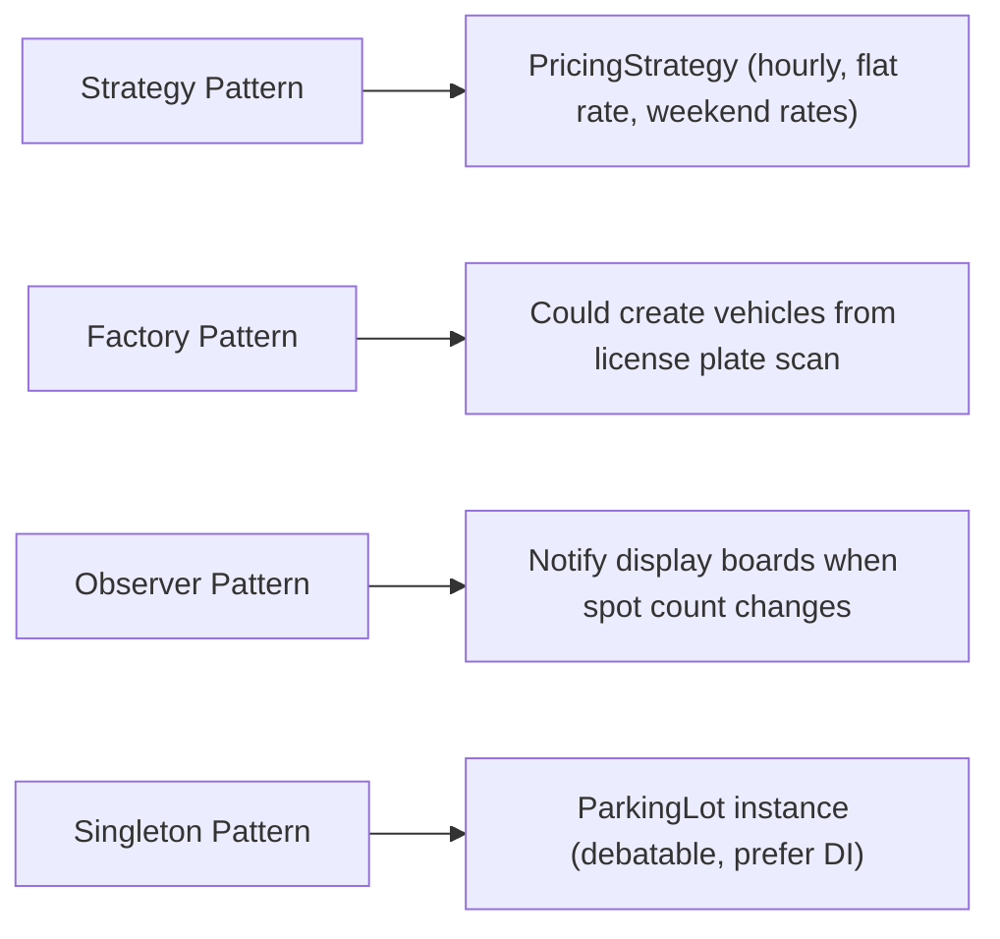
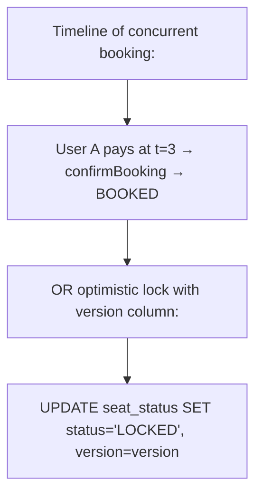

> **Navigation**: [Back to Index](../00_MASTER_INDEX.md) | [Design Patterns](02_Design_Patterns.md)
> 🧠 **Mental Model**: See [System Design Thinking](../14_Mental_Models/15_System_Design_Thinking.md)

---

# 🏛️ LLD Solved Problems — Low-Level Design with SOLID & Patterns

> 5 classic LLD interview problems solved with clean OOP, SOLID principles, and design patterns

---

## 🎤 The Lld Interview Framework


> 1. CLARIFY requirements (2 min): What entities? What operations?
> 2. IDENTIFY objects & relationships (5 min): Nouns → classes, Verbs → methods
> 3. DEFINE interfaces first (3 min): Program to interfaces
> 4. APPLY patterns (5 min): Strategy, Observer, Factory, etc.
> 5. CODE key classes (15 min): Focus on core logic, not boilerplate
> 6. DISCUSS extensibility (5 min): "What if we add X?"


---

# PROBLEM 1: Design Parking Lot

## Requirements
- Multi-floor parking lot with different spot sizes (Small, Medium, Large)
- Vehicles: Motorcycle (S), Car (M), Bus (L)
- Track available spots per floor per size
- Issue tickets on entry, calculate fee on exit

## Class Design
```java
// ── ENUMS ──
enum VehicleType { MOTORCYCLE, CAR, BUS }
enum SpotSize { SMALL, MEDIUM, LARGE }

// ── CORE CLASSES ──
class Vehicle {
    private String licensePlate;
    private VehicleType type;
    
    public SpotSize requiredSpotSize() {
        return switch (type) {
            case MOTORCYCLE -> SpotSize.SMALL;
            case CAR -> SpotSize.MEDIUM;
            case BUS -> SpotSize.LARGE;
        };
    }
}

class ParkingSpot {
    private int spotId;
    private SpotSize size;
    private int floor;
    private boolean isOccupied;
    private Vehicle currentVehicle;
    
    public boolean canFit(Vehicle vehicle) {
        return !isOccupied && this.size.ordinal() >= vehicle.requiredSpotSize().ordinal();
    }
    
    public void park(Vehicle vehicle)   { this.currentVehicle = vehicle; this.isOccupied = true; }
    public void unpark()                { this.currentVehicle = null; this.isOccupied = false; }
}

class Ticket {
    private String ticketId;
    private Vehicle vehicle;
    private ParkingSpot spot;
    private LocalDateTime entryTime;
    private LocalDateTime exitTime;
    
    public double calculateFee(PricingStrategy strategy) {
        Duration duration = Duration.between(entryTime, exitTime);
        return strategy.calculate(duration, spot.getSize());
    }
}

// ── STRATEGY PATTERN for pricing ──
interface PricingStrategy {
    double calculate(Duration duration, SpotSize size);
}

class HourlyPricing implements PricingStrategy {
    private Map<SpotSize, Double> hourlyRates = Map.of(
        SpotSize.SMALL, 10.0,
        SpotSize.MEDIUM, 20.0,
        SpotSize.LARGE, 30.0
    );
    
    public double calculate(Duration duration, SpotSize size) {
        long hours = Math.max(1, duration.toHours());
        return hours * hourlyRates.get(size);
    }
}

// ── MAIN PARKING LOT ──
class ParkingLot {
    private List<ParkingSpot> spots;
    private Map<String, Ticket> activeTickets; // ticketId → Ticket
    private PricingStrategy pricingStrategy;
    
    // FIND first available spot that fits the vehicle
    public synchronized Ticket parkVehicle(Vehicle vehicle) {
        ParkingSpot spot = spots.stream()
            .filter(s -> s.canFit(vehicle))
            .findFirst()
            .orElseThrow(() -> new ParkingFullException("No spot available"));
        
        spot.park(vehicle);
        Ticket ticket = new Ticket(UUID.randomUUID().toString(), vehicle, spot, LocalDateTime.now());
        activeTickets.put(ticket.getTicketId(), ticket);
        return ticket;
    }
    
    public double unparkVehicle(String ticketId) {
        Ticket ticket = activeTickets.remove(ticketId);
        ticket.setExitTime(LocalDateTime.now());
        ticket.getSpot().unpark();
        return ticket.calculateFee(pricingStrategy);
    }
}
```

### Design Patterns Used
```
Strategy Pattern  → PricingStrategy (hourly, flat rate, weekend rates)
Factory Pattern   → Could create vehicles from license plate scan
Observer Pattern  → Notify display boards when spot count changes
Singleton Pattern → ParkingLot instance (debatable, prefer DI)
```

> **Flow**: Strategy Pattern → PricingStrategy (hourly, flat rate, weekend rates) | Factory Pattern → Could create vehicles from license plate scan | Observer Pattern → Notify display boards when spot count changes | Singleton Pattern → ParkingLot instance (debatable, prefer DI)



---

# PROBLEM 2: Design BookMyShow (Movie Booking)

## Key Classes
```java
class Movie {
    private String movieId, title;
    private Duration duration;
    private String genre;
}

class Theater {
    private String theaterId, name, city;
    private List<Screen> screens;
}

class Screen {
    private int screenId;
    private int totalSeats;
    private List<Seat> seats;
}

class Seat {
    private String seatId;    // "A1", "B5"
    private SeatType type;    // REGULAR, PREMIUM, VIP
    private double basePrice;
}

class Show {
    private String showId;
    private Movie movie;
    private Screen screen;
    private LocalDateTime startTime;
    private Map<String, SeatStatus> seatAvailability; // seatId → AVAILABLE/LOCKED/BOOKED
}

enum SeatStatus { AVAILABLE, LOCKED, BOOKED }

// ── THE HARD PART: Concurrent seat booking ──
class BookingService {
    
    // PROBLEM: Two users select same seat at same time!
    // SOLUTION: Optimistic locking with temporary lock
    
    public synchronized List<String> lockSeats(String showId, List<String> seatIds, String userId) {
        Show show = getShow(showId);
        
        // Check all seats are AVAILABLE
        for (String seatId : seatIds) {
            if (show.getSeatStatus(seatId) != SeatStatus.AVAILABLE) {
                throw new SeatUnavailableException("Seat " + seatId + " already taken");
            }
        }
        
        // Lock seats for 5 minutes (user has 5 min to pay)
        for (String seatId : seatIds) {
            show.setSeatStatus(seatId, SeatStatus.LOCKED);
        }
        
        // Schedule auto-unlock after 5 minutes
        scheduler.schedule(() -> releaseExpiredLock(showId, seatIds, userId), 5, TimeUnit.MINUTES);
        
        return seatIds;
    }
    
    public Booking confirmBooking(String showId, List<String> seatIds, Payment payment) {
        // Verify payment → mark seats as BOOKED → generate booking
        Show show = getShow(showId);
        for (String seatId : seatIds) {
            show.setSeatStatus(seatId, SeatStatus.BOOKED);
        }
        return new Booking(UUID.randomUUID().toString(), show, seatIds, payment);
    }
}
```

### Race Condition Solution
```
╔══════════════════════════════════════════════════════════════════════════════════╗
║  Timeline of concurrent booking:                                                 ║
║                                                                                  ║
║  User A selects seat A1 at t=0    →  lockSeats("A1") → SUCCESS (locked for A)    ║
║  User B selects seat A1 at t=1    →  lockSeats("A1") → FAIL (already LOCKED)     ║
║                                                                                  ║
║  User A pays at t=3              →  confirmBooking → BOOKED                      ║
║  OR User A doesn't pay by t=5   →  auto-release → AVAILABLE again                ║
║                                                                                  ║
║  DATABASE-LEVEL: Use SELECT ... FOR UPDATE (pessimistic lock)                    ║
║  OR optimistic lock with version column:                                         ║
║  UPDATE seat_status SET status='LOCKED', version=version+1                       ║
║  WHERE seat_id='A1' AND status='AVAILABLE' AND version=current_version           ║
╚══════════════════════════════════════════════════════════════════════════════════╝
```

> **Flow**: Timeline of concurrent booking: → User A pays at t=3 → confirmBooking → BOOKED | User A pays at t=3 → confirmBooking → BOOKED → OR optimistic lock with version column: | OR optimistic lock with version column: → UPDATE seat_status SET status='LOCKED', version=version



---

# PROBLEM 3: Design Splitwise (Expense Sharing)

## Core Classes
```java
class User {
    private String userId, name, email;
    private Map<String, Double> balances; // userId → amount owed (+ means they owe me)
}

class Group {
    private String groupId, name;
    private List<User> members;
    private List<Expense> expenses;
}

class Expense {
    private String expenseId;
    private double amount;
    private User paidBy;
    private List<Split> splits;
    private String description;
    private LocalDateTime createdAt;
}

// ── STRATEGY PATTERN for split types ──
interface Split {
    String getUserId();
    double getAmount();
}

class EqualSplit implements Split {
    private String userId;
    private double amount; // calculated: total / num_participants
}

class ExactSplit implements Split {
    private String userId;
    private double amount; // user specifies exact amount
}

class PercentSplit implements Split {
    private String userId;
    private double percent;
    private double amount; // calculated: total * percent / 100
}

// ── EXPENSE SERVICE ──
class ExpenseService {
    
    public void addExpense(Expense expense) {
        validate(expense);
        
        // Update balances between payer and each participant
        for (Split split : expense.getSplits()) {
            if (!split.getUserId().equals(expense.getPaidBy().getUserId())) {
                // The participant owes the payer
                updateBalance(expense.getPaidBy().getUserId(), split.getUserId(), split.getAmount());
            }
        }
    }
    
    private void updateBalance(String payerId, String owerId, double amount) {
        // payer's balance with ower increases (ower owes payer more)
        balanceSheet.merge(key(payerId, owerId), amount, Double::sum);
        // ower's balance with payer decreases
        balanceSheet.merge(key(owerId, payerId), -amount, Double::sum);
    }
}

// ── DEBT SIMPLIFICATION (Graph Problem!) ──
class DebtSimplifier {
    // Net balance approach: reduce N*(N-1) debts to at most N-1
    
    public List<Transaction> simplify(Map<String, Double> netBalances) {
        // netBalance: positive = creditor, negative = debtor
        PriorityQueue<double[]> creditors = new PriorityQueue<>((a,b) -> Double.compare(b[1],a[1]));
        PriorityQueue<double[]> debtors = new PriorityQueue<>((a,b) -> Double.compare(a[1],b[1]));
        
        List<Transaction> result = new ArrayList<>();
        
        // Match biggest creditor with biggest debtor
        while (!creditors.isEmpty() && !debtors.isEmpty()) {
            double[] creditor = creditors.poll();
            double[] debtor = debtors.poll();
            
            double settleAmount = Math.min(creditor[1], Math.abs(debtor[1]));
            result.add(new Transaction(debtor[0], creditor[0], settleAmount));
            
            double remaining;
            if ((remaining = creditor[1] - settleAmount) > 0) creditors.offer(new double[]{creditor[0], remaining});
            if ((remaining = debtor[1] + settleAmount) < 0) debtors.offer(new double[]{debtor[0], remaining});
        }
        return result;
    }
}
```

---

# PROBLEM 4: Design Elevator System

```java
enum Direction { UP, DOWN, IDLE }

class Elevator {
    private int id;
    private int currentFloor;
    private Direction direction;
    private Set<Integer> destinationFloors; // ordered set
    
    public void addDestination(int floor) {
        destinationFloors.add(floor);
    }
    
    public void move() {
        if (destinationFloors.isEmpty()) {
            direction = Direction.IDLE;
            return;
        }
        
        if (direction == Direction.UP) {
            currentFloor++;
            if (destinationFloors.contains(currentFloor)) {
                openDoors();
                destinationFloors.remove(currentFloor);
            }
            if (destinationFloors.stream().allMatch(f -> f < currentFloor)) {
                direction = Direction.DOWN;
            }
        }
        // similar for DOWN
    }
}

// ── STRATEGY PATTERN for scheduling ──
interface ElevatorSchedulingStrategy {
    Elevator selectElevator(List<Elevator> elevators, int requestFloor, Direction requestDir);
}

// LOOK Algorithm (Elevator Algorithm): 
// Serve requests in current direction, then reverse
class LOOKStrategy implements ElevatorSchedulingStrategy {
    public Elevator selectElevator(List<Elevator> elevators, int floor, Direction dir) {
        return elevators.stream()
            .filter(e -> e.getDirection() == Direction.IDLE 
                      || (e.getDirection() == dir && isOnTheWay(e, floor, dir)))
            .min(Comparator.comparingInt(e -> Math.abs(e.getCurrentFloor() - floor)))
            .orElse(elevators.get(0)); // fallback: nearest idle
    }
}

class ElevatorController {
    private List<Elevator> elevators;
    private ElevatorSchedulingStrategy strategy;
    
    public void handleRequest(int floor, Direction direction) {
        Elevator best = strategy.selectElevator(elevators, floor, direction);
        best.addDestination(floor);
    }
}
```

---

# PROBLEM 5: Design Logger / Logging Framework

```java
// CHAIN OF RESPONSIBILITY + SINGLETON + STRATEGY

enum LogLevel { DEBUG, INFO, WARN, ERROR, FATAL }

// ── Chain of Responsibility ──
abstract class Logger {
    protected LogLevel level;
    protected Logger nextLogger;
    protected List<LogAppender> appenders;
    
    public void log(LogLevel msgLevel, String message) {
        if (msgLevel.ordinal() >= this.level.ordinal()) {
            for (LogAppender appender : appenders) {
                appender.append(format(msgLevel, message));
            }
        }
        if (nextLogger != null) {
            nextLogger.log(msgLevel, message);
        }
    }
    
    private String format(LogLevel level, String message) {
        return String.format("[%s] %s %s - %s", 
            level, LocalDateTime.now(), Thread.currentThread().getName(), message);
    }
}

// ── Strategy Pattern for output destinations ──
interface LogAppender {
    void append(String message);
}

class ConsoleAppender implements LogAppender {
    public void append(String message) { System.out.println(message); }
}

class FileAppender implements LogAppender {
    private BufferedWriter writer;
    public void append(String message) {
        writer.write(message + "\n");
        writer.flush();
    }
}

class DatabaseAppender implements LogAppender {
    public void append(String message) { /* INSERT INTO logs ... */ }
}

// ── Builder for configuration ──
class LoggerConfig {
    public static Logger build() {
        Logger errorLogger = new ConcreteLogger(LogLevel.ERROR, List.of(new FileAppender("error.log")));
        Logger infoLogger = new ConcreteLogger(LogLevel.INFO, List.of(new ConsoleAppender()));
        
        infoLogger.setNextLogger(errorLogger); // chain: INFO → ERROR
        return infoLogger;
    }
}
```

---

## SOLID Principles in Every Solution

```
╔══════════════════════════════════════════════════════════════════════════════════╗
║  PRINCIPLE          │ WHERE WE APPLIED IT                                        ║
║─────────────────────┼─────────────────────────────────────────────────────────   ║
║  S - Single Resp.   │ BookingService only books, PricingStrategy only prices     ║
║  O - Open/Closed    │ New split types without changing ExpenseService            ║
║  L - Liskov Sub.    │ EqualSplit/ExactSplit both work wherever Split is used     ║
║  I - Interface Seg. │ Small interfaces: PricingStrategy, LogAppender             ║
║  D - Dependency Inv.│ ParkingLot depends on PricingStrategy interface, not impl  ║
╚══════════════════════════════════════════════════════════════════════════════════╝
```

---

> **Navigation**: [< Previous](06_Distributed_Systems_Fundamentals.md) | [Back to Index](../00_MASTER_INDEX.md) | [Next >](08_Design_Patterns_Java.md)