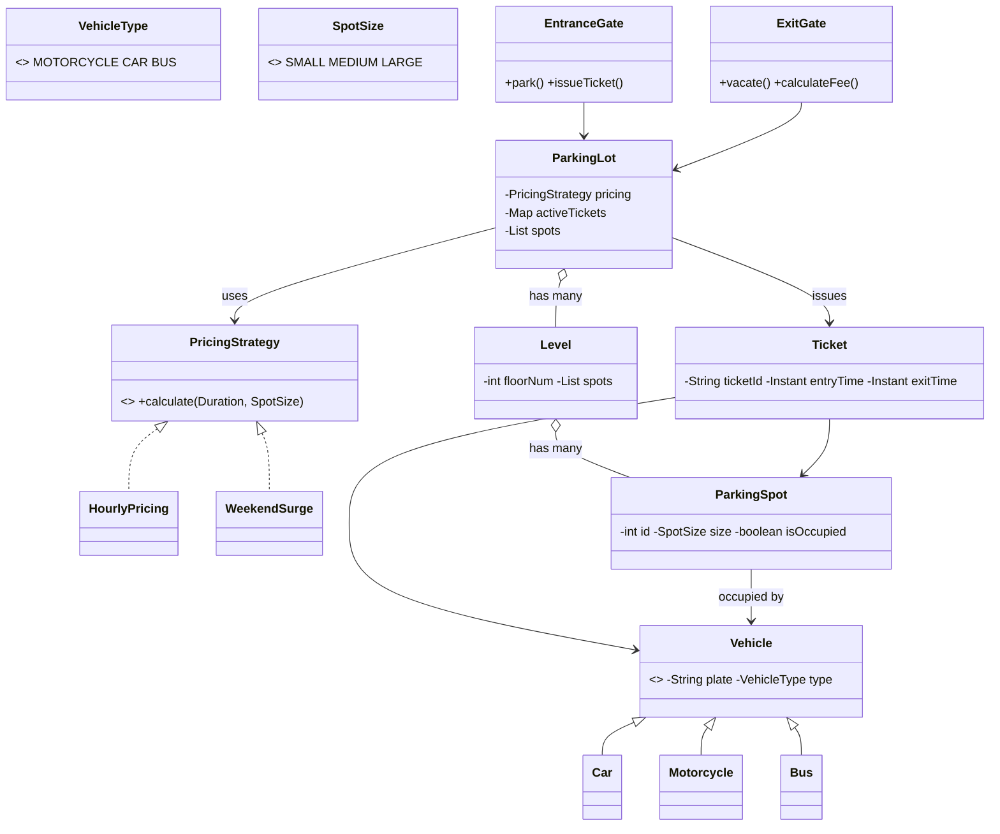
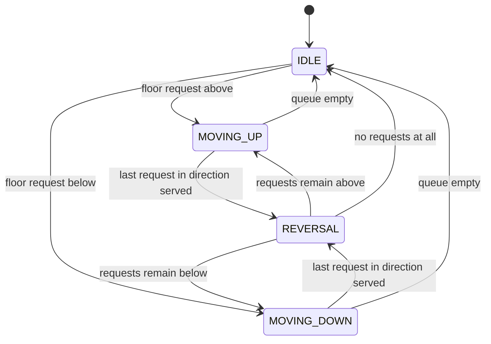
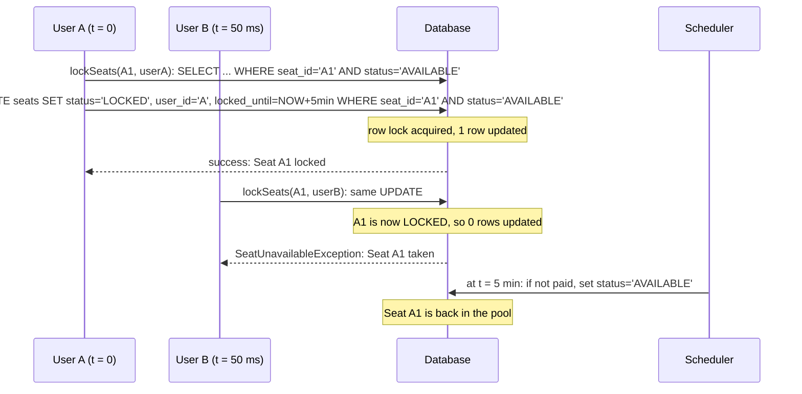

# PLUS Enhancements

> **Navigation**: [← The Lld Interview Framework](01_the_lld_interview_framework.md) | [Chapter overview](../07_LLD_Solved_Problems.md)
> Page 2 of 2 in **LLD Solved Problems — Low-Level Design with SOLID & Patterns**


## Diagram 1: Parking Lot Class Diagram

### Parking lot system design



**How to read this diagram.** The lot owns levels, levels own spots, and a ticket links a vehicle to the spot it occupies. Pricing is an interface, so a new pricing rule (such as weekend surge) is a new class and the rest stays unchanged (Open/Closed). The gates are thin clients of `ParkingLot`.

**Patterns used**

- **Strategy:** `PricingStrategy` (hourly, flat, surge)
- **Factory:** `VehicleFactory`, for example from a licence-plate scan
- **Observer:** `DisplayBoard` updates when spot availability changes
- **Singleton:** one `ParkingLot` instance, though dependency injection is preferred

## Diagram 2: Elevator LOOK Algorithm State Diagram

### Elevator state machine



**How to read this diagram.** `REVERSAL` is an internal decision state: if no request remains in the current direction, check the other direction, and go idle if there is nothing to do.

**LOOK algorithm walk-through** (building with floors 1 to 6; the user presses 4, then 2, then 5):

| Step | State | Request queue | What the elevator does |
| --- | --- | --- | --- |
| 1 | MOVING_UP | [4] | Travels 1 → 2 → 3 → 4, stops, opens doors, removes 4 |
| 2 | REVERSAL | [2] | At floor 4 nothing remains above, but a request for 2 is below, so it reverses to MOVING_DOWN |
| 3 | MOVING_DOWN | [2] | Travels 4 → 3 → 2, stops, removes 2 |
| 4 | REVERSAL | [5] | At floor 2 the pending request for 5 is above, so it reverses to MOVING_UP |
| 5 | MOVING_UP | [5] | Travels 2 → 3 → 4 → 5, stops, done |

**Why LOOK and not SCAN?**

- **SCAN** sweeps all the way to the last floor (floor 6) before reversing, even with no requests there.
- **LOOK** reverses as soon as there are no more requests in the current direction.
- Result: LOOK saves travel time.

Real elevator controllers add zoning and destination dispatch on top of this basic idea.

## Diagram 3: BookMyShow Seat-Locking Sequence

### Concurrent seat booking timeline



**How to read this diagram.** The conditional `UPDATE ... WHERE status='AVAILABLE'` is the whole trick: the database applies it atomically, so exactly one of the two users updates a row. A timer releases the lock if payment never completes.

### Three locking strategies compared

**Pessimistic: `SELECT ... FOR UPDATE`**

```sql
SELECT * FROM seats WHERE seat_id = 'A1' FOR UPDATE;
-- Acquires a row-level lock. Other transactions that try to lock or update the row WAIT.
```

Strong guarantee, but waiters queue up and a long transaction hurts throughput. Supported by PostgreSQL, MySQL InnoDB and most SQL databases. (Plain reads under MVCC are not blocked.)

**Optimistic: version column**

```sql
UPDATE seats SET status = 'LOCKED', version = version + 1
WHERE seat_id = 'A1' AND version = 5 AND status = 'AVAILABLE';
-- Returns 0 rows if the version changed: retry or fail.
```

No lock is held, so concurrency is high; the cost is retries under contention. This is the idea behind JPA's `@Version`, and Redis offers a similar check-and-set with `WATCH`/`MULTI`/`EXEC`.

**Distributed lock: Redis `SET ... NX EX`**

```text
SET seat:A1:lock userA NX EX 300
```

Atomic set-if-not-exists with a TTL of 300 seconds, so the lock releases itself. It avoids a database round trip for the check and is very fast, but a TTL lock alone is not a correctness guarantee (a paused client can outlive its TTL): keep the database constraint as the final authority, or use fencing tokens.

## Mechanism Deep-Dive: Concurrent Seat Booking — Three Locking Strategies

**Pessimistic Locking (SELECT ... FOR UPDATE):**

```sql
-- In a transaction:
BEGIN;
SELECT * FROM seats
  WHERE seat_id = 'A1' AND show_id = 'SHOW_123'
  FOR UPDATE;  -- ← acquires row-level exclusive lock

-- If another transaction tries:
-- SELECT * FROM seats WHERE seat_id = 'A1' FOR UPDATE;
-- → WAITS here until first transaction commits or rolls back

UPDATE seats SET status = 'LOCKED' WHERE seat_id = 'A1';
COMMIT;
```

**The Pessimistic trade-off:**

- Guarantees no race: one transaction holds the lock until commit/rollback
- Other transactions BLOCK waiting — if lock is held too long, users experience delays
- Risk: long-held locks can cause deadlocks if two users try to lock seats A1 and A2 simultaneously
- Solution: always lock in deterministic order (lock lower seat ID first)

**Optimistic Locking (version column):**

```sql
-- No lock at read time:
SELECT * FROM seats WHERE seat_id = 'A1';
-- Returns: {seat_id:'A1', status:'AVAILABLE', version:5}

-- At write time (with version check):
UPDATE seats
  SET status = 'LOCKED', version = version + 1
  WHERE seat_id = 'A1'
    AND version = 5          -- ← must match
    AND status = 'AVAILABLE'; -- ← must still be available

-- Result: 0 rows affected if:
--   (a) version changed (another transaction updated it) OR
--   (b) status is no longer AVAILABLE

-- Application code:
if (rowsAffected == 0) {
    throw new OptimisticLockException("Seat was modified, retry");
}
```

**The Optimistic trade-off:**

- No blocking — reads are never blocked
- Good for low-contention scenarios (most bookings don't overlap)
- Bad for high-contention (concert tickets going on sale — everyone hits the same seats)
- Requires retry logic: optimistic lock failure → user sees "someone grabbed it, try again"

**Distributed Lock (Redis SETNX + TTL):**

```java
// Using Redisson:
RLock lock = redissonClient.getLock("seat:A1:SHOW_123");
boolean acquired = lock.tryLock(0, 300, TimeUnit.SECONDS);

if (acquired) {
    try {
        // Check DB seat status
        // Update DB
        // Release lock explicitly (or rely on TTL)
    } finally {
        lock.unlock();
    }
} else {
    throw new SeatUnavailableException("Lock not acquired");
}

// TTL auto-releases if process crashes
// SETNX is atomic — no check-then-act race
```

**The Distributed Lock trade-off:**

- Fastest (in-memory, no disk I/O on hot path)
- External dependency (Redis must be available)
- Redis is eventually consistent — lock state may lag slightly
- TTL too short: lock expires before payment completes → double-booking
- TTL too long: legitimate lock waits unnecessarily

## Why-This-Not-That: Queue vs Stack in Elevator Scheduling

### Why a queue (not a stack) for elevator requests

**Queue (FIFO), as used by the LOOK algorithm.** Requests for floors `[4, 2, 5, 3]` are served from the head:

| Position | head → | | | tail |
| --- | --- | --- | --- | --- |
| Queue | 4 | 2 | 5 | 3 |

The elevator is moving up, so it serves 4 first (dequeue 4) and the queue becomes `[2, 5, 3]`.

Why a queue works:

- ✅ Preserves arrival order (fairness): whoever pressed first is served first.
- ✅ LOOK keeps requests sorted by floor for each direction.
- ✅ Predictable: you can reason about the elevator's behaviour.
- ✅ Easy to implement: an ordered set per direction.

**Stack (LIFO) is wrong here.** Push 4, 2, 5, 3 and pop: the top, 3, is served first even though the passenger at floor 4 pressed first.

- ❌ Violates FIFO fairness: the first request is served last.
- ❌ Wastes movement: the elevator travels past waiting floors to serve the top of the stack.
- ❌ Unpredictable: passengers cannot reason about when they will be served.

**Analogy.** Think of an elevator like a bus stop, not a stack of plates: the first passenger at the stop boards first.

**Real-world scheduling variants**

| Variant | Behaviour | Note |
| --- | --- | --- |
| SCAN | Goes to the extreme floor, then reverses | Wasted travel to floors with no requests |
| LOOK | Serves the nearest requests in the current direction, then reverses | Minimises travel and stays fair |
| FIFO | Pure queue | Rarely used: ignores floor proximity |
| Priority | VIP floors first | Special-purpose buildings |

**Queue plus direction sort = LOOK**

- Direction up: the queue holds only floors above the current floor, sorted ascending.
- Direction down: the queue holds only floors below, sorted descending.
- Queue empty: reverse direction (or go idle).

## Breadth Comparison 1: LLD Problem Pattern Mapping Table

| PROBLEM | DESIGN PATTERNS USED | KEY OOP PRINCIPLE |
| --- | --- | --- |
| Parking Lot | Strategy (pricing: hourly/flat/surge)<br>Factory (VehicleFactory from scan)<br>Observer (display board updates)<br>Singleton (debatable, prefer DI) | OCP: new strategy = new class, no existing code mod<br>SRP: parking logic ≠ pricing logic ≠ display logic |
| BookMyShow | Observer (seat availability → UI update)<br>State (SeatStatus: AVAIL→LOCKED→BOOKED)<br>Locking (pessimistic/optimistic/distrib)<br>Strategy (payment processing) | OCP: new payment gateway = new class, existing code unchanged<br>SRP: BookingService only books, PaymentService only processes |
| Splitwise | Strategy (Split: Equal/Exact/Percent)<br>Composite (Expense contains many Splits)<br>Graph algorithm (debt simplification) | LSP: any Split implementation works in ExpenseService<br>OCP: new split type = new class, no Expense changes |
| Elevator | Strategy (SchedulingStrategy: LOOK/SCAN)<br>State (ElevatorState: IDLE/MOVING_*)<br>Template Method (move sequence) | OCP: new algorithm = new class, controller unchanged<br>DIP: ElevatorController depends on abstract<br>SchedulingStrategy, not concrete LOOKStrategy |
| Logger/Logging | Chain of Responsibility (DEBUG→INFO→ERR)<br>Strategy (LogAppender: console/file/DB)<br>Singleton (Logger, but DI preferred)<br>Builder (LoggerConfig for fluent build) | SRP: Logger chains don't know about each other's details<br>ISP: LogAppender has one method: append(String) |

**Recurring pattern across all 5 problems**

1. Every problem uses AT LEAST 2 GoF patterns (Strategy appears in 4 of 5).
2. Every problem satisfies SRP (one class = one responsibility).
3. Every problem is OCP-friendly (new behavior = new class, never modify existing code).
4. Every problem is DIP-compliant (high-level modules depend on abstractions).

## Breadth Comparison 2: Concurrency Control Strategies Table

| STRATEGY | MECHANISM | BEST FOR | RISKS |
| --- | --- | --- | --- |
| synchronized (method) | Intrinsic lock on 'this' | Simple shared state, low concurrency needs | Over-synchronization (all threads wait)<br>Deadlock if A locks<br>X and waits for Y |
| synchronized (block) (more control) | Intrinsic lock on specific obj (e.g., spots[i]) | Multiple shared resources that need atomicity | Must release all locks in same order to avoid deadlock |
| ReentrantLock (java.util .concurrent) | Explicit lock tryLock() with timeout, fairness param | Try-lock (non-blocking failure), read-write | MUST unlock in finally block or lock persists (unlike synch) |
| ReadWriteLock | Shared read, exclusive write | Read-heavy workloads (parking spots) | Writers may starve if readers keep coming |
| AtomicInteger<br>AtomicLong | CAS (Compare-And-Swap, no locking) | Simple counter increments, flags | Only works for single variables (not compound ops) |
| Concurrent<br>LinkedQueue<br>Concurrent<br>HashMap | Lock-free queue (CAS-based) | Producer-consumer (event processing, request queues) | Iteration requires snapshot or iterator from queue |
| volatile (fields) | Read/write visibility (no lock) | Flags, caches (no compound operations) | NOT atomic for compound operations (volatile++ is NOT thread-safe!) |
| StampedLock (Java 8+) | Optimistic read with validate | Read-heavy with rare writes (cache) | Must validate stamp after read or retry |

**Decision guide for LLD problems**

| Need | Use |
| --- | --- |
| Protect a simple counter (active tickets count) | `AtomicInteger` / `AtomicLong` (no lock needed) |
| Protect a data structure (available spots) | `synchronized` block, or `ConcurrentHashMap` + `computeIfAbsent` |
| Try-lock with timeout (deadlock recovery) | `ReentrantLock` with `tryLock(timeout, unit)` |
| Many readers, rare writers (parking lot availability) | `ReadWriteLock` (multiple readers, exclusive writer) |
| Distributed lock across machines | Redis `SETNX` + TTL (Redisson `RLock`) |
| DB-level lock | `SELECT ... FOR UPDATE` (pessimistic) or a version column (optimistic) |

**Navigation**: [< Previous](../06_Distributed_Systems_Fundamentals.md) | [Back to Index](../../00_MASTER_INDEX.md) | [Next >](../08_Design_Patterns_Java.md)

🔬 **Section Challenge — SOLID Principles in Every Solution**

**Challenge 1 (Reasoning):** Open/Closed Principle says 'closed for modification'. Does this mean code can NEVER be changed?

<details><summary>Answer</summary>

No — it means don't modify existing, tested behavior to add new features. Add new classes/methods instead. In practice: use interfaces + plugins. Adding a new payment type = new class implementing `PaymentStrategy`. Not modifying `PaymentProcessor`. The existing processor is 'closed' (don't touch tested code). The system is 'open' (easily extend by adding new implementations).

</details>

**Challenge 2 (Design):** A class has 5 public methods but clients only use 1-2. Which SOLID principle is violated and what's the fix?

<details><summary>Answer</summary>

Interface Segregation Principle (ISP): clients shouldn't depend on methods they don't use. Fix: split the class into smaller, focused interfaces. `Printable`, `Scannable`, `FaxMachine` instead of one `AllInOnePrinter`. Each client implements/uses only the interface it needs.

</details>

## Historical Evolution

These problems are classic interview staples; the verifiable milestones behind them are below.

- **Parking lot** — a standard teaching example for inheritance versus composition, enums and strategy-based pricing; it has no single historical origin.
- **Seat booking** — airline reservation is the original high-concurrency booking problem: IBM and American Airlines' SABRE went live around 1960. Two agents selling the same seat is the textbook lost-update race.
- **Expense sharing** — settling debts with the fewest transfers is a combinatorial problem (minimising transactions is NP-hard in general); the common greedy approach of matching the largest creditor with the largest debtor needs at most n-1 transfers but is not always minimal.
- **Elevator** — scheduling follows disk-arm scheduling: the SCAN or "elevator" algorithm was analysed by Denning (1967), with SCAN and LOOK variants compared by Teorey and Pinkerton (1972). LOOK reverses when no requests remain ahead rather than travelling to the end.
- **Logger / Chain of Responsibility** — the GoF pattern (1994) is visible in Unix syslog (BSD, 1980s), Log4j (first released 1999-2001) and `java.util.logging` (JDK 1.4, 2002), where a record travels through handlers and levels.


## Production Reality

- **Parking-lot double booking (illustrative)**: A check-then-act sequence - read "spot is free" in one request, write "booked" in another with no lock or constraint between them - is a time-of-check to time-of-use race, so two users can both be told the spot is theirs. The fix is to make the claim atomic: a `synchronized` or per-spot lock for in-memory designs, or a conditional update or `SELECT ... FOR UPDATE` plus a unique constraint in a database. This is why the solution's `parkVehicle()` is synchronized.
- **Elevator LOOK versus SCAN**: SCAN sweeps to the physical end before reversing; LOOK reverses at the last pending request, saving travel. Real dispatchers add zoning and destination-dispatch rules on top, but the interview answer is the direction-aware sweep.
- **Therac-25, 1985-1987**: A radiation-therapy machine delivered massive overdoses in six known accidents, with deaths among the patients (Leveson and Turner, 1993). The investigation found race conditions in the operator-input and setup code, reused software from earlier models, and no independent hardware interlock. Lesson for LLD: shared mutable state needs a single owner and a guarded protocol, and safety-critical invariants need a check that the main code cannot bypass.

---

[← The Lld Interview Framework](01_the_lld_interview_framework.md) | [Chapter overview](../07_LLD_Solved_Problems.md)
