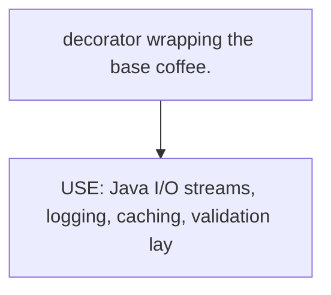
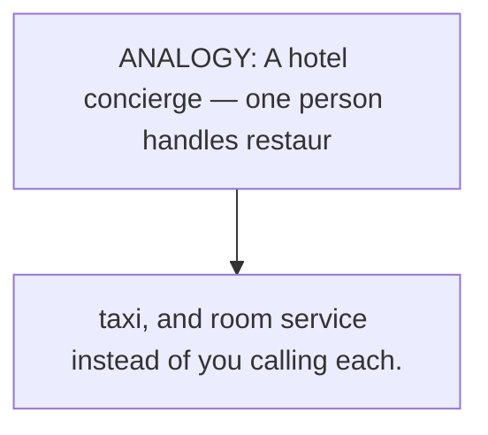
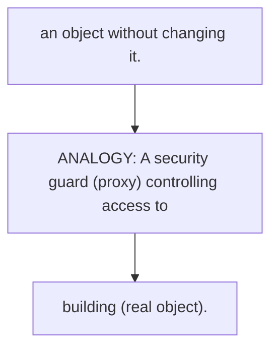
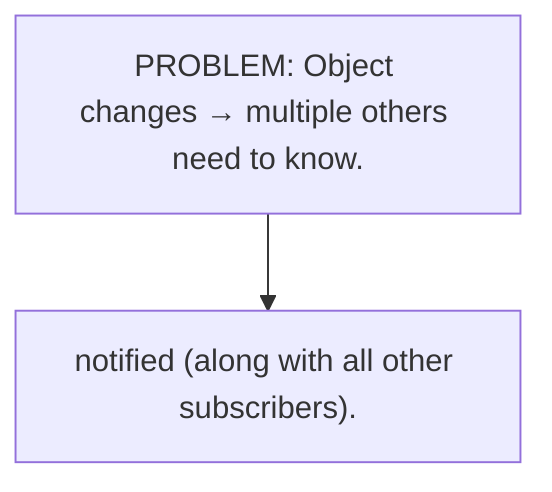
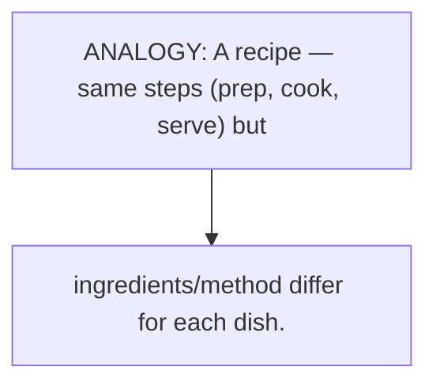
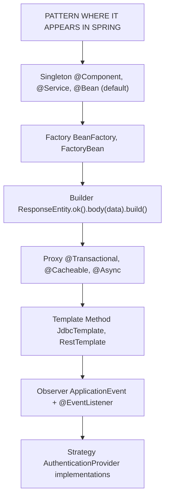
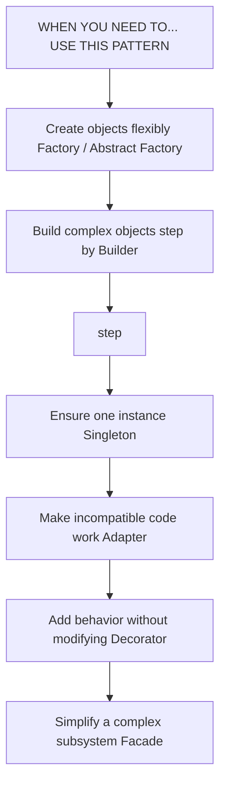
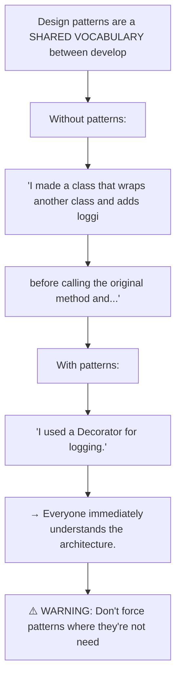

> **Navigation**: [< Previous](07_LLD_Solved_Problems.md) | [Back to Index](../00_MASTER_INDEX.md)

# Design Patterns in Java — Gang of Four & Beyond

## Why Learn Design Patterns?


> Design patterns are PROVEN SOLUTIONS to RECURRING PROBLEMS.
>
> Without patterns:  "I'll figure out a way to do this..."
> With patterns:     "This is a Strategy problem — I know exactly
> how to structure this."
>
> Interview Reality: "Can you give me an example of [Pattern]?"
> → Expected for mid-level and above


---


> 🔬 **Section Challenge — Why Learn Design Patterns?**
>
> **Challenge 1 (Design):** Factory Method vs Abstract Factory — give a concrete example showing when each is appropriate.
> <details><summary>Answer</summary>
>
> Factory Method: `DocumentParser.createParser(fileType)` returns a `PdfParser` or `DocxParser`. One product family, one creator. Abstract Factory: `UIFactory` with `createButton()` + `createTextField()` + `createDialog()`. A `WindowsUIFactory` and `MacUIFactory` each create a FAMILY of related components. Use Abstract Factory when multiple interdependent products must be created together from the same family.
> </details>
>
> **Challenge 2 (Reasoning):** Singleton is often called an anti-pattern. Why?
> <details><summary>Answer</summary>
>
> 1) Hidden global state — any code can access/modify the singleton, making dependencies implicit and testing hard. 2) Tight coupling — hard to swap implementation (no interface). 3) Concurrency: lazy init needs double-checked locking. 4) Violates SRP often. Better: use dependency injection — pass the single instance as a constructor argument. The DI container manages lifecycle. You get the same 'one instance' behavior with testability and explicit dependencies.
> </details>
>

## Pattern Categories Overview


> CREATIONAL (5)         STRUCTURAL (7)        BEHAVIORAL (11)
> How objects are        How objects are        How objects
> CREATED                COMPOSED              COMMUNICATE
> ─────────────         ─────────────         ─────────────
> Singleton ★           Adapter ★             Strategy ★
> Factory Method ★      Decorator ★           Observer ★
> Abstract Factory      Facade ★              Template Method ★
> Builder ★             Proxy ★               Iterator
> Prototype             Composite             Command
> Bridge                Chain of Resp ★
> Flyweight             State
> Mediator
> Memento
> Visitor
> Interpreter
>
> ★ = Most commonly asked in interviews / used in practice


---


> 🔬 **Section Challenge — Pattern Categories Overview**
>
> **Challenge 1 (Design):** Factory Method vs Abstract Factory — give a concrete example showing when each is appropriate.
> <details><summary>Answer</summary>
>
> Factory Method: `DocumentParser.createParser(fileType)` returns a `PdfParser` or `DocxParser`. One product family, one creator. Abstract Factory: `UIFactory` with `createButton()` + `createTextField()` + `createDialog()`. A `WindowsUIFactory` and `MacUIFactory` each create a FAMILY of related components. Use Abstract Factory when multiple interdependent products must be created together from the same family.
> </details>
>
> **Challenge 2 (Reasoning):** Singleton is often called an anti-pattern. Why?
> <details><summary>Answer</summary>
>
> 1) Hidden global state — any code can access/modify the singleton, making dependencies implicit and testing hard. 2) Tight coupling — hard to swap implementation (no interface). 3) Concurrency: lazy init needs double-checked locking. 4) Violates SRP often. Better: use dependency injection — pass the single instance as a constructor argument. The DI container manages lifecycle. You get the same 'one instance' behavior with testability and explicit dependencies.
> </details>
>

## Creational Patterns

### 1. Singleton — One Instance Only


> PROBLEM: Need exactly ONE instance of a class globally.
> ANALOGY: There's only ONE President of a country at a time.
> USE: Database connection pool, Logger, Configuration, Cache


```java
// Thread-safe Singleton using enum (Joshua Bloch's recommended approach)
public enum DatabasePool {
    INSTANCE;
    
    private final HikariDataSource dataSource;
    
    DatabasePool() {
        HikariConfig config = new HikariConfig();
        config.setJdbcUrl("jdbc:postgresql://localhost/mydb");
        config.setMaximumPoolSize(10);
        this.dataSource = new HikariDataSource(config);
    }
    
    public Connection getConnection() throws SQLException {
        return dataSource.getConnection();
    }
}

// Usage
Connection conn = DatabasePool.INSTANCE.getConnection();
```

```java
// Double-checked locking (classic approach)
public class Logger {
    private static volatile Logger instance;
    
    private Logger() { } // private constructor!
    
    public static Logger getInstance() {
        if (instance == null) {                    // First check (no lock)
            synchronized (Logger.class) {
                if (instance == null) {            // Second check (with lock)
                    instance = new Logger();
                }
            }
        }
        return instance;
    }
}
```

```
⚠️ WARNING: Singleton is often OVERUSED. 
   Consider Dependency Injection instead (@Autowired in Spring).
   Spring beans are singletons by default within the container.
```

### 2. Factory Method — Let Subclasses Decide

```
╔══════════════════════════════════════════════════════════════════════╗
║  PROBLEM: Need to create objects without specifying exact class.     ║
║  ANALOGY: You order "a pizza" — the kitchen decides which type.      ║
║  USE: When a class can't anticipate which objects to create.         ║
╚══════════════════════════════════════════════════════════════════════╝
```

```java
// --- Product interface ---
public interface Notification {
    void send(String message);
}

// --- Concrete products ---
public class EmailNotification implements Notification {
    @Override
    public void send(String message) {
        System.out.println("Email: " + message);
    }
}

public class SMSNotification implements Notification {
    @Override
    public void send(String message) {
        System.out.println("SMS: " + message);
    }
}

public class PushNotification implements Notification {
    @Override
    public void send(String message) {
        System.out.println("Push: " + message);
    }
}

// --- Factory ---
public class NotificationFactory {
    public static Notification create(String channel) {
        return switch (channel.toLowerCase()) {
            case "email" -> new EmailNotification();
            case "sms"   -> new SMSNotification();
            case "push"  -> new PushNotification();
            default -> throw new IllegalArgumentException(
                "Unknown channel: " + channel);
        };
    }
}

// Usage — client doesn't know concrete classes
Notification n = NotificationFactory.create("email");
n.send("Your order has shipped!");
```

### 3. Builder — Complex Object Construction

```
╔══════════════════════════════════════════════════════════════════════╗
║  PROBLEM: Constructor with too many parameters (telescoping).        ║
║  ANALOGY: Ordering a customized burger — pick each component.        ║
║  USE: Objects with many optional fields (HttpRequest, User, etc.)    ║
╚══════════════════════════════════════════════════════════════════════╝
```

```java
public class User {
    private final String firstName;     // required
    private final String lastName;      // required
    private final String email;         // required
    private final String phone;         // optional
    private final String address;       // optional
    private final int age;              // optional
    
    private User(Builder builder) {
        this.firstName = builder.firstName;
        this.lastName = builder.lastName;
        this.email = builder.email;
        this.phone = builder.phone;
        this.address = builder.address;
        this.age = builder.age;
    }
    
    public static class Builder {
        // Required
        private final String firstName;
        private final String lastName;
        private final String email;
        // Optional — defaults
        private String phone = "";
        private String address = "";
        private int age = 0;
        
        public Builder(String firstName, String lastName, String email) {
            this.firstName = firstName;
            this.lastName = lastName;
            this.email = email;
        }
        
        public Builder phone(String phone) {
            this.phone = phone;
            return this;  // enables chaining
        }
        
        public Builder address(String address) {
            this.address = address;
            return this;
        }
        
        public Builder age(int age) {
            this.age = age;
            return this;
        }
        
        public User build() {
            // Validate here if needed
            return new User(this);
        }
    }
}

// Usage — clean, readable, flexible
User user = new User.Builder("Sai", "Harsha", "sai@example.com")
    .phone("1234567890")
    .age(25)
    .build();

// TIP: Use @Builder from Lombok to generate this automatically
// @Builder
// public class User { ... }
```

---


> 🔬 **Section Challenge — Creational Patterns**
>
> **Challenge 1 (Design):** Factory Method vs Abstract Factory — give a concrete example showing when each is appropriate.
> <details><summary>Answer</summary>
>
> Factory Method: `DocumentParser.createParser(fileType)` returns a `PdfParser` or `DocxParser`. One product family, one creator. Abstract Factory: `UIFactory` with `createButton()` + `createTextField()` + `createDialog()`. A `WindowsUIFactory` and `MacUIFactory` each create a FAMILY of related components. Use Abstract Factory when multiple interdependent products must be created together from the same family.
> </details>
>
> **Challenge 2 (Reasoning):** Singleton is often called an anti-pattern. Why?
> <details><summary>Answer</summary>
>
> 1) Hidden global state — any code can access/modify the singleton, making dependencies implicit and testing hard. 2) Tight coupling — hard to swap implementation (no interface). 3) Concurrency: lazy init needs double-checked locking. 4) Violates SRP often. Better: use dependency injection — pass the single instance as a constructor argument. The DI container manages lifecycle. You get the same 'one instance' behavior with testability and explicit dependencies.
> </details>
>

## Structural Patterns

### 4. Adapter — Make Incompatible Interfaces Work Together

```
╔══════════════════════════════════════════════════════════════════════╗
║  PROBLEM: You have an existing interface but need a different one.   ║
║  ANALOGY: A power adapter that converts US plug → EU socket.         ║
║  USE: Integrating third-party libraries, legacy system wrappers.     ║
╚══════════════════════════════════════════════════════════════════════╝
```

```java
// --- Target interface (what our code expects) ---
public interface PaymentProcessor {
    boolean charge(String customerId, double amount);
}

// --- Adaptee (third-party library with incompatible interface) ---
public class StripeAPI {
    public StripeCharge createCharge(StripeChargeRequest request) {
        // third-party Stripe SDK method
        return new StripeCharge(/* ... */);
    }
}

// --- Adapter ---
public class StripeAdapter implements PaymentProcessor {
    private final StripeAPI stripeAPI;
    
    public StripeAdapter(StripeAPI stripeAPI) {
        this.stripeAPI = stripeAPI;
    }
    
    @Override
    public boolean charge(String customerId, double amount) {
        StripeChargeRequest request = new StripeChargeRequest();
        request.setCustomer(customerId);
        request.setAmount((long)(amount * 100)); // Stripe uses cents
        request.setCurrency("usd");
        
        StripeCharge charge = stripeAPI.createCharge(request);
        return charge.isPaid();
    }
}

// Usage — our code only knows PaymentProcessor
PaymentProcessor processor = new StripeAdapter(new StripeAPI());
processor.charge("cust_123", 49.99);

// Tomorrow: switch to PayPal? Write PayPalAdapter implements PaymentProcessor
```

### 5. Decorator — Add Behavior Dynamically

```
╔══════════════════════════════════════════════════════════════════════╗
║  PROBLEM: Need to add features to objects without modifying them.    ║
║  ANALOGY: A coffee with milk, sugar, whipped cream — each is a       ║
║           decorator wrapping the base coffee.                        ║
║  USE: Java I/O streams, logging, caching, validation layers.         ║
╚══════════════════════════════════════════════════════════════════════╝
```

**Flow:**
- decorator wrapping the base coffee.
- ↓
- USE: Java I/O streams, logging, caching, validation lay



```java
// --- Component interface ---
public interface DataSource {
    String read();
    void write(String data);
}

// --- Base component ---
public class FileDataSource implements DataSource {
    private final String filename;
    
    public FileDataSource(String filename) { this.filename = filename; }
    
    @Override
    public String read() { return readFromFile(filename); }
    
    @Override
    public void write(String data) { writeToFile(filename, data); }
}

// --- Decorator base ---
public abstract class DataSourceDecorator implements DataSource {
    protected DataSource wrappee;
    
    public DataSourceDecorator(DataSource source) { this.wrappee = source; }
    
    @Override
    public String read() { return wrappee.read(); }
    
    @Override
    public void write(String data) { wrappee.write(data); }
}

// --- Concrete decorators ---
public class EncryptionDecorator extends DataSourceDecorator {
    public EncryptionDecorator(DataSource source) { super(source); }
    
    @Override
    public void write(String data) {
        super.write(encrypt(data));       // encrypt before writing
    }
    
    @Override
    public String read() {
        return decrypt(super.read());     // decrypt after reading
    }
}

public class CompressionDecorator extends DataSourceDecorator {
    public CompressionDecorator(DataSource source) { super(source); }
    
    @Override
    public void write(String data) {
        super.write(compress(data));
    }
    
    @Override
    public String read() {
        return decompress(super.read());
    }
}

// Usage — stack decorators like layers
DataSource source = new FileDataSource("data.txt");
source = new EncryptionDecorator(source);           // add encryption
source = new CompressionDecorator(source);          // add compression

source.write("sensitive data");  // compressed → encrypted → file

// Java I/O is the classic decorator example:
// new BufferedReader(new InputStreamReader(new FileInputStream("file.txt")));
```

### 6. Facade — Simplify Complex Subsystems

```
╔══════════════════════════════════════════════════════════════════════╗
║  PROBLEM: Complex subsystem with many classes — need simple API.     ║
║  ANALOGY: A hotel concierge — one person handles restaurant,         ║
║           taxi, and room service instead of you calling each.        ║
║  USE: Wrapping complex libraries, simplifying microservice calls.    ║
╚══════════════════════════════════════════════════════════════════════╝
```

**Flow:**
- ANALOGY: A hotel concierge — one person handles restaur
- ↓
- taxi, and room service instead of you calling each.



```java
// Complex subsystems
class InventoryService { boolean checkStock(String productId) { /*...*/ } }
class PaymentService   { boolean processPayment(Order order)    { /*...*/ } }
class ShippingService  { String createShipment(Order order)     { /*...*/ } }
class NotifyService    { void sendConfirmation(String email)    { /*...*/ } }

// Facade — one simple method for the client
public class OrderFacade {
    private final InventoryService inventory;
    private final PaymentService payment;
    private final ShippingService shipping;
    private final NotifyService notify;
    
    // Constructor with DI...
    
    public OrderResult placeOrder(Order order) {
        // Step 1: Check stock
        if (!inventory.checkStock(order.getProductId())) {
            return OrderResult.outOfStock();
        }
        
        // Step 2: Process payment
        if (!payment.processPayment(order)) {
            return OrderResult.paymentFailed();
        }
        
        // Step 3: Create shipment
        String trackingId = shipping.createShipment(order);
        
        // Step 4: Notify customer
        notify.sendConfirmation(order.getEmail());
        
        return OrderResult.success(trackingId);
    }
}

// Client code is SIMPLE
OrderResult result = orderFacade.placeOrder(order);
```

### 7. Proxy — Control Access to an Object

```
╔══════════════════════════════════════════════════════════════════════╗
║  PROBLEM: Need to add control (caching, access, logging) around      ║
║           an object without changing it.                             ║
║  ANALOGY: A security guard (proxy) controlling access to a           ║
║           building (real object).                                    ║
║  USE: Caching proxy, lazy initialization, access control, logging    ║
╚══════════════════════════════════════════════════════════════════════╝
```

**Flow:**
- an object without changing it.
- ↓
- ANALOGY: A security guard (proxy) controlling access to
- ↓
- building (real object).



```java
public interface UserRepository {
    User findById(Long id);
}

// Real implementation
public class UserRepositoryImpl implements UserRepository {
    @Override
    public User findById(Long id) {
        // expensive database call
        return queryDatabase(id);
    }
}

// Caching Proxy
public class CachingUserRepository implements UserRepository {
    private final UserRepository realRepo;
    private final Map<Long, User> cache = new ConcurrentHashMap<>();
    
    public CachingUserRepository(UserRepository realRepo) {
        this.realRepo = realRepo;
    }
    
    @Override
    public User findById(Long id) {
        return cache.computeIfAbsent(id, realRepo::findById);
    }
}

// Usage — caller doesn't know about caching
UserRepository repo = new CachingUserRepository(new UserRepositoryImpl());
User user = repo.findById(1L);  // DB call
User same = repo.findById(1L);  // cache hit!

// Spring uses proxies everywhere: @Transactional, @Cacheable, @Async
```

---


> 🔬 **Section Challenge — Structural Patterns**
>
> **Challenge 1 (Design):** Factory Method vs Abstract Factory — give a concrete example showing when each is appropriate.
> <details><summary>Answer</summary>
>
> Factory Method: `DocumentParser.createParser(fileType)` returns a `PdfParser` or `DocxParser`. One product family, one creator. Abstract Factory: `UIFactory` with `createButton()` + `createTextField()` + `createDialog()`. A `WindowsUIFactory` and `MacUIFactory` each create a FAMILY of related components. Use Abstract Factory when multiple interdependent products must be created together from the same family.
> </details>
>
> **Challenge 2 (Reasoning):** Singleton is often called an anti-pattern. Why?
> <details><summary>Answer</summary>
>
> 1) Hidden global state — any code can access/modify the singleton, making dependencies implicit and testing hard. 2) Tight coupling — hard to swap implementation (no interface). 3) Concurrency: lazy init needs double-checked locking. 4) Violates SRP often. Better: use dependency injection — pass the single instance as a constructor argument. The DI container manages lifecycle. You get the same 'one instance' behavior with testability and explicit dependencies.
> </details>
>

## Behavioral Patterns

### 8. Strategy — Swap Algorithms at Runtime

```
╔══════════════════════════════════════════════════════════════════════╗
║  PROBLEM: Multiple ways to do something — want to swap easily.       ║
║  ANALOGY: Different routes to work — GPS selects based on traffic.   ║
║  USE: Sorting, validation, pricing, authentication strategies.       ║
╚══════════════════════════════════════════════════════════════════════╝
```

```java
// Strategy interface
@FunctionalInterface
public interface DiscountStrategy {
    double calculateDiscount(double price);
}

// Concrete strategies
public class NoDiscount implements DiscountStrategy {
    public double calculateDiscount(double price) { return price; }
}

public class PercentageDiscount implements DiscountStrategy {
    private final double percent;
    public PercentageDiscount(double percent) { this.percent = percent; }
    public double calculateDiscount(double price) {
        return price * (1 - percent / 100);
    }
}

public class FlatDiscount implements DiscountStrategy {
    private final double amount;
    public FlatDiscount(double amount) { this.amount = amount; }
    public double calculateDiscount(double price) {
        return Math.max(0, price - amount);
    }
}

// Context
public class ShoppingCart {
    private DiscountStrategy discountStrategy;
    
    public void setDiscountStrategy(DiscountStrategy strategy) {
        this.discountStrategy = strategy;
    }
    
    public double checkout(double total) {
        return discountStrategy.calculateDiscount(total);
    }
}

// Usage
ShoppingCart cart = new ShoppingCart();
cart.setDiscountStrategy(new PercentageDiscount(20));
double price = cart.checkout(100.0);  // 80.0

// With lambdas (since it's a functional interface):
cart.setDiscountStrategy(price -> price * 0.9); // 10% off inline
```

### 9. Observer — Notify When State Changes

```
╔══════════════════════════════════════════════════════════════════════╗
║  PROBLEM: Object changes → multiple others need to know.             ║
║  ANALOGY: YouTube subscription — when channel uploads, you get       ║
║           notified (along with all other subscribers).               ║
║  USE: Event systems, UI updates, pub/sub, reactive programming.      ║
╚══════════════════════════════════════════════════════════════════════╝
```

**Flow:**
- PROBLEM: Object changes
- ↓
- multiple others need to know.
- ↓
- notified (along with all other subscribers).



```java
// Observer interface
public interface OrderEventListener {
    void onOrderPlaced(Order order);
}

// Concrete observers
public class InventoryManager implements OrderEventListener {
    @Override
    public void onOrderPlaced(Order order) {
        System.out.println("Reducing stock for: " + order.getProductId());
    }
}

public class EmailService implements OrderEventListener {
    @Override
    public void onOrderPlaced(Order order) {
        System.out.println("Sending confirmation to: " + order.getEmail());
    }
}

public class AnalyticsService implements OrderEventListener {
    @Override
    public void onOrderPlaced(Order order) {
        System.out.println("Tracking order event for analytics");
    }
}

// Subject (publisher)
public class OrderService {
    private final List<OrderEventListener> listeners = new ArrayList<>();
    
    public void subscribe(OrderEventListener listener) {
        listeners.add(listener);
    }
    
    public void placeOrder(Order order) {
        // ... business logic ...
        
        // Notify all observers
        listeners.forEach(l -> l.onOrderPlaced(order));
    }
}

// Usage
OrderService orderService = new OrderService();
orderService.subscribe(new InventoryManager());
orderService.subscribe(new EmailService());
orderService.subscribe(new AnalyticsService());

orderService.placeOrder(new Order(/*...*/));
// All 3 listeners are notified!

// In Spring: ApplicationEventPublisher + @EventListener do exactly this
```

### 10. Template Method — Define Algorithm Skeleton

```
╔══════════════════════════════════════════════════════════════════════╗
║  PROBLEM: Same algorithm steps, different implementation details.    ║
║  ANALOGY: A recipe — same steps (prep, cook, serve) but              ║
║           ingredients/method differ for each dish.                   ║
║  USE: Frameworks (Spring's JdbcTemplate), data processing pipes      ║
╚══════════════════════════════════════════════════════════════════════╝
```

**Flow:**
- ANALOGY: A recipe — same steps (prep, cook, serve) but
- ↓
- ingredients/method differ for each dish.



```java
// Template
public abstract class DataImporter {
    
    // Template method — defines the algorithm skeleton
    public final void importData() {
        String raw = readData();          // Step 1
        List<Record> parsed = parse(raw); // Step 2
        List<Record> valid = validate(parsed); // Step 3
        save(valid);                      // Step 4
        notifyComplete(valid.size());     // Step 5
    }
    
    protected abstract String readData();              // subclass implements
    protected abstract List<Record> parse(String raw); // subclass implements
    
    // Common implementation (can be overridden)
    protected List<Record> validate(List<Record> records) {
        return records.stream()
                .filter(Record::isValid)
                .collect(Collectors.toList());
    }
    
    protected void save(List<Record> records) {
        repository.saveAll(records);
    }
    
    protected void notifyComplete(int count) {
        log.info("Imported {} records", count);
    }
}

// Concrete implementations
public class CSVImporter extends DataImporter {
    @Override
    protected String readData() { return readFile("data.csv"); }
    
    @Override
    protected List<Record> parse(String raw) {
        return Arrays.stream(raw.split("\n"))
                .map(line -> Record.fromCSV(line))
                .collect(Collectors.toList());
    }
}

public class JSONImporter extends DataImporter {
    @Override
    protected String readData() { return callAPI("/api/data"); }
    
    @Override
    protected List<Record> parse(String raw) {
        return objectMapper.readValue(raw, new TypeReference<>() {});
    }
}

// Usage
DataImporter importer = new CSVImporter();
importer.importData(); // runs the whole pipeline
```

### 11. Chain of Responsibility — Pass Request Along a Chain

```
╔══════════════════════════════════════════════════════════════════════╗
║  PROBLEM: Multiple handlers, unknown which one handles request.      ║
║  ANALOGY: Customer support escalation — Level 1 → 2 → Manager.       ║
║  USE: Middleware, validation chains, logging, servlet filters.       ║
╚══════════════════════════════════════════════════════════════════════╝
```

```java
public abstract class AuthHandler {
    private AuthHandler next;
    
    public AuthHandler setNext(AuthHandler handler) {
        this.next = handler;
        return handler; // for chaining
    }
    
    public boolean handle(HttpRequest request) {
        if (next != null) {
            return next.handle(request);
        }
        return true; // end of chain = approved
    }
}

public class RateLimitHandler extends AuthHandler {
    @Override
    public boolean handle(HttpRequest request) {
        if (isRateLimited(request.getIp())) {
            throw new TooManyRequestsException();
        }
        return super.handle(request); // pass to next
    }
}

public class AuthenticationHandler extends AuthHandler {
    @Override
    public boolean handle(HttpRequest request) {
        if (!isValidToken(request.getToken())) {
            throw new UnauthorizedException();
        }
        return super.handle(request);
    }
}

public class AuthorizationHandler extends AuthHandler {
    @Override
    public boolean handle(HttpRequest request) {
        if (!hasPermission(request.getUser(), request.getResource())) {
            throw new ForbiddenException();
        }
        return super.handle(request);
    }
}

// Build the chain
AuthHandler chain = new RateLimitHandler();
chain.setNext(new AuthenticationHandler())
     .setNext(new AuthorizationHandler());

// Process request — goes through rate limit → auth → authz
chain.handle(request);

// Spring Security filter chain works exactly like this!
```

---


> 🔬 **Section Challenge — Behavioral Patterns**
>
> **Challenge 1 (Design):** Factory Method vs Abstract Factory — give a concrete example showing when each is appropriate.
> <details><summary>Answer</summary>
>
> Factory Method: `DocumentParser.createParser(fileType)` returns a `PdfParser` or `DocxParser`. One product family, one creator. Abstract Factory: `UIFactory` with `createButton()` + `createTextField()` + `createDialog()`. A `WindowsUIFactory` and `MacUIFactory` each create a FAMILY of related components. Use Abstract Factory when multiple interdependent products must be created together from the same family.
> </details>
>
> **Challenge 2 (Reasoning):** Singleton is often called an anti-pattern. Why?
> <details><summary>Answer</summary>
>
> 1) Hidden global state — any code can access/modify the singleton, making dependencies implicit and testing hard. 2) Tight coupling — hard to swap implementation (no interface). 3) Concurrency: lazy init needs double-checked locking. 4) Violates SRP often. Better: use dependency injection — pass the single instance as a constructor argument. The DI container manages lifecycle. You get the same 'one instance' behavior with testability and explicit dependencies.
> </details>
>

## Patterns in Spring Boot — Where You Already Use Them

```
╔══════════════════════════════════════════════════════════════════════╗
║  PATTERN               │  WHERE IT APPEARS IN SPRING                 ║
╠════════════════════════╪═════════════════════════════════════════════╣
║  Singleton             │  @Component, @Service, @Bean (default)      ║
║  Factory               │  BeanFactory, FactoryBean                   ║
║  Builder               │  ResponseEntity.ok().body(data).build()     ║
║  Proxy                 │  @Transactional, @Cacheable, @Async         ║
║  Template Method       │  JdbcTemplate, RestTemplate                 ║
║  Observer              │  ApplicationEvent + @EventListener          ║
║  Strategy              │  AuthenticationProvider implementations     ║
║  Decorator             │  HttpServletRequestWrapper                  ║
║  Adapter               │  HandlerAdapter in MVC                      ║
║  Chain of Resp         │  Security Filter Chain                      ║
║  Facade                │  Spring Data JPA Repository                 ║
║  Composite             │  CompositeCacheManager                      ║
╚══════════════════════════════════════════════════════════════════════╝
```

**Flow:**
- PATTERN WHERE IT APPEARS IN SPRING
- ↓
- Singleton @Component, @Service, @Bean (default)
- ↓
- Factory BeanFactory, FactoryBean
- ↓
- Builder ResponseEntity.ok().body(data).build()
- ↓
- Proxy @Transactional, @Cacheable, @Async
- ↓
- Template Method JdbcTemplate, RestTemplate
- ↓
- Observer ApplicationEvent + @EventListener



---


## Pattern Selection Guide

```
╔══════════════════════════════════════════════════════════════════════╗
║  WHEN YOU NEED TO...              │  USE THIS PATTERN                ║
╠═══════════════════════════════════╪══════════════════════════════════╣
║  Create objects flexibly          │  Factory / Abstract Factory      ║
║  Build complex objects step by    │  Builder                         ║
║  step                             │                                  ║
║  Ensure one instance              │  Singleton                       ║
║  Make incompatible code work      │  Adapter                         ║
║  Add behavior without modifying   │  Decorator                       ║
║  Simplify a complex subsystem     │  Facade                          ║
║  Control access or add caching    │  Proxy                           ║
║  Swap algorithms at runtime       │  Strategy                        ║
║  Notify subscribers of changes    │  Observer                        ║
║  Define algorithm skeleton        │  Template Method                 ║
║  Process through multiple steps   │  Chain of Responsibility         ║
║  Represent tree structures        │  Composite                       ║
╚══════════════════════════════════════════════════════════════════════╝
```

**Flow:**
- WHEN YOU NEED TO... USE THIS PATTERN
- ↓
- Create objects flexibly Factory / Abstract Factory
- ↓
- Build complex objects step by Builder
- ↓
- step
- ↓
- Ensure one instance Singleton
- ↓
- Make incompatible code work Adapter
- ↓
- Add behavior without modifying Decorator



---


> 🔬 **Section Challenge — Pattern Selection Guide**
>
> **Challenge 1 (Design):** Factory Method vs Abstract Factory — give a concrete example showing when each is appropriate.
> <details><summary>Answer</summary>
>
> Factory Method: `DocumentParser.createParser(fileType)` returns a `PdfParser` or `DocxParser`. One product family, one creator. Abstract Factory: `UIFactory` with `createButton()` + `createTextField()` + `createDialog()`. A `WindowsUIFactory` and `MacUIFactory` each create a FAMILY of related components. Use Abstract Factory when multiple interdependent products must be created together from the same family.
> </details>
>
> **Challenge 2 (Reasoning):** Singleton is often called an anti-pattern. Why?
> <details><summary>Answer</summary>
>
> 1) Hidden global state — any code can access/modify the singleton, making dependencies implicit and testing hard. 2) Tight coupling — hard to swap implementation (no interface). 3) Concurrency: lazy init needs double-checked locking. 4) Violates SRP often. Better: use dependency injection — pass the single instance as a constructor argument. The DI container manages lifecycle. You get the same 'one instance' behavior with testability and explicit dependencies.
> </details>
>

## Interview Quick-Fire

```
Q: What's the difference between Strategy and Template Method?
A: Strategy: composition (HAS-A) — inject different algorithms
   Template: inheritance (IS-A) — override specific steps

Q: When would you use Factory over new?
A: When the creation logic is complex, when you want to decouple
   the client from concrete classes, or when the type is determined
   at runtime.

Q: Decorator vs Proxy — what's the difference?
A: Decorator: adds NEW behavior (stacking features)
   Proxy: controls ACCESS to existing behavior (caching, security)
   Structurally similar, different intent.

Q: Name 3 patterns you've used in real projects.
A: Builder (API response objects), Strategy (payment processing
   with multiple gateways), Observer (event-driven order processing
   with Spring @EventListener)

Q: What's wrong with Singleton?
A: Global state, hard to test (use DI instead), hides dependencies,
   violates SRP if it manages its own creation + business logic.
```

---

## Mental Model: Patterns as Communication

```
╔══════════════════════════════════════════════════════════════════════╗
║  Design patterns are a SHARED VOCABULARY between developers.         ║
║                                                                      ║
║  Without patterns:                                                   ║
║  "I made a class that wraps another class and adds logging           ║
║   before calling the original method and..."                         ║
║                                                                      ║
║  With patterns:                                                      ║
║  "I used a Decorator for logging."                                   ║
║  → Everyone immediately understands the architecture.                ║
║                                                                      ║
║  ⚠️ WARNING: Don't force patterns where they're not needed.          ║
║  The cure shouldn't be worse than the disease.                       ║
║  Simple problems deserve simple solutions.                           ║
╚══════════════════════════════════════════════════════════════════════╝
```

**Flow:**
- Design patterns are a SHARED VOCABULARY between develop
- ↓
- Without patterns:
- ↓
- 'I made a class that wraps another class and adds loggi
- ↓
- before calling the original method and...'
- ↓
- With patterns:
- ↓
- 'I used a Decorator for logging.'
- ↓
- Everyone immediately understands the architecture.



---

*Learn 5 patterns deeply (Strategy, Factory, Builder, Observer, Decorator). The rest you can recognize and reference.*


---


---


> 🔬 **Section Challenge — Mental Model: Patterns as Communication**
>
> **Challenge 1 (Design):** Factory Method vs Abstract Factory — give a concrete example showing when each is appropriate.
> <details><summary>Answer</summary>
>
> Factory Method: `DocumentParser.createParser(fileType)` returns a `PdfParser` or `DocxParser`. One product family, one creator. Abstract Factory: `UIFactory` with `createButton()` + `createTextField()` + `createDialog()`. A `WindowsUIFactory` and `MacUIFactory` each create a FAMILY of related components. Use Abstract Factory when multiple interdependent products must be created together from the same family.
> </details>
>
> **Challenge 2 (Reasoning):** Singleton is often called an anti-pattern. Why?
> <details><summary>Answer</summary>
>
> 1) Hidden global state — any code can access/modify the singleton, making dependencies implicit and testing hard. 2) Tight coupling — hard to swap implementation (no interface). 3) Concurrency: lazy init needs double-checked locking. 4) Violates SRP often. Better: use dependency injection — pass the single instance as a constructor argument. The DI container manages lifecycle. You get the same 'one instance' behavior with testability and explicit dependencies.
> </details>
>

## 🏋️ Practice & Interview Questions — OOP & Design Patterns

### Predict / Trace
**Q1.** What design pattern does this code follow?
```java
Logger logger = Logger.getInstance();
```
<details><summary>Answer</summary>

**Singleton** — ensures only one Logger instance exists globally.
</details>

**Q2.** What SOLID principle is violated?
```java
class User {
    void login() { ... }
    void logout() { ... }
    void sendEmail() { ... }  // ← ?
    void generateReport() { ... }  // ← ?
}
```
<details><summary>Answer</summary>

**SRP (Single Responsibility)** — User class has 4 responsibilities: authentication, email, reporting. Should be split into: `AuthService`, `EmailService`, `ReportService`.
</details>

### Design Pattern Problems
**Q3.** ⭐ Implement Strategy pattern for payment processing.
<details><summary>Solution</summary>

```java
interface PaymentStrategy { void pay(int amount); }
class CreditCard implements PaymentStrategy { public void pay(int amount){ /*...*/ } }
class PayPal implements PaymentStrategy { public void pay(int amount){ /*...*/ } }
class UPI implements PaymentStrategy { public void pay(int amount){ /*...*/ } }

class PaymentContext {
    private PaymentStrategy strategy;
    void setStrategy(PaymentStrategy s){ this.strategy=s; }
    void processPayment(int amount){ strategy.pay(amount); }
}
// Switch strategy at runtime — open/closed principle!
```
</details>

**Q4.** ⭐⭐ Implement Observer pattern for event notification.
<details><summary>Solution</summary>

```java
interface Observer { void update(String event); }
interface Observable {
    void subscribe(Observer o); void unsubscribe(Observer o); void notify(String event);
}
class EventBus implements Observable {
    List<Observer> observers = new ArrayList<>();
    public void subscribe(Observer o){ observers.add(o); }
    public void unsubscribe(Observer o){ observers.remove(o); }
    public void notify(String event){ observers.forEach(o -> o.update(event)); }
}
```
</details>

**Q5.** ⭐⭐ Builder pattern for a complex configuration object.
<details><summary>Solution</summary>

```java
class ServerConfig {
    private final String host; private final int port; private final int timeout;
    private ServerConfig(Builder b){ host=b.host; port=b.port; timeout=b.timeout; }

    static class Builder {
        String host="localhost"; int port=8080; int timeout=30;
        Builder host(String h){ host=h; return this; }
        Builder port(int p){ port=p; return this; }
        Builder timeout(int t){ timeout=t; return this; }
        ServerConfig build(){ return new ServerConfig(this); }
    }
}
// ServerConfig config = new ServerConfig.Builder().host("prod.com").port(443).build();
```
</details>

### MCQ Rapid Fire
| # | Question | Answer |
|---|---|---|
| 1 | SOLID: O stands for | Open/Closed Principle |
| 2 | Factory vs Abstract Factory | Factory: one product; Abstract Factory: family of products |
| 3 | Composition over inheritance means | Prefer has-a (field) over is-a (extends) for flexibility |
| 4 | Decorator pattern purpose | Add behavior dynamically without subclassing |
| 5 | Facade pattern purpose | Simplified interface to complex subsystem |
| 6 | Proxy pattern types | Virtual, protective, remote, caching |
| 7 | Command pattern encapsulates | Request as an object (supports undo/redo) |
| 8 | Template Method pattern | Defines algorithm skeleton, subclasses fill in steps |


---

## 🧠 Deep Conceptual Questions — OOP, SOLID & Design Patterns

**C1. What is the difference between an interface and an abstract class — when to use each?**
<details><summary>Deep Answer</summary>

**Abstract class**: can have fields, constructors, concrete method implementations. Models IS-A with shared state and behavior. Use when: you have partial implementation to share (template method pattern). Single inheritance: if you extend an abstract class, you can't extend another. **Interface**: pure contract, no state (Java 8+: default methods allowed). Models CAN-DO / role capability. A class can implement unlimited interfaces. Use when: defining a capability across unrelated classes (`Comparable`, `Serializable`, `Runnable`). Rule: prefer interfaces for type definitions. Use abstract class when you need to share implementation code AND all subtypes share the same "IS-A" relationship. In practice: interfaces + composition > abstract class + inheritance.
</details>

**C2. Liskov Substitution Principle: what does it actually mean and how do you violate it?**
<details><summary>Deep Answer</summary>

LSP: if `S extends P`, anywhere you use `P`, you should be able to use `S` without breaking correctness. Violation example: `Square extends Rectangle`. Rectangle behavior: setWidth and setHeight are independent. Square invariant: width must equal height. `Square s = new Square(5); s.setWidth(10);` — now `s.getHeight() == 10` (Square enforced equality) but Rectangle contract says height should still be 5. Code using Rectangle is surprised. Better: Square and Rectangle as siblings under a Shape hierarchy. Another classic: override a method and throw exception for a case the parent method handled → violates LSP. Test: can you run the parent's test suite against the child and pass?
</details>

**C3. Strategy pattern vs. if-else chains: the OCP argument.**
<details><summary>Deep Answer</summary>

```java
// BAD: add new payment type = modify this method = Open for modification (violates OCP)
if(type == "credit") { } else if(type == "paypal") { } else if(type == "crypto") { }

// GOOD: add new payment = new class, zero modification of existing code
interface PaymentStrategy { void pay(int amount); }
// Add Crypto: new CryptoPayment implements PaymentStrategy — no other file touched
```
Open/Closed Principle: open for extension, closed for modification. Each `else if` = a modification to an existing method = risk of breaking existing behavior, requires re-testing the entire method. Strategy = extension by new class = old code untouched = zero regression risk. When if-else is fine: 2-3 fixed cases that never change. When strategy shines: extensible behaviors that vary at runtime.
</details>

**C4. What is the Dependency Inversion Principle and how does it enable testability?**
<details><summary>Deep Answer</summary>

DIP: high-level modules should not depend on low-level modules — both should depend on abstractions. Without DIP: `OrderService` directly creates `MySQLOrderRepository`. To test OrderService: must have MySQL running. With DIP: `OrderService` depends on `OrderRepository` interface. In production: inject `MySQLOrderRepository`. In tests: inject `MockOrderRepository`. The high-level business logic (OrderService) has zero knowledge of the database layer. This makes: unit testing trivial (mock the interface), swapping implementations easy (SQLite, PostgreSQL, in-memory), layer boundaries clear. Dependency INJECTION (DI framework like Spring) is the mechanism that enables DIP at runtime.
</details>

**C5. Observer pattern vs. Event Bus: when does one become the other?**
<details><summary>Deep Answer</summary>

**Observer**: subject holds direct references to observer objects. Subject explicitly notifies each one. Tightly coupled (subject knows about observers). Fine for: small systems, known observers at compile time. Breaks when: observers span different modules, dynamic subscription needed, observers need to be remote. **Event Bus / Message Queue**: publishers and subscribers decoupled. Publisher sends event with a TYPE to the bus. Subscribers register for event types — publisher doesn't know who's listening. De-facto standard in large systems: Spring ApplicationEventPublisher, Kafka, RabbitMQ are all event buses. Rule: Observer for in-process tightly-coupled notification. Event bus for loose coupling, cross-module, or distributed communication.
</details>


> **Navigation**: [< Previous](07_LLD_Solved_Problems.md) | [Back to Index](../00_MASTER_INDEX.md)