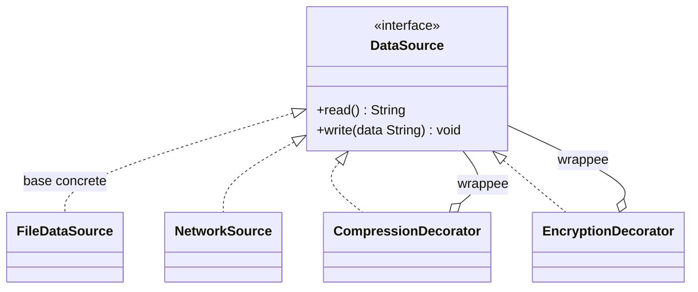
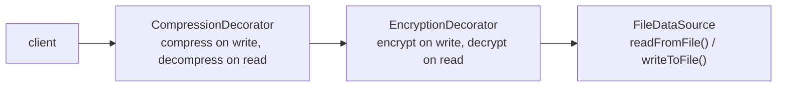
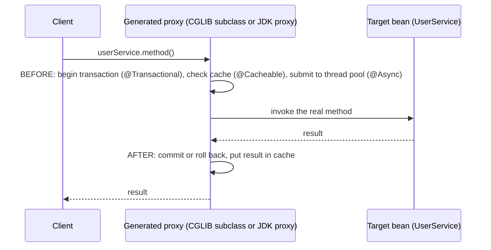
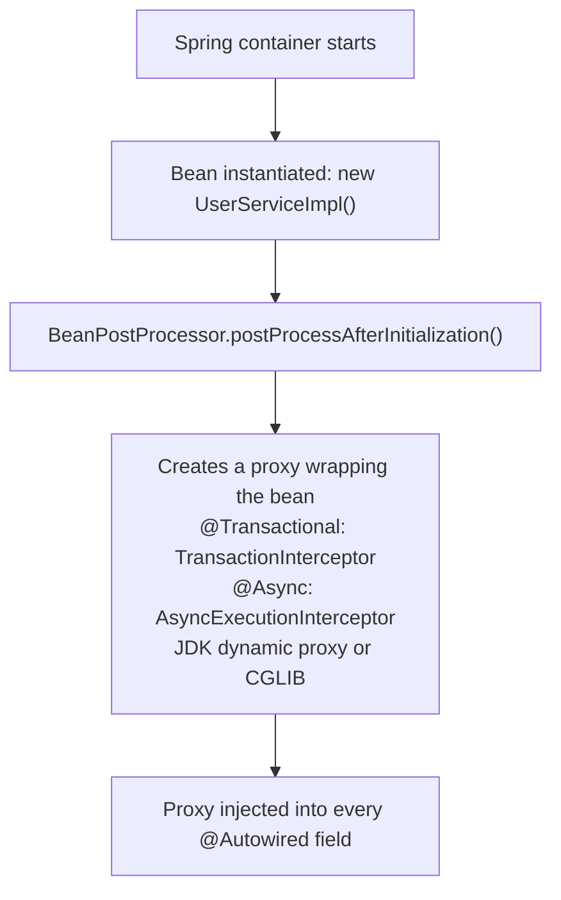

# Behavioral Patterns

> **Navigation**: [← Structural Patterns](02_structural_patterns.md) | [Chapter overview](../08_Design_Patterns_Java.md) | [Why-This-Not-That: Builder vs Constructor… →](04_why_this_not_that_builder_vs.md)
> Page 3 of 4 in **Design Patterns in Java — Gang of Four & Beyond**


## 8. Strategy — Swap Algorithms at Runtime

```text
PROBLEM: Multiple ways to do something — want to swap easily.
ANALOGY: Different routes to work — GPS selects based on traffic.
USE: Sorting, validation, pricing, authentication strategies.
```

```java
// Strategy interface
@FunctionalInterface
public interface DiscountStrategy {
    double calculateDiscount(double price);
}

// Concrete strategies
public class NoDiscount implements DiscountStrategy {
    public double calculateDiscount(double price) { return price; }
}

public class PercentageDiscount implements DiscountStrategy {
    private final double percent;
    public PercentageDiscount(double percent) { this.percent = percent; }
    public double calculateDiscount(double price) {
        return price * (1 - percent / 100);
    }
}

public class FlatDiscount implements DiscountStrategy {
    private final double amount;
    public FlatDiscount(double amount) { this.amount = amount; }
    public double calculateDiscount(double price) {
        return Math.max(0, price - amount);
    }
}

// Context
public class ShoppingCart {
    private DiscountStrategy discountStrategy;

    public void setDiscountStrategy(DiscountStrategy strategy) {
        this.discountStrategy = strategy;
    }

    public double checkout(double total) {
        return discountStrategy.calculateDiscount(total);
    }
}

// Usage
ShoppingCart cart = new ShoppingCart();
cart.setDiscountStrategy(new PercentageDiscount(20));
double price = cart.checkout(100.0);  // 80.0

// With lambdas (since it's a functional interface):
cart.setDiscountStrategy(price -> price * 0.9); // 10% off inline
```

## 9. Observer — Notify When State Changes

```text
PROBLEM: Object changes → multiple others need to know.
ANALOGY: YouTube subscription — when channel uploads, you get
         notified (along with all other subscribers).
USE: Event systems, UI updates, pub/sub, reactive programming.
```

```java
// Observer interface
public interface OrderEventListener {
    void onOrderPlaced(Order order);
}

// Concrete observers
public class InventoryManager implements OrderEventListener {
    @Override
    public void onOrderPlaced(Order order) {
        System.out.println("Reducing stock for: " + order.getProductId());
    }
}

public class EmailService implements OrderEventListener {
    @Override
    public void onOrderPlaced(Order order) {
        System.out.println("Sending confirmation to: " + order.getEmail());
    }
}

public class AnalyticsService implements OrderEventListener {
    @Override
    public void onOrderPlaced(Order order) {
        System.out.println("Tracking order event for analytics");
    }
}

// Subject (publisher)
public class OrderService {
    private final List<OrderEventListener> listeners = new ArrayList<>();

    public void subscribe(OrderEventListener listener) {
        listeners.add(listener);
    }

    public void placeOrder(Order order) {
        // ... business logic ...

        // Notify all observers
        listeners.forEach(l -> l.onOrderPlaced(order));
    }
}

// Usage
OrderService orderService = new OrderService();
orderService.subscribe(new InventoryManager());
orderService.subscribe(new EmailService());
orderService.subscribe(new AnalyticsService());

orderService.placeOrder(new Order(/*...*/));
// All 3 listeners are notified!

// In Spring: ApplicationEventPublisher + @EventListener do exactly this
```

## 10. Template Method — Define Algorithm Skeleton

```text
PROBLEM: Same algorithm steps, different implementation details.
ANALOGY: A recipe — same steps (prep, cook, serve) but
         ingredients/method differ for each dish.
USE: Frameworks (Spring's JdbcTemplate), data processing pipes
```

```java
// Template
public abstract class DataImporter {

    // Template method — defines the algorithm skeleton
    public final void importData() {
        String raw = readData();          // Step 1
        List<Record> parsed = parse(raw); // Step 2
        List<Record> valid = validate(parsed); // Step 3
        save(valid);                      // Step 4
        notifyComplete(valid.size());     // Step 5
    }

    protected abstract String readData();              // subclass implements
    protected abstract List<Record> parse(String raw); // subclass implements

    // Common implementation (can be overridden)
    protected List<Record> validate(List<Record> records) {
        return records.stream()
                .filter(Record::isValid)
                .collect(Collectors.toList());
    }

    protected void save(List<Record> records) {
        repository.saveAll(records);
    }

    protected void notifyComplete(int count) {
        log.info("Imported {} records", count);
    }
}

// Concrete implementations
public class CSVImporter extends DataImporter {
    @Override
    protected String readData() { return readFile("data.csv"); }

    @Override
    protected List<Record> parse(String raw) {
        return Arrays.stream(raw.split("\n"))
                .map(line -> Record.fromCSV(line))
                .collect(Collectors.toList());
    }
}

public class JSONImporter extends DataImporter {
    @Override
    protected String readData() { return callAPI("/api/data"); }

    @Override
    protected List<Record> parse(String raw) {
        return objectMapper.readValue(raw, new TypeReference<>() {});
    }
}

// Usage
DataImporter importer = new CSVImporter();
importer.importData(); // runs the whole pipeline
```

## 11. Chain of Responsibility — Pass Request Along a Chain

```text
PROBLEM: Multiple handlers, unknown which one handles request.
ANALOGY: Customer support escalation — Level 1 → 2 → Manager.
USE: Middleware, validation chains, logging, servlet filters.
```

```java
public abstract class AuthHandler {
    private AuthHandler next;

    public AuthHandler setNext(AuthHandler handler) {
        this.next = handler;
        return handler; // for chaining
    }

    public boolean handle(HttpRequest request) {
        if (next != null) {
            return next.handle(request);
        }
        return true; // end of chain = approved
    }
}

public class RateLimitHandler extends AuthHandler {
    @Override
    public boolean handle(HttpRequest request) {
        if (isRateLimited(request.getIp())) {
            throw new TooManyRequestsException();
        }
        return super.handle(request); // pass to next
    }
}

public class AuthenticationHandler extends AuthHandler {
    @Override
    public boolean handle(HttpRequest request) {
        if (!isValidToken(request.getToken())) {
            throw new UnauthorizedException();
        }
        return super.handle(request);
    }
}

public class AuthorizationHandler extends AuthHandler {
    @Override
    public boolean handle(HttpRequest request) {
        if (!hasPermission(request.getUser(), request.getResource())) {
            throw new ForbiddenException();
        }
        return super.handle(request);
    }
}

// Build the chain
AuthHandler chain = new RateLimitHandler();
chain.setNext(new AuthenticationHandler())
     .setNext(new AuthorizationHandler());

// Process request — goes through rate limit → auth → authz
chain.handle(request);

// Spring Security filter chain works exactly like this!
```

---

🔬 **Section Challenge — Behavioral Patterns**

**Challenge 1 (Reasoning):** Strategy vs Template Method — both let you vary algorithm behavior. In the code above, `DiscountStrategy` uses composition (HAS-A) while `DataImporter` uses inheritance (IS-A). **When** is each appropriate? **What** limitation does Template Method have that Strategy doesn't?

<details><summary>Answer</summary>

**Strategy (composition):** Use when algorithms are interchangeable AT RUNTIME. The `ShoppingCart` can swap discount strategies per transaction. No inheritance needed — strategies are independent objects. **Template Method (inheritance):** Use when the ALGORITHM SKELETON is fixed but specific steps vary. `DataImporter` always runs read→parse→validate→save→notify — subclasses only override specific steps.

**Template Method's limitation:** Single inheritance. A `CSVImporter` can't also be a `CompressedImporter`. With Strategy, you can inject multiple strategies (discount strategy + shipping strategy + tax strategy). Template Method locks you into one hierarchy. Modern Java preference: favor Strategy (composition) over Template Method (inheritance) — this is "favor composition over inheritance" in practice.

</details>

## Patterns in Spring Boot — Where You Already Use Them

| Pattern | Where it appears in Spring |
| --- | --- |
| Singleton | `@Component`, `@Service`, `@Bean` (default scope) |
| Factory | `BeanFactory`, `FactoryBean` |
| Builder | `ResponseEntity.ok().body(data).build()` |
| Proxy | `@Transactional`, `@Cacheable`, `@Async` |
| Template Method | `JdbcTemplate`, `RestTemplate` |
| Observer | `ApplicationEvent` and `@EventListener` |
| Strategy | `AuthenticationProvider` implementations |
| Decorator | `HttpServletRequestWrapper` |
| Adapter | `HandlerAdapter` in Spring MVC |
| Chain of Responsibility | Security filter chain |
| Facade | Spring Data JPA repository |
| Composite | `CompositeCacheManager` |

---

## Pattern Selection Guide

| If you need to… | Use |
| --- | --- |
| Create objects flexibly | Factory or Abstract Factory |
| Build complex objects step by step | Builder |
| Ensure one instance | Singleton |
| Make incompatible code work together | Adapter |
| Add behaviour without modifying a class | Decorator |
| Simplify a complex subsystem | Facade |
| Control access or add caching | Proxy |
| Swap algorithms at run time | Strategy |
| Notify subscribers of changes | Observer |
| Define an algorithm skeleton | Template Method |
| Process a request through multiple steps | Chain of Responsibility |
| Represent tree structures | Composite |

---

🔬 **Section Challenge — Pattern Selection Guide**

**Challenge 1 (Design):** You're building an e-commerce checkout. Requirements: (1) apply different tax rules per state, (2) wrap payment processing with logging + retry, (3) create order objects with 12 optional fields. Which pattern for each and why?

<details><summary>Answer</summary>

**(1) Tax rules → Strategy.** Different algorithms (state tax calculation) swapped at runtime based on shipping address. `TaxStrategy` interface with `CaliforniaTax`, `TexasTax`, etc. **(2) Logging + retry → Decorator.** Wrap `PaymentProcessor` with `LoggingDecorator` then `RetryDecorator`. Each adds behavior without modifying the core. **(3) Order with 12 optional fields → Builder.** Avoids telescoping constructors. Required fields in Builder constructor, optional via fluent methods. `Order order = new Order.Builder(userId, cartId).shippingAddress(...).giftWrap(true).build();`

</details>

## Interview Quick-Fire

```
Q: What's the difference between Strategy and Template Method?
A: Strategy: composition (HAS-A) — inject different algorithms
   Template: inheritance (IS-A) — override specific steps

Q: When would you use Factory over new?
A: When the creation logic is complex, when you want to decouple
   the client from concrete classes, or when the type is determined
   at runtime.

Q: Decorator vs Proxy — what's the difference?
A: Decorator: adds NEW behavior (stacking features)
   Proxy: controls ACCESS to existing behavior (caching, security)
   Structurally similar, different intent.

Q: Name 3 patterns you've used in real projects.
A: Builder (API response objects), Strategy (payment processing
   with multiple gateways), Observer (event-driven order processing
   with Spring @EventListener)

Q: What's wrong with Singleton?
A: Global state, hard to test (use DI instead), hides dependencies,
   violates SRP if it manages its own creation + business logic.
```

---

## Mental Model: Patterns as Communication

```text
Design patterns are a SHARED VOCABULARY between developers.

Without patterns:
"I made a class that wraps another class and adds logging
 before calling the original method and..."

With patterns:
"I used a Decorator for logging."
→ Everyone immediately understands the architecture.

⚠️ WARNING: Don't force patterns where they're not needed.
The cure shouldn't be worse than the disease.
Simple problems deserve simple solutions.
```

## PLUS Enhancements

### Diagram 1: Singleton Double-Checked Locking with volatile (Memory Layout)

### Without `volatile`: the broken path

Thread A runs `getInstance()` and creates the `Logger`. The JVM and CPU may reorder the three underlying steps:

| Step | What happens | State other threads can see |
| --- | --- | --- |
| 1 | Allocate memory for the `Logger` object | Reference not yet published; fields are default values (`null`) |
| 2 | **Reordering:** the reference is assigned to `instance` *before* the constructor runs | `instance` is non-null, but the object is still uninitialised |
| 3 | The constructor runs and writes the fields (for example `fileWriter`) | Object is fully built, but too late for a thread that already looked |

If Thread B reaches `if (instance == null)` between steps 2 and 3, it sees a non-null `instance`, returns a **partially constructed** `Logger`, and fails with a `NullPointerException` when it touches `fileWriter`.

### With `volatile`: the correct path

Declaring the field `private static volatile Logger instance;` gives the write a **happens-before** relationship with later reads:

1. Allocate memory.
2. Run the constructor.
3. Publish the reference. The volatile write cannot be reordered ahead of the constructor's writes, so any thread that sees the reference also sees the fully constructed object.

### The double-checked locking code

```java
public static Logger getInstance() {
    if (instance == null) {                 // first check: fast path, no lock
        synchronized (Logger.class) {
            if (instance == null) {         // second check: under the lock
                instance = new Logger();
            }
        }
    }
    return instance;
}
```

- Thread A holds the lock and creates the instance.
- Thread B waits at `synchronized`, then acquires the lock, sees `instance != null` and returns it.

**Why two checks?** Without the first check, every call acquires the lock, which is a large overhead. Without the second check, two threads that both passed the first check would each create an instance.

## Diagram 2: Decorator Pattern — "Russian Doll" Wrapping Visualization

### Component interface



**How to read this diagram.** Decorators implement the same interface as the object they wrap, so they can be stacked in any order.

### Decorator chain (wrapping like a Russian doll)

```java
DataSource source = new CompressionDecorator(
                        new EncryptionDecorator(
                            new FileDataSource("data.txt")));
```



**How to read this diagram.** Arrows show the direction of flow from one step or component to the next.

**Write flow (outside in):** `client.write("sensitive data")` → `CompressionDecorator.write` compresses → `EncryptionDecorator.write` encrypts the compressed bytes → `FileDataSource.write` writes them to the file.

**Read flow (inside out):** `FileDataSource.read()` reads the raw bytes → `EncryptionDecorator.read()` decrypts → `CompressionDecorator.read()` decompresses → the client receives the fully processed data.

> [!IMPORTANT]
> **Key property:** decorators are stackable and composable. New decorators are added with zero changes to existing code (Open/Closed Principle).

## Diagram 3: Proxy Pattern (Spring AOP) — Transaction/Async Sequence

### Spring AOP proxy chain (how `@Transactional` works)

**Without a proxy (what you might expect):** the client calls `TargetService.method()` directly.

**With a Spring proxy (what actually happens):**



**How to read this diagram.** The client never talks to the real bean: it talks to a proxy that wraps each call with advice. For `@Async` the proxy submits the work to a thread pool and returns a `CompletableFuture` to the caller immediately.

**Bean post-processor lifecycle**



**How to read this diagram.** Arrows show the direction of flow from one step or component to the next.

Client code never sees the real object, only the proxy.

**Annotation → behaviour**

| Annotation | Before | After |
| --- | --- | --- |
| `@Transactional` | Begin transaction | Commit or roll back |
| `@Cacheable` | Check cache | Put result in cache |
| `@Async` | Submit to thread pool | Caller already has a `Future` |

The chain is: annotation → aspect/interceptor → pointcut → advice → proxy. For example, `@Transactional` is applied by a `TransactionInterceptor` whose `invoke()` wraps the target call.

> [!WARNING]
> **The self-invocation problem.** Inside `UserService`, `methodA() { this.methodB(); }` bypasses the proxy because `this` is the target, not the proxy. If `methodB` is `@Transactional`, no transaction starts. Fix: move `methodB` to another bean, inject the bean into itself, or use `TransactionTemplate`.

## Mechanism Deep-Dive: Spring's AOP Proxy Chain

**How the BeanPostProcessor creates the proxy at startup:**

### Spring container bootstrap sequence

1. A scanner parses `@Component` / `@Service` classes and registers bean definitions, for example `"userService"` → `UserServiceImpl.class`.
2. `BeanFactoryPostProcessor`s process the definitions. When transaction management is enabled, this registers the transaction infrastructure (an auto-proxy creator, a transaction advisor and interceptor, and your `TransactionManager`).
3. **Instantiation:** `new UserServiceImpl()` runs, so the real object exists.
4. `BeanPostProcessor.postProcessAfterInitialization()` runs. The auto-proxy creator (itself a `BeanPostProcessor`) wraps every bean that matches a pointcut, such as any bean with `@Transactional`, in a proxy.

> [!NOTE]
> With Spring AOP the advice is `TransactionInterceptor`, applied by an auto-proxy creator. With AspectJ weaving (`mode = ASPECTJ`) the aspect is `AnnotationTransactionAspect` and no proxy is involved.

### Proxy type selection

| Situation | Proxy used | How it works |
| --- | --- | --- |
| The bean implements an interface and proxy-target-class is off (classic default) | **JDK dynamic proxy** | The proxy implements the same interfaces; calls go to an `InvocationHandler` |
| The bean has no interface, or proxy-target-class is on | **CGLIB** | The proxy is a **subclass** of `UserServiceImpl` that overrides methods to add interception |

Spring Boot enables proxy-target-class by default, so CGLIB is what you usually get. A CGLIB proxy cannot intercept `final` methods or a `final` class.

### How `@Transactional` creates transaction boundaries

```java
@Transactional
public void transfer(Account from, Account to, double amount) {
    debit(from, amount);
    credit(to, amount);
    // exception -> rollback
    // success   -> commit
}
```

What actually executes in `TransactionInterceptor.invoke(MethodInvocation)`:

1. **Determine transaction attributes:** read propagation, isolation level and timeout from the annotation.
2. **Check propagation:** is there already a transaction on this thread? `REQUIRED` joins the existing one; `REQUIRES_NEW` suspends it and starts a new one.
3. **Get a connection** from the `DataSource` (`DataSourceUtils.getConnection(dataSource)`).
4. **Set the isolation level** if the annotation specifies one (otherwise the database default applies).
5. **Set `autoCommit = false`.**
6. **Bind the connection to a `ThreadLocal`** (`TransactionSynchronizationManager.bindResource`) so nested `@Transactional` calls join the same transaction.
7. **Invoke the target method** (your code runs here): `invocation.proceed()`.
8. **Commit or roll back:** no exception → `commit()`. By default a `RuntimeException` or `Error` triggers `rollback()`; checked exceptions do not unless you set `rollbackFor`.
9. **Unbind** from the `ThreadLocal`.
10. **Return the connection** to the pool (`DataSourceUtils.releaseConnection`).

---

[← Structural Patterns](02_structural_patterns.md) | [Chapter overview](../08_Design_Patterns_Java.md) | [Why-This-Not-That: Builder vs Constructor… →](04_why_this_not_that_builder_vs.md)
