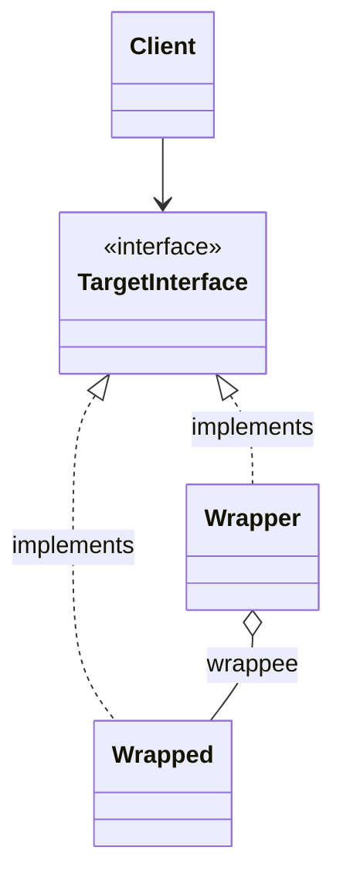

# Why-This-Not-That: Builder vs Constructor Telescoping

> **Navigation**: [← Behavioral Patterns](03_behavioral_patterns.md) | [Chapter overview](../08_Design_Patterns_Java.md)
> Page 4 of 4 in **Design Patterns in Java — Gang of Four & Beyond**


```
  THE PROBLEM: CONSTRUCTOR TELESCOPING
  ══════════════════════════════════════════

  User has 3 required + 5 optional fields:

  // Without telescoping: 2^5 = 32 constructors needed!
  User("John")                         ← which optionals?
  User("John", null)                   ← which is null?
  User("John", null, null)             ← confusing
  User("John", null, null, null)       ← which is address?
  User("John", null, null, null, null) ← impossible to read

  // Telescoping pattern: each constructor adds one optional
  public User(String firstName) {
      this(firstName, null, null, null, null, null);
  }
  public User(String firstName, String lastName) {
      this(firstName, lastName, null, null, null, null);
  }
  public User(String firstName, String lastName, String email) {
      this(firstName, lastName, email, null, null, null);
  }
  // ... 32 variations

  MAINTENANCE COST: Adding one more optional field requires
  adding 16 new constructors (half of 32).

  THE BUILDER SOLUTION:
  ════════════════════════

  User user = new User.Builder("John", "Doe", "john@example.com")
      .phone("1234567890")
      .address("123 Main St")
      .age(30)
      .build();

  COMPARISON TABLE:
  ════════════════════════
```

| DIMENSION | BUILDER | TELESCOPING |
| --- | --- | --- |
| N optional params (where N = 5) | 1 class + 1 Builder inner | 2^N constructors required! |
| Readability at call site | YES: Clear names .phone("123") | NO: positional args<br>User("John", null, "john@", null, 30) |
| Immutability | YES: final fields set in constructor | NO: mutable during construction |
| Validation | YES: Centralized in build() | NO: scattered across ctors |
| Adding optional param | 2 lines: setter + field | 16 constructor variants modified! |
| IDE auto-complete | YES: Builder methods named | NO: positional, no name hints |
| Lombok @Builder (zero-boilerplate) | YES: One annotation generates all | NO: manual all 32 constructors |

```
  BUILDER + FLUENT INTERFACE:
  ══════════════════════════

  The key insight: Builder methods RETURN THE BUILDER, not void.

  return this;  // enables method chaining

  This is called the FLUENT INTERFACE pattern.
  Used in: StringBuilder, Stream API, JUnit assertions, HttpClient.

  BUILDER + VALIDATION:
  ══════════════════════════

  public User build() {
      if (firstName == null || firstName.isBlank()) {
          throw new IllegalStateException("firstName required");
      }
      if (age != null && age < 0) {
          throw new IllegalStateException("age must be positive");
      }
      // Cross-field validation
      if (phone != null && !phone.matches("\\d{10}")) {
          throw new IllegalStateException("Invalid phone");
      }
      return new User(this);
  }

  Validation happens ONCE at build(), never scattered.
  Impossible with telescoping: each constructor would need its own validation.

  WHEN NOT TO USE BUILDER:
  ─────────────────────────
  1. 1-2 required fields, no optionals → plain constructor is fine
  2. All parameters required → no benefit
  3. Simple DTO with Jackson/JSON → @Data + @Builder for Jackson integration
  4. Performance-critical (GC pressure from Builder allocation) → consider static factory
```

## Breadth Comparison 1: Creational Pattern Selection Table

| PATTERN | WHEN TO USE | TRADE-OFFS | SELECTION CRITERIA |
| --- | --- | --- | --- |
| Factory<br>Method | Type determined at subclass (Collection. iterator()) | Decouples creator from concrete type; adds indirection | Do you need to create<br>ONE family of related objects with shared configuration? |
| Abstract<br>Factory | Creating families of related objects (e.g., UI:<br>Button+TextField must match style) | More complex (many factory classes); hard to add new product families | Need Button + Scrollbar to both be Windows-style or both Mac-style? Use<br>Abstract Factory |
| Builder | Complex object, many optional params, need immutability | More code (Builder class);<br>1 extra object allocation | Object has 4+ fields, some required, some optional; or validation needed; or want readable call site |
| Prototype | Creating objects by cloning existing one (Shape.clone()) | Cloning can be complex for deep copies (circular refs) | Need copies of complex objects; avoid rebuilding from scratch; e.g., prototype registry |
| Singleton (use DI) | One instance, globally accessible (Registry) | Global state; hides deps; untestable | Framework globals (log, config); but prefer DI + Spring @Component over self-managed getInstance() |
| Object Pool (not GoF) | Reuse expensive objects | Must manage pool lifecycle; memory if pool too large | DB connections, thread pools, string pool (reuse String literals) |

```
  QUICK DECISION GUIDE:
  ══════════════════════════
  Need ONE of something, global access?  → Singleton (or DI)
  Create by type parameter?              → Factory Method
  Create families of related objects?    → Abstract Factory
  Create complex objects step-by-step?   → Builder
  Create copies of existing objects?     → Prototype
  Reuse expensive resources?             → Object Pool

  MOST USED IN PRODUCTION: Builder (#1), Factory (#2), DI/Singleton (#3)
```

## Breadth Comparison 2: Structural Pattern Comparison — Adapter vs Decorator vs Proxy vs Facade

### Adapter, Decorator, Proxy and Facade compared

| Dimension | Adapter | Decorator | Proxy | Facade |
| --- | --- | --- | --- | --- |
| **Wraps** | An interface (converts it) | An interface (adds to it) | An interface (controls it) | A subsystem (simplifies it) |
| **What changes** | The interface shape | Behaviour (adds new) | Access (same operation, guarded) | The API (many → one) |
| **Client sees** | A new interface (the target) | The same interface (component) | The same interface (service) | A simpler interface |
| **Can stack?** | No (wrap once) | Yes, many layers | No (single level) | No (one level) |
| **Intention** | Make things work together | Add behaviour dynamically | Control access (lazy, cache, auth, log) | Simplify complexity |
| **Java example** | `Arrays.asList` (array → `List`) | `BufferedReader` wrapping `FileReader` | `@Transactional` (Spring AOP), lazy init (Hibernate) | `OrderFacade.placeOrder()` |
| **Spring use** | `HandlerAdapter` | `HttpServletRequestWrapper` | `@Transactional`, `@Cacheable`, `@Async` | Repository (hides JPA complexity) |

### The common structure

All four share the wrapper idea:



**How to read this diagram.** The wrapper (adapter, decorator, proxy or facade) holds a reference to what it wraps. What differs is the wrapper's behaviour:

- **Adapter:** wraps an incompatible interface and makes it look like the target.
- **Decorator:** wraps the same interface and adds new behaviour (stacking is fine).
- **Proxy:** wraps the same interface and controls access (caching, auth, laziness).
- **Facade:** wraps several interfaces and provides one simple entry point.

> [!TIP]
> **Remember:** an adapter makes things *work* together, a decorator makes things *do more*, a proxy makes things *accessible safely*, and a facade makes things *simpler*.

**Structural similarity, practical difference**

- **Adapter:** I have X but need Y, so adapt X to look like Y.
- **Decorator:** I have X and need X plus logging, so wrap X with logging.
- **Proxy:** I have X but do not want to load it until it is called, so use a lazy X.
- **Facade:** I have A, B, C and D and the client only knows E, so E hides A, B, C and D.

---

_Learn 5 patterns deeply (Strategy, Factory, Builder, Observer, Decorator). The rest you can recognize and reference._

---

---

🔬 **Section Challenge — Mental Model: Patterns as Communication**

**Challenge 1 (Reasoning):** The warning says "Don't force patterns where they're not needed." Give a concrete example of pattern over-engineering: describe a simple problem where applying a design pattern makes the code WORSE, and explain why the simple solution is better.

<details><summary>Answer</summary>

**Example:** A small script that reads a config file. Over-engineered: `ConfigReaderFactory` + `ConfigReader` interface + `JSONConfigReader` + `YAMLConfigReader` + `ConfigReaderBuilder`. For a single-file, single-format script, this is 5 classes for what should be `Properties.load(new FileInputStream("config.properties"))`. **Why worse?** More code to maintain, more indirection to trace, more files to navigate. Patterns solve recurring problems in COMPLEX systems — applying them to simple problems adds complexity without benefit. The rule: if you can explain the entire module in one sentence, you probably don't need a pattern. Patterns should reduce cognitive load, not increase it. If adding a pattern makes the code harder to understand for a competent developer, you're over-engineering.

</details>

## Production Reality

- **Boeing 737 MAX, 2018-2019**: Two crashes (Lion Air 610 and Ethiopian Airlines 302) killed 346 people. Investigations found that the MCAS flight-control software acted on a single angle-of-attack sensor, so one faulty reading could trigger repeated nose-down commands. Design lesson (an analogy, not a SOLID audit): a safety-relevant decision must not depend on one unvalidated input; cross-check redundant sources, limit the authority of automatic actions and make disagreement visible. The certified fix made MCAS use both sensors and limited its authority.
- **Cisco IOS Smart Install, 2018 (CVE-2018-0171)**: Improper validation of packet data allowed a stack-based buffer overflow and unauthenticated remote code execution on exposed devices. OOP lesson: encapsulation only protects invariants if data crossing the boundary is validated before it reaches internal state; "validate at the boundary" applies to a class's constructor as much as to a network parser.
- **Singleton hazards in Java**: A hand-rolled `getInstance()` using double-checked locking without `volatile` is broken under the Java memory model, because another thread can observe a partially constructed object. Container-managed singletons (Spring's default bean scope) hand lifecycle to the container, which also allows tests to substitute fakes. If you need a framework-free singleton, use the enum form (Bloch, _Effective Java_, Item 3).


### In Production: Diamond Inheritance with Java 8+ Default Methods

Java forbids class multiple inheritance (`class D extends A, B`), but allows _interface_ multiple inheritance via `implements`. With Java 8's `default` methods, two interfaces can both provide an implementation of the same method signature — creating the **interface diamond problem**:

```java
// Two orthogonal interfaces — Audit and Notification — both default to logging
interface AuditLog { default void log(String event) { System.out.println("Audit: " + event); } }
interface NotifyAdmin { default void log(String event) { System.out.println("Admin: " + event); } }

// This COMPILE ERRORs — unrelated defaults for log():
class OrderService implements AuditLog, NotifyAdmin { }  // error!

// Must explicitly resolve:
class OrderService implements AuditLog, NotifyAdmin {
    public void log(String event) { AuditLog.super.log(event); }  // picks AuditLog's version
}
```

**Resolution rules**: A class's own method wins over any interface default; otherwise the most specific interface wins; if two unrelated interfaces both supply a default, the compiler reports an error and the class must override and pick one explicitly with `Interface.super.method()`. Defaults were added in Java 8 so that interfaces such as `Collection` could gain methods without breaking existing implementations - not as a general multiple-inheritance mechanism.


**C++ parity**: The C++ multiple-inheritance diamond (`class D : public B, public C`) has the same ambiguity with no compiler automatic resolution. C++ requires either explicit qualification (`d.B::foo()`) or virtual inheritance (`class B : virtual public A`). Virtual inheritance adds a vptr indirection cost and complicates constructor ordering — it is rarely used, so C++ codebases simply avoid multiple inheritance of stateful base classes.

In Java, the interface default method feature is a powerful tool for API evolution but must be used with care to avoid unintentional diamond inheritance issues. The best practice is to avoid default methods in interfaces that are likely to be implemented together, or to design interfaces with clear orthogonal responsibilities that don't overlap in method signatures.

---

[← Behavioral Patterns](03_behavioral_patterns.md) | [Chapter overview](../08_Design_Patterns_Java.md)
