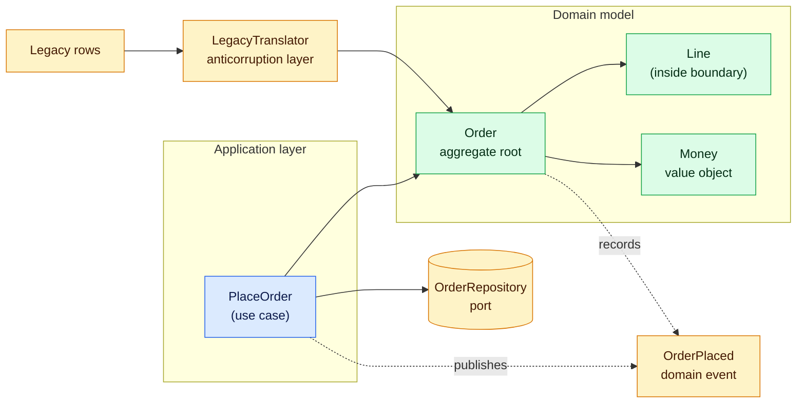

# 🏛️ Domain-Driven Design Essentials — Entities, Value Objects, Aggregates, Repositories

> **Navigation**: [← Design Heuristics — Least…](11_Design_Heuristics.md) | [Chapter index](00_INDEX.md) | [LLD Solved Problems — Low-Level… →](07_LLD_Solved_Problems.md)

---

## 🔗 Bridge — Where This Chapter Fits

| Dimension | This chapter |
| --- | --- |
| **Builds on** | [OOP Principles](01_OOPS_Principles.md) (encapsulation, invariants), [Design Patterns in Java](08_Design_Patterns_Java.md) (Factory, Repository-style Facades), [Low-Level Design problems](07_LLD_Solved_Problems.md) |
| **You will learn** | Entity vs value object, aggregate root and boundary, repository, application service, domain event, bounded context and anti-corruption layer |
| **Leads to** | [System Design](03_System_Design.md) (service boundaries), [Distributed Systems](06_Distributed_Systems_Fundamentals.md) (eventual consistency between aggregates), [DDD Tactical Patterns](../10_Enterprise_Systems/01b_DDD_Tactical_Patterns.md) and [Domain-Driven Entity Design](../10_Enterprise_Systems/01c_Domain_Driven_Entity_Design.md) (the same ideas in an ERP setting) |
| **Abstraction level** | Classes with getters and setters → **objects that guard rules** → **clusters that change together (aggregates)** → **models with explicit boundaries (bounded contexts)** |
| **Source book** | _Domain-Driven Design_, Eric Evans — chapter 5 (entities, value objects, services), chapter 6 (aggregates, factories, repositories), chapter 14 (bounded context, context map, anticorruption layer); see the [Book Companion](00_BOOK_COMPANION.md) |

> [!NOTE]
> This page teaches the **tactical** building blocks and one strategic idea (bounded context). It does not replace the book: strategic design (distillation, large-scale structure) is chapters 15-17.

---

## 💬 Explain It Like a Study Partner — Domain-Driven Design

### 1. The bottom line

Put the business rules **inside** the objects that own the data, draw a boundary around the objects that must stay consistent together, and let everything else talk to that boundary only.

### 2. The textbook core

- **Entity** — defined by identity that persists over time (an order, a car with its VIN). Two entities with equal fields are still different if their ids differ.
- **Value object** — defined only by its attributes, immutable, replaceable (money, a date range). Equality is by value.
- **Aggregate** — "a cluster of associated objects that we treat as a unit for the purpose of data changes". It has a **root** (one entity) and a **boundary**; outside code may hold references only to the root, and every invariant inside the boundary holds when each transaction completes (Evans, ch. 6).
- **Repository** — a collection-like interface for retrieving and saving aggregate roots, hiding the storage technology.
- **Application service** — orchestrates a use case (load, call the domain, save, publish); contains no business rules.
- **Domain event** — a record that something meaningful happened. Evans' 2003 book predates the pattern; it was added to the vocabulary later, and it is the usual way to update other aggregates **eventually** instead of in one transaction.
- **Bounded context** — "the delimited applicability of a particular model" (Evans, glossary). The same word, such as _customer_, may legitimately mean different things in billing and in shipping.
- **Anticorruption layer** — a translator that keeps a legacy or foreign model from leaking into yours.

### 3. The real-world analogy

A **bank vault with one door**. You can ask the teller (the root) to move money between the safe-deposit boxes inside, but you cannot reach into a box yourself. The teller checks the rules each time, so the vault is never in a state that breaks them.

### 4. Walkthrough

The code below is one runnable file (Java 21). Read it in this order: `Money` (value object), `Order` (aggregate root enforcing a credit limit), `OrderRepository` (collection-like port), `PlaceOrder` (application service), `LegacyTranslator` (anticorruption layer), then `main` (the tests).

```java
import java.util.*;
import java.util.function.Consumer;

public class Ddd {
    // ---- Value Object: no identity, immutable, equality by value ----
    record Money(long cents, String currency) {
        Money {
            if (cents < 0) throw new IllegalArgumentException("negative money");
            Objects.requireNonNull(currency);
        }
        static Money usd(long cents) { return new Money(cents, "USD"); }
        Money plus(Money o) { requireSame(o); return new Money(cents + o.cents, currency); }
        Money times(int n) { return new Money(cents * n, currency); }
        boolean exceeds(Money o) { requireSame(o); return cents > o.cents; }
        private void requireSame(Money o) {
            if (!currency.equals(o.currency)) throw new IllegalArgumentException("currency mismatch");
        }
    }

    record OrderId(String value) {}
    record Sku(String value) {}

    // ---- Domain event ----
    sealed interface OrderEvent permits OrderPlaced {}
    record OrderPlaced(OrderId id, Money total) implements OrderEvent {}

    // ---- Aggregate root: only entry point, enforces invariants ----
    static final class Order {
        private final OrderId id;               // identity (entity)
        private final Money creditLimit;
        private final List<Line> lines = new ArrayList<>();   // internal entities
        private boolean placed;
        private final List<OrderEvent> pending = new ArrayList<>();

        private record Line(Sku sku, int qty, Money unitPrice) {
            Money subtotal() { return unitPrice.times(qty); }
        }

        Order(OrderId id, Money creditLimit) { this.id = id; this.creditLimit = creditLimit; }

        OrderId id() { return id; }

        void addLine(Sku sku, int qty, Money unitPrice) {
            if (placed) throw new IllegalStateException("order already placed");
            if (qty <= 0) throw new IllegalArgumentException("qty must be positive");
            Money candidate = total().plus(unitPrice.times(qty));
            if (candidate.exceeds(creditLimit)) throw new IllegalStateException("credit limit exceeded");
            lines.add(new Line(sku, qty, unitPrice));   // invariant holds after every change
        }

        Money total() {
            Money sum = Money.usd(0);
            for (Line l : lines) sum = sum.plus(l.subtotal());
            return sum;
        }

        void place() {
            if (placed) throw new IllegalStateException("order already placed");
            if (lines.isEmpty()) throw new IllegalStateException("empty order");
            placed = true;
            pending.add(new OrderPlaced(id, total()));
        }

        List<OrderEvent> pullEvents() { var e = List.copyOf(pending); pending.clear(); return e; }
    }

    // ---- Repository: collection-like access to aggregate roots only ----
    interface OrderRepository {
        Optional<Order> findById(OrderId id);
        void save(Order order);
    }
    static final class InMemoryOrders implements OrderRepository {
        private final Map<OrderId, Order> store = new HashMap<>();
        public Optional<Order> findById(OrderId id) { return Optional.ofNullable(store.get(id)); }
        public void save(Order o) { store.put(o.id(), o); }
    }

    // ---- Application service: orchestrates, holds no business rules ----
    static final class PlaceOrder {
        private final OrderRepository repo; private final Consumer<OrderEvent> publisher;
        PlaceOrder(OrderRepository repo, Consumer<OrderEvent> publisher) { this.repo = repo; this.publisher = publisher; }
        void handle(OrderId id) {
            Order o = repo.findById(id).orElseThrow();
            o.place();
            repo.save(o);
            o.pullEvents().forEach(publisher);
        }
    }

    // ---- Anti-corruption layer: translate a legacy model into ours ----
    record LegacyRow(String ORD_NO, String ITEM, String QTY_STR, String PRICE_DOLLARS) {}
    static final class LegacyTranslator {
        Order toOrder(LegacyRow r, Money limit) {
            Order o = new Order(new OrderId(r.ORD_NO()), limit);
            long cents = Math.round(Double.parseDouble(r.PRICE_DOLLARS()) * 100);
            o.addLine(new Sku(r.ITEM()), Integer.parseInt(r.QTY_STR().trim()), Money.usd(cents));
            return o;
        }
    }

    static void check(boolean c, String m) { if (!c) throw new AssertionError(m); }
    static void expect(Class<? extends Exception> t, Runnable r, String m) {
        try { r.run(); } catch (Exception e) { if (t.isInstance(e)) return; throw new AssertionError(m + " wrong exception " + e); }
        throw new AssertionError(m + " no exception");
    }

    public static void main(String[] a) {
        // value object equality
        check(Money.usd(500).equals(Money.usd(500)), "value equality");
        expect(IllegalArgumentException.class, () -> Money.usd(1).plus(new Money(1, "EUR")), "currency");
        // aggregate invariants
        Order o = new Order(new OrderId("o1"), Money.usd(10_000));
        o.addLine(new Sku("pen"), 3, Money.usd(250));
        check(o.total().equals(Money.usd(750)), "total");
        expect(IllegalStateException.class, () -> o.addLine(new Sku("tv"), 1, Money.usd(9_500)), "limit");
        check(o.total().equals(Money.usd(750)), "failed add leaves aggregate unchanged");
        expect(IllegalArgumentException.class, () -> o.addLine(new Sku("x"), 0, Money.usd(1)), "qty");
        // use case + events
        var repo = new InMemoryOrders(); var seen = new ArrayList<OrderEvent>();
        repo.save(o);
        new PlaceOrder(repo, seen::add).handle(o.id());
        check(seen.equals(List.of(new OrderPlaced(new OrderId("o1"), Money.usd(750)))), "event");
        expect(IllegalStateException.class, () -> o.addLine(new Sku("pen"), 1, Money.usd(250)), "frozen");
        expect(IllegalStateException.class, () -> new PlaceOrder(repo, seen::add).handle(o.id()), "double place");
        // ACL
        Order legacy = new LegacyTranslator().toOrder(new LegacyRow("L-9", "cable", " 2 ", "3.99"), Money.usd(5_000));
        check(legacy.total().equals(Money.usd(798)), "acl total " + legacy.total());
        System.out.println("DDD OK");
    }
}
```

Verified output: `DDD OK` (compiled with Java 21 and run).

**What to notice**

1. `addLine` computes the candidate total **before** mutating, so a rejected change leaves the aggregate untouched; the test asserts that.
2. Nothing outside `Order` can touch a `Line`; the type is `private`. That is the aggregate boundary expressed in the language.
3. `PlaceOrder` has no `if` about business rules. It loads, calls `place()`, saves, then publishes the events the aggregate recorded.
4. `LegacyTranslator` is the only class that knows the legacy column names and that prices are decimal dollars in text.



**How to read this diagram.** Green is the domain model: only the root is reachable from outside. Blue is the use case that orchestrates. Amber marks the edges that touch the outside world (storage, events, legacy data).

### 5. Check yourself

**Q1.** Two `Money` objects both hold 500 USD. Are they the same object? Does it matter?

<details><summary>Answer</summary>

No, and it does not matter. A value object has no identity, so equality is by value (`record` gives this for free). Compare with two orders that happen to contain the same lines: they are still different orders because their ids differ.

</details>

**Q2.** Why does `Order.addLine` check the credit limit inside the aggregate rather than in the caller?

<details><summary>Answer</summary>

Because every code path that adds a line must obey the rule. If callers checked, one forgotten check would break the invariant. The root is the single choke point, which is what makes "every invariant holds after each transaction" achievable.

</details>

**Q3.** An order and a customer's loyalty-points balance must both change when an order is placed. Should they be one aggregate?

<details><summary>Answer</summary>

Usually no. Make them separate aggregates, place the order in one transaction, publish `OrderPlaced`, and update the points in a second transaction when the event is handled. The rule "points eventually reflect orders" is allowed to be briefly stale; the rule "an order never exceeds its credit limit" is not. Evans states that rules spanning aggregates are not expected to be up to date at all times.

</details>

---

## ⚡ At a Glance

| Building block | Identity? | Mutable? | Referenced from outside? | Example here |
| --- | --- | --- | --- | --- |
| Value object | No | No | Freely copied | `Money`, `Sku` |
| Entity | Yes | Yes | Only if root | `Order` |
| Aggregate root | Yes (global) | Yes | Yes | `Order` |
| Inner entity | Local only | Yes | No | `Line` |
| Repository | - | - | Yes | `OrderRepository` |
| Domain event | - | No | Published | `OrderPlaced` |

## Common mistakes

| Mistake | Why it hurts | Fix |
| --- | --- | --- |
| Public setters on the root | Callers bypass invariants | Expose behaviour (`addLine`, `place`), not fields |
| One giant aggregate ("Customer owns everything") | Every change locks and loads the whole graph | Keep aggregates small; reference others by id |
| Repository per table | Leaks persistence structure into the model | One repository per **aggregate root** |
| Business rules in the application service | Rules duplicated across use cases | Move them into the aggregate |
| Sharing one model across contexts | Words drift and teams collide | Separate models, translate at the boundary |

## 🏢 Enterprise Lens — Domain-Driven Design

- **Team boundaries follow context boundaries.** A bounded context is the natural unit for a team or service; splitting a context across teams creates the coordination cost microservices were meant to avoid.
- **Transactions follow aggregates.** One aggregate per transaction maps cleanly to a row-level lock or a single document write; cross-aggregate work becomes events, retries and idempotent handlers (see [Distributed Systems](06_Distributed_Systems_Fundamentals.md)).
- **Persistence is an adapter.** The same `OrderRepository` interface can be backed by JPA, a document store or an in-memory fake in tests.
- **Cost of the approach.** DDD pays off where rules are complex and long-lived; for CRUD screens with little logic it adds ceremony.

## 🧪 Practice

1. Add a `cancel()` operation that is allowed only before `place()` and records `OrderCancelled`. Which test proves a placed order cannot be cancelled?
2. Model `DateRange` as a value object that rejects `end < start` and offers `overlaps(DateRange)`.
3. Sketch two bounded contexts (Sales and Shipping) in which "Order" has different fields. Write the translator between them.

## Reality Check

> [!CAUTION]
> **"DDD means entities, repositories and a lot of annotations."** Those are the tactical parts; Evans spends the first chapters on **shared language and knowledge crunching** with domain experts. A codebase with perfectly named repositories but no shared vocabulary is not doing DDD.

> [!WARNING]
> **"Each aggregate must be one database table."** An aggregate is a consistency boundary in the model; its storage shape is a separate decision.

