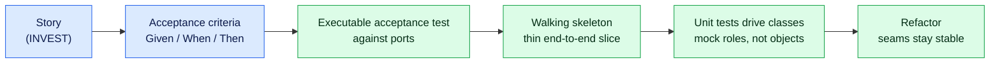

# 📝 From User Stories to Design — INVEST, Acceptance Tests and Seams

> **Navigation**: [← OOP & Design — Problem Sets](06b_PROBLEM_SETS.md) | [Chapter index](00_INDEX.md) | [System Design & Feature Creation… →](03_System_Design.md)

---

## 🔗 Bridge — Where This Chapter Fits

| Dimension | This chapter |
| --- | --- |
| **Builds on** | [Low-Level Design problems](07_LLD_Solved_Problems.md) (turning a prompt into classes), [System Design Fundamentals](05b_System_Design_Fundamentals.md) (walking skeleton, mocking roles) |
| **You will learn** | What makes a story good (INVEST), how acceptance criteria become an executable test, and how that test reveals the **seams** (interfaces) of a design |
| **Leads to** | [Design Heuristics](11_Design_Heuristics.md), [User & System Flows](04_User_System_Flows.md) |
| **Abstraction level** | Vague requirement → **story with acceptance criteria** → **executable acceptance test** → **ports and a minimal implementation** |
| **Source books** | _User Stories Applied_ (Mike Cohn), chapters 2, 6 and 7; _Growing Object-Oriented Software, Guided by Tests_ (Freeman and Pryce), chapters 2, 4, 5 and 10; see the [Book Companion](00_BOOK_COMPANION.md) |

---

## 💬 Explain It Like a Study Partner — Stories to Design

### 1. The bottom line

A good story is a small, testable promise of user value; write its acceptance test first and the interfaces your design needs fall out of the test.

### 2. The textbook core

Cohn (chapter 2) lists six attributes of a good story and credits Bill Wake with the acronym **INVEST**:

| Letter | Attribute | Practical check |
| --- | --- | --- |
| **I** | Independent | Can it be scheduled without another story? |
| **N** | Negotiable | Is it a conversation starter, not a contract? |
| **V** | Valuable | Does a user or customer care? |
| **E** | Estimatable | Do we know enough to size it? |
| **S** | Small | Fits in an iteration |
| **T** | Testable | Is there a clear pass/fail? |

GOOS adds the design half: grow a **walking skeleton** first (chapter 4, worked through in chapter 10), **start each feature with an acceptance test** that exercises the system from the outside (chapter 5), then drive the inside with unit tests that **mock roles** (interfaces), not concrete classes.

### 3. The real-world analogy

A **restaurant order ticket**. The ticket (story) says "one medium-rare steak"; the check the diner makes at the table (acceptance test) is "is it medium-rare?". How the kitchen is organised — stations, handoffs — is the design, and it is shaped by what the ticket and the check require.

### 4. Walkthrough

**Story:** _As a shopper, I can apply a discount code so that I pay less._

**Acceptance criteria (Given/When/Then):**

1. Given a basket with one book (20.00) and two pens (1.00 each), the total is 22.00.
2. When I apply the valid code `SAVE10`, the total becomes 19.80.
3. When I apply an unknown code, it is rejected and the total is unchanged.

The test below is written against two **ports** (`Catalog`, `Codes`), so it needs no database or UI. Needing exactly those two collaborators is the design insight the test gave us.

```java
import java.util.*;

public class Stories {
    // Story: "As a shopper I can apply a discount code so that I pay less."
    // Acceptance test is written against ports (Catalog, Codes) -- not against a database or UI.
    interface Catalog { long priceCents(String sku); }
    interface Codes { Optional<Integer> percentOff(String code); }

    static class Basket {
        private final Catalog catalog; private final Codes codes;
        private final Map<String,Integer> items = new LinkedHashMap<>(); private int percentOff;
        Basket(Catalog c, Codes k){catalog=c;codes=k;}
        void add(String sku, int qty){ items.merge(sku, qty, Integer::sum); }
        boolean apply(String code){ var p = codes.percentOff(code); p.ifPresent(v -> percentOff = v); return p.isPresent(); }
        long totalCents(){
            long sum = 0; for (var e : items.entrySet()) sum += catalog.priceCents(e.getKey()) * e.getValue();
            return sum - sum * percentOff / 100;
        }
    }

    static void check(boolean c, String m){ if(!c) throw new AssertionError(m); }
    public static void main(String[] a){
        Catalog catalog = sku -> switch (sku) { case "book" -> 2000; case "pen" -> 100; default -> throw new IllegalArgumentException(sku); };
        Codes codes = c -> c.equals("SAVE10") ? Optional.of(10) : Optional.empty();
        // Given a basket with 1 book and 2 pens
        var b = new Basket(catalog, codes); b.add("book",1); b.add("pen",2);
        check(b.totalCents()==2200, "no code");
        // When the shopper applies a valid code
        check(b.apply("SAVE10"), "valid code accepted");
        // Then the total drops by ten percent
        check(b.totalCents()==1980, "10% off");
        // And an unknown code is rejected and changes nothing
        check(!b.apply("NOPE") && b.totalCents()==1980, "unknown code");
        System.out.println("STORIES OK");
    }
}
```

Verified output: `STORIES OK` (compiled with Java 21 and run).

**Story splitting.** Cohn's _Small_ and _Estimatable_ sections (chapter 2) cover splitting a story that is too big and using a short investigative **spike** when a story cannot be estimated. "Apply a discount code" could split into _percentage codes_, _fixed-amount codes_ and _one-use codes_; each is independently valuable and testable. Chapter 7 ("Slice the Cake") adds that slices should cut vertically through all layers, as the test above does, rather than building one layer at a time.



**How to read this diagram.** Blue is the requirement side (what the user wants); green is the engineering side (how we prove and build it). The acceptance test is the bridge between them.

### 5. Check yourself

**Q1.** "The system will use Log4J to log all error messages to a file." Which INVEST attribute does it fail?

<details><summary>Answer</summary>

**Valuable** to users or customers. It describes an implementation choice. Cohn's exercise list in chapter 1 uses this exact example. Rewrite it as the user need (for example, support can find out why a payment failed).

</details>

**Q2.** Why does the test above not need a database?

<details><summary>Answer</summary>

Because the basket depends on the small interfaces `Catalog` and `Codes`, not on storage. The test supplies lambdas for them. That the behaviour could be tested without infrastructure is evidence the seams are in the right place.

</details>

**Q3.** Name one story in a checkout feature that violates "Independent", and one fix.

<details><summary>Answer</summary>

"Pay with a saved card" depends on "Save a card". Fix: combine them into one slice ("Pay with a card, optionally saving it") or order them explicitly and plan them together. Cohn warns that dependencies cause prioritisation and estimation problems.

</details>

---

## ⚡ At a Glance

| Artefact | Question it answers | Owner |
| --- | --- | --- |
| Story | What value, for whom? | Product with the team |
| Acceptance criteria | How do we know it is done? | Product and testers |
| Acceptance test | Does the whole system do it? | Team (automated) |
| Unit tests | Does each collaborator play its role? | Developers |

## Common mistakes

| Mistake | Why it hurts | Fix |
| --- | --- | --- |
| Stories as technical tasks ("create table") | No user value; cannot be demoed | Slice vertically through the layers |
| Acceptance tests through the UI only | Slow, brittle | Test at the highest stable port; keep a few UI smoke tests |
| Mocking every class | Tests mirror the implementation | Mock roles you own; use real value objects |
| Skipping the skeleton | Integration risk appears at the end | Deploy and test the thinnest slice first |

## 🏢 Enterprise Lens — Stories to Design

- **Definition of Done** usually includes a passing automated acceptance test, so the criteria in the story are the contract with QA and the release pipeline.
- **Traceability.** Naming tests after story criteria lets auditors and product owners trace behaviour to requirements.
- **Contract tests.** When a port is implemented by another team's service, add a consumer-driven contract test so both sides notice breaking changes.

## 🧪 Practice

1. Write INVEST-compliant stories for "reset my password" and mark which attribute each tends to violate.
2. Extend `Basket` with a fixed-amount code. Which existing test stays unchanged, and why?
3. For a library-system story, list the ports an acceptance test would need.

## Reality Check

> [!CAUTION]
> **"A story is a requirements document in a card."** Cohn's point is that a story is a **reminder for a conversation**; the detail lives in the discussion and the acceptance tests.

