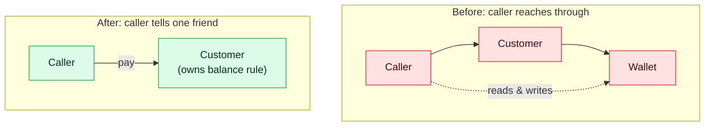

# 🧭 Design Heuristics — Least Knowledge, Tell Don't Ask, Hollywood, Context Independence

> **Navigation**: [← The Remaining GoF Patterns…](12_Remaining_GoF_Patterns.md) | [Chapter index](00_INDEX.md) | [Domain-Driven Design Essentials… →](09_Domain_Driven_Design_Essentials.md)

---

## 🔗 Bridge — Where This Chapter Fits

| Dimension | This chapter |
| --- | --- |
| **Builds on** | [OOP Principles](01_OOPS_Principles.md) (SOLID, encapsulation), [Design Patterns](02_Design_Patterns.md) and [in Java](08_Design_Patterns_Java.md) (Facade, Template Method) |
| **You will learn** | Four small, testable heuristics for deciding _where behaviour belongs_, plus the habits expert designers report |
| **Leads to** | Reviewing real code: these are the questions to ask in a design review |
| **Abstraction level** | Rules of thumb (named patterns and principles) → **judgement about coupling and cohesion** |
| **Source books** | _Head First Design Patterns_ (2nd ed.) — principle of least knowledge (ch. 7), Hollywood principle (ch. 8); _GOOS_ — chapter 2 ("Tell, Don't Ask") and chapter 6 ("Object-Oriented Style"); _Software Design Decoded_ (Petre and van der Hoek, 2016); see the [Book Companion](00_BOOK_COMPANION.md) |

---

## 💬 Explain It Like a Study Partner — Design Heuristics

### 1. The bottom line

Keep each object knowing as little as possible about others, ask objects to do things instead of pulling their data out, let a framework call you, and make parts work without knowing who uses them.

### 2. The textbook core

- **Principle of Least Knowledge (Law of Demeter).** Head First puts it as "talk only to your immediate friends": a method should call methods on itself, its parameters, objects it creates and its direct components, not on objects returned by those calls. A chain such as `a.getB().getC().doIt()` ties the caller to the structure of three classes.
- **Tell, don't ask.** Instead of fetching state to decide what to do, tell the object what you want and let it decide. It keeps the rule next to the data. GOOS (chapter 2) gives it a section of its own, "Tell, Don't Ask", followed by "But Sometimes Ask": queries are fine for values and for decisions that belong to the caller.
- **Hollywood principle** ("don't call us, we'll call you"). High-level code owns the flow and calls low-level hooks; Template Method is the classic example (Head First, chapter 8).
- **Context independence** (GOOS, chapter 6). An object should not know the context it is used in, so it can be reused and tested in isolation. Pass in what it needs, such as a clock, instead of reaching for globals.
- **Composite simpler than the sum of its parts** (GOOS, chapter 6): a composite should expose a smaller, simpler interface than all of its children together; if it just forwards everything, it hides nothing.
- **No "and"s, "or"s or "but"s** (GOOS, chapter 6): if you cannot describe an object's responsibility without those words, it probably has more than one.

### 3. The real-world analogy

Ordering at a **restaurant**. You tell the waiter what you want (tell, don't ask); you do not walk into the kitchen to check the fridge (least knowledge). The kitchen calls you when the food is ready (Hollywood). The chef cooks the same dish whether you are table 4 or table 12 (context independence).

### 4. Walkthrough

```java
import java.util.*;
import java.util.function.*;

public class Heur {
    // ---------- 1. Law of Demeter ----------
    static class Wallet { private long cents; Wallet(long c){cents=c;} long cents(){return cents;} void setCents(long c){cents=c;} }
    static class CustomerBad { private final Wallet wallet; CustomerBad(Wallet w){wallet=w;} Wallet getWallet(){return wallet;} }
    // caller reaches through: customer.getWallet().setCents(customer.getWallet().cents() - price)
    static boolean payBad(CustomerBad c, long price) {
        if (c.getWallet().cents() >= price) { c.getWallet().setCents(c.getWallet().cents() - price); return true; }
        return false;
    }
    static class Customer {
        private long cents;
        Customer(long c){cents=c;}
        boolean pay(long price) { if (cents < price) return false; cents -= price; return true; }   // tell, don't ask
        long balance(){return cents;}
    }

    // ---------- 2. Hollywood principle: framework calls you ----------
    static abstract class Report {
        final String render() { return header() + body() + footer(); }   // the framework owns the flow
        String header(){ return "[";} abstract String body(); String footer(){ return "]";}
    }

    // ---------- 3. Context independence ----------
    interface Clock { long now(); }
    static class Cache {                // knows nothing about who uses it: clock is passed in
        private final Map<String,long[]> m = new HashMap<>(); private final Clock clock; private final long ttl;
        Cache(Clock c, long ttl){clock=c;this.ttl=ttl;}
        void put(String k, long v){ m.put(k,new long[]{v,clock.now()}); }
        OptionalLong get(String k){ var e=m.get(k); return (e==null||clock.now()-e[1]>=ttl)?OptionalLong.empty():OptionalLong.of(e[0]); }
    }

    static void check(boolean c, String m){ if(!c) throw new AssertionError(m); }
    public static void main(String[] x){
        var bad = new CustomerBad(new Wallet(500)); check(payBad(bad,200) && bad.getWallet().cents()==300, "bad");
        var good = new Customer(500); check(good.pay(200) && good.balance()==300 && !good.pay(400) && good.balance()==300, "good");
        check(new Report(){ String body(){return "x";} }.render().equals("[x]"), "hollywood");
        long[] t={0}; var c=new Cache(() -> t[0], 10); c.put("a",1);
        check(c.get("a").getAsLong()==1,"hit"); t[0]=10; check(c.get("a").isEmpty(),"expired at ttl");
        System.out.println("HEUR OK");
    }
}
```

Verified output: `HEUR OK` (compiled with Java 21 and run).

**Reading the code**

| Heuristic | Smell | Fix in the code |
| --- | --- | --- |
| Least knowledge | `payBad` reaches through `getWallet()` twice | `Customer.pay(price)` keeps the balance check and the update together |
| Tell, don't ask | Caller decides using the callee's data | `pay` returns whether it succeeded |
| Hollywood | Subclasses controlling the flow | `Report.render()` is `final`; subclasses fill in `body()` |
| Context independence | A cache that calls `System.currentTimeMillis()` | `Cache` takes a `Clock`; the test moves time by hand |



**How to read this diagram.** In the red version the caller knows two classes and the shape between them; in the green version it knows one.

**What expert designers do.** _Software Design Decoded_ (Petre and van der Hoek) reports 66 observed habits of expert designers. Several map directly onto this page: prefer simple solutions (1), solve simpler problems first (2), divide and conquer while remembering the whole (3), avoid over-generalising (4), design elegant abstractions (5), and use metaphor (6). Treat them as habits to practise, not rules.

### 5. Check yourself

**Q1.** `order.getCustomer().getAddress().getCity()` — which heuristic does it strain, and what would you offer instead?

<details><summary>Answer</summary>

Least knowledge. The caller depends on the structure of three classes. Offer a method that expresses the intent, for example `order.shippingCity()`, so changes to the address model stay local. Do not overdo it: fluent builders and data-structure traversals are not violations.

</details>

**Q2.** Why is `Report.render()` declared `final`?

<details><summary>Answer</summary>

The superclass owns the sequence (header, body, footer). Subclasses may supply parts but must not reorder or skip them. That is the Hollywood principle applied through Template Method.

</details>

**Q3.** A test for `Cache` needs `Thread.sleep(10_000)` to check expiry. Which heuristic is being violated?

<details><summary>Answer</summary>

Context independence: the cache depends on real time. Inject a `Clock`, as the code above does, and move time with a variable.

</details>

---

## ⚡ At a Glance

| Heuristic | One-line test |
| --- | --- |
| Least knowledge | How many classes must I know to make this call? |
| Tell, don't ask | Am I fetching state just to decide for the object? |
| Hollywood | Who owns the sequence of steps? |
| Context independence | Can I use this object in a test with no setup? |
| Single responsibility wording | Can I describe it without "and", "or" or "but"? |

## Common mistakes

| Mistake | Why it hurts | Fix |
| --- | --- | --- |
| Wrapping every getter chain in a delegating method | Bloats the interface with trivial forwards | Add behaviour that means something, not mere forwards |
| "Tell, don't ask" applied to pure data holders | Records and DTOs are meant to be read | Use it for objects with behaviour and rules |
| Using inheritance for the Hollywood principle when a lambda would do | Extra class per variation | Pass the varying step as a function |
| Hiding time or randomness in static calls | Tests become slow or flaky | Inject `Clock` and `Random` |

## 🏢 Enterprise Lens — Design Heuristics

- **Review vocabulary.** Naming the heuristic ("this violates least knowledge") makes review comments about design, not taste.
- **Static analysis.** Tools can flag long call chains and large classes, but judgement is still needed.
- **Testability as an indicator.** If a unit needs a full container or a real clock to test, the design is carrying hidden context.

## 🧪 Practice

1. Find a three-step call chain in your own code and decide whether to hide it.
2. Convert a class that calls `LocalDate.now()` directly to one that accepts a `Clock`.
3. Write the one-sentence responsibility of a class you maintain. Does it contain "and"?

## Reality Check

> [!WARNING]
> **"Following the Law of Demeter means no dots."** It concerns coupling to _structure_ of unrelated objects, not syntax. A stream pipeline or a builder is not a violation.

