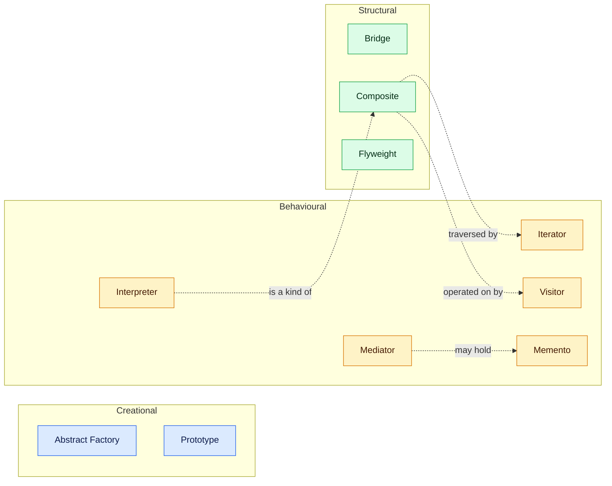

# 🧩 The Remaining GoF Patterns — Abstract Factory, Prototype, Bridge, Composite, Iterator, Visitor, Flyweight, Mediator, Memento, Interpreter

> **Navigation**: [← Design Patterns in Java — Gang of…](08_Design_Patterns_Java.md) | [Chapter index](00_INDEX.md) | [Design Heuristics — Least… →](11_Design_Heuristics.md)

---

## 🔗 Bridge — Where This Chapter Fits

| Dimension | This chapter |
| --- | --- |
| **Builds on** | [Design Patterns](02_Design_Patterns.md) (the three categories), [Design Patterns in Java](08_Design_Patterns_Java.md) (the 13 patterns it teaches in depth) |
| **You will learn** | The ten Gang of Four patterns that had no dedicated section: what force each one answers, a runnable Java 21 example, and the JDK or framework place you meet it |
| **Leads to** | [Low-Level Design problems](07_LLD_Solved_Problems.md), where several of these appear inside larger designs |
| **Abstraction level** | Catalogue names → **a complete, tested mini-example of every remaining pattern** |
| **Source book** | _Head First Design Patterns_ (2nd ed.): Abstract Factory (ch. 4), Iterator and Composite (ch. 9), and the appendix "Leftover Patterns" (Bridge, Builder, Chain of Responsibility, Flyweight, Interpreter, Mediator, Memento, Prototype, Visitor); see the [Book Companion](00_BOOK_COMPANION.md) |

> [!NOTE]
> After this page all 23 GoF patterns have a home. The coverage table below says where each one is taught.

---

## 💬 Explain It Like a Study Partner — The Remaining Patterns

### 1. The bottom line

Each of these patterns answers one specific force; if you cannot name the force in a sentence, you do not need the pattern.

### 2. The textbook core

| Pattern | Force it answers | One-line shape |
| --- | --- | --- |
| **Abstract Factory** | Products must come from one consistent family | An interface with one creation method per product |
| **Prototype** | Creating from scratch is costly or complex; copying a configured object is easy | `copy()` returning an independent object |
| **Bridge** | Two dimensions vary independently (shape × renderer) | Abstraction holds a reference to an implementor interface |
| **Composite** | Clients should treat one object and a tree of objects the same | Leaf and container implement one interface |
| **Iterator** | Traverse a collection without exposing its structure | `hasNext()` / `next()`, or `Iterable` and for-each |
| **Visitor** | Add operations over a closed set of types without editing each type | Double dispatch, or in modern Java a sealed type plus `switch` |
| **Flyweight** | Many objects share large identical (intrinsic) state | A pool returns shared immutable instances |
| **Mediator** | Many objects talk to many others and the web of references is tangled | Colleagues talk to one hub |
| **Memento** | Undo or restore without breaking encapsulation | Opaque snapshot object |
| **Interpreter** | A small, stable grammar must be evaluated repeatedly | One class or lambda per grammar rule |

### 3. The real-world analogy

A **kitchen**: a menu set (Abstract Factory) keeps a meal's dishes matching; a recipe card photocopy (Prototype) saves rewriting; a head waiter (Mediator) stops every cook from shouting at every other cook; and a fridge label ("use by…") that every dish shares is the Flyweight of a restaurant chain.

### 4. Walkthrough

The single file below demonstrates all ten, each in its smallest honest form. The `main` method is the test; it exits with an assertion error if any pattern misbehaves.

```java
import java.util.*;
import java.util.function.*;

public class Gof {
    // 1. ABSTRACT FACTORY: create a consistent family of products
    interface Button { String render(); }
    interface Checkbox { String render(); }
    interface WidgetFactory { Button button(); Checkbox checkbox(); }
    static class LightFactory implements WidgetFactory {
        public Button button() { return () -> "[light button]"; }
        public Checkbox checkbox() { return () -> "[light checkbox]"; }
    }
    static class DarkFactory implements WidgetFactory {
        public Button button() { return () -> "[dark button]"; }
        public Checkbox checkbox() { return () -> "[dark checkbox]"; }
    }
    static String screen(WidgetFactory f) { return f.button().render() + f.checkbox().render(); }

    // 2. PROTOTYPE: copy an existing configured object
    static final class Document implements Cloneable {
        final List<String> lines; final String owner;
        Document(List<String> lines, String owner) { this.lines = lines; this.owner = owner; }
        Document copy() { return new Document(new ArrayList<>(lines), owner); }   // deep enough for a list of immutable strings
    }

    // 3. BRIDGE: vary abstraction and implementation independently
    interface Renderer { String drawCircle(int r); }
    static class VectorRenderer implements Renderer { public String drawCircle(int r) { return "vector circle r=" + r; } }
    static class RasterRenderer implements Renderer { public String drawCircle(int r) { return "raster circle r=" + r; } }
    static abstract class Shape { protected final Renderer renderer; Shape(Renderer r) { renderer = r; } abstract String draw(); }
    static class Circle extends Shape { final int r; Circle(Renderer rd, int r) { super(rd); this.r = r; } String draw() { return renderer.drawCircle(r); } }

    // 4. COMPOSITE: treat a tree and a leaf uniformly
    interface Node { long size(); }
    record FileNode(long bytes) implements Node { public long size() { return bytes; } }
    record Folder(List<Node> children) implements Node {
        public long size() { long s = 0; for (Node n : children) s += n.size(); return s; }
    }

    // 5. ITERATOR: traverse without exposing representation
    static final class Range implements Iterable<Integer> {
        private final int from, to;
        Range(int from, int to) { this.from = from; this.to = to; }
        public Iterator<Integer> iterator() {
            return new Iterator<>() {
                int next = from;
                public boolean hasNext() { return next < to; }
                public Integer next() { if (!hasNext()) throw new NoSuchElementException(); return next++; }
            };
        }
    }

    // 6. VISITOR (modern form): sealed types + pattern-matching switch
    sealed interface Expr permits Num, Add, Mul {}
    record Num(int v) implements Expr {}
    record Add(Expr l, Expr r) implements Expr {}
    record Mul(Expr l, Expr r) implements Expr {}
    static int eval(Expr e) {
        return switch (e) {
            case Num n -> n.v();
            case Add a -> eval(a.l()) + eval(a.r());
            case Mul m -> eval(m.l()) * eval(m.r());
        };
    }
    static String show(Expr e) {
        return switch (e) {
            case Num n -> Integer.toString(n.v());
            case Add a -> "(" + show(a.l()) + " + " + show(a.r()) + ")";
            case Mul m -> show(m.l()) + " * " + show(m.r());
        };
    }

    // 7. FLYWEIGHT: share immutable intrinsic state
    record Glyph(char c, String font) {}
    static final class GlyphPool {
        private final Map<String, Glyph> pool = new HashMap<>(); int created;
        Glyph get(char c, String font) { return pool.computeIfAbsent(c + "/" + font, k -> { created++; return new Glyph(c, font); }); }
    }

    // 8. MEDIATOR: colleagues talk to a hub, not to each other
    interface Colleague { void receive(String from, String msg); }
    static final class ChatRoom {
        private final Map<String, Colleague> users = new LinkedHashMap<>();
        void join(String name, Colleague c) { users.put(name, c); }
        void say(String from, String msg) { users.forEach((n, c) -> { if (!n.equals(from)) c.receive(from, msg); }); }
    }

    // 9. MEMENTO: capture and restore state without exposing it
    static final class Editor {
        private String text = "";
        record Snapshot(String text) {}
        void type(String s) { text += s; }
        Snapshot save() { return new Snapshot(text); }
        void restore(Snapshot s) { text = s.text(); }
        String text() { return text; }
    }

    // 10. INTERPRETER: a tiny grammar -- sum of integers separated by '+'
    interface Rule { int eval(Map<String,Integer> vars); }
    static Rule parse(String src) {
        List<Rule> terms = new ArrayList<>();
        for (String t : src.split("\\+")) {
            String s = t.trim();
            terms.add(s.matches("\\d+") ? vars -> Integer.parseInt(s) : vars -> vars.getOrDefault(s, 0));
        }
        return vars -> terms.stream().mapToInt(r -> r.eval(vars)).sum();
    }

    static void check(boolean c, String m) { if (!c) throw new AssertionError(m); }
    public static void main(String[] a) {
        check(screen(new DarkFactory()).equals("[dark button][dark checkbox]"), "abstract factory");
        Document d1 = new Document(new ArrayList<>(List.of("a", "b")), "ann"); Document d2 = d1.copy(); d2.lines.add("c");
        check(d1.lines.size() == 2 && d2.lines.size() == 3, "prototype independent copy");
        check(new Circle(new VectorRenderer(), 5).draw().equals("vector circle r=5") && new Circle(new RasterRenderer(), 5).draw().equals("raster circle r=5"), "bridge");
        Node tree = new Folder(List.of(new FileNode(10), new Folder(List.of(new FileNode(5), new FileNode(7)))));
        check(tree.size() == 22, "composite");
        int sum = 0; for (int x : new Range(0, 5)) sum += x; check(sum == 10, "iterator");
        Expr e = new Add(new Num(2), new Mul(new Num(3), new Num(4)));
        check(eval(e) == 14 && show(e).equals("(2 + 3 * 4)"), "visitor " + show(e));
        GlyphPool p = new GlyphPool(); for (char c : "hello".toCharArray()) p.get(c, "Mono");
        check(p.created == 4 && p.get('l', "Mono") == p.get('l', "Mono"), "flyweight shares 'l'");
        var room = new ChatRoom(); var log = new ArrayList<String>();
        room.join("ann", (f, m) -> log.add("ann<" + f + ":" + m)); room.join("bob", (f, m) -> log.add("bob<" + f + ":" + m));
        room.say("ann", "hi"); check(log.equals(List.of("bob<ann:hi")), "mediator " + log);
        Editor ed = new Editor(); ed.type("abc"); var snap = ed.save(); ed.type("def"); ed.restore(snap);
        check(ed.text().equals("abc"), "memento");
        check(parse("1 + x + 3").eval(Map.of("x", 6)) == 10, "interpreter");
        System.out.println("GOF OK");
    }
}
```

Verified output: `GOF OK` (compiled with Java 21 and run).

**Reading notes**

1. **Abstract Factory** — `screen(factory)` never mentions "dark" or "light"; swapping the factory swaps the family.
2. **Prototype** — `copy()` clones the list so edits to the copy do not leak back. Java's `Object.clone()` has well-known pitfalls (shallow copies, no constructor call); a copy method or constructor is usually clearer (Bloch, _Effective Java_, "Override clone judiciously").
3. **Bridge** — `Circle` and `Renderer` vary separately: adding `SvgRenderer` touches no shape, and adding `Square` touches no renderer.
4. **Composite** — `Folder.size()` and `FileNode.size()` share one signature, so recursion is the only logic.
5. **Iterator** — implementing `Iterable` is what lets the for-each loop work.
6. **Visitor** — `eval` and `show` are two operations added without touching the record types; because `Expr` is `sealed`, the compiler checks the `switch` is exhaustive. The classic two-method `accept`/`visit` form is only needed when the type set is open or you are on an older Java.
7. **Flyweight** — "hello" has five characters but only four distinct glyphs, so only four objects are created.
8. **Mediator** — users never hold references to each other; `ChatRoom` decides who receives a message.
9. **Memento** — `Snapshot` is a record the editor creates and reads; callers just hold and return it.
10. **Interpreter** — each term becomes a small `Rule`; the grammar stays tiny, which is the only case where this pattern pays.



**How to read this diagram.** Boxes are grouped by GoF category. Dotted lines show common partnerships: a composite is usually traversed by an iterator and operated on by a visitor, and an interpreted expression tree is itself a composite.

### 5. Check yourself

**Q1.** Why does `Expr` being `sealed` matter for the visitor-style `switch`?

<details><summary>Answer</summary>

The compiler knows every permitted subtype, so it can reject a `switch` that misses a case. With an open hierarchy you cannot get that guarantee, and the classic `accept`/`visit` Visitor (or a default branch) is the alternative. Adding a new operation is easy; adding a new type means updating every `switch`.

</details>

**Q2.** What is the difference between Factory Method and Abstract Factory?

<details><summary>Answer</summary>

Factory Method creates **one** product and lets a subclass choose its type. Abstract Factory creates a **family** of related products through several creation methods, so the products are guaranteed to match.

</details>

**Q3.** When is Flyweight worth the complexity?

<details><summary>Answer</summary>

When there are very many objects (thousands or more), most of their state is identical and immutable, and measurements show memory or allocation is a problem. Java's `Integer.valueOf` cache for small values is the standard example; for a handful of objects it is overkill.

</details>

---

## ⚡ At a Glance — Coverage of All 23 GoF Patterns

| Category | Pattern | Taught in |
| --- | --- | --- |
| Creational | Singleton, Factory Method, Builder | [Design Patterns](02_Design_Patterns.md), [Patterns in Java](08_Design_Patterns_Java.md) |
| Creational | Abstract Factory, Prototype | This page |
| Structural | Adapter, Decorator, Facade, Proxy | [Design Patterns](02_Design_Patterns.md), [Patterns in Java](08_Design_Patterns_Java.md) |
| Structural | Bridge, Composite, Flyweight | This page |
| Behavioural | Observer, Strategy, Command, State, Template Method | [Design Patterns](02_Design_Patterns.md), [Patterns in Java](08_Design_Patterns_Java.md) |
| Behavioural | Chain of Responsibility | [Patterns in Java](08_Design_Patterns_Java.md), applied in the logger of [LLD Problems](07_LLD_Solved_Problems.md) |
| Behavioural | Iterator, Visitor, Mediator, Memento, Interpreter | This page |

| Pattern | Where you meet it |
| --- | --- |
| Abstract Factory | JDBC: a `Connection` yields matching `Statement` and `ResultSet` objects for one driver |
| Prototype | Copy constructors and `copy()` methods; `Object.clone()` (with caution) |
| Bridge | JDBC: the `Driver` interface separates the API from each database implementation |
| Composite | Swing and AWT `Container` and `Component` |
| Iterator | `java.util.Iterator`, `Iterable`, the for-each loop |
| Visitor | `java.nio.file.FileVisitor` with `Files.walkFileTree` |
| Flyweight | `Integer.valueOf` cache (-128 to 127 by default) |
| Mediator | Chat rooms, dialog controllers, air-traffic-control style hubs |
| Memento | Undo stacks in editors; serialization snapshots |
| Interpreter | Spring Expression Language, regex engines, small rule DSLs |

## Common mistakes

| Mistake | Why it hurts | Fix |
| --- | --- | --- |
| Using Visitor on a type set that changes often | Every new type edits every visitor | Use polymorphic methods when types change more than operations |
| Mediator that knows every rule | It becomes a God class | Keep the mediator to routing; push rules into colleagues |
| `clone()` on classes with mutable fields | Shallow copies share state | Write an explicit copy that duplicates mutable parts |
| Flyweight objects with mutable state | Sharing then leaks changes | Make shared state immutable; pass extrinsic state in |
| Interpreter for a large grammar | Class explosion and slow evaluation | Use a parser generator or a real parser library |

## 🏢 Enterprise Lens — Remaining Patterns

- **Composite and Visitor** appear in rule engines, permission trees and AST processing (linters, compilers, query planners).
- **Mediator** survives as the event bus or orchestrator; keep it thin or it becomes the system's single point of coupling.
- **Memento** shows up as event sourcing and audit snapshots, where history is the data.
- **Abstract Factory and Bridge** are how SDKs support several backends (databases, cloud providers) behind one API.
- **Testing**: each pattern's collaborators are interfaces, so tests substitute fakes; the Visitor and Interpreter examples are pure functions and need no fakes.

## 🧪 Practice

1. Add `SvgRenderer` to the Bridge example and show that no `Shape` class changes.
2. Add a `Neg(Expr)` record. What does the compiler tell you, and why is that useful?
3. Extend `Editor` with a bounded undo stack of `Snapshot` objects.
4. Write a `Folder.walk()` that returns an `Iterator<Node>` over the tree (depth first).

## Reality Check

> [!WARNING]
> **"Learn all 23 patterns to be a good designer."** Half of them solve problems you may never meet. Learn the forces; look up the pattern when the force appears.

> [!CAUTION]
> **"Visitor is always the answer to adding operations."** In Java 21, a sealed hierarchy with a pattern-matching `switch` is shorter and checked by the compiler; classic Visitor remains for open hierarchies and libraries.

