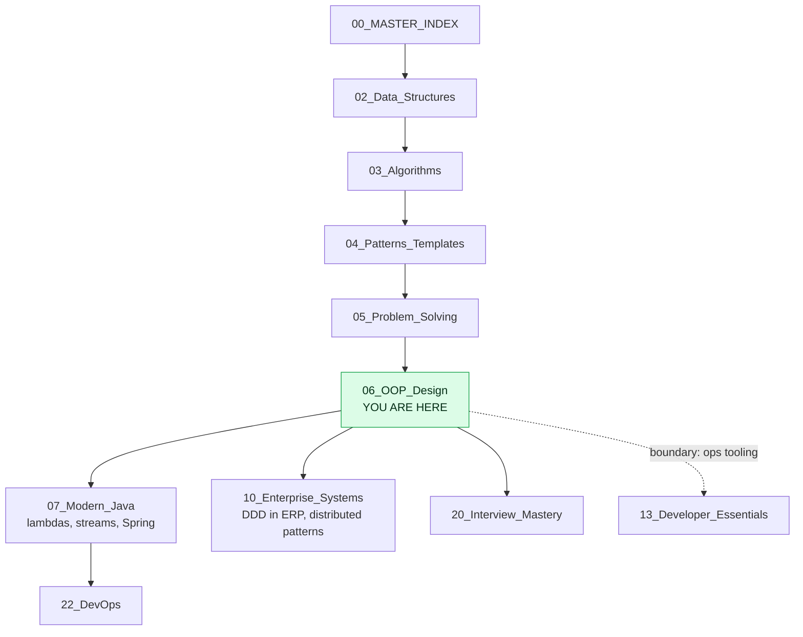

# Folder Context: 06_OOP_Design

## Purpose

Teach OOP, SOLID, design patterns, LLD, system design fundamentals, and object modeling.

## Writing Style

- Start from responsibilities and boundaries.
- Use small object models and tradeoffs.
- Explain why a pattern exists before showing code.
- Connect design choices to maintainability and testability.

## Boundaries

Spring-specific framework mechanics belong in `07_Modern_Java`. Distributed system operations belong in `13_Developer_Essentials`, `20_Interview_Mastery`, or `22_DevOps` depending on focus.

## PLUS Enhancements

### Folder Position Map (Curriculum Boundaries)

**How to read this diagram.** Arrows show the usual reading order. Dotted lines mark boundaries: framework mechanics belong in `07_Modern_Java`, and operational tooling (containers, CI/CD, Kubernetes) belongs in `13_Developer_Essentials` and `22_DevOps`, not here.

### Depth vs Breadth Positioning Note

`06_OOP_Design` occupies a **pivotal position** in the curriculum map:

| Property         | Position in Curriculum                                  | Implication                                                                |
| ---------------- | ------------------------------------------------------- | -------------------------------------------------------------------------- |
| **Depth**        | Highest in 06 (OOP Principles)                          | Teaches WHY patterns exist before HOW to implement them                    |
| **Breadth**      | Spans from fundamentals to LLD                          | Must stay focused on OOP/SOLID — not drift into Spring (07) or Docker (22) |
| **Dependencies** | Entry point for 07, 10, 20                              | Nothing above it in the OOP chain; other folders depend on it              |
| **Bridge role**  | Connects Java basics and algorithms (02-05) to system design | First folder where design thinking > syntax                           |

**Critical boundary rule**: When a design pattern topic intersects with framework-specific mechanics, the **framework interpretation** goes in 07_Modern_Java. For example:

- "How the Strategy pattern works" → 06_OOP_Design
- "How Spring uses Strategy in `@Qualifier` resolution" → 07_Modern_Java

## Layout

- Chapters of 1000+ lines are hubs (`01_OOPS_Principles.md`, `02_Design_Patterns.md`, `03_System_Design.md`, `04_User_System_Flows.md`, `07_LLD_Solved_Problems.md`, `08_Design_Patterns_Java.md`); their topic pages live in a same-named folder.
- Reading order and hand-offs: `00_LEARNING_PATH.md`. Book chapter maps: `00_BOOK_COMPANION.md`.
- Added after the book audit: `09_Domain_Driven_Design_Essentials.md`, `10_Stories_To_Design.md`, `11_Design_Heuristics.md`, `12_Remaining_GoF_Patterns.md`, `13_LLD_Reference_Implementations.md` (each with Java 21 code that was compiled and run).
- Historical dates and incident summaries must cite a primary source (paper, post-mortem, regulator report); unsourced scenarios are labelled illustrative.

## Update Triggers

Update this file when new design-pattern conventions, LLD templates, or system-design boundaries are added.
