> **Navigation**: [Back to Index](../00_MASTER_INDEX.md) | [Next >](01_Functional_Programming.md)

# 🗺️ SPRING BOOT MASTERY ROADMAP

> **The Complete Learning Path - From Zero to Industry Expert**
> _Follow this sequence for optimal learning_

---

# 📍 VISUAL LEARNING PATH (START HERE!)

```
┌─────────────────────────────────────────────────────────────────────────────────┐
│                    🎯 YOUR COMPLETE LEARNING JOURNEY                             │
├─────────────────────────────────────────────────────────────────────────────────┤
│                                                                                 │
│  ════════════════════════════════════════════════════════════════════════════   │
│                                                                                 │
│  🟡 WEEK 0: PREREQUISITES                                                        │
│  ─────────────────────────────────────────────────────────────────────────────  │
│  ┌─────────────────────┐                                                        │
│  │ 📄 FUNCTIONAL PROG  │  Modern Java: Lambda, Streams, Optional, Records        │
│  │    01_Functional... │  ⏱️ 2-3 days                                           │
│  └─────────────────────┘                                                        │
│            │                                                                    │
│            ▼                                                                    │
│  ═══════════════════════════════════════════════════════════════════════════    │
│                                                                                 │
│  ⚫ WEEK 1: HIDDEN FOUNDATIONS (The "WHY" Behind Spring)                         │
│  ─────────────────────────────────────────────────────────────────────────────  │
│  ┌─────────────────────┐                                                        │
│  │ 📄 PART 0           │  Reflection, Proxies, Servlets, Design Patterns         │
│  │    02_Spring_Boot...│  ⏱️ 3-4 days (MOST IMPORTANT!)                         │
│  └─────────────────────┘                                                        │
│            │                                                                    │
│            ▼                                                                    │
│  ═══════════════════════════════════════════════════════════════════════════    │
│                                                                                 │
│  🟢 WEEK 2-3: CORE SPRING (The Heart of Everything)                              │
│  ─────────────────────────────────────────────────────────────────────────────  │
│  ┌─────────────────────┐    ┌─────────────────────┐    ┌─────────────────────┐  │
│  │ 📄 PART 1           │───►│ 📄 PART 2           │───►│ 📄 PART 3           │     │
│  │    Java Foundations │    │    IoC & DI         │    │    AOP & Auto-Conf  │  │
│  │    ⏱️ 2 days        │    │    ⏱️ 3 days        │    │    ⏱️ 2 days        │  │
│  └─────────────────────┘    └─────────────────────┘    └─────────────────────┘  │
│                                                                 │               │
│  ═══════════════════════════════════════════════════════════════│═══════════    │
│                                                                 ▼               │
│  🟡 WEEK 3-4: WEB FUNDAMENTALS (Before Building APIs!)                           │
│  ─────────────────────────────────────────────────────────────────────────────  │
│  ┌─────────────────────┐    ┌─────────────────────┐                             │
│  │ 📄 PART 5           │───►│ 📄 PART 10          │  Read HTTP BEFORE             │
│  │    Lombok & DTOs    │    │    HTTP Deep Dive   │  Controllers!               │
│  │    ⏱️ 1 day         │    │    ⏱️ 2 days        │                             │
│  └─────────────────────┘    └─────────────────────┘                             │
│                                      │                                          │
│  ════════════════════════════════════│══════════════════════════════════════    │
│                                      ▼                                          │
│  🔵 WEEK 4-5: APPLICATION LAYERS (Build Real APIs!)                              │
│  ─────────────────────────────────────────────────────────────────────────────  │
│  ┌─────────────────────┐    ┌─────────────────────┐    ┌─────────────────────┐  │
│  │ 📄 PART 7           │───►│ 📄 PART 6           │───►│ 📄 PART 8           │     │
│  │    Controllers/REST │    │    Service/Repo     │    │    JPA Deep Dive    │  │
│  │    ⏱️ 2 days        │    │    ⏱️ 2 days        │    │    ⏱️ 3 days        │  │
│  └─────────────────────┘    └─────────────────────┘    └─────────────────────┘  │
│                                                                 │               │
│  ═══════════════════════════════════════════════════════════════│═══════════    │
│                                                                 ▼               │
│  🟠 WEEK 5-6: PRODUCTION READY (Real World Features!)                            │
│  ─────────────────────────────────────────────────────────────────────────────  │
│  ┌─────────────────────┐    ┌─────────────────────┐                             │
│  │ 📄 PART 14          │───►│ 📄 PART 11          │                               │
│  │    Cache/Async/     │    │    Security & JWT   │                             │
│  │    Actuator/Swagger │    │    OAuth2/RBAC      │                             │
│  │    ⏱️ 2 days        │    │    ⏱️ 3 days        │                             │
│  └─────────────────────┘    └─────────────────────┘                             │
│                                      │                                          │
│  ════════════════════════════════════│══════════════════════════════════════    │
│                                      ▼                                          │
│  🔴 WEEK 6-8: MASTERY (Senior Developer Skills!)                                 │
│  ─────────────────────────────────────────────────────────────────────────────  │
│  ┌─────────────────────┐    ┌─────────────────────┐    ┌─────────────────────┐  │
│  │ 📄 PART 9           │───►│ 📄 PART 12          │───►│ 📄 PART 13          │     │
│  │    Architecture &   │    │    DSA in Spring    │    │    Industry         │  │
│  │    Clean Code       │    │    Rate Limit, LRU  │    │    Projects         │  │
│  │    ⏱️ 2 days        │    │    ⏱️ 2 days        │    │    ⏱️ 2 days        │  │
│  └─────────────────────┘    └─────────────────────┘    └─────────────────────┘  │
│                                                                 │               │
│  ═══════════════════════════════════════════════════════════════│═══════════    │
│                                                                 ▼               │
│  🟣 WEEK 8-12: ENTERPRISE & CLOUD (Architect Level!)                             │
│  ─────────────────────────────────────────────────────────────────────────────  │
│  ┌───────────┐ ┌───────────┐ ┌───────────┐ ┌───────────┐ ┌───────────┐          │
│  │ PART 15   │►│ PART 16   │►│ PART 17   │►│ PART 18   │►│ PART 19   │          │
│  │ WebFlux   │ │ SOLID     │ │ DB Secur. │ │ Tracing   │ │ Testing   │          │
│  └───────────┘ └───────────┘ └───────────┘ └───────────┘ └───────────┘          │
│        │                                                                        │
│        └──────────────────────────────────────────────────────┐                 │
│                                                               ▼                 │
│                    ┌─────────────────────┐    ┌─────────────────────┐           │
│                    │ 📄 PART 20          │───►│ 📄 PART 21          │             │
│                    │    Microservices    │    │    Cloud/K8s/CI-CD  │           │
│                    │    Patterns         │    │    AWS/Azure/GCP    │           │
│                    └─────────────────────┘    └─────────────────────┘           │
│                                                                                 │
│  ═══════════════════════════════════════════════════════════════════════════    │
│                                                                                 │
│  📖 REFERENCE (Use Anytime!)                                                     │
│  ─────────────────────────────────────────────────────────────────────────────  │
│  ┌─────────────────────────────────────────────────────────────────────────┐    │
│  │ 📄 PART 22: ANNOTATIONS COMPLETE REFERENCE                              │     │
│  │    Every annotation explained: JPA, Web, Security, Testing, Lombok     │     │
│  │    ⭐ BOOKMARK THIS - Use as quick lookup while coding                 │      │
│  └─────────────────────────────────────────────────────────────────────────┘    │
│                                                                                 │
│  ┌─────────────────────────────────────────────────────────────────────────┐    │
│  │ 📄 PART 23: MISSING ESSENTIAL TOPICS                                    │     │
│  │    WebSockets, GraphQL, gRPC, Spring Batch, HATEOAS, i18n,            │      │
│  │    Multi-Tenancy, Spring Boot 3.x, GraalVM, Modulith, Rate Limiting   │      │
│  │    ⭐ 14 topics that complete your Spring Boot mastery                  │     │
│  └─────────────────────────────────────────────────────────────────────────┘    │
│                                                                                 │
│  ┌─────────────────────────────────────────────────────────────────────────┐    │
│  │ 📄 50-DAY SPRING BOOT CURRICULUM                                        │     │
│  │    Complete 10-week study plan: Foundations → Production → Expert      │     │
│  │    Daily structure: READ + CODE + PRACTICE + NOTES                     │     │
│  └─────────────────────────────────────────────────────────────────────────┘    │
│                                                                                 │
│  ┌─────────────────────────────────────────────────────────────────────────┐    │
│  │ 📄 PART 4: QUICK OVERVIEW (Optional high-level summary)                 │     │
│  └─────────────────────────────────────────────────────────────────────────┘    │
│                                                                                 │
└─────────────────────────────────────────────────────────────────────────────────┘
```

---

# 📚 COMPLETE FILE → TOPIC MAPPING

## #   File Name                                    Topics

--  01_Functional_Programming.md              Lambda, Streams, Optional,
Records, var keyword
00  02_Spring_Boot_Part0_Hidden_Foundations   Reflection, Proxy, Servlet,
Jackson, HikariCP, DevTools
01  03_Spring_Boot_Complete_Part1             JVM, GC, Threads, Memory
02  04_Spring_Boot_Complete_Part2             IoC, DI, Bean Scopes, Lifecycle,
Circular Dependencies
03  05_Spring_Boot_Complete_Part3             AOP, Proxies, Auto-Config
04  06_Spring_Boot_Complete_Part4             JPA/Web/Security Overview
05  07_Spring_Boot_Part5_Lombok_DTOs          @Data, @Builder, DTO Patterns
06  08_Spring_Boot_Part6_Service_Repository   @Service, @Repository, @Query
07  09_Spring_Boot_Part7_Controllers_REST     @RestController, @Valid, APIs
08  10_Spring_Boot_Part8_JPA_Deep_Dive        Entities, Relations, N+1, Fetch
09  11_Spring_Boot_Part9_Architecture_Quality Clean Code, Package Structure
10  12_Spring_Boot_Part10_HTTP_Deep_Dive      HTTP Lifecycle, Headers, REST
11  13_Spring_Boot_Part11_Auth_Security       JWT, OAuth2, Spring Security
12  14_Spring_Boot_Part12_DSA_Applications    Rate Limiter, LRU, Trie, Graph
13  15_Spring_Boot_Part13_Industry_Projects   Notification, Feature Flags
14  16_Spring_Boot_Part14_Essential_Topics    Cache, Async, Actuator, Swagger
15  17_Spring_Boot_Part15_WebFlux_Reactive    Mono, Flux, WebClient, R2DBC
16  18_Spring_Boot_Part16_SOLID_Principles    S.O.L.I.D with Spring Examples
17  19_Spring_Boot_Part17_Database_Security   Password Hash, Encryption, RBAC
18  20_Spring_Boot_Part18_Distributed_Tracing Micrometer, Zipkin, Spans
19  21_Spring_Boot_Part19_Testing_Complete    JUnit, Mockito, TestContainers
20  22_Spring_Boot_Part20_Microservices       Eureka, Gateway, Circuit Breaker
21  23_Spring_Boot_Part21_Cloud_Deployment    Docker, K8s, AWS, Azure, CI/CD
22  24_Spring_Boot_Part22_Annotations         ALL annotations reference
23  25_Spring_Boot_Part23_Missing_Essentials   WebSockets, GraphQL, gRPC,
Batch, HATEOAS, i18n, GraalVM
--  26_Spring_Boot_Curriculum_50Day            50-day study plan (10 weeks)

---

# 🔍 How to Use This Roadmap

```
┌─────────────────────────────────────────────────────────────────────────────────┐
│                         LEARNING PHILOSOPHY                                     │
├─────────────────────────────────────────────────────────────────────────────────┤
│                                                                                 │
│  ❌ WRONG: Jump to Spring Boot → Get stuck → Don't understand errors             │
│  ✅ RIGHT: Master foundations → Understand the "magic" → Build confidently       │
│                                                                                 │
│  EACH PHASE BUILDS ON THE PREVIOUS ONE                                          │
│  Don't skip phases unless you're already proficient!                            │
│                                                                                 │
│  ⏱️ ESTIMATED TOTAL TIME: 10-14 weeks (2-3 hours/day)                           │
│     Including Part 0: Hidden Foundations + Functional Programming               │
│                                                                                 │
│  TOTAL GUIDES: 24 Files (Functional Programming + Parts 0-22)                   │
│                                                                                 │
└─────────────────────────────────────────────────────────────────────────────────┘
```

> **Flow**: LEARNING PHILOSOPHY → EACH PHASE BUILDS ON THE PREVIOUS ONE | EACH PHASE BUILDS ON THE PREVIOUS ONE → Don't skip phases unless you're already proficient! | Don't skip phases unless you're already proficient! → ⏱️ ESTIMATED TOTAL TIME: 10-14 weeks (2-3 hours/day)

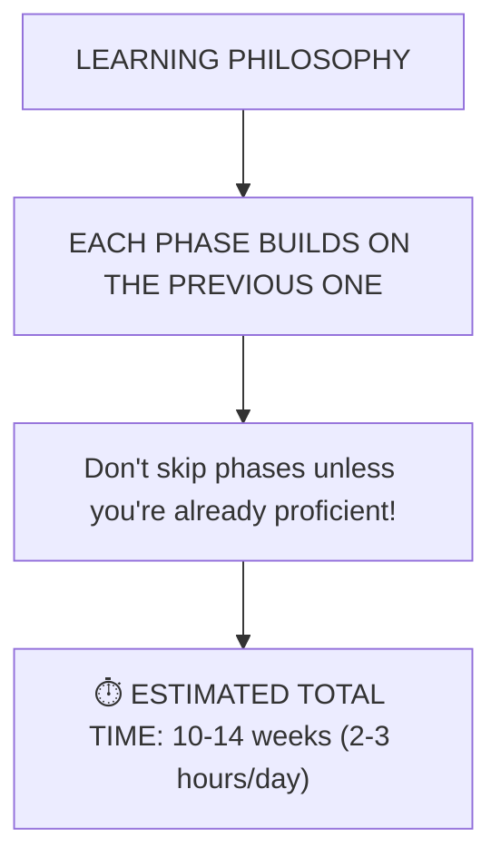

---

# 📚 COMPLETE LEARNING SEQUENCE

---

## PREREQUISITES: MODERN JAVA FUNDAMENTALS (Week 0) 🟡
> _"You cannot learn Spring Boot without modern Java"_

```
┌─────────────────────────────────────────────────────────────────────────────────┐
│  📄 FUNCTIONAL PROGRAMMING IN JAVA                                               │
│                                                                                 │
│  File: 01_Functional_Programming.md                                             │
│                                                                                 │
│  TOPICS COVERED:                                                                │
│  ┌────────────────────────────────────────────────────────────────────────┐     │
│  │ A. Lambda Expressions     │ (x) -> x * 2, concise anonymous functions │      │
│  │ B. Functional Interfaces  │ Predicate, Function, Consumer, Supplier   │      │
│  │ C. Stream API             │ filter, map, reduce, collect              │      │
│  │ D. Method References      │ Class::method shorthand                   │      │
│  │ E. Optional               │ Null-safe value handling                  │      │
│  │ F. Local Variable (var)   │ Type inference: var x = new HashMap<>(); │       │
│  │ G. Java Records           │ Immutable data carriers: record User(...) │      │
│  └────────────────────────────────────────────────────────────────────────┘     │
│                                                                                 │
│  ⏱️ TIME: 2-3 days                                                              │
│                                                                                 │
│  WHY READ FIRST:                                                                │
│  • Spring Boot uses lambdas EVERYWHERE (WebFlux, configs, callbacks)            │
│  • Stream API: 10 lines of loops → 1 elegant line                               │
│  • Records: Perfect for DTOs (Request/Response objects)                         │
│  • Interview: "Rewrite this using streams" is a common question                 │
│                                                                                 │
│  ✅ READY FOR NEXT WHEN YOU CAN:                                                 │
│  • Convert a for-loop to stream pipeline                                        │
│  • Explain what Optional.map() does vs Optional.flatMap()                       │
│  • Create a record with validation in compact constructor                       │
│                                                                                 │
└─────────────────────────────────────────────────────────────────────────────────┘
```

> **Flow**: 📄 FUNCTIONAL PROGRAMMING IN JAVA → File: 01_Functional_Programming.md | File: 01_Functional_Programming.md → TOPICS COVERED: | TOPICS COVERED: → C. Stream API filter, map, reduce, collect | C. Stream API filter, map, reduce, collect → D. Method References Class::method shorthand | D. Method References Class::method shorthand → E. Optional Null-safe value handling | E. Optional Null-safe value handling → G. Java Records Immutable data carriers: record User(.. | ...+1 more

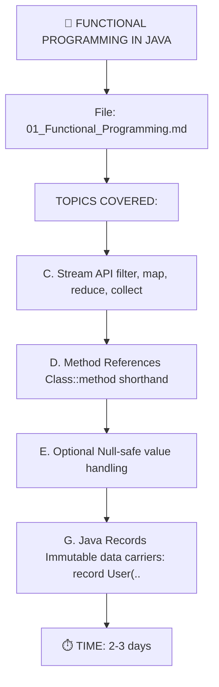

---

## PHASE 0: HIDDEN FOUNDATIONS (Week 1 - Read First!) ⚫
> _"The invisible knowledge that tutorials never teach"_

```
┌─────────────────────────────────────────────────────────────────────────────────┐
│  📄 PART 0: THE HIDDEN FOUNDATIONS                                               │
│                                                                                 │
│  File: 02_Spring_Boot_Part0_Hidden_Foundations.md                               │
│                                                                                 │
│  TOPICS COVERED:                                                                │
│  ┌────────────────────────────────────────────────────────────────────────┐     │
│  │ A. Java Reflection      │ How Spring reads @Autowired, @Component     │      │
│  │ B. Annotation Processing│ How @Getter (Lombok) vs @Autowired differ   │      │
│  │ C. Proxy Patterns       │ Why @Transactional fails on private methods │      │
│  │ D. Servlet API          │ What Spring Boot hides from you             │      │
│  │ E. Jackson Serialization│ How JSON ↔ Java conversion works            │      │
│  │ F. Connection Pooling   │ Why HikariCP matters                         │     │
│  │ G. Classloading         │ How Spring DevTools hot-reload works        │      │
│  │ H. Build Tools          │ Maven/Gradle phases, scopes, transitive deps│      │
│  │ I. HTTP Fundamentals    │ Raw HTTP, status codes, keep-alive          │      │
│  │ J. Design Patterns      │ Singleton, Factory, Proxy in Spring         │      │
│  │ K. Threads & Executors  │ How Tomcat handles requests, @Async         │      │
│  │ L. Generics & Type Erasure│ Why you can't do new T()                  │      │
│  │ M. Bytecode             │ How Spring Data generates repositories     │       │
│  └────────────────────────────────────────────────────────────────────────┘     │
│                                                                                 │
│  ⚠️ READ THIS FIRST if you want to understand WHY, not just HOW                 │
│                                                                                 │
└─────────────────────────────────────────────────────────────────────────────────┘
```

> **Flow**: 📄 PART 0: THE HIDDEN FOUNDATIONS → File: 02_Spring_Boot_Part0_Hidden_Foundations.md | File: 02_Spring_Boot_Part0_Hidden_Foundations.md → TOPICS COVERED: | TOPICS COVERED: → A. Java Reflection How Spring reads @Autowired, @Compon | A. Java Reflection How Spring reads @Autowired, @Compon → D. Servlet API What Spring Boot hides from you | D. Servlet API What Spring Boot hides from you → E. Jackson Serialization How JSON ↔ Java conversion wor | E. Jackson Serialization How JSON ↔ Java conversion wor → F. Connection Pooling Why HikariCP matters | ...+1 more

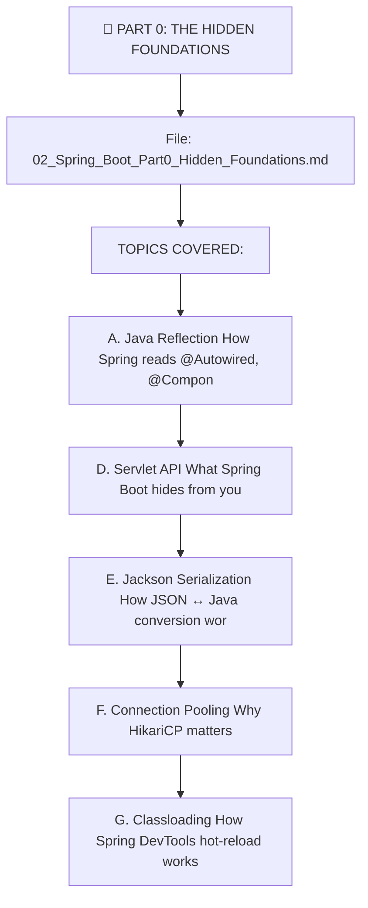

### Why Part 0 Exists

| What People Say | The Reality |
|-----------------|-------------|
| "Just use @Autowired" | But HOW does it inject? (Reflection!) |
| "@Transactional handles transactions" | But WHY doesn't it work on private methods? (Proxies!) |
| "Add the dependency to pom.xml" | But what does "provided" scope mean? |
| "Jackson converts JSON automatically" | But WHY do I need TypeReference<List<User>>? |

**This is the knowledge that separates "tutorial followers" from "real engineers"**

---

## PHASE 1: FOUNDATIONS (Week 1-2) 🟢

> _"You cannot understand Spring without understanding Java internals"_

```
┌─────────────────────────────────────────────────────────────────────────────────┐
│  PART 1 → PART 2 → PART 3                                                       │
│                                                                                 │
│  ┌──────────────────┐    ┌──────────────────┐    ┌──────────────────┐           │
│  │  📄 PART 1       │    │  📄 PART 2       │    │  📄 PART 3       │              │
│  │  Java            │───►│  Spring Core     │───►│  AOP &           │           │
│  │  Foundations     │    │  (IoC & DI)      │    │  Auto-Config     │           │
│  └──────────────────┘    └──────────────────┘    └──────────────────┘           │
│                                                                                 │
│  File: 03_Spring_Boot_Complete_Part1.md                                         │
│  File: 04_Spring_Boot_Complete_Part2.md                                         │
│  File: 05_Spring_Boot_Complete_Part3.md                                         │
│                                                                                 │
└─────────────────────────────────────────────────────────────────────────────────┘
```

> **Flow**: PART 1 → PART 2 → PART 3 → 📄 PART 1 📄 PART 2 📄 PART 3 | 📄 PART 1 📄 PART 2 📄 PART 3 → Java Spring Core AOP & | Java Spring Core AOP & → Foundations (IoC & DI) Auto-Config | Foundations (IoC & DI) Auto-Config → File: 03_Spring_Boot_Complete_Part1.md | File: 03_Spring_Boot_Complete_Part1.md → File: 04_Spring_Boot_Complete_Part2.md | File: 04_Spring_Boot_Complete_Part2.md → File: 05_Spring_Boot_Complete_Part3.md

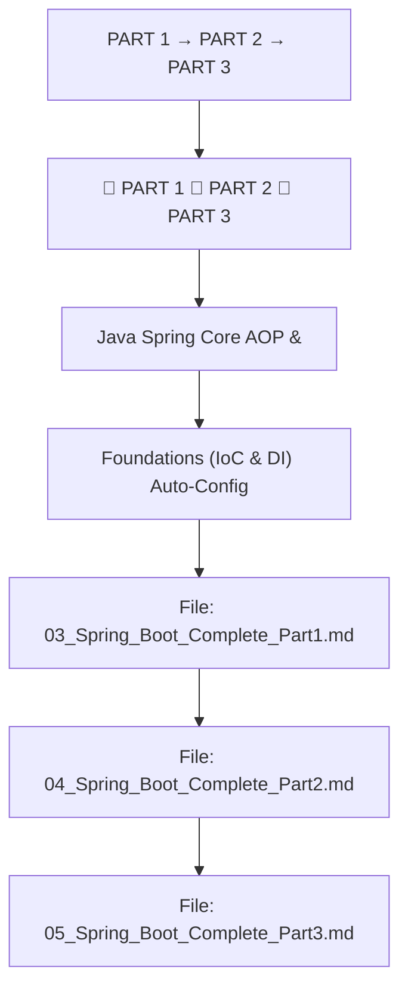

### Part 1: Java Foundations (PREREQUISITE)

**File:** `03_Spring_Boot_Complete_Part1.md`

| Topic                   | Why It Matters                             |
| ----------------------- | ------------------------------------------ |
| JVM Memory Model        | Understand where Spring Beans live         |
| Garbage Collection      | Know why Singletons are efficient          |
| Class Loading           | Understand how Spring loads configurations |
| Threading & Concurrency | Essential for @Async, @Scheduled           |
| Functional Programming  | Lambda + Streams used everywhere           |

**✅ You're ready for Part 2 when you can answer:**

- Where do Spring singleton beans live in memory?
- What's the difference between Heap and Metaspace?
- How does CompletableFuture work?

---

### Part 2: Spring Core (IoC & DI)

**File:** `04_Spring_Boot_Complete_Part2.md`

| Topic                | Why It Matters                |
| -------------------- | ----------------------------- |
| Inversion of Control | THE core philosophy of Spring |
| Dependency Injection | How Spring wires everything   |
| Bean Scopes          | Singleton, Prototype, Request |
| Bean Lifecycle       | @PostConstruct, @PreDestroy   |
| ApplicationContext   | The IoC Container itself      |
| @Qualifier, @Primary | Resolving multiple beans      |

**✅ You're ready for Part 3 when you can answer:**

- Why is constructor injection preferred over field injection?
- What's the difference between @Component and @Bean?
- When would you use @Qualifier?

---

### Part 3: AOP & Auto-Configuration

**File:** `05_Spring_Boot_Complete_Part3.md`

| Topic                  | Why It Matters                      |
| ---------------------- | ----------------------------------- |
| AOP Concepts           | How @Transactional, @Cacheable work |
| Pointcuts & Advice     | Understand the "magic"              |
| Proxy Types            | JDK vs CGLIB proxies                |
| @SpringBootApplication | What it actually does               |
| Auto-configuration     | How starters work                   |
| Profiles               | Dev/Prod configuration              |

**✅ Phase 1 complete when you can answer:**

- How does @Transactional work behind the scenes?
- What does @EnableAutoConfiguration do?
- Why doesn't @Transactional work on private methods?

---

## PHASE 2: TOOLING & WEB BASICS (Week 2-3) 🟡

> _"Learn HTTP before building REST APIs"_

```
┌─────────────────────────────────────────────────────────────────────────────────┐
│  PART 5 → PART 10 → PART 4 (Overview)                                           │
│                                                                                 │
│  ┌──────────────────┐    ┌──────────────────┐    ┌──────────────────┐           │
│  │  📄 PART 5       │    │  📄 PART 10      │    │  📄 PART 4       │              │
│  │  Lombok &        │───►│  HTTP Deep       │───►│  Quick Overview  │           │
│  │  DTOs            │    │  Dive            │    │  (Optional)      │           │
│  └──────────────────┘    └──────────────────┘    └──────────────────┘           │
│                                                                                 │
│  File: 07_Spring_Boot_Part5_Lombok_DTOs.md                                      │
│  File: 12_Spring_Boot_Part10_HTTP_Deep_Dive.md                                  │
│  File: 06_Spring_Boot_Complete_Part4.md (Optional overview)                     │
│                                                                                 │
└─────────────────────────────────────────────────────────────────────────────────┘
```

> **Flow**: PART 5 → PART 10 → PART 4 (Overview) → 📄 PART 5 📄 PART 10 📄 PART 4 | 📄 PART 5 📄 PART 10 📄 PART 4 → Lombok & HTTP Deep Quick Overview | Lombok & HTTP Deep Quick Overview → DTOs Dive (Optional) | DTOs Dive (Optional) → File: 07_Spring_Boot_Part5_Lombok_DTOs.md | File: 07_Spring_Boot_Part5_Lombok_DTOs.md → File: 12_Spring_Boot_Part10_HTTP_Deep_Dive.md | File: 12_Spring_Boot_Part10_HTTP_Deep_Dive.md → File: 06_Spring_Boot_Complete_Part4.md (Optional overvi

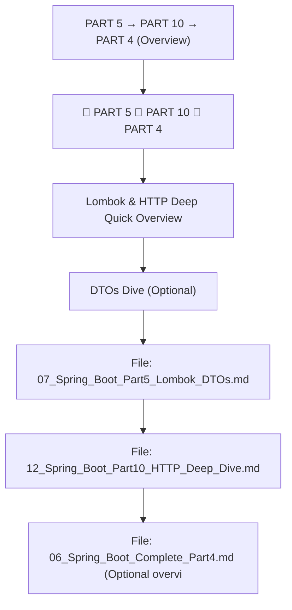

### Part 5: Lombok & DTOs

**File:** `07_Spring_Boot_Part5_Lombok_DTOs.md`

| Topic                 | Why It Matters               |
| --------------------- | ---------------------------- |
| Lombok Annotations    | Reduce boilerplate massively |
| @Data, @Builder       | Used in every project        |
| DTO Patterns          | Separate entities from API   |
| Request/Response DTOs | Clean API design             |
| MapStruct vs Manual   | DTO mapping strategies       |

---

### Part 10: HTTP Deep Dive ⚠️ READ BEFORE CONTROLLERS!

**File:** `12_Spring_Boot_Part10_HTTP_Deep_Dive.md`

| Topic                      | Why It Matters              |
| -------------------------- | --------------------------- |
| HTTP Request Lifecycle     | DNS → TCP → TLS → HTTP      |
| Request/Response Structure | Headers, Body, Status Codes |
| Path Variables             | /users/{id} - how they work |
| Query Parameters           | ?page=1&size=10             |
| Postman Testing            | Test your APIs              |
| WebSocket, gRPC            | Alternative protocols       |

---

### Part 4: Overview (OPTIONAL - Quick Reference)

**File:** `06_Spring_Boot_Complete_Part4.md`

_High-level overview of JPA, Web, Security, Testing. Read for context, but detailed versions in later parts._

---

## PHASE 3: APPLICATION LAYERS (Week 3-4) 🔵

> _"Controller → Service → Repository - The layered architecture"_

```
┌─────────────────────────────────────────────────────────────────────────────────┐
│  PART 7 → PART 6 → PART 8                                                       │
│                                                                                 │
│  ┌──────────────────┐    ┌──────────────────┐    ┌──────────────────┐           │
│  │  📄 PART 7       │    │  📄 PART 6       │    │  📄 PART 8       │              │
│  │  Controllers     │───►│  Service &       │───►│  JPA Deep        │           │
│  │  & REST API      │    │  Repository      │    │  Dive            │           │
│  └──────────────────┘    └──────────────────┘    └──────────────────┘           │
│                                                                                 │
│  File: 09_Spring_Boot_Part7_Controllers_REST.md                                 │
│  File: 08_Spring_Boot_Part6_Service_Repository.md                               │
│  File: 10_Spring_Boot_Part8_JPA_Deep_Dive.md                                    │
│                                                                                 │
└─────────────────────────────────────────────────────────────────────────────────┘
```

> **Flow**: PART 7 → PART 6 → PART 8 → 📄 PART 7 📄 PART 6 📄 PART 8 | 📄 PART 7 📄 PART 6 📄 PART 8 → Controllers Service & JPA Deep | Controllers Service & JPA Deep → & REST API Repository Dive | & REST API Repository Dive → File: 09_Spring_Boot_Part7_Controllers_REST.md | File: 09_Spring_Boot_Part7_Controllers_REST.md → File: 08_Spring_Boot_Part6_Service_Repository.md | File: 08_Spring_Boot_Part6_Service_Repository.md → File: 10_Spring_Boot_Part8_JPA_Deep_Dive.md

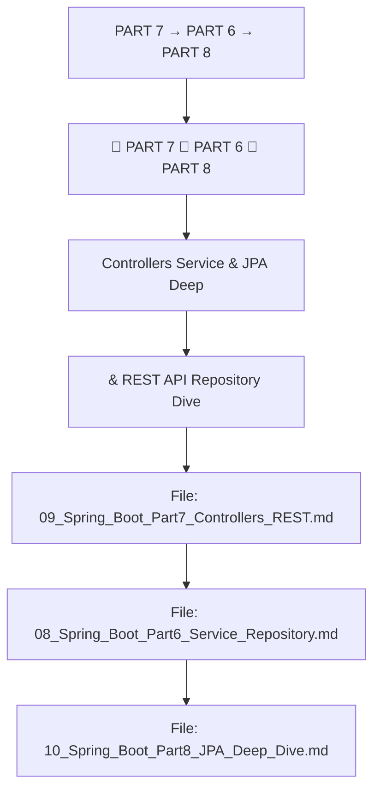

### Part 7: Controllers & REST API

**File:** `09_Spring_Boot_Part7_Controllers_REST.md`

| Topic                        | Why It Matters                |
| ---------------------------- | ----------------------------- |
| @RestController              | Entry point for HTTP requests |
| @GetMapping, @PostMapping    | HTTP method handlers          |
| @PathVariable, @RequestParam | Extract data from URLs        |
| @RequestBody, @ResponseBody  | JSON serialization            |
| Validation (@Valid)          | Input validation              |
| Exception Handling           | Global error handling         |
| API Versioning               | /api/v1, /api/v2              |

---

### Part 6: Service & Repository Patterns

**File:** `08_Spring_Boot_Part6_Service_Repository.md`

| Topic                 | Why It Matters       |
| --------------------- | -------------------- |
| Service Layer         | Business logic home  |
| @Service patterns     | Best practices       |
| Repository Interface  | Spring Data JPA      |
| Derived Query Methods | findByEmailAndStatus |
| @Query (JPQL/Native)  | Custom queries       |
| Specifications        | Dynamic queries      |

---

### Part 8: JPA & Hibernate Deep Dive

**File:** `10_Spring_Boot_Part8_JPA_Deep_Dive.md`

| Topic               | Why It Matters             |
| ------------------- | -------------------------- |
| Entity Mapping      | @Entity, @Id, @Column      |
| Relationships       | @OneToMany, @ManyToMany    |
| Fetch Strategies    | LAZY vs EAGER, N+1 problem |
| Persistence Context | First-level cache          |
| Cascade Types       | When to use PERSIST, MERGE |
| Transactions        | @Transactional deep dive   |

**✅ Phase 3 complete when you can:**

- Build a complete CRUD REST API
- Write custom repository queries
- Avoid N+1 query problem
- Handle transactions properly

---

## PHASE 4: PRODUCTION FEATURES (Week 4-5) 🟠

> _"Features that make your app production-ready"_

```
┌─────────────────────────────────────────────────────────────────────────────────┐
│  PART 14 → PART 11                                                              │
│                                                                                 │
│  ┌──────────────────┐    ┌──────────────────┐                                   │
│  │  📄 PART 14      │    │  📄 PART 11      │                                     │
│  │  Essential       │───►│  Authentication  │                                   │
│  │  Topics          │    │  & Security      │                                   │
│  └──────────────────┘    └──────────────────┘                                   │
│                                                                                 │
│  File: 16_Spring_Boot_Part14_Essential_Missing_Topics.md                        │
│  File: 13_Spring_Boot_Part11_Auth_Security.md                                   │
│                                                                                 │
└─────────────────────────────────────────────────────────────────────────────────┘
```

> **Flow**: PART 14 → PART 11 → 📄 PART 14 📄 PART 11 | 📄 PART 14 📄 PART 11 → Essential Authentication | Essential Authentication → Topics & Security | Topics & Security → File: 16_Spring_Boot_Part14_Essential_Missing_Topics.md | File: 16_Spring_Boot_Part14_Essential_Missing_Topics.md → File: 13_Spring_Boot_Part11_Auth_Security.md

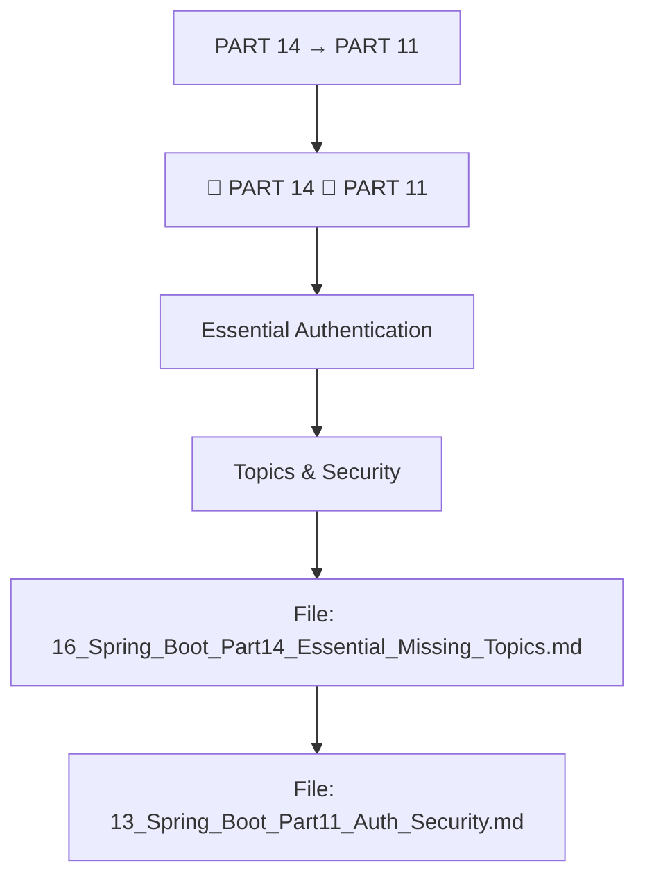

### Part 14: Essential Production Topics

**File:** `16_Spring_Boot_Part14_Essential_Missing_Topics.md`

| Topic                   | Why It Matters           |
| ----------------------- | ------------------------ |
| Caching (@Cacheable)    | Performance optimization |
| Async (@Async)          | Background processing    |
| Scheduling (@Scheduled) | Cron jobs                |
| Actuator                | Health checks, metrics   |
| Swagger/OpenAPI         | API documentation        |
| File Upload/Download    | Multipart handling       |
| Email Sending           | JavaMailSender           |
| Logging                 | SLF4J, Logback, MDC      |
| Flyway                  | Database migrations      |
| Docker                  | Containerization         |
| Kafka/RabbitMQ          | Message queues           |

---

### Part 11: Authentication & Authorization

**File:** `13_Spring_Boot_Part11_Auth_Security.md`

| Topic                 | Why It Matters        |
| --------------------- | --------------------- |
| Spring Security       | Filter chain          |
| JWT Authentication    | Token-based auth      |
| OAuth2 / Social Login | Google, GitHub login  |
| @PreAuthorize         | Method-level security |
| API Key Auth          | Service-to-service    |
| RBAC                  | Role-based access     |

---

## PHASE 5: MASTERY (Week 5-6+) 🔴

> _"From developer to architect"_

```
┌─────────────────────────────────────────────────────────────────────────────────┐
│  PART 9 → PART 12 → PART 13                                                     │
│                                                                                 │
│  ┌──────────────────┐    ┌──────────────────┐    ┌──────────────────┐           │
│  │  📄 PART 9       │    │  📄 PART 12      │    │  📄 PART 13      │              │
│  │  Clean           │───►│  DSA in          │───►│  Industry        │           │
│  │  Architecture    │    │  Spring Boot     │    │  Projects        │           │
│  └──────────────────┘    └──────────────────┘    └──────────────────┘           │
│                                                                                 │
│  File: 11_Spring_Boot_Part9_Architecture_Quality.md                             │
│  File: 14_Spring_Boot_Part12_DSA_Applications.md                                │
│  File: 15_Spring_Boot_Part13_Industry_Projects.md                               │
│                                                                                 │
└─────────────────────────────────────────────────────────────────────────────────┘
```

> **Flow**: PART 9 → PART 12 → PART 13 → 📄 PART 9 📄 PART 12 📄 PART 13 | 📄 PART 9 📄 PART 12 📄 PART 13 → Clean DSA in Industry | Clean DSA in Industry → Architecture Spring Boot Projects | Architecture Spring Boot Projects → File: 11_Spring_Boot_Part9_Architecture_Quality.md | File: 11_Spring_Boot_Part9_Architecture_Quality.md → File: 14_Spring_Boot_Part12_DSA_Applications.md | File: 14_Spring_Boot_Part12_DSA_Applications.md → File: 15_Spring_Boot_Part13_Industry_Projects.md

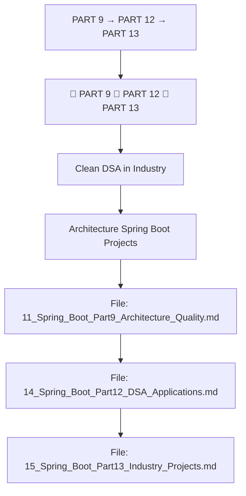

### Part 9: Clean Architecture & Quality

**File:** `11_Spring_Boot_Part9_Architecture_Quality.md`

| Topic                 | Why It Matters         |
| --------------------- | ---------------------- |
| Layered Architecture  | Proper separation      |
| Package Structure     | Feature vs Layer       |
| Clean Code Principles | SOLID in Spring        |
| Testing Strategy      | Unit, Integration, E2E |
| Error Handling        | Global strategy        |
| Configuration         | Best practices         |

---

### Part 12: DSA in Spring Boot

**File:** `14_Spring_Boot_Part12_DSA_Applications.md`

| Topic          | Real-World Use     |
| -------------- | ------------------ |
| Sliding Window | Rate limiting      |
| Trie           | Auto-complete      |
| LRU Cache      | API caching        |
| Dijkstra       | Route optimization |
| Priority Queue | Task scheduling    |
| TreeMap        | Leaderboards       |

---

### Part 13: Industry Projects

**File:** `15_Spring_Boot_Part13_Industry_Projects.md`

| Project             | What You Learn               |
| ------------------- | ---------------------------- |
| Notification Engine | Queues, Retry logic          |
| Feature Flags       | A/B testing, gradual rollout |
| Analytics Platform  | Real-time aggregations       |
| Workflow Engine     | State machines               |
| Booking System      | Conflict detection           |

---

## PHASE 6: ENTERPRISE & CLOUD (Week 7-10+) 🟣

> _"From monolith to microservices, from local to cloud"_

```
┌─────────────────────────────────────────────────────────────────────────────────┐
│  PART 15 → PART 16 → PART 17 → PART 18 → PART 19 → PART 20 → PART 21            │
│                                                                                 │
│  ┌──────────┐ ┌──────────┐ ┌──────────┐ ┌──────────┐ ┌──────────┐               │
│  │ PART 15  │ │ PART 16  │ │ PART 17  │ │ PART 18  │ │ PART 19  │               │
│  │ WebFlux  │→│ SOLID    │→│ Database │→│ Distrib. │→│ Testing  │               │
│  │ Reactive │ │Principles│ │ Security │ │ Tracing  │ │ Complete │               │
│  └──────────┘ └──────────┘ └──────────┘ └──────────┘ └──────────┘               │
│                               │                                                 │
│                               ▼                                                 │
│                 ┌──────────────────────────────┐                                │
│                 │  PART 20       │  PART 21    │                                │
│                 │  Microservices │  Cloud      │                                │
│                 │  Patterns      │  Deployment │                                │
│                 └──────────────────────────────┘                                │
│                                                                                 │
│  Files:                                                                         │
│  ├── 17_Spring_Boot_Part15_WebFlux_Reactive.md                                  │
│  ├── 18_Spring_Boot_Part16_SOLID_Principles.md                                  │
│  ├── 19_Spring_Boot_Part17_Database_Security.md                                 │
│  ├── 20_Spring_Boot_Part18_Distributed_Tracing.md                               │
│  ├── 21_Spring_Boot_Part19_Testing_Complete.md                                  │
│  ├── 22_Spring_Boot_Part20_Microservices_Patterns.md                            │
│  └── 23_Spring_Boot_Part21_Cloud_Deployment.md                                  │
│                                                                                 │
└─────────────────────────────────────────────────────────────────────────────────┘
```

> **Flow**: PART 15 / WebFlux / Reactive → PART 16 / SOLID / Principles | PART 16 / SOLID / Principles → PART 17 / Database / Security | PART 16 / SOLID / Principles → PART 20 PART 21 / Microservices Cloud / Patterns Deploy | PART 17 / Database / Security → PART 18 / Distrib. / Tracing | PART 17 / Database / Security → PART 20 PART 21 / Microservices Cloud / Patterns Deploy | PART 18 / Distrib. / Tracing → PART 19 / Testing / Complete | ...+1 more

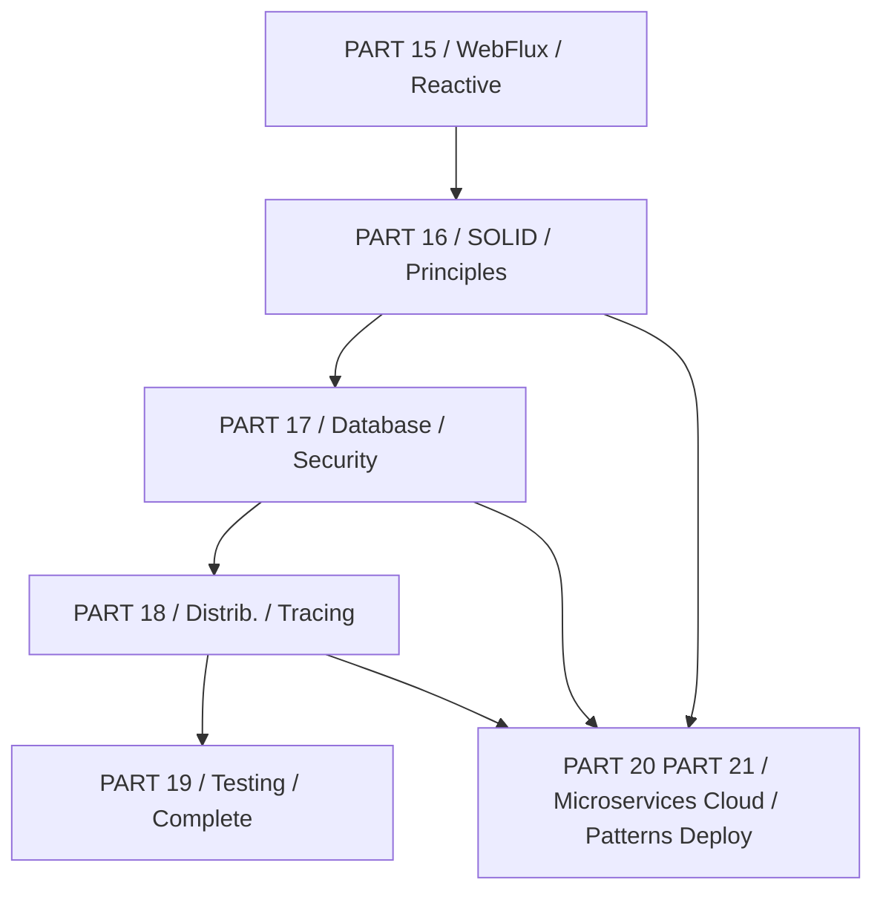

### Part 15: WebFlux & Reactive Programming

**File:** `17_Spring_Boot_Part15_WebFlux_Reactive.md`

| Topic                 | Why It Matters              |
| --------------------- | --------------------------- |
| Reactive Streams      | Non-blocking I/O            |
| Mono & Flux           | Core reactive types         |
| WebClient             | Reactive HTTP client        |
| R2DBC                 | Reactive database access    |
| Backpressure          | Handle overwhelming data    |
| Schedulers            | Control threading           |

---

### Part 16: SOLID Principles with Spring

**File:** `18_Spring_Boot_Part16_SOLID_Principles.md`

| Topic                            | Spring Example              |
| -------------------------------- | --------------------------- |
| Single Responsibility            | Service layer separation    |
| Open/Closed                      | Strategy pattern in Spring  |
| Liskov Substitution              | Interface programming       |
| Interface Segregation            | Repository interfaces       |
| Dependency Inversion             | @Autowired abstraction      |

---

### Part 17: Database Security

**File:** `19_Spring_Boot_Part17_Database_Security.md`

| Topic                 | Why It Matters              |
| --------------------- | --------------------------- |
| User Management       | Registration, authentication|
| Password Security     | BCrypt, Argon2 hashing      |
| Role-Based Access     | RBAC implementation         |
| SQL Injection         | Prevention strategies       |
| Data Encryption       | Column-level encryption     |
| Audit Logging         | Track data changes          |

---

### Part 18: Distributed Tracing

**File:** `20_Spring_Boot_Part18_Distributed_Tracing.md`

| Topic                 | Why It Matters              |
| --------------------- | --------------------------- |
| Micrometer Tracing    | Observability               |
| Zipkin Integration    | Trace visualization         |
| Span & Trace IDs      | Request correlation         |
| Baggage Propagation   | Cross-service context       |
| Performance Analysis  | Latency identification      |

---

### Part 19: Testing Complete Guide

**File:** `21_Spring_Boot_Part19_Testing_Complete.md`

| Topic                 | Why It Matters              |
| --------------------- | --------------------------- |
| JUnit 5               | Modern testing framework    |
| Mockito               | Mocking dependencies        |
| @SpringBootTest       | Integration testing         |
| @WebMvcTest           | Controller testing          |
| @DataJpaTest          | Repository testing          |
| TestContainers        | Real database testing       |
| TDD & BDD             | Development methodologies   |

---

### Part 20: Microservices Patterns

**File:** `22_Spring_Boot_Part20_Microservices_Patterns.md`

| Topic                 | Why It Matters              |
| --------------------- | --------------------------- |
| Service Discovery     | Eureka, Consul              |
| API Gateway           | Spring Cloud Gateway        |
| Circuit Breaker       | Resilience4j                |
| Saga Pattern          | Distributed transactions    |
| CQRS                  | Read/write separation       |
| Event Sourcing        | Audit and replay            |

---

### Part 21: Cloud Deployment

**File:** `23_Spring_Boot_Part21_Cloud_Deployment.md`

| Topic                 | Why It Matters              |
| --------------------- | --------------------------- |
| Docker                | Containerization            |
| Kubernetes            | Container orchestration     |
| AWS (EKS, S3, SQS)    | Amazon cloud services       |
| Azure (AKS, Blob)     | Microsoft cloud services    |
| GCP (GKE, Pub/Sub)    | Google cloud services       |
| CI/CD Pipelines       | Automated deployments       |
| Terraform             | Infrastructure as Code      |

**✅ Phase 6 complete when you can:**

- Build reactive APIs with WebFlux
- Apply SOLID principles in Spring
- Secure database access properly
- Trace requests across microservices
- Write comprehensive tests
- Design microservice architecture
- Deploy to cloud platforms

---

## APPENDIX: Quick Reference Guides 📖

```
┌─────────────────────────────────────────────────────────────────────────────────┐
│  PART 22: ANNOTATIONS COMPLETE REFERENCE                                        │
│                                                                                 │
│  File: 24_Spring_Boot_Part22_Annotations_Complete_Reference.md                  │
│                                                                                 │
│  A comprehensive reference covering ALL important annotations:                  │
│                                                                                 │
│  ┌────────────────────────────────────────────────────────────────────────┐     │
│  │ • JPA Lifecycle: @PrePersist, @PostPersist, @PreUpdate, @PostUpdate   │      │
│  │ • JPA Mapping: @Entity, @Column, @OneToMany, @ManyToOne, @Embedded    │      │
│  │ • Auditing: @CreatedDate, @LastModifiedDate, @CreatedBy, @Version     │      │
│  │ • Validation: @NotNull, @NotBlank, @Size, @Email, @Pattern, @Valid    │      │
│  │ • Spring Core: @Component, @Service, @Autowired, @Qualifier, @Scope   │      │
│  │ • Web: @GetMapping, @PostMapping, @PathVariable, @RequestBody         │      │
│  │ • Security: @PreAuthorize, @PostAuthorize, @Secured                   │      │
│  │ • Caching: @Cacheable, @CacheEvict, @CachePut                         │      │
│  │ • Async: @Async, @Scheduled                                           │      │
│  │ • Transaction: @Transactional (propagation, isolation, rollback)      │      │
│  │ • Testing: @SpringBootTest, @MockBean, @DataJpaTest                   │      │
│  │ • Lombok: @Data, @Builder, @Slf4j, @Value                             │      │
│  │ • Hibernate: @Formula, @Where, @BatchSize, @DynamicUpdate             │      │
│  └────────────────────────────────────────────────────────────────────────┘     │
│                                                                                 │
│  ⭐ USE AS QUICK REFERENCE - Bookmark this file!                                 │
│                                                                                 │
└─────────────────────────────────────────────────────────────────────────────────┘
```

> **Flow**: PART 22: ANNOTATIONS COMPLETE REFERENCE → • Security: @PreAuthorize, @PostAuthorize, @Secured | • Security: @PreAuthorize, @PostAuthorize, @Secured → • Caching: @Cacheable, @CacheEvict, @CachePut | • Caching: @Cacheable, @CacheEvict, @CachePut → • Async: @Async, @Scheduled | • Async: @Async, @Scheduled → • Testing: @SpringBootTest, @MockBean, @DataJpaTest | • Testing: @SpringBootTest, @MockBean, @DataJpaTest → • Lombok: @Data, @Builder, @Slf4j, @Value | • Lombok: @Data, @Builder, @Slf4j, @Value → • Hibernate: @Formula, @Where, @BatchSize, @DynamicUpda | ...+1 more

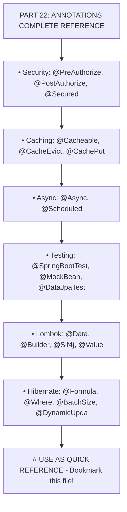

---

# 📋 QUICK REFERENCE: ALL PARTS

```
┌─────────────────────────────────────────────────────────────────────────────────┐
│              COMPLETE FILE LIST (IN LEARNING ORDER)                             │
├─────────────────────────────────────────────────────────────────────────────────┤
│                                                                                 │
│  PHASE 0: HIDDEN FOUNDATIONS (Read First!)                                      │
│  └── 📄 02_Spring_Boot_Part0_Hidden_Foundations.md → Reflection, Proxies, etc.   │
│                                                                                 │
│  PHASE 1: FOUNDATIONS                                                           │
│  ├── 📄 03_Spring_Boot_Complete_Part1.md      → Java Foundations                 │
│  ├── 📄 04_Spring_Boot_Complete_Part2.md      → IoC & DI                         │
│  └── 📄 05_Spring_Boot_Complete_Part3.md      → AOP & Auto-Config                │
│                                                                                 │
│  PHASE 2: TOOLING & WEB BASICS                                                  │
│  ├── 📄 07_Spring_Boot_Part5_Lombok_DTOs.md   → Lombok & DTOs                    │
│  ├── 📄 12_Spring_Boot_Part10_HTTP_Deep_Dive.md → HTTP (READ BEFORE PHASE 3!)    │
│  └── 📄 06_Spring_Boot_Complete_Part4.md      → Overview (Optional)              │
│                                                                                 │
│  PHASE 3: APPLICATION LAYERS                                                    │
│  ├── 📄 09_Spring_Boot_Part7_Controllers_REST.md → Controllers                   │
│  ├── 📄 08_Spring_Boot_Part6_Service_Repository.md → Service Layer               │
│  └── 📄 10_Spring_Boot_Part8_JPA_Deep_Dive.md → JPA & Hibernate                  │
│                                                                                 │
│  PHASE 4: PRODUCTION FEATURES                                                   │
│  ├── 📄 16_Spring_Boot_Part14_Essential_Missing_Topics.md → Cache, Async, etc.   │
│  └── 📄 13_Spring_Boot_Part11_Auth_Security.md → Security                        │
│                                                                                 │
│  PHASE 5: MASTERY                                                               │
│  ├── 📄 11_Spring_Boot_Part9_Architecture_Quality.md → Architecture              │
│  ├── 📄 14_Spring_Boot_Part12_DSA_Applications.md → DSA                          │
│  └── 📄 15_Spring_Boot_Part13_Industry_Projects.md → Projects                    │
│                                                                                 │
│  PHASE 6: ENTERPRISE & CLOUD                                                    │
│  ├── 📄 17_Spring_Boot_Part15_WebFlux_Reactive.md → Reactive Programming         │
│  ├── 📄 18_Spring_Boot_Part16_SOLID_Principles.md → SOLID in Spring              │
│  ├── 📄 19_Spring_Boot_Part17_Database_Security.md → Database Security           │
│  ├── 📄 20_Spring_Boot_Part18_Distributed_Tracing.md → Tracing                   │
│  ├── 📄 21_Spring_Boot_Part19_Testing_Complete.md → Testing                      │
│  ├── 📄 22_Spring_Boot_Part20_Microservices_Patterns.md → Microservices          │
│  └── 📄 23_Spring_Boot_Part21_Cloud_Deployment.md → Cloud Deployment             │
│                                                                                 │
│  APPENDIX                                                                       │
│  ├── 📄 24_Spring_Boot_Part22_Annotations_Complete_Reference.md → All Annotations│
│  ├── 📄 25_Spring_Boot_Part23_Missing_Essential_Topics.md → Missing Essentials   │
│  └── 📄 26_Spring_Boot_Curriculum_50Day.md → 50-Day Study Plan                   │
│                                                                                 │
│  TOTAL: 25 FILES (Part 0-23 + Curriculum)                                       │
│                                                                                 │
└─────────────────────────────────────────────────────────────────────────────────┘
```

> **Flow**: COMPLETE FILE LIST (IN LEARNING ORDER) → PHASE 0: HIDDEN FOUNDATIONS (Read First!) | PHASE 0: HIDDEN FOUNDATIONS (Read First!) → PHASE 1: FOUNDATIONS | PHASE 1: FOUNDATIONS → 📄 03_Spring_Boot_Complete_Part1.md → Java Foundations | 📄 03_Spring_Boot_Complete_Part1.md → Java Foundations → 📄 04_Spring_Boot_Complete_Part2.md → IoC & DI | 📄 04_Spring_Boot_Complete_Part2.md → IoC & DI → 📄 05_Spring_Boot_Complete_Part3.md → AOP & Auto-Config | 📄 05_Spring_Boot_Complete_Part3.md → AOP & Auto-Config → PHASE 2: TOOLING & WEB BASICS | ...+1 more

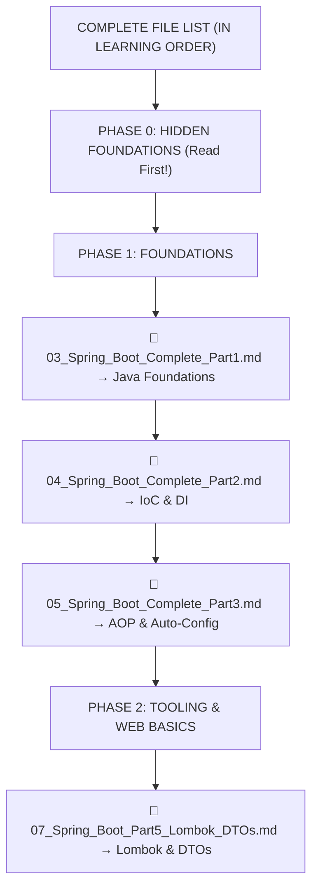

---

# 🎯 LEARNING TIPS

## How To Study Effectively

1. DON'T JUST READ - CODE ALONG
Create a practice project and implement as you learn
2. EACH PART = 1-3 DAYS
Don't rush. Understanding beats memorization.
3. BUILD SOMETHING AFTER EACH PHASE
Phase 1: Simple bean playground
Phase 2: REST API skeleton
Phase 3: Complete CRUD app
Phase 4: Add caching, security
Phase 5: Full industry-level project
4. INTERVIEW PREP PRIORITY
Most asked: IoC/DI, REST, JPA, Transactions, Security
5. REVISIT FOUNDATIONS
If stuck on advanced topics, re-read Part 2 (IoC) and Part 3 (AOP)

---

# 🚀 QUICK START PATHS (Choose Your Adventure!)

## Learning Paths By Goal

🎯 PATH A: JOB INTERVIEW PREP (2-3 weeks)
Functional Prog → Part 0 (key sections) → Part 2 → Part 7 → Part 8 → Part 11

**Focus**: Lambdas, IoC/DI, REST APIs, JPA Basics, Security

**Interview Topics**: "How does @Autowired work?", "Explain @Transactional"
📚 PATH B: FULL MASTERY (10-14 weeks)
Functional Prog → Part 0 → Parts 1-22 (all in roadmap order)

**Result**: Complete backend engineer with enterprise knowledge
⚡ PATH C: ALREADY KNOW JAVA (4-5 weeks)
Part 0 (review) → Part 2 → Part 10 → Part 7-8 → Part 14 → Part 11 → Part 13

**Skip**: Part 1 (Java basics), Part 5 (if know Lombok)

**Focus**: Spring internals, REST, JPA, Production features
🔍 PATH D: "I WANT TO REALLY UNDERSTAND SPRING" (Recommended!)
Part 0 (ALL sections) → Part 2 → Part 3 → Continue in roadmap order

**Why**: Part 0 explains the WHY behind Spring's "magic"

**Result**: Debug any Spring issue, understand any blog post
☁️ PATH E: MICROSERVICES & CLOUD FOCUS (4-5 weeks)
Part 15 (WebFlux) → Part 19 (Testing) → Part 20 (Microservices) → Part 21
Add: Part 18 (Distributed Tracing) for observability

**Ideal For**: Senior devs moving to microservices architecture
🛡️ PATH F: SECURITY SPECIALIST (2-3 weeks)
Part 11 (Auth/Security) → Part 17 (DB Security) → Part 22 (Security annot.)

**Focus**: JWT, OAuth2, Role-Based Access, SQL Injection Prevention
🧪 PATH G: TESTING EXPERT (1-2 weeks)
Part 19 (Testing Complete) → Part 22 (Testing annotations)

**Topics**: JUnit 5, Mockito, @SpringBootTest, TestContainers, TDD/BDD

---

# ✅ PHASE COMPLETION CHECKLIST

## After Each Phase, You Should Be Able To Answer These Questions


**Prerequisites**:
☐ What's the difference between map() and flatMap() in Streams?
☐ When would you use Optional vs returning null?
☐ How do Java Records differ from regular classes?
PHASE 0 (Hidden Foundations):
☐ How does @Autowired inject dependencies? (Reflection!)
☐ Why doesn't @Transactional work on private methods? (Proxies!)
☐ What is the Servlet lifecycle?
PHASE 1 (Core Spring):
☐ What's the difference between @Component and @Bean?
☐ Explain constructor injection vs field injection pros/cons
☐ What are the different bean scopes?
☐ How does AOP work in Spring?
PHASE 2 (Web Fundamentals):
☐ What HTTP status code for "resource not found" vs "validation error"?
☐ When to use @PathVariable vs @RequestParam?
☐ What does Content-Type header do?
PHASE 3 (Application Layers):
☐ Build a complete CRUD REST API from scratch
☐ What is the N+1 query problem and how to solve it?
☐ Explain LAZY vs EAGER fetch strategies
☐ What are transaction propagation levels?
PHASE 4 (Production Features):
☐ How to implement JWT authentication?
☐ What is the Filter Chain in Spring Security?
☐ How does @Cacheable work?
☐ What endpoints does Actuator expose?
PHASE 5 (Mastery):
☐ Design a rate limiter using sliding window
☐ Implement clean architecture in a Spring Boot app
☐ Build a notification engine with retry logic
PHASE 6 (Enterprise):
☐ Explain Mono vs Flux in WebFlux
☐ Implement Circuit Breaker pattern
☐ Deploy Spring Boot app to Kubernetes
☐ Set up distributed tracing with Zipkin

---

_Start with Functional Programming if you're weak in modern Java._
_Start with Part 0 if you want to understand the magic._
_Start with Part 1 if you're completely new to Java._
_Trust the process!_ 🚀


---

> **Navigation**: [Back to Index](../00_MASTER_INDEX.md) | [Next >](01_Functional_Programming.md)