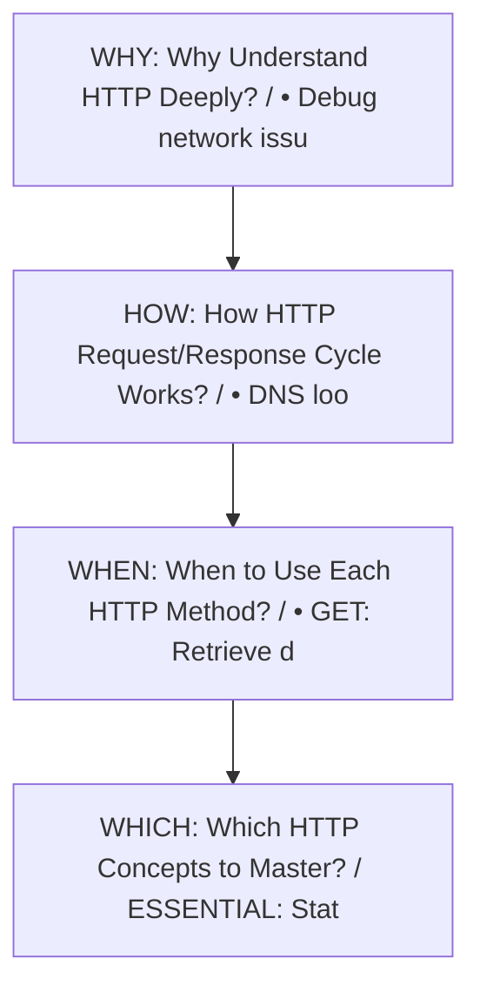
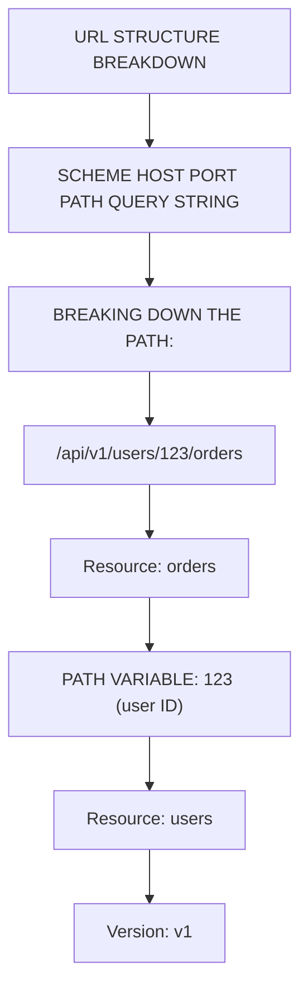
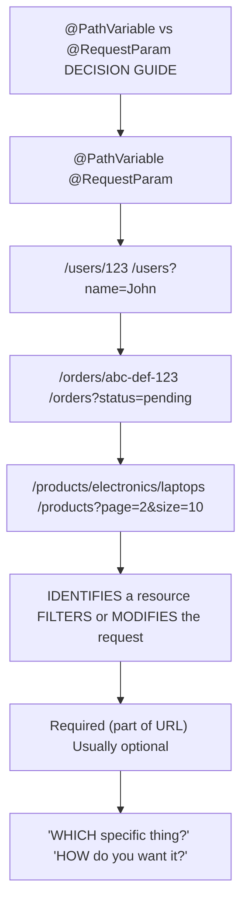
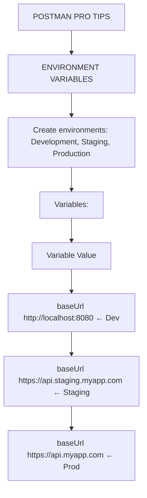
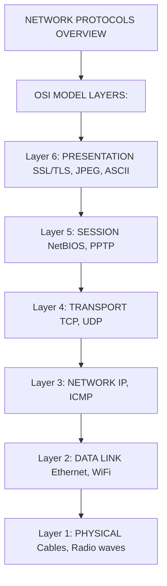

> **Navigation**: [< Previous](11_Spring_Boot_Part9_Architecture_Quality.md) | [Back to Index](../00_MASTER_INDEX.md) | [Next >](13_Spring_Boot_Part11_Auth_Security.md)

# 🌐 SPRING BOOT MASTERY - Part 10: HTTP Deep Dive

> **Understanding How the Internet Really Works**
> _"Every API call is a journey through layers of protocols"_

---

# 🎯 WHY-HOW-WHEN-WHICH FRAMEWORK

```
┌─────────────────────────────────────────────────────────────────────────────────┐
│  WHY: Why Understand HTTP Deeply?                                               │
├─────────────────────────────────────────────────────────────────────────────────┤
│  • Debug network issues: "Why is my API slow?" - headers, connections           │
│  • API design: Right status codes, headers make intuitive APIs                  │
│  • Security: CORS, cookies, authentication headers                              │
│  • Performance: Caching, compression, keep-alive connections                    │
│  • Interview: Network questions are common in backend interviews                │
└─────────────────────────────────────────────────────────────────────────────────┘

┌─────────────────────────────────────────────────────────────────────────────────┐
│  HOW: How HTTP Request/Response Cycle Works?                                    │
├─────────────────────────────────────────────────────────────────────────────────┤
│  • DNS lookup: Domain → IP address resolution                                   │
│  • TCP handshake: Establish connection (3-way handshake)                        │
│  • TLS negotiation: HTTPS encryption setup                                      │
│  • Request: Method + URL + Headers + Body                                       │
│  • Response: Status + Headers + Body                                            │
└─────────────────────────────────────────────────────────────────────────────────┘

┌─────────────────────────────────────────────────────────────────────────────────┐
│  WHEN: When to Use Each HTTP Method?                                            │
├─────────────────────────────────────────────────────────────────────────────────┤
│  • GET: Retrieve data (safe, idempotent, cacheable)                             │
│  • POST: Create new resource (not idempotent)                                   │
│  • PUT: Replace entire resource (idempotent)                                    │
│  • PATCH: Partial update (not always idempotent)                                │
│  • DELETE: Remove resource (idempotent)                                         │
└─────────────────────────────────────────────────────────────────────────────────┘

┌─────────────────────────────────────────────────────────────────────────────────┐
│  WHICH: Which HTTP Concepts to Master?                                          │
├─────────────────────────────────────────────────────────────────────────────────┤
│  ESSENTIAL:     Status codes, methods, headers, request/response structure      │
│  IMPORTANT:     CORS, cookies, caching headers, content types                   │
│  ADVANCED:      HTTP/2, WebSocket, long polling, streaming                      │
└─────────────────────────────────────────────────────────────────────────────────┘
```

> **Flow**: WHY: Why Understand HTTP Deeply? / • Debug network issu → HOW: How HTTP Request/Response Cycle Works? / • DNS loo | HOW: How HTTP Request/Response Cycle Works? / • DNS loo → WHEN: When to Use Each HTTP Method? / • GET: Retrieve d | WHEN: When to Use Each HTTP Method? / • GET: Retrieve d → WHICH: Which HTTP Concepts to Master? / ESSENTIAL: Stat



---

# 📌 Section 1: HTTP Request Lifecycle

---

## Chapter 1: What Happens When You Hit an API?

```
┌─────────────────────────────────────────────────────────────────────────────────┐
│              THE COMPLETE JOURNEY OF AN HTTP REQUEST                            │
├─────────────────────────────────────────────────────────────────────────────────┤
│                                                                                 │
│  YOU TYPE: http://api.myapp.com/users/123?include=orders                        │
│                                                                                 │
│  STEP 1: DNS RESOLUTION                                                         │
│  ══════════════════════                                                         │
│                                                                                 │
│   Browser → "What's the IP of api.myapp.com?"                                   │
│                                                                                 │
│   1. Check browser cache                                                        │
│   2. Check OS cache (/etc/hosts, DNS cache)                                     │
│   3. Query DNS resolver (ISP's DNS)                                             │
│   4. Resolver queries: Root → TLD (.com) → Authoritative DNS                    │
│   5. Returns: 52.34.198.76                                                      │
│                                                                                 │
│   ┌─────────┐    ┌─────────┐    ┌──────────┐    ┌─────────────┐                 │
│   │ Browser ├────► ISP DNS ├────► Root DNS ├────► .com TLD    │                 │
│   └─────────┘    └─────────┘    └──────────┘    └──────┬──────┘                 │
│                                                         │                       │
│                                                         ▼                       │
│                                              ┌─────────────────┐                │
│                                              │ Authoritative   │                │
│                                              │ DNS for myapp   │                │
│                                              │ → 52.34.198.76  │                │
│                                              └─────────────────┘                │
│                                                                                 │
│  STEP 2: TCP CONNECTION (Three-Way Handshake)                                   │
│  ═════════════════════════════════════════════                                  │
│                                                                                 │
│   ┌─────────┐                              ┌─────────┐                          │
│   │ Client  │                              │ Server  │                          │
│   └────┬────┘                              └────┬────┘                          │
│        │                                        │                               │
│        │  ──── SYN (seq=100) ─────────────────► │   1. Client sends SYN         │
│        │                                        │                               │
│        │  ◄─── SYN-ACK (seq=300, ack=101) ──── │   2. Server responds           │
│        │                                        │                               │
│        │  ──── ACK (ack=301) ─────────────────► │   3. Connection established   │
│        │                                        │                               │
│   Connection now ESTABLISHED                                                    │
│                                                                                 │
│  STEP 3: TLS HANDSHAKE (for HTTPS)                                              │
│  ══════════════════════════════════                                             │
│                                                                                 │
│   Client                                   Server                               │
│     │                                        │                                  │
│     │─── ClientHello (TLS versions, ─────────► │                                │
│     │          cipher suites)                │                                  │
│     │                                        │                                  │
│     │ ◄── ServerHello + Certificate ─────────│                                  │
│     │                                        │                                  │
│     │─── Verify cert, Generate session ─────►│                                  │
│     │         key, send encrypted            │                                  │
│     │                                        │                                  │
│     │ ◄── Acknowledge encrypted ─────────────│                                  │
│     │           connection                   │                                  │
│                                                                                 │
│  STEP 4: HTTP REQUEST SENT                                                      │
│  ══════════════════════════                                                     │
│                                                                                 │
│  GET /users/123?include=orders HTTP/1.1                                         │
│  Host: api.myapp.com                                                            │
│  User-Agent: Mozilla/5.0                                                        │
│  Accept: application/json                                                       │
│  Authorization: Bearer eyJhbGciOiJIUzI1...                                      │
│  Connection: keep-alive                                                         │
│                                                                                 │
│  STEP 5: SERVER PROCESSES (Spring Boot)                                         │
│  ═══════════════════════════════════════                                        │
│                                                                                 │
│  Tomcat → DispatcherServlet → HandlerMapping → Controller → Service → DB        │
│                                                                                 │
│  STEP 6: HTTP RESPONSE RETURNED                                                 │
│  ══════════════════════════════                                                 │
│                                                                                 │
│  HTTP/1.1 200 OK                                                                │
│  Content-Type: application/json                                                 │
│  Content-Length: 256                                                            │
│                                                                                 │
│  {"id": 123, "name": "John", "orders": [...]}                                   │
│                                                                                 │
│  STEP 7: TCP CONNECTION CLOSE (or kept alive)                                   │
│  ═════════════════════════════════════════════                                  │
│                                                                                 │
│  With HTTP/1.1 Keep-Alive, connection stays open for reuse                      │
│  Without it: FIN → FIN-ACK → FIN → FIN-ACK (4-way handshake)                    │
│                                                                                 │
└─────────────────────────────────────────────────────────────────────────────────┘
```

---

## Chapter 2: HTTP Request Structure

## Anatomy Of An Http Request

REQUEST LINE
POST /api/v1/users/123/orders HTTP/1.1
───┬── ─────────┬───────────── ────┬───
| |            |                  | |
METHOD        URL               VERSION
HEADERS
Host: api.myapp.com                       │ ← Required in HTTP/1.1
Content-Type: application/json            │ ← What format body is in
Content-Length: 89                        │ ← Body size in bytes
Accept: application/json                  │ ← What format you want back
Authorization: Bearer eyJhbGc...          │ ← Authentication token
User-Agent: PostmanRuntime/7.29.0         │ ← Client info
Cache-Control: no-cache                   │ ← Caching behavior
X-Request-ID: abc-123-def                 │ ← Custom header
BLANK LINE
(separates headers from body)
BODY (optional)
{
"productId": 456,
"quantity": 2
}
═══════════════════════════════════════════════════════════════════════════

**Headers Detailed**:

**General Headers**:
Cache-Control    │ no-cache, no-store, max-age=3600
Connection       │ keep-alive, close
Date             │ Wed, 12 Feb 2026 10:30:00 GMT

**Request Headers**:
Accept           │ application/json, text/html, */*
Accept-Encoding  │ gzip, deflate, br
Accept-Language  │ en-US,en;q=0.9
Authorization    │ Bearer token, Basic base64creds
Host             │ api.myapp.com (required!)
User-Agent       │ Browser/App identifier
Cookie           │ session=abc123
Referer          │ Previous page URL
ENTITY HEADERS (about the body):
Content-Type     │ application/json, multipart/form-data
Content-Length   │ Size in bytes
Content-Encoding │ gzip

---

## Chapter 3: HTTP Response Structure

## Anatomy Of An Http Response

STATUS LINE
HTTP/1.1 201 Created
────┬─── ─┬─ ───┬───
| |     |     | |
VERSION CODE  PHRASE
RESPONSE HEADERS
Content-Type: application/json
Content-Length: 89
Location: /api/v1/orders/789              │ ← For 201, where created
Cache-Control: max-age=3600
X-RateLimit-Remaining: 99                 │ ← Custom response header
Set-Cookie: session=xyz; HttpOnly
RESPONSE BODY
{
"id": 789,
"status": "pending"
}
═══════════════════════════════════════════════════════════════════════════

**Status Codes Reference**:
1xx INFORMATIONAL:
100 Continue        │ Keep sending the request
101 Switching       │ Changing protocols (WebSocket upgrade)
2xx SUCCESS:
200 OK              │ Standard success
201 Created         │ Resource created (POST)
202 Accepted        │ Request accepted, processing async
204 No Content      │ Success but no body (DELETE)
3xx REDIRECTION:
301 Moved Permanent │ URL changed permanently
302 Found           │ Temporary redirect
304 Not Modified    │ Cached version is still valid
4xx CLIENT ERROR:
400 Bad Request     │ Invalid syntax/data
401 Unauthorized    │ Not authenticated
403 Forbidden       │ Authenticated but not authorized
404 Not Found       │ Resource doesn't exist
405 Method Not      │ Wrong HTTP method
409 Conflict        │ State conflict (duplicate, etc.)
422 Unprocessable   │ Valid syntax, invalid semantics
429 Too Many Reqs   │ Rate limit exceeded
5xx SERVER ERROR:
500 Internal Error  │ Generic server error
502 Bad Gateway     │ Upstream server error
503 Service Unavail │ Server temporarily unavailable
504 Gateway Timeout │ Upstream server timeout

---

# SECTION 2: PATH VARIABLES vs QUERY PARAMETERS

---

## Chapter 4: Understanding URL Structure

```
┌─────────────────────────────────────────────────────────────────────────────────┐
│                         URL STRUCTURE BREAKDOWN                                 │
├─────────────────────────────────────────────────────────────────────────────────┤
│                                                                                 │
│  https://api.myapp.com:8080/api/v1/users/123/orders?status=pending&limit=10     │
│  ──┬──  ───────┬──────  ─┬─ ──────────┬──────────── ───────────┬────────────    │
│    │           │         │            │                        │                │
│  SCHEME      HOST      PORT         PATH              QUERY STRING              │
│                                                                                 │
│  BREAKING DOWN THE PATH:                                                        │
│  ══════════════════════                                                         │
│                                                                                 │
│  /api/v1/users/123/orders                                                       │
│   ─┬─ ─┬─ ──┬─ ─┬─ ──┬──                                                        │
│    │   │    │   │    │                                                          │
│    │   │    │   │    └── Resource: orders                                       │
│    │   │    │   │                                                               │
│    │   │    │   └─────── PATH VARIABLE: 123 (user ID)                           │
│    │   │    │                                                                   │
│    │   │    └─────────── Resource: users                                        │
│    │   │                                                                        │
│    │   └──────────────── Version: v1                                            │
│    │                                                                            │
│    └──────────────────── Base path                                              │
│                                                                                 │
│  BREAKING DOWN QUERY STRING:                                                    │
│  ════════════════════════════                                                   │
│                                                                                 │
│  ?status=pending&limit=10                                                       │
│  ─ ────┬─ ───┬── ─ ──┬─ ─┬                                                      │
│  │     │     │   │   │   │                                                      │
│  │     │     │   │   │   └── Value                                              │
│  │     │     │   │   │                                                          │
│  │     │     │   │   └────── Key                                                │
│  │     │     │   │                                                              │
│  │     │     │   └────────── Parameter separator                                │
│  │     │     │                                                                  │
│  │     │     └────────────── Value                                              │
│  │     │                                                                        │
│  │     └──────────────────── Key                                                │
│  │                                                                              │
│  └────────────────────────── Query start marker                                 │
│                                                                                 │
└─────────────────────────────────────────────────────────────────────────────────┘
```

> **Flow**: URL STRUCTURE BREAKDOWN → SCHEME HOST PORT PATH QUERY STRING | SCHEME HOST PORT PATH QUERY STRING → BREAKING DOWN THE PATH: | BREAKING DOWN THE PATH: → /api/v1/users/123/orders | /api/v1/users/123/orders → Resource: orders | Resource: orders → PATH VARIABLE: 123 (user ID) | PATH VARIABLE: 123 (user ID) → Resource: users | ...+1 more



---

## Chapter 5: @PathVariable - Deep Dive

```java
// ═══════════════════════════════════════════════════════════════════════════════
// WHAT IS @PathVariable?
// ═══════════════════════════════════════════════════════════════════════════════
//
// @PathVariable extracts values from the URL PATH ITSELF
// 
// URL: /users/123/orders/456
//              ↓         ↓
//           userId    orderId  ← These ARE PART OF THE PATH (not after ?)
//
// USE WHEN: Identifying a SPECIFIC RESOURCE
// Think: "Which exact thing?"
//
// ═══════════════════════════════════════════════════════════════════════════════


@RestController
@RequestMapping("/api/v1")
public class PathVariableExamplesController {
    
    // ─────────────────────────────────────────────────────────────────────────
    // BASIC PATH VARIABLE
    // ─────────────────────────────────────────────────────────────────────────
    
    // GET /api/v1/users/123
    @GetMapping("/users/{id}")
    public ResponseEntity<UserResponse> getUser(@PathVariable Long id) {
        // id = 123
        return ResponseEntity.ok(userService.findById(id));
    }
    
    
    // ─────────────────────────────────────────────────────────────────────────
    // PATH VARIABLE WITH DIFFERENT NAME
    // ─────────────────────────────────────────────────────────────────────────
    
    // When URL param name differs from Java variable name
    // GET /api/v1/users/123
    @GetMapping("/users/{userId}")
    public ResponseEntity<UserResponse> getUserv2(
            @PathVariable("userId") Long id) {  // "userId" maps to id
        return ResponseEntity.ok(userService.findById(id));
    }
    
    
    // ─────────────────────────────────────────────────────────────────────────
    // MULTIPLE PATH VARIABLES
    // ─────────────────────────────────────────────────────────────────────────
    
    // GET /api/v1/users/123/orders/456
    @GetMapping("/users/{userId}/orders/{orderId}")
    public ResponseEntity<OrderResponse> getUserOrder(
            @PathVariable Long userId,
            @PathVariable Long orderId) {
        // userId = 123, orderId = 456
        return ResponseEntity.ok(orderService.findByUserAndId(userId, orderId));
    }
    
    
    // ─────────────────────────────────────────────────────────────────────────
    // OPTIONAL PATH VARIABLE (Rare - usually bad design)
    // ─────────────────────────────────────────────────────────────────────────
    
    // GET /api/v1/products/electronics
    // GET /api/v1/products/electronics/laptops
    @GetMapping({"/products/{category}", "/products/{category}/{subcategory}"})
    public ResponseEntity<List<ProductResponse>> getProducts(
            @PathVariable String category,
            @PathVariable(required = false) String subcategory) {
        // subcategory is null if not provided
        return ResponseEntity.ok(productService.findByCategory(category, subcategory));
    }
    
    
    // ─────────────────────────────────────────────────────────────────────────
    // PATH VARIABLE WITH MAP (all variables at once)
    // ─────────────────────────────────────────────────────────────────────────
    
    // GET /api/v1/regions/north/cities/seattle
    @GetMapping("/regions/{region}/cities/{city}")
    public ResponseEntity<Map<String, Object>> getRegionCity(
            @PathVariable Map<String, String> pathVars) {
        // pathVars = {"region": "north", "city": "seattle"}
        String region = pathVars.get("region");
        String city = pathVars.get("city");
        return ResponseEntity.ok(locationService.find(region, city));
    }
    
    
    // ─────────────────────────────────────────────────────────────────────────
    // PATH VARIABLE WITH REGEX VALIDATION
    // ─────────────────────────────────────────────────────────────────────────
    
    // Only matches if id is numeric
    // GET /api/v1/items/123 ✓
    // GET /api/v1/items/abc ✗ (404, not this endpoint)
    @GetMapping("/items/{id:\\d+}")  // \\d+ = one or more digits
    public ResponseEntity<ItemResponse> getItem(@PathVariable Long id) {
        return ResponseEntity.ok(itemService.findById(id));
    }
    
    // GET /api/v1/items/abc would match THIS endpoint instead
    @GetMapping("/items/{slug:[a-z-]+}")  // lowercase letters and hyphens
    public ResponseEntity<ItemResponse> getItemBySlug(@PathVariable String slug) {
        return ResponseEntity.ok(itemService.findBySlug(slug));
    }
    
    
    // ─────────────────────────────────────────────────────────────────────────
    // PATH VARIABLE DATA TYPES
    // ─────────────────────────────────────────────────────────────────────────
    
    // Spring automatically converts String from URL to target type
    
    @GetMapping("/numbers/{num}")
    public String numberTypes(
            @PathVariable int num,          // "123" → 123
            @PathVariable Long num2,        // "123" → 123L
            @PathVariable Double num3) {    // "12.5" → 12.5
        return "converted!";
    }
    
    // Works with @DateTimeFormat
    @GetMapping("/events/{date}")
    public ResponseEntity<List<EventResponse>> getEventsByDate(
            @PathVariable @DateTimeFormat(iso = DateTimeFormat.ISO.DATE) LocalDate date) {
        // URL: /events/2026-02-12
        // date = LocalDate.of(2026, 2, 12)
        return ResponseEntity.ok(eventService.findByDate(date));
    }
    
    // Works with UUIDs
    @GetMapping("/sessions/{sessionId}")
    public ResponseEntity<SessionResponse> getSession(@PathVariable UUID sessionId) {
        // URL: /sessions/550e8400-e29b-41d4-a716-446655440000
        return ResponseEntity.ok(sessionService.findById(sessionId));
    }
    
    
    // ─────────────────────────────────────────────────────────────────────────
    // PATH VARIABLE WITH ENUM
    // ─────────────────────────────────────────────────────────────────────────
    
    public enum ReportType { DAILY, WEEKLY, MONTHLY, YEARLY }
    
    // GET /api/v1/reports/WEEKLY
    @GetMapping("/reports/{type}")
    public ResponseEntity<ReportResponse> getReport(@PathVariable ReportType type) {
        // Automatically converts string to enum
        // Invalid value → 400 Bad Request
        return ResponseEntity.ok(reportService.generate(type));
    }
}
```

---

## Chapter 6: @RequestParam - Deep Dive

```java
// ═══════════════════════════════════════════════════════════════════════════════
// WHAT IS @RequestParam?
// ═══════════════════════════════════════════════════════════════════════════════
//
// @RequestParam extracts values from QUERY STRING (after ?)
// 
// URL: /users?name=John&age=25&active=true
//              ↓       ↓       ↓
//            name    age    active  ← These come AFTER the ?
//
// USE WHEN: Filtering, sorting, pagination, optional data
// Think: "How should I filter/process?"
//
// ═══════════════════════════════════════════════════════════════════════════════


@RestController
@RequestMapping("/api/v1")
public class RequestParamExamplesController {
    
    // ─────────────────────────────────────────────────────────────────────────
    // BASIC QUERY PARAMETER
    // ─────────────────────────────────────────────────────────────────────────
    
    // GET /api/v1/users?name=John
    @GetMapping("/users")
    public ResponseEntity<List<UserResponse>> searchUsers(
            @RequestParam String name) {
        // name = "John"
        return ResponseEntity.ok(userService.searchByName(name));
    }
    
    
    // ─────────────────────────────────────────────────────────────────────────
    // OPTIONAL PARAMETER (with default)
    // ─────────────────────────────────────────────────────────────────────────
    
    // GET /api/v1/products           → page=0, size=20
    // GET /api/v1/products?page=2    → page=2, size=20
    // GET /api/v1/products?size=50   → page=0, size=50
    @GetMapping("/products")
    public ResponseEntity<Page<ProductResponse>> getProducts(
            @RequestParam(defaultValue = "0") int page,
            @RequestParam(defaultValue = "20") int size) {
        return ResponseEntity.ok(productService.findAll(PageRequest.of(page, size)));
    }
    
    
    // ─────────────────────────────────────────────────────────────────────────
    // TRULY OPTIONAL (null if not provided)
    // ─────────────────────────────────────────────────────────────────────────
    
    // GET /api/v1/orders                    → status=null, minAmount=null
    // GET /api/v1/orders?status=PENDING     → status=PENDING, minAmount=null
    @GetMapping("/orders")
    public ResponseEntity<List<OrderResponse>> getOrders(
            @RequestParam(required = false) OrderStatus status,
            @RequestParam(required = false) BigDecimal minAmount) {
        return ResponseEntity.ok(orderService.search(status, minAmount));
    }
    
    
    // ─────────────────────────────────────────────────────────────────────────
    // MULTIPLE VALUES (List/Array)
    // ─────────────────────────────────────────────────────────────────────────
    
    // GET /api/v1/products?category=electronics&category=books&category=toys
    // OR: /api/v1/products?category=electronics,books,toys
    @GetMapping("/products/filter")
    public ResponseEntity<List<ProductResponse>> filterProducts(
            @RequestParam List<String> category) {
        // category = ["electronics", "books", "toys"]
        return ResponseEntity.ok(productService.findByCategories(category));
    }
    
    // GET /api/v1/items?ids=1,2,3,4,5
    @GetMapping("/items")
    public ResponseEntity<List<ItemResponse>> getItems(
            @RequestParam List<Long> ids) {
        // ids = [1L, 2L, 3L, 4L, 5L]
        return ResponseEntity.ok(itemService.findAllById(ids));
    }
    
    
    // ─────────────────────────────────────────────────────────────────────────
    // DIFFERENT PARAMETER NAME
    // ─────────────────────────────────────────────────────────────────────────
    
    // GET /api/v1/search?q=spring+boot
    @GetMapping("/search")
    public ResponseEntity<SearchResult> search(
            @RequestParam("q") String query) {  // "q" in URL → "query" in code
        return ResponseEntity.ok(searchService.search(query));
    }
    
    
    // ─────────────────────────────────────────────────────────────────────────
    // ALL PARAMETERS AS MAP
    // ─────────────────────────────────────────────────────────────────────────
    
    // GET /api/v1/custom?color=red&size=large&brand=nike
    @GetMapping("/custom")
    public ResponseEntity<Map<String, Object>> customSearch(
            @RequestParam Map<String, String> params) {
        // params = {"color": "red", "size": "large", "brand": "nike"}
        return ResponseEntity.ok(catalogService.search(params));
    }
    
    
    // ─────────────────────────────────────────────────────────────────────────
    // DATE/TIME PARAMETERS
    // ─────────────────────────────────────────────────────────────────────────
    
    // GET /api/v1/events?from=2026-01-01&to=2026-12-31
    @GetMapping("/events")
    public ResponseEntity<List<EventResponse>> getEvents(
            @RequestParam @DateTimeFormat(iso = DateTimeFormat.ISO.DATE) LocalDate from,
            @RequestParam @DateTimeFormat(iso = DateTimeFormat.ISO.DATE) LocalDate to) {
        return ResponseEntity.ok(eventService.findBetween(from, to));
    }
    
    // With time: /api/v1/logs?since=2026-02-12T08:30:00
    @GetMapping("/logs")
    public ResponseEntity<List<LogEntry>> getLogs(
            @RequestParam @DateTimeFormat(iso = DateTimeFormat.ISO.DATE_TIME) 
            LocalDateTime since) {
        return ResponseEntity.ok(logService.findSince(since));
    }
    
    
    // ─────────────────────────────────────────────────────────────────────────
    // BOOLEAN PARAMETERS
    // ─────────────────────────────────────────────────────────────────────────
    
    // GET /api/v1/users?active=true&verified=false
    // Note: "true", "yes", "1" all work for true
    //       "false", "no", "0" all work for false
    @GetMapping("/filtered-users")
    public ResponseEntity<List<UserResponse>> getFilteredUsers(
            @RequestParam(defaultValue = "true") boolean active,
            @RequestParam(required = false) Boolean verified) {  // Can be null
        return ResponseEntity.ok(userService.filter(active, verified));
    }
    
    
    // ─────────────────────────────────────────────────────────────────────────
    // COMPLEX FILTERING - REAL WORLD EXAMPLE
    // ─────────────────────────────────────────────────────────────────────────
    
    // GET /api/v1/jobs?
    //     keyword=java&
    //     location=seattle&
    //     remote=true&
    //     minSalary=100000&
    //     maxSalary=200000&
    //     experience=SENIOR,MID&
    //     sortBy=salary&
    //     sortDir=desc&
    //     page=0&
    //     size=20
    
    @GetMapping("/jobs")
    public ResponseEntity<Page<JobResponse>> searchJobs(
            @RequestParam(required = false) String keyword,
            @RequestParam(required = false) String location,
            @RequestParam(defaultValue = "false") boolean remote,
            @RequestParam(required = false) BigDecimal minSalary,
            @RequestParam(required = false) BigDecimal maxSalary,
            @RequestParam(required = false) List<ExperienceLevel> experience,
            @RequestParam(defaultValue = "createdAt") String sortBy,
            @RequestParam(defaultValue = "desc") String sortDir,
            @RequestParam(defaultValue = "0") int page,
            @RequestParam(defaultValue = "20") int size) {
        
        JobSearchCriteria criteria = JobSearchCriteria.builder()
            .keyword(keyword)
            .location(location)
            .remote(remote)
            .minSalary(minSalary)
            .maxSalary(maxSalary)
            .experienceLevels(experience)
            .build();
        
        Sort sort = sortDir.equalsIgnoreCase("asc") 
            ? Sort.by(sortBy).ascending() 
            : Sort.by(sortBy).descending();
        
        PageRequest pageRequest = PageRequest.of(page, size, sort);
        
        return ResponseEntity.ok(jobService.search(criteria, pageRequest));
    }
}
```

---

## Chapter 7: @PathVariable vs @RequestParam - When to Use

```
┌─────────────────────────────────────────────────────────────────────────────────┐
│               @PathVariable vs @RequestParam DECISION GUIDE                     │
├─────────────────────────────────────────────────────────────────────────────────┤
│                                                                                 │
│  ┌─────────────────────────────────────┬─────────────────────────────────────┐  │
│  │         @PathVariable               │         @RequestParam               │  │
│  ├─────────────────────────────────────┼─────────────────────────────────────┤  │
│  │                                     │                                     │  │
│  │  /users/123                         │  /users?name=John                   │  │
│  │  /orders/abc-def-123                │  /orders?status=pending             │  │
│  │  /products/electronics/laptops      │  /products?page=2&size=10           │  │
│  │                                     │                                     │  │
│  ├─────────────────────────────────────┼─────────────────────────────────────┤  │
│  │  IDENTIFIES a resource              │  FILTERS or MODIFIES the request   │   │
│  │                                     │                                     │  │
│  │  Required (part of URL)             │  Usually optional                   │  │
│  │                                     │                                     │  │
│  │  "WHICH specific thing?"            │  "HOW do you want it?"              │  │
│  │                                     │                                     │  │
│  └─────────────────────────────────────┴─────────────────────────────────────┘  │
│                                                                                 │
│  ═══════════════════════════════════════════════════════════════════════════    │
│                                                                                 │
│  USE @PathVariable FOR:                 │  USE @RequestParam FOR:               │
│  ───────────────────────                │  ────────────────────────             │
│                                         │                                       │
│  • Resource IDs                         │  • Search/filter criteria             │
│  • Unique identifiers (UUID, slug)      │  • Pagination (page, size)            │
│  • Nested resources                     │  • Sorting (sortBy, sortDir)          │
│  • Required path segments               │  • Optional filters                   │
│  • Hierarchical data                    │  • Boolean flags                      │
│                                         │  • Multiple values (arrays)           │
│                                                                                 │
│  ═══════════════════════════════════════════════════════════════════════════    │
│                                                                                 │
│  COMBINED USAGE (Common Pattern):                                               │
│  ════════════════════════════════                                               │
│                                                                                 │
│  GET /api/v1/users/123/orders?status=pending&page=0&size=10                     │
│               ─┬─       ─┬─     ───┬───       ──┬──   ──┬──                     │
│                │         │         │            │       │                       │
│         @PathVariable   @PathVariable   @RequestParam @RequestParam             │
│            userId        orderId         status       page/size                 │
│                                                                                 │
│  @GetMapping("/users/{userId}/orders")                                          │
│  public Page<OrderResponse> getUserOrders(                                      │
│      @PathVariable Long userId,                    // REQUIRED - which user?    │
│      @RequestParam(required=false) OrderStatus status,  // OPTIONAL - filter    │
│      @RequestParam(defaultValue="0") int page,    // OPTIONAL - pagination      │
│      @RequestParam(defaultValue="20") int size);                                │
│                                                                                 │
│  ═══════════════════════════════════════════════════════════════════════════    │
│                                                                                 │
│  ANTI-PATTERNS (DON'T DO):                                                      │
│  ══════════════════════════                                                     │
│                                                                                 │
│  ❌ /users?id=123              →  ✅ /users/123                                   │
│     (Use path for IDs)                                                          │
│                                                                                 │
│  ❌ /search/John/Seattle       →  ✅ /search?name=John&city=Seattle               │
│     (Use params for filters)                                                    │
│                                                                                 │
│  ❌ /users/123/active/true     →  ✅ /users/123?active=true                       │
│     (Use param for state)                                                       │
│                                                                                 │
└─────────────────────────────────────────────────────────────────────────────────┘
```

> **Flow**: @PathVariable vs @RequestParam DECISION GUIDE → @PathVariable @RequestParam | @PathVariable @RequestParam → /users/123 /users?name=John | /users/123 /users?name=John → /orders/abc-def-123 /orders?status=pending | /orders/abc-def-123 /orders?status=pending → /products/electronics/laptops /products?page=2&size=10 | /products/electronics/laptops /products?page=2&size=10 → IDENTIFIES a resource FILTERS or MODIFIES the request | IDENTIFIES a resource FILTERS or MODIFIES the request → Required (part of URL) Usually optional | ...+1 more



---

# 🧪 Section 3: Testing in Postman

---

## Chapter 8: Postman Complete Guide

```
┌─────────────────────────────────────────────────────────────────────────────────┐
│                    POSTMAN TESTING GUIDE                                        │
├─────────────────────────────────────────────────────────────────────────────────┤
│                                                                                 │
│  1. CREATE NEW REQUEST                                                          │
│  ═════════════════════                                                          │
│                                                                                 │
│  ┌───────────────────────────────────────────────────────────────────────────┐  │
│  │  [GET ▼] │ http://localhost:8080/api/v1/users/123?active=true      [Send] │  │
│  └───────────────────────────────────────────────────────────────────────────┘  │
│                                                                                 │
│  2. PATH VARIABLES IN POSTMAN                                                   │
│  ════════════════════════════                                                   │
│                                                                                 │
│  URL: http://localhost:8080/api/v1/users/:userId/orders/:orderId                │
│                                                                                 │
│  Go to "Params" tab:                                                            │
│  ┌────────────────┬─────────────┐                                               │
│  │ Path Variables │             │                                               │
│  ├────────────────┼─────────────┤                                               │
│  │ userId         │ 123         │                                               │
│  │ orderId        │ 456         │                                               │
│  └────────────────┴─────────────┘                                               │
│                                                                                 │
│  Result: http://localhost:8080/api/v1/users/123/orders/456                      │
│                                                                                 │
│  3. QUERY PARAMETERS IN POSTMAN                                                 │
│  ═══════════════════════════════                                                │
│                                                                                 │
│  Go to "Params" tab:                                                            │
│  ┌─────────────────┬─────────────┐                                              │
│  │ Query Params    │             │                                              │
│  ├─────────────────┼─────────────┤                                              │
│  │ status          │ PENDING     │                                              │
│  │ page            │ 0           │                                              │
│  │ size            │ 20          │                                              │
│  │ sort            │ created,desc│                                              │
│  └─────────────────┴─────────────┘                                              │
│                                                                                 │
│  Result: ?status=PENDING&page=0&size=20&sort=created,desc                       │
│                                                                                 │
│  4. HEADERS IN POSTMAN                                                          │
│  ═════════════════════                                                          │
│                                                                                 │
│  Go to "Headers" tab:                                                           │
│  ┌─────────────────────┬────────────────────────────────────┐                   │
│  │ Key                 │ Value                              │                   │
│  ├─────────────────────┼────────────────────────────────────┤                   │
│  │ Content-Type        │ application/json                   │                   │
│  │ Accept              │ application/json                   │                   │
│  │ Authorization       │ Bearer eyJhbGciOiJIUzI1NiIsIn...   │                   │
│  │ X-Request-ID        │ abc-123-def                        │                   │
│  └─────────────────────┴────────────────────────────────────┘                   │
│                                                                                 │
│  5. REQUEST BODY (POST/PUT)                                                     │
│  ══════════════════════════                                                     │
│                                                                                 │
│  Go to "Body" tab → Select "raw" → Select "JSON"                                │
│                                                                                 │
│  {                                                                              │
│    "email": "john@example.com",                                                 │
│    "password": "SecretPass123",                                                 │
│    "name": "John Doe"                                                           │
│  }                                                                              │
│                                                                                 │
│  6. FORM DATA (File Upload)                                                     │
│  ══════════════════════════                                                     │
│                                                                                 │
│  Go to "Body" tab → Select "form-data"                                          │
│  ┌─────────────────────┬────────────┬─────────────────┐                         │
│  │ Key                 │ Type       │ Value           │                         │
│  ├─────────────────────┼────────────┼─────────────────┤                         │
│  │ file                │ File       │ [Select File]   │                         │
│  │ description         │ Text       │ My document     │                         │
│  └─────────────────────┴────────────┴─────────────────┘                         │
│                                                                                 │
│  7. AUTHORIZATION TAB                                                           │
│  ═════════════════════                                                          │
│                                                                                 │
│  Type: Bearer Token                                                             │
│  Token: eyJhbGciOiJIUzI1NiIsInR5cCI6IkpXVCJ9...                                 │
│                                                                                 │
│  OR                                                                             │
│                                                                                 │
│  Type: Basic Auth                                                               │
│  Username: admin                                                                │
│  Password: secret123                                                            │
│                                                                                 │
└─────────────────────────────────────────────────────────────────────────────────┘
```

---

## Chapter 9: Postman Environment Variables & Collections

```
┌─────────────────────────────────────────────────────────────────────────────────┐
│                    POSTMAN PRO TIPS                                             │
├─────────────────────────────────────────────────────────────────────────────────┤
│                                                                                 │
│  ENVIRONMENT VARIABLES                                                          │
│  ═════════════════════                                                          │
│                                                                                 │
│  Create environments: Development, Staging, Production                          │
│                                                                                 │
│  Variables:                                                                     │
│  ┌────────────────┬───────────────────────────────────┐                         │
│  │ Variable       │ Value                             │                         │
│  ├────────────────┼───────────────────────────────────┤                         │
│  │ baseUrl        │ http://localhost:8080             │  ← Dev                  │
│  │ baseUrl        │ https://api.staging.myapp.com     │  ← Staging              │
│  │ baseUrl        │ https://api.myapp.com             │  ← Prod                 │
│  │ accessToken    │ (set via script)                  │                         │
│  └────────────────┴───────────────────────────────────┘                         │
│                                                                                 │
│  Usage in URL: {{baseUrl}}/api/v1/users                                         │
│  Usage in Header: Bearer {{accessToken}}                                        │
│                                                                                 │
│                                                                                 │
│  PRE-REQUEST SCRIPT (JavaScript)                                                │
│  ════════════════════════════════                                               │
│                                                                                 │
│  // Set timestamp                                                               │
│  pm.environment.set("timestamp", Date.now());                                   │
│                                                                                 │
│  // Generate random email                                                       │
│  pm.environment.set("randomEmail",                                              │
│      "test" + Math.random().toString(36).substring(7) + "@example.com");        │
│                                                                                 │
│                                                                                 │
│  TEST SCRIPT (Validate Response)                                                │
│  ═══════════════════════════════                                                │
│                                                                                 │
│  // Check status code                                                           │
│  pm.test("Status is 200", function() {                                          │
│      pm.response.to.have.status(200);                                           │
│  });                                                                            │
│                                                                                 │
│  // Check response body                                                         │
│  pm.test("Has user ID", function() {                                            │
│      const json = pm.response.json();                                           │
│      pm.expect(json.id).to.exist;                                               │
│  });                                                                            │
│                                                                                 │
│  // Save token from login response for future requests                          │
│  var json = pm.response.json();                                                 │
│  pm.environment.set("accessToken", json.accessToken);                           │
│                                                                                 │
│                                                                                 │
│  COLLECTION RUNNER (Automated Testing)                                          │
│  ══════════════════════════════════════                                         │
│                                                                                 │
│  Organize requests in folders:                                                  │
│                                                                                 │
│  📁 My API Collection                                                            │
│  ├── 📁 Auth                                                                     │
│  │   ├── POST /auth/login                                                       │
│  │   └── POST /auth/refresh                                                     │
│  ├── 📁 Users                                                                    │
│  │   ├── GET /users (list)                                                      │
│  │   ├── GET /users/:id                                                         │
│  │   ├── POST /users                                                            │
│  │   ├── PUT /users/:id                                                         │
│  │   └── DELETE /users/:id                                                      │
│  └── 📁 Orders                                                                   │
│      ├── GET /users/:userId/orders                                              │
│      └── POST /users/:userId/orders                                             │
│                                                                                 │
│  Run entire collection → Click "Runner" → Select collection → Run!              │
│                                                                                 │
└─────────────────────────────────────────────────────────────────────────────────┘
```

> **Flow**: POSTMAN PRO TIPS → ENVIRONMENT VARIABLES | ENVIRONMENT VARIABLES → Create environments: Development, Staging, Production | Create environments: Development, Staging, Production → Variables: | Variables: → Variable Value | Variable Value → baseUrl http://localhost:8080 ← Dev | baseUrl http://localhost:8080 ← Dev → baseUrl https://api.staging.myapp.com ← Staging | ...+1 more



---

# 🌐 Section 4: Network Protocols

---

## Chapter 10: Protocol Comparison

```
┌─────────────────────────────────────────────────────────────────────────────────┐
│                    NETWORK PROTOCOLS OVERVIEW                                   │
├─────────────────────────────────────────────────────────────────────────────────┤
│                                                                                 │
│  OSI MODEL LAYERS:                                                              │
│  ══════════════════                                                             │
│                                                                                 │
│  Layer 7: APPLICATION   │ HTTP, HTTPS, FTP, SMTP, POP3, IMAP, DNS               │
│  Layer 6: PRESENTATION  │ SSL/TLS, JPEG, ASCII                                  │
│  Layer 5: SESSION       │ NetBIOS, PPTP                                         │
│  Layer 4: TRANSPORT     │ TCP, UDP                                              │
│  Layer 3: NETWORK       │ IP, ICMP                                              │
│  Layer 2: DATA LINK     │ Ethernet, WiFi                                        │
│  Layer 1: PHYSICAL      │ Cables, Radio waves                                   │
│                                                                                 │
│  ═══════════════════════════════════════════════════════════════════════════    │
│                                                                                 │
│  PROTOCOL COMPARISON TABLE:                                                     │
│  ══════════════════════════                                                     │
│                                                                                 │
│  ┌──────────┬──────────┬────────────────────────────────────────────────────┐   │
│  │ Protocol │ Port     │ Purpose                                            │   │
│  ├──────────┼──────────┼────────────────────────────────────────────────────┤   │
│  │ HTTP     │ 80       │ Web pages (unencrypted)                            │   │
│  │ HTTPS    │ 443      │ Secure web (encrypted with TLS)                    │   │
│  │ FTP      │ 21       │ File transfer (command)                            │   │
│  │ FTPS     │ 990      │ Secure FTP                                         │   │
│  │ SFTP     │ 22       │ FTP over SSH                                       │   │
│  │ SSH      │ 22       │ Secure shell (remote access)                       │   │
│  │ SMTP     │ 25, 587  │ Sending email                                      │   │
│  │ POP3     │ 110, 995 │ Download email (delete from server)                │   │
│  │ IMAP     │ 143, 993 │ Sync email (keep on server)                        │   │
│  │ DNS      │ 53       │ Domain name resolution                             │   │
│  │ WebSocket│ 80, 443  │ Bidirectional real-time communication             │    │
│  │ MQTT     │ 1883     │ IoT messaging                                      │   │
│  │ gRPC     │ 443      │ High-performance RPC                               │   │
│  └──────────┴──────────┴────────────────────────────────────────────────────┘   │
│                                                                                 │
│  ═══════════════════════════════════════════════════════════════════════════    │
│                                                                                 │
│  TCP vs UDP:                                                                    │
│  ═══════════                                                                    │
│                                                                                 │
│  ┌─────────────────────────────────┬─────────────────────────────────────────┐  │
│  │          TCP                    │           UDP                           │  │
│  ├─────────────────────────────────┼─────────────────────────────────────────┤  │
│  │ Connection-oriented             │ Connectionless                          │  │
│  │ Reliable (acknowledges data)    │ Unreliable (fire and forget)           │   │
│  │ Ordered delivery                │ No order guarantee                      │  │
│  │ Error checking + retransmission │ Basic error checking only              │   │
│  │ Slower but reliable             │ Faster but may lose data               │   │
│  │                                 │                                         │  │
│  │ HTTP, HTTPS, SSH, Email         │ DNS, Video streaming, Gaming, VoIP     │   │
│  └─────────────────────────────────┴─────────────────────────────────────────┘  │
│                                                                                 │
└─────────────────────────────────────────────────────────────────────────────────┘
```

> **Flow**: NETWORK PROTOCOLS OVERVIEW → OSI MODEL LAYERS: | OSI MODEL LAYERS: → Layer 6: PRESENTATION SSL/TLS, JPEG, ASCII | Layer 6: PRESENTATION SSL/TLS, JPEG, ASCII → Layer 5: SESSION NetBIOS, PPTP | Layer 5: SESSION NetBIOS, PPTP → Layer 4: TRANSPORT TCP, UDP | Layer 4: TRANSPORT TCP, UDP → Layer 3: NETWORK IP, ICMP | Layer 3: NETWORK IP, ICMP → Layer 2: DATA LINK Ethernet, WiFi | ...+1 more



---

## Chapter 11: Building Protocol Clients in Spring Boot

```java
// ═══════════════════════════════════════════════════════════════════════════════
// 1. EMAIL - SMTP (Spring Mail)
// ═══════════════════════════════════════════════════════════════════════════════

// application.yml
// spring:
//   mail:
//     host: smtp.gmail.com
//     port: 587
//     username: your-email@gmail.com
//     password: ${MAIL_PASSWORD}
//     properties:
//       mail.smtp.auth: true
//       mail.smtp.starttls.enable: true

// pom.xml: spring-boot-starter-mail

@Service
@RequiredArgsConstructor
@Slf4j
public class EmailService {
    
    private final JavaMailSender mailSender;
    private final TemplateEngine templateEngine;  // Thymeleaf
    
    // Simple text email
    public void sendSimpleEmail(String to, String subject, String body) {
        SimpleMailMessage message = new SimpleMailMessage();
        message.setTo(to);
        message.setSubject(subject);
        message.setText(body);
        mailSender.send(message);
        log.info("Email sent to {}", to);
    }
    
    // HTML email with template
    public void sendHtmlEmail(String to, String subject, String template, 
                              Map<String, Object> variables) {
        try {
            Context context = new Context();
            context.setVariables(variables);
            String htmlContent = templateEngine.process(template, context);
            
            MimeMessage message = mailSender.createMimeMessage();
            MimeMessageHelper helper = new MimeMessageHelper(message, true, "UTF-8");
            
            helper.setTo(to);
            helper.setSubject(subject);
            helper.setText(htmlContent, true);  // true = HTML
            
            mailSender.send(message);
            log.info("HTML email sent to {}", to);
        } catch (MessagingException e) {
            throw new EmailException("Failed to send email", e);
        }
    }
    
    // Email with attachment
    public void sendEmailWithAttachment(String to, String subject, String body, 
                                         String attachmentPath) {
        try {
            MimeMessage message = mailSender.createMimeMessage();
            MimeMessageHelper helper = new MimeMessageHelper(message, true);
            
            helper.setTo(to);
            helper.setSubject(subject);
            helper.setText(body);
            
            FileSystemResource file = new FileSystemResource(new File(attachmentPath));
            helper.addAttachment(file.getFilename(), file);
            
            mailSender.send(message);
        } catch (MessagingException e) {
            throw new EmailException("Failed to send email with attachment", e);
        }
    }
}


// ═══════════════════════════════════════════════════════════════════════════════
// 2. FTP - File Transfer
// ═══════════════════════════════════════════════════════════════════════════════

// pom.xml: commons-net for FTP

@Service
@RequiredArgsConstructor
@Slf4j
public class FtpService {
    
    @Value("${ftp.host}")
    private String host;
    
    @Value("${ftp.port}")
    private int port;
    
    @Value("${ftp.username}")
    private String username;
    
    @Value("${ftp.password}")
    private String password;
    
    public void uploadFile(String localPath, String remotePath) {
        FTPClient ftpClient = new FTPClient();
        
        try {
            // Connect
            ftpClient.connect(host, port);
            ftpClient.login(username, password);
            ftpClient.enterLocalPassiveMode();
            ftpClient.setFileType(FTP.BINARY_FILE_TYPE);
            
            // Upload
            try (InputStream inputStream = new FileInputStream(localPath)) {
                boolean success = ftpClient.storeFile(remotePath, inputStream);
                if (!success) {
                    throw new FtpException("Failed to upload file");
                }
            }
            
            log.info("File uploaded: {} → {}", localPath, remotePath);
            
        } catch (IOException e) {
            throw new FtpException("FTP operation failed", e);
        } finally {
            try {
                if (ftpClient.isConnected()) {
                    ftpClient.logout();
                    ftpClient.disconnect();
                }
            } catch (IOException ignored) {}
        }
    }
    
    public void downloadFile(String remotePath, String localPath) {
        FTPClient ftpClient = new FTPClient();
        
        try {
            ftpClient.connect(host, port);
            ftpClient.login(username, password);
            ftpClient.enterLocalPassiveMode();
            
            try (OutputStream outputStream = new FileOutputStream(localPath)) {
                boolean success = ftpClient.retrieveFile(remotePath, outputStream);
                if (!success) {
                    throw new FtpException("Failed to download file");
                }
            }
            
            log.info("File downloaded: {} → {}", remotePath, localPath);
            
        } catch (IOException e) {
            throw new FtpException("FTP operation failed", e);
        } finally {
            try {
                if (ftpClient.isConnected()) {
                    ftpClient.logout();
                    ftpClient.disconnect();
                }
            } catch (IOException ignored) {}
        }
    }
    
    public List<String> listFiles(String remotePath) {
        FTPClient ftpClient = new FTPClient();
        
        try {
            ftpClient.connect(host, port);
            ftpClient.login(username, password);
            ftpClient.enterLocalPassiveMode();
            
            FTPFile[] files = ftpClient.listFiles(remotePath);
            return Arrays.stream(files)
                .map(FTPFile::getName)
                .collect(Collectors.toList());
                
        } catch (IOException e) {
            throw new FtpException("FTP list failed", e);
        } finally {
            try {
                if (ftpClient.isConnected()) {
                    ftpClient.logout();
                    ftpClient.disconnect();
                }
            } catch (IOException ignored) {}
        }
    }
}


// ═══════════════════════════════════════════════════════════════════════════════
// 3. WebSocket - Real-time Communication
// ═══════════════════════════════════════════════════════════════════════════════

// pom.xml: spring-boot-starter-websocket

@Configuration
@EnableWebSocketMessageBroker
public class WebSocketConfig implements WebSocketMessageBrokerConfigurer {
    
    @Override
    public void configureMessageBroker(MessageBrokerRegistry config) {
        // Messages TO client use /topic prefix
        config.enableSimpleBroker("/topic", "/queue");
        // Messages FROM client use /app prefix
        config.setApplicationDestinationPrefixes("/app");
        // User-specific messages
        config.setUserDestinationPrefix("/user");
    }
    
    @Override
    public void registerStompEndpoints(StompEndpointRegistry registry) {
        // WebSocket endpoint
        registry.addEndpoint("/ws")
                .setAllowedOrigins("*")
                .withSockJS();  // Fallback for browsers without WebSocket
    }
}

// WebSocket Controller
@Controller
@RequiredArgsConstructor
public class ChatController {
    
    private final SimpMessagingTemplate messagingTemplate;
    
    // Receive message from client, broadcast to all subscribers
    @MessageMapping("/chat.sendMessage")  // Client sends to /app/chat.sendMessage
    @SendTo("/topic/public")              // Broadcast to all subscribers
    public ChatMessage sendMessage(ChatMessage message) {
        return message;
    }
    
    // Send to specific user
    @MessageMapping("/chat.sendPrivate")
    public void sendPrivateMessage(PrivateMessage message, Principal principal) {
        messagingTemplate.convertAndSendToUser(
            message.getRecipient(),
            "/queue/private",
            message
        );
    }
    
    // Send from any service (not just WebSocket handler)
    public void notifyUser(String username, Notification notification) {
        messagingTemplate.convertAndSendToUser(
            username,
            "/queue/notifications",
            notification
        );
    }
}

// JavaScript client:
// const socket = new SockJS('/ws');
// const stompClient = Stomp.over(socket);
// stompClient.connect({}, frame => {
//     stompClient.subscribe('/topic/public', message => {
//         console.log('Received:', JSON.parse(message.body));
//     });
//     stompClient.send('/app/chat.sendMessage', {}, JSON.stringify({text: 'Hello!'}));
// });


// ═══════════════════════════════════════════════════════════════════════════════
// 4. Raw TCP Socket Server (Custom Protocol)
// ═══════════════════════════════════════════════════════════════════════════════

@Component
@Slf4j
public class TcpServer {
    
    @Value("${tcp.server.port:9090}")
    private int port;
    
    private ServerSocket serverSocket;
    private ExecutorService executorService;
    
    @PostConstruct
    public void start() {
        executorService = Executors.newCachedThreadPool();
        
        new Thread(() -> {
            try {
                serverSocket = new ServerSocket(port);
                log.info("TCP Server started on port {}", port);
                
                while (!serverSocket.isClosed()) {
                    Socket clientSocket = serverSocket.accept();
                    executorService.submit(() -> handleClient(clientSocket));
                }
            } catch (IOException e) {
                log.error("TCP Server error", e);
            }
        }).start();
    }
    
    private void handleClient(Socket socket) {
        try (
            BufferedReader in = new BufferedReader(
                new InputStreamReader(socket.getInputStream()));
            PrintWriter out = new PrintWriter(socket.getOutputStream(), true)
        ) {
            String inputLine;
            while ((inputLine = in.readLine()) != null) {
                log.info("Received: {}", inputLine);
                
                // Process command (custom protocol)
                String response = processCommand(inputLine);
                out.println(response);
            }
        } catch (IOException e) {
            log.error("Client handling error", e);
        }
    }
    
    private String processCommand(String command) {
        // Simple command processor
        return switch (command.toUpperCase()) {
            case "PING" -> "PONG";
            case "TIME" -> LocalDateTime.now().toString();
            case "QUIT" -> "BYE";
            default -> "UNKNOWN COMMAND";
        };
    }
    
    @PreDestroy
    public void stop() throws IOException {
        if (serverSocket != null) {
            serverSocket.close();
        }
        if (executorService != null) {
            executorService.shutdown();
        }
    }
}


// ═══════════════════════════════════════════════════════════════════════════════
// 5. gRPC - High Performance RPC
// ═══════════════════════════════════════════════════════════════════════════════

// Proto file: user_service.proto
// syntax = "proto3";
// package com.myapp;
// 
// service UserService {
//   rpc GetUser (GetUserRequest) returns (UserResponse);
//   rpc ListUsers (ListUsersRequest) returns (stream UserResponse);
// }
// 
// message GetUserRequest {
//   int64 id = 1;
// }
// 
// message UserResponse {
//   int64 id = 1;
//   string name = 2;
//   string email = 3;
// }

// pom.xml: grpc-spring-boot-starter

@GrpcService
public class UserGrpcService extends UserServiceGrpc.UserServiceImplBase {
    
    @Autowired
    private UserRepository userRepository;
    
    @Override
    public void getUser(GetUserRequest request, 
                        StreamObserver<UserResponse> responseObserver) {
        User user = userRepository.findById(request.getId())
            .orElseThrow(() -> new StatusRuntimeException(Status.NOT_FOUND));
        
        UserResponse response = UserResponse.newBuilder()
            .setId(user.getId())
            .setName(user.getName())
            .setEmail(user.getEmail())
            .build();
        
        responseObserver.onNext(response);
        responseObserver.onCompleted();
    }
    
    @Override
    public void listUsers(ListUsersRequest request, 
                          StreamObserver<UserResponse> responseObserver) {
        // Streaming response
        userRepository.findAll().forEach(user -> {
            UserResponse response = UserResponse.newBuilder()
                .setId(user.getId())
                .setName(user.getName())
                .setEmail(user.getEmail())
                .build();
            responseObserver.onNext(response);
        });
        responseObserver.onCompleted();
    }
}
```

---

## Chapter 12: HTTP Client Implementations

```java
// ═══════════════════════════════════════════════════════════════════════════════
// CALLING EXTERNAL APIs FROM SPRING BOOT
// ═══════════════════════════════════════════════════════════════════════════════

// Option 1: RestTemplate (Legacy, still widely used)
@Service
@RequiredArgsConstructor
public class ExternalApiService {
    
    private final RestTemplate restTemplate;
    
    public UserDto getUser(Long id) {
        String url = "https://api.external.com/users/{id}";
        return restTemplate.getForObject(url, UserDto.class, id);
    }
    
    public UserDto createUser(CreateUserRequest request) {
        String url = "https://api.external.com/users";
        return restTemplate.postForObject(url, request, UserDto.class);
    }
    
    // With headers
    public UserDto getUserWithAuth(Long id, String token) {
        String url = "https://api.external.com/users/{id}";
        
        HttpHeaders headers = new HttpHeaders();
        headers.setBearerAuth(token);
        headers.setContentType(MediaType.APPLICATION_JSON);
        
        HttpEntity<?> entity = new HttpEntity<>(headers);
        
        ResponseEntity<UserDto> response = restTemplate.exchange(
            url, HttpMethod.GET, entity, UserDto.class, id);
        
        return response.getBody();
    }
}

// RestTemplate bean configuration
@Configuration
public class RestTemplateConfig {
    
    @Bean
    public RestTemplate restTemplate(RestTemplateBuilder builder) {
        return builder
            .setConnectTimeout(Duration.ofSeconds(5))
            .setReadTimeout(Duration.ofSeconds(30))
            .build();
    }
}


// Option 2: WebClient (Modern, Reactive - Recommended for new projects)
@Service
@RequiredArgsConstructor
public class ReactiveApiService {
    
    private final WebClient webClient;
    
    public Mono<UserDto> getUser(Long id) {
        return webClient.get()
            .uri("/users/{id}", id)
            .retrieve()
            .bodyToMono(UserDto.class);
    }
    
    // Blocking call (if you need synchronous)
    public UserDto getUserBlocking(Long id) {
        return webClient.get()
            .uri("/users/{id}", id)
            .retrieve()
            .bodyToMono(UserDto.class)
            .block();  // Blocks until complete
    }
    
    // With error handling
    public Mono<UserDto> getUserWithErrorHandling(Long id) {
        return webClient.get()
            .uri("/users/{id}", id)
            .retrieve()
            .onStatus(HttpStatus::is4xxClientError, response -> 
                Mono.error(new ClientException("Client error: " + response.statusCode())))
            .onStatus(HttpStatus::is5xxServerError, response -> 
                Mono.error(new ServerException("Server error: " + response.statusCode())))
            .bodyToMono(UserDto.class)
            .timeout(Duration.ofSeconds(10));
    }
}

// WebClient bean configuration
@Configuration
public class WebClientConfig {
    
    @Bean
    public WebClient webClient() {
        return WebClient.builder()
            .baseUrl("https://api.external.com")
            .defaultHeader(HttpHeaders.CONTENT_TYPE, MediaType.APPLICATION_JSON_VALUE)
            .filter(logRequest())
            .build();
    }
    
    private ExchangeFilterFunction logRequest() {
        return ExchangeFilterFunction.ofRequestProcessor(clientRequest -> {
            log.info("Request: {} {}", clientRequest.method(), clientRequest.url());
            return Mono.just(clientRequest);
        });
    }
}


// Option 3: OpenFeign (Declarative HTTP Client)
// pom.xml: spring-cloud-starter-openfeign

@EnableFeignClients  // On main application class

@FeignClient(name = "user-service", url = "${external.api.url}")
public interface UserClient {
    
    @GetMapping("/users/{id}")
    UserDto getUser(@PathVariable Long id);
    
    @GetMapping("/users")
    List<UserDto> getAllUsers(@RequestParam(defaultValue = "0") int page,
                              @RequestParam(defaultValue = "20") int size);
    
    @PostMapping("/users")
    UserDto createUser(@RequestBody CreateUserRequest request);
    
    @PutMapping("/users/{id}")
    UserDto updateUser(@PathVariable Long id, @RequestBody UpdateUserRequest request);
    
    @DeleteMapping("/users/{id}")
    void deleteUser(@PathVariable Long id);
}

// Usage in service
@Service
@RequiredArgsConstructor
public class UserManagementService {
    
    private final UserClient userClient;  // Auto-injected
    
    public UserDto getUser(Long id) {
        return userClient.getUser(id);
    }
}
```

---

_Continue to Part 11: Authentication & Authorization_


---

> **Navigation**: [< Previous](11_Spring_Boot_Part9_Architecture_Quality.md) | [Back to Index](../00_MASTER_INDEX.md) | [Next >](13_Spring_Boot_Part11_Auth_Security.md)