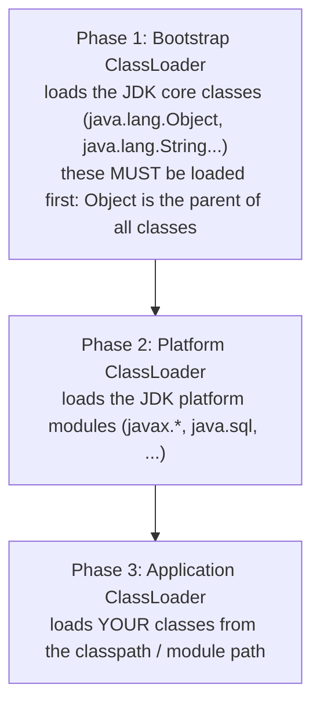
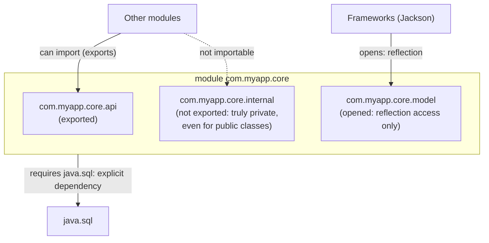

# 56. Java Core Foundations — Missing Pieces

**Navigation**: [< Strings & Immutability](Ch02_Strings_Immutability.md) | [Back to Index](../00_MASTER_INDEX.md)

## 0. War Stories — When Java's "Simple" Rules Break Production

### Story 1: The HashMap cache that silently stopped caching

A team built a user-role cache: `Map<User, Set<Role>> roleCache`. The `User` class had 10 fields. A dev added `equals()` to compare by `userId`. He did NOT add `hashCode()`.

Result: `roleCache.get(user)` always returned `null` — even when the same user had been put() a second ago. The cache was useless. Every request hit the database.

Root cause: HashMap locates buckets using `hashCode()`. The default `hashCode()` (from `Object`) returns a memory address. Two `User` objects with the same `userId` have different memory addresses → different hash codes → different buckets → `get()` looks in the wrong bucket → null.

The contract: if `a.equals(b)` is true, `a.hashCode()` MUST equal `b.hashCode()`. Violate this contract → HashMap, HashSet, Hashtable, LinkedHashMap silently malfunction.

```java
// ❌ BROKEN — equals without hashCode
@Override
public boolean equals(Object o) {
    if (!(o instanceof User)) return false;
    return this.userId.equals(((User) o).userId);
}
// hashCode() not overridden → uses Object default (memory address) → cache never hits

// ✅ CORRECT — both must use the same fields
@Override
public int hashCode() {
    return Objects.hash(userId); // SAME field(s) as equals()
}
```

### Story 2: The `ConcurrentModificationException` in production under load

A billing service iterated over orders to apply discounts:

```java
for (Order order : orders) {
    if (order.isEligible()) {
        orders.remove(order); // ← production crash
        discountedOrders.add(order);
    }
}
```

In dev (single-threaded, small list): worked fine. In production (high load, 800 orders): `ConcurrentModificationException` on random requests.

Cause: `ArrayList`'s iterator is fail-fast — it tracks a `modCount` counter. Any structural modification (`remove`, `add`) while iterating increments `modCount`. The iterator checks `modCount` on every `next()` call and throws if it changed. No concurrency needed — a SINGLE thread modifying its own list mid-iteration triggers this.

```java
// ✅ Safe: collect removes, apply after iteration
List<Order> toDiscount = new ArrayList<>();
for (Order order : orders) {
    if (order.isEligible()) toDiscount.add(order);
}
orders.removeAll(toDiscount); // modify AFTER iteration completes
```

### Story 3: The Integer comparison that worked in test and failed in prod

A payment system compared order amounts as `Integer`:

```java
Integer orderId1 = 127;
Integer orderId2 = 127;
if (orderId1 == orderId2) // ✅ true in both test and prod

Integer amount1 = 1500;
Integer amount2 = 1500;
if (amount1 == amount2) // ✅ true in test (small dataset)
                        // ❌ false in PROD (different heap objects)
```

The bug: Java caches `Integer` objects for values -128 to 127 (the Integer cache). `Integer.valueOf(127)` always returns the SAME cached object. `Integer.valueOf(1500)` creates a NEW object each time. `==` compares object references, not values. For amounts above 127, `==` compares two different heap objects → false.

In test: order amounts were seeded as small numbers (order #1, #5, #42) — all in the cache range. In prod: real payment amounts (1500, 2999) — outside the cache.

```java
// ❌ Never use == for Integer/Long/Double comparison
if (amount1 == amount2)

// ✅ Always use .equals() for wrapper type comparison
if (amount1.equals(amount2))
// Or unbox explicitly:
if (amount1.intValue() == amount2.intValue())
```

---

## 🔑 JVM Class Loading Sequence — Why It Matters

**JVM startup sequence (from byte 0 to your `main()` method)**



**How to read this diagram.** The three class loaders run in this order. Each loaded class then goes through three sub-phases:

1. **Load:** read the `.class` bytes from disk.
2. **Link:**
   - **Verify:** check that the bytecode is valid (type safety).
   - **Prepare:** allocate memory for static fields (set to their defaults).
   - **Resolve:** convert symbolic method references to direct pointers.
3. **Initialize:** run static initializers and static field assignments.

**Why this matters**

1. A class is loaded ONCE and initialized ONCE, so its static field initializers run once.
2. This is why the Singleton via the initialization-on-demand holder is thread-safe. The JVM guarantees that class initialization is atomic, so no synchronization is needed:

```java
class Singleton {
    private static class Holder { static final Singleton INSTANCE = new Singleton(); }
    public static Singleton getInstance() { return Holder.INSTANCE; }
}
```

3. `printStackTrace` shows "Caused by: ExceptionInInitializerError" when a static initializer throws. The class then becomes unusable for the rest of the JVM's lifetime.

---

## PART 1: INNER CLASSES & INITIALIZATION

### 🧠 Theory Lens: Lexical Scoping and the State Encapsulation Problem

Before memorizing Java's 4 types of inner classes, you must understand the language-design problem they solve structurally: **Object-to-Object State Coupling.**

In pure Object-Oriented design, sibling objects should be strictly decoupled. However, certain helper entities (like Collection Iterators or UI ActionListeners) intrinsically make _no sense_ unless they are deeply welded to a parent instance's hidden state. An `ArrayList.Iterator` _must_ indiscriminately access the private internal array of its parent `ArrayList`.

**The Architectural Compromise:**
Instead of forcing developers to break encapsulation (by exposing private fields as `public`) or manually passing `this` parent references backward through child constructors, Java's architects introduced Inner Classes.

Fundamentally, Inner Classes are **Compiler Syntactic Sugar**. At the runtime JVM level, an "Inner Class" does not exist. The Java `javac` compiler simply extracts the nested class, flattens it, and silently injects a hidden pointer field (named `this$0`) so the child can silently deference the parent's memory address. Realizing that non-static inner classes are just "hidden memory anchors" makes it mathematically obvious why they cause massive memory leaks if allowed to outlive their parent.

---

**Challenge (Reasoning):** A non-static inner class holds a hidden reference to the outer class (`Outer.this`). Why does this cause memory leaks in Android and why does `static` inner class fix it?

<details><summary>Answer</summary>

When you pass a non-static inner class instance (e.g., an AsyncTask or Handler) to a Thread/callback system, the inner object HOLDS a reference to the outer Activity/Fragment. If the outer is destroyed (user navigates away) but the inner is still running, the GC cannot collect the outer — memory leak. A `static` inner class has NO implicit reference to the outer instance, so the outer can be garbage collected freely. If the static inner needs to access the outer, use a `WeakReference<OuterClass>` — weak references don't prevent GC.

</details>

## 1. Inner Classes — 4 Types

| Type | Access to outer | Use case |
| --- | --- | --- |
| Static nested class | Only static members | Helper class, Builder |
| Non-static inner class | Full (including the outer's `this`) | Tightly coupled logic |
| Local inner class | Full, plus effectively final local variables | Complex one-off inside a method body |
| Anonymous inner class | Full, plus effectively final local variables | Quick interface implementation (replaced by a lambda) |

```java
public class Outer {
    private int outerField = 10;
    private static int staticField = 20;

    // ── 1. STATIC NESTED CLASS ──
    // Has NO reference to Outer instance
    // Can only access Outer's static members
    static class StaticNested {
        void show() {
            System.out.println(staticField);    // ✅ static — OK
            // System.out.println(outerField);  // ❌ Compile error
        }
    }

    // ── 2. NON-STATIC INNER CLASS ──
    // Has implicit reference to Outer instance (Outer.this)
    // ⚠️ Holds reference → can cause memory leak if inner outlives outer
    class Inner {
        void show() {
            System.out.println(outerField);     // ✅ can access outer's fields
            System.out.println(Outer.this.outerField); // ✅ explicit outer ref
        }
    }

    void method() {
        final int localVar = 42;

        // ── 3. LOCAL INNER CLASS ──
        // Defined inside a method, can access effectively final locals
        class LocalInner {
            void show() {
                System.out.println(outerField);  // ✅
                System.out.println(localVar);    // ✅ must be effectively final
            }
        }
        new LocalInner().show();

        // ── 4. ANONYMOUS INNER CLASS ──
        // Implements interface or extends class inline
        Runnable r = new Runnable() {
            @Override
            public void run() {
                System.out.println(outerField);  // ✅
                System.out.println(localVar);    // ✅ effectively final
            }
        };
    }
}

// How to instantiate:
Outer outer = new Outer();
Outer.StaticNested sn = new Outer.StaticNested();  // No outer instance needed
Outer.Inner inner = outer.new Inner();              // Needs outer instance!
```

### Lambda vs Anonymous Inner Class

|  | Lambda | Anonymous Inner Class |
| --- | --- | --- |
| Works with<br>Has own 'this'?<br>Creates .class file?<br>Performance<br>Readability<br>Can have state? | Functional interface (exactly 1 method)<br>NO — 'this' = outer<br>NO (invokedynamic)<br>Slightly better<br>More concise<br>NO | Any interface/class (any number of methods)<br>YES — 'this' = anon<br>YES (Outer$1.class)<br>Slightly worse<br>More verbose<br>YES (fields) |
| RULE | Prefer lambda for functional interfaces | Use when multiple methods needed |

```java
// Lambda — 'this' refers to ENCLOSING class
Runnable lambda = () -> System.out.println(this);  // 'this' = Outer

// Anonymous — 'this' refers to the ANONYMOUS class
Runnable anon = new Runnable() {
    public void run() {
        System.out.println(this);  // 'this' = the Runnable$1 instance
    }
};
```

---

🔬 **Section Challenge — 1. Inner Classes — 4 Types**

**Challenge 1 (Debug — Who/When/What):** A non-static inner class instance is stored in a long-lived cache. **Who** holds the implicit reference to the outer class? **What** memory leak does this cause? **When** does the outer class become eligible for GC?\n\n<details><summary>Answer</summary>\n\n**Who holds the implicit ref?** Every non-static inner class instance holds a hidden `OuterClass.this` reference — it's a synthetic field added by the compiler, invisible in your code. **Memory leak:** The cache keeps the inner class alive → inner class keeps the outer class alive → the entire outer class (and all its fields) cannot be GC'd even if nothing else references it. **When GC eligible?** Only when the cache entry is evicted AND the inner class instance is no longer reachable. **Fix:** Use a static nested class (no implicit outer reference) for cache entries: `static class CacheEntry { }`. Or extract to a top-level class. This is a classic Android/Swing memory leak: anonymous `Runnable`/`Listener` captures the enclosing Activity/Frame.\n\n</details>

## 2. Initialization Order — The Exact Sequence

```text
CLASS LOADING ORDER (happens ONCE per class):

1. Parent class loaded first (recursively)
2. Static fields — in order of appearance
3. Static initializer blocks — in order of appearance

OBJECT CREATION ORDER (happens EACH time 'new' is called):

4. Parent instance fields & initializers — in order
5. Parent constructor body
6. Child instance fields & initializers — in order
7. Child constructor body
```

```java
class Parent {
    static { System.out.println("1. Parent   static block"); }
    { System.out.println("4. Parent   instance block"); }

    Parent() { System.out.println("5. Parent   constructor"); }
}

class Child extends Parent {
    static { System.out.println("2. Child    static block"); }
    { System.out.println("6. Child    instance block"); }

    Child() { System.out.println("7. Child    constructor"); }
}

// new Child() prints:
// 1. Parent   static block     ← class loading (once)
// 2. Child    static block     ← class loading (once)
// 4. Parent   instance block   ← object creation
// 5. Parent   constructor      ← object creation
// 6. Child    instance block   ← object creation
// 7. Child    constructor      ← object creation

// Second new Child() prints only 4-7 (static blocks run ONCE):
// 4. Parent   instance block
// 5. Parent   constructor
// 6. Child    instance block
// 7. Child    constructor
```

---

**Challenge (Reasoning):** Parent constructor calls an overridable method `init()`. Child overrides `init()`. When `new Child()` is called, `init()` runs while Child's fields are still 0/null. Why is this dangerous?

<details><summary>Answer</summary>

Java initialization order: Parent static → Child static → Parent instance fields → Parent constructor → Child instance fields → Child constructor. The Parent constructor runs BEFORE Child's fields are initialized. If Parent's constructor calls `init()` (which is overridden), it runs the CHILD's version while the Child's fields are still at their default values (0/null). Pattern: never call overridable methods from constructors. Mark `init()` as `final` or use a factory method pattern instead.

</details>

## 3. Wrapper Classes & Caching Trap

```java
// Integer cache: -128 to 127 are cached (pre-created objects)
Integer a = 127;
Integer b = 127;
System.out.println(a == b);   // true — SAME cached object

Integer c = 128;
Integer d = 128;
System.out.println(c == d);   // false — DIFFERENT objects!

Integer e = -128;
Integer f = -128;
System.out.println(e == f);   // true — cached

Integer g = -129;
Integer h = -129;
System.out.println(g == h);   // false — outside cache range!

// RULE: ALWAYS use .equals() to compare wrapper objects
System.out.println(c.equals(d));  // true ✅

// Which wrappers have caches?
// Integer: -128 to 127 (can be increased with -XX:AutoBoxCacheMax)
// Short:   -128 to 127
// Byte:    -128 to 127 (all values — byte range)
// Long:    -128 to 127
// Character: 0 to 127
// Boolean:   TRUE and FALSE (both cached)
// Float/Double: NO CACHE
```

### Autoboxing & Unboxing Pitfalls

```java
// Autoboxing: primitive → wrapper (automatic)
Integer x = 42;        // int 42 → Integer.valueOf(42)

// Unboxing: wrapper → primitive (automatic)
int y = x;             // Integer.intValue() → 42

// ⚠️ PITFALL 1: NullPointerException on unboxing null
Integer z = null;
int zz = z;            // NullPointerException! null.intValue()

// ⚠️ PITFALL 2: Unnecessary boxing in performance-critical code
Long sum = 0L;
for (long i = 0; i < 1_000_000; i++) {
    sum += i;  // Unbox sum, add, REBOX sum → creates 1M Long objects!
}

// ✅ Fix: use primitive
long sum = 0L;
for (long i = 0; i < 1_000_000; i++) {
    sum += i;  // No boxing — fast!
}

// ⚠️ PITFALL 3: Widening vs Boxing precedence
// Widening wins over boxing:
void method(long x)    { }  // Called for method(5) → int widened to long
void method(Integer x) { }  // NOT called for method(5)

// Widening wins over varargs:
void method(long x)    { }  // Called for method(5)
void method(int... x)  { }  // NOT called for method(5)
```

---

## PART 2: COMPARABLE, COMPARATOR & OPTIONAL

---

## 4. Comparable vs Comparator — Complete Guide

|  | Comparable<T> | Comparator<T> |
| --- | --- | --- |
| Package<br>Method<br>Where defined<br>Sorts<br>Collections.sort | java.lang compareTo(T other)<br>Inside the class<br>Natural order (1 way) sort(list) | java.util compare(T a, T b)<br>Outside the class<br>Custom order (many) sort(list, comparator) |
| Think of it as | "I know how to sort myself" | "Someone else decides how to sort me" |

```java
// Comparable — natural ordering (defined inside the class)
public class Employee implements Comparable<Employee> {
    private String name;
    private int age;
    private double salary;

    @Override
    public int compareTo(Employee other) {
        return Integer.compare(this.age, other.age);  // Natural: by age
    }
}

// Comparator — external, multiple orderings
Comparator<Employee> byName = Comparator.comparing(Employee::getName);
Comparator<Employee> bySalary = Comparator.comparingDouble(Employee::getSalary);

// Chained sorting — multi-level
Comparator<Employee> complex = Comparator
    .comparing(Employee::getName)                      // 1st: by name
    .thenComparingInt(Employee::getAge)                // 2nd: by age
    .thenComparingDouble(Employee::getSalary)          // 3rd: by salary
    .reversed();                                       // Descending

// Null handling
Comparator<Employee> nullSafe = Comparator
    .nullsFirst(Comparator.comparing(Employee::getName));

// nullsFirst  → nulls come before non-null values
// nullsLast   → nulls come after non-null values

// Sort with null-safe field
Comparator<Employee> byNullableDept = Comparator
    .comparing(Employee::getDepartment,
        Comparator.nullsLast(Comparator.naturalOrder()));

// Reverse natural order
Collections.sort(list);                                     // Ascending
Collections.sort(list, Comparator.reverseOrder());          // Descending
Collections.sort(list, Comparator.comparing(Employee::getName).reversed());
```

---

## 5. Optional — Deep Dive

```java
// WHAT: A container that may or may not hold a non-null value
// WHY: Explicit "might be absent" — avoids NullPointerException

// ── CREATING ──
Optional<String> present = Optional.of("hello");      // Must be non-null
Optional<String> empty   = Optional.empty();           // No value
Optional<String> maybe   = Optional.ofNullable(null);  // null → empty

// ── CHECKING & GETTING ──
present.isPresent();             // true
present.isEmpty();               // true (Java 11)

present.get();                   // "hello" — ⚠️ throws if empty!
present.orElse("default");      // "hello" (value exists, returns it)
empty.orElse("default");        // "default" (no value, returns default)
empty.orElseGet(() -> compute());    // Lazy — only computes if empty
empty.orElseThrow();                 // NoSuchElementException
empty.orElseThrow(() -> new NotFoundException("not found"));

// ── TRANSFORMING ──
Optional<String> upper = present.map(String::toUpperCase);  // Optional["HELLO"]
empty.map(String::toUpperCase);                              // Optional.empty()

// flatMap — when the function returns Optional
Optional<String> result = findUser("id")
    .flatMap(User::getEmail)     // User::getEmail returns Optional<String>
    .map(String::toLowerCase);

// filter — keep value only if it matches
Optional<String> filtered = present
    .filter(s -> s.length() > 3);  // Optional["hello"]
present.filter(s -> s.length() > 10);  // Optional.empty()

// ── CHAINING (Pipeline) ──
String display = findUser(id)
    .flatMap(User::getAddress)
    .map(Address::getCity)
    .map(String::toUpperCase)
    .orElse("UNKNOWN");
```

### Optional Anti-Patterns

```java
// ❌ ANTI-PATTERN 1: Optional for fields
class User {
    Optional<String> email;  // ❌ Never! Use @Nullable or just null
}

// ❌ ANTI-PATTERN 2: Optional as method parameter
void sendEmail(Optional<String> to) { }  // ❌ Awkward for callers
void sendEmail(String to) { }            // ✅ Just accept nullable

// ❌ ANTI-PATTERN 3: Optional.get() without checking
String value = optional.get();  // ❌ Can throw NoSuchElementException
String value = optional.orElse("default");  // ✅ Safe

// ❌ ANTI-PATTERN 4: isPresent() + get() instead of map/orElse
if (optional.isPresent()) {       // ❌ Old-style — defeats the purpose
    return optional.get();
}
return optional.orElse("default"); // ✅ Functional style

// ❌ ANTI-PATTERN 5: Optional.of(null)
Optional.of(null);  // ❌ NullPointerException!
Optional.ofNullable(null);  // ✅ Returns Optional.empty()

// ✅ WHEN TO USE OPTIONAL:
// - Return type of methods that might not have a result
//   Optional<User> findById(String id);
// - Stream terminal operations: findFirst(), findAny(), reduce()
// - Chaining transformations on possibly-absent values
```

---

## PART 3: ITERATOR, CLONE & VARARGS

---

## 6. Iterator & Iterable — Fail-Fast vs Fail-Safe

```java
// Iterable — "I can produce an Iterator"
// Iterator — "I can traverse elements one by one"

public interface Iterable<T> {
    Iterator<T> iterator();
}

public interface Iterator<T> {
    boolean hasNext();
    T next();
    default void remove() { throw new UnsupportedOperationException(); }
}

// Any class implementing Iterable can use for-each:
for (String s : myCollection) { }  // Calls iterator() internally
```

### Fail-Fast Iterators

```java
// ArrayList, HashMap, HashSet — FAIL-FAST iterators
// If collection is modified during iteration → ConcurrentModificationException

List<String> list = new ArrayList<>(List.of("a", "b", "c"));
for (String s : list) {
    if (s.equals("b")) {
        list.remove(s);  // ❌ ConcurrentModificationException!
    }
}

// ✅ Fix 1: Use Iterator.remove()
Iterator<String> it = list.iterator();
while (it.hasNext()) {
    if (it.next().equals("b")) {
        it.remove();  // ✅ Safe removal during iteration
    }
}

// ✅ Fix 2: Use removeIf() (Java 8+)
list.removeIf(s -> s.equals("b"));  // ✅ Clean and safe

// ✅ Fix 3: Use CopyOnWriteArrayList (concurrent collection)
List<String> concurrent = new CopyOnWriteArrayList<>(List.of("a", "b", "c"));
for (String s : concurrent) {
    concurrent.remove(s);  // ✅ No exception — iterates over snapshot
}
```

### Fail-Safe Iterators

```java
// ConcurrentHashMap, CopyOnWriteArrayList — FAIL-SAFE iterators
// They iterate over a SNAPSHOT or weakly consistent view
// Never throw ConcurrentModificationException

ConcurrentHashMap<String, Integer> map = new ConcurrentHashMap<>();
map.put("a", 1);
map.put("b", 2);

for (Map.Entry<String, Integer> entry : map.entrySet()) {
    map.put("c", 3);  // ✅ No exception — weakly consistent
}
// May or may not see "c" during iteration — that's "weakly consistent"
```

---

## 7. Clone — Deep vs Shallow

```java
// Cloneable is a MARKER interface (no methods)
// Override clone() from Object to provide copying

// SHALLOW CLONE — copies references, not the objects they point to
public class Employee implements Cloneable {
    String name;
    Address address;  // Mutable reference!

    @Override
    public Employee clone() {
        try {
            return (Employee) super.clone();  // Shallow copy
        } catch (CloneNotSupportedException e) {
            throw new AssertionError();  // Can't happen — we implement Cloneable
        }
    }
}

Employee original = new Employee("Harsha", new Address("Hyderabad"));
Employee clone = original.clone();

clone.address.setCity("Bangalore");
System.out.println(original.address.getCity());  // "Bangalore"! — SHARED reference

// DEEP CLONE — copies everything recursively
@Override
public Employee clone() {
    try {
        Employee clone = (Employee) super.clone();
        clone.address = this.address.clone();  // Also clone Address
        return clone;
    } catch (CloneNotSupportedException e) {
        throw new AssertionError();
    }
}

// ⚠️ Clone is BROKEN by design (Effective Java)
// Problems:
// - Cloneable has no clone method (it's on Object)
// - clone() returns Object (need casting)
// - No constructor is called (bypasses initialization)
// - Shallow by default (must manually deep-copy each field)

// ✅ BETTER ALTERNATIVES:
// 1. Copy constructor
public Employee(Employee other) {
    this.name = other.name;
    this.address = new Address(other.address);  // Deep copy
}

// 2. Static factory
public static Employee copyOf(Employee other) {
    return new Employee(other.name, new Address(other.address));
}
```

---

## 8. equals() and hashCode() Contract

```java
// THE CONTRACT:
// 1. If a.equals(b) → a.hashCode() == b.hashCode()   (MUST)
// 2. If a.hashCode() != b.hashCode() → !a.equals(b)  (MUST)
// 3. If a.hashCode() == b.hashCode() → a.equals(b) OR !a.equals(b) (collisions OK)

// ❌ BROKEN: Override equals() but NOT hashCode()
class Point {
    int x, y;

    @Override
    public boolean equals(Object o) {
        if (this == o) return true;
        if (!(o instanceof Point p)) return false;
        return x == p.x && y == p.y;
    }
    // Missing hashCode()!
}

Point p1 = new Point(1, 2);
Point p2 = new Point(1, 2);
p1.equals(p2);  // true

Set<Point> set = new HashSet<>();
set.add(p1);
set.contains(p2);  // FALSE! Different hashCode → different bucket

// ✅ CORRECT: Override BOTH
@Override
public int hashCode() {
    return Objects.hash(x, y);  // Uses both fields — matches equals()
}

// RULES for equals():
// 1. Reflexive: a.equals(a) → true
// 2. Symmetric: a.equals(b) ↔ b.equals(a)
// 3. Transitive: a.equals(b) && b.equals(c) → a.equals(c)
// 4. Consistent: multiple calls → same result (if state unchanged)
// 5. a.equals(null) → false

// Modern pattern (Java 16+):
@Override
public boolean equals(Object o) {
    if (this == o) return true;
    if (!(o instanceof Point p)) return false;  // pattern matching
    return x == p.x && y == p.y;
}
```

---

## PART 4: FUNCTIONAL INTERFACES & JPMS

---

**Challenge (Reasoning):** `@FunctionalInterface` is an annotation, not a compiler keyword. What does it actually do?

<details><summary>Answer</summary>

It's a marker annotation that causes the COMPILER to verify the interface has exactly one abstract method. It does NOT make the interface a functional interface — any interface with exactly one abstract method is already functional (lambdas can implement it). `@FunctionalInterface` just: (1) documents intent, (2) prevents accidental addition of a second abstract method. Without it: if someone later adds a second abstract method, the annotation causes a compile error instead of silently breaking all lambda usages.

</details>

## 9. All Built-in Functional Interfaces

| Interface | Input | Output | Method |
| --- | --- | --- | --- |
| `Function<T,R>` | `T` | `R` | `apply(T)` |
| `BiFunction<T,U,R>` | `T, U` | `R` | `apply(T,U)` |
| `UnaryOperator<T>` | `T` | `T` (same type) | `apply(T)` |
| `BinaryOperator<T>` | `T, T` | `T` (same type) | `apply(T,T)` |
| `Predicate<T>` | `T` | `boolean` | `test(T)` |
| `BiPredicate<T,U>` | `T, U` | `boolean` | `test(T,U)` |
| `Consumer<T>` | `T` | `void` | `accept(T)` |
| `BiConsumer<T,U>` | `T, U` | `void` | `accept(T,U)` |
| `Supplier<T>` | none | `T` | `get()` |
| `Runnable` | none | `void` | `run()` |
| `Callable<V>` | none | `V` (and may throw) | `call()` |

```java
// Primitive specializations (avoid boxing):
IntFunction<String>      // int → String
ToIntFunction<String>    // String → int
IntPredicate             // int → boolean
IntConsumer              // int → void
IntSupplier              // () → int
IntUnaryOperator         // int → int
IntBinaryOperator        // int, int → int
// Same for Long, Double: LongFunction, DoubleConsumer, etc.

// Composition (chaining):
Function<String, String> trim = String::trim;
Function<String, String> upper = String::toUpperCase;
Function<String, String> pipeline = trim.andThen(upper);
pipeline.apply("  hello  ");  // "HELLO"

Predicate<String> notEmpty = s -> !s.isEmpty();
Predicate<String> isShort = s -> s.length() < 5;
Predicate<String> combined = notEmpty.and(isShort);
combined.test("hi");  // true

// Custom functional interface:
@FunctionalInterface
public interface Converter<F, T> {
    T convert(F from);
    // Can have default and static methods
    // But ONLY ONE abstract method
}

Converter<String, Integer> toInt = Integer::parseInt;
```

---

**Challenge (Reasoning):** `Function<T,R>` vs `UnaryOperator<T>` — they look identical. When would you choose one over the other?

<details><summary>Answer</summary>

`UnaryOperator<T>` extends `Function<T,T>` (same input and output type). Choose `UnaryOperator<T>` when the transformation PRESERVES the type (e.g., `UnaryOperator<String> trim = String::trim`). This communicates intent: "I'm transforming a T into another T". Choose `Function<T,R>` when input and output types differ (e.g., `Function<String, Integer> length = String::length`). In practice: use the most specific interface — better readability and allows more specific composition methods.

</details>

## 10. Java Module System (JPMS) — Java 9+

```text
WHAT: Module = a named, self-describing collection of packages
WHY:  Strong encapsulation (hide internal packages),
      reliable configuration (explicit dependencies),
      smaller runtime (custom JRE with jlink)
```

```java
// module-info.java — placed in the module root
module com.myapp.core {
    requires java.sql;              // I depend on java.sql
    requires transitive java.logging; // My users also get java.logging

    exports com.myapp.core.api;     // Public API — other modules can use
    // com.myapp.core.internal is NOT exported — truly hidden!

    opens com.myapp.core.model to com.fasterxml.jackson.databind;
    // Opens for reflection (needed for Jackson serialization)
}
```



**How to read this diagram.** `exports` makes a package importable by other modules. A package that is not exported stays hidden, even if its classes are `public`. `requires` declares a dependency, and `opens` allows deep reflection on a package without exporting it for normal use.

```java
// Key keywords:
// module     — declares a module
// requires   — this module depends on another
// exports    — makes a package accessible to other modules
// opens      — allows reflection access (for frameworks like Spring)
// provides   — provides a service implementation
// uses       — consumes a service
// transitive — my dependents also get this dependency

// Most projects still use classpath (no modules)
// Modules are important for: libraries, JDK itself, large modular apps

// Quick check: which modules does JDK have?
// java --list-modules
// java.base, java.sql, java.logging, java.xml, etc.
```

---

## 11. Varargs — Rules and Pitfalls

```java
// Varargs = variable number of arguments (syntactic sugar for array)
void print(String... messages) {
    // messages is actually String[] internally
    for (String msg : messages) {
        System.out.println(msg);
    }
}

print("a");                    // ✅
print("a", "b", "c");         // ✅
print();                       // ✅ empty array
print(new String[]{"a", "b"}); // ✅ pass array directly

// RULES:
// 1. Only ONE varargs parameter per method
// 2. Must be the LAST parameter
void method(int x, String... names) { }  // ✅
// void method(String... names, int x) { }  // ❌ Compile error!

// OVERLOAD RESOLUTION PITFALL:
void method(int... args) { }
void method(int a, int b) { }

method(1, 2);  // Calls method(int a, int b) — exact match wins!
method(1);     // Calls method(int... args) — only varargs matches
method();      // Calls method(int... args) — empty varargs

// HEAP POLLUTION with generic varargs:
@SafeVarargs  // Suppress warning — you promise no heap pollution
static <T> List<T> listOf(T... elements) {
    return List.of(elements);
}
```

---

## 12. Interview Questions & Answers

**Q: What are the 4 types of inner classes? When do you use each?**
(1) Static nested — utility class like Builder, no outer reference. (2) Non-static inner — tightly coupled to outer, has Outer.this reference, can cause memory leaks. (3) Local inner — defined in method, used for complex one-off logic. (4) Anonymous inner — inline interface implementation, mostly replaced by lambdas. Use lambda for functional interfaces; anonymous inner when multiple methods needed.

**Q: What's the initialization order in Java?**
Class loading (once): parent static fields/blocks → child static fields/blocks. Object creation (each time): parent instance fields/blocks → parent constructor → child instance fields/blocks → child constructor. Static blocks run on first class access, instance blocks run before constructor body.

**Q: Why does `Integer a = 127; Integer b = 127; a == b` return true but `128 == 128` returns false?**
Integer caches values -128 to 127 (IntegerCache). Autoboxed values in this range return the same cached object, so `==` is true. Outside this range, new Integer objects are created, so `==` compares references (false). Always use `.equals()` for wrapper comparison.

**Q: Comparable vs Comparator?**
Comparable defines ONE natural ordering inside the class (`compareTo`). Comparator defines EXTERNAL custom orderings (can have many). Use `Comparator.comparing(...).thenComparing(...)` chains for multi-level sorting. Use `nullsFirst/nullsLast` for null safety. Use `.reversed()` for descending.

**Q: When should you use Optional?**
Use as method return type when absence is a valid result (e.g., `findById`). Never as field type, constructor parameter, or method parameter. Use `map/flatMap/filter/orElse` chains — avoid `isPresent()+get()`. Never call `Optional.of(null)` — use `ofNullable`. Stream operations like `findFirst()` already return Optional.

**Q: Fail-fast vs fail-safe iterators?**
Fail-fast (ArrayList, HashMap): throw ConcurrentModificationException if collection modified during iteration. Use `Iterator.remove()` or `removeIf()` for safe removal. Fail-safe (ConcurrentHashMap, CopyOnWriteArrayList): iterate over snapshot/weakly-consistent view, never throw CME but may not reflect concurrent changes.

**Q: Why is clone() considered broken in Java?**
Cloneable is a marker interface with no methods (clone is on Object), default is shallow copy (shared references), no constructor called (bypasses initialization), and return type is Object. Use copy constructors or static factory methods (`copyOf`) instead — explicit, type-safe, and deep by design.

---

**Key Takeaway**: Inner classes capture outer references (memory leak risk).
Initialization follows parent-first, static-first order. Integer caching makes
`==` unreliable for wrappers. Use Comparator chains for complex sorting.
Optional is for return types only. Clone is broken — use copy constructors.

**Navigation**: [< Strings & Immutability](Ch02_Strings_Immutability.md) | [Back to Index](../00_MASTER_INDEX.md)


---

## Reality Check

**"Java is purely object-oriented — everything is an object"** → Not true. The 8 primitive types (`int`, `long`, `double`, `boolean`, `byte`, `short`, `char`, `float`) are NOT objects. They have no methods, no null, no identity. `int x = 5` stores the value directly on the stack or in object fields. Autoboxing (`Integer x = 5`) wraps them in objects but creates allocation and unboxing overhead. This distinction matters for generics (can't use `List<int>`) and performance.

**"The main() method is just a convention — I could name it anything"** → The JVM entry-point contract requires exactly: `public static void main(String[] args)`. The JVM looks for this specific signature at startup. You can have other methods named anything, but the JVM won't call them at startup. `public static void main(String... args)` works (varargs is compatible). `public void main(String[] args)` (missing `static`) compiles but the JVM cannot call it without an instance.

**"Java pass-by-reference means objects are passed directly"** → Java is ALWAYS pass-by-value. For objects, the value passed is the *reference* (memory address). The method receives a copy of that address — it can use it to mutate the object, but reassigning the parameter to a new object does not affect the caller's variable. No Java mechanism passes the variable itself.

**"An interface can only have abstract methods"** → Since Java 8: default methods (concrete implementation). Since Java 9: private methods (for code reuse within the interface). Static methods always worked. Constant fields (`public static final`) always worked. A Java interface today is much closer to an abstract class than the original design — the main remaining distinctions are no instance fields and multiple inheritance support.

**"Integer.MAX_VALUE + 1 throws an exception"** → Silent integer overflow. `Integer.MAX_VALUE + 1 = Integer.MIN_VALUE` (-2,147,483,648). No exception is thrown — Java integer arithmetic wraps around silently (two's complement). For safe arithmetic, use `Math.addExact()` (throws `ArithmeticException` on overflow), `long` for larger ranges, or `BigInteger` for arbitrary precision.
