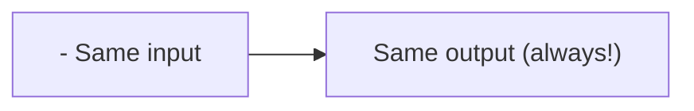

**Navigation**: [< Previous](Ch24_Spring_Boot_Roadmap.md) | [Back to Index](../00_MASTER_INDEX.md) | [Next >](Ch20_AlgoEng_Core.md)

# 🎯 Functional Programming in Java

## Thinking in Functions

---


🔬 **Section Challenge — Thinking in Functions**

**Challenge 1 (Reasoning):** In Java Functional Programming, what is the core difference between a `Supplier<T>` and a `Function<T, R>`?
<details><summary>Answer</summary>

Input requirements. A `Function<T, R>` represents a transformation. It takes exactly one argument of type `T` and returns a result of type `R` (e.g., taking an `Integer` ID and returning a `User` object). A `Supplier<T>` takes zero arguments and generates a result of type `T` (e.g., generating a random UUID or fetching the current timestamp). It is essentially a factory method.
</details>


# 🎯 WHY-HOW-WHEN-WHICH FRAMEWORK

### Why Learn Functional Programming in Java?

- Spring Boot uses lambdas everywhere — WebFlux, callbacks, configs
- **Stream API**: 10 lines of loops → 1 elegant line
- **Parallelism**: `.parallelStream()` for instant multi-core processing
- **Interview favorite**: "Write this with streams" — a common interview task
- Modern Java (8+) features are expected knowledge

### How Does Functional Programming Work?

- **Lambdas** — anonymous functions: `(x) -> x * 2`
- **Functional Interfaces** — one abstract method: `Predicate`, `Function`, `Consumer`
- **Stream Pipeline** — `source → intermediate ops → terminal op`
- **Method References** — `Class::method` shorthand for lambdas
- **Optional** — no more `NullPointerException`, explicit null handling

### When to Use Functional vs Imperative?

**Use Functional** when:
- Collection processing (filter, map, reduce)
- Parallel processing is needed
- Working with callbacks and event handlers

**Use Imperative** when:
- Complex control flow with `break`/`continue`
- Performance-critical with primitive arrays
- Stateful operations needing external mutation

### Which Functional Concepts to Master?

| Priority | Concepts |
|----------|----------|
| **Essential** | Lambda syntax, Stream API (filter/map/collect), Optional |
| **Important** | Method references, Collectors, flatMap, reduce |
| **Advanced** | Custom collectors, parallel streams, CompletableFuture |

---

# 📚 Part 0: Complete Understanding of Functional Programming


Functional programming is a paradigm where you build software by composing **pure functions** that avoid changing state and mutating data.

💡 **Key Insight**: Instead of telling the computer *how* to do something step-by-step, you describe *what* result you want.

**Analogy**:
- **Imperative (OOP)**: A recipe — *"Heat pan, add oil, wait 2 min, add onions, stir for 5 min..."*
- **Functional**: A transformation — *"Take raw ingredients → Apply cooking transformation → Get dish"*

### Historical Evolution

| Era | Milestone | Significance |
|-----|-----------|-------------|
| 1930s | Lambda calculus (Alonzo Church) | Mathematical foundation |
| 1958 | LISP | First functional programming language |
| 1973 | ML language | Type inference |
| 1990 | Haskell | Pure functional programming |
| 2014 | **Java 8** | Lambdas and streams brought FP to Java |
| Today | JS, Python, Scala | FP concepts in all major languages |

---

## What Problem Does Functional Programming Solve?

**Problem 1: Bugs from shared mutable state**

Imperative — risky (another thread could modify `total`):
```java
int total = 0;
for (Order o : orders) {
    total += o.getAmount();
}
```

Functional — safe (no mutable state):
```java
int total = orders.stream()
                   .mapToInt(Order::getAmount)
                   .sum();
```

**Problem 2**: Imperative code is **hard to parallelize** (needs careful synchronization). Pure functions can run in parallel safely.

**Problem 3**: Imperative code is **hard to test** (must set up state, mock dependencies). Pure functions just test input → output.

**Problem 4**: Imperative code is **hard to reason about** ("What's the value of x HERE vs THERE?"). Same input **always** gives same output in FP.

---


🔬 **Section Challenge — What Problem Does Functional Programming Solve?**

**Challenge 1 (Reasoning):** In Java Functional Programming, what is the core difference between a `Supplier<T>` and a `Function<T, R>`?
<details><summary>Answer</summary>

Input requirements. A `Function<T, R>` represents a transformation. It takes exactly one argument of type `T` and returns a result of type `R` (e.g., taking an `Integer` ID and returning a `User` object). A `Supplier<T>` takes zero arguments and generates a result of type `T` (e.g., generating a random UUID or fetching the current timestamp). It is essentially a factory method.
</details>


## Why Learn Functional Programming?

1. **Cleaner Code** — 10 lines of loop → 1 line of stream. More readable, less error-prone.
2. **Parallel Processing** — `list.parallelStream()` instantly parallelizes! Critical for big data, multi-core CPUs.
3. **Industry Demand** — React (JS) is functional, Spark (Big Data) is functional, modern Java uses streams extensively.
4. **Better Abstractions** — `map`, `filter`, `reduce` work on ANY collection. Write once, use everywhere.
5. **Interview Advantage** — *"Can you solve this with streams?"* Concise solutions impress interviewers.

---


🔬 **Section Challenge — Why Learn Functional Programming?**

**Challenge 1 (Reasoning):** In Java Functional Programming, what is the core difference between a `Supplier<T>` and a `Function<T, R>`?
<details><summary>Answer</summary>

Input requirements. A `Function<T, R>` represents a transformation. It takes exactly one argument of type `T` and returns a result of type `R` (e.g., taking an `Integer` ID and returning a `User` object). A `Supplier<T>` takes zero arguments and generates a result of type `T` (e.g., generating a random UUID or fetching the current timestamp). It is essentially a factory method.
</details>


## When to Use Functional vs Imperative

**Use Functional when**:
- Processing collections (filter, transform, aggregate)
- Need parallel processing
- Data transformations (pipelines)
- Avoiding side effects is important

**Use Imperative when**:
- Need early termination with complex conditions
- Modifying multiple variables in complex ways
- Performance-critical loops (sometimes)
- Index-based operations are clearer

✅ **Best Practice**: Use **both**! Java supports multi-paradigm. Use streams for data processing, loops when they're clearer. Don't force functional style where it doesn't fit.

---


🔬 **Section Challenge — When to Use Functional vs Imperative**
>
**Challenge 2 (Design):** `ROW_NUMBER()` vs `RANK()` vs `DENSE_RANK()` — show with an example where they produce different results.
<details><summary>Answer</summary>

Scores: [100, 90, 90, 80]. ROW_NUMBER: 1,2,3,4 (always unique, arbitrary for ties). RANK: 1,2,2,4 (gives same rank to ties, SKIPS the next rank). DENSE_RANK: 1,2,2,3 (same rank to ties, NO skipping). Use: ROW_NUMBER for pagination (must be unique). RANK when you want 'no 3rd place if two tied for 2nd'. DENSE_RANK when you want consecutive ranks despite ties.
</details>


## Difficulties in Learning FP

1. **"I think in loops"** — Start by converting existing loops to streams: `for` → `forEach`, `if` → `filter`, transformation → `map`
2. **"Lambdas are confusing"** — Think of them as "mini-functions without a name": `(x) -> x * 2` just doubles
3. **"Debugging is hard"** — Break long streams into smaller pieces. Add `peek()` to see intermediate values.
4. **"Don't know which method to use"** — Master the 6 core operations first: `filter`, `map`, `flatMap`, `reduce`, `collect`, `forEach`
5. **"When is it overkill?"** — If a simple loop is clearer, use the loop! FP is a tool, not a religion.

---


🔬 **Section Challenge — Difficulties in Learning FP**

**Challenge 1 (Reasoning):** In Java Functional Programming, what is the core difference between a `Supplier<T>` and a `Function<T, R>`?
<details><summary>Answer</summary>

Input requirements. A `Function<T, R>` represents a transformation. It takes exactly one argument of type `T` and returns a result of type `R` (e.g., taking an `Integer` ID and returning a `User` object). A `Supplier<T>` takes zero arguments and generates a result of type `T` (e.g., generating a random UUID or fetching the current timestamp). It is essentially a factory method.
</details>


## Expected Outcomes

- ✅ **Concise Code**: Replace 10-line loops with 1-line streams
- ✅ **Safer Code**: No shared mutable state bugs
- ✅ **Parallel Ready**: Easy parallelization when needed
- ✅ **Modern Java**: Use Java 8+ features professionally
- ✅ **Interview Ready**: Solve problems elegantly with streams
- ✅ **Cross-Language**: Same concepts in JavaScript, Python, Scala

🧠 **The Transformation**: FROM *"How do I iterate through this collection?"* → TO *"What transformation do I need to apply?"*


---

# 📌 Part 1: What is Functional Programming?

## The Mental Shift

**Imperative** (how to do it): *"Go to the store. Pick up milk. Go to checkout. Pay. Come back."*

**Functional** (what to do): *"Get milk from store."*

Imperative code:

```java
List<Integer> result = new ArrayList<>();
for (int num : numbers) {
    if (num % 2 == 0) {
        result.add(num * 2);
    }
}
```

Functional code:

```java
List<Integer> result = numbers.stream()
    .filter(n -> n % 2 == 0)
    .map(n -> n * 2)
    .collect(Collectors.toList());
```

## Core Principles

```
1. PURE FUNCTIONS
   - Same input → Same output (always!)
   - No side effects (doesn't modify external state)

   // IMPURE (modifies external state)
   int counter = 0;
   void incrementCounter() { counter++; }

   // PURE (no side effects)
   int increment(int x) { return x + 1; }

2. IMMUTABILITY
   - Don't modify data, create new data

   // MUTABLE (bad)
   list.add(item);  // Modifies original

   // IMMUTABLE (good)
   List<Item> newList = new ArrayList<>(list);
   newList.add(item);

3. FIRST-CLASS FUNCTIONS
   - Functions can be passed as arguments
   - Functions can be returned from functions
   - Functions can be stored in variables

4. DECLARATIVE STYLE
   - Describe WHAT you want, not HOW to get it
```

**Flow:**
1. - Same input
2. Same output (always!)



---


🔬 **Section Challenge — Core Principles**

**Challenge 1 (Reasoning):** In Java Functional Programming, what is the core difference between a `Supplier<T>` and a `Function<T, R>`?
<details><summary>Answer</summary>

Input requirements. A `Function<T, R>` represents a transformation. It takes exactly one argument of type `T` and returns a result of type `R` (e.g., taking an `Integer` ID and returning a `User` object). A `Supplier<T>` takes zero arguments and generates a result of type `T` (e.g., generating a random UUID or fetching the current timestamp). It is essentially a factory method.
</details>


# 📌 Part 2: Lambda Expressions

## Basic Syntax

```java
// ANONYMOUS FUNCTION SYNTAX:
// (parameters) -> expression
// (parameters) -> { statements; }

// EXAMPLES:

// No parameters
() -> System.out.println("Hello")

// One parameter (parentheses optional)
x -> x * 2
(x) -> x * 2

// Two parameters
(x, y) -> x + y

// Multiple statements (need braces and return)
(x, y) -> {
    int sum = x + y;
    return sum * 2;
}

// Type inference - Java figures out types
(String s) -> s.length()  // Explicit
s -> s.length()           // Inferred (cleaner)
```

## Common Usage Patterns

```java
// 1. SORTING
List<String> names = Arrays.asList("Bob", "Alice", "Charlie");

// Old way
Collections.sort(names, new Comparator<String>() {
    @Override
    public int compare(String a, String b) {
        return a.compareTo(b);
    }
});

// Lambda way
Collections.sort(names, (a, b) -> a.compareTo(b));

// Even simpler with method reference
names.sort(String::compareTo);


// 2. THREADING
// Old way
new Thread(new Runnable() {
    @Override
    public void run() {
        System.out.println("Running!");
    }
}).start();

// Lambda way
new Thread(() -> System.out.println("Running!")).start();


// 3. EVENT HANDLING
button.addActionListener(e -> handleClick(e));
```

---


# 📌 Part 3: Functional Interfaces

## What Are They?

```java
// An interface with EXACTLY ONE abstract method
// Can be used with lambda expressions

@FunctionalInterface  // Optional annotation for compile-time check
interface Greeting {
    void greet(String name);
}

// Usage
Greeting hello = name -> System.out.println("Hello, " + name);
hello.greet("Harsha");  // "Hello, Harsha"
```

## Built-in Functional Interfaces

```java
// Java provides these in java.util.function package:

// 1. Predicate<T> - Takes T, returns boolean
Predicate<Integer> isEven = n -> n % 2 == 0;
isEven.test(4);  // true
isEven.test(3);  // false

// 2. Function<T, R> - Takes T, returns R
Function<String, Integer> length = s -> s.length();
length.apply("Hello");  // 5

// 3. Consumer<T> - Takes T, returns nothing
Consumer<String> print = s -> System.out.println(s);
print.accept("Hello");  // prints "Hello"

// 4. Supplier<T> - Takes nothing, returns T
Supplier<Double> random = () -> Math.random();
random.get();  // random number

// 5. BiFunction<T, U, R> - Takes T and U, returns R
BiFunction<Integer, Integer, Integer> add = (a, b) -> a + b;
add.apply(3, 4);  // 7

// 6. BinaryOperator<T> - Takes two T, returns T
BinaryOperator<Integer> multiply = (a, b) -> a * b;
multiply.apply(3, 4);  // 12

// 7. UnaryOperator<T> - Takes T, returns T
UnaryOperator<Integer> square = n -> n * n;
square.apply(5);  // 25
```


🔬 **Section Challenge — Built-in Functional Interfaces**

**Challenge 1 (Reasoning):** In Java Functional Programming, what is the core difference between a `Supplier<T>` and a `Function<T, R>`?
<details><summary>Answer</summary>

Input requirements. A `Function<T, R>` represents a transformation. It takes exactly one argument of type `T` and returns a result of type `R` (e.g., taking an `Integer` ID and returning a `User` object). A `Supplier<T>` takes zero arguments and generates a result of type `T` (e.g., generating a random UUID or fetching the current timestamp). It is essentially a factory method.
</details>


## Chaining Predicates

```java
Predicate<Integer> isPositive = n -> n > 0;
Predicate<Integer> isEven = n -> n % 2 == 0;

// AND
Predicate<Integer> isPositiveAndEven = isPositive.and(isEven);
isPositiveAndEven.test(4);   // true
isPositiveAndEven.test(-4);  // false (not positive)

// OR
Predicate<Integer> isPositiveOrEven = isPositive.or(isEven);
isPositiveOrEven.test(-4);  // true (is even)

// NEGATE
Predicate<Integer> isNotPositive = isPositive.negate();
isNotPositive.test(-5);  // true
```

---


🔬 **Section Challenge — Chaining Predicates**

**Challenge 1 (Reasoning):** In Java Functional Programming, what is the core difference between a `Supplier<T>` and a `Function<T, R>`?
<details><summary>Answer</summary>

Input requirements. A `Function<T, R>` represents a transformation. It takes exactly one argument of type `T` and returns a result of type `R` (e.g., taking an `Integer` ID and returning a `User` object). A `Supplier<T>` takes zero arguments and generates a result of type `T` (e.g., generating a random UUID or fetching the current timestamp). It is essentially a factory method.
</details>


# 🔌 Part 4: Stream API

## What is a Stream?

A Stream is a sequence of elements that supports declarative, functional-style operations.

```
Source → Stream → Intermediate Ops → Terminal Op → Result
List   → stream() → filter, map   → collect     → List
```

⚠️ **Important**:
- Streams are **NOT** data structures (they don't store data)
- Streams are **lazy** (operations only run when terminal op is called)
- Streams can only be consumed **once**


🔬 **Section Challenge — What is a Stream?**

**Challenge 1 (Reasoning):** `list.stream().filter().map().collect()` — at which point does data actually start flowing through the pipeline?
<details><summary>Answer</summary>

Not until `collect()` (or any terminal operation). `filter()` and `map()` are LAZY — they build a pipeline description but process nothing. When the terminal operation is called, the pipeline pulls elements through lazily: one element passes through the entire pipeline before the next is processed. This means: early termination with `findFirst()` is O(1) if the first element matches, not O(N).
</details>

**Challenge 2 (Bug Hunt):** You call `stream.filter(...).collect(...)` twice on the same stream. What happens?
<details><summary>Answer</summary>

`IllegalStateException: stream has already been operated upon or closed`. Streams are single-use. Once a terminal operation is called, the stream is consumed. Fix: create a new stream from the source each time, or collect to a `List` first and stream the list repeatedly.
</details>


## Creating Streams

```java
// From Collection
List<String> list = Arrays.asList("a", "b", "c");
Stream<String> stream1 = list.stream();

// From Array
int[] arr = {1, 2, 3};
IntStream stream2 = Arrays.stream(arr);

// From values
Stream<String> stream3 = Stream.of("a", "b", "c");

// Generate infinite streams
Stream<Double> randoms = Stream.generate(Math::random);
Stream<Integer> counting = Stream.iterate(0, n -> n + 1);

// Range
IntStream range = IntStream.range(1, 10);      // 1 to 9
IntStream rangeClosed = IntStream.rangeClosed(1, 10);  // 1 to 10
```


🔬 **Section Challenge — Creating Streams**

**Challenge 1 (Reasoning):** `list.stream().filter().map().collect()` — at which point does data actually start flowing through the pipeline?
<details><summary>Answer</summary>

Not until `collect()` (or any terminal operation). `filter()` and `map()` are LAZY — they build a pipeline description but process nothing. When the terminal operation is called, the pipeline pulls elements through lazily: one element passes through the entire pipeline before the next is processed. This means: early termination with `findFirst()` is O(1) if the first element matches, not O(N).
</details>

**Challenge 2 (Bug Hunt):** You call `stream.filter(...).collect(...)` twice on the same stream. What happens?
<details><summary>Answer</summary>

`IllegalStateException: stream has already been operated upon or closed`. Streams are single-use. Once a terminal operation is called, the stream is consumed. Fix: create a new stream from the source each time, or collect to a `List` first and stream the list repeatedly.
</details>


## Intermediate Operations (Transform Stream)

```java
List<Integer> numbers = Arrays.asList(1, 2, 3, 4, 5, 6, 7, 8, 9, 10);

// FILTER - Keep elements matching condition
numbers.stream()
    .filter(n -> n % 2 == 0)  // [2, 4, 6, 8, 10]

// MAP - Transform each element
numbers.stream()
    .map(n -> n * 2)  // [2, 4, 6, 8, 10, 12, 14, 16, 18, 20]

// FLATMAP - Flatten nested structures
List<List<Integer>> nested = Arrays.asList(
    Arrays.asList(1, 2),
    Arrays.asList(3, 4)
);
nested.stream()
    .flatMap(list -> list.stream())  // [1, 2, 3, 4]

// SORTED - Sort elements
numbers.stream()
    .sorted()  // Natural order
    .sorted(Comparator.reverseOrder())  // Reverse order

// DISTINCT - Remove duplicates
Arrays.asList(1, 1, 2, 2, 3).stream()
    .distinct()  // [1, 2, 3]

// LIMIT - Take first n elements
numbers.stream()
    .limit(3)  // [1, 2, 3]

// SKIP - Skip first n elements
numbers.stream()
    .skip(3)  // [4, 5, 6, 7, 8, 9, 10]

// PEEK - Debug/inspect (side effect, use carefully)
numbers.stream()
    .peek(n -> System.out.println("Processing: " + n))
    .filter(n -> n > 5)
```


🔬 **Section Challenge — Intermediate Operations (Transform Stream)**

**Challenge 1 (Reasoning):** `list.stream().filter().map().collect()` — at which point does data actually start flowing through the pipeline?
<details><summary>Answer</summary>

Not until `collect()` (or any terminal operation). `filter()` and `map()` are LAZY — they build a pipeline description but process nothing. When the terminal operation is called, the pipeline pulls elements through lazily: one element passes through the entire pipeline before the next is processed. This means: early termination with `findFirst()` is O(1) if the first element matches, not O(N).
</details>

**Challenge 2 (Bug Hunt):** You call `stream.filter(...).collect(...)` twice on the same stream. What happens?
<details><summary>Answer</summary>

`IllegalStateException: stream has already been operated upon or closed`. Streams are single-use. Once a terminal operation is called, the stream is consumed. Fix: create a new stream from the source each time, or collect to a `List` first and stream the list repeatedly.
</details>


## Terminal Operations (Produce Result)

```java
List<Integer> numbers = Arrays.asList(1, 2, 3, 4, 5);

// COLLECT - Gather into collection
List<Integer> evenList = numbers.stream()
    .filter(n -> n % 2 == 0)
    .collect(Collectors.toList());

Set<Integer> evenSet = numbers.stream()
    .filter(n -> n % 2 == 0)
    .collect(Collectors.toSet());

// FOREACH - Perform action on each
numbers.stream()
    .forEach(n -> System.out.println(n));

// COUNT - Count elements
long count = numbers.stream()
    .filter(n -> n > 3)
    .count();  // 2

// REDUCE - Combine all elements into one
int sum = numbers.stream()
    .reduce(0, (a, b) -> a + b);  // 15

int product = numbers.stream()
    .reduce(1, (a, b) -> a * b);  // 120

// FINDFIRST / FINDANY - Get one element
Optional<Integer> first = numbers.stream()
    .filter(n -> n > 3)
    .findFirst();  // Optional[4]

// MIN / MAX
Optional<Integer> max = numbers.stream()
    .max(Integer::compareTo);  // Optional[5]

// ANYMATCH / ALLMATCH / NONEMATCH
boolean anyEven = numbers.stream().anyMatch(n -> n % 2 == 0);  // true
boolean allPositive = numbers.stream().allMatch(n -> n > 0);   // true
boolean noneNegative = numbers.stream().noneMatch(n -> n < 0); // true

// TOARRAY
Integer[] arr = numbers.stream().toArray(Integer[]::new);
```

---


🔬 **Section Challenge — Terminal Operations (Produce Result)**

**Challenge 1 (Reasoning):** In Java Functional Programming, what is the core difference between a `Supplier<T>` and a `Function<T, R>`?
<details><summary>Answer</summary>

Input requirements. A `Function<T, R>` represents a transformation. It takes exactly one argument of type `T` and returns a result of type `R` (e.g., taking an `Integer` ID and returning a `User` object). A `Supplier<T>` takes zero arguments and generates a result of type `T` (e.g., generating a random UUID or fetching the current timestamp). It is essentially a factory method.
</details>


# 🎨 Part 5: Common Stream Patterns

## Pattern 1: Filter-Map-Collect

```java
// Most common pattern!
// Filter some elements, transform them, collect results

List<Person> people = ...;

List<String> adultNames = people.stream()
    .filter(p -> p.getAge() >= 18)    // Keep adults
    .map(Person::getName)              // Get names
    .collect(Collectors.toList());     // Collect to list
```


## Pattern 2: Grouping

```java
// Group elements by some property

List<Person> people = ...;

Map<String, List<Person>> byCity = people.stream()
    .collect(Collectors.groupingBy(Person::getCity));

// {"New York": [person1, person2], "LA": [person3]}

// Group and count
Map<String, Long> countByCity = people.stream()
    .collect(Collectors.groupingBy(Person::getCity, Collectors.counting()));

// {"New York": 2, "LA": 1}
```


🔬 **Section Challenge — Pattern 2: Grouping**

**Challenge 1 (Reasoning):** In Java Functional Programming, what is the core difference between a `Supplier<T>` and a `Function<T, R>`?
<details><summary>Answer</summary>

Input requirements. A `Function<T, R>` represents a transformation. It takes exactly one argument of type `T` and returns a result of type `R` (e.g., taking an `Integer` ID and returning a `User` object). A `Supplier<T>` takes zero arguments and generates a result of type `T` (e.g., generating a random UUID or fetching the current timestamp). It is essentially a factory method.
</details>


## Pattern 3: Partitioning

```java
// Split into two groups based on predicate

Map<Boolean, List<Person>> adultOrNot = people.stream()
    .collect(Collectors.partitioningBy(p -> p.getAge() >= 18));

// {true: [adults], false: [minors]}
```


🔬 **Section Challenge — Pattern 3: Partitioning**

**Challenge 1 (Reasoning):** In Java Functional Programming, what is the core difference between a `Supplier<T>` and a `Function<T, R>`?
<details><summary>Answer</summary>

Input requirements. A `Function<T, R>` represents a transformation. It takes exactly one argument of type `T` and returns a result of type `R` (e.g., taking an `Integer` ID and returning a `User` object). A `Supplier<T>` takes zero arguments and generates a result of type `T` (e.g., generating a random UUID or fetching the current timestamp). It is essentially a factory method.
</details>


## Pattern 4: Joining Strings

```java
List<String> names = Arrays.asList("Alice", "Bob", "Charlie");

String joined = names.stream()
    .collect(Collectors.joining(", "));

// "Alice, Bob, Charlie"

String withPrefixSuffix = names.stream()
    .collect(Collectors.joining(", ", "[", "]"));

// "[Alice, Bob, Charlie]"
```


🔬 **Section Challenge — Pattern 4: Joining Strings**

**Challenge 1 (Reasoning):** `LEFT JOIN` returns all rows from the left table. When does it return MORE rows than the left table?
<details><summary>Answer</summary>

When the right table has MULTIPLE matching rows for one left-table row. Example: Orders LEFT JOIN OrderItems — one order with 5 items = 5 result rows for that one order. Analogy: `1 order × 5 items = 5 rows`. Always check your join multiplicity. Use `SELECT COUNT(*) vs COUNT(DISTINCT left.id)` to detect row explosion.
</details>

**Challenge 2 (Bug Hunt):** `SELECT * FROM A, B WHERE A.id = B.a_id` — what join type is this and is it equivalent to `A JOIN B ON A.id = B.a_id`?
<details><summary>Answer</summary>

It's an old-style INNER JOIN. Functionally equivalent to `A INNER JOIN B ON A.id = B.a_id` — only returns rows where both sides match. BUT: the comma syntax is dangerous. Forgetting the WHERE clause on a multi-table comma join → CROSS JOIN (cartesian product). Explicit JOIN syntax with ON makes intent clear and prevents the accidental cross join.
</details>


## Pattern 5: Statistics

```java
List<Integer> numbers = Arrays.asList(1, 2, 3, 4, 5);

IntSummaryStatistics stats = numbers.stream()
    .mapToInt(Integer::intValue)
    .summaryStatistics();

stats.getSum();     // 15
stats.getAverage(); // 3.0
stats.getMin();     // 1
stats.getMax();     // 5
stats.getCount();   // 5
```

---


# 📖 Part 6: Method References

## The Four Types

```java
// Method references are shorthand for lambdas that just call a method

// 1. STATIC METHOD REFERENCE
// Class::staticMethod
Function<String, Integer> parse = Integer::parseInt;
// Same as: s -> Integer.parseInt(s)

// 2. INSTANCE METHOD OF PARTICULAR OBJECT
// object::instanceMethod
String prefix = "Mr. ";
Function<String, String> addPrefix = prefix::concat;
// Same as: s -> prefix.concat(s)

// 3. INSTANCE METHOD OF ARBITRARY OBJECT
// Class::instanceMethod
Function<String, Integer> length = String::length;
// Same as: s -> s.length()

BiPredicate<String, String> eq = String::equals;
// Same as: (s1, s2) -> s1.equals(s2)

// 4. CONSTRUCTOR REFERENCE
// Class::new
Supplier<List<String>> listMaker = ArrayList::new;
// Same as: () -> new ArrayList<>()

Function<Integer, int[]> arrayMaker = int[]::new;
// Same as: size -> new int[size]
```


🔬 **Section Challenge — The Four Types**

**Challenge 1 (Reasoning):** You write `List<String> list = new ArrayList<>();`. At runtime, can you check `list instanceof List<String>`?
<details><summary>Answer</summary>

No — `instanceof List<String>` is a compile error. After erasure, it's just `List` at runtime. Use `instanceof List<?>` for an unparameterized check. This is why you can't do `new T()`, `new T[]`, or `T.class` — T doesn't exist at runtime.
</details>

**Challenge 2 (Bug Hunt):** A method returns `(T) jsonDeserialize(json)` where T is a generic type param. When does the `ClassCastException` actually occur?
<details><summary>Answer</summary>

NOT at the cast — the unchecked cast compiles to nothing at runtime (erasure). The CCE occurs when the calling code tries to USE the returned value as a specific type. This makes debugging hard: the error appears far from the actual source. Use `Class<T> clazz` parameter to do safe `clazz.cast(...)` instead.
</details>


## When to Use Method References

```java
// USE when lambda just calls an existing method
list.forEach(System.out::println);  // ✓ Clean
list.forEach(x -> System.out.println(x));  // Unnecessary lambda

// DON'T USE when you need to do more
list.forEach(x -> System.out.println("Value: " + x));  // Need lambda
```

---

# 📌 Part 7: Optional

## The Null Problem

```java
// The billion-dollar mistake
String name = person.getAddress().getCity().getName();
// Any of these could be null → NullPointerException!

// Old solution: Defensive null checks
String name = null;
if (person != null) {
    Address address = person.getAddress();
    if (address != null) {
        City city = address.getCity();
        if (city != null) {
            name = city.getName();
        }
    }
}
// UGLY!
```

## Optional to the Rescue

```java
// Optional<T> is a container that may or may not contain a value

// Creating Optional
Optional<String> full = Optional.of("Hello");      // Contains value
Optional<String> empty = Optional.empty();          // Empty
Optional<String> nullable = Optional.ofNullable(x); // null becomes empty

// Getting value safely
String value = optional.orElse("default");
String value = optional.orElseGet(() -> computeDefault());
String value = optional.orElseThrow(() -> new RuntimeException());

// Check if present
if (optional.isPresent()) {
    System.out.println(optional.get());
}

// Better: ifPresent
optional.ifPresent(v -> System.out.println(v));

// Chaining operations
Optional<String> name = Optional.ofNullable(person)
    .map(Person::getAddress)
    .map(Address::getCity)
    .map(City::getName);

// Filtering
Optional<String> longName = Optional.ofNullable(name)
    .filter(n -> n.length() > 5);

// FlatMap for Optional-returning functions
Optional<String> result = optional
    .flatMap(v -> Optional.ofNullable(transform(v)));
```

---


🔬 **Section Challenge — Optional to the Rescue**

**Challenge 1 (Reasoning):** `Optional.get()` without `isPresent()` check — what's the point of Optional then?
<details><summary>Answer</summary>

`Optional.get()` is a code smell. The right API: `orElse(default)`, `orElseGet(supplier)`, `orElseThrow()`, `map(fn)`, `ifPresent(consumer)`. Optional's value: it makes the ABSENCE of a value explicit in the type signature — callers MUST handle the empty case. Using `get()` defeats this. Rule: never call `get()` unless you've already verified presence through the Optional API.
</details>


# 📌 Part 8: Functional DSA Examples

## Example 1: Find Max Element

```java
// Imperative
int max = Integer.MIN_VALUE;
for (int num : numbers) {
    if (num > max) {
        max = num;
    }
}

// Functional
int max = numbers.stream()
    .max(Integer::compareTo)
    .orElse(Integer.MIN_VALUE);
```


🔬 **Section Challenge — Example 1: Find Max Element**

**Challenge 1 (Reasoning):** In Java Functional Programming, what is the core difference between a `Supplier<T>` and a `Function<T, R>`?
<details><summary>Answer</summary>

Input requirements. A `Function<T, R>` represents a transformation. It takes exactly one argument of type `T` and returns a result of type `R` (e.g., taking an `Integer` ID and returning a `User` object). A `Supplier<T>` takes zero arguments and generates a result of type `T` (e.g., generating a random UUID or fetching the current timestamp). It is essentially a factory method.
</details>


## Example 2: Sum of Squares of Even Numbers

```java
// Imperative
int sum = 0;
for (int num : numbers) {
    if (num % 2 == 0) {
        sum += num * num;
    }
}

// Functional
int sum = numbers.stream()
    .filter(n -> n % 2 == 0)
    .map(n -> n * n)
    .reduce(0, Integer::sum);
```


🔬 **Section Challenge — Example 2: Sum of Squares of Even Numbers**
>

## Example 3: First Duplicate

```java
// Functional approach to find first duplicate
public Optional<Integer> findFirstDuplicate(List<Integer> numbers) {
    Set<Integer> seen = new HashSet<>();
    return numbers.stream()
        .filter(n -> !seen.add(n))  // add returns false for duplicates
        .findFirst();
}
```

## Example 4: Frequency Map

```java
// Count frequency of each element
Map<Integer, Long> frequency = numbers.stream()
    .collect(Collectors.groupingBy(
        Function.identity(),
        Collectors.counting()
    ));

// {1: 2, 2: 3, 3: 1}
```

## Example 5: Flatten 2D Array

```java
int[][] matrix = {{1, 2}, {3, 4}, {5, 6}};

List<Integer> flat = Arrays.stream(matrix)
    .flatMapToInt(Arrays::stream)
    .boxed()
    .collect(Collectors.toList());

// [1, 2, 3, 4, 5, 6]
```

---

# 📌 Part 9: When to Use Functional Style

**Use Functional when**:
- ✓ Processing collections (filter, map, transform)
- ✓ Parallel processing needed (`parallelStream`)
- ✓ Code is about *what*, not *how*
- ✓ Chaining multiple operations
- ✓ Working with `Optional` values

**Use Imperative when**:
- ✓ Performance is critical (streams have overhead)
- ✓ Need to `break`/`continue` in loops
- ✓ Modifying elements in place
- ✓ Complex state management
- ✓ Index-based operations needed

💡 **Hybrid is fine** — mixing styles is normal and often best!

---

# PART 10: MODERN JAVA FEATURES (Java 10+)

## A. LOCAL VARIABLE TYPE INFERENCE (var) - Java 10

`var` lets the compiler **infer** the type from the right-hand side.

**Before** (verbose):
```java
Map<String, List<Employee>> departments = new HashMap<>();
HttpServletRequest request = (HttpServletRequest) servletRequest;
```

**After** (concise):
```java
var departments = new HashMap<String, List<Employee>>();
var request = (HttpServletRequest) servletRequest;
```

```java
// WHERE TO USE var

// ✅ GOOD: Long generic types
var userService = new UserServiceImpl();
var userMap = new HashMap<String, List<User>>();
var iterator = collection.iterator();
var stream = list.stream().filter(x -> x > 0);

// ✅ GOOD: Try-with-resources
try (var reader = new BufferedReader(new FileReader("file.txt"))) {
    var line = reader.readLine();  // Clear from context
}

// ✅ GOOD: For-each loops
for (var user : users) {
    System.out.println(user.getName());
}

// ❌ BAD: Type not clear from right side
var result = getResult();     // What type is result?
var data = process(input);    // Unclear!

// ❌ BAD: Primitives where int/double conveys meaning
var count = 0;        // Use int count = 0;
var rate = 3.14;      // Use double rate = 3.14;

// ❌ INVALID: Cannot use var
var name;                     // No initializer
var arr = {1, 2, 3};         // Array initializer
var lambda = (x) -> x * 2;   // Lambda needs explicit type

// ✅ These work:
String[] arr = {1, 2, 3};                    // Explicit type
Function<Integer, Integer> lambda = x -> x * 2;  // Explicit type
```

**`var` Rules**:
- ✓ Only for **local variables** (not fields, parameters, or return types)
- ✓ Must have initializer on the same line
- ✓ Type is determined at **compile time** (not runtime)
- ✓ `var` is NOT a keyword — can still use as a variable name (not recommended)

🎯 **Interview Tip**: *"var improves readability when type is obvious from context, but explicit types are better when they document intent."*

---


🔬 **Section Challenge — A. LOCAL VARIABLE TYPE INFERENCE (var) - Java 10**

**Challenge 1 (Reasoning):** You write `List<String> list = new ArrayList<>();`. At runtime, can you check `list instanceof List<String>`?
<details><summary>Answer</summary>

No — `instanceof List<String>` is a compile error. After erasure, it's just `List` at runtime. Use `instanceof List<?>` for an unparameterized check. This is why you can't do `new T()`, `new T[]`, or `T.class` — T doesn't exist at runtime.
</details>

**Challenge 2 (Bug Hunt):** A method returns `(T) jsonDeserialize(json)` where T is a generic type param. When does the `ClassCastException` actually occur?
<details><summary>Answer</summary>

NOT at the cast — the unchecked cast compiles to nothing at runtime (erasure). The CCE occurs when the calling code tries to USE the returned value as a specific type. This makes debugging hard: the error appears far from the actual source. Use `Class<T> clazz` parameter to do safe `clazz.cast(...)` instead.
</details>


## B. JAVA RECORDS (Java 16+)

A **record** is a concise way to declare classes that are "data carriers" — classes whose main purpose is to hold data, not behavior.

**Problem**: Traditional "POJO" classes require lots of boilerplate — 50+ lines for a simple data class (constructor, getters, `equals()`, `hashCode()`, `toString()`).

**Solution with Records**:
```java
public record User(String name, int age) { }  // 1 line! That's it!
```

```java
// BASIC RECORD SYNTAX
public record User(String name, String email, int age) { }

// WHAT THE COMPILER GENERATES:
// - Private final fields for each component
// - Public constructor taking all components
// - Public accessor methods: name(), email(), age()  (NOT getName()!)
// - equals() based on all components
// - hashCode() based on all components
// - toString() like: User[name=John, email=john@email.com, age=25]

// USAGE
var user = new User("John", "john@email.com", 25);
System.out.println(user.name());      // John (not getName!)
System.out.println(user);             // User[name=John, email=john@email.com, age=25]

// COMPARING
var user1 = new User("John", "john@email.com", 25);
var user2 = new User("John", "john@email.com", 25);
System.out.println(user1.equals(user2));  // true - compares all fields!
```

```java
// ADDING CUSTOM LOGIC TO RECORDS

// 1. Custom Constructor (Validation)
public record User(String name, String email, int age) {
    // Compact constructor - no parameter list needed
    public User {
        if (name == null || name.isBlank()) {
            throw new IllegalArgumentException("Name cannot be blank");
        }
        if (age < 0 || age > 150) {
            throw new IllegalArgumentException("Invalid age");
        }
        // name, email, age are auto-assigned after this block
    }
}

// 2. Custom Methods
public record Point(int x, int y) {
    // Additional methods
    public double distanceFromOrigin() {
        return Math.sqrt(x * x + y * y);
    }
    
    // Static factory methods
    public static Point origin() {
        return new Point(0, 0);
    }
}

// 3. Custom Accessor (rarely needed)
public record SensitiveData(String password) {
    @Override
    public String password() {
        return "********";  // Hide actual value
    }
}
```

```java
// RECORDS IN SPRING BOOT - PERFECT FOR DTOs!

// Request DTO
public record CreateUserRequest(
    @NotBlank String name,
    @Email String email,
    @Min(0) @Max(150) int age
) { }

// Response DTO
public record UserResponse(Long id, String name, String email) {
    public static UserResponse from(User user) {
        return new UserResponse(user.getId(), user.getName(), user.getEmail());
    }
}

// Controller using records
@RestController
public class UserController {
    
    @PostMapping("/users")
    public ResponseEntity<UserResponse> create(
            @Valid @RequestBody CreateUserRequest request) {
        User user = userService.create(request);
        return ResponseEntity.ok(UserResponse.from(user));
    }
}
```

### Records vs Class vs Lombok

| Feature | `class` | `record` | `@Data` (Lombok) |
|---------|---------|----------|-------------------|
| Immutable | Manual | Always | `@Value` for immutable |
| Inheritance | Yes | No (final) | Yes |
| Mutable fields | Yes | No | Yes |
| Boilerplate | High | None | None |
| External dependency | None | None | Lombok |
| Serialization | Works | Works | Works |
| JPA Entities | Yes | No (immutable) | Yes |

**When to use records**:
- ✓ DTOs (Request/Response objects)
- ✓ Value objects (Money, Address, Coordinates)
- ✓ Compound map keys
- ✓ Return multiple values from a method

**When NOT to use records**:
- ✗ JPA Entities (need mutable setters, default constructor)
- ✗ Classes with behavior more important than data
- ✗ Classes that need inheritance

🎯 **Interview Tip**: *"Records are perfect for DTOs because they're immutable, concise, and automatically implement equals/hashCode correctly."*

---

# 💪 Part 11: Practice Exercises

1. Write a stream pipeline to:
    - Filter strings longer than 3 characters
    - Convert to uppercase
    - Sort alphabetically
    - Collect to list

2. Given a list of transactions, find:
    - Total value of all transactions
    - Transactions grouped by type
    - The highest value transaction

3. Implement these with streams:
    - Find all prime numbers up to n
    - Find anagrams in a list of words
    - Merge two sorted lists

4. Convert imperative to functional:
    ```java
    List<String> result = new ArrayList<>();
    for (Person p : people) {
        if (p.getAge() > 20 && p.getAge() < 30) {
            String name = p.getName().toUpperCase();
            if (!result.contains(name)) {
                result.add(name);
            }
        }
    }
    ```

---

_Functional programming is about clarity and composability!_ 🎯


---

> **Navigation**: [< Previous](Ch24_Spring_Boot_Roadmap.md) | [Back to Index](../00_MASTER_INDEX.md) | [Next >](Ch20_AlgoEng_Core.md)