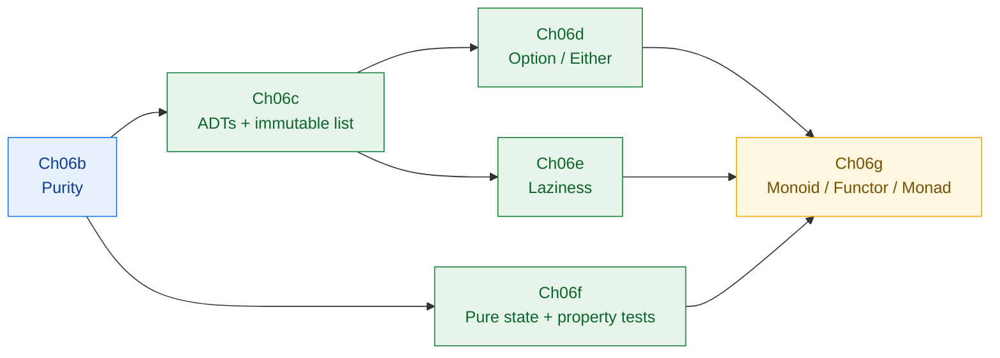

# 🧩 Functional Programming Foundations — Learning Path & Book Map

> **Navigation**: [← Functional Programming in Java](Ch06_Functional_Programming.md) | [Back to Index](00_INDEX.md) | [Next: Purity & Referential Transparency →](Ch06b_FP_Purity_Substitution_And_Effects.md)

---

## 🔗 Bridge — Where This Chapter Fits

| Dimension | This chapter |
| --- | --- |
| **Builds on** | [Functional Programming in Java](Ch06_Functional_Programming.md) (lambdas, streams, `Optional`), [Strings & Immutability](Ch02_Strings_Immutability.md), [Enums, Records, Sealed](Ch03_Enums_Records_Sealed.md), [Generics](Ch04_Generics_Exceptions.md) |
| **You will learn** | The idea behind functional programming (purity, immutability, composition), the order in which the six foundation pages build on each other, and which topics from the Scala book are covered or deferred |
| **Leads to** | [Purity & Effects](Ch06b_FP_Purity_Substitution_And_Effects.md) → [ADTs & Immutable Lists](Ch06c_FP_Algebraic_Data_Types_And_Immutable_Lists.md) → [Option & Either](Ch06d_FP_Error_Handling_Option_Either.md) → [Laziness](Ch06e_FP_Laziness_And_Lazy_Streams.md) → [Pure State & Property Testing](Ch06f_FP_Pure_State_And_Property_Testing.md) → [Monoids, Functors, Monads](Ch06g_FP_Monoids_Functors_Monads.md) |
| **Abstraction level** | Language features (lambdas) → **principles** (purity, algebra) → reusable abstractions (monoid, functor, monad) |

> [!NOTE]
> The full gap-free reading order and dependency graph are in the [FP Learning Path](Ch06a_FP_Learning_Path_And_Book_Map.md).

---

## 💬 Explain It Like a Study Partner — the FP Series

### 1. The bottom line

Functional programming is programming with functions that only compute — no hidden effects — which makes programs easy to reason about, test and compose.

### 2. The textbook core

- A **pure function** returns the same output for the same input and does nothing else observable.
- **Referential transparency:** an expression can be replaced by its value without changing the program.
- Data is **immutable**; "changing" it means returning a new value that shares structure with the old.
- Errors and absence are **values** (`Option`, `Either`), not hidden control flow.
- Abstractions such as monoids, functors and monads are *patterns with laws*, not magic.

### 3. The real-world analogy

A **spreadsheet**: each cell is a formula of other cells; change an input and everything depends on it predictably — no cell secretly edits another.

### 4. Walkthrough

1. Start with what you know: Java lambdas and streams ([Ch06](Ch06_Functional_Programming.md)).
2. Ask "what makes `map` safe to reorder?" → answer: purity ([Ch06b](Ch06b_FP_Purity_Substitution_And_Effects.md)).
3. Model data with sealed types so illegal states cannot be represented ([Ch06c](Ch06c_FP_Algebraic_Data_Types_And_Immutable_Lists.md)).
4. Handle failure as values ([Ch06d](Ch06d_FP_Error_Handling_Option_Either.md)), delay work ([Ch06e](Ch06e_FP_Laziness_And_Lazy_Streams.md)), thread state explicitly ([Ch06f](Ch06f_FP_Pure_State_And_Property_Testing.md)).
5. Notice the repeated shapes and name them ([Ch06g](Ch06g_FP_Monoids_Functors_Monads.md)).

> [!NOTE]
> **Quick check:** What is the single question that tells you whether a function is pure? *Can I replace every call with its result without changing behaviour?*

---

## ⚡ At a Glance

**How to read this diagram.** Arrows mean "read before". Purity is the base; the three middle tracks (data, errors/laziness, state/testing) all converge on the shared abstractions of the last page.

---

> [!NOTE]
> **Source note.** The topic selection for this series was guided by the table of contents of *Functional Programming in Scala* (Paul Chiusano and Rúnar Bjarnason, Manning, 2014), which teaches functional programming from first principles. Everything here is written independently in **Java 21** (records, sealed interfaces, pattern-matching `switch`), and every program was compiled and checked against tests or algebraic laws. The book itself is not part of this repository; consult it for the full Scala treatment.

## Topic Map — From the Book's Table of Contents to This Repository

The first edition is organised in four parts. Chapter numbers below are listed from memory of the 2014 edition — check them against your copy.

| Book part / chapter topic | Where it lives here | Status |
| --- | --- | --- |
| 1. What is functional programming (purity, referential transparency, substitution model) | [Ch06b](Ch06b_FP_Purity_Substitution_And_Effects.md) | ✅ |
| 2. Getting started (recursion, higher-order functions, polymorphic functions) | [Ch06 §Lambdas and functional interfaces](Ch06_Functional_Programming.md), [Recursion](../03_Algorithms/03b_Recursion_Fundamentals.md) | ✅ |
| 3. Functional data structures (immutable lists, trees, ADTs, folds) | [Ch06c](Ch06c_FP_Algebraic_Data_Types_And_Immutable_Lists.md) | ✅ |
| 4. Handling errors without exceptions (`Option`, `Either`) | [Ch06d](Ch06d_FP_Error_Handling_Option_Either.md) | ✅ |
| 5. Strictness and laziness (non-strict evaluation, lazy streams) | [Ch06e](Ch06e_FP_Laziness_And_Lazy_Streams.md), [Streams deep reasoning](Ch23_Streams_Deep_Reasoning.md) | ✅ |
| 6. Purely functional state (RNG, state actions) | [Ch06f](Ch06f_FP_Pure_State_And_Property_Testing.md) | ✅ |
| 7. Purely functional parallelism (`Par`, combinators) | [Concurrency](Ch15_Concurrency_Core.md), `CompletableFuture` in [Ch16](Ch16_Concurrency_Advanced.md) | ◑ Java-native equivalents; a from-scratch `Par` library is not covered |
| 8. Property-based testing (generators, shrinking, `forAll`) | [Ch06f](Ch06f_FP_Pure_State_And_Property_Testing.md) | ✅ (minimal framework; shrinking is described, not built) |
| 9. Parser combinators | — | ⏳ Open gap |
| 10. Monoids (laws, `foldMap`, product monoids) | [Ch06g](Ch06g_FP_Monoids_Functors_Monads.md) | ✅ |
| 11. Monads (`flatMap`, laws, identity/State/reader examples) | [Ch06g](Ch06g_FP_Monoids_Functors_Monads.md) | ✅ |
| 12. Applicative and traversable functors | [Ch06g §Beyond flatMap](Ch06g_FP_Monoids_Functors_Monads.md) (`sequence` shown) | ◑ `sequence` only; full applicative/traversable theory deferred |
| 13–15. External effects and I/O, local mutable state, stream processing | [Ch06b §Effects](Ch06b_FP_Purity_Substitution_And_Effects.md), [Virtual threads & I/O](Ch13_Networking_NIO.md) | ◑ Principles covered; an `IO` monad library is not |

> [!TIP]
> **Why Java and not Scala?** This repository teaches Java first. Java lacks tail-call elimination, higher-kinded types and implicit parameters, so some Scala idioms (a generic `Monad[F[_]]` typeclass, for example) cannot be expressed directly. Each page says where the translation loses something.

## Java Versus Scala — What Translates and What Does Not

| Idea | Scala (book) | Java 21 here |
| --- | --- | --- |
| Algebraic data types | `sealed trait` + `case class` | `sealed interface` + `record` |
| Pattern matching | `match` | `switch` with record patterns |
| Immutability | `val`, immutable collections | `final`, records, `List.copyOf`, persistent lists |
| Tail recursion | `@tailrec` guarantees no stack growth | **No guarantee** — use loops or trampolines |
| Higher-kinded types | `Functor[F[_]]` | Not expressible; define `map`/`flatMap` per type |
| Laziness | `lazy val`, by-name parameters | `Supplier<A>`, `Stream` |

## Study Plan

| Day | Page | Goal |
| --- | --- | --- |
| 1 | Ch06b | Classify five functions you wrote as pure/impure and refactor one |
| 2 | Ch06c | Implement `map`, `foldRight` and `reverse` for the immutable list |
| 3 | Ch06d | Replace one `try/catch` + `null` pipeline with `Either` |
| 4 | Ch06e | Build the lazy prime sieve and explain why it terminates |
| 5 | Ch06f | Write two properties for a function you own |
| 6 | Ch06g | Verify monoid and monad laws for a type of your own |

---

## 🏢 Enterprise Lens — the FP Series

| Area | What top-tier engineering looks like |
| ---- | ------------------------------------ |
| **Where it runs in production** | Service code that is easy to test (pure business rules), stream/batch pipelines, event-sourced domains, concurrent code that shares nothing mutable |
| **Failure modes** | Calling code "functional" because it uses lambdas while it still mutates shared state; over-abstracting with monad vocabulary where a loop is clearer |
| **Testing and verification** | Each page ships runnable Java checked against tests or algebraic laws; reuse the same habit — test laws, not only examples |

---

## 🧪 Practice Ladder

| Level | Exercise | Idea |
| ----- | -------- | ---- |
| 1 | Label ten functions in a project pure or impure | Purity vocabulary |
| 2 | Rewrite one method to return a value instead of mutating a field | Immutability |
| 3 | Model a payment state machine with a sealed interface | ADTs |
| 4 | Replace exceptions in a validator with `Either` | Errors as values |
| 5 | Add one property-based test to an existing class | Testing laws |
| 6 | Find a fold in your codebase and name its monoid | Abstraction spotting |

> [!CAUTION]
> **Reality check — "Functional programming means no loops." Loops are fine when they are local and invisible from outside; what FP removes is *shared mutable state and hidden effects*.

---

[← Functional Programming in Java](Ch06_Functional_Programming.md) | [Index](00_INDEX.md) | [Purity & Referential Transparency →](Ch06b_FP_Purity_Substitution_And_Effects.md)
