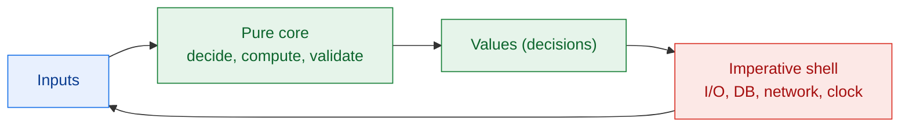

# 🧩 Purity, Referential Transparency & Effects

> **Navigation**: [← FP Learning Path](Ch06a_FP_Learning_Path_And_Book_Map.md) | [Back to Index](00_INDEX.md) | [Next: ADTs & Immutable Lists →](Ch06c_FP_Algebraic_Data_Types_And_Immutable_Lists.md)

---

## 🔗 Bridge — Where This Chapter Fits

| Dimension | This chapter |
| --- | --- |
| **Builds on** | [Functional Programming in Java](Ch06_Functional_Programming.md), [Strings & Immutability](Ch02_Strings_Immutability.md), [Java Memory Model](Ch18_JMM_GC_Deep.md) (why shared mutation is risky) |
| **You will learn** | Pure functions, referential transparency and the substitution model, side effects, memoisation, and the "functional core, imperative shell" architecture |
| **Leads to** | [ADTs & Immutable Lists](Ch06c_FP_Algebraic_Data_Types_And_Immutable_Lists.md), [Pure State](Ch06f_FP_Pure_State_And_Property_Testing.md), [Concurrency](Ch15_Concurrency_Core.md) |
| **Abstraction level** | Methods that "do things" → **functions that compute values** → effects pushed to the boundary |

> [!NOTE]
> The full gap-free reading order and dependency graph are in the [FP Learning Path](Ch06a_FP_Learning_Path_And_Book_Map.md).

---

## 💬 Explain It Like a Study Partner — Purity & Effects

### 1. The bottom line

A pure function only computes its result from its arguments, so you can reason about it, test it and reuse it without knowing anything about the rest of the program.

### 2. The textbook core

- **Pure:** same arguments → same result, and no observable side effects (no mutation of outside state, no I/O, no exceptions as control flow, no clock/random).
- **Referential transparency (RT):** replacing a call with its value never changes the meaning of the program.
- **Substitution model:** evaluate a program by repeatedly replacing expressions with their values — valid only when everything is RT.
- **Effect:** anything beyond computing a value (printing, reading a file, mutating a field, throwing).
- Effects are not banned; they are **separated**: a pure core makes decisions, a thin shell performs I/O.
- **Memoisation** and safe parallelism both depend on purity.

### 3. The real-world analogy

A **calculator versus a vending machine**: pressing `2 + 3` always gives 5, and nothing else happens. A vending machine gives different results depending on its hidden stock and takes your money.

### 4. Walkthrough

1. `add(2, 3) + add(2, 3)` equals `x + x` where `x = add(2, 3)` — substitution works.
2. `nextImpure() + nextImpure()` returns 3 on a fresh counter, but `2 * nextImpure()` returns 2: replacing the repeated expression by one value changes the answer.
3. Therefore `nextImpure` is not RT and cannot be memoised or reordered safely.
4. Move the decision logic (`totalCents`, `receipt`) into pure functions; keep printing and database writes in a small shell.

> [!NOTE]
> **Quick check:** Why can you memoise a pure function but not an impure one? *The cached value stays correct only if the result depends solely on the arguments.*

---

## ⚡ At a Glance



**How to read this diagram.** Data flows from the shell (effects, red) into the pure core (green) and back out as plain values that the shell then acts on. Most of the code and all of the logic sit in the green part, where tests need no mocks.

---

## 1. Pure Versus Impure

```java
// impure: depends on and changes hidden state
static int counter = 0;
static int nextImpure() { return ++counter; }

// pure: result depends only on the arguments
static int add(int a, int b) { return a + b; }
```

| Property | `add` | `nextImpure` |
| --- | --- | --- |
| Same input → same output | ✅ | ❌ |
| Observable side effect | none | changes `counter` |
| Safe to call twice instead of once | ✅ | ❌ |
| Safe to memoise | ✅ | ❌ |
| Safe to run in parallel | ✅ | ❌ (data race) |

## 2. Functional Core, Imperative Shell

```java
record Order(String id, int cents) {}

static int totalCents(List<Order> orders) {           // pure core
    return orders.stream().mapToInt(Order::cents).sum();
}
static String receipt(List<Order> orders) {           // pure
    return "TOTAL=" + totalCents(orders);
}
// shell: System.out.println(receipt(loadOrders()));   // the only effect
```

The pure functions are tested with plain lists. The shell is so small that a single integration test covers it.

## 3. Memoisation Needs Purity

```java
static <A, B> Function<A, B> memoize(Function<A, B> f) {
    Map<A, B> cache = new HashMap<>();
    return a -> cache.computeIfAbsent(a, f);
}
```

Memoising `slowFib` makes the second call free. Memoising `k -> nextImpure()` instead *freezes the first effect* for each key — the result is wrong in the sense that the original program called the counter twice. (Do not use `computeIfAbsent` recursively on the same `HashMap`; it can throw `ConcurrentModificationException`.)

## 4. What Counts as an Effect?

| Effect | Example | How to handle it |
| --- | --- | --- |
| Mutation | `this.total += x` | Return a new value |
| I/O | file, network, console | Shell layer |
| Time | `Instant.now()` | Pass a `Clock` or the time as an argument |
| Randomness | `Math.random()` | Pass a seed / RNG state ([Ch06f](Ch06f_FP_Pure_State_And_Property_Testing.md)) |
| Exceptions | `throw` for expected failure | Return `Either` ([Ch06d](Ch06d_FP_Error_Handling_Option_Either.md)) |
| Logging | `log.info` | Acceptable at the boundary; avoid inside algorithms |

> [!TIP]
> Passing a `java.time.Clock` into a method is the cheapest purity upgrade you can make: tests supply a fixed clock and the method becomes deterministic.

## 5. Tail Calls — A Java Caveat

Scala guarantees constant stack for self-recursive tail calls (`@tailrec`). **Java does not.** A deep recursion such as `sum(list)` over 100 000 elements can overflow the stack. Convert to a loop (`foldLeft` style) or use an explicit trampoline when depth is unbounded.

## Verification

All snippets compile, and the checks run for this page were: substitution holds for `add`, fails for `nextImpure` (`3` versus `2`), `receipt` is deterministic, memoised `slowFib` makes no extra calls on a repeat, and memoising an impure function freezes its first result.

---

## 🏢 Enterprise Lens — Purity & Effects

| Area | What top-tier engineering looks like |
| ---- | ------------------------------------ |
| **Where it runs in production** | Business-rule engines, pricing and tax calculators, validation, report generation, anything that must be unit-tested without mocks |
| **Failure modes** | Hidden effects (logging, clock, random, static caches) inside "pure" code; memoising a function that reads mutable state; exceptions used for control flow |
| **Testing and verification** | Test pure functions with plain inputs/outputs (no mocks); property-test that calling twice gives equal results; run in parallel to expose hidden shared state |
| **Review checklist** | Complexity stated for time **and** space · invariant stated · edge cases listed (empty, one element, duplicates, extremes) · behaviour at 10× data understood |

---

## 🧪 Practice Ladder

| Level | Exercise | Idea |
| ----- | -------- | ---- |
| 1 | Classify `String.toUpperCase`, `List.add`, `Math.random`, `LocalDate.now` | Pure vs impure vocabulary |
| 2 | Refactor a method that reads `System.currentTimeMillis()` to take a `Clock` | Inject time |
| 3 | Split a method that both computes a price and writes to a DB | Core vs shell |
| 4 | Write a property test: `f(x) == f(x)` for a function you call "pure" | Detect hidden state |
| 5 | Add memoisation to a pure function and measure calls | Safe caching |
| 6 | Find one place where an exception is used for expected failure | Prepare for `Either` |

> [!CAUTION]
> **Reality check — "Pure code cannot do anything useful." Pure code *decides*; effects are performed at the edges. Real systems are mostly decisions, which is why this style pays off.

---

[← FP Learning Path](Ch06a_FP_Learning_Path_And_Book_Map.md) | [Index](00_INDEX.md) | [ADTs & Immutable Lists →](Ch06c_FP_Algebraic_Data_Types_And_Immutable_Lists.md)
