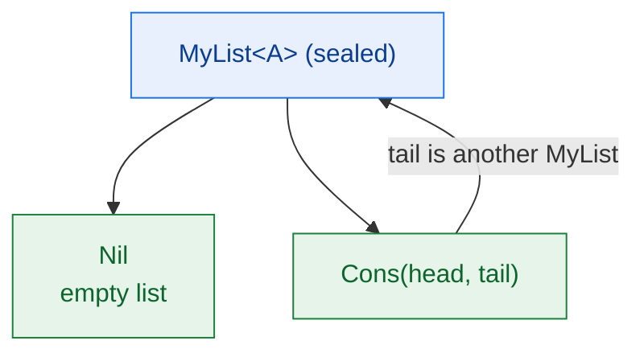
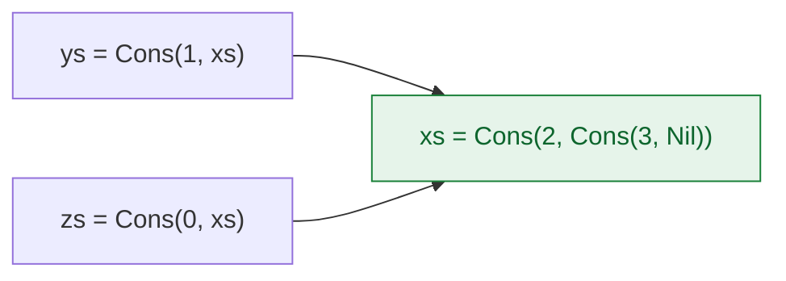

# 🧩 Algebraic Data Types & Immutable Lists

> **Navigation**: [← Purity & Effects](Ch06b_FP_Purity_Substitution_And_Effects.md) | [Back to Index](00_INDEX.md) | [Next: Option & Either →](Ch06d_FP_Error_Handling_Option_Either.md)

---

## 🔗 Bridge — Where This Chapter Fits

| Dimension | This chapter |
| --- | --- |
| **Builds on** | [Purity](Ch06b_FP_Purity_Substitution_And_Effects.md), [Enums, Records, Sealed](Ch03_Enums_Records_Sealed.md), [Generics](Ch04_Generics_Exceptions.md), [Linked Lists](../02_Data_Structures/01c_LinkedList.md) |
| **You will learn** | Sum and product types, sealed interfaces with records, exhaustive pattern matching, an immutable singly linked list, `foldLeft`/`foldRight` and structural sharing |
| **Leads to** | [Option & Either](Ch06d_FP_Error_Handling_Option_Either.md), [Laziness](Ch06e_FP_Laziness_And_Lazy_Streams.md), [Monoids & Monads](Ch06g_FP_Monoids_Functors_Monads.md) |
| **Abstraction level** | Mutable objects → **immutable values described by their shape** → folds as the universal consumer |

> [!NOTE]
> The full gap-free reading order and dependency graph are in the [FP Learning Path](Ch06a_FP_Learning_Path_And_Book_Map.md).

---

## 💬 Explain It Like a Study Partner — ADTs & Immutable Lists

### 1. The bottom line

Describe data as a closed set of shapes (a list is either empty or a head plus a tail) and write functions by handling each shape — the compiler checks you covered them all.

### 2. The textbook core

- A **product type** groups fields (`record Cons(head, tail)`); a **sum type** is "one of" several cases (`sealed interface MyList permits Nil, Cons`).
- Together they form an **algebraic data type (ADT)**.
- `switch` over a sealed hierarchy is **exhaustive**: adding a case makes every incomplete `switch` fail to compile.
- An immutable list "changes" by creating a new head that points at the old list — **structural sharing**, `O(1)` prepend, no copying.
- `foldRight(z, f)` replaces `Nil` with `z` and each `Cons` with `f`; `foldLeft` accumulates iteratively and is stack-safe.
- `map`, `reverse`, `sum`, `length` and most list functions are folds.

### 3. The real-world analogy

**Lego bricks with a fixed catalogue**: every model is built from a few known piece types; an inspector (the `switch`) can check every piece type is handled.

### 4. Walkthrough

1. Build `of(1, 2, 3, 4)` = `Cons(1, Cons(2, Cons(3, Cons(4, Nil))))`.
2. `sum` matches `Nil → 0` and `Cons → head + sum(tail)` = 10.
3. `foldRight(l, "", (x, acc) -> x + acc)` rebuilds the list as the string `"1234"`.
4. `foldRight` with `Cons`/`Nil` as the function returns the same list — folds can express identity, proving they are the universal consumer.

> [!NOTE]
> **Quick check:** What does `foldRight(list, Nil, Cons)` return? *The original list.*

---

## ⚡ At a Glance



**How to read this diagram.** A list is *either* `Nil` *or* `Cons`, and `Cons` refers back to a list: that self-reference gives unlimited length with only two cases to handle.

---

## 1. The List ADT

```java
sealed interface MyList<A> permits Nil, Cons {}
record Nil<A>() implements MyList<A> {}
record Cons<A>(A head, MyList<A> tail) implements MyList<A> {}

@SafeVarargs static <A> MyList<A> of(A... xs) { MyList<A> r = new Nil<>(); for (int i = xs.length - 1; i >= 0; i--) r = new Cons<>(xs[i], r); return r; }
static int sum(MyList<Integer> l) { return switch (l) { case Nil<Integer> n -> 0; case Cons<Integer> c -> c.head() + sum(c.tail()); }; }
static <A> MyList<A> tail(MyList<A> l) { return switch (l) { case Nil<A> n -> throw new NoSuchElementException(); case Cons<A> c -> c.tail(); }; }
static <A, B> B foldRight(MyList<A> l, B z, BiFunction<A, B, B> f) { return switch (l) { case Nil<A> n -> z; case Cons<A> c -> f.apply(c.head(), foldRight(c.tail(), z, f)); }; }
static <A, B> B foldLeft(MyList<A> l, B z, BiFunction<B, A, B> f) { B acc = z; MyList<A> cur = l; while (cur instanceof Cons<A> c) { acc = f.apply(acc, c.head()); cur = c.tail(); } return acc; }
static <A> MyList<A> nil() { return new Nil<>(); }
static <A> MyList<A> reverse(MyList<A> l) { return F.<A, MyList<A>>foldLeft(l, nil(), (acc, x) -> new Cons<>(x, acc)); }
static <A, B> MyList<B> map(MyList<A> l, Function<A, B> f) { return reverse(F.<A, MyList<B>>foldLeft(l, nil(), (acc, x) -> new Cons<>(f.apply(x), acc))); }
static <A> List<A> toJava(MyList<A> l) { List<A> out = new ArrayList<>(); MyList<A> cur = l; while (cur instanceof Cons<A> c) { out.add(c.head()); cur = c.tail(); } return out; }
```

`of(1, 2, 3, 4)` builds the list, `sum` is the classic two-case function, and `foldRight` / `foldLeft` generalise it.

> [!WARNING]
> `foldRight` and `sum` are recursive. On a list of 100 000 elements they can throw `StackOverflowError` in Java. `foldLeft`, `reverse` and `map` above use loops, so they are safe.

## 2. Helpers That Keep Type Inference Happy

Java's inference struggles when the seed of a fold is `new Nil<A>()`; give it an explicit type:

```java
static <A> MyList<A> nil() { return new Nil<>(); }
static <A> MyList<A> reverse(MyList<A> l) {
    return F.<A, MyList<A>>foldLeft(l, nil(), (acc, x) -> new Cons<>(x, acc));
}
```

(`F` stands for the enclosing class.) Seeding with the sealed supertype avoids the "`Cons` is not a `Nil`" inference error.

## 3. Structural Sharing



**How to read this diagram.** `ys` and `zs` both prepend to the same `xs`; nothing is copied. Because `xs` is immutable, sharing is safe, which is why prepending is `O(1)`.

| Operation | `MyList` | `ArrayList` |
| --- | --- | --- |
| Prepend | `O(1)` (shares the tail) | `O(n)` |
| Append | `O(n)` (copy spine) | amortised `O(1)` |
| Index access | `O(n)` | `O(1)` |
| Safe to share between threads | ✅ | ❌ without copying |

## 4. Folds as the Universal Consumer

| Function | As a fold |
| --- | --- |
| `sum` | `foldLeft(l, 0, +)` |
| `length` | `foldLeft(l, 0, (n, _) -> n + 1)` |
| `reverse` | `foldLeft(l, Nil, (acc, x) -> Cons(x, acc))` |
| `map` | `reverse(foldLeft(l, Nil, (acc, x) -> Cons(f(x), acc)))` |
| identity | `foldRight(l, Nil, Cons)` |

## Verification

The snippets above were compiled and checked: `sum(of(1,2,3,4)) = 10`, `map(l, x -> x * 2) = [2,4,6,8]`, `reverse(l) = [4,3,2,1]`, `foldRight(l, "", …) = "1234"`, and `foldRight` with `Cons`/`Nil` returns the original list.

---

## 🏢 Enterprise Lens — ADTs & Immutable Lists

| Area | What top-tier engineering looks like |
| ---- | ------------------------------------ |
| **Where it runs in production** | Domain modelling (payment states, commands, events), compilers/interpreters (expression trees), persistent collections in concurrent code, undo history |
| **Failure modes** | Recursion on very long lists overflowing the stack (Java has no tail-call elimination); non-exhaustive `switch` with a `default` hiding missing cases; leaking mutability through contained collections |
| **Testing and verification** | Check `reverse(reverse(l)) == l`, `foldRight(l, Nil, Cons) == l`, `toJava(map(l, f))` against `stream().map`; random lists for lengths 0–10 |
| **Review checklist** | Complexity stated for time **and** space · invariant stated · edge cases listed (empty, one element, duplicates, extremes) · behaviour at 10× data understood |

---

## 🧪 Practice Ladder

| Level | Exercise | Idea |
| ----- | -------- | ---- |
| 1 | Implement `length`, `append`, `filter` for `MyList` | Fold practice |
| 2 | Add a `Tree<A>` ADT (`Leaf`, `Branch`) with `size`, `depth`, `map` | Another ADT |
| 3 | Write `foldRight` using `foldLeft` and `reverse` (stack-safe) | Stack safety |
| 4 | Model an `Expr` (`Num`, `Add`, `Mul`) and an `eval` | ADT interpreter |
| 5 | Add a case to a sealed type and watch which switches fail to compile | Exhaustiveness |
| 6 | Compare memory of prepending 1M items to `MyList` and `ArrayList` | Sharing vs copying |

> [!CAUTION]
> **Reality check — "ADTs are the same as class hierarchies." They differ in *closedness*: a sealed hierarchy cannot be extended elsewhere, which is exactly what lets the compiler prove your `switch` complete.

---

[← Purity & Effects](Ch06b_FP_Purity_Substitution_And_Effects.md) | [Index](00_INDEX.md) | [Option & Either →](Ch06d_FP_Error_Handling_Option_Either.md)
