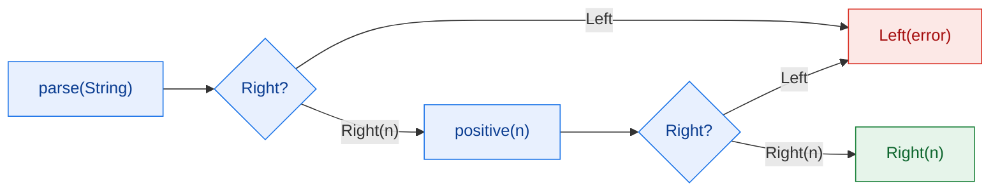

# 🧩 Error Handling with Option & Either

> **Navigation**: [← ADTs & Immutable Lists](Ch06c_FP_Algebraic_Data_Types_And_Immutable_Lists.md) | [Back to Index](00_INDEX.md) | [Next: Laziness →](Ch06e_FP_Laziness_And_Lazy_Streams.md)

---

## 🔗 Bridge — Where This Chapter Fits

| Dimension | This chapter |
| --- | --- |
| **Builds on** | [ADTs](Ch06c_FP_Algebraic_Data_Types_And_Immutable_Lists.md), [Generics & Exceptions](Ch04_Generics_Exceptions.md), [Optional in Ch06](Ch06_Functional_Programming.md) |
| **You will learn** | Why exceptions and `null` break reasoning, `Option` for absence, `Either` for failure with a reason, `map`/`flatMap` to chain steps, `sequence` to combine results, and the fail-fast versus accumulate choice |
| **Leads to** | [Laziness](Ch06e_FP_Laziness_And_Lazy_Streams.md), [Monoids, Functors, Monads](Ch06g_FP_Monoids_Functors_Monads.md), [Validation in services](Ch37_SB_Controllers_REST.md) |
| **Abstraction level** | Exceptions as hidden control flow → **failure as an ordinary value** → composable pipelines |

> [!NOTE]
> The full gap-free reading order and dependency graph are in the [FP Learning Path](Ch06a_FP_Learning_Path_And_Book_Map.md).

---

## 💬 Explain It Like a Study Partner — Option & Either

### 1. The bottom line

Return a value that says "here is the result or here is why not" instead of throwing, and the compiler forces every caller to deal with it.

### 2. The textbook core

- **`Option<A>`** = `None | Some(a)`; it represents "maybe a value".
- **`Either<E, A>`** = `Left(error) | Right(value)`; by convention `Right` is the success.
- `map(f)` transforms the success and leaves the failure alone; `flatMap(f)` chains a step that can itself fail.
- `sequence` turns `List<Either<E, A>>` into `Either<E, List<A>>` (stops at the first `Left`).
- Exceptions break referential transparency (the call has an effect beyond its value) and are invisible in the type of the method.
- Use **`Either`/`Result` for expected failures** (validation, parsing) and **exceptions for truly exceptional, unrecoverable conditions**.

### 3. The real-world analogy

A **parcel with a delivery note**: either the item arrives (`Right`) or a note explains why not (`Left`). You never get a mystery explosion in the hallway.

### 4. Walkthrough

1. `parse(" 12 ")` → `Right(12)`; `positive(12)` → `Right(12)`.
2. `parse("-3")` → `Right(-3)`, then `positive(-3)` → `Left("not positive: -3")`.
3. `parse("x")` short-circuits: `Left("not a number: x")`; `positive` never runs.
4. `sequence([parse("1"), parse("q"), parse("z")])` returns the first error, `Left("not a number: q")`.

> [!NOTE]
> **Quick check:** What does `flatMap` do when the value is a `Left`? *Nothing — it returns the same `Left` without calling the function.*

---

## ⚡ At a Glance



**How to read this diagram.** Each step either passes its value on (right) or short-circuits to the first error (left). The code never needs an `if` at each step: `flatMap` does the routing.

---

## 1. `Option` and `Either`

```java
sealed interface Option<A> permits None, Some {}
record None<A>() implements Option<A> {}
record Some<A>(A value) implements Option<A> {}
static <A, B> Option<B> mapO(Option<A> o, Function<A, B> f) { return switch (o) { case None<A> n -> new None<>(); case Some<A> s -> new Some<>(f.apply(s.value())); }; }
static <A, B> Option<B> flatMapO(Option<A> o, Function<A, Option<B>> f) { return switch (o) { case None<A> n -> new None<>(); case Some<A> s -> f.apply(s.value()); }; }
static <A> A getOrElse(Option<A> o, A d) { return o instanceof Some<A> s ? s.value() : d; }

sealed interface Either<E, A> permits Left, Right {}
record Left<E, A>(E error) implements Either<E, A> {}
record Right<E, A>(A value) implements Either<E, A> {}
static <E, A, B> Either<E, B> mapE(Either<E, A> e, Function<A, B> f) { return switch (e) { case Left<E, A> l -> new Left<>(l.error()); case Right<E, A> r -> new Right<>(f.apply(r.value())); }; }
static <E, A, B> Either<E, B> flatMapE(Either<E, A> e, Function<A, Either<E, B>> f) { return switch (e) { case Left<E, A> l -> new Left<>(l.error()); case Right<E, A> r -> f.apply(r.value()); }; }
static Either<String, Integer> parse(String s) { try { return new Right<>(Integer.parseInt(s.trim())); } catch (NumberFormatException ex) { return new Left<>("not a number: " + s); } }
static Either<String, Integer> positive(int n) { return n > 0 ? new Right<>(n) : new Left<>("not positive: " + n); }
static <E, A> Either<E, List<A>> sequence(List<Either<E, A>> es) { List<A> out = new ArrayList<>(); for (Either<E, A> e : es) { if (e instanceof Left<E, A> l) return new Left<>(l.error()); out.add(((Right<E, A>) e).value()); } return new Right<>(out); }
static <A> Option<Double> mean(List<Double> xs) { return xs.isEmpty() ? new None<>() : new Some<>(xs.stream().mapToDouble(d -> d).sum() / xs.size()); }
static Option<Double> variance(List<Double> xs) { return flatMapO(F.<Double>mean(xs), m -> F.<Double>mean(xs.stream().map(x -> Math.pow(x - m, 2)).toList())); }
```

`variance(List.of(1.0, 2.0, 3.0, 4.0))` is `Some(1.25)`; for an empty list it is `None`, instead of `NaN` or an exception.

## 2. Chaining Steps

```java
flatMapE(parse(" 12 "), F::positive)   // Right(12)
flatMapE(parse("-3"),   F::positive)   // Left("not positive: -3")
flatMapE(parse("x"),    F::positive)   // Left("not a number: x")
```

## 3. Choosing a Strategy

| Need | Use | Behaviour |
| --- | --- | --- |
| A value might be missing | `Option` / `Optional` (return types only) | No reason needed |
| Failure with a reason, stop at first | `Either` + `flatMap` | Fail-fast |
| Report **all** validation errors | A validation type that accumulates a list of errors | Needs an applicative-style combinator (see [Ch06g](Ch06g_FP_Monoids_Functors_Monads.md)) |
| Unrecoverable bug (null where impossible, corrupted state) | Exception | Let it propagate |

> [!WARNING]
> `java.util.Optional` is designed for **return types**. Avoid it for fields, method parameters and collections; it is not serializable and invites misuse.

## 4. Java Notes

| Topic | Note |
| --- | --- |
| Checked exceptions | Already part of the signature; `Either` makes the same idea explicit and composable |
| `Optional.flatMap` | Equivalent of `flatMapO`; prefer it over a hand-written `Option` in production |
| Libraries | Vavr's `Either`/`Try`/`Validation` provide polished versions; the point of this page is the concept |

## Verification

Checked in tests: the `variance` example (`1.25`, `None` for empty input), the three `parse`/`positive` outcomes above, `sequence` returning `Right([1, 2])` for good input and the *first* `Left` for `[“1”, “q”, “z”]`, and the functor and monad laws for `Option` (see [Ch06g](Ch06g_FP_Monoids_Functors_Monads.md)).

---

## 🏢 Enterprise Lens — Option & Either

| Area | What top-tier engineering looks like |
| ---- | ------------------------------------ |
| **Where it runs in production** | Input validation, parsing, configuration loading, domain operations with business-rule failures, API clients that map HTTP errors to typed results |
| **Failure modes** | Using `Either<Exception, A>` everywhere (loses meaning); swallowing the `Left`; mixing exceptions and `Either` in the same layer; using `Optional` as a field or parameter |
| **Testing and verification** | Table-driven tests for each failure branch; assert fail-fast order; property: `map(identity) == original` |
| **Review checklist** | Complexity stated for time **and** space · invariant stated · edge cases listed (empty, one element, duplicates, extremes) · behaviour at 10× data understood |

---

## 🧪 Practice Ladder

| Level | Exercise | Idea |
| ----- | -------- | ---- |
| 1 | Rewrite a method that returns `null` to return `Option`/`Optional` | Absence as a value |
| 2 | Implement `mapE`, `flatMapE` and `getOrElse` for `Either` | Core combinators |
| 3 | Parse `"key=value"` lines into a `Map` with `Either<String, …>` | Fail-fast parsing |
| 4 | Write `traverse(List<A>, A -> Either<E,B>)` | Generalise `sequence` |
| 5 | Design a validation type that collects all errors | Accumulation |
| 6 | Replace a service method’s `throws` with `Either` and update the callers | Migration |

> [!CAUTION]
> **Reality check — "Either replaces exceptions everywhere." It replaces them for *expected* failures; exceptions remain right for bugs and unrecoverable states.

---

[← ADTs & Immutable Lists](Ch06c_FP_Algebraic_Data_Types_And_Immutable_Lists.md) | [Index](00_INDEX.md) | [Laziness →](Ch06e_FP_Laziness_And_Lazy_Streams.md)
