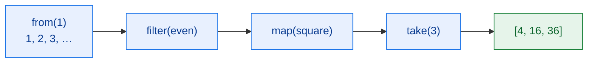

# 🧩 Laziness & Lazy Streams

> **Navigation**: [← Option & Either](Ch06d_FP_Error_Handling_Option_Either.md) | [Back to Index](00_INDEX.md) | [Next: Pure State & Property Testing →](Ch06f_FP_Pure_State_And_Property_Testing.md)

---

## 🔗 Bridge — Where This Chapter Fits

| Dimension | This chapter |
| --- | --- |
| **Builds on** | [ADTs](Ch06c_FP_Algebraic_Data_Types_And_Immutable_Lists.md), [Streams in Java](Ch06_Functional_Programming.md), [Streams deep reasoning](Ch23_Streams_Deep_Reasoning.md) |
| **You will learn** | Strict versus non-strict evaluation, `Supplier` as a thunk, memoised lazy values, infinite streams, `filter`/`map` pipelines that do only the needed work, and the sieve of Eratosthenes as a stream |
| **Leads to** | [Pure State](Ch06f_FP_Pure_State_And_Property_Testing.md), [Monoids & Monads](Ch06g_FP_Monoids_Functors_Monads.md), [Streams deep reasoning](Ch23_Streams_Deep_Reasoning.md) |
| **Abstraction level** | Compute everything now → **describe the computation, run it on demand** → infinite structures and fused pipelines |

> [!NOTE]
> The full gap-free reading order and dependency graph are in the [FP Learning Path](Ch06a_FP_Learning_Path_And_Book_Map.md).

---

## 💬 Explain It Like a Study Partner — Laziness

### 1. The bottom line

Laziness means "do not compute it until someone actually needs it" — and then remember the answer so you never compute it twice.

### 2. The textbook core

- **Strict** evaluation computes arguments before the call; **non-strict** (lazy) evaluation delays them.
- Java is strict, but `&&`, `||` and `?:` short-circuit; a **`Supplier<A>`** is a *thunk* that delays an expression.
- A **lazy value** caches its result after the first `get()` (memoisation) — safe because the thunk is pure.
- A **lazy stream** is `cons(head, () -> tail)`: the tail is computed only when requested, so streams can be infinite.
- Lazy pipelines (`filter` → `map` → `take`) process **one element at a time**, avoiding intermediate collections.
- Laziness hides *when* effects happen, so combine it with purity.

### 3. The real-world analogy

A **restaurant that cooks to order**: nothing is made until a customer asks, and a dish already made is kept warm for the next identical order (memoisation).

### 4. Walkthrough

1. `from(1)` is `1, 2, 3, …` — infinite, yet `take(from(1), 5)` terminates with `[1,2,3,4,5]`.
2. `take(map(filter(from(1), even), square), 3)` processes only as many elements as needed: `[4, 16, 36]`.
3. `orLazy(true, () -> expensive())` never calls `expensive`.
4. `sieve(from(2))` produces primes by filtering the tail with each prime found.

> [!NOTE]
> **Quick check:** Why must the thunk be pure? *If it has effects, running it later (or once, via memoisation) changes the program’s meaning.*

---

## ⚡ At a Glance



**How to read this diagram.** Nothing runs until `take` asks for elements; each request pulls one value through the whole pipeline, so the infinite source is never fully built.

---

## 1. Thunks and Memoised Lazy Values

```java
static boolean orLazy(boolean a, Supplier<Boolean> b) { return a || b.get(); }

static final class Lazy<A> {
    private Supplier<A> s; private A v; private boolean done;
    Lazy(Supplier<A> s) { this.s = s; }
    A get() { if (!done) { v = s.get(); done = true; s = null; } return v; }
}
```

The second `get()` returns the stored value; `s = null` lets the thunk (and everything it captured) be garbage collected. (This version is not thread-safe; wrap the check in `synchronized` or use a holder idiom if shared.)

## 2. A Lazy Stream

```java
static final class Lazy<A> {
    private Supplier<A> s; private A v; private boolean done;
    Lazy(Supplier<A> s) { this.s = s; }
    A get() { if (!done) { v = s.get(); done = true; s = null; } return v; }
}
static int evalCount = 0;
static boolean orLazy(boolean a, Supplier<Boolean> b) { return a || b.get(); }
interface LStream<A> { static <A> LStream<A> cons(A h, Supplier<LStream<A>> t) { Lazy<LStream<A>> lt = new Lazy<>(t); return new LStream<A>() { public A head() { return h; } public LStream<A> tail() { return lt.get(); } public boolean isEmpty() { return false; } }; }
    static <A> LStream<A> empty() { return new LStream<A>() { public A head() { throw new NoSuchElementException(); } public LStream<A> tail() { throw new NoSuchElementException(); } public boolean isEmpty() { return true; } }; }
    A head(); LStream<A> tail(); boolean isEmpty(); }
static LStream<Integer> from(int n) { return LStream.cons(n, () -> from(n + 1)); }
static <A> List<A> take(LStream<A> s, int n) { List<A> out = new ArrayList<>(); while (n-- > 0 && !s.isEmpty()) { out.add(s.head()); s = s.tail(); } return out; }
static <A> LStream<A> filter(LStream<A> s, Predicate<A> p) { while (!s.isEmpty() && !p.test(s.head())) s = s.tail(); if (s.isEmpty()) return LStream.empty(); final LStream<A> cur = s; return LStream.cons(cur.head(), () -> filter(cur.tail(), p)); }
static <A, B> LStream<B> mapL(LStream<A> s, Function<A, B> f) { return s.isEmpty() ? LStream.empty() : LStream.cons(f.apply(s.head()), () -> mapL(s.tail(), f)); }
static LStream<Integer> sieve(LStream<Integer> s) { int p = s.head(); return LStream.cons(p, () -> sieve(filter(s.tail(), x -> x % p != 0))); }
```

> [!NOTE]
> The listing above includes `Lazy` again so the stream code is self-contained; `LStream.cons` stores the tail as a memoised `Lazy`, which is what makes repeated traversal cheap.

`take(sieve(from(2)), 10)` returns `[2, 3, 5, 7, 11, 13, 17, 19, 23, 29]`.

## 3. Java's Built-in Laziness

| Tool | Lazy? | Notes |
| --- | --- | --- |
| `Stream` intermediate ops (`filter`, `map`) | ✅ | Nothing runs until a terminal op |
| `Stream.iterate`, `Stream.generate` | ✅ infinite | Combine with `limit` |
| `Supplier<T>` | ✅ | Manual thunk; no memoisation |
| `Optional.orElseGet(supplier)` | ✅ | Computes the default only when empty |
| `List.stream()` re-use | ❌ | A stream can be consumed once |
| Collections (`ArrayList`, …) | ❌ | Eager |

## 4. Pitfalls

- **Space leaks:** keeping a reference to the first node of a long stream keeps every computed element alive.
- **Order of effects:** with lazy pipelines the interleaving of `peek` side effects follows element-by-element evaluation, not stage-by-stage.
- **Deep recursion:** `filter` on a stream where thousands of consecutive elements are rejected recurses in this naive version; production streams (`java.util.stream`) iterate instead.

## Verification

Checked: `orLazy(true, …)` does not evaluate its second argument; a `Lazy` thunk evaluates exactly once across two `get()` calls; `take(from(1), 5) = [1..5]`; `take(map(filter(from(1), even), square), 3) = [4, 16, 36]`; `sieve` yields the first ten primes.

---

## 🏢 Enterprise Lens — Laziness

| Area | What top-tier engineering looks like |
| ---- | ------------------------------------ |
| **Where it runs in production** | Database cursors and paginated APIs, log/file streaming, `java.util.stream` pipelines, infinite generators in simulations, lazy configuration loading |
| **Failure modes** | Holding the head of a huge lazy stream (memory leak); expecting effects to happen at definition time; stack overflow when filtering through very long runs of rejected elements; not memoising an expensive thunk |
| **Testing and verification** | Count evaluations with a counter (`evalCount == 1` after two `get()`s); test infinite streams with `take`; compare with an eager `stream().filter().map()` on finite data |

---

## 🧪 Practice Ladder

| Level | Exercise | Idea |
| ----- | -------- | ---- |
| 1 | Implement `Lazy<A>` thread-safely (double-checked locking or holder idiom) | Safe memoisation |
| 2 | Write `takeWhile` and `zip` for `LStream` | Stream combinators |
| 3 | Generate Fibonacci numbers lazily and take the first 20 | Infinite sequences |
| 4 | Use `Stream.iterate` + `limit` to build a paginator | Built-in laziness |
| 5 | Show with a counter that `Stream.filter().findFirst()` stops early | Short-circuiting |
| 6 | Create a lazily loaded configuration object | Practical thunk |

> [!CAUTION]
> **Reality check — "Lazy is always faster." Laziness avoids unneeded work but adds bookkeeping and can hold memory; use it when work may not be needed or data is unbounded.

---

[← Option & Either](Ch06d_FP_Error_Handling_Option_Either.md) | [Index](00_INDEX.md) | [Pure State & Property Testing →](Ch06f_FP_Pure_State_And_Property_Testing.md)
