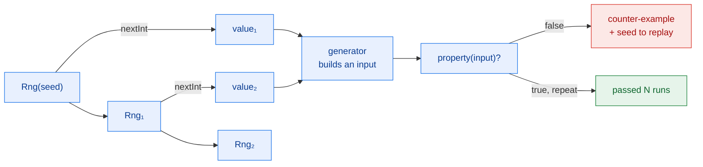

# 🧩 Pure State & Property-Based Testing

> **Navigation**: [← Laziness](Ch06e_FP_Laziness_And_Lazy_Streams.md) | [Back to Index](00_INDEX.md) | [Next: Monoids, Functors & Monads →](Ch06g_FP_Monoids_Functors_Monads.md)

---

## 🔗 Bridge — Where This Chapter Fits

| Dimension | This chapter |
| --- | --- |
| **Builds on** | [Purity](Ch06b_FP_Purity_Substitution_And_Effects.md), [ADTs](Ch06c_FP_Algebraic_Data_Types_And_Immutable_Lists.md), [Testing in Spring](Ch41_SB_Architecture_Quality.md) |
| **You will learn** | Passing state explicitly (a deterministic random-number generator), the `State` action and `flatMap`, generators, properties with `forAll`, and why tests of laws find more bugs than hand-picked examples |
| **Leads to** | [Monoids, Functors & Monads](Ch06g_FP_Monoids_Functors_Monads.md), [Algorithm tests with brute force](../03_Algorithms/00_BOOK_COMPANION.md) |
| **Abstraction level** | Hidden mutable state → **state threaded through return values** → reusable `State` abstraction → generated tests |

> [!NOTE]
> The full gap-free reading order and dependency graph are in the [FP Learning Path](Ch06a_FP_Learning_Path_And_Book_Map.md).

---

## 💬 Explain It Like a Study Partner — Pure State & Property Testing

### 1. The bottom line

Instead of a generator that secretly changes itself, return the next value *and* the next generator; the same seed then always gives the same sequence.

### 2. The textbook core

- A **pure RNG**: `nextInt(rng)` returns `(value, nextRng)`; calling it twice on the same `rng` returns the same value.
- Threading state by hand is repetitive; a **`State<S, A>`** is a function `S → (A, S)` that can be composed with `map` and `flatMap`.
- **Property-based testing:** state a law (`reverse(reverse(xs)) == xs`), generate many random inputs, and look for a counter-example.
- A **generator** is just a `State` over the RNG; a **property** is a predicate plus the number of runs.
- Real libraries (jqwik, QuickCheck-style tools) add **shrinking** to minimise a failing case.
- Reproducibility: print the seed so a failure can be replayed.

### 3. The real-world analogy

A **numbered lottery ticket book**: ticket `n` always yields the same result, and the book tells you which ticket to use next.

### 4. Walkthrough

1. `Rng(42).nextInt()` called twice returns the same pair `(value, nextRng)` — no hidden change.
2. `counter().flatMap(x -> counter().flatMap(y -> counter().map(z -> [x, y, z])))` run from `10` returns `[10, 11, 12]` and final state `13`.
3. `forAll(genList, xs -> reverse(reverse(xs)) == xs, 200 runs)` passes.
4. `forAll(genList, xs -> sum(xs) < 10, …)` is falsified and reports the failing input and run number.

> [!NOTE]
> **Quick check:** Why does `Rng(42).nextInt()` return the same value twice? *`Rng` is immutable, so the call has no effect on it.*

---

## ⚡ At a Glance



**How to read this diagram.** Each random draw returns a value *and* the next generator state, so the chain is deterministic. Generated inputs feed a property; the first failure is reported with the seed so you can replay it.

---

## 1. A Pure Random Number Generator and `State`

```java
record RandInt(int value, Rng next) {}
record Rng(long seed) {
    RandInt nextInt() { long n = (seed * 0x5DEECE66DL + 0xBL) & 0xFFFFFFFFFFFFL; return new RandInt((int) (n >>> 16), new Rng(n)); }
}
static RandInt nonNegativeInt(Rng r) { RandInt ri = r.nextInt(); return new RandInt(ri.value() < 0 ? -(ri.value() + 1) : ri.value(), ri.next()); }
static List<Integer> ints(int n, Rng r) { List<Integer> out = new ArrayList<>(); for (int i = 0; i < n; i++) { RandInt ri = nonNegativeInt(r); out.add(ri.value()); r = ri.next(); } return out; }
record State<S, A>(Function<S, Map.Entry<A, S>> run) {
    static <S, A> State<S, A> unit(A a) { return new State<>(s -> Map.entry(a, s)); }
    <B> State<S, B> map(Function<A, B> f) { return new State<>(s -> { var r = run.apply(s); return Map.entry(f.apply(r.getKey()), r.getValue()); }); }
    <B> State<S, B> flatMap(Function<A, State<S, B>> f) { return new State<>(s -> { var r = run.apply(s); return f.apply(r.getKey()).run().apply(r.getValue()); }); }
}
static State<Integer, Integer> counter() { return new State<>(s -> Map.entry(s, s + 1)); }
```

The generator uses the 48-bit linear congruential recurrence with the same constants as `java.util.Random` (`0x5DEECE66D`, `0xB`). It is for tests and teaching, **not** for security.

`ints(5, new Rng(7))` returns the same five numbers every run.

## 2. A Tiny Property-Testing Harness

```java
static <A> boolean forAll(Function<Rng, Map.Entry<A, Rng>> gen, Predicate<A> prop, int runs, long seed, StringBuilder log) {
    Rng r = new Rng(seed);
    for (int i = 0; i < runs; i++) { var e = gen.apply(r); r = e.getValue(); if (!prop.test(e.getKey())) { log.append("falsified after ").append(i + 1).append(" runs: ").append(e.getKey()); return false; } }
    return true;
}
static Map.Entry<List<Integer>, Rng> genList(Rng r) { RandInt len = nonNegativeInt(r); int n = len.value() % 8; Rng cur = len.next(); List<Integer> out = new ArrayList<>(); for (int i = 0; i < n; i++) { RandInt ri = nonNegativeInt(cur); out.add(ri.value() % 100 - 50); cur = ri.next(); } return Map.entry(out, cur); }
```

Usage:

```java
forAll(F::genList, xs -> reverseTwice(xs).equals(xs), 200, 1, log);      // passes
forAll(F::genList, xs -> sum(xs) < 10,                  200, 3, log);      // falsified: log has the input
```

## 3. Writing Good Properties

| Property type | Example |
| --- | --- |
| **Round trip** | `decode(encode(x)) == x`; `reverse(reverse(xs)) == xs` |
| **Invariant** | Output of `sort` is ordered and has the same length |
| **Oracle** | Fast algorithm equals a slow brute force (the habit used throughout this repository) |
| **Idempotence** | `normalise(normalise(x)) == normalise(x)` |
| **Algebraic law** | Monoid associativity, functor identity ([Ch06g](Ch06g_FP_Monoids_Functors_Monads.md)) |
| **Metamorphic** | Adding a duplicate to a set leaves its size unchanged |

> [!TIP]
> **Shrinking.** When a property fails on a 40-element list, try smaller candidates (halve the list, simplify elements) until you find a minimal failing input. Libraries such as jqwik do this automatically; the hand-rolled harness above reports the first failing input only.

## Verification

Checked: same seed → same value; `ints` reproducible; state-monad example returns `[10, 11, 12]` and final state `13`; the two true properties pass on 200 runs; the false property is falsified and reports the input.

---

## 🏢 Enterprise Lens — Pure State & Property Testing

| Area | What top-tier engineering looks like |
| ---- | ------------------------------------ |
| **Where it runs in production** | Reproducible simulations, test-data generators, fuzzing, load-test scenarios, game logic that must replay deterministically |
| **Failure modes** | Using `System.nanoTime()` as a seed without logging it (irreproducible failures); properties that restate the implementation; generators that never produce edge cases (empty, zero, max) |
| **Testing and verification** | Prove determinism (same seed, same output); property-test the properties themselves on a deliberately wrong implementation to ensure they fail |

---

## 🧪 Practice Ladder

| Level | Exercise | Idea |
| ----- | -------- | ---- |
| 1 | Write a pure `shuffle(list, rng)` that returns the new list and new `Rng` | State threading |
| 2 | Add `map`/`flatMap` to `Gen<A>` built on `Rng` | Generator combinators |
| 3 | Add shrinking by halving lists on failure | Counter-example minimisation |
| 4 | Test `Collections.sort` against your own insertion sort as an oracle | Oracle properties |
| 5 | Write idempotence and round-trip properties for a JSON/URL encoder | Law-style tests |
| 6 | Try jqwik or another library on an existing class | Real tooling |

> [!CAUTION]
> **Reality check — "Property tests replace example tests." They complement them: examples document intent and edge cases; properties search the space you did not think of.

---

[← Laziness](Ch06e_FP_Laziness_And_Lazy_Streams.md) | [Index](00_INDEX.md) | [Monoids, Functors & Monads →](Ch06g_FP_Monoids_Functors_Monads.md)
