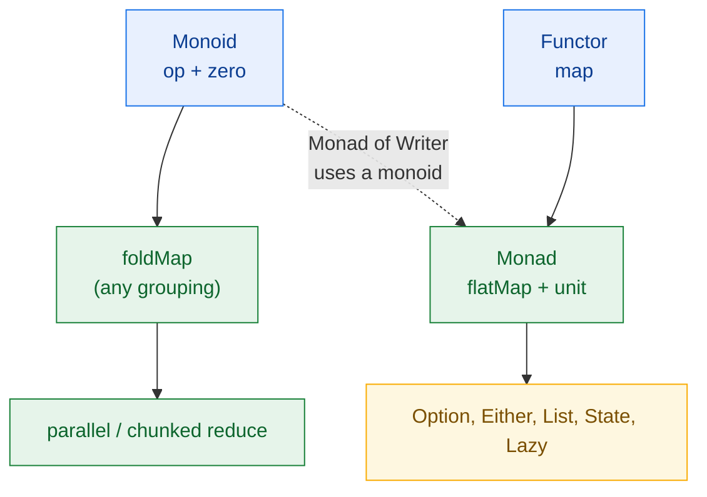
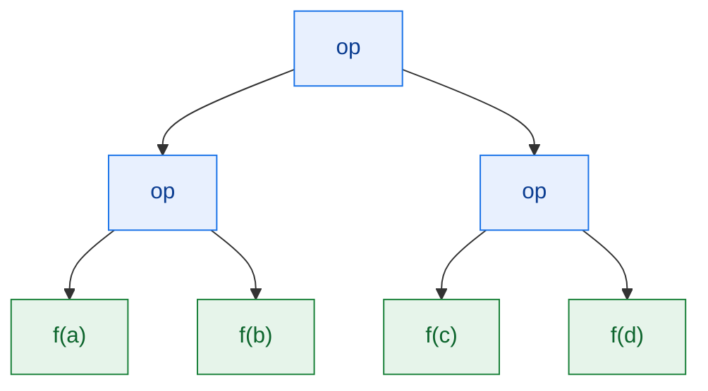

# 🧩 Monoids, Functors & Monads

> **Navigation**: [← Pure State & Property Testing](Ch06f_FP_Pure_State_And_Property_Testing.md) | [Back to Index](00_INDEX.md) | [Next: Modern Java 9–21 →](Ch07_Modern_Java_9to21.md)

---

## 🔗 Bridge — Where This Chapter Fits

| Dimension | This chapter |
| --- | --- |
| **Builds on** | [ADTs](Ch06c_FP_Algebraic_Data_Types_And_Immutable_Lists.md), [Option & Either](Ch06d_FP_Error_Handling_Option_Either.md), [Laziness](Ch06e_FP_Laziness_And_Lazy_Streams.md), [State](Ch06f_FP_Pure_State_And_Property_Testing.md) |
| **You will learn** | Monoids (associative combine + identity), `foldMap`, balanced folds and parallelism, product monoids, functors (`map`) and monads (`flatMap`) with their laws, and how to test the laws |
| **Leads to** | [Concurrency](Ch15_Concurrency_Core.md) (parallel reduce), [Reactive streams / WebFlux](Ch48_SB_WebFlux_Core.md), [MapReduce-style design](../03_Algorithms/13_Algorithms_In_Production.md) |
| **Abstraction level** | Individual examples (`Option`, `List`, `State`) → **the shape they share** → laws that make code reusable and testable |

> [!NOTE]
> The full gap-free reading order and dependency graph are in the [FP Learning Path](Ch06a_FP_Learning_Path_And_Book_Map.md).

---

## 💬 Explain It Like a Study Partner — Monoids, Functors & Monads

### 1. The bottom line

Many types share the same few shapes — "combine two things", "transform inside a container", "chain steps that may add context" — and naming the shape lets you reuse the same code and tests.

### 2. The textbook core

- **Monoid:** a type with an associative `op(a, b)` and an identity `zero` (`op(a, zero) = a = op(zero, a)`). Examples: `+` and `0`, `*` and `1`, string concatenation and `""`, list append and `[]`, `max` with `-∞`.
- **`foldMap(xs, monoid, f)`** maps each element into the monoid and combines them. Associativity lets you fold **in any grouping** — balanced trees, chunks, parallel workers.
- A **product monoid** combines several results in one pass (count *and* sum).
- **Functor:** has `map` with `map(identity) = identity` and `map(f ∘ g) = map(f) ∘ map(g)`.
- **Monad:** adds `unit` and `flatMap` with left identity, right identity and associativity.
- **Not a monoid:** subtraction (`(1−2)−3 ≠ 1−(2−3)`).

### 3. The real-world analogy

**Lego-compatible studs**: any two compatible pieces snap together (`op`), the empty baseplate changes nothing (`zero`), and it does not matter in which order you pre-assemble sub-groups (associativity).

### 4. Walkthrough

1. Words `[“a”, “bc”, “d”]`: `foldMap` with the string monoid gives `"abcd"` whichever way you group the folds.
2. Sum `0..99` by splitting into two halves, summing each, then combining — the same answer as a single pass, so the halves can run in parallel.
3. `foldMap([3,4,5], (count, sum), x -> (1, x))` returns `(3, 12)` in one traversal.
4. `flatMapO(flatMapO(m, f), g)` equals `flatMapO(m, y -> flatMapO(f(y), g))` for `None`, `Some(−1)`, `Some(0)`, `Some(3)` — associativity holds.

> [!NOTE]
> **Quick check:** Is integer subtraction a monoid? *No — it is not associative, so a parallel fold could give a different answer.*

---

## ⚡ At a Glance



**How to read this diagram.** Monoids give you combinable results and free parallelism; functors and monads give you containers you can transform and chain. The dotted line shows that logging-style monads build on monoids.

---

## 1. Monoids and `foldMap`

```java
interface Monoid<A> { A zero(); A op(A a, A b); }
static final Monoid<Integer> INT_ADD = new Monoid<>() { public Integer zero() { return 0; } public Integer op(Integer a, Integer b) { return a + b; } };
static final Monoid<String> STR = new Monoid<>() { public String zero() { return ""; } public String op(String a, String b) { return a + b; } };
static <A> Monoid<List<A>> listM() { return new Monoid<>() { public List<A> zero() { return List.of(); } public List<A> op(List<A> a, List<A> b) { List<A> r = new ArrayList<>(a); r.addAll(b); return r; } }; }
static <A> boolean lawsHold(Monoid<A> m, List<A> samples) {
    for (A a : samples) { if (!m.op(a, m.zero()).equals(a) || !m.op(m.zero(), a).equals(a)) return false;
        for (A b : samples) for (A c : samples) if (!m.op(m.op(a, b), c).equals(m.op(a, m.op(b, c)))) return false; }
    return true;
}
static <A, B> B foldMap(List<A> xs, Monoid<B> m, Function<A, B> f) { B acc = m.zero(); for (A x : xs) acc = m.op(acc, f.apply(x)); return acc; }
// balanced fold: because of associativity, can split work in halves (parallelisable)
static <A, B> B foldMapBalanced(List<A> xs, Monoid<B> m, Function<A, B> f) { if (xs.isEmpty()) return m.zero(); if (xs.size() == 1) return f.apply(xs.get(0)); int mid = xs.size() / 2; return m.op(foldMapBalanced(xs.subList(0, mid), m, f), foldMapBalanced(xs.subList(mid, xs.size()), m, f)); }
record Pair<A, B>(A a, B b) {}
static Monoid<Pair<Integer, Integer>> prod(Monoid<Integer> m1, Monoid<Integer> m2) { return new Monoid<>() { public Pair<Integer, Integer> zero() { return new Pair<>(0, 0); } public Pair<Integer, Integer> op(Pair<Integer, Integer> x, Pair<Integer, Integer> y) { return new Pair<>(m1.op(x.a(), y.a()), m2.op(x.b(), y.b())); } }; }
```

Test the laws instead of trusting yourself:

```java
check(lawsHold(INT_ADD, List.of(-3, 0, 5, 9)));
check(lawsHold(STR, List.of("", "a", "bc")));
check(!lawsHold(subtraction, List.of(1, 2, 3)));    // subtraction fails associativity
```

`foldMapBalanced` splits the list in half. Because `op` is associative, it gives the same result as `foldMap` for every input (500 random lists checked) — which is exactly the property a parallel `reduce` relies on.



**How to read this diagram.** A balanced fold combines the leaves pairwise. The two sub-trees are independent, so they can run on different threads; associativity guarantees the answer matches a left-to-right fold.

## 2. Functor and Monad Laws (checked for `Option`)

| Law | Statement | Checked on |
| --- | --- | --- |
| Functor identity | `map(o, x -> x) == o` | `None`, `Some(5)` |
| Functor composition | `map(map(o, f), g) == map(o, f.andThen(g))` | `None`, `Some(5)` |
| Monad left identity | `flatMap(unit(x), f) == f(x)` | `x ∈ {−1, 0, 3}` |
| Monad right identity | `flatMap(m, unit) == m` | same |
| Monad associativity | `flatMap(flatMap(m, f), g) == flatMap(m, y -> flatMap(f(y), g))` | same |

```java
Function<Integer, Option<Integer>> unit = y -> new Some<>(y);
Function<Integer, Option<Integer>> fg   = y -> flatMapO(f.apply(y), g);
check(flatMapO(m, unit).equals(m));                         // right identity
check(flatMapO(flatMapO(m, f), g).equals(flatMapO(m, fg))); // associativity
```

> [!NOTE]
> The compiler (JDK 21.0.12) crashed on one early formulation that inlined the associativity lambda; extracting `unit` and `fg` into named variables fixed it. If you hit an internal javac error, simplify the generic lambdas first.

## 3. Beyond `flatMap` — Combining Independent Results

`flatMap` chains steps where each depends on the previous result. When steps are **independent**, you only need to combine results:

| Task | Tool | Example |
| --- | --- | --- |
| List of fallible steps → one fallible list | `sequence` ([Ch06d](Ch06d_FP_Error_Handling_Option_Either.md)) | Parse every field |
| Collect all errors, not just the first | Applicative-style validation | Form validation |
| Run independent async calls | `CompletableFuture.allOf` / `thenCombine` | Parallel service calls |

Full applicative and traversable functors need higher-kinded types, which Java does not have; implement `map2`/`sequence` per type.

## 4. Where Java Already Has These

| Concept | In the JDK |
| --- | --- |
| Monoid | `Stream.reduce(identity, op)`, `Collectors.summingInt`, `BinaryOperator` |
| Functor | `Optional.map`, `Stream.map`, `CompletableFuture.thenApply` |
| Monad | `Optional.flatMap`, `Stream.flatMap`, `CompletableFuture.thenCompose` |
| Law-breaking trap | `Stream.reduce` with a non-associative operator in `parallel()` gives unpredictable results |

## Verification

Checked: integer, string and list monoids satisfy both laws on sample values; subtraction is rejected; balanced and linear `foldMap` agree on 500 random lists; the product monoid returns `(3, 12)` for `[3,4,5]`; `Option` satisfies the functor and monad laws on `None` and several `Some` values.

---

## 🏢 Enterprise Lens — Monoids, Functors & Monads

| Area | What top-tier engineering looks like |
| ---- | ------------------------------------ |
| **Where it runs in production** | MapReduce/Spark aggregations, metrics counters, CRDTs (merge operations are commutative monoids), stream reductions (`Stream.reduce` needs an associative operator), middleware chains |
| **Failure modes** | Using a non-associative operator in `parallelStream().reduce` (silently non-deterministic); forgetting the identity (empty input crashes); calling every container a "monad" without checking the laws |
| **Testing and verification** | Law tests: associativity and identity on sample values for every monoid you define; functor and monad laws for each container; compare `foldMap` with `foldMapBalanced` |
| **Review checklist** | Complexity stated for time **and** space · invariant stated · edge cases listed (empty, one element, duplicates, extremes) · behaviour at 10× data understood |

---

## 🧪 Practice Ladder

| Level | Exercise | Idea |
| ----- | -------- | ---- |
| 1 | Implement a `max` monoid for `Optional<Integer>` and prove the laws by test | Identity element design |
| 2 | Compute mean in one pass with a product monoid `(count, sum)` | Product monoid |
| 3 | Show that `Stream.parallel().reduce` with `(a, b) -> a - b` is unstable | Why laws matter |
| 4 | Implement `flatMap` for `State` and verify the monad laws | Law testing |
| 5 | Write `map2(Option<A>, Option<B>, f)` and `sequence(List<Option<A>>)` | Independent combination |
| 6 | Implement a `Writer<W, A>` monad given a `Monoid<W>` | Monoid + monad |

> [!CAUTION]
> **Reality check — "Monads are mysterious." A monad is just a type with `unit` and `flatMap` that obeys three laws; the value is that every such type can be chained with the same pattern and tested with the same laws.

---

[← Pure State & Property Testing](Ch06f_FP_Pure_State_And_Property_Testing.md) | [Index](00_INDEX.md) | [Modern Java 9–21 →](Ch07_Modern_Java_9to21.md)
