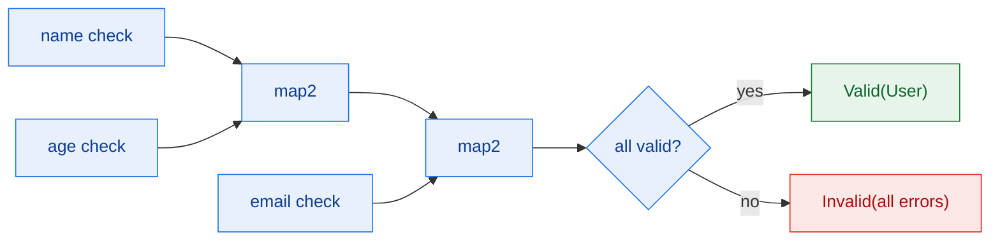
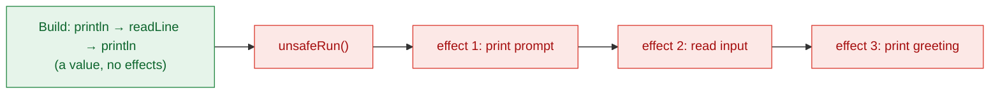

# 🧩 Validation & IO as Descriptions

> **Navigation**: [← Parser Combinators](Ch06h_FP_Parser_Combinators.md) | [Back to Index](00_INDEX.md) | [Next: Modern Java 9–21 →](Ch07_Modern_Java_9to21.md)

---

## 🔗 Bridge — Where This Chapter Fits

| Dimension | This chapter |
| --- | --- |
| **Builds on** | [Option & Either](Ch06d_FP_Error_Handling_Option_Either.md), [Monoids, Functors & Monads](Ch06g_FP_Monoids_Functors_Monads.md), [Purity & Effects](Ch06b_FP_Purity_Substitution_And_Effects.md) |
| **You will learn** | Why `flatMap` stops at the first error, how an applicative-style `map2` combines independent checks and collects **all** errors, and how an `IO` value describes an effect without running it |
| **Leads to** | [Spring validation and controllers](Ch37_SB_Controllers_REST.md), [Reactive streams](Ch48_SB_WebFlux_Core.md), [Concurrency](Ch15_Concurrency_Core.md) |
| **Abstraction level** | Run effects immediately → **describe effects as values** → run them once, at the edge of the program |

> [!NOTE]
> The full gap-free reading order and dependency graph are in the [FP Learning Path](Ch06a_FP_Learning_Path_And_Book_Map.md).

---

## 💬 Explain It Like a Study Partner — Validation & IO

### 1. The bottom line

Use `Either` when later steps depend on earlier ones (stop at the first error); use a `Validation` that accumulates when checks are independent (show every error); and treat an effect as a value you build first and run last.

### 2. The textbook core

- `flatMap` is **sequential**: step 2 needs step 1, so a failure stops everything.
- Independent checks (name, age, email) can all run; an **applicative** `map2(a, b, f)` combines two results and, if both fail, **concatenates the errors**.
- `Validation<E, A>` = `Invalid(List<E>) | Valid(A)`; `map2` is its only essential combinator (`sequence`/`traverse` build on it).
- An **`IO<A>`** value wraps a computation (`Supplier<A>`); `map` and `flatMap` build larger descriptions; **nothing happens until `unsafeRun()`**.
- Descriptions are reusable and testable: you can inspect or replay them; each `unsafeRun` performs the effects again.
- Keep `unsafeRun` in `main`/framework code only — the functional core stays pure ([Ch06b](Ch06b_FP_Purity_Substitution_And_Effects.md)).

### 3. The real-world analogy

**A recipe versus cooking**: writing the recipe (building an `IO`) cooks nothing; cooking (running it) uses ingredients. A form checker is like a teacher marking all answers at once instead of stopping at the first mistake.

### 4. Walkthrough

1. `validate(" ", 200, "nope")` runs three independent checks.
2. It returns `Invalid(["name is blank", "age out of range: 200", "email must contain '@'"])` — every error at once.
3. `println("Name?").flatMap(readLine).flatMap(n -> println("Hello, " + n))` builds a program; the console list is still empty.
4. `unsafeRun()` then prints `"Name?"` and `"Hello, Sam"` exactly once.

> [!NOTE]
> **Quick check:** Why can `Either` with `flatMap` not report all validation errors? *`flatMap` needs the previous value to run the next step, so after the first failure there is nothing to continue with.*

---

## ⚡ At a Glance



**How to read this diagram.** The three checks are independent, so `map2` combines them side by side. If any fail, the errors from all failing checks are collected; only when every check passes does a `User` get built.

---

## 1. Accumulating Validation

```java
sealed interface Validation<E, A> permits Invalid, Valid {}
record Invalid<E, A>(List<E> errors) implements Validation<E, A> {}
record Valid<E, A>(A value) implements Validation<E, A> {}
static <E, A, B, C> Validation<E, C> map2(Validation<E, A> a, Validation<E, B> b, BiFunction<A, B, C> f) {
    if (a instanceof Valid<E, A> va && b instanceof Valid<E, B> vb) return new Valid<>(f.apply(va.value(), vb.value()));
    List<E> errs = new ArrayList<>();
    if (a instanceof Invalid<E, A> ia) errs.addAll(ia.errors());
    if (b instanceof Invalid<E, B> ib) errs.addAll(ib.errors());
    return new Invalid<>(errs);
}
record User(String name, int age, String email) {}
static Validation<String, String> vName(String n) { return n != null && !n.isBlank() ? new Valid<>(n) : new Invalid<>(List.of("name is blank")); }
static Validation<String, Integer> vAge(int a) { return a >= 0 && a <= 150 ? new Valid<>(a) : new Invalid<>(List.of("age out of range: " + a)); }
static Validation<String, String> vEmail(String e) { return e.contains("@") ? new Valid<>(e) : new Invalid<>(List.of("email must contain '@'")); }
static Validation<String, User> validate(String n, int a, String e) {
```

| Call | Result |
| --- | --- |
| `validate("Ana", 30, "a@x.org")` | `Valid(User[Ana, 30, a@x.org])` |
| `validate("Bo", 5, "bo")` | `Invalid(["email must contain '@'"])` |
| `validate(" ", 200, "nope")` | `Invalid(["name is blank", "age out of range: 200", "email must contain '@'"])` |

> [!NOTE]
> Combining three checks takes nested `map2` calls here because Java has no `map3`; add `map3`/`map4` helpers or use a library (Vavr `Validation`, Spring's `Errors`/`BindingResult`) in real projects.

## 2. When to Use Which

| Situation | Use | Reason |
| --- | --- | --- |
| Step B needs the result of step A | `Either` + `flatMap` | Sequential dependency |
| Independent field checks | `Validation` + `map2` | Report all errors |
| A list of independent items | `traverse`/`sequence` with `Validation` | Collect every failing item |
| Exceptions from external code | Wrap at the boundary, convert to `Either`/`Invalid` | Keep the core exception-free |

## 3. `IO` as a Description

```java
record IO<A>(Supplier<A> thunk) {
    static <A> IO<A> pure(A a) { return new IO<>(() -> a); }
    <B> IO<B> map(Function<A, B> f) { return new IO<>(() -> f.apply(thunk.get())); }
    <B> IO<B> flatMap(Function<A, IO<B>> f) { return new IO<>(() -> f.apply(thunk.get()).thunk().get()); }
    A unsafeRun() { return thunk.get(); }
}
static List<String> console = new ArrayList<>();
static IO<Void> println(String s) { return new IO<>(() -> { console.add(s); return null; }); }
static IO<String> readLine(Deque<String> input) { return new IO<>(input::poll); }
```

```java
IO<Void> prog = println("Name?")
        .flatMap(x -> readLine(in))
        .flatMap(n -> println("Hello, " + n));
// nothing has happened yet: console is empty and the input is untouched
prog.unsafeRun();      // now: "Name?", then "Hello, Sam" — each effect exactly once
```



**How to read this diagram.** The green box is pure: it only builds a description. The red boxes happen when you call `unsafeRun()`, in the order described. Running the same description again repeats the effects.

## 4. Limits of This Toy `IO`

| Missing | Why it matters | Where to look |
| --- | --- | --- |
| Stack safety | Long `flatMap` chains can overflow the stack | A trampolined interpreter (Cats Effect, ZIO) |
| Resource safety | Files/connections must be closed on failure | `try`-with-resources, `bracket` in effect libraries |
| Concurrency | Real effect systems provide fibres and cancellation | Virtual threads ([Ch07](Ch07_Modern_Java_9to21.md)), Reactor |
| Error channel | Here exceptions escape `unsafeRun` | Combine with `Either` (`IO<Either<E, A>>`) |

## Verification

Checked by running: the three `validate` outcomes in the table; building the `IO` program leaves the console empty and the input queue untouched; one `unsafeRun` prints `["Name?", "Hello, Sam"]` and consumes the input exactly once; a reusable `IO` that logs `"tick"` runs its effect once per execution.

---

## 🏢 Enterprise Lens — Validation & IO

| Area | What top-tier engineering looks like |
| ---- | ------------------------------------ |
| **Where it runs in production** | Form and API request validation (show all field errors), configuration loading, batch import checks, effect systems (Cats Effect, ZIO, Reactor) that separate describing from running |
| **Failure modes** | Using `flatMap` where independent validation is wanted; running effects while "building" a description; sharing mutable state between runs of the same `IO`; forgetting that a thunk-based `IO` is not stack-safe for very long chains |
| **Testing and verification** | Table-driven tests for each field combination (valid, one error, all errors); assert that building an `IO` has no effect and that a run performs each effect once |

---

## 🧪 Practice Ladder

| Level | Exercise | Idea |
| ----- | -------- | ---- |
| 1 | Add `map3` and use it to validate a three-field form | Reduce nesting |
| 2 | Implement `traverse(List<A>, A -> Validation<E,B>)` | Collect errors over a list |
| 3 | Return `IO<Either<String, Integer>>` for a failing parse | Combine error channels |
| 4 | Write `IO.sequence(List<IO<A>>)` and test the order of effects | IO combinator |
| 5 | Make `unsafeRun` stack-safe for 100 000 chained `map`s using a loop | Trampolining |
| 6 | Replace one `try/catch` block in your code with a `Validation` or `Either` at the boundary | Real refactoring |

> [!CAUTION]
> **Reality check — "`IO` is just a fancy way to call methods." The point is separation: building a program is pure and testable, running it is isolated in one place, so you can test, reorder, retry or time out effects without changing the business logic.

---

[← Parser Combinators](Ch06h_FP_Parser_Combinators.md) | [Index](00_INDEX.md) | [Modern Java 9–21 →](Ch07_Modern_Java_9to21.md)
