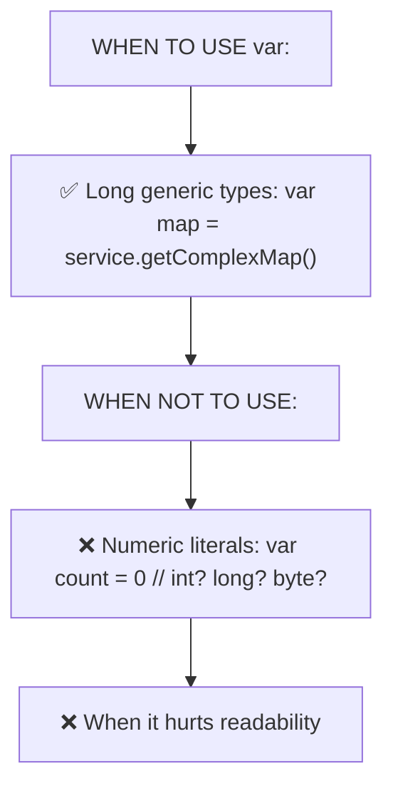
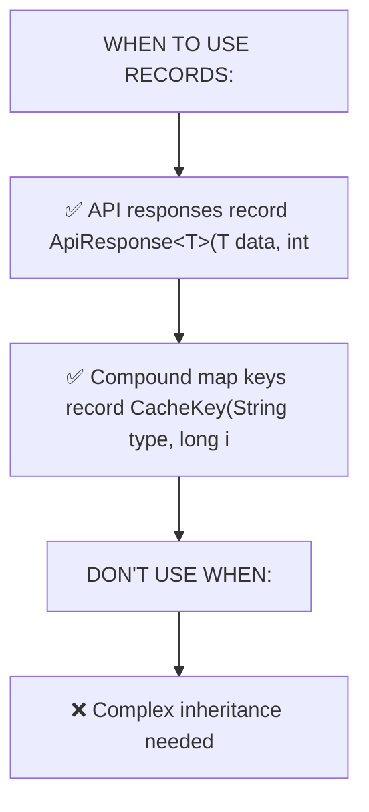
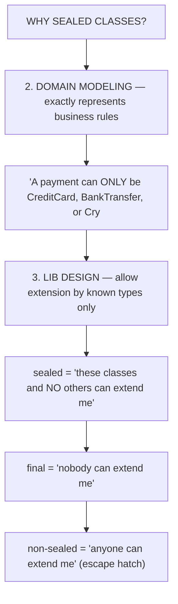
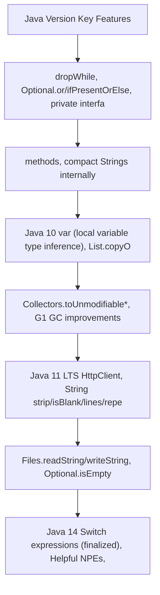
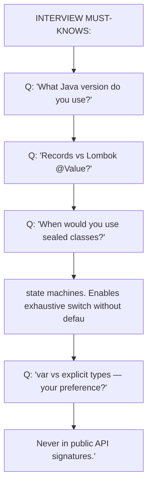

> **Navigation**: [Back to Index](../00_MASTER_INDEX.md)
> 🧠 **Mental Model**: See [Optimization Pipeline](../14_Mental_Models/14_Optimization_Pipeline.md) — new Java features as optimization tools

---

# 🆕 Modern Java Features (Java 9–21)

> Every feature that changed how production Java is written

---

## ❓ Why This Matters


> Interviewers ask: "What Java version do you use? What features?"
> Senior devs MUST know: Records, Sealed classes, Pattern matching, Var,
> Text blocks, Switch expressions, Virtual threads, Structured concurrency
>
> If you write Java 8-style code in 2026, you look outdated.


---

# PART 1: var — Local Variable Type Inference (Java 10)

```java
// BEFORE: Explicit, verbose
Map<String, List<Employee>> departmentMap = new HashMap<String, List<Employee>>();
BufferedReader reader = new BufferedReader(new FileReader("data.txt"));

// AFTER: var infers the type
var departmentMap = new HashMap<String, List<Employee>>();
var reader = new BufferedReader(new FileReader("data.txt"));

// Works with:
var list = List.of(1, 2, 3);           // List<Integer>
var stream = list.stream();             // Stream<Integer>
var entry = Map.entry("key", 42);       // Map.Entry<String, Integer>

// DOES NOT work with:
// var x;                    // No initializer — can't infer
// var x = null;             // null has no type
// var x = () -> {};         // Lambda needs target type
// var x = {1, 2, 3};       // Array initializer needs type
// var as parameter type     // Not allowed in method signatures
// var as field type         // Only local variables
```

```
┌─────────────────────────────────────────────────────────────────────────────────┐
│  WHEN TO USE var:                                                               │
│  ✅ Type is obvious from right side: var list = new ArrayList<String>()          │
│  ✅ Long generic types: var map = service.getComplexMap()                        │
│  ✅ Try-with-resources: try (var br = new BufferedReader(...))                   │
│                                                                                 │
│  WHEN NOT TO USE:                                                               │
│  ❌ Type isn't clear: var result = process(data)  // What's result?              │
│  ❌ Numeric literals: var count = 0  // int? long? byte?                         │
│  ❌ When it hurts readability                                                    │
└─────────────────────────────────────────────────────────────────────────────────┘
```

> **Flow**: WHEN TO USE var: → ✅ Long generic types: var map = service.getComplexMap() | ✅ Long generic types: var map = service.getComplexMap() → WHEN NOT TO USE: | WHEN NOT TO USE: → ❌ Numeric literals: var count = 0 // int? long? byte? | ❌ Numeric literals: var count = 0 // int? long? byte? → ❌ When it hurts readability



---

# PART 2: Records — Immutable Data Carriers (Java 16)

```java
// BEFORE: 60+ lines of boilerplate
public class Point {
    private final int x;
    private final int y;
    
    public Point(int x, int y) { this.x = x; this.y = y; }
    public int getX() { return x; }
    public int getY() { return y; }
    
    @Override public boolean equals(Object o) { /* ... 10 lines ... */ }
    @Override public int hashCode() { return Objects.hash(x, y); }
    @Override public String toString() { return "Point[x=" + x + ", y=" + y + "]"; }
}

// AFTER: 1 line. Same exact behavior.
public record Point(int x, int y) {}

// What you get automatically:
// ✅ private final fields (x, y)
// ✅ Constructor with all fields
// ✅ Accessor methods: point.x(), point.y()  (NOT getX()!)
// ✅ equals() based on all fields
// ✅ hashCode() based on all fields
// ✅ toString() → "Point[x=1, y=2]"
// ✅ Implements Serializable-compatible

// Custom validation in compact constructor:
public record Email(String address) {
    public Email {  // Compact constructor — no parens
        if (address == null || !address.contains("@")) {
            throw new IllegalArgumentException("Invalid email: " + address);
        }
        address = address.toLowerCase();  // Can transform before assignment
    }
}

// Records can have:
public record User(String name, int age) {
    // Static fields and methods
    static final User ANONYMOUS = new User("anon", 0);
    
    // Instance methods
    public String greeting() { return "Hello, " + name; }
    
    // Custom accessor (override generated one)
    public String name() { return name.toUpperCase(); }
    
    // Implements interfaces
    // implements Comparable<User>
}

// Records CANNOT:
// ❌ Extend other classes (implicitly extend Record)
// ❌ Have mutable fields (all fields are final)
// ❌ Be abstract
// ❌ Have additional instance fields
```

```
┌──────────────────────────────────────────────────────────────────────────────────┐
│  WHEN TO USE RECORDS:                                                            │
│  ✅ DTOs (Data Transfer Objects)         record UserDTO(String name, String email)│
│  ✅ API responses                        record ApiResponse<T>(T data, int code)  │
│  ✅ Value objects (DDD)                  record Money(BigDecimal amount, Currency)│
│  ✅ Configuration holders                record DbConfig(String url, int pool)    │
│  ✅ Compound map keys                    record CacheKey(String type, long id)    │
│  ✅ Method return types (multiple vals)  record ParseResult(int value, int pos)   │
│                                                                                  │
│  DON'T USE WHEN:                                                                 │
│  ❌ Entity needs mutability (JPA entities — but JPA 3.2 starts supporting them)   │
│  ❌ Complex inheritance needed                                                    │
│  ❌ Need builder pattern (records have all-args constructor only)                 │
└──────────────────────────────────────────────────────────────────────────────────┘
```

> **Flow**: WHEN TO USE RECORDS: → ✅ API responses record ApiResponse&lt;T&gt;(T data, int | ✅ API responses record ApiResponse&lt;T&gt;(T data, int → ✅ Compound map keys record CacheKey(String type, long i | ✅ Compound map keys record CacheKey(String type, long i → DON'T USE WHEN: | DON'T USE WHEN: → ❌ Complex inheritance needed



---

# PART 3: Sealed Classes — Controlled Inheritance (Java 17)

```java
// Sealed class: ONLY these specific classes can extend me
public sealed class Shape permits Circle, Rectangle, Triangle {
    abstract double area();
}

// Each permitted subclass MUST be: final, sealed, or non-sealed
public final class Circle extends Shape {
    double radius;
    double area() { return Math.PI * radius * radius; }
}

public final class Rectangle extends Shape {
    double width, height;
    double area() { return width * height; }
}

public non-sealed class Triangle extends Shape {
    // non-sealed: anyone can extend Triangle further
    double base, height;
    double area() { return 0.5 * base * height; }
}

// Sealed interfaces
public sealed interface Payment permits CreditCard, BankTransfer, Crypto {
    double amount();
}
public record CreditCard(double amount, String number) implements Payment {}
public record BankTransfer(double amount, String iban) implements Payment {}
public record Crypto(double amount, String wallet) implements Payment {}
```

```
┌─────────────────────────────────────────────────────────────────────────────────┐
│  WHY SEALED CLASSES?                                                            │
│                                                                                 │
│  1. EXHAUSTIVE PATTERN MATCHING — compiler knows ALL subtypes                   │
│     → No need for "default" case in switch (compiler checks all)                │
│  2. DOMAIN MODELING — exactly represents business rules                         │
│     "A payment can ONLY be CreditCard, BankTransfer, or Crypto"                 │
│  3. LIB DESIGN — allow extension by known types only                            │
│                                                                                 │
│  sealed = "these classes and NO others can extend me"                           │
│  final = "nobody can extend me"                                                 │
│  non-sealed = "anyone can extend me" (escape hatch)                             │
└─────────────────────────────────────────────────────────────────────────────────┘
```

> **Flow**: WHY SEALED CLASSES? → 2. DOMAIN MODELING — exactly represents business rules | 2. DOMAIN MODELING — exactly represents business rules → 'A payment can ONLY be CreditCard, BankTransfer, or Cry | 'A payment can ONLY be CreditCard, BankTransfer, or Cry → 3. LIB DESIGN — allow extension by known types only | 3. LIB DESIGN — allow extension by known types only → sealed = 'these classes and NO others can extend me' | sealed = 'these classes and NO others can extend me' → final = 'nobody can extend me' | final = 'nobody can extend me' → non-sealed = 'anyone can extend me' (escape hatch)



---

# PART 4: Pattern Matching — The Game Changer (Java 16-21)

## instanceof Pattern Matching (Java 16)

```java
// BEFORE: Cast after instanceof (verbose, error-prone)
if (obj instanceof String) {
    String s = (String) obj;  // Redundant cast
    System.out.println(s.length());
}

// AFTER: Pattern variable bound directly
if (obj instanceof String s) {  // s is available if true
    System.out.println(s.length());
}

// Works with && (s available in both conditions)
if (obj instanceof String s && s.length() > 5) {
    System.out.println(s.toUpperCase());
}

// Does NOT work with || (s might not be bound)
// if (obj instanceof String s || s.length() > 5) { }  // COMPILE ERROR
```

## Switch Expressions (Java 14) + Pattern Matching (Java 21)

```java
// OLD switch — verbose, fall-through bugs
switch (day) {
    case MONDAY:
    case FRIDAY:
        System.out.println("Working");
        break;  // Forget break = silent bug!
    default:
        System.out.println("Other");
}

// NEW switch expression — concise, no fall-through, returns value
String result = switch (day) {
    case MONDAY, FRIDAY -> "Working hard";
    case SATURDAY, SUNDAY -> "Weekend!";
    default -> "Regular day";
};

// Switch with blocks (use yield to return value)
int numericDay = switch (day) {
    case MONDAY -> 1;
    case TUESDAY -> {
        log.info("It's Tuesday");
        yield 2;  // yield returns value from block
    }
    default -> 0;
};

// PATTERN MATCHING IN SWITCH (Java 21) — THE POWER FEATURE
String describe(Object obj) {
    return switch (obj) {
        case Integer i when i > 0 -> "Positive integer: " + i;
        case Integer i            -> "Non-positive integer: " + i;
        case String s when s.isEmpty() -> "Empty string";
        case String s             -> "String of length " + s.length();
        case int[] arr            -> "Int array of length " + arr.length;
        case null                 -> "null";
        default                   -> "Unknown: " + obj.getClass();
    };
}

// WITH SEALED CLASSES — NO DEFAULT NEEDED (compiler checks exhaustiveness)
double area(Shape shape) {
    return switch (shape) {
        case Circle c    -> Math.PI * c.radius() * c.radius();
        case Rectangle r -> r.width() * r.height();
        case Triangle t  -> 0.5 * t.base() * t.height();
        // No default! Compiler knows these are ALL possible shapes.
    };
}
```

## Record Patterns — Destructuring (Java 21)

```java
// Destructure record components directly in patterns
record Point(int x, int y) {}
record Line(Point start, Point end) {}

// Destructuring in instanceof
if (obj instanceof Point(int x, int y)) {
    System.out.println("x=" + x + ", y=" + y);
}

// NESTED destructuring
if (obj instanceof Line(Point(int x1, int y1), Point(int x2, int y2))) {
    double length = Math.sqrt(Math.pow(x2 - x1, 2) + Math.pow(y2 - y1, 2));
}

// In switch
String describe(Object obj) {
    return switch (obj) {
        case Point(int x, int y) when x == 0 && y == 0 -> "Origin";
        case Point(int x, int y) -> "Point(" + x + "," + y + ")";
        case Line(Point s, Point e) -> "Line from " + s + " to " + e;
        default -> "Unknown";
    };
}
```

---

# PART 5: Text Blocks (Java 15) & String Enhancements

```java
// BEFORE: Escape hell
String json = "{\n" +
    "  \"name\": \"John\",\n" +
    "  \"age\": 30\n" +
    "}";

// AFTER: Text blocks — multi-line strings
String json = """
        {
          "name": "John",
          "age": 30
        }
        """;
// Incidental whitespace (before closing """) is stripped
// Trailing whitespace trimmed per line
// Final newline included (put """ on same line to exclude)

// Formatting with text blocks
String html = """
        <html>
          <body>
            <h1>%s</h1>
            <p>%s</p>
          </body>
        </html>
        """.formatted(title, content);

// New String methods (Java 9-17):
"  hello  ".strip();          // "hello" (Unicode-aware, better than trim())
"  hello  ".stripLeading();   // "hello  "
"  hello  ".stripTrailing();  // "  hello"
"hello".repeat(3);            // "hellohellohello"
"hello".isBlank();            // false
"".isBlank();                 // true
"   ".isBlank();              // true (only whitespace)
"hello\nworld".lines();       // Stream<String> of lines
"hello".indent(4);            // "    hello\n"
"HELLO".transform(s -> s.toLowerCase() + "!");  // "hello!"
```

---

# PART 6: Collection Factory Methods & Stream Enhancements

```java
// IMMUTABLE COLLECTION FACTORIES (Java 9)
var list = List.of(1, 2, 3);           // Immutable
var set = Set.of("a", "b", "c");       // Immutable, no duplicates
var map = Map.of("a", 1, "b", 2);     // Immutable, up to 10 entries
var map2 = Map.ofEntries(              // Immutable, any number of entries
    Map.entry("a", 1),
    Map.entry("b", 2)
);
// list.add(4);  // throws UnsupportedOperationException!

// Copy factory (Java 10)
var mutable = new ArrayList<>(List.of(1, 2, 3));
var immutableCopy = List.copyOf(mutable);  // Immutable copy

// STREAM ENHANCEMENTS
// takeWhile / dropWhile (Java 9)
List.of(1, 2, 3, 4, 5, 6).stream()
    .takeWhile(n -> n < 4)   // [1, 2, 3] — stops at first failure
    .toList();

List.of(1, 2, 3, 4, 5).stream()
    .dropWhile(n -> n < 3)   // [3, 4, 5] — skips until first success
    .toList();

// Stream.ofNullable (Java 9)
Stream.ofNullable(nullableValue)  // Empty stream if null, single-element if not
    .flatMap(...)

// Collectors.toUnmodifiableList/Set/Map (Java 10)
var result = stream.collect(Collectors.toUnmodifiableList());

// stream.toList() (Java 16) — shorthand
var result = stream.toList();  // Returns unmodifiable list

// mapMulti (Java 16) — replaces complex flatMap
stream.<String>mapMulti((item, consumer) -> {
    if (item.isValid()) {
        consumer.accept(item.getName());
        consumer.accept(item.getAlias());
    }
});
```

---

# PART 7: Other Essential Features

## Optional Enhancements (Java 9-11)

```java
Optional<String> opt = Optional.of("hello");

// ifPresentOrElse (Java 9)
opt.ifPresentOrElse(
    val -> System.out.println("Found: " + val),
    () -> System.out.println("Not found")
);

// or() — lazy fallback Optional (Java 9)
Optional<String> result = opt
    .or(() -> fetchFromCache())     // Try cache
    .or(() -> fetchFromDatabase()); // Then DB

// stream() — convert to Stream (Java 9)
List<String> names = optionalList.stream()
    .flatMap(Optional::stream)   // Filters out empty optionals
    .toList();
```

## HTTP Client (Java 11)

```java
// Modern HTTP client (replaces HttpURLConnection)
HttpClient client = HttpClient.newBuilder()
    .connectTimeout(Duration.ofSeconds(10))
    .followRedirects(HttpClient.Redirect.NORMAL)
    .build();

HttpRequest request = HttpRequest.newBuilder()
    .uri(URI.create("https://api.example.com/users"))
    .header("Content-Type", "application/json")
    .timeout(Duration.ofSeconds(30))
    .GET()
    .build();

// Synchronous
HttpResponse<String> response = client.send(request, 
    HttpResponse.BodyHandlers.ofString());

// Asynchronous
CompletableFuture<HttpResponse<String>> future = client.sendAsync(request,
    HttpResponse.BodyHandlers.ofString());
```

## Helpful NullPointerExceptions (Java 14)

```java
// BEFORE: "NullPointerException" — WHERE?!
user.getAddress().getCity().toUpperCase();
// Exception: NullPointerException  (which one is null??)

// AFTER (Java 14): Helpful message
// Exception: Cannot invoke "Address.getCity()" because the return value of
//            "User.getAddress()" is null
// → Tells you EXACTLY which reference was null!
```

---

# 📋 Part 8: Feature Summary Table

```
┌──────────────┬────────────────────────────────────────────────────────────────┐
│ Java Version │ Key Features                                                   │
├──────────────┼────────────────────────────────────────────────────────────────┤
│ Java 9       │ Modules, JShell, Collection factories, Stream takeWhile/       │
│              │ dropWhile, Optional.or/ifPresentOrElse, private interface      │
│              │ methods, compact Strings internally                            │
├──────────────┼────────────────────────────────────────────────────────────────┤
│ Java 10      │ var (local variable type inference), List.copyOf,              │
│              │ Collectors.toUnmodifiable*, G1 GC improvements                 │
├──────────────┼────────────────────────────────────────────────────────────────┤
│ Java 11 LTS  │ HttpClient, String strip/isBlank/lines/repeat,                 │
│              │ Files.readString/writeString, Optional.isEmpty                 │
├──────────────┼────────────────────────────────────────────────────────────────┤
│ Java 14      │ Switch expressions (finalized), Helpful NPEs,                  │
│              │ Records (preview)                                              │
├──────────────┼────────────────────────────────────────────────────────────────┤
│ Java 15      │ Text blocks (finalized), Sealed classes (preview),             │
│              │ Hidden classes                                                 │
├──────────────┼────────────────────────────────────────────────────────────────┤
│ Java 16      │ Records (finalized), instanceof pattern matching,              │
│              │ Stream.toList(), mapMulti                                      │
├──────────────┼────────────────────────────────────────────────────────────────┤
│ Java 17 LTS  │ Sealed classes (finalized), pattern matching for switch        │
│              │ (preview), always-strict floating-point                        │
├──────────────┼────────────────────────────────────────────────────────────────┤
│ Java 21 LTS  │ Virtual threads, Record patterns, Pattern matching switch      │
│              │ (finalized), Sequenced collections, Structured concurrency     │
│              │ (preview), String templates (preview)                          │
└──────────────┴────────────────────────────────────────────────────────────────┘
```

> **Flow**: Java Version Key Features → dropWhile, Optional.or/ifPresentOrElse, private interfa | dropWhile, Optional.or/ifPresentOrElse, private interfa → methods, compact Strings internally | methods, compact Strings internally → Java 10 var (local variable type inference), List.copyO | Java 10 var (local variable type inference), List.copyO → Collectors.toUnmodifiable*, G1 GC improvements | Collectors.toUnmodifiable*, G1 GC improvements → Java 11 LTS HttpClient, String strip/isBlank/lines/repe | Java 11 LTS HttpClient, String strip/isBlank/lines/repe → Files.readString/writeString, Optional.isEmpty | ...+1 more



```
┌─────────────────────────────────────────────────────────────────────────────────┐
│  INTERVIEW MUST-KNOWS:                                                          │
│                                                                                 │
│  Q: "What Java version do you use?"                                             │
│  A: "Java 21 LTS — virtual threads, records, sealed classes, pattern matching"  │
│                                                                                 │
│  Q: "Records vs Lombok @Value?"                                                 │
│  A: "Records are native, no annotation processor, work with pattern matching.   │
│      Lombok needs compile-time dependency. Records can't have mutable fields."  │
│                                                                                 │
│  Q: "When would you use sealed classes?"                                        │
│  A: "Domain modeling where exactly N types exist — payment types, AST nodes,    │
│      state machines. Enables exhaustive switch without default."                │
│                                                                                 │
│  Q: "var vs explicit types — your preference?"                                  │
│  A: "var when type is obvious from context. Explicit when it aids readability.  │
│      Never in public API signatures."                                           │
└─────────────────────────────────────────────────────────────────────────────────┘
```

> **Flow**: INTERVIEW MUST-KNOWS: → Q: 'What Java version do you use?' | Q: 'What Java version do you use?' → Q: 'Records vs Lombok @Value?' | Q: 'Records vs Lombok @Value?' → Q: 'When would you use sealed classes?' | Q: 'When would you use sealed classes?' → state machines. Enables exhaustive switch without defau | state machines. Enables exhaustive switch without defau → Q: 'var vs explicit types — your preference?' | Q: 'var vs explicit types — your preference?' → Never in public API signatures.'



---

> **Navigation**: [< Previous](Ch16_Concurrency_Advanced.md) | [Back to Index](../00_MASTER_INDEX.md) | [Next >](Ch54_Message_Queues_Kafka.md)