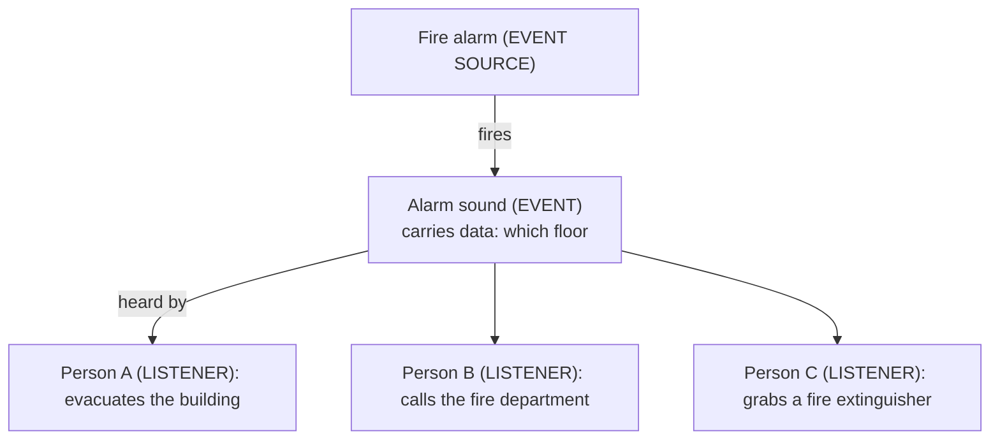
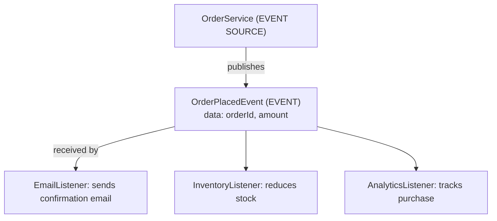
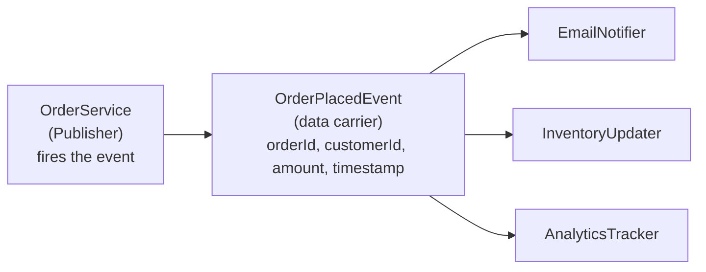
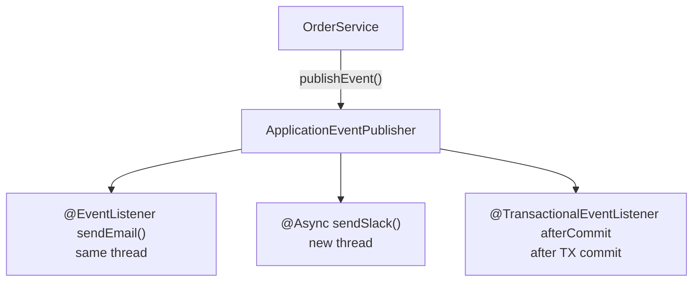
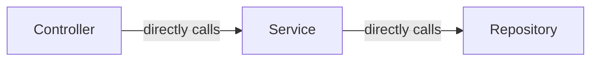
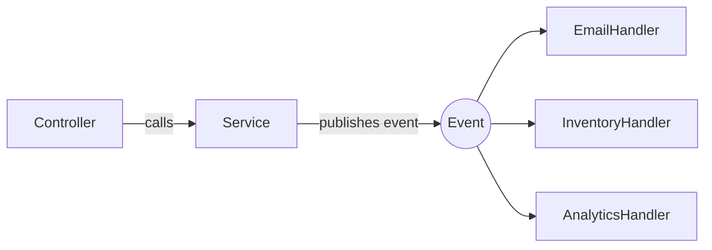

# 48. Java Events, Listeners & Observer Pattern — How to Understand Event Objects

**Navigation**: [< Reflection & Annotations](Ch10_Reflection_Annotations.md) | [Back to Index](../00_MASTER_INDEX.md) | [Enums, Records & Sealed >](Ch03_Enums_Records_Sealed.md)

---

## 🎯 The 5W1H Framework for Events

```text
 WHAT = An event is a MESSAGE that says "something happened"
        An event object CARRIES DATA about what happened

 WHY  = Decoupling: the thing that HAPPENED doesn't need to
        know who CARES about it

 WHEN = User clicks button, order is placed, file changes,
        timer fires, data arrives, state transitions

 WHERE = GUI (Swing/JavaFX), Spring events, message queues,
         WebSocket, file watchers, custom business logic

 WHO  = Publisher (fires event) → Event (data) → Listener
        (reacts to event)

 HOW  = Observer pattern / Listener pattern / Pub-Sub
```

### Historical Evolution

**Inventor / Originator:** Erich Gamma, Richard Helm, Ralph Johnson, John Vlissides (1994) — GoF *Design Patterns* formalized the Observer pattern.

**Predecessor context:** Pre-pattern literature, event handling was ad-hoc: callback function pointers (C), ad-hoc listener interfaces (pre-JavaBeans), or polling loops. No standardized vocabulary, no reusable abstractions.

**Evolution narrative:** The Observer pattern was codified by the Gang of Four in *Design Patterns* (1994) as one of 23 foundational patterns. JavaBeans (1998) introduced `PropertyChangeSupport` and `PropertyChangeListener` — the first standardized event model in Java, requiring explicit registration and firing. The GoF pattern used a `Subject`/`Observer` interface pair; JavaBeans used `PropertyChangeSupport` as a delegate. Spring's event system started as a simple `ApplicationEventPublisher` in Spring 1.0 (2004). Before Spring 4.2 (2014), developers had to implement `ApplicationListener<MyEvent>` for every event — verbose and type-unsafe. `@EventListener` (Spring 4.2, 2014) dramatically reduced boilerplate and enabled SpEL expressions for conditional event handling (`@EventListener("#event.status == 'NEW'")`).

**Modern practice:** Spring's `ApplicationEvent` + `@EventListener` is the standard. For async events, add `@Async` (Spring 3.x) on a separate `@AsyncEventListener`. Spring ApplicationEvent is now generic (`ApplicationEvent<Payload>`) for type-safe payloads. For cross-service events, use Spring ApplicationEventPublisher or Spring Cloud Stream (2016+) with Kafka. Domain Events (DomainEventPublisher in Axon Framework, 2009) implement the Aggregate Root pattern for DDD event sourcing.

- **GoF Observer — 1994**: *Design Patterns* (Gamma et al.). Subject/Observer interface pair. Foundational.
- **JavaBeans PropertyChangeSupport — 1998**: First standardized Java event model. Delegate-based listener.
- **`ApplicationEvent` — Spring 1.0 (2004)**: `ApplicationContext` publishes events. Manual `ApplicationListener` interface.
- **`@EventListener` — Spring 4.2 (2014)**: Annotation-based event handling. SpEL condition support.
- **`@TransactionalEventListener` — Spring 4.2 (2014)**: Events fire after transaction commit/rollback.
- **Spring Cloud Stream / Kafka — 2016+**: Distributed events across microservices. Event-driven messaging.

---

## 1. The Mental Model — Events in Real Life

**Real life**



**How to read this diagram.** The alarm doesn't know who is listening. Each listener decides what to do independently, and new listeners can be added without changing the alarm.

**In code**



**How to read this diagram.** `OrderService` doesn't know about email or inventory. Adding a new listener needs zero changes to `OrderService`.

---

🔬 **Section Challenge — 1. The Mental Model — Events in Real Life**

**Challenge 1 (Reasoning):** Why is it dangerous to perform a heavy database update synchronously inside a Spring `@EventListener` method?

<details><summary>Answer</summary>

Thread Blocking. By default, Spring `@EventListener` methods execute synchronously on the EXACT same thread that published the event. If the listener takes 5 seconds to run, the method that called `applicationEventPublisher.publishEvent()` is completely blocked for 5 seconds. To process events in the background without blocking the main workflow, you must explicitly annotate the listener with `@Async` to force it onto a separate thread pool.

</details>

## 2. How to Understand ANY Event Object

When you see an event object for the first time, ask these 4 questions:

```text
QUESTION 1: WHAT happened?
  → The event CLASS NAME tells you
  → OrderPlacedEvent, ButtonClickEvent, FileChangedEvent

QUESTION 2: WHAT data does it carry?
  → Look at the FIELDS of the event class
  → orderId, timestamp, userId, previousValue, newValue

QUESTION 3: WHO fired this event?
  → Look for getSource() or similar method
  → Returns the object that created the event

QUESTION 4: WHEN did it happen?
  → Look for timestamp field
  → Or check event creation time
```

### Example: Dissecting a Java SE Event Object

```java
// java.util.EventObject — the ROOT of all Java events
public class EventObject {
    protected transient Object source;   // WHO fired it

    public EventObject(Object source) {
        this.source = source;
    }

    public Object getSource() {
        return source;    // Get the object that fired this event
    }
}

// When you see ANY event extending EventObject, you know:
// → It has a source (the thing that fired it)
// → It carries data through its own fields
```

---

## 3. Building an Event System From Scratch

### Step 1: Define the Event

```java
// The event = a data carrier
public class OrderPlacedEvent {
    private final String orderId;
    private final String customerId;
    private final double amount;
    private final LocalDateTime timestamp;

    public OrderPlacedEvent(String orderId, String customerId, double amount) {
        this.orderId = orderId;
        this.customerId = customerId;
        this.amount = amount;
        this.timestamp = LocalDateTime.now();
    }

    // Getters only — events should be IMMUTABLE
    public String getOrderId() { return orderId; }
    public String getCustomerId() { return customerId; }
    public double getAmount() { return amount; }
    public LocalDateTime getTimestamp() { return timestamp; }
}
```

### Step 2: Define the Listener Interface

```java
// The contract: "I can handle OrderPlacedEvent"
public interface OrderEventListener {
    void onOrderPlaced(OrderPlacedEvent event);
}
```

### Step 3: Build the Event Publisher

```java
public class OrderService {
    // List of listeners (observers)
    private final List<OrderEventListener> listeners = new ArrayList<>();

    // Register listener
    public void addListener(OrderEventListener listener) {
        listeners.add(listener);
    }

    // Remove listener
    public void removeListener(OrderEventListener listener) {
        listeners.remove(listener);
    }

    // Business logic
    public void placeOrder(String customerId, double amount) {
        String orderId = UUID.randomUUID().toString();

        // ... save order to database ...

        // Fire event — notify all listeners
        OrderPlacedEvent event = new OrderPlacedEvent(orderId, customerId, amount);
        for (OrderEventListener listener : listeners) {
            listener.onOrderPlaced(event);
        }
    }
}
```

### Step 4: Implement Listeners

```java
public class EmailNotifier implements OrderEventListener {
    @Override
    public void onOrderPlaced(OrderPlacedEvent event) {
        System.out.printf("📧 Sending email for order %s, amount: $%.2f%n",
            event.getOrderId(), event.getAmount());
    }
}

public class InventoryUpdater implements OrderEventListener {
    @Override
    public void onOrderPlaced(OrderPlacedEvent event) {
        System.out.printf("📦 Reducing inventory for order %s%n",
            event.getOrderId());
    }
}

public class AnalyticsTracker implements OrderEventListener {
    @Override
    public void onOrderPlaced(OrderPlacedEvent event) {
        System.out.printf("📊 Tracking purchase: customer=%s, amount=$%.2f%n",
            event.getCustomerId(), event.getAmount());
    }
}
```

### Step 5: Wire It Together

```java
public class Main {
    public static void main(String[] args) {
        OrderService orderService = new OrderService();

        // Register listeners
        orderService.addListener(new EmailNotifier());
        orderService.addListener(new InventoryUpdater());
        orderService.addListener(new AnalyticsTracker());

        // Place order — all 3 listeners react!
        orderService.placeOrder("CUST-001", 299.99);

        // Output:
        // 📧 Sending email for order abc-123, amount: $299.99
        // 📦 Reducing inventory for order abc-123
        // 📊 Tracking purchase: customer=CUST-001, amount=$299.99
    }
}
```



**How to read this diagram.** The publisher fires one event that carries the data. Each listener reacts independently.

---

🔬 **Section Challenge — 3. Building an Event System From Scratch**

**Challenge 1 (Reasoning):** Why is it dangerous to perform a heavy database update synchronously inside a Spring `@EventListener` method?

<details><summary>Answer</summary>

Thread Blocking. By default, Spring `@EventListener` methods execute synchronously on the EXACT same thread that published the event. If the listener takes 5 seconds to run, the method that called `applicationEventPublisher.publishEvent()` is completely blocked for 5 seconds. To process events in the background without blocking the main workflow, you must explicitly annotate the listener with `@Async` to force it onto a separate thread pool.

</details>

## 4. Generic Event System — Production Grade

```java
// Step 1: Generic event interface
public interface Event {
    LocalDateTime getTimestamp();
}

// Step 2: Generic listener
@FunctionalInterface
public interface EventListener<E extends Event> {
    void handle(E event);
}

// Step 3: Event Bus (central event manager)
public class EventBus {
    private final Map<Class<?>, List<EventListener<?>>> listeners = new ConcurrentHashMap<>();

    // Register listener for a specific event type
    public <E extends Event> void subscribe(Class<E> eventType, EventListener<E> listener) {
        listeners.computeIfAbsent(eventType, k -> new CopyOnWriteArrayList<>())
                 .add(listener);
    }

    // Unregister
    public <E extends Event> void unsubscribe(Class<E> eventType, EventListener<E> listener) {
        List<EventListener<?>> list = listeners.get(eventType);
        if (list != null) {
            list.remove(listener);
        }
    }

    // Publish event to all registered listeners
    @SuppressWarnings("unchecked")
    public <E extends Event> void publish(E event) {
        List<EventListener<?>> list = listeners.get(event.getClass());
        if (list != null) {
            for (EventListener<?> listener : list) {
                ((EventListener<E>) listener).handle(event);
            }
        }
    }
}

// Usage
EventBus bus = new EventBus();

bus.subscribe(OrderPlacedEvent.class, event ->
    System.out.println("Order: " + event.getOrderId()));

bus.subscribe(UserRegisteredEvent.class, event ->
    System.out.println("Welcome: " + event.getUsername()));

bus.publish(new OrderPlacedEvent("ORD-1", "CUST-1", 99.99));
bus.publish(new UserRegisteredEvent("harsha", "h@mail.com"));
```

---

## 5. Spring ApplicationEvent — The Professional Way

### Built-in Event System

```java
// Step 1: Define event (extend ApplicationEvent or use any POJO in Spring 4.2+)

// Classic way (extends ApplicationEvent)
public class OrderPlacedEvent extends ApplicationEvent {
    private final String orderId;
    private final double amount;

    public OrderPlacedEvent(Object source, String orderId, double amount) {
        super(source);
        this.orderId = orderId;
        this.amount = amount;
    }

    public String getOrderId() { return orderId; }
    public double getAmount() { return amount; }
}

// Modern way (just a POJO — Spring 4.2+)
public record OrderPlacedEvent(String orderId, String customerId, double amount) {}
```

### Step 2: Publish

```java
@Service
@RequiredArgsConstructor
public class OrderService {
    private final ApplicationEventPublisher eventPublisher;

    public void placeOrder(CreateOrderRequest request) {
        // ... save order ...

        // Publish event — Spring delivers to all listeners
        eventPublisher.publishEvent(
            new OrderPlacedEvent(request.orderId(), request.customerId(), request.amount())
        );
    }
}
```

### Step 3: Listen

```java
// Way 1: @EventListener annotation (RECOMMENDED)
@Component
public class OrderEventHandlers {

    @EventListener
    public void sendConfirmationEmail(OrderPlacedEvent event) {
        // Spring calls this when OrderPlacedEvent is published
        System.out.println("Email sent for order: " + event.orderId());
    }

    @EventListener
    public void updateInventory(OrderPlacedEvent event) {
        System.out.println("Inventory updated for: " + event.orderId());
    }

    // Conditional listening
    @EventListener(condition = "#event.amount() > 1000")
    public void notifyManager(OrderPlacedEvent event) {
        System.out.println("Manager notified: high-value order $" + event.amount());
    }
}

// Way 2: Async event handling (non-blocking)
@Component
public class AsyncEventHandlers {

    @Async
    @EventListener
    public void sendSlackNotification(OrderPlacedEvent event) {
        // Runs in a separate thread — doesn't block the publisher
        System.out.println("Slack notification sent");
    }
}

// Way 3: @TransactionalEventListener
@Component
public class TransactionalHandlers {

    @TransactionalEventListener(phase = TransactionPhase.AFTER_COMMIT)
    public void afterOrderCommitted(OrderPlacedEvent event) {
        // Only fires AFTER the transaction commits successfully
        // If transaction rolls back → this NEVER fires
        System.out.println("Order committed, sending external notification");
    }
}
```

**Spring event flow**



**How to read this diagram.** The publisher delivers the event to every matching listener. Where each handler runs depends on its annotation: the caller's thread, a new thread, or after the transaction commits.

---

🔬 **Section Challenge — 5. Spring ApplicationEvent — The Professional Way**

**Challenge 1 (Reasoning):** Why is it dangerous to perform a heavy database update synchronously inside a Spring `@EventListener` method?

<details><summary>Answer</summary>

Thread Blocking. By default, Spring `@EventListener` methods execute synchronously on the EXACT same thread that published the event. If the listener takes 5 seconds to run, the method that called `applicationEventPublisher.publishEvent()` is completely blocked for 5 seconds. To process events in the background without blocking the main workflow, you must explicitly annotate the listener with `@Async` to force it onto a separate thread pool.

</details>

## 6. Spring Built-in Events — What You Can Listen To

```java
@Component
public class AppLifecycleListener {

    @EventListener
    public void onStartup(ApplicationReadyEvent event) {
        System.out.println("🚀 Application is READY to serve requests");
    }

    @EventListener
    public void onContextRefreshed(ContextRefreshedEvent event) {
        System.out.println("🔄 Context refreshed (all beans created)");
    }

    @EventListener
    public void onContextClosed(ContextClosedEvent event) {
        System.out.println("🛑 Application shutting down");
    }

    @EventListener
    public void onServletRequest(ServletRequestHandledEvent event) {
        System.out.printf("📡 %s %s → %dms %n",
            event.getMethod(), event.getRequestUrl(), event.getProcessingTimeMillis());
    }
}
```

**Spring Boot startup event order**

| Order | Event | Meaning |
| --- | --- | --- |
| 1 | `ApplicationStartingEvent` | Before anything |
| 2 | `ApplicationEnvironmentPreparedEvent` | Environment ready |
| 3 | `ApplicationContextInitializedEvent` | Context created |
| 4 | `ApplicationPreparedEvent` | Bean definitions loaded |
| 5 | `ContextRefreshedEvent` | All beans created |
| 6 | `ApplicationStartedEvent` | Context refreshed |
| 7 | `ApplicationReadyEvent` | READY to serve ✅ |

---

🔬 **Section Challenge — 6. Spring Built-in Events — What You Can Listen To**

**Challenge 1 (Reasoning):** Why is it dangerous to perform a heavy database update synchronously inside a Spring `@EventListener` method?

<details><summary>Answer</summary>

Thread Blocking. By default, Spring `@EventListener` methods execute synchronously on the EXACT same thread that published the event. If the listener takes 5 seconds to run, the method that called `applicationEventPublisher.publishEvent()` is completely blocked for 5 seconds. To process events in the background without blocking the main workflow, you must explicitly annotate the listener with `@Async` to force it onto a separate thread pool.

</details>

## 7. Observer Pattern — The Design Pattern Behind Events

```text
Observer Pattern = the FORMAL name for the event/listener
pattern. Same concept, different vocabulary:

Publisher  = Subject  = Observable   (fires events)
Listener   = Observer                (reacts to events)
Event      = Notification = Message  (data carrier)
```

### Classic Observer Pattern

```java
// Subject interface
public interface Subject<T> {
    void attach(Observer<T> observer);
    void detach(Observer<T> observer);
    void notifyObservers(T data);
}

// Observer interface
@FunctionalInterface
public interface Observer<T> {
    void update(T data);
}

// Concrete subject: Stock Price Monitor
public class StockPriceMonitor implements Subject<StockPrice> {
    private final List<Observer<StockPrice>> observers = new CopyOnWriteArrayList<>();
    private final String symbol;

    public StockPriceMonitor(String symbol) {
        this.symbol = symbol;
    }

    @Override
    public void attach(Observer<StockPrice> observer) {
        observers.add(observer);
    }

    @Override
    public void detach(Observer<StockPrice> observer) {
        observers.remove(observer);
    }

    @Override
    public void notifyObservers(StockPrice price) {
        for (Observer<StockPrice> observer : observers) {
            observer.update(price);
        }
    }

    public void updatePrice(double newPrice) {
        StockPrice price = new StockPrice(symbol, newPrice, LocalDateTime.now());
        notifyObservers(price);  // Tell everyone!
    }
}

// Event data
public record StockPrice(String symbol, double price, LocalDateTime timestamp) {}

// Usage
StockPriceMonitor tesla = new StockPriceMonitor("TSLA");

// Observer 1: Display on screen
tesla.attach(price ->
    System.out.printf("📺 %s: $%.2f%n", price.symbol(), price.price()));

// Observer 2: Alert if price drops
tesla.attach(price -> {
    if (price.price() < 200) {
        System.out.println("🚨 ALERT: TSLA below $200!");
    }
});

// Observer 3: Log to database
tesla.attach(price ->
    System.out.printf("💾 Logged: %s at %s%n", price.symbol(), price.timestamp()));

tesla.updatePrice(250.50);
// 📺 TSLA: $250.50
// 💾 Logged: TSLA at 2026-03-08T10:00:00

tesla.updatePrice(195.00);
// 📺 TSLA: $195.00
// 🚨 ALERT: TSLA below $200!
// 💾 Logged: TSLA at 2026-03-08T10:01:00
```

---

## 8. Property Change Events — Java Beans Standard

```java
import java.beans.PropertyChangeListener;
import java.beans.PropertyChangeSupport;

public class UserProfile {
    private final PropertyChangeSupport pcs = new PropertyChangeSupport(this);

    private String name;
    private String email;
    private int age;

    // Add/Remove listeners
    public void addPropertyChangeListener(PropertyChangeListener listener) {
        pcs.addPropertyChangeListener(listener);
    }

    public void removePropertyChangeListener(PropertyChangeListener listener) {
        pcs.removePropertyChangeListener(listener);
    }

    // When property changes → fire event with OLD and NEW value
    public void setName(String name) {
        String oldName = this.name;
        this.name = name;
        pcs.firePropertyChange("name", oldName, name);
    }

    public void setAge(int age) {
        int oldAge = this.age;
        this.age = age;
        pcs.firePropertyChange("age", oldAge, age);
    }

    // ... getters
}

// Usage
UserProfile profile = new UserProfile();

// Listen to ALL property changes
profile.addPropertyChangeListener(event -> {
    System.out.printf("Property '%s' changed: %s → %s%n",
        event.getPropertyName(), event.getOldValue(), event.getNewValue());
});

profile.setName("Harsha");    // Property 'name' changed: null → Harsha
profile.setAge(25);           // Property 'age' changed: 0 → 25
profile.setName("Sai");       // Property 'name' changed: Harsha → Sai
```

### Understanding the PropertyChangeEvent Object

```text
PropertyChangeEvent contains:
getSource()        → UserProfile object  │ ← WHO fired it
getPropertyName()  → "name"              │ ← WHAT changed
getOldValue()      → "Harsha"            │ ← Previous value
getNewValue()      → "Sai"               │ ← Current value

This pattern is used in:
• JavaFX bindings
• Swing UI components
• JMX monitoring
• Any reactive data binding
```

---

## 9. Event-Driven Architecture — The Big Picture

**Layered (traditional)**



Problem: tight coupling. Adding email means changing the Service code.

**Event-driven**



**How to read these diagrams.** In the layered version each layer calls the next one directly. In the event-driven version the Service only publishes an event and doesn't know about the handlers. Adding a new handler means zero changes to the Service.

### When to Use Events vs Direct Calls

```text
DIRECT CALL (method invocation)
✅ Use when: caller NEEDS the result immediately
✅ Use when: operation is core business logic
✅ Use when: simple, 1-to-1 relationship
Example: orderService.calculateTotal(items)

EVENT-DRIVEN
✅ Use when: multiple things react to one action
✅ Use when: reactions are INDEPENDENT of each other
✅ Use when: you want to add reactions WITHOUT changing source
✅ Use when: async processing is acceptable
Example: order placed → email + inventory + analytics

❌ DON'T use events for:
• Simple getter/setter calls
• When you need the result synchronously
• When there's only one listener (just call the method!)
```

---

## 10. Java NIO File Watch Events — Real-World Example

```java
// Watch a directory for file changes
public class FileWatcher {

    public void watchDirectory(Path dir) throws IOException, InterruptedException {
        WatchService watcher = FileSystems.getDefault().newWatchService();

        dir.register(watcher,
            StandardWatchEventKinds.ENTRY_CREATE,
            StandardWatchEventKinds.ENTRY_MODIFY,
            StandardWatchEventKinds.ENTRY_DELETE
        );

        System.out.println("Watching: " + dir);

        while (true) {
            WatchKey key = watcher.take();  // Blocks until event

            for (WatchEvent<?> event : key.pollEvents()) {
                WatchEvent.Kind<?> kind = event.kind();
                Path filename = (Path) event.context();

                // Understanding the event object:
                // kind()    → WHAT happened (CREATE/MODIFY/DELETE)
                // context() → WHICH file was affected
                // count()   → HOW MANY times (overflow detection)

                System.out.printf("Event: %s → File: %s%n", kind.name(), filename);
            }

            key.reset();  // Must reset to receive more events
        }
    }
}
```

---

## 11. CompletableFuture as Events — Modern Async Pattern

```java
// CompletableFuture are essentially "future events"
// "When X completes, THEN do Y"

CompletableFuture<Order> orderFuture = CompletableFuture
    .supplyAsync(() -> orderService.createOrder(request))

    // WHEN order created → THEN send email
    .thenApply(order -> {
        emailService.sendConfirmation(order);
        return order;
    })

    // WHEN email sent → THEN update inventory
    .thenApply(order -> {
        inventoryService.reduce(order.getItems());
        return order;
    })

    // WHEN everything done → THEN track analytics
    .thenAccept(order ->
        analyticsService.trackPurchase(order))

    // IF anything fails → handle error
    .exceptionally(ex -> {
        log.error("Order pipeline failed", ex);
        return null;
    });
```

```
Event Chain:
supplyAsync → thenApply → thenApply → thenAccept
    │             │            │            │
  Order       + Email     + Inventory   + Analytics
  Created      Sent        Updated       Tracked

Each step is an "event handler" for the previous step's completion
```

---

## 12. Reactive Streams — The Ultimate Event Pattern

```java
// Reactive = continuous stream of events
// Using Project Reactor (Spring WebFlux foundation)

Flux<StockPrice> stockPrices = Flux.interval(Duration.ofSeconds(1))
    .map(tick -> new StockPrice("TSLA", 200 + Math.random() * 50, LocalDateTime.now()));

// Subscribe = register event listener
stockPrices
    .filter(price -> price.price() > 230)          // Only high prices
    .map(price -> "🚨 TSLA high: $" + price.price())
    .subscribe(
        message -> System.out.println(message),     // onNext (event handler)
        error -> System.err.println("Error: " + error), // onError
        () -> System.out.println("Stream complete")      // onComplete
    );

// This is event-driven at the STREAM level:
// Publisher  = Flux (emits stock prices every second)
// Event      = Each StockPrice object
// Subscriber = The lambda in subscribe()
```

---

🔬 **Section Challenge — 12. Reactive Streams — The Ultimate Event Pattern**

**Challenge 1 (Reasoning):** `list.stream().filter().map().collect()` — at which point does data actually start flowing through the pipeline?

<details><summary>Answer</summary>

Not until `collect()` (or any terminal operation). `filter()` and `map()` are LAZY — they build a pipeline description but process nothing. When the terminal operation is called, the pipeline pulls elements through lazily: one element passes through the entire pipeline before the next is processed. This means: early termination with `findFirst()` is O(1) if the first element matches, not O(N).

</details>

**Challenge 2 (Bug Hunt):** You call `stream.filter(...).collect(...)` twice on the same stream. What happens?

<details><summary>Answer</summary>

`IllegalStateException: stream has already been operated upon or closed`. Streams are single-use. Once a terminal operation is called, the stream is consumed. Fix: create a new stream from the source each time, or collect to a `List` first and stream the list repeatedly.

</details>

## 13. How to Read/Understand ANY Event System

When you encounter a new event system (in any framework), follow this checklist:

```text
STEP 1: Find the EVENT CLASS
  → What fields does it have? (that's the data)
  → Does it extend a base event class?
  → Is it immutable? (events should be)

STEP 2: Find WHO PUBLISHES it
  → Search for: new EventClassName(
  → Or: eventPublisher.publish(
  → Or: fireEvent( / notifyObservers(

STEP 3: Find WHO LISTENS
  → Search for: @EventListener
  → Or: implements Listener<EventType>
  → Or: addEventListener( / subscribe(

STEP 4: Trace the FLOW
  → Publisher creates event
  → Event carries data through the system
  → Each listener receives and processes independently

STEP 5: Check ORDERING & THREADING
  → Are listeners called synchronously or async?
  → Is there a guaranteed order?
  → What happens if a listener throws an exception?
```

---

## 14. Common Event Patterns Comparison

 Complexity gets HIGHER as you go down Choose the SIMPLEST that meets your needs**

| PATTERN | COUPLING | THREAD | USE CASE |
| --- | --- | --- | --- |
| Direct call | Tight | Same | Core business logic |
| Observer | Loose | Same | In-process notif. |
| Event Bus | Very loose | Same/Async | In-app decoupling |
| Spring Events | Very loose | Same/@Async | Spring apps |
| Message Queue | Zero | Separate | Microservices |
| Reactive Stream | Zero | Scheduled | High-throughput |

- Coupling gets LOOSER as you go down.
- Complexity gets HIGHER as you go down.
- Choose the SIMPLEST pattern that meets your needs.

---

## 15. Interview Questions & Answers

**Q: What is the Observer pattern? Give a real example.**
Subject maintains a list of observers. When state changes, it notifies all. Example: Stock price monitor notifies display, alert, and logging components.

**Q: Explain Spring's event system.**
Any bean can publish events via `ApplicationEventPublisher`. Other beans use `@EventListener` to react. Events can be sync/async and transactional.

**Q: When would you use events vs direct method calls?**
Events when multiple independent reactions to one action, when you want decoupling, or when reactions might change. Direct calls when you need the result, or there's a 1-to-1 relationship.

**Q: What is @TransactionalEventListener?**
It fires AFTER the transaction phase (usually AFTER_COMMIT). If the transaction rolls back, the listener never fires. Used for external side-effects like sending emails.

**Q: How do you handle event listener failures?**
Sync: exception propagates to publisher (dangerous). Async (@Async): exception logged, publisher unaffected. Best practice: use try-catch in listeners, dead-letter queue for critical events.

**Q: How do events relate to eventual consistency in microservices?**
Service A publishes event → message queue → Service B consumes. B is eventually consistent with A. If B fails, event stays in queue for retry. This is the foundation of event-driven microservices.

---

**Key Takeaway**: Events are everywhere in Java — from Swing buttons
to Spring beans to Kafka messages. The core pattern is always the same:
**Publisher fires → Event carries data → Listener reacts**.
Learn to identify these 3 parts in ANY system.

**Navigation**: [< Reflection & Annotations](Ch10_Reflection_Annotations.md) | [Back to Index](../00_MASTER_INDEX.md) | [Enums, Records & Sealed >](Ch03_Enums_Records_Sealed.md)


---

## Reality Check

**"Event listeners are automatically garbage collected when done"** → Listeners are NOT automatically garbage collected. If an object registers a listener on a long-lived source (`EventBus.register(this)`, `button.addActionListener(this)`) and is then "released" by the application, the long-lived source still holds a reference via the listener — the object cannot be garbage collected. This is the classic observer-pattern memory leak: many objects registered but never unregistered. Always unregister listeners when done: `button.removeActionListener(this)`, `EventBus.unregister(this)`. Use WeakReference-based listener lists if auto-cleanup is needed.

**"@EventListener in Spring handles events synchronously by default"** → Spring's `@EventListener` is synchronous by default: the publisher's thread blocks until all listeners for the event have completed. For long-running listeners, this delays the publisher. `@Async @EventListener` runs the listener in a separate thread pool — the publisher does not wait. `ApplicationEventPublisher.publishEvent()` vs `@TransactionalEventListener(phase = AFTER_COMMIT)`: the transactional variant fires AFTER the transaction commits (useful for sending an email only if the DB write succeeded — not before).

**"Observer pattern and event-driven architecture are the same pattern"** → Observer pattern is a design pattern: one observable, multiple observers, direct reference. Event-driven architecture is a broader system design: events flow through a message bus or queue (Kafka, RabbitMQ), producers and consumers are decoupled (producer doesn't know who listens), events are durable (persisted on the bus), and consumers can be in different services or even different datacenters. Observer pattern = in-process tight coupling. EDA = cross-service loose coupling via a message infrastructure.

**"Property change listeners are unique to Java Swing"** → `PropertyChangeSupport` and `PropertyChangeListener` are in `java.beans` — part of the JavaBeans specification, not Swing-specific. Any class can use `PropertyChangeSupport` to fire `propertyChange(PropertyChangeEvent)` when its properties change. JavaFX uses `ObservableProperty` and `ChangeListener`. Spring has `ApplicationEvent`/`ApplicationListener`. Android has `LiveData` and `StateFlow`. The pattern is universal; the implementation varies by framework.

**"GUI event listeners run on any available thread"** → Swing event listeners MUST run on the Event Dispatch Thread (EDT). Long-running work on the EDT freezes the UI. `SwingUtilities.invokeLater(runnable)` schedules work on the EDT from any thread. `SwingWorker` runs work on a background thread and publishes results back to the EDT. JavaFX uses `Platform.runLater()` for the same purpose. This single-threaded GUI model is universal: Android also requires all UI updates on the main thread. Background work → update UI → must post back to UI thread.
