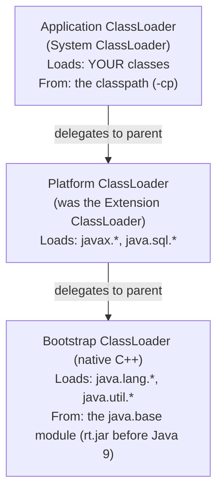
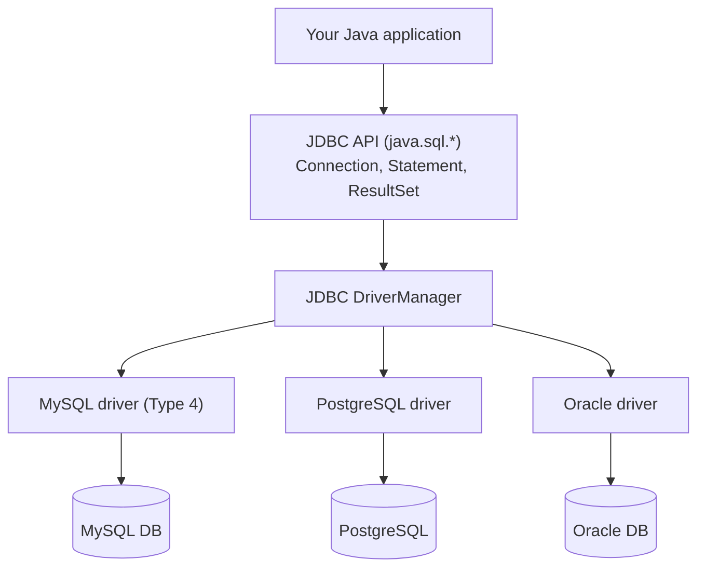
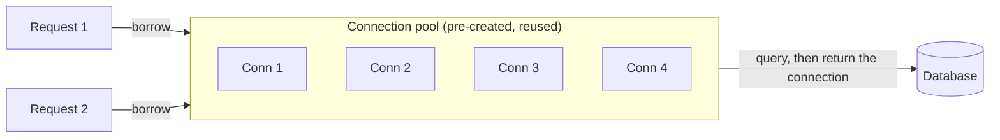
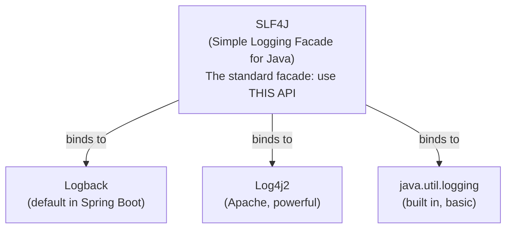

# 52. Java ClassLoader, JDBC & Logging — The Infrastructure Layer

**Navigation**: [< Generics & Exceptions](Ch04_Generics_Exceptions.md) | [Back to Index](../00_MASTER_INDEX.md)

---

## PART 1: CLASSLOADER — How Java Finds & Loads Classes

---

🔬 **Section Challenge — PART 1: CLASSLOADER — How Java Finds & Loads Classes**

**Challenge 1 (Reasoning):** What happens if you try to define your own class named `java.lang.String` in your project and execute it?

<details><summary>Answer</summary>

The JVM strictly ignores it and uses the built-in String class. This is enforced by the ClassLoader Delegation Model (Parent-First). When your application asks the ApplicationClassLoader to load `java.lang.String`, it immediately delegates the request up to the Bootstrap ClassLoader. The Bootstrap loader finds the authentic `String` class in the JDK's `rt.jar` and returns it, preventing malicious code from overriding core JDK security classes.

</details>

## 🎯 The 5W1H

```text
 WHAT = ClassLoader reads .class files (bytecode) and converts
        them into Class<?> objects that the JVM can use

 WHY  = JVM doesn't load ALL classes at startup — it loads them
        ON DEMAND when first referenced. ClassLoader decides
        WHERE to find each class.

 WHEN = Every time you use 'new', access a static method,
        or reference a class for the first time

 HOW  = Delegation model: child asks parent first
```

### Historical Evolution

**Inventor / Originator:** James Gosling / Sun Microsystems (1995) — ClassLoader architecture in Java 1.0. JDBC team at Sun (1997).

**Predecessor context:** Before ClassLoaders, all classes were loaded from the bootstrap classpath. No plugin architecture, no OSGi, no dynamic loading. JDBC pre-4.0 required `Class.forName("sun.jdbc.odbc.JdbcOdbcDriver")` for the ODBC bridge.

**Evolution narrative:** The three-tier ClassLoader hierarchy (Bootstrap → Platform/Extension → Application) was designed from Java 1.0 to enable applet sandboxing and plugin architectures. The Parent-Delegation Model prevents classes from overriding core JDK types (e.g., `java.lang.String`). `ServiceLoader` (Java 6, 2006) standardized the Service Provider Interface (SPI) pattern — `META-INF/services/<FQCN>` files listing implementations. JPMS (Java 9, 2017, JSR 376) introduced module path, making the classpath optional. For JDBC, Java 1.1 (1997) introduced `java.sql` with `DriverManager`; JDBC 4.0 (Java 6, 2006) added `DriverManager` auto-loading — no more `Class.forName()`. SLF4J (QOS.ch, 2005) was created to end the log4j 1.x vs `java.util.logging` fragmentation by providing a single facade.

**Modern practice:** Spring Boot 3.x uses JPMS module paths. `DriverManager` auto-registers JDBC 4.0+ drivers via `META-INF/services`. SLF4J with Logback (successor to log4j 1.x) is the standard logging stack. `ServiceLoader` is used by JAX-RS, JDBC drivers, and Java's built-in crypto providers. For plugin architectures, consider Java's `ModuleLayer` (Java 9+) or OSGi (Apache, 2000+).

- **ClassLoader hierarchy — Java 1.0 (1995)**: Bootstrap (C++), Extension, Application. Parent-first delegation.
- **JDBC-ODBC bridge — Java 1.1 (1997)**: `Class.forName("sun.jdbc.odbc.JdbcOdbcDriver")`. Replaced by JDBC 4.0.
- **`ServiceLoader` — Java 6 (2006)**: `META-INF/services/<interface>` SPI. JDBC drivers, JAX-RS implementations.
- **JDBC 4.0 — Java 6 (2006)**: `DriverManager` auto-registers. No more `Class.forName()`. ServiceLoader-based.
- **SLF4J — QOS.ch 2005**: Ceki Gülcü. Single facade: log4j 1.x, `java.util.logging`, Logback. End of fragmentation.
- **JPMS (Jigsaw) — Java 9 (2017)**: JSR 376. Module path alongside classpath. `requires`, `exports` directives.

---

## 1. The Three ClassLoaders



**How to read this diagram.** Each loader first delegates to its parent. Only when the parent can't find the class does the child try to load it itself.

```java
// See which ClassLoader loaded a class
System.out.println(String.class.getClassLoader());
// null — Bootstrap (native, not a Java object)

System.out.println(java.sql.Connection.class.getClassLoader());
// PlatformClassLoader

System.out.println(MyApp.class.getClassLoader());
// AppClassLoader
```

---

🔬 **Section Challenge — 1. The Three ClassLoaders**

**Challenge 2 (ClassLoader Reasoning):** A class named `com.app.User` loads successfully, but your own `java.lang.String` class is ignored. Which class loader rule explains both outcomes?

<details><summary>Trace, Reasoning & Debug</summary>

The application class loader can load application classes from your classpath, such as `com.app.User`. But class loading follows parent-first delegation.

For core JDK classes like `java.lang.String`, the request delegates upward to the bootstrap class loader first. Bootstrap finds the trusted JDK class before the application loader gets a chance.

This prevents application code from overriding core Java classes and is a security boundary as much as a loading mechanism.

</details>

## 2. Delegation Model — Parent-First

```
When Application ClassLoader needs to load "com.myapp.User":

Step 1: App asks Platform: "Do you have com.myapp.User?"
Step 2: Platform asks Bootstrap: "Do you have com.myapp.User?"
Step 3: Bootstrap: "No, I only have java.lang.*, java.util.*, etc."
Step 4: Platform: "No, I only have javax.*, etc."
Step 5: App: "I'll look in the classpath... Found it!"

WHY parent-first?
→ Security: You can't create a fake java.lang.String
→ Your String class will NEVER be loaded because Bootstrap always wins
→ Core classes are always the real ones
```

```java
// Class loading lifecycle
// Loading → Linking (Verify → Prepare → Resolve) → Initialization

// 1. LOADING: Read bytecode from .class file
// 2. VERIFY: Check bytecode is valid (no stack overflow tricks, etc.)
// 3. PREPARE: Allocate memory for static fields (set to defaults)
// 4. RESOLVE: Replace symbolic references with direct references
// 5. INITIALIZE: Run static initializers and static blocks
```

---

## 3. Custom ClassLoader — Practical Use

```java
// Why build one? Plugin systems, hot-reload, encryption, isolation

public class PluginClassLoader extends ClassLoader {
    private final Path pluginDir;

    public PluginClassLoader(Path pluginDir, ClassLoader parent) {
        super(parent);
        this.pluginDir = pluginDir;
    }

    @Override
    protected Class<?> findClass(String name) throws ClassNotFoundException {
        try {
            String fileName = name.replace('.', '/') + ".class";
            Path classFile = pluginDir.resolve(fileName);
            byte[] bytes = Files.readAllBytes(classFile);
            return defineClass(name, bytes, 0, bytes.length);
        } catch (IOException e) {
            throw new ClassNotFoundException("Could not load: " + name, e);
        }
    }
}

// Usage — load plugin at runtime
PluginClassLoader loader = new PluginClassLoader(Path.of("/plugins"),
    ClassLoader.getSystemClassLoader());
Class<?> pluginClass = loader.loadClass("com.plugin.MyPlugin");
Object plugin = pluginClass.getDeclaredConstructor().newInstance();
```

---

🔬 **Section Challenge — 3. Custom ClassLoader — Practical Use**

**Challenge 3 (ClassLoader Design):** A plugin system loads jars from a `/plugins` folder and supports hot reload. Why can keeping references to old plugin objects create a memory leak?

<details><summary>Trace, Reasoning & Debug</summary>

Each plugin jar may be loaded by its own class loader. Classes are eligible for unloading only when the defining class loader and all classes/instances loaded by it become unreachable.

If a registry, thread, static field, cache, or listener keeps a reference to an old plugin object, the old class loader stays alive. That keeps old bytecode and metadata alive too.

Fix by isolating plugins behind a parent-loaded interface, closing URLClassLoader resources, stopping plugin threads, unregistering listeners, clearing caches, and dropping every reference to the old loader during reload.

</details>

## 4. Class.forName vs ClassLoader.loadClass

```java
// Class.forName — LOADS and INITIALIZES the class
Class<?> clazz = Class.forName("com.mysql.cj.jdbc.Driver");
// Static blocks run immediately!

// ClassLoader.loadClass — LOADS but does NOT initialize
Class<?> clazz = ClassLoader.getSystemClassLoader()
    .loadClass("com.mysql.cj.jdbc.Driver");
// Static blocks do NOT run until first use

// This matters for JDBC drivers:
// Old way: Class.forName("com.mysql.cj.jdbc.Driver");
// Modern: Not needed! ServiceLoader auto-discovers drivers via META-INF/services
```

---

🔬 **Section Challenge — 4. Class.forName vs ClassLoader.loadClass**

**Challenge 4 (Initialization Reasoning):** `Class.forName("com.mysql.Driver")` triggers driver registration, but `loader.loadClass("com.mysql.Driver")` may not. Why?

<details><summary>Trace, Reasoning & Debug</summary>

`ClassLoader.loadClass` loads the class metadata but does not necessarily initialize the class. `Class.forName(String)` loads and initializes by default.

Initialization runs static initializers. Older JDBC drivers registered themselves in a static block, so merely loading without initialization could skip driver registration.

Use the correct API for intent: load metadata when you only need a `Class` object; initialize when static registration or side effects are intentionally required. Modern JDBC usually uses service loading, but the distinction still matters.

</details>

## PART 2: JDBC — Database Access Internals

---

🔬 **Section Challenge — PART 2: JDBC — Database Access Internals**

**Challenge 5 (JDBC Reasoning):** Why is `PreparedStatement` safer and often faster than building SQL strings with concatenation?

<details><summary>Trace, Reasoning & Debug</summary>

String concatenation mixes SQL structure and user data. A malicious value can escape the intended literal context and become executable SQL.

`PreparedStatement` sends query structure and bind values separately. The database treats parameters as data, not syntax, and may reuse the execution plan for repeated calls.

Use prepared statements for all dynamic values. They solve injection risk, improve clarity, and can reduce parse/plan overhead for repeated statements.

</details>

## 5. JDBC Architecture



**How to read this diagram.** Your code talks to the JDBC API only. `DriverManager` picks the driver that matches the database URL, and the driver speaks that database's protocol.

**Type 4 driver (most common):** pure Java, converts JDBC calls directly to the database protocol, needs no native code. Examples: `mysql-connector-j` and the PostgreSQL driver.

---

## 6. Connection, Statement, ResultSet — The Core Three

```java
// The basic JDBC pattern (always use try-with-resources!)
String url = "jdbc:mysql://localhost:3306/mydb";
String sql = "SELECT id, name, email FROM users WHERE status = ?";

try (
    Connection conn = DriverManager.getConnection(url, "user", "pass");
    PreparedStatement ps = conn.prepareStatement(sql)
) {
    ps.setString(1, "ACTIVE");  // Parameter index starts at 1!

    try (ResultSet rs = ps.executeQuery()) {
        while (rs.next()) {
            long id = rs.getLong("id");
            String name = rs.getString("name");
            String email = rs.getString("email");
        }
    }
}
// All three resources auto-closed in reverse order
```

### Statement vs PreparedStatement vs CallableStatement

| Statement type | Use | Notes |
| --- | --- | --- |
| `Statement` | Plain SQL, no parameters | ❌ SQL injection risk. Use only for DDL or admin tasks. |
| `PreparedStatement` | Parameterized SQL with `?` | ✅ SQL-injection safe (parameters are data). ✅ Precompiled, faster for repeated use. Use this almost always. |
| `CallableStatement` | Calls stored procedures | `{call procedure_name(?, ?)}` |

### SQL Injection — Why PreparedStatement Matters

```java
// ❌ DANGEROUS — Statement with string concatenation
String name = userInput;  // User types: ' OR '1'='1
String sql = "SELECT * FROM users WHERE name = '" + name + "'";
// Becomes: SELECT * FROM users WHERE name = '' OR '1'='1'
// Returns ALL users!

// ✅ SAFE — PreparedStatement with parameter binding
String sql = "SELECT * FROM users WHERE name = ?";
PreparedStatement ps = conn.prepareStatement(sql);
ps.setString(1, name);
// The ? is replaced with the escaped value — SQL injection impossible
// The database sees the input as DATA, never as SQL code
```

---

## 7. Connection Pooling — Why and How

**Without a pool**

- Request 1 → open connection → query → close connection (about 200 ms overhead)
- Request 2 → open connection → query → close connection (about 200 ms overhead)

**With a pool**



**How to read this diagram.** Requests borrow an already-open connection, run the query and return the connection to the pool, so the per-request overhead drops from hundreds of milliseconds to well under a millisecond.

```java
// HikariCP — the fastest connection pool (Spring Boot default)
// application.properties
// spring.datasource.url=jdbc:mysql://localhost:3306/mydb
// spring.datasource.hikari.maximum-pool-size=10
// spring.datasource.hikari.minimum-idle=5
// spring.datasource.hikari.connection-timeout=30000
// spring.datasource.hikari.idle-timeout=600000

// Manual HikariCP setup
HikariConfig config = new HikariConfig();
config.setJdbcUrl("jdbc:mysql://localhost:3306/mydb");
config.setUsername("user");
config.setPassword("pass");
config.setMaximumPoolSize(10);
config.setMinimumIdle(5);

HikariDataSource ds = new HikariDataSource(config);

try (Connection conn = ds.getConnection()) {  // Borrows from pool
    // ... use connection
}  // Returns to pool (NOT closed!)
```

---

🔬 **Section Challenge — 7. Connection Pooling — Why and How**

**Challenge 6 (Production Debug):** A Spring service occasionally hangs under load. Thread dumps show many threads waiting for a JDBC connection. What pool-level questions should you ask?

<details><summary>Trace, Reasoning & Debug</summary>

The application is not necessarily CPU-bound; it may be connection-pool bound. Threads are waiting because all connections are checked out or slow queries hold them too long.

Check max pool size, active/idle counts, connection acquisition timeout, slow query logs, transaction duration, leak detection, and whether code always closes connections via try-with-resources or Spring-managed transactions.

Fix the bottleneck, not just the pool size. Increase pool size only if the database can handle it; otherwise optimize queries, shorten transactions, add indexes, or remove connection leaks.

</details>

## 8. Batch Operations & Fetch Size

```java
// Batch INSERT — single round-trip for multiple rows
String sql = "INSERT INTO users (name, email) VALUES (?, ?)";
try (PreparedStatement ps = conn.prepareStatement(sql)) {
    conn.setAutoCommit(false);  // Start transaction

    for (User user : users) {
        ps.setString(1, user.getName());
        ps.setString(2, user.getEmail());
        ps.addBatch();

        if (users.indexOf(user) % 1000 == 0) {
            ps.executeBatch();  // Execute in chunks of 1000
            ps.clearBatch();
        }
    }
    ps.executeBatch();  // Execute remaining
    conn.commit();
}

// Fetch size — control how many rows are fetched per network round-trip
PreparedStatement ps = conn.prepareStatement(sql);
ps.setFetchSize(100);  // Fetch 100 rows at a time instead of ALL at once
// Important for large result sets — prevents OutOfMemoryError
```

---

## 9. Transaction Management

```java
// Manual transaction
Connection conn = dataSource.getConnection();
try {
    conn.setAutoCommit(false);  // Start transaction

    // Multiple operations as ONE atomic unit
    transferMoney(conn, fromAccount, toAccount, amount);
    logTransaction(conn, fromAccount, toAccount, amount);

    conn.commit();  // All succeed → commit
} catch (Exception e) {
    conn.rollback();  // Any failure → undo ALL changes
    throw e;
} finally {
    conn.setAutoCommit(true);
    conn.close();
}

// Spring's @Transactional does all of this automatically:
@Transactional
public void transfer(Long from, Long to, BigDecimal amount) {
    accountRepo.debit(from, amount);   // If this throws...
    accountRepo.credit(to, amount);    // ...this won't execute, and debit is rolled back
}
```

---

## PART 3: LOGGING — The Observability Foundation

---

🔬 **Section Challenge — PART 3: LOGGING — The Observability Foundation**

**Challenge 7 (Observability Reasoning):** A production incident has an error log but no request id, user id, or upstream call timing. Why is that log almost useless?

<details><summary>Trace, Reasoning & Debug</summary>

A log line without correlation context tells you something failed but not which request, tenant, user action, or upstream dependency caused it.

Logging is useful when it connects events across a request path. Metrics show the shape of the problem, traces show the path, and logs explain local facts at a point in time.

Add correlation ids, structured fields, exception stack traces, request metadata, and dependency timings. Avoid logging secrets.

</details>

## 10. Logging Landscape



**How to read this diagram.** Your code calls the SLF4J API, and one binding connects it to the real logging implementation.

> [!TIP]
> **Rule:** code against the SLF4J API. You can swap the implementation without changing code.

---

🔬 **Section Challenge — 10. Logging Landscape**

**Challenge 8 (Logging Architecture):** What is the difference between SLF4J and Logback, and why should application code depend on the facade?

<details><summary>Trace, Reasoning & Debug</summary>

SLF4J is the logging API/facade your code calls. Logback is an implementation that actually formats and writes log events.

Depending on the facade decouples application code from the backend. You can swap Logback, Log4j2, or other implementations through dependencies/configuration without rewriting every class.

Use `private static final Logger log = LoggerFactory.getLogger(CurrentClass.class);`, parameterized messages, and backend-specific config outside business code.

</details>

## 11. SLF4J + Logback — The Standard

```java
import org.slf4j.Logger;
import org.slf4j.LoggerFactory;

public class UserService {
    // One logger per class — static final
    private static final Logger log = LoggerFactory.getLogger(UserService.class);

    public User findById(Long id) {
        log.debug("Looking up user with id: {}", id);

        User user = repository.findById(id).orElse(null);

        if (user == null) {
            log.warn("User not found: {}", id);
            throw new ResourceNotFoundException("User", id);
        }

        log.info("Found user: {} ({})", user.getName(), user.getEmail());
        return user;
    }

    public void processOrder(Order order) {
        log.info("Processing order: {}", order.getId());
        try {
            // ... process
            log.info("Order {} processed successfully", order.getId());
        } catch (Exception e) {
            // Exception as LAST argument — SLF4J prints full stack trace
            log.error("Failed to process order: {}", order.getId(), e);
            throw e;
        }
    }
}

// With Lombok — even simpler
@Slf4j
public class UserService {
    // log variable is auto-generated
    public void doSomething() {
        log.info("Doing something");
    }
}
```

---

## 12. Log Levels — When to Use Each

| Level | When to Use |
| --- | --- |
| TRACE | Very detailed flow info. Method entry/exit.<br>Almost never enabled in production. |
| DEBUG | Diagnostic information for developers.<br>Variable values, SQL queries, cache hits/misses.<br>Enabled in dev, disabled in production. |
| INFO | Business events and milestones.<br>"User registered", "Order processed", App started.<br>DEFAULT level in production. |
| WARN | Potential issues that don't stop the app.<br>Deprecated API used, retry succeeded after failure.<br>"Something looks wrong but we recovered." |
| ERROR | Something FAILED and needs attention.<br>Unhandled exceptions, failed operations.<br>Always include the exception object. |

```
Level hierarchy: TRACE < DEBUG < INFO < WARN < ERROR
Setting level to INFO means: INFO, WARN, ERROR are logged
                             TRACE, DEBUG are suppressed
```

---

## 13. Logback Configuration

```xml
<!-- logback-spring.xml (Spring Boot) or logback.xml -->
<configuration>

    <!-- Console output -->
    <appender name="CONSOLE" class="ch.qos.logback.core.ConsoleAppender">
        <encoder>
            <pattern>%d{yyyy-MM-dd HH:mm:ss.SSS} [%thread] %-5level %logger{36} - %msg%n</pattern>
        </encoder>
    </appender>

    <!-- File output with daily rotation -->
    <appender name="FILE" class="ch.qos.logback.core.rolling.RollingFileAppender">
        <file>logs/app.log</file>
        <rollingPolicy class="ch.qos.logback.core.rolling.TimeBasedRollingPolicy">
            <fileNamePattern>logs/app.%d{yyyy-MM-dd}.log</fileNamePattern>
            <maxHistory>30</maxHistory>  <!-- Keep 30 days -->
            <totalSizeCap>1GB</totalSizeCap>
        </rollingPolicy>
        <encoder>
            <pattern>%d{ISO8601} [%thread] %-5level %logger{36} - %msg%n</pattern>
        </encoder>
    </appender>

    <!-- Package-specific levels -->
    <logger name="com.myapp" level="DEBUG"/>
    <logger name="org.springframework" level="INFO"/>
    <logger name="org.hibernate.SQL" level="DEBUG"/>

    <!-- Root level -->
    <root level="INFO">
        <appender-ref ref="CONSOLE"/>
        <appender-ref ref="FILE"/>
    </root>

</configuration>
```

```
Pattern symbols:
%d    = Date/time
%thread = Thread name
%-5level = Level, left-padded to 5 chars
%logger{36} = Logger name, max 36 chars
%msg  = The log message
%n    = Newline
%X{key} = MDC value (see below)
```

---

## 14. MDC — Mapped Diagnostic Context

```java
// MDC adds context (like request ID) to ALL log messages in a thread

// Filter that sets MDC for every request
@Component
public class RequestIdFilter implements Filter {
    @Override
    public void doFilter(ServletRequest req, ServletResponse res, FilterChain chain)
            throws IOException, ServletException {
        String requestId = UUID.randomUUID().toString().substring(0, 8);
        MDC.put("requestId", requestId);
        MDC.put("userId", getCurrentUserId());
        try {
            chain.doFilter(req, res);
        } finally {
            MDC.clear();  // ALWAYS clear — threads are reused!
        }
    }
}

// Logback pattern includes MDC:
// %d [%thread] [%X{requestId}] [%X{userId}] %-5level %logger - %msg%n

// Output:
// 2024-01-15 10:30:00 [http-nio-8080-exec-1] [a1b2c3d4] [user42] INFO UserService - Found user
// 2024-01-15 10:30:01 [http-nio-8080-exec-1] [a1b2c3d4] [user42] INFO OrderService - Processing order

// Now you can grep ALL logs for one request: grep "a1b2c3d4" app.log
```

---

🔬 **Section Challenge — 14. MDC — Mapped Diagnostic Context**

**Challenge 9 (Context Propagation):** You put `requestId` into MDC in a servlet filter, but logs inside an `@Async` method lose the request id. Why?

<details><summary>Trace, Reasoning & Debug</summary>

MDC is usually backed by `ThreadLocal`. The servlet request runs on one thread, while `@Async` work runs on another thread from a pool.

Thread-local context does not automatically cross thread boundaries. The async thread may have no MDC, or worse, stale MDC from a previous task if cleanup is missing.

Fix with a task decorator/context propagator, copy the MDC map into async tasks, and always clear MDC in `finally` blocks after request/task completion.

</details>

## 15. Structured JSON Logging — Production Standard

```xml
<!-- Logback with JSON output (for ELK/Splunk/CloudWatch) -->
<!-- Add dependency: logstash-logback-encoder -->
<appender name="JSON" class="ch.qos.logback.core.ConsoleAppender">
    <encoder class="net.logstash.logback.encoder.LogstashEncoder">
        <includeMdcKeyName>requestId</includeMdcKeyName>
        <includeMdcKeyName>userId</includeMdcKeyName>
    </encoder>
</appender>

<!-- Output:
{
  "@timestamp": "2024-01-15T10:30:00.123Z",
  "level": "INFO",
  "thread": "http-nio-8080-exec-1",
  "logger": "com.myapp.UserService",
  "message": "Found user: Harsha",
  "requestId": "a1b2c3d4",
  "userId": "user42"
}
-->
```

---

🔬 **Section Challenge — 15. Structured JSON Logging — Production Standard**

**Challenge 10 (Production Search):** Why is `log.info("user " + userId + " failed")` weaker than structured JSON logging in a distributed system?

<details><summary>Trace, Reasoning & Debug</summary>

Plain strings are hard for log systems to query reliably. You end up regex-searching message text instead of filtering fields.

Structured logs emit fields such as `event`, `userId`, `requestId`, `status`, `latencyMs`, and `errorCode`. Log platforms can index and aggregate those fields.

Use parameterized logging for normal messages and structured appenders for production. Keep field names stable and avoid secrets or high-cardinality noise unless it is intentional.

</details>

## 16. Logging Best Practices

```java
// ✅ DO: Use parameterized messages — SLF4J evaluates ONLY if level is enabled
log.debug("User {} has {} orders", userId, orderCount);

// ❌ DON'T: String concatenation — always evaluated even if debug is off
log.debug("User " + userId + " has " + orderCount + " orders");

// ✅ DO: Log exception as last argument
log.error("Payment failed for order: {}", orderId, exception);

// ❌ DON'T: Swallow the stack trace
log.error("Payment failed: " + exception.getMessage());

// ✅ DO: Check level for expensive operations
if (log.isDebugEnabled()) {
    log.debug("Full request body: {}", objectMapper.writeValueAsString(request));
}

// ❌ DON'T: Log sensitive data
log.info("User login: {} password: {}", email, password);  // NEVER!

// ✅ DO: Log at the right level
log.info("User registered: {}", email);     // Business event
log.debug("Cache hit for key: {}", key);    // Diagnostic
log.warn("Retry attempt {} of {}", i, max); // Potential issue
log.error("Failed to send email", ex);      // Failure
```

---

## 17. Quick Reference — All Three Combined

```
ClassLoader Chain:
  Bootstrap → Platform → Application → Custom
  Parent-first delegation = security + consistency

JDBC Essentials:
  ALWAYS use PreparedStatement (SQL injection protection)
  ALWAYS use try-with-resources (Connection, Statement, ResultSet)
  ALWAYS use connection pooling (HikariCP) in production
  ALWAYS use @Transactional in Spring (not manual commits)

Logging Rules:
  API: SLF4J (facade) + Logback (implementation)
  Levels: ERROR > WARN > INFO > DEBUG > TRACE
  Pattern: log.info("msg {}", param)  — NOT string concatenation
  MDC: Add requestId for tracing across services
  Production: JSON structured logging for search/aggregation
```

---

🔬 **Section Challenge — 17. Quick Reference — All Three Combined**

**Challenge 11 (Integrated Debug):** An API is slow only in production. How do ClassLoader, JDBC, and logging knowledge combine into a debugging path?

<details><summary>Trace, Reasoning & Debug</summary>

ClassLoader knowledge helps verify which driver/library version actually loaded. JDBC knowledge helps inspect pool saturation, slow queries, transaction duration, fetch size, and prepared statement usage.

Logging knowledge gives correlation ids and structured fields so one request can be followed through controller, service, database call, and exception handling.

Debug path: confirm runtime class versions, inspect connection pool metrics, trace SQL timings, use request ids across logs, then fix the bottleneck with evidence rather than guessing.

</details>

## 18. Interview Questions & Answers

**Q: Explain the ClassLoader delegation model.**
When a class needs loading, the Application ClassLoader delegates to Platform, which delegates to Bootstrap. Only if the parent can't find it does the child try. This prevents overriding core Java classes — security guarantee.

**Q: Why must you use PreparedStatement instead of Statement?**
PreparedStatement prevents SQL injection by sending query structure and data separately. The database treats parameters as data, never as executable SQL. It's also faster for repeated queries because the execution plan is cached.

**Q: What's the difference between SLF4J and Logback?**
SLF4J is the API (facade) — you code against it. Logback is one implementation. You can swap Logback for Log4j2 without changing any application code, only the dependency and config file.

**Q: What is MDC and why is it important?**
Mapped Diagnostic Context stores per-thread key-value pairs (like request ID, user ID) that appear in every log line. Essential for tracing a single request across multiple service classes. Always clear MDC in a finally block because threads are reused.

**Q: How does connection pooling work?**
A pool pre-creates database connections and keeps them alive. When code needs a connection, it borrows one from the pool and returns it when done (close() returns to pool, doesn't actually close). This eliminates the 200ms+ overhead of establishing a new TCP connection + authentication for every query.

---

**Key Takeaway**: ClassLoaders enforce Java's security model through parent-first
delegation. JDBC's PreparedStatement is non-negotiable for SQL injection protection.
SLF4J + Logback + MDC + JSON logging form the observability foundation for
any production Java application.

**Navigation**: [< Generics & Exceptions](Ch04_Generics_Exceptions.md) | [Back to Index](../00_MASTER_INDEX.md)


---

## Reality Check

**"JDBC's ResultSet.getString(1) and ResultSet.getString("column_name") are equivalent"** → Both work but with important differences: column index (1-based) is faster (no name lookup) and breaks silently if the SELECT column order changes. Column name is more robust to query refactoring. ResultSet column indexes start at 1, not 0 — a common gotcha. Also: `ResultSet.wasNull()` must be called immediately after getting a primitive type (int, long, double) from a ResultSet to detect SQL NULL — the primitive value returned is 0 for int/long and 0.0 for double when the column is NULL.

**"The ClassLoader hierarchy doesn't matter for normal applications"** → It matters when: loading plugins (each plugin gets its own classloader — isolation from each other), application servers (Tomcat loads each webapp in its own classloader — preventing `ClassCastException` across webapp boundaries), OSGi bundles (each bundle has its own classloader), and when you get `ClassCastException` even though the classes "look the same" — they were loaded by different classloaders. The parent-delegation model: bootstrap → extension → system (application) classloader. Custom classloaders break this chain deliberately.

**"java.util.logging (JUL) and SLF4J are the same"** → JUL is Java's built-in logging API. SLF4J is a facade (Simple Logging Facade for Java) — it provides a common API that routes to different implementations: Logback (default in Spring Boot), Log4j2, JUL. Log4j2 and Logback are NOT JUL — they are separate logging frameworks with their own configuration. Spring Boot by default uses SLF4J API + Logback implementation. `import org.slf4j.Logger` is the correct import for portable logging. Using `java.util.logging.Logger` in Spring Boot works but bypasses your Logback configuration.

**"Connection.close() commits the current transaction"** → In JDBC, `Connection.close()` with `autoCommit=false` while a transaction is in progress: behavior is undefined by the JDBC spec but most drivers ROLLBACK the transaction (the safe choice). Never rely on close() to commit — always explicitly call `connection.commit()` or `connection.rollback()`. With Spring's transaction management: the `@Transactional` proxy commits before closing the connection. Manual JDBC: always commit/rollback before close.

**"PreparedStatement prevents all SQL injection because parameters are escaped"** → PreparedStatement doesn't "escape" parameters — it separates code from data at the protocol level. The SQL query structure is sent to the DB first (`SELECT * FROM users WHERE id = ?`), then the parameter value is sent separately as data. The DB engine treats it as data, never as SQL code, regardless of what characters it contains. This is fundamentally safer than string escaping (which is fragile — edge cases in character encodings, contexts). Parameterization = send code and data separately. Escaping = try to sanitize data inserted into code.
