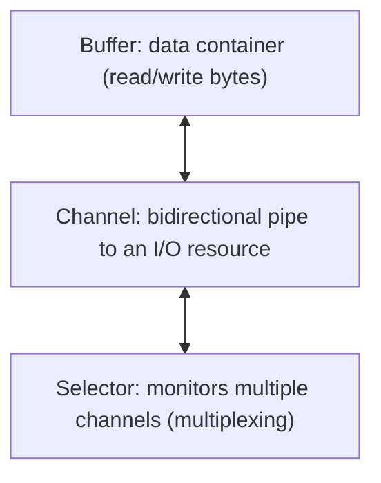

**Navigation**: [< Previous](Ch14_Maven_Gradle.md) | [Back to Index](../00_MASTER_INDEX.md)

# 🌐 Chapter 46 — Java Networking & NIO: Sockets, HTTP, and Non-Blocking I/O

**"Every API call, database query, and microservice communication uses networking. Understanding Java's Socket API, the modern HttpClient, and NIO's non-blocking model explains how Spring Boot, Netty, and message brokers actually work under the hood."**

---


### Historical Evolution

**Inventor / Originator:** Linus Torvalds / BSD (1983) — `select()` system call in 4.2 BSD Unix. Foundation of Java NIO's Selector API.

**Predecessor context:** Blocking I/O (`Socket`, `ServerSocket`) was Java 1.0's only model. Each socket consumed one OS thread. 10,000 concurrent connections required 10,000 threads — context switching overhead made this infeasible past ~1,000 connections.

**Evolution narrative:** Unix's `select()` (4.2 BSD, 1983) introduced I/O multiplexing: one thread polls multiple file descriptors. `epoll` (Linux 2.6, 2003) replaced `select`/`poll` with O(1) notification. Java NIO (Java 1.4, 2002) brought `Selector`, `Channel`, and `Buffer` — the Selector-based non-blocking model. It was inspired by Unix's `select`/`poll`. Java NIO.2 (Java 7, 2011) added `AsynchronousServerSocketChannel` and `AsynchronousChannelGroup` for true async I/O callbacks. Netty (Trustin Lee, 2004; now Apache, 2013) built on NIO to provide a production-grade event-driven network framework — used by Cassandra (2010), Spark (2010), and most high-performance Java servers. Java 11 HttpClient (2018) brought HTTP/2 and WebSocket over NIO.

**Modern practice:** Netty is the standard for high-performance network applications (gRPC, Akka, Vert.x). Vert.x (2009, Red Hat) is the reactive alternative built on Netty. Java 11 HttpClient is standard for simple HTTP calls. For I/O-bound Spring Boot apps, the default Tomcat (blocking) suffices. For high-concurrency scenarios, switch to Reactive Spring (WebFlux, Netty-based) or Undertow (2012, Red Hat).

- **`select()` — 4.2 BSD 1983**: I/O multiplexing. One thread handles multiple file descriptors. Foundation of NIO.
- **`epoll` — Linux 2.6 (2003)**: Event notification O(1). `select`/`poll` were O(n). Game changer for scale.
- **Java NIO — Java 1.4 (2002)**: `Selector`, `Channel`, `Buffer`. Non-blocking I/O model on JVM.
- **Netty — Trustin Lee 2004**: Event-driven network framework. Apache 2013. Used by Cassandra, Spark, gRPC.
- **Java NIO.2 async — Java 7 (2011)**: `AsynchronousServerSocketChannel`. True async callbacks on JVM.
- **Java 11 HttpClient — 2018**: HTTP/1.1, HTTP/2, WebSocket. Built on NIO. Non-blocking by default.

## Table of Contents

1. [Networking Fundamentals for Java Devs](#1-networking-fundamentals-for-java-devs)
2. [Classic Socket API — Blocking I/O](#2-classic-socket-api--blocking-io)
3. [ServerSocket — Building a Server](#3-serversocket--building-a-server)
4. [Java 11 HttpClient — Modern HTTP](#4-java-11-httpclient--modern-http)
5. [Java I/O vs NIO vs NIO.2](#5-java-io-vs-nio-vs-nio2)
6. [Buffers — The NIO Data Container](#6-buffers--the-nio-data-container)
7. [Channels — Bidirectional I/O](#7-channels--bidirectional-io)
8. [Selectors — Multiplexed Non-Blocking I/O](#8-selectors--multiplexed-non-blocking-io)
9. [Building a Non-Blocking Server](#9-building-a-non-blocking-server)
10. [SSL/TLS in Java](#10-ssltls-in-java)
11. [Real-World: How Frameworks Use NIO](#11-real-world-how-frameworks-use-nio)

---

## 1. Networking Fundamentals for Java Devs

**TCP/IP STACK — What happens when you call an API**

```text
Your Java App
     ↓
Application Layer  (HTTP, WebSocket, gRPC)
     ↓
Transport Layer    (TCP — reliable, ordered delivery)
     ↓
Network Layer      (IP — routing packets across networks)
     ↓
Link Layer         (Ethernet, WiFi — physical transmission)
```

**Key concepts**

```text
IP Address:  Identifies a machine (192.168.1.100)
Port:        Identifies a service (8080 = your Spring Boot app)
Socket:      IP + Port = endpoint (192.168.1.100:8080)
TCP:         Reliable, ordered, connection-oriented (HTTP, DB)
UDP:         Unreliable, fast, connectionless (DNS, video streaming)
```

---

🔬 **Section Challenge — 1. Networking Fundamentals for Java Devs**

**Challenge 1 (Reasoning):** Why is Java NIO (Non-blocking I/O) vastly superior to traditional Java IO for building a high-concurrency web server like Tomcat or Netty?

<details><summary>Answer</summary>

Thread-per-connection vs Multiplexing. Traditional IO `InputStream.read()` blocks the current thread until data arrives. If you have 10,000 clients, you need 10,000 threads, which consumes gigabytes of memory and crashes the OS via context switching. NIO uses an `Epoll Selector` (Multiplexer) that monitors thousands of open SocketChannels using a single thread. It only wakes up a worker thread when a channel actually has data ready to be read.

</details>

## 2. Classic Socket API — Blocking I/O

```java
// CLIENT — Connect to a server and send/receive data:
import java.net.*;
import java.io.*;

try (Socket socket = new Socket("api.example.com", 80)) {
    // Get output stream (send data TO server):
    PrintWriter out = new PrintWriter(socket.getOutputStream(), true);

    // Get input stream (receive data FROM server):
    BufferedReader in = new BufferedReader(
        new InputStreamReader(socket.getInputStream())
    );

    // Send HTTP request:
    out.println("GET / HTTP/1.1");
    out.println("Host: api.example.com");
    out.println("Connection: close");
    out.println();  // Empty line = end of headers

    // Read response:
    String line;
    while ((line = in.readLine()) != null) {  // BLOCKS until data arrives
        System.out.println(line);
    }
} // Auto-closes socket
```

**Blocking problem**

```text
in.readLine()  ← Thread BLOCKS here. Does nothing. Waits.
socket.accept() ← Thread BLOCKS here. Waits for client.

Thread per connection model:

Client A → Thread 1 (blocked reading)
Client B → Thread 2 (blocked reading)
Client C → Thread 3 (blocked reading)
...
Client 10000 → Thread 10000 (10K threads = ~10GB RAM!)

Each thread ≈ 1MB stack → 10K connections = 10GB just for stacks.
Most threads are WAITING. Massive waste.
```

---

🔬 **Section Challenge — 2. Classic Socket API — Blocking I/O**

**Challenge 1 (Blocking Socket Thread Model):** Classic Java `ServerSocket` spawns one thread per connection. **Who** determines how many connections you can handle concurrently? **When** does the thread-per-connection model fail? **What** is the OS limit on threads?

<details><summary>Answer</summary>

**Who determines the limit:** The OS. Each Java thread maps to a native OS thread (platform threads). The OS limits: maximum thread count per JVM process (typically 10k-30k on Linux, configurable). Each thread consumes stack memory (default 512KB-1MB). **When the thread-per-connection model fails:** At C10K scale (10,000 concurrent connections). 10k threads × 512KB stack = 5GB RAM just for stacks. Context-switching overhead becomes extreme — CPU spends more time switching threads than doing work. This is called "thread starvation." **What the OS limit is:** Linux: `/proc/sys/kernel/threads-max` (often ~127k per system). JVM: `-Xss` controls stack size. Reducing to 256KB doubles thread count but risks StackOverflow. **Why Tomcat uses thread pool:** Tomcat's default pool (maxThreads=200) limits threads. Beyond 200 concurrent requests, Tomcat queues or rejects. Netty/NIO can handle 10k+ connections on a handful of threads using event-driven I/O. **Java 21 Virtual Threads:** Platform threads cost 1MB stack. Virtual threads cost 1-10KB. Virtual threads allow thread-per-connection style code that scales like NIO internally.

</details>
<details><summary>Answer</summary>

Thread-per-connection vs Multiplexing. Traditional IO `InputStream.read()` blocks the current thread until data arrives. If you have 10,000 clients, you need 10,000 threads, which consumes gigabytes of memory and crashes the OS via context switching. NIO uses an `Epoll Selector` (Multiplexer) that monitors thousands of open SocketChannels using a single thread. It only wakes up a worker thread when a channel actually has data ready to be read.

</details>

## 3. ServerSocket — Building a Server

```java
// SIMPLE BLOCKING SERVER:
try (ServerSocket server = new ServerSocket(8080)) {
    System.out.println("Server listening on port 8080");

    while (true) {
        Socket client = server.accept();  // BLOCKS until client connects

        // Handle client in a new thread (thread-per-connection):
        new Thread(() -> handleClient(client)).start();
    }
}

void handleClient(Socket client) {
    try (
        BufferedReader in = new BufferedReader(
            new InputStreamReader(client.getInputStream()));
        PrintWriter out = new PrintWriter(client.getOutputStream(), true)
    ) {
        String request = in.readLine();  // BLOCKS until data arrives
        System.out.println("Received: " + request);

        // Send response:
        out.println("HTTP/1.1 200 OK");
        out.println("Content-Type: text/plain");
        out.println();
        out.println("Hello, World!");
    } catch (IOException e) {
        e.printStackTrace();
    }
}
```

```
  BETTER: Thread Pool instead of unlimited threads:
```

```java
ExecutorService pool = Executors.newFixedThreadPool(200);

try (ServerSocket server = new ServerSocket(8080)) {
    while (true) {
        Socket client = server.accept();
        pool.submit(() -> handleClient(client));
        // Max 200 concurrent connections handled.
        // Connection 201 waits in queue.
    }
}
```

---

🔬 **Section Challenge — 3. ServerSocket — Building a Server**

**Challenge 1 (ServerSocket accept() Pattern):** `serverSocket.accept()` BLOCKS until a connection arrives. **Who** is blocked? **When** is this acceptable? **What** is the exact exception thrown if the socket is closed while blocked in `accept()`?

<details><summary>Answer</summary>

**Who is blocked:** The current thread. `accept()` suspends the thread in an OS system call (`epoll_wait` or `accept4` internally). The thread is in `WAITING` state (not consuming CPU, but consuming stack memory). **When this is acceptable:** Single-client servers (development tools, embedded systems). Test servers where one connection at a time is the design. Servers with a thread-per-connection pool where each thread calls `accept()` on the SAME `ServerSocket` (only one thread returns, the rest continue blocking). **What exception is thrown:** `SocketException: Socket closed`. If another thread calls `serverSocket.close()` while the first thread is blocked in `accept()`, the blocked `accept()` throws `SocketException`. This is the standard shutdown pattern: close the `ServerSocket` to unblock all waiting `accept()` threads. **Timeout alternative:** `serverSocket.setSoTimeout(1000)` makes `accept()` throw `SocketTimeoutException` if no connection arrives within 1 second. Allows polling for a shutdown flag: `while (!shutdown) { try { socket = server.accept(); } catch (SocketTimeoutException e) { /* check shutdown */ } }`.

</details>
<details><summary>Answer</summary>

Thread-per-connection vs Multiplexing. Traditional IO `InputStream.read()` blocks the current thread until data arrives. If you have 10,000 clients, you need 10,000 threads, which consumes gigabytes of memory and crashes the OS via context switching. NIO uses an `Epoll Selector` (Multiplexer) that monitors thousands of open SocketChannels using a single thread. It only wakes up a worker thread when a channel actually has data ready to be read.

</details>

## 4. Java 11 HttpClient — Modern HTTP

```java
// Java 11+ HttpClient — THE modern way to make HTTP calls:
import java.net.http.*;
import java.net.URI;

HttpClient client = HttpClient.newBuilder()
    .version(HttpClient.Version.HTTP_2)       // HTTP/2 with fallback
    .connectTimeout(Duration.ofSeconds(10))
    .followRedirects(HttpClient.Redirect.NORMAL)
    .build();

// GET request:
HttpRequest request = HttpRequest.newBuilder()
    .uri(URI.create("https://api.example.com/users/1"))
    .header("Accept", "application/json")
    .GET()
    .build();

// Synchronous (blocking):
HttpResponse<String> response = client.send(
    request,
    HttpResponse.BodyHandlers.ofString()
);
System.out.println(response.statusCode());  // 200
System.out.println(response.body());        // JSON string


// Asynchronous (non-blocking):
client.sendAsync(request, HttpResponse.BodyHandlers.ofString())
    .thenApply(HttpResponse::body)
    .thenAccept(body -> System.out.println("Got: " + body))
    .exceptionally(ex -> {
        System.err.println("Failed: " + ex.getMessage());
        return null;
    });


// POST with JSON body:
HttpRequest postRequest = HttpRequest.newBuilder()
    .uri(URI.create("https://api.example.com/users"))
    .header("Content-Type", "application/json")
    .POST(HttpRequest.BodyPublishers.ofString(
        "{\"name\": \"Harsha\", \"role\": \"developer\"}"
    ))
    .build();

HttpResponse<String> postResponse = client.send(
    postRequest,
    HttpResponse.BodyHandlers.ofString()
);
```

---

🔬 **Section Challenge — 4. Java 11 HttpClient — Modern HTTP**

**Challenge 1 (Reasoning — Who/When/What):** NIO `Selector` handles 10,000 connections on a single thread. Traditional I/O uses 1 thread per connection. **Who** blocks in each model? **When** does the Selector wake up? **What** is the trade-off?

<details><summary>Answer</summary>

**Traditional I/O:** EACH thread blocks on `socket.read()` waiting for data. 10,000 connections = 10,000 blocked threads = 10,000 MB stack space. **NIO Selector:** The Selector is the single thread that calls `selector.select()` — it blocks until ANY registered channel has data. **When wakes up?** When the OS delivers a read-ready event for any registered `SocketChannel`. **The Selector returns a `Set<SelectionKey>`** with all ready channels. **Trade-off:** NIO wins on memory and scalability (no per-connection thread). But all business logic runs on one thread — a slow handler blocks ALL connections. Solution: Reactor pattern (Netty) — Selector thread only dispatches; actual work goes to a separate worker thread pool.

</details>

## 5. Java I/O vs NIO vs NIO.2

| | Java I/O (`java.io`) | Java NIO (`java.nio`) |
| --- | --- | --- |
| Model | Stream-oriented | Buffer-oriented |
| Blocking | Always blocking | Blocking AND non-blocking |
| Multiplexing | No (1 thread per connection) | Yes (`Selector`: 1 thread, many connections) |
| Unit | byte or char | `Buffer` (a chunk of bytes) |
| Direction | One-way (Input OR Output) | Bidirectional (`Channel`) |
| When to use | Simple file I/O, small apps | Network servers, high concurrency, large files |

**NIO key components**



**How to read this diagram.** Data moves between buffers and channels, and one selector watches many channels at once.

---

## 6. Buffers — The NIO Data Container

```java
// ByteBuffer — most important NIO buffer:
ByteBuffer buffer = ByteBuffer.allocate(1024);  // 1KB buffer

// Buffer has 4 properties:
// capacity = max size (1024)
// limit    = current read/write boundary
// position = current read/write cursor
// mark     = saved position (optional)

// WRITE MODE (put data into buffer):
buffer.put("Hello".getBytes());
// position = 5, limit = 1024

// FLIP to READ MODE:
buffer.flip();
// position = 0, limit = 5

// READ data out:
byte[] data = new byte[buffer.remaining()];  // remaining = limit - position
buffer.get(data);
System.out.println(new String(data));  // "Hello"

// CLEAR to reuse:
buffer.clear();
// position = 0, limit = capacity
```

**Buffer state diagram**

```text
After allocate(10):
[_][_][_][_][_][_][_][_][_][_]
 ↑ position=0                  ↑ limit=capacity=10

After put("Hi"):
[H][i][_][_][_][_][_][_][_][_]
       ↑ position=2             ↑ limit=10

After flip():
[H][i][_][_][_][_][_][_][_][_]
 ↑ position=0  ↑ limit=2

Now you can READ: get() returns 'H', 'i'

After clear():
[_][_][_][_][_][_][_][_][_][_]
 ↑ position=0                  ↑ limit=10

RULE: write → flip → read → clear → write → ...
```

```java
// DIRECT BUFFER — allocated outside JVM heap (faster for I/O):
ByteBuffer directBuffer = ByteBuffer.allocateDirect(1024);
// Pro: No copy between JVM heap and OS buffer
// Con: Slower to allocate, not garbage collected as eagerly
// Use for: Long-lived buffers, heavy I/O operations
```

---

🔬 **Section Challenge — 6. Buffers — The NIO Data Container**

**Challenge 1 (ByteBuffer flip() Semantics):** You write data into a `ByteBuffer`: `buffer.put(bytes)`. Then you call `buffer.flip()`. **Who** changes what? **When** do you call `flip()` vs `clear()`? **What** happens if you forget `flip()` before `channel.write(buffer)`?

<details><summary>Answer</summary>

**Who changes what:** `flip()` sets `limit = position`, then `position = 0`. After writing to buffer: position = bytes written, limit = capacity. After `flip()`: position = 0 (start reading from beginning), limit = bytes written (stop at what was written). Now the buffer is in READ mode. **Write-to-read cycle:** `buffer.clear()` (reset for writing) → `buffer.put(data)` → `buffer.flip()` (switch to read mode) → `channel.write(buffer)` (read from buffer, write to channel) → `buffer.clear()` (reset for next write). **`clear()` vs `flip()`:** `clear()` sets `position = 0, limit = capacity` (ready to write ALL available space). `flip()` sets `limit = position, position = 0` (ready to read what was just written). `compact()` copies unread bytes to start and positions after them (used when partial reads occur). **If you forget `flip()`:** `channel.write(buffer)` reads from current position (at end of data) to limit (at capacity). Nothing is between position and limit (or garbage after your data). Channel writes 0 bytes or garbage. The data you wrote is lost. This is a silent bug — no exception, just nothing is sent.

</details>
<details><summary>Answer</summary>

Thread-per-connection vs Multiplexing. Traditional IO `InputStream.read()` blocks the current thread until data arrives. If you have 10,000 clients, you need 10,000 threads, which consumes gigabytes of memory and crashes the OS via context switching. NIO uses an `Epoll Selector` (Multiplexer) that monitors thousands of open SocketChannels using a single thread. It only wakes up a worker thread when a channel actually has data ready to be read.

</details>

## 7. Channels — Bidirectional I/O

```java
// CHANNEL types:
// FileChannel        — read/write files
// SocketChannel      — TCP client
// ServerSocketChannel — TCP server
// DatagramChannel    — UDP

// Reading a file with NIO:
try (FileChannel channel = FileChannel.open(
        Path.of("data.txt"), StandardOpenOption.READ)) {

    ByteBuffer buffer = ByteBuffer.allocate(4096);

    while (channel.read(buffer) != -1) {  // Read into buffer
        buffer.flip();                     // Switch to read mode

        while (buffer.hasRemaining()) {
            System.out.print((char) buffer.get());
        }

        buffer.clear();                    // Ready for next read
    }
}

// Writing a file:
try (FileChannel channel = FileChannel.open(
        Path.of("output.txt"),
        StandardOpenOption.CREATE,
        StandardOpenOption.WRITE)) {

    ByteBuffer buffer = ByteBuffer.wrap("Hello NIO!".getBytes());
    channel.write(buffer);
}

// Memory-mapped file (FAST for large files):
try (FileChannel channel = FileChannel.open(
        Path.of("large-file.dat"), StandardOpenOption.READ)) {

    MappedByteBuffer mapped = channel.map(
        FileChannel.MapMode.READ_ONLY, 0, channel.size()
    );
    // File is mapped to memory — OS handles paging
    // Access like a regular buffer:
    while (mapped.hasRemaining()) {
        byte b = mapped.get();
    }
}
```

---

## 8. Selectors — Multiplexed Non-Blocking I/O

THE KEY INSIGHT:

Without Selector:  1 thread per connection (10K threads for 10K connections)
With Selector:     1 thread handles ALL connections

HOW IT WORKS:

### Selector

Monitors multiple channels:

Channel A ──→ Ready to READ?   → Yes ✓  
Channel B ──→ Ready to READ?   → No  
Channel C ──→ Ready to WRITE?  → Yes ✓  
Channel D ──→ Ready to ACCEPT? → No

selector.select() returns: {A, C}  
→ Process ONLY ready channels  
→ Never blocks on unready channels

SELECTABLE OPERATIONS:

| Selectable operation | Meaning |
| --- | --- |
| SelectionKey.OP_ACCEPT | ServerSocketChannel ready to accept |
| SelectionKey.OP_CONNECT | SocketChannel finished connecting |
| SelectionKey.OP_READ | Channel has data to read |
| SelectionKey.OP_WRITE | Channel ready to write |

---

🔬 **Section Challenge — 8. Selectors — Multiplexed Non-Blocking I/O**

**Challenge 1 (Selector interestOps Update):** After a `channel.write()` partially writes data, you need to set the channel's interest to `OP_WRITE`. **Who** updates the interest set? **When** do you REMOVE `OP_WRITE` from the interest set? **What** happens if you leave `OP_WRITE` permanently registered?

<details><summary>Answer</summary>

**Who updates the interest set:** Your application code, via `key.interestOps(key.interestOps() | SelectionKey.OP_WRITE)`. Or register with `OP_WRITE` only when there's data to write. **When to REMOVE `OP_WRITE`:** After all pending write data is fully flushed (buffer is completely sent). Remove `OP_WRITE`: `key.interestOps(key.interestOps() & ~SelectionKey.OP_WRITE)`. Or de-register and re-register only `OP_READ`. **What happens if left permanently:** `selector.select()` returns IMMEDIATELY every loop because the channel is writable (socket send buffer has space). Your CPU spins at 100% in a busy loop, calling `select()` thousands of times per second but having no data to write. This is a classic NIO performance bug called "CPU spin" or "busy selector." **Pattern for correct write handling:** Only register `OP_WRITE` when your write buffer is non-empty. After each `OP_WRITE` event, flush as much as possible. If buffer drains to empty, remove `OP_WRITE`. If partial write remains, keep `OP_WRITE` registered and try again on next `OP_WRITE` event.

</details>
<details><summary>Answer</summary>

Thread-per-connection vs Multiplexing. Traditional IO `InputStream.read()` blocks the current thread until data arrives. If you have 10,000 clients, you need 10,000 threads, which consumes gigabytes of memory and crashes the OS via context switching. NIO uses an `Epoll Selector` (Multiplexer) that monitors thousands of open SocketChannels using a single thread. It only wakes up a worker thread when a channel actually has data ready to be read.

</details>

## 9. Building a Non-Blocking Server

```java
import java.nio.*;
import java.nio.channels.*;
import java.net.*;
import java.util.*;

public class NioServer {
    public static void main(String[] args) throws Exception {
        // 1. Open a selector:
        Selector selector = Selector.open();

        // 2. Open server channel (non-blocking):
        ServerSocketChannel serverChannel = ServerSocketChannel.open();
        serverChannel.bind(new InetSocketAddress(8080));
        serverChannel.configureBlocking(false);  // KEY: non-blocking mode

        // 3. Register with selector for ACCEPT events:
        serverChannel.register(selector, SelectionKey.OP_ACCEPT);

        System.out.println("NIO Server on port 8080 (single thread!)");

        // 4. Event loop (single thread handles everything):
        while (true) {
            selector.select();  // Block until at least 1 channel is ready

            Set<SelectionKey> selectedKeys = selector.selectedKeys();
            Iterator<SelectionKey> iter = selectedKeys.iterator();

            while (iter.hasNext()) {
                SelectionKey key = iter.next();
                iter.remove();

                if (key.isAcceptable()) {
                    // New client connection:
                    SocketChannel client = serverChannel.accept();
                    client.configureBlocking(false);
                    client.register(selector, SelectionKey.OP_READ);
                    System.out.println("Client connected: " + client.getRemoteAddress());
                }

                if (key.isReadable()) {
                    // Client sent data:
                    SocketChannel client = (SocketChannel) key.channel();
                    ByteBuffer buffer = ByteBuffer.allocate(1024);

                    int bytesRead = client.read(buffer);
                    if (bytesRead == -1) {
                        client.close();  // Client disconnected
                        continue;
                    }

                    buffer.flip();
                    byte[] data = new byte[buffer.remaining()];
                    buffer.get(data);
                    String message = new String(data).trim();
                    System.out.println("Received: " + message);

                    // Echo back:
                    ByteBuffer response = ByteBuffer.wrap(
                        ("Echo: " + message + "\n").getBytes()
                    );
                    client.write(response);
                }
            }
        }
    }
}
```

```
  ONE THREAD handles:
  • Accepting new connections
  • Reading from ALL connected clients
  • Writing responses to ALL clients

  This is how Netty, Tomcat NIO connector, and Node.js work!
  10K connections → 1 thread → ~1MB RAM (vs 10GB with blocking I/O)
```

---

🔬 **Section Challenge — 9. Building a Non-Blocking Server**

**Challenge 1 (Non-Blocking Server Partial Write):** A non-blocking `SocketChannel.write(buffer)` returns the number of bytes actually written. It CAN return less than `buffer.remaining()`. **Who** is responsible for handling partial writes? **When** does a partial write occur? **What** is the retry strategy?

<details><summary>Answer</summary>

**Who is responsible:** Your application code. NIO gives you control; it doesn't buffer writes for you. If `write()` returns N < buffer.remaining(), you must track the remaining bytes and retry. **When a partial write occurs:** When the OS socket send buffer is full. The kernel can't accept more data right now (the remote side isn't reading fast enough). `write()` writes what it can (0 to remaining) and returns. **Retry strategy:** (1) Check `buffer.hasRemaining()` after `write()`. (2) If true, register `OP_WRITE` on the selector. (3) On next `OP_WRITE` event, call `write(buffer)` again (buffer already positioned after the written bytes). (4) Repeat until `buffer.hasRemaining()` is false. (5) Remove `OP_WRITE` interest. **Why blocking I/O is easier here:** `socket.getOutputStream().write(bytes)` blocks until ALL bytes are written or an exception is thrown. No partial write handling needed. This is why NIO code is more complex but scales better: you control every byte, every event, with no thread blocking.

</details>
<details><summary>Answer</summary>

Thread-per-connection vs Multiplexing. Traditional IO `InputStream.read()` blocks the current thread until data arrives. If you have 10,000 clients, you need 10,000 threads, which consumes gigabytes of memory and crashes the OS via context switching. NIO uses an `Epoll Selector` (Multiplexer) that monitors thousands of open SocketChannels using a single thread. It only wakes up a worker thread when a channel actually has data ready to be read.

</details>

## 10. SSL/TLS in Java

```java
// HTTPS with HttpClient (easiest):
HttpClient secureClient = HttpClient.newBuilder()
    .sslContext(SSLContext.getDefault())  // Uses JVM's truststore
    .build();

// Custom SSL context (for self-signed certs in dev):
SSLContext sslContext = SSLContext.getInstance("TLS");
TrustManagerFactory tmf = TrustManagerFactory.getInstance(
    TrustManagerFactory.getDefaultAlgorithm()
);

KeyStore trustStore = KeyStore.getInstance(KeyStore.getDefaultType());
try (FileInputStream fis = new FileInputStream("truststore.jks")) {
    trustStore.load(fis, "changeit".toCharArray());
}

tmf.init(trustStore);
sslContext.init(null, tmf.getTrustManagers(), null);

HttpClient client = HttpClient.newBuilder()
    .sslContext(sslContext)
    .build();
```

**Jvm truststore**

```text
Location: $JAVA_HOME/lib/security/cacerts
Default password: "changeit"
Contains: Root CA certificates (DigiCert, Let's Encrypt, etc.)

Add a certificate:
keytool -importcert -file cert.pem -alias myservice \
        -keystore $JAVA_HOME/lib/security/cacerts

List certificates:
keytool -list -keystore $JAVA_HOME/lib/security/cacerts
```

---

🔬 **Section Challenge — 10. SSL/TLS in Java**

**Challenge 1 (SSL/TLS Handshake Failure Diagnosis):** Your Java HTTPS client throws `SSLHandshakeException: PKIX path building failed`. **Who** validates the certificate? **When** does PKIX path building fail? **What** are the three main causes and fixes?

<details><summary>Answer</summary>

**Who validates:** The Java TrustManager (specifically `X509TrustManager`). JSSE (Java Secure Socket Extension) uses a trust store (`cacerts`) containing trusted root CAs. During handshake, the server presents its certificate chain. The `TrustManager` validates the chain ends at a trusted root in `cacerts`. **When PKIX path building fails:** The certificate chain cannot be completed to a trusted root. Three causes: (1) **Self-signed certificate:** Server uses a self-signed cert not in `cacerts`. Fix: Add the cert to `cacerts`: `keytool -importcert -alias myserver -file server.crt -keystore $JAVA_HOME/lib/security/cacerts`. (2) **Expired certificate:** The server's cert or an intermediate CA cert expired. Fix: Server must renew the certificate. `openssl s_client -connect host:443 -showcerts` to inspect the chain. (3) **Missing intermediate CA:** The server doesn't send the full chain. Fix: Server configuration must include intermediate certs. Or import the intermediate CA into `cacerts`. **Quick debug:** `System.setProperty("javax.net.debug", "ssl:handshake")` enables verbose TLS debugging. Shows exact certificate chain, which CA is untrusted, and where validation fails. **Never do this in production:** `trustAllCerts` disabling TrustManager makes TLS useless — it defeats the entire purpose of HTTPS.

</details>
<details><summary>Answer</summary>

Thread-per-connection vs Multiplexing. Traditional IO `InputStream.read()` blocks the current thread until data arrives. If you have 10,000 clients, you need 10,000 threads, which consumes gigabytes of memory and crashes the OS via context switching. NIO uses an `Epoll Selector` (Multiplexer) that monitors thousands of open SocketChannels using a single thread. It only wakes up a worker thread when a channel actually has data ready to be read.

</details>

## 11. Real-World: How Frameworks Use NIO

**Spring boot (tomcat nio)**

```text
Tomcat's NIO connector:
• 1 Acceptor thread → accepts connections
• 1 Poller thread → NIO Selector monitors all connections
• Worker thread pool (default 200) → processes ready requests

HTTP request lifecycle:
1. Client connects → Acceptor accepts → registers with Poller
2. Client sends data → Poller detects → submits to worker pool
3. Worker thread runs your @RequestMapping handler
4. Response sent → worker returns to pool
```

**NETTY (foundation of Spring WebFlux, gRPC)**

```text
• Boss Group (1 thread) → accepts connections
• Worker Group (N threads, usually CPU cores) → handles I/O
• Each worker thread has its own Selector
• Channel pipeline: chain of handlers (decode → business logic → encode)
```

**SPRING WEBFLUX (reactive, non-blocking)**

```text
Built on Netty. Fully non-blocking.
Uses Project Reactor (Mono/Flux) for async composition.
Can handle 100K+ connections with very few threads.

@GetMapping("/users/{id}")
public Mono<User> getUser(@PathVariable String id) {
    return userRepository.findById(id);  // Non-blocking DB call
}
```

**I/O MODEL COMPARISON:**

| Model | Threads | Connections | Framework |
| --- | --- | --- | --- |
| Blocking I/O | 1:1 | ~200 | Old Tomcat BIO |
| Thread pool | Pool:N | ~200 | Tomcat BIO pool |
| NIO | Few | 10K+ | Tomcat NIO |
| Netty | Few | 100K+ | WebFlux, gRPC |
| Virtual threads | 1M:N | 1M+ | Java 21 Loom |

> [!TIP]
> **Java 21 virtual threads (Project Loom):** write blocking code and the JVM makes it non-blocking. Best of both worlds: simple code plus massive concurrency.

---

**Back to Index**: [Master Index](../00_MASTER_INDEX.md)


---

## Reality Check

**"NIO (java.nio) is always faster than classic java.io"** → NIO is non-blocking and channel-based, designed for high-concurrency I/O with a selector model (one thread can handle thousands of connections). Classic `java.io` uses blocking I/O — one thread per connection, simpler to program. For a simple application reading one file or handling a few connections: blocking I/O is simpler and plenty fast. NIO's complexity pays off at high concurrency (thousands of simultaneous connections). Netty, Vert.x, and NIO2 (`AsynchronousFileChannel`) are built on NIO; Spring WebFlux uses Reactor Netty on top of NIO.

**"DatagramSocket (UDP) delivers packets in order"** → UDP provides no ordering, no delivery guarantee, no deduplication. Packets sent in order may arrive out of order, some may be lost, and some may be duplicated. Use UDP when: speed > reliability (video streaming, VoIP, gaming — a dropped frame is better than waiting), or when the application implements its own reliability (QUIC protocol on top of UDP implements ordered, reliable delivery). TCP provides ordering and reliability; UDP provides speed and simplicity.

**"Sockets are always network connections"** → Unix domain sockets are sockets that communicate between processes on the same machine using the filesystem (a socket file) instead of a network interface. They bypass the TCP/IP stack entirely — faster and more secure (filesystem permissions). Docker uses Unix sockets for the Docker daemon API (`/var/run/docker.sock`). PostgreSQL defaults to Unix socket for local connections. Java (NIO, since Java 16) supports Unix domain sockets via `UnixDomainSocketAddress`. Windows also supports Unix domain sockets since Windows 10 Build 17063.

**"HTTP/2 is just HTTP/1.1 with compression"** → HTTP/2 is a binary protocol (HTTP/1.1 is text). Key features: multiplexing (multiple requests on one TCP connection in parallel, solving HTTP/1.1's head-of-line blocking), server push (server can send resources before client requests them), header compression (HPACK — headers are compressed and sent as binary fields). HTTP/2 is negotiated via ALPN (TLS extension). HTTP/3 moves from TCP to QUIC (UDP-based) — eliminates TCP's head-of-line blocking at the transport layer. Java's `java.net.http.HttpClient` (Java 11+) supports HTTP/1.1 and HTTP/2 natively.

**"SSL/TLS is handled by your web server — your Java code doesn't need to know"** → When using Spring Boot with embedded Tomcat, you configure TLS in `application.properties`. But for Java clients making outbound HTTPS calls: the JVM has a truststore (cacerts) with trusted CA certificates — if you call an API with a self-signed cert, the JVM throws `SSLHandshakeException` (untrusted cert) unless you add the cert to the truststore or configure a custom `SSLContext`. API integrations with internal services, mTLS (mutual TLS), and certificate pinning all require explicit SSL configuration in Java client code.
