> **Navigation**: [Back to Index](../00_MASTER_INDEX.md) | [Next >](Ch16_Concurrency_Advanced.md)
> 🧠 **Mental Model**: See [Space-Time Tradeoffs](../14_Mental_Models/12_Space_Time_Tradeoffs.md) — concurrency trades complexity for throughput

---

# ⚡ Java Concurrency — Core Foundations

> Why every production Java application needs concurrency mastery

---

## ❓ Why This Matters


> REALITY CHECK
>
> Your REST API gets 1000 requests/second. Each request = 1 thread.
> If each thread takes 200ms, you need 200 threads running simultaneously.
>
> Without understanding concurrency:
> ❌ Race conditions corrupt data
> ❌ Deadlocks freeze your server
> ❌ Thread leaks crash your JVM
> ❌ You can't debug "works locally, fails in prod" issues
>
> With mastery:
> ✅ You write thread-safe code by default
> ✅ You choose the right concurrency tool for each problem
> ✅ You debug production issues others can't
> ✅ You design systems that scale


---

# 📖 Part 1: Thread Fundamentals

## What Is a Thread (At CPU Level)?

```
┌─────────────────────────────────────────────────────────────────────────────────┐
│  PROCESS vs THREAD — The Apartment Analogy                                      │
│                                                                                 │
│  PROCESS = An apartment                                                         │
│    - Has its own address space (its own rooms, kitchen, bathroom)               │
│    - Isolated from other apartments                                             │
│    - Expensive to create (need to allocate entire apartment)                    │
│                                                                                 │
│  THREAD = A person living in the apartment                                      │
│    - Shares the apartment's space (heap memory)                                 │
│    - Has own bed/desk (stack, program counter, registers)                       │
│    - Cheap to create (just add a person, don't build new apartment)             │
│    - BUT: sharing kitchen → conflicts! (race conditions)                        │
│                                                                                 │
│  ┌──────────── Process (JVM) ─────────────┐                                     │
│  │  HEAP (shared by all threads)           │                                    │
│  │  ┌───────┐  ┌───────┐  ┌───────┐      │                                      │
│  │  │Thread1│  │Thread2│  │Thread3│      │                                      │
│  │  │ Stack │  │ Stack │  │ Stack │      │                                      │
│  │  │  PC   │  │  PC   │  │  PC   │      │                                      │
│  │  └───────┘  └───────┘  └───────┘      │                                      │
│  └─────────────────────────────────────────┘                                    │
│                                                                                 │
│  Each thread has:                                                               │
│    - Own stack (local variables, method calls) — typically 512KB-1MB            │
│    - Own program counter (which instruction it's executing)                     │
│    - Own register state                                                         │
│  All threads share:                                                             │
│    - Heap (objects, arrays)                                                     │
│    - Method area (class metadata)                                               │
│    - File handles, sockets                                                      │
└─────────────────────────────────────────────────────────────────────────────────┘
```

**Flow:**
- PROCESS vs THREAD — The Apartment Analogy
- ↓
- PROCESS = An apartment
- ↓
- - Isolated from other apartments
- ↓
- - Expensive to create (need to allocate entire apartmen
- ↓
- THREAD = A person living in the apartment
- ↓
- - Shares the apartment's space (heap memory)
- ↓
- - Has own bed/desk (stack, program counter, registers)

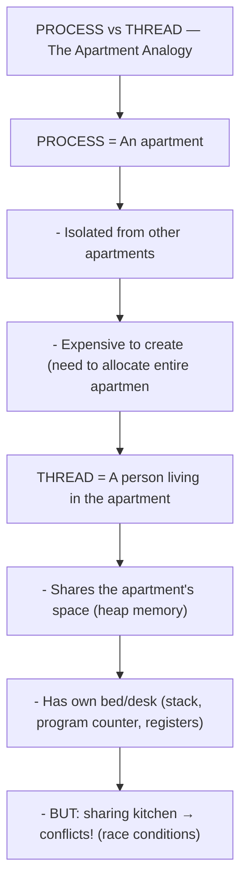

## Creating Threads — 3 Ways

```java
// WAY 1: Extend Thread class (rarely used in production)
class MyThread extends Thread {
    @Override
    public void run() {
        System.out.println("Running in: " + Thread.currentThread().getName());
    }
}
MyThread t = new MyThread();
t.start();  // start() creates new thread. NEVER call run() directly!

// WAY 2: Implement Runnable (preferred — separates task from thread)
class MyTask implements Runnable {
    @Override
    public void run() {
        System.out.println("Task running in: " + Thread.currentThread().getName());
    }
}
Thread t = new Thread(new MyTask());
t.start();

// WAY 3: Lambda (modern Java — cleanest)
Thread t = new Thread(() -> {
    System.out.println("Lambda running in: " + Thread.currentThread().getName());
});
t.start();
```

```
┌─────────────────────────────────────────────────────────────────────────────────┐
│  CRITICAL MISTAKE — start() vs run()                                            │
│                                                                                 │
│  t.start()  →  Creates NEW thread, runs run() in that thread  ✅                 │
│  t.run()    →  Runs run() in CURRENT thread (no new thread!)   ❌                │
│                                                                                 │
│  This is an interview classic. The JVM:                                         │
│  1. Allocates new stack for the thread                                          │
│  2. Registers thread with OS scheduler                                          │
│  3. OS gives it CPU time                                                        │
│  4. Thread's run() method executes                                              │
└─────────────────────────────────────────────────────────────────────────────────┘
```

**Flow:**
- CRITICAL MISTAKE — start() vs run()
- ↓
- t.start()
- ↓
- Creates NEW thread, runs run() in that thre
- ↓
- t.start()
- ↓
- Creates NEW thread, runs run() in that thre
- ↓
- t.run()
- ↓
- Runs run() in CURRENT thread (no new thread!)
- ↓
- t.run()
- ↓
- Runs run() in CURRENT thread (no new thread!)
- ↓
- This is an interview classic. The JVM:
- ↓
- 1. Allocates new stack for the thread
- ↓
- 2. Registers thread with OS scheduler
- ↓
- 3. OS gives it CPU time

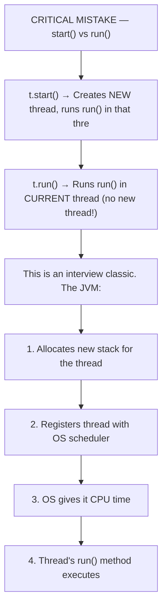

## Thread Lifecycle — The State Machine

```
┌─────────────────────────────────────────────────────────────────────────────────┐
│                      THREAD LIFECYCLE STATE MACHINE                             │
│                                                                                 │
│    ┌────────┐    start()    ┌──────────┐                                        │
│    │  NEW   │──────────────→│ RUNNABLE │←──────────────┐                        │
│    └────────┘               └────┬─────┘               │                        │
│                                  │                      │                       │
│                    ┌─────────────┼──────────────┐      │                        │
│                    │             │              │      │                        │
│             synchronized    sleep()/     I/O wait   notify()/                   │
│             (can't get      wait()                  sleep done/                 │
│              the lock)        │              │      I/O done                    │
│                    │          │              │      │                           │
│                    ▼          ▼              ▼      │                           │
│              ┌──────────┐ ┌──────────┐ ┌──────────┐│                            │
│              │ BLOCKED  │ │ WAITING  │ │ TIMED_   ││                            │
│              │          │ │          │ │ WAITING  ││                            │
│              └────┬─────┘ └────┬─────┘ └────┬─────┘│                            │
│                   │            │             │      │                           │
│                   └────────────┴─────────────┴──────┘                           │
│                                                                                 │
│                    run() completes or exception                                 │
│                              │                                                  │
│                              ▼                                                  │
│                       ┌────────────┐                                            │
│                       │ TERMINATED │                                            │
│                       └────────────┘                                            │
│                                                                                 │
│  States you can check: Thread.State enum                                        │
│  Thread.currentThread().getState()                                              │
└─────────────────────────────────────────────────────────────────────────────────┘
```

**Flow:**
- NEW --(start())--> RUNNABLE
- ↓
- NEW
- ↓
- BLOCKED
- ↓
- RUNNABLE
- ↓
- nized sleep()/ I/O wait / get wait() / ck) / ▼ ▼ ▼ / KE
- ↓
- BLOCKED
- ↓
- TERMINATED

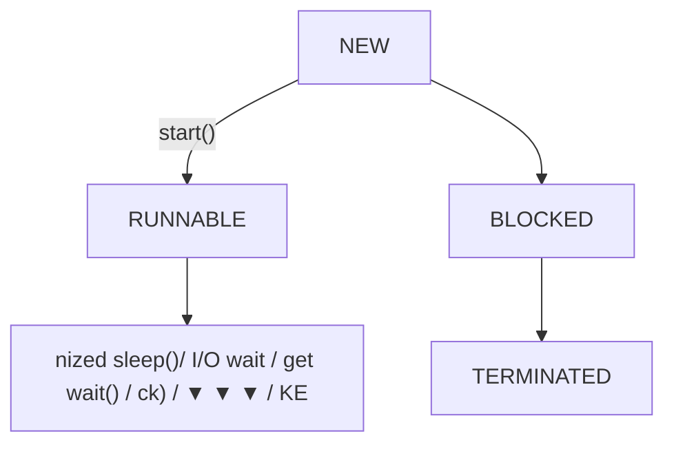

## Essential Thread Methods

```java
// Joining threads — wait for another thread to finish
Thread worker = new Thread(() -> heavyComputation());
worker.start();
worker.join();  // Current thread BLOCKS until worker finishes
// Now worker's result is available

// join() with timeout
worker.join(5000);  // Wait at most 5 seconds

// Sleep — pause current thread
Thread.sleep(1000);  // Pause 1 second. Does NOT release locks!

// Interrupt — cooperative cancellation
worker.interrupt();  // Sets interrupt flag

// Inside the worker:
while (!Thread.currentThread().isInterrupted()) {
    // Do work
    try {
        Thread.sleep(100);
    } catch (InterruptedException e) {
        Thread.currentThread().interrupt();  // Restore flag!
        break;  // Exit gracefully
    }
}

// Daemon threads — die when main thread exits
Thread daemon = new Thread(() -> {
    while (true) { /* background work */ }
});
daemon.setDaemon(true);  // MUST set before start()
daemon.start();
// When main thread exits, daemon is killed automatically
```

---

# PART 2: THE VISIBILITY PROBLEM — Why Shared Data Breaks

```
┌─────────────────────────────────────────────────────────────────────────────────┐
│  THE VISIBILITY PROBLEM — Why volatile Exists                                   │
│                                                                                 │
│  Modern CPUs have caches. Each core caches variables locally.                   │
│                                                                                 │
│  Core 1 (Thread A)          Core 2 (Thread B)                                   │
│  ┌─────────────┐            ┌─────────────┐                                     │
│  │ L1 Cache    │            │ L1 Cache    │                                     │
│  │ flag = true │            │ flag = false│  ← STALE!                           │
│  └─────────────┘            └─────────────┘                                     │
│         │                          │                                            │
│         └──────────┬───────────────┘                                            │
│                    │                                                            │
│             ┌──────────────┐                                                    │
│             │ Main Memory  │                                                    │
│             │ flag = true  │                                                    │
│             └──────────────┘                                                    │
│                                                                                 │
│  Thread A sets flag = true, but Thread B still sees false                       │
│  because it reads from its own CPU cache, NOT main memory!                      │
│                                                                                 │
│  FIX: volatile boolean flag = true;                                             │
│  volatile forces reads/writes to go through main memory                         │
└─────────────────────────────────────────────────────────────────────────────────┘
```

**Flow:**
- L1 Cache / flag = true
- ↓
- Main Memory / flag = true

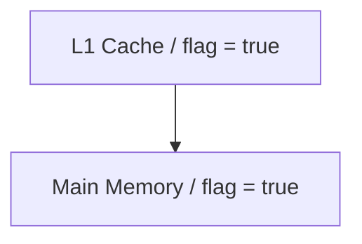

```java
// WITHOUT volatile — BROKEN (may loop forever!)
class BrokenStopFlag {
    boolean stop = false;  // Thread B may NEVER see the update

    void runWorker() {
        new Thread(() -> {
            while (!stop) { /* spin */ }  // May never exit!
        }).start();
    }

    void stopWorker() { stop = true; }
}

// WITH volatile — CORRECT
class CorrectStopFlag {
    volatile boolean stop = false;  // All threads see updates immediately

    void runWorker() {
        new Thread(() -> {
            while (!stop) { /* spin */ }  // Guaranteed to see update
        }).start();
    }

    void stopWorker() { stop = true; }
}
```

```
┌─────────────────────────────────────────────────────────────────────────────────┐
│  volatile GUARANTEES:                                                           │
│  ✅ Visibility — writes visible to all threads immediately                       │
│  ✅ Ordering — prevents instruction reordering around volatile                   │
│                                                                                 │
│  volatile DOES NOT GUARANTEE:                                                   │
│  ❌ Atomicity — count++ is STILL broken even with volatile                       │
│     (count++ = read + increment + write = 3 operations!)                        │
│                                                                                 │
│  WHEN TO USE volatile:                                                          │
│  ✅ Boolean flags (stop, done, initialized)                                      │
│  ✅ Status fields read by many threads, written by one                           │
│  ❌ Counters, accumulators (use AtomicInteger instead)                           │
│  ❌ Complex state (use synchronized/locks instead)                               │
└─────────────────────────────────────────────────────────────────────────────────┘
```

**Flow:**
- volatile GUARANTEES:
- ↓
- ✅ Visibility — writes visible to all threads immediatel
- ↓
- volatile DOES NOT GUARANTEE:
- ↓
- ❌ Atomicity — count++ is STILL broken even with volatil
- ↓
- (count++ = read + increment + write = 3 operations!)
- ↓
- WHEN TO USE volatile:
- ↓
- ✅ Boolean flags (stop, done, initialized)

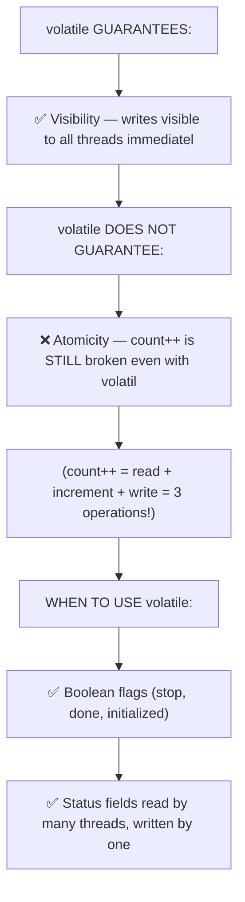

---

# 📌 Part 3: Race Conditions & Synchronization

## The Race Condition

```java
// THE CLASSIC RACE CONDITION
class BankAccount {
    int balance = 1000;

    void withdraw(int amount) {
        if (balance >= amount) {       // Thread A: balance=1000, amount=800 ✓
            // Thread B sneaks in here!  Thread B: balance=1000, amount=500 ✓
            balance -= amount;          // Thread A: balance = 200
                                       // Thread B: balance = -300  💀 NEGATIVE!
        }
    }
}
// Both threads read balance=1000, both pass the check, both withdraw
// Result: balance = -300 (should have rejected one!)
```

```
┌─────────────────────────────────────────────────────────────────────────────────┐
│  RACE CONDITION = Two threads access shared data, at least one writes,          │
│                   and there's no synchronization.                               │
│                                                                                 │
│  Time    Thread A              Thread B           balance                       │
│  ─────  ──────────────────    ──────────────────  ────────                      │
│  t1     read balance (1000)                        1000                         │
│  t2                           read balance (1000)  1000                         │
│  t3     check: 1000>=800 ✓                         1000                         │
│  t4                           check: 1000>=500 ✓   1000                         │
│  t5     balance = 1000-800                         200                          │
│  t6                           balance = 200-500    -300  ← CORRUPTED!           │
│                                                                                 │
│  This is called a CHECK-THEN-ACT race condition.                                │
│  The check and the act must be ATOMIC (indivisible).                            │
└─────────────────────────────────────────────────────────────────────────────────┘
```

**Flow:**
- and there's no synchronization.
- ↓
- Time Thread A Thread B balance
- ↓
- t1 read balance (1000) 1000
- ↓
- t2 read balance (1000) 1000
- ↓
- t3 check: 1000>=800 ✓ 1000
- ↓
- t4 check: 1000>=500 ✓ 1000
- ↓
- t5 balance = 1000-800 200

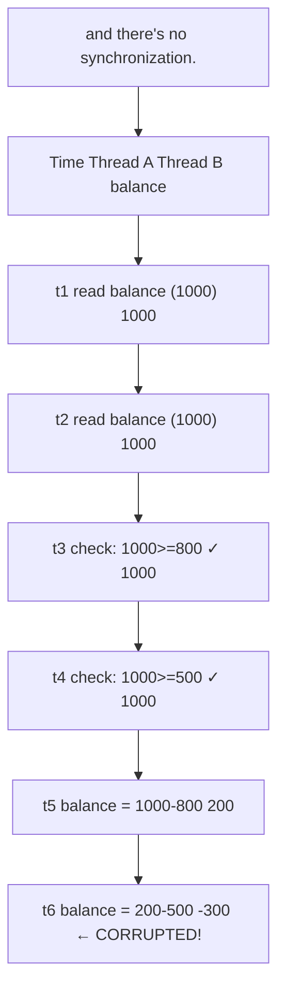

## synchronized — The Basic Lock

```java
class SafeBankAccount {
    private int balance = 1000;
    private final Object lock = new Object();

    // Option 1: synchronized method (locks on 'this')
    synchronized void withdraw(int amount) {
        if (balance >= amount) {
            balance -= amount;  // Only one thread can be here at a time
        }
    }

    // Option 2: synchronized block (locks on specific object — PREFERRED)
    void deposit(int amount) {
        synchronized (lock) {         // Acquire lock
            balance += amount;        // Critical section
        }                             // Release lock automatically
    }

    // Option 3: synchronized static method (locks on Class object)
    static synchronized void globalOperation() {
        // Locks on SafeBankAccount.class
    }
}
```

```
┌─────────────────────────────────────────────────────────────────────────────────┐
│  HOW synchronized WORKS INTERNALLY                                              │
│                                                                                 │
│  Every Java object has a MONITOR (also called intrinsic lock).                  │
│                                                                                 │
│  Thread A enters synchronized:                                                  │
│  1. Try to acquire the object's monitor                                         │
│  2. If free → acquire it, enter critical section                                │
│  3. If taken → Thread A goes to BLOCKED state, waits in entry set               │
│  4. When Thread A exits → releases monitor, one waiting thread gets it          │
│                                                                                 │
│  ┌──── Object Monitor ────┐                                                     │
│  │  Owner: Thread A       │                                                     │
│  │  Entry Set: [B, C]     │  ← Threads waiting to acquire                       │
│  │  Wait Set:  [D]        │  ← Threads that called wait()                       │
│  └────────────────────────┘                                                     │
│                                                                                 │
│  synchronized GUARANTEES:                                                       │
│  ✅ Mutual exclusion (only one thread in critical section)                       │
│  ✅ Visibility (changes visible to next thread that acquires lock)               │
│  ✅ Ordering (happens-before relationship)                                       │
│                                                                                 │
│  RULES:                                                                         │
│  • Lock on the SAME object to protect SAME data                                 │
│  • Keep synchronized blocks SHORT                                               │
│  • Never call unknown/external code inside synchronized                         │
│  • Prefer private final lock objects over locking on 'this'                     │
└─────────────────────────────────────────────────────────────────────────────────┘
```

**Flow:**
- HOW synchronized WORKS INTERNALLY
- ↓
- Thread A enters synchronized:
- ↓
- 1. Try to acquire the object's monitor
- ↓
- 2. If free
- ↓
- acquire it, enter critical section
- ↓
- 2. If free
- ↓
- acquire it, enter critical section
- ↓
- Object Monitor
- ↓
- Owner: Thread A
- ↓
- Entry Set: [B, C] ← Threads waiting to acquire

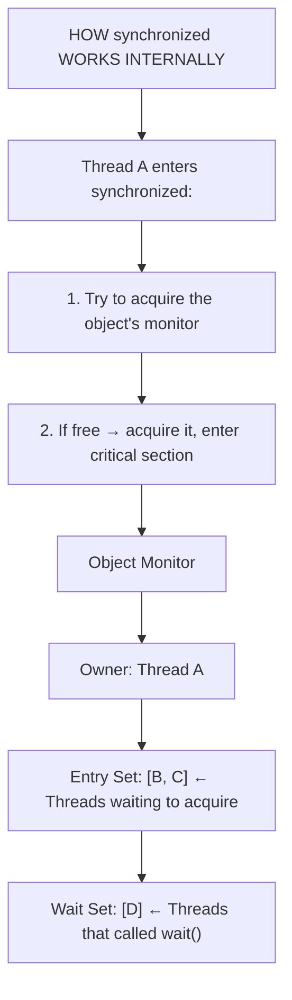

## wait() / notify() — Thread Communication

```java
// PRODUCER-CONSUMER with wait/notify
class BoundedBuffer<T> {
    private final Queue<T> queue = new LinkedList<>();
    private final int capacity;

    BoundedBuffer(int capacity) { this.capacity = capacity; }

    synchronized void put(T item) throws InterruptedException {
        while (queue.size() == capacity) {  // WHILE, not IF! (spurious wakeups)
            wait();   // Release lock, go to wait set
        }
        queue.add(item);
        notifyAll();  // Wake up ALL waiting threads
    }

    synchronized T take() throws InterruptedException {
        while (queue.isEmpty()) {
            wait();   // Release lock, go to wait set
        }
        T item = queue.poll();
        notifyAll();
        return item;
    }
}
```

```
┌─────────────────────────────────────────────────────────────────────────────────┐
│  wait() vs notify() vs notifyAll()                                              │
│                                                                                 │
│  wait()      — Release lock, go to WAITING state, added to wait set             │
│  notify()    — Wake ONE random thread from wait set                             │
│  notifyAll() — Wake ALL threads from wait set (they compete for lock)           │
│                                                                                 │
│  RULES:                                                                         │
│  • Must be called inside synchronized block (on same object)                    │
│  • ALWAYS use while loop, not if, to check condition (spurious wakeups)         │
│  • Prefer notifyAll() over notify() (safer, avoids missed signals)              │
│                                                                                 │
│  The wait() + notify() Pattern:                                                 │
│  synchronized(lock) {                                                           │
│      while (!condition) {   // ALWAYS while, not if                             │
│          lock.wait();       // Release lock and wait                            │
│      }                                                                          │
│      // Condition is true, proceed                                              │
│  }                                                                              │
└─────────────────────────────────────────────────────────────────────────────────┘
```

**Flow:**
- wait() vs notify() vs notifyAll()
- ↓
- notify() — Wake ONE random thread from wait set
- ↓
- RULES:
- ↓
- • Must be called inside synchronized block (on same obj
- ↓
- The wait() + notify() Pattern:
- ↓
- synchronized(lock) {
- ↓
- lock.wait(); // Release lock and wait

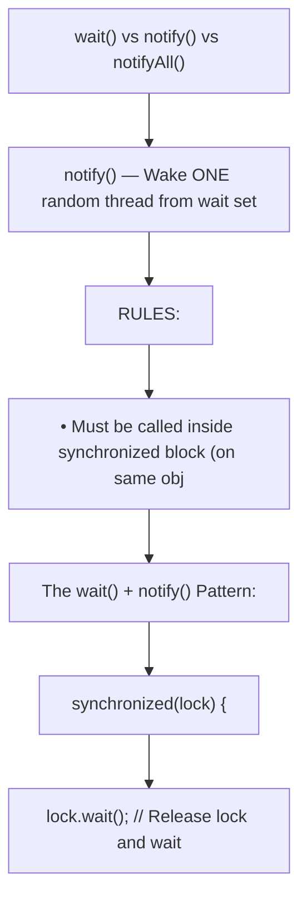

---

# PART 4: DEADLOCKS — The Silent Killer

```
┌─────────────────────────────────────────────────────────────────────────────────┐
│  DEADLOCK — Two threads each holding a lock the other needs                     │
│                                                                                 │
│  Thread A:               Thread B:                                              │
│  lock(account1)          lock(account2)                                         │
│  lock(account2) ← WAIT  lock(account1) ← WAIT                                   │
│  ... forever ...         ... forever ...                                        │
│                                                                                 │
│  Thread A holds account1, waits for account2                                    │
│  Thread B holds account2, waits for account1                                    │
│  → DEADLOCK! Neither can proceed.                                               │
│                                                                                 │
│  4 CONDITIONS (ALL must be true for deadlock):                                  │
│  1. Mutual Exclusion — locks are exclusive                                      │
│  2. Hold and Wait — holding one lock, waiting for another                       │
│  3. No Preemption — can't force a thread to release a lock                      │
│  4. Circular Wait — A waits for B, B waits for A                                │
│                                                                                 │
│  BREAK condition #4 to prevent deadlocks:                                       │
│  → Always acquire locks in the SAME ORDER                                       │
└─────────────────────────────────────────────────────────────────────────────────┘
```

**Flow:**
- DEADLOCK — Two threads each holding a lock the other ne
- ↓
- Thread A: Thread B:
- ↓
- lock(account1) lock(account2)
- ↓
- lock(account2) ← WAIT lock(account1) ← WAIT
- ↓
- ... forever ... ... forever ...
- ↓
- Thread A holds account1, waits for account2
- ↓
- Thread B holds account2, waits for account1

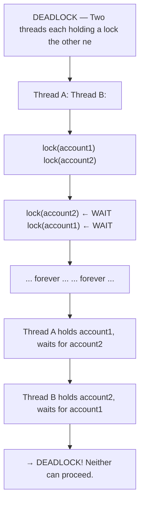

```java
// DEADLOCK-PRONE CODE
class DeadlockExample {
    void transfer(Account from, Account to, int amount) {
        synchronized (from) {           // Lock 'from' first
            synchronized (to) {          // Then lock 'to'
                from.balance -= amount;
                to.balance += amount;
            }
        }
    }
    // Thread A: transfer(acc1, acc2, 100)  → locks acc1, then acc2
    // Thread B: transfer(acc2, acc1, 50)   → locks acc2, then acc1
    // DEADLOCK!
}

// FIXED — Lock ordering by account ID
class SafeTransfer {
    void transfer(Account from, Account to, int amount) {
        Account first = from.id < to.id ? from : to;
        Account second = from.id < to.id ? to : from;

        synchronized (first) {
            synchronized (second) {
                if (from.balance >= amount) {
                    from.balance -= amount;
                    to.balance += amount;
                }
            }
        }
    }
    // Both threads now always lock the lower-ID account first → no circular wait!
}
```

---

# PART 5: ATOMIC CLASSES — Lock-Free Thread Safety

```
┌─────────────────────────────────────────────────────────────────────────────────┐
│  Atomic classes use CPU-level Compare-And-Swap (CAS) instruction                │
│  → No locks needed! Much faster than synchronized for simple operations         │
│                                                                                 │
│  CAS: "If value == expected, set to new. Otherwise, retry."                     │
│                                                                                 │
│  CPU Instruction (single atomic operation):                                     │
│  compareAndSwap(memoryLocation, expectedValue, newValue)                        │
│  → Returns true if swapped, false if value changed                              │
│                                                                                 │
│  Available Atomic Types:                                                        │
│  ┌──────────────────────────────────────────────┐                               │
│  │ AtomicInteger   │ AtomicLong    │ AtomicBoolean│                             │
│  │ AtomicReference │ AtomicArray   │ LongAdder    │                             │
│  └──────────────────────────────────────────────┘                               │
└─────────────────────────────────────────────────────────────────────────────────┘
```

**Flow:**
- CAS: 'If value == expected, set to new. Otherwise, retr
- ↓
- CPU Instruction (single atomic operation):
- ↓
- compareAndSwap(memoryLocation, expectedValue, newValue)
- ↓
- Returns true if swapped, false if value changed
- ↓
- Available Atomic Types:
- ↓
- AtomicInteger AtomicLong AtomicBoolean
- ↓
- AtomicReference AtomicArray LongAdder

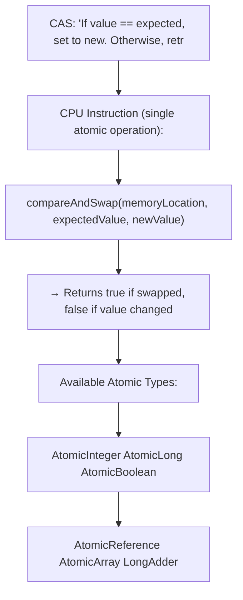

```java
import java.util.concurrent.atomic.*;

// AtomicInteger — thread-safe counter without locks
AtomicInteger counter = new AtomicInteger(0);

counter.incrementAndGet();           // ++counter (atomic)
counter.decrementAndGet();           // --counter (atomic)
counter.addAndGet(5);                // counter += 5 (atomic)
counter.getAndIncrement();           // counter++ (returns old value)
counter.compareAndSet(5, 10);        // If counter==5, set to 10
counter.updateAndGet(x -> x * 2);   // Apply function atomically

// AtomicReference — thread-safe reference swap
AtomicReference<String> ref = new AtomicReference<>("initial");
ref.compareAndSet("initial", "updated");  // CAS on references

// LongAdder — high-contention counter (faster than AtomicLong)
LongAdder adder = new LongAdder();
adder.increment();   // Multiple threads can increment in parallel
adder.sum();         // Get final count (slightly delayed)
// Use LongAdder when many threads increment, but you read rarely
```

```
┌─────────────────────────────────────────────────────────────────────────────────┐
│  WHEN TO USE WHAT:                                                              │
│                                                                                 │
│  ┌──────────────────────────────────────────────────────────────────────┐       │
│  │ Need                        │ Use                                    │       │
│  ├─────────────────────────────┼────────────────────────────────────────│       │
│  │ Simple counter              │ AtomicInteger / AtomicLong             │       │
│  │ High-contention counter     │ LongAdder                              │       │
│  │ Boolean flag                │ volatile boolean or AtomicBoolean      │       │
│  │ Reference swap              │ AtomicReference                        │       │
│  │ Multiple fields together    │ synchronized or Lock                   │       │
│  │ Complex invariants          │ synchronized or Lock                   │       │
│  └─────────────────────────────┴────────────────────────────────────────┘       │
└─────────────────────────────────────────────────────────────────────────────────┘
```

**Flow:**
- WHEN TO USE WHAT:
- ↓
- Need Use
- ↓
- Simple counter AtomicInteger / AtomicLong
- ↓
- High-contention counter LongAdder
- ↓
- Boolean flag volatile boolean or AtomicBoolean
- ↓
- Reference swap AtomicReference
- ↓
- Multiple fields together synchronized or Lock

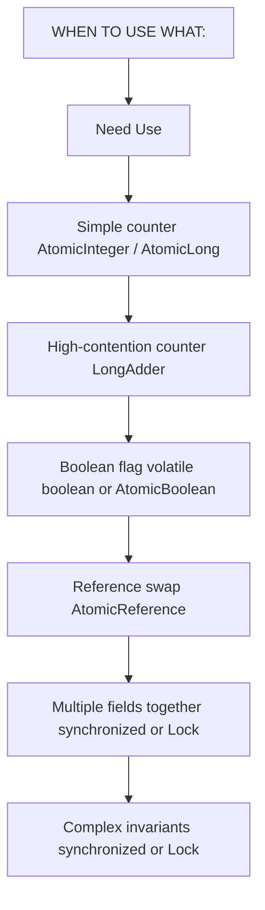

---

# 📌 Part 6: Concurrent Collections

```
┌─────────────────────────────────────────────────────────────────────────────────┐
│  THREAD-SAFE COLLECTIONS HIERARCHY                                              │
│                                                                                 │
│  DON'T USE:                    USE INSTEAD:                                     │
│  ─────────                     ────────────                                     │
│  HashMap                 →     ConcurrentHashMap                                │
│  ArrayList               →     CopyOnWriteArrayList                             │
│  TreeMap                 →     ConcurrentSkipListMap                            │
│  LinkedList (as queue)   →     ConcurrentLinkedQueue                            │
│  PriorityQueue           →     PriorityBlockingQueue                            │
│  ArrayDeque              →     LinkedBlockingDeque                              │
│                                                                                 │
│  Collections.synchronizedMap() is a TRAP:                                       │
│  → Wraps every method in synchronized → single global lock → SLOW               │
│  → ConcurrentHashMap uses segment locking (Java 7) or CAS (Java 8+)             │
│    → Multiple threads can read/write different segments simultaneously          │
└─────────────────────────────────────────────────────────────────────────────────┘
```

**Flow:**
- THREAD-SAFE COLLECTIONS HIERARCHY
- ↓
- DON'T USE: USE INSTEAD:
- ↓
- HashMap
- ↓
- ConcurrentHashMap
- ↓
- HashMap
- ↓
- ConcurrentHashMap
- ↓
- ArrayList
- ↓
- CopyOnWriteArrayList
- ↓
- ArrayList
- ↓
- CopyOnWriteArrayList
- ↓
- TreeMap
- ↓
- ConcurrentSkipListMap
- ↓
- TreeMap
- ↓
- ConcurrentSkipListMap
- ↓
- LinkedList (as queue)
- ↓
- ConcurrentLinkedQueue
- ↓
- LinkedList (as queue)
- ↓
- ConcurrentLinkedQueue
- ↓
- PriorityQueue
- ↓
- PriorityBlockingQueue

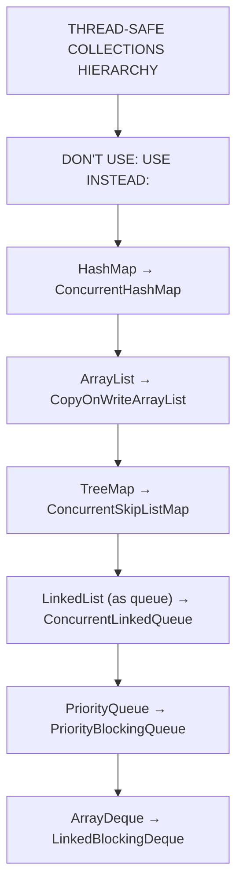

```java
// ConcurrentHashMap — the king of concurrent collections
ConcurrentHashMap<String, Integer> map = new ConcurrentHashMap<>();

map.put("key", 1);
map.putIfAbsent("key", 2);              // Only puts if key not present
map.compute("key", (k, v) -> v + 1);    // Atomic read-modify-write
map.merge("key", 1, Integer::sum);       // Atomic merge (great for counting!)

// WRONG way to do check-then-act:
if (!map.containsKey("key")) {
    map.put("key", value);  // Race condition between containsKey and put!
}
// CORRECT:
map.putIfAbsent("key", value);  // Single atomic operation

// CopyOnWriteArrayList — reads never block, writes copy entire array
CopyOnWriteArrayList<String> list = new CopyOnWriteArrayList<>();
// Great for: event listeners, config lists (read-heavy, write-rare)
// Bad for: frequently modified lists (copies entire array on each write)

// BlockingQueue — the producer-consumer backbone
BlockingQueue<Task> queue = new LinkedBlockingQueue<>(100);
queue.put(task);     // Blocks if full (producer waits)
Task t = queue.take(); // Blocks if empty (consumer waits)
// No explicit wait/notify needed! The queue handles it.
```

---

# 🎤 Part 7: Common Mistakes & Interview Questions

```
┌─────────────────────────────────────────────────────────────────────────────────┐
│  TOP 10 CONCURRENCY MISTAKES                                                    │
│                                                                                 │
│  1. Using count++ instead of AtomicInteger                                      │
│  2. Using HashMap in multithreaded code (NPE, infinite loop on resize!)         │
│  3. Forgetting volatile on shared boolean flags                                 │
│  4. Using if instead of while with wait()                                       │
│  5. Calling run() instead of start()                                            │
│  6. Not restoring interrupt flag after catching InterruptedException            │
│  7. Locking on mutable objects ("test".intern() disaster)                       │
│  8. Holding locks while doing I/O                                               │
│  9. Double-checked locking without volatile (broken before Java 5)              │
│  10. Not making lock objects final                                              │
│                                                                                 │
│  INTERVIEW FAVORITES:                                                           │
│  Q: "Difference between synchronized and volatile?"                             │
│  A: synchronized guarantees atomicity + visibility + ordering                   │
│     volatile guarantees visibility + ordering only (NOT atomicity)              │
│                                                                                 │
│  Q: "Can two threads enter two different synchronized methods of same object?"  │
│  A: NO. Both lock on 'this'. Only one thread at a time for ALL                  │
│     synchronized methods of the same object instance.                           │
│                                                                                 │
│  Q: "What happens if you don't call start()?"                                   │
│  A: Calling run() directly executes in current thread. No new thread created.   │
└─────────────────────────────────────────────────────────────────────────────────┘
```

**Flow:**
- TOP 10 CONCURRENCY MISTAKES
- ↓
- 1. Using count++ instead of AtomicInteger
- ↓
- 3. Forgetting volatile on shared boolean flags
- ↓
- 4. Using if instead of while with wait()
- ↓
- 5. Calling run() instead of start()
- ↓
- 7. Locking on mutable objects ('test'.intern() disaster
- ↓
- 8. Holding locks while doing I/O

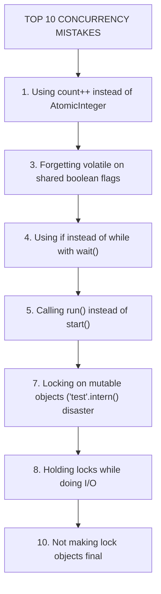

---

> **Next**: [Part 2 — ExecutorService, CompletableFuture, Virtual Threads →](Ch16_Concurrency_Advanced.md)


---

> **Navigation**: [< Previous](Ch25_Spring_Boot_50Day_Plan.md) | [Back to Index](../00_MASTER_INDEX.md) | [Next >](Ch16_Concurrency_Advanced.md)