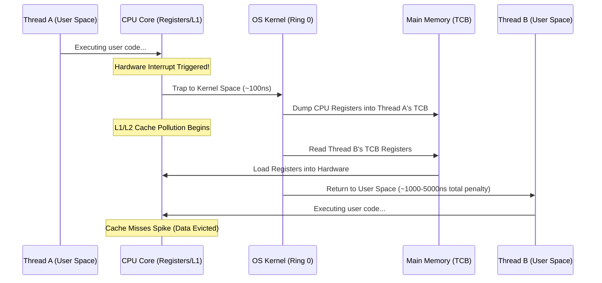

**Navigation**: [Back to Index](../00_MASTER_INDEX.md) | [Next >](Ch16_Concurrency_Advanced.md)
🧠 **Mental Model**: See [Space-Time Tradeoffs](../14_Mental_Models/12_Space_Time_Tradeoffs.md) — concurrency trades complexity for throughput

---

# ⚡ Java Concurrency — Core Foundations

Why every production Java application needs concurrency mastery


## Roadmap

This chapter covers thread fundamentals, JMM happens-before, synchronized/wait/notify, concurrent utilities, and performance. Suggested future splits (approximate — actual breaks follow the file's `## ` headers):

- **Part A (lines ~1-750):** Thread basics, memory ordering, JMM happens-before, race conditions
- **Part B (lines ~750-1200):** Synchronization primitives — synchronized, wait/notify, ReentrantLock, Condition
- **Part C (lines ~1200-1900):** Concurrent utilities — BlockingQueue, CountDownLatch, CyclicBarrier, Semaphore; Thread pools and exceptions
- **Part D (lines ~1900-end):** Challenges and production skills — lock prediction drills, MCQ, code review, context switching

Use these markers as approximation; the file has not been split yet.

## 🔑 Critical Context: ARM vs x86 Memory Ordering

[!WARNING]
**This is why code "works on your laptop but fails on AWS".** AWS Graviton (ARM) processors use a weaker memory model than Intel/AMD (x86). Code with subtle data races passes testing locally and silently corrupts in production.

```
MEMORY ORDERING — The Hidden Difference:

x86 (Intel/AMD):          ARM (Graviton, Apple M-series, mobile):
═══════════════           ════════════════════════════════════════
Strong memory model        Weak memory model
Loads are NOT reordered    Loads CAN be reordered
Stores are NOT reordered   Stores CAN be reordered

Result: Racy code that     Result: Racy code visibly corrupts data.
  "works" on x86 because   ARM reorders more aggressively → races
  hardware enforces       →  that x86 suppressed are now visible.
  ordering "accidentally"

WHAT THIS MEANS FOR JAVA:
  Java Memory Model (JMM) defines the MINIMUM guarantees.
  Compliant VMs must honor JMM — but x86 OVER-delivers.
  When you put Java on ARM, the JMM is still respected,
  but YOUR CODE that depends on x86's extra guarantees breaks.

REAL EXAMPLE:
  // Broken code (no volatile, no synchronization):
  boolean ready = false;
  String value = null;

  // Thread 1:                    Thread 2:
  value = "Hello";                while (!ready) {}    // spin
  ready = true;                   System.out.println(value);

  On x86: Works (usually) — store ordering prevents value=null
  On ARM: Can print null — CPU reordered ready=true before value="Hello"

  Fix: volatile boolean ready = false;
  volatile creates a happens-before relationship (JLS §17.4) guaranteed by JMM.
```

🔬 **Challenge:** You add `volatile` to `ready` but not `value`. Does the ARM race disappear?

<details><summary>Answer</summary>

Yes! The `volatile` write to `ready = true` in Thread 1 creates a happens-before with the `volatile` read of `ready` in Thread 2. JMM guarantees: ALL writes before a volatile write are visible to any thread that subsequently reads that volatile variable. So `value = "Hello"` (which happens before `ready = true`) is visible to Thread 2 after it reads `ready = true`. Only ONE volatile is needed: the "gate" variable.

</details>

---

### The Java Memory Model — What Happens-Before Actually Means and Why Volatile Isn't Always Enough

The ARM vs x86 section above shows the practical symptom (racy code works on x86, breaks on ARM). But it doesn't show the *formal model* — what the JMM actually guarantees and why. Without that, you're memorizing "use volatile to fix visibility bugs" instead of understanding when it's enough and when it isn't (the answer: often it isn't, because volatile gives you per-variable visibility but not *atomicity of compound actions*). The JMM happens-before relation is the precise tool for answering "is this read guaranteed to see that write?"

**The full happens-before relation — every rule, in one place.** The JMM defines a partial order on actions in a program. Two actions `a` and `b` have a happens-before relationship (written `a →hb b`) if any of these hold:

1. **Program order**: within a single thread, every statement happens-before the next statement in source order.
2. **Monitor lock (synchronized)**: an unlock on a monitor happens-before every subsequent lock on the same monitor. (And symmetrically, a write that happens-before an unlock is visible to any thread that locks after that unlock.)
3. **volatile**: a write to a volatile field happens-before every subsequent read of that volatile field.
4. **Thread.start()**: the call to `Thread.start()` happens-before any action in the started thread.
5. **Thread.join()**: any action in a thread happens-before the return from `Thread.join()` for that thread.
6. **Thread.interrupt()**: the interrupt happens-before the interrupted thread sees the interrupt (when it checks `Thread.interrupted()` or throws `InterruptedException`).
7. **Final field**: a write to a final field in a constructor happens-before the freeze action that publishes the object reference.
8. **Concurrent collections**: `put` to a `ConcurrentHashMap` happens-before a subsequent `get` that observes the put.
9. **Transitivity**: if `a →hb b` and `b →hb c`, then `a →hb c`. (This is how the "single volatile gate" trick from the example above works — transitivity chains all the pre-gate writes to all post-gate reads.)

The **visibility guarantee**: if `a →hb b`, then the write `a` is *guaranteed* to be visible to the read `b`. Without happens-before, JMM permits any outcome (the read may see the write, may not, may see a stale value).

**Why volatile is not enough for compound actions.** The classic check-then-act bug:

```java
if (!map.containsKey(key)) {       // check
    map.put(key, computeValue());   // act
}
```

This is *not* atomic even if `map` is a `ConcurrentHashMap`. Between the `containsKey` and the `put`, another thread can `put` the key. The two operations are separate volatile reads/writes; there's no happens-before linking them as one atomic unit. The fix is `map.putIfAbsent(key, computeValue())` — a single compound action whose internal happens-before is guaranteed by the implementation.

This is also why `AtomicInteger.incrementAndGet()` exists instead of just `volatile int` + `++`. The `++` is three operations (read, add, write), and between them another thread can read or write. The atomic method does all three under a CAS loop.

**The synchronize-with vs happens-before distinction.** JLS §17.4 defines two related but distinct concepts:
- **Synchronizes-with**: a specific relation between *one* write and *one* read (e.g., volatile write to volatile read of same variable).
- **Happens-before**: the partial order on *all* actions, built from program order + synchronizes-with + transitivity.

Synchronizes-with is a building block; happens-before is what you actually compute in your head when reasoning about whether a value is visible. The chain "thread-local writes happen-before the volatile write, volatile write synchronizes-with volatile read in another thread, volatile read happens-before subsequent reads in that thread" is the standard pattern.

**The "out-of-thin-air" guarantee.** JMM has an additional safety property: a read can only return a value that was written by some thread, or a default initial value. It cannot invent a value out of thin air. This rules out absurd outcomes like `x = y + 1; y = x + 1` both executing and ending with `x = y = 1` (which would require circular causality). Real compilers and CPUs respect this; without it, you'd need fences around every read.

**The "publication" trap — the canonical JMM bug.** Pattern:

```java
// Thread 1 (publisher)
holder = new Holder(42);

// Thread 2 (reader)
if (holder != null) {
    int v = holder.value;  // could be 0, not 42!
}
```

Even though `holder` looks "safely published" by the null-check, JMM permits `holder.value` to be seen as the default `0` (the default value of `int`) if `Holder` doesn't have proper synchronization. The fix: declare `value` as `final` (the constructor-freeze rule), or publish through a volatile/ConcurrentHashMap/synchronized block. This is exactly the bug that motivated the JMM formalization in Java 5 (pre-Java 5, the JMM was so weak that final fields weren't guaranteed safe-publishable either).

**Connection to the rest of the chapter.** Every later concurrency tool in this chapter is a *specific implementation of happens-before*:
- `synchronized` block = monitor lock rules (rule 2).
- `volatile` = rule 3.
- `AtomicInteger` etc. = CAS loop using volatile internally (rule 3, repeatedly).
- `BlockingQueue.put/get` = the collection rules (rule 8).
- `Thread.start/join` = rules 4, 5.
- `final` fields in immutable objects = rule 7.

When you understand happens-before as "what writes are visible to what reads," you can answer any visibility question by tracing the chain: "is there a synchronizes-with edge between the write and the read? If not, the read may see anything." Memorizing "use volatile" works for simple cases; happens-before works for all cases.

🔬 **Section Challenge — Java Memory Model**

**Challenge 1 (Happens-Before Chain, 8 min):** Thread A writes `data = 42`, then writes `ready = true` (volatile). Thread B spins on `while (!ready);`, then reads `data`. Under JMM, is the read of `data` in Thread B guaranteed to see `42`? Walk through the happens-before chain.

<details><summary>Answer</summary>

Yes, guaranteed. The chain:

1. **Program order in Thread A**: `data = 42` happens-before `ready = true` (rule 1).
2. **Volatile write/read synchronizes-with**: the write of `ready = true` synchronizes-with the read of `ready` in Thread B that returns `true` (rule 3, the volatile synchronizes-with edge).
3. **Program order in Thread B**: the read of `ready` (which observes `true`) happens-before the subsequent read of `data` (rule 1).
4. **Transitivity**: `data = 42` happens-before `ready = true` happens-before `ready read` happens-before `data read`. So `data = 42` happens-before `data read`.

By the visibility guarantee, the read of `data` must see `42`. The single volatile "gate" variable is sufficient.

If `ready` were *not* volatile, step 2 would fail (no synchronizes-with edge), the chain breaks, and the read of `data` could see the default `0` or any other value.

</details>

**Challenge 2 (Publication Reasoning, 5 min):** Thread A constructs a `Config` object with several `final` fields, then stores the reference in a `volatile` field `currentConfig`. Thread B reads `currentConfig` and then reads `currentConfig.someField`. Is this safe-publication?

<details><summary>Answer</summary>

Yes, doubly safe.

1. **Final field rule (rule 7)**: writes to `final` fields in the `Config` constructor happen-before the freeze action. Once Thread B sees the `Config` reference (via `currentConfig`), the final fields are guaranteed initialized.

2. **Volatile rule (rule 3)**: the write of `currentConfig` happens-before the read of `currentConfig` in Thread B.

Combining: the writes to `final` fields happen-before the freeze, the freeze happens-before the volatile write, the volatile write happens-before the volatile read in Thread B. So the final field writes happen-before Thread B's reads. Safe publication.

In contrast, if the fields were *not* final, then rule 7 doesn't apply, and you'd need another happens-before path. The volatile `currentConfig` would still guarantee the *reference* is visible, but not the field values — Thread B could read a partially-constructed `Config`. This is the "publication trap" the JLS specifically warns about.

The combination of `final` fields + a volatile reference is the canonical "immutable + safely-published" pattern in Java — it's why `String`, `Integer`, `LocalDateTime`, etc. can be shared across threads without external synchronization.

</details>


## ❓ Why This Matters

REALITY CHECK

Your REST API gets 1000 requests/second. Each request = 1 thread.
If each thread takes 200ms, you need 200 threads running simultaneously.

Without understanding concurrency:
❌ Race conditions corrupt data
❌ Deadlocks freeze your server
❌ Thread leaks crash your JVM
❌ You can't debug "works locally, fails in prod" issues

With mastery:
✅ You write thread-safe code by default
✅ You choose the right concurrency tool for each problem
✅ You debug production issues others can't
✅ You design systems that scale

---

# 📖 Part 1: Thread Fundamentals

## What Is a Thread (At CPU Level)?

```
┌─────────────────────────────────────────────────────────────────────────────────┐
│  PROCESS vs THREAD — The Apartment Analogy                                      │
│                                                                                 │
│  PROCESS = An apartment                                                         │
│    - Has its own address space (its own rooms, kitchen, bathroom)               │
│    - Isolated from other apartments                                             │
│    - Expensive to create (need to allocate entire apartment)                    │
│                                                                                 │
│  THREAD = A person living in the apartment                                      │
│    - Shares the apartment's space (heap memory)                                 │
│    - Has own bed/desk (stack, program counter, registers)                       │
│    - Cheap to create (just add a person, don't build new apartment)             │
│    - BUT: sharing kitchen → conflicts! (race conditions)                        │
│                                                                                 │
│  ┌──────────── Process (JVM) ─────────────┐                                     │
│  │  HEAP (shared by all threads)          │                                     │
│  │  ┌───────┐  ┌───────┐  ┌───────┐       │                                     │
│  │  │Thread1│  │Thread2│  │Thread3│       │                                     │
│  │  │ Stack │  │ Stack │  │ Stack │       │                                     │
│  │  │  PC   │  │  PC   │  │  PC   │       │                                     │
│  │  └───────┘  └───────┘  └───────┘       │                                     │
│  └─────────────────────────────────────────┘                                    │
│                                                                                 │
│  Each thread has:                                                               │
│    - Own stack (local variables, method calls) — typically 512KB-1MB            │
│    - Own program counter (which instruction it's executing)                     │
│    - Own register state                                                         │
│  All threads share:                                                             │
│    - Heap (objects, arrays)                                                     │
│    - Method area (class metadata)                                               │
│    - File handles, sockets                                                      │
└─────────────────────────────────────────────────────────────────────────────────┘
```

## Creating Threads — 3 Ways

```java
// WAY 1: Extend Thread class (rarely used in production)
class MyThread extends Thread {
    @Override
    public void run() {
        System.out.println("Running in: " + Thread.currentThread().getName());
    }
}
MyThread t = new MyThread();
t.start();  // start() creates new thread. NEVER call run() directly!

// WAY 2: Implement Runnable (preferred — separates task from thread)
class MyTask implements Runnable {
    @Override
    public void run() {
        System.out.println("Task running in: " + Thread.currentThread().getName());
    }
}
Thread t = new Thread(new MyTask());
t.start();

// WAY 3: Lambda (modern Java — cleanest)
Thread t = new Thread(() -> {
    System.out.println("Lambda running in: " + Thread.currentThread().getName());
});
t.start();

```

🔬 **Section Challenge — Thread Creation**

**Challenge 1 (Reasoning):** You have a class `DataProcessor extends Thread`. Later you need `DataProcessor` to also extend `BaseService`. What breaks, and how do you redesign?

<details><summary>Answer</summary>

`extends Thread` blocks you — Java has no multiple inheritance. The fix: make `DataProcessor extends BaseService implements Runnable`, wrap in `new Thread(processor)` or submit to an `ExecutorService`. The task logic stays in `run()`, threading is handled externally. This is exactly why Runnable exists — decoupling.

</details>

**Challenge 2 (Trace):** A programmer writes `new Thread(task).run()` inside a `for` loop 1000 times. No new threads are created. Where's the bug and what's the actual execution behavior?

<details><summary>Answer</summary>

`run()` executes on the CALLING thread (sequential, blocking). All 1000 iterations run on the main thread, one after another. No parallelism whatsoever. Fix: `new Thread(task).start()` — or better: submit to `ExecutorService` which manages the pool.

</details>

**Challenge 3 (Design):** Why can the same `Runnable` instance be passed to multiple threads but it's dangerous if it has instance state?

<details><summary>Answer</summary>

`Runnable` is just a task description. Running the same `Runnable` on 5 threads = 5 threads sharing one object's fields. If `run()` reads/writes instance variables, you have a race condition. Solutions: (1) stateless Runnable (all data via parameters/local vars), (2) synchronized access, (3) create a new Runnable instance per thread with its own state.

</details>

## 🔴 WHY Does Runnable Exist? — The Design Reasoning

**Your exact question**: "Runnable is an interface. We implement it and write `run()` anyway. Then why not just extend Thread directly? What's the point of Runnable?"

This is a **Senior Engineer interview question**. The answer goes deep into Object-Oriented design philosophy.

```
╔══════════════════════════════════════════════════════════════════╗
║  THE RESTAURANT ANALOGY                                          ║
║                                                                  ║
║  Thread = A waiter (the EXECUTOR — knows HOW to serve tables)    ║
║  Runnable = An order ticket (the TASK — knows WHAT to do)        ║
║                                                                  ║
║  Option A: Extend Thread (BAD DESIGN):                           ║
║  → You say "I want a waiter who ALSO IS the order ticket"        ║
║  → The waiter (thread) is permanently glued to ONE specific task ║
║  → Next order? Need a completely new specialised waiter          ║
║  → Delivery apps can't reuse the waiter for different orders     ║
║                                                                  ║
║  Option B: Implement Runnable (GOOD DESIGN):                     ║
║  → Order ticket (task) is separate from the waiter (thread)      ║
║  → The same waiter can carry ANY order ticket                    ║
║  → The same order ticket can be served by ANY waiter             ║
║  → Thread pool = a pool of waiters, tasks = order slips          ║
║  → THIS is how ExecutorService works!                            ║
╚══════════════════════════════════════════════════════════════════╝
```

### Reason 1: Java Has No Multiple Inheritance

```java
// ❌ PROBLEM with extending Thread:
class MyThread extends Thread {
    @Override
    public void run() { doWork(); }
}

// What if your class ALSO needs to extend something else?
class MyThread extends Thread, Animal { }  // ❌ COMPILE ERROR!
// Java doesn't allow extending two classes.

// ✅ SOLUTION with Runnable (it's an interface):
class MyTask extends Animal implements Runnable {
    @Override
    public void run() { doWork(); }
}
// You can implement MULTIPLE interfaces!
// Your class keeps its inheritance hierarchy AND becomes a runnable task.
```

### Reason 2: Separation of Concerns (SRP — Single Responsibility Principle)

```java
// ❌ BAD: Thread subclass — task and executor are FUSED
class EmailSenderThread extends Thread {
    private String recipient;
    private String body;

    EmailSenderThread(String r, String b) { this.recipient = r; this.body = b; }

    @Override
    public void run() {
        sendEmail(recipient, body);
    }
}

// What does EmailSenderThread "do"?
// 1. Send emails (business logic)      ← task responsibility
// 2. Be a thread (execution mechanism) ← threading responsibility
// → TWO responsibilities → violation of SRP!
// → Cannot reuse email logic without creating a thread!
// → Cannot test email logic without starting a thread!

// ✅ GOOD: Runnable separates task from executor
class EmailSender implements Runnable {     // Task: knows WHAT to do
    private String recipient, body;

    EmailSender(String r, String b) { this.recipient = r; this.body = b; }

    @Override
    public void run() {
        sendEmail(recipient, body);
    }
}

// Now the SAME EmailSender can be used in multiple ways:
EmailSender task = new EmailSender("user@example.com", "Hello!");

// Option 1: Run on a dedicated new thread
new Thread(task).start();

// Option 2: Run on a thread pool (most common in production)
ExecutorService pool = Executors.newFixedThreadPool(4);
pool.submit(task);  // Pool decides WHICH thread runs it

// Option 3: Run on the CURRENT thread (for unit testing!)
task.run();  // No thread created — tests EmailSender logic directly!

// Option 4: Schedule for future execution
scheduledPool.schedule(task, 5, TimeUnit.SECONDS);

// Option 5: Run in a Future for async result handling
Future<?> f = pool.submit(task);

// ONE task class → infinite execution strategies
// If you extended Thread, you'd be locked into ONE strategy
```

### Reason 3: Reusability — Same Task, Different Executors

```java
// THE KEY INSIGHT:
// When you extend Thread, the task IS the Thread.
// When you implement Runnable, the task and the thread are INDEPENDENT.

Runnable sendReport = () -> generateAndSendReport();

// Same runnable, different execution contexts:
new Thread(sendReport).start();                          // Ad-hoc thread
executorService.submit(sendReport);                      // Thread pool
scheduledService.scheduleAtFixedRate(sendReport, 0, 1, TimeUnit.HOURS);  // Hourly
CompletableFuture.runAsync(sendReport);                  // ForkJoinPool
virtualThread.startVirtualThread(sendReport);            // Virtual thread (Java 21)

// All the same Runnable! You didn't change your task at all.
// Just changed WHO runs it and WHEN.
```

### Reason 4: Functional Interface — Lambda Support

```java
// Runnable is a @FunctionalInterface (exactly 1 abstract method: run())
// This means Java 8+ lambdas work directly as Runnable

// ❌ Old way (extending Thread or implementing Runnable):
Thread t = new Thread(new Runnable() {
    @Override
    public void run() {
        System.out.println("Verbose!");
    }
});

// ✅ Modern way (lambda):
Thread t = new Thread(() -> System.out.println("Clean!"));

// The lambda () -> ... IS the Runnable!
// No class needed. No implements. No @Override.
// This is ONLY possible because Runnable is an INTERFACE, not a class.
// If Thread.run() were not separated into Runnable, lambdas couldn't work here.
```

### The Complete Design Picture

```
┌─────────────────────────────────────────────────────────────────────────────────┐
│  EXTENDING Thread vs IMPLEMENTING Runnable — Full Comparison                     │
│                                                                                 │
│  Question                    extends Thread      implements Runnable            │
│  ─────────────────────────   ──────────────────  ─────────────────────────     │
│  Can inherit another class?  ❌ No (Java SCI)    ✅ Yes (interface)            │
│  Task reusable by pool?      ❌ No (thread IS task)  ✅ Yes (task ≠ thread)    │
│  Testable without a thread?  ❌ Hard             ✅ Just call .run() directly   │
│  Lambda support?             ❌ No               ✅ Yes (@FunctionalInterface)  │
│  Separation of concerns?     ❌ Fused            ✅ Clean separation            │
│  Can pass to ExecutorService? ❌ No              ✅ Yes                        │
│  Production usage?           Never               Always                         │
│                                                                                 │
│  WHEN to extend Thread:                                                         │
│  → Almost NEVER in production code                                              │
│  → Only when you need to CHANGE Thread's behavior (not just override run)      │
│  → Example: creating a custom daemon thread with specific interrupt handling    │
└─────────────────────────────────────────────────────────────────────────────────┘
```

### Interview Q&A Section

**Q: Why `implements Runnable` over `extends Thread`?**
Three reasons: (1) Java has single inheritance — `extends Thread` locks you out of extending another class. (2) Runnable separates the **task** (what to do) from the **executor** (how/when to run) — SRP. (3) The same `Runnable` can be passed to a thread pool, a scheduler, virtual threads, or called directly for testing — maximum **reusability**.

**Q: If Runnable has only `run()`, why call `start()` on Thread? Why not call `run()`?**
`thread.run()` = calls `run()` on the **current thread** — no new thread is created. `thread.start()` = asks the **JVM + OS** to create a new native thread, allocate its stack, register it with the scheduler, and **then** call `run()` on that new thread. Calling `run()` directly is the #1 beginner mistake — it does all the work synchronously on your calling thread.

**Q: What does Thread do with the Runnable passed to it?**
Thread stores it internally: `this.target = runnable`. When the JVM calls `thread.run()` on the new thread, Thread's own `run()` checks: `if (target != null) target.run()`. So Thread is essentially a **wrapper** that knows how to spin up an OS thread and then delegate to whatever Runnable you gave it.

```java
// Thread's run() method source (simplified):
@Override
public void run() {
    if (target != null) {
        target.run();        // ← Delegates to YOUR Runnable!
    }
    // If you extend Thread and override run(), this line never runs
    // Because you replaced the whole method
}
```

**Q: Thread also implements Runnable. Why?**
Because Thread itself has a `run()` method — it IS a `Runnable`! This means a `Thread` can be passed wherever a `Runnable` is expected. It also means Thread can be used polymorphically in frameworks that accept `Runnable`. It's a design consistency: everything that can run is a `Runnable`.

**Q: Callable vs Runnable — what's the difference?**

```java
// Runnable: no return value, no checked exception
void run();

// Callable<T>: returns T, can throw Exception
T call() throws Exception;

// Use Runnable when: fire-and-forget (logging, notifications)
// Use Callable when: you need the result (computation, DB query)

Future<String> result = pool.submit(() -> fetchData());  // Callable lambda
pool.execute(() -> logEvent());                          // Runnable lambda
```

---

## Thread Lifecycle — The State Machine

```
----------------------------------------------------------------------------------
│                                                                                │
│  t.start()  →  Creates NEW thread, runs run() in that thread  ✅               │
│  t.run()    →  Runs run() in CURRENT thread (no new thread!)   ❌              │
│                                                                                 │
│  This is an interview classic. The JVM:                                         │
│  1. Allocates new stack for the thread                                          │
│  2. Registers thread with OS scheduler                                          │
│  3. OS gives it CPU time                                                        │
│  4. Thread's run() method executes                                              │
└─────────────────────────────────────────────────────────────────────────────────┘
```

## Thread Lifecycle — The State Machine

```
┌─────────────────────────────────────────────────────────────────────────────────┐
│                      THREAD LIFECYCLE STATE MACHINE                             │
│                                                                                 │
│    ┌────────┐    start()    ┌──────────┐                                        │
│    │  NEW   │──────────────→│ RUNNABLE │←──────────────┐                        │
│    └────────┘               └────┬─────┘               │                        │
│                                  │                      │                       │
│                    ┌─────────────┼──────────────┐      │                        │
│                    │             │              │      │                        │
│             synchronized    sleep()/     I/O wait   notify()/                   │
│             (can't get      wait()                  sleep done/                 │
│              the lock)        │              │      I/O done                    │
│                    │          │              │      │                           │
│                    ▼          ▼              ▼      │                           │
│              ┌──────────┐ ┌──────────┐ ┌──────────┐│                            │
│              │ BLOCKED  │ │ WAITING  │ │ TIMED_   ││                            │
│              │          │ │          │ │ WAITING  ││                            │
│              └────┬─────┘ └────┬─────┘ └────┬─────┘│                            │
│                   │            │             │      │                           │
│                   └────────────┴─────────────┴──────┘                           │
│                                                                                 │
│                    run() completes or exception                                 │
│                              │                                                  │
│                              ▼                                                  │
│                       ┌────────────┐                                            │
│                       │ TERMINATED │                                            │
│                       └────────────┘                                            │
│                                                                                 │
│  States you can check: Thread.State enum                                        │
│  Thread.currentThread().getState()                                              │
└─────────────────────────────────────────────────────────────────────────────────┘
```

## Essential Thread Methods

```java
// Joining threads — wait for another thread to finish
Thread worker = new Thread(() -> heavyComputation());
worker.start();
worker.join();  // Current thread BLOCKS until worker finishes
// Now worker's result is available

// join() with timeout
worker.join(5000);  // Wait at most 5 seconds

// Sleep — pause current thread
Thread.sleep(1000);  // Pause 1 second. Does NOT release locks!

// Interrupt — cooperative cancellation
worker.interrupt();  // Sets interrupt flag

// Inside the worker:
while (!Thread.currentThread().isInterrupted()) {
    // Do work
    try {
        Thread.sleep(100);
    } catch (InterruptedException e) {
        Thread.currentThread().interrupt();  // Restore flag!
        break;  // Exit gracefully
    }
}

// Daemon threads — die when main thread exits
Thread daemon = new Thread(() -> {
    while (true) { /* background work */ }
});
daemon.setDaemon(true);  // MUST set before start()
daemon.start();
// When main thread exits, daemon is killed automatically
```

---

🔬 **Section Challenge — Thread Lifecycle & Methods**

**Challenge 1 (Reasoning):** `Thread.sleep(0)` — does this do anything? Why would a programmer ever use it?

<details><summary>Answer</summary>

`sleep(0)` briefly yields the CPU, allowing the OS scheduler to run other threads. It's a hint — not a guarantee. Used to: (1) prevent a tight loop from monopolizing the CPU, (2) insert a safepoint for GC (JVM executes safepoint checks at certain call sites like `sleep`). You rarely need this explicitly — `Thread.yield()` is more idiomatic.

</details>

**Challenge 2 (Reasoning):** When is a daemon thread dangerous? Give a concrete production scenario.

<details><summary>Answer</summary>

Daemon threads are killed when all non-daemon threads finish. Danger: a daemon thread writing a file or DB record gets killed mid-write when the main app exits → corrupted file, incomplete DB transaction, partial message sent. Rule: only use daemon threads for truly disposable work (log flushing that can be lost, background cache warming). Never for I/O or DB operations that must complete.

</details>

**Challenge 3 (Predict):** `t.join(2000)` — the thread `t` takes 5 seconds. What happens?

<details><summary>Answer</summary>

`join(2000)` blocks the calling thread for AT MOST 2000ms. After 2 seconds, `join()` returns — regardless of whether `t` is done. `t` KEEPS RUNNING in the background. The caller continues. Use `t.isAlive()` after `join(timeout)` to check if `t` actually finished.

</details>

# PART 2: THE VISIBILITY PROBLEM — Why Shared Data Breaks

```
┌─────────────────────────────────────────────────────────────────────────────────┐
│  THE VISIBILITY PROBLEM — Why volatile Exists                                   │
│                                                                                 │
│  Modern CPUs have caches. Each core caches variables locally.                   │
│                                                                                 │
│  Core 1 (Thread A)          Core 2 (Thread B)                                   │
│  ┌─────────────┐            ┌─────────────┐                                     │
│  │ L1 Cache    │            │ L1 Cache    │                                     │
│  │ flag = true │            │ flag = false│  ← STALE!                           │
│  └─────────────┘            └─────────────┘                                     │
│         │                          │                                            │
│         └──────────┬───────────────┘                                            │
│                    │                                                            │
│             ┌──────────────┐                                                    │
│             │ Main Memory  │                                                    │
│             │ flag = true  │                                                    │
│             └──────────────┘                                                    │
│                                                                                 │
│  Thread A sets flag = true, but Thread B still sees false                       │
│  because it reads from its own CPU cache, NOT main memory!                      │
│                                                                                 │
│  FIX: volatile boolean flag = true;                                             │
│  volatile forces reads/writes to go through main memory                         │
└─────────────────────────────────────────────────────────────────────────────────┘
```

```java
// WITHOUT volatile — BROKEN (may loop forever!)
class BrokenStopFlag {
    boolean stop = false;  // Thread B may NEVER see the update

    void runWorker() {
        new Thread(() -> {
            while (!stop) { /* spin */ }  // May never exit!
        }).start();
    }

    void stopWorker() { stop = true; }
}

// WITH volatile — CORRECT
class CorrectStopFlag {
    volatile boolean stop = false;  // All threads see updates immediately

    void runWorker() {
        new Thread(() -> {
            while (!stop) { /* spin */ }  // Guaranteed to see update
        }).start();
    }

    void stopWorker() { stop = true; }
}
```

```
┌─────────────────────────────────────────────────────────────────────────────────┐
│  volatile GUARANTEES:                                                           │
│  ✅ Visibility — writes visible to all threads immediately                       │
│  ✅ Ordering — prevents instruction reordering around volatile                   │
│                                                                                 │
│  volatile DOES NOT GUARANTEE:                                                   │
│  ❌ Atomicity — count++ is STILL broken even with volatile                       │
│     (count++ = read + increment + write = 3 operations!)                        │
│                                                                                 │
│  WHEN TO USE volatile:                                                          │
│  ✅ Boolean flags (stop, done, initialized)                                      │
│  ✅ Status fields read by many threads, written by one                           │
│  ❌ Counters, accumulators (use AtomicInteger instead)                           │
│  ❌ Complex state (use synchronized/locks instead)                               │
└─────────────────────────────────────────────────────────────────────────────────┘
```

---

# 📌 Part 3: Race Conditions & Synchronization

## The Race Condition

```java
// THE CLASSIC RACE CONDITION
class BankAccount {
    int balance = 1000;

    void withdraw(int amount) {
        if (balance >= amount) {       // Thread A: balance=1000, amount=800 ✓
            // Thread B sneaks in here!  Thread B: balance=1000, amount=500 ✓
            balance -= amount;          // Thread A: balance = 200
                                       // Thread B: balance = -300  💀 NEGATIVE!
        }
    }
}
// Both threads read balance=1000, both pass the check, both withdraw
// Result: balance = -300 (should have rejected one!)
```

```
┌─────────────────────────────────────────────────────────────────────────────────┐
│  RACE CONDITION = Two threads access shared data, at least one writes,          │
│                   and there's no synchronization.                               │
│                                                                                 │
│  Time    Thread A              Thread B           balance                       │
│  ─────  ──────────────────    ──────────────────  ────────                      │
│  t1     read balance (1000)                        1000                         │
│  t2                           read balance (1000)  1000                         │
│  t3     check: 1000>=800 ✓                         1000                         │
│  t4                           check: 1000>=500 ✓   1000                         │
│  t5     balance = 1000-800                         200                          │
│  t6                           balance = 200-500    -300  ← CORRUPTED!           │
│                                                                                 │
│  This is called a CHECK-THEN-ACT race condition.                                │
│  The check and the act must be ATOMIC (indivisible).                            │
└─────────────────────────────────────────────────────────────────────────────────┘
```

## synchronized — The Basic Lock

```java
class SafeBankAccount {
    private int balance = 1000;
    private final Object lock = new Object();

    // Option 1: synchronized method (locks on 'this')
    synchronized void withdraw(int amount) {
        if (balance >= amount) {
            balance -= amount;  // Only one thread can be here at a time
        }
    }

    // Option 2: synchronized block (locks on specific object — PREFERRED)
    void deposit(int amount) {
        synchronized (lock) {         // Acquire lock
            balance += amount;        // Critical section
        }                             // Release lock automatically
    }

    // Option 3: synchronized static method (locks on Class object)
    static synchronized void globalOperation() {
        // Locks on SafeBankAccount.class
    }
}
```

```
┌─────────────────────────────────────────────────────────────────────────────────┐
│  HOW synchronized WORKS INTERNALLY                                              │
│                                                                                 │
│  Every Java object has a MONITOR (also called intrinsic lock).                  │
│                                                                                 │
│  Thread A enters synchronized:                                                  │
│  1. Try to acquire the object's monitor                                         │
│  2. If free → acquire it, enter critical section                                │
│  3. If taken → Thread A goes to BLOCKED state, waits in entry set               │
│  4. When Thread A exits → releases monitor, one waiting thread gets it          │
│                                                                                 │
│  ┌──── Object Monitor ────┐                                                     │
│  │  Owner: Thread A       │                                                     │
│  │  Entry Set: [B, C]     │  ← Threads waiting to acquire                       │
│  │  Wait Set:  [D]        │  ← Threads that called wait()                       │
│  └────────────────────────┘                                                     │
│                                                                                 │
│  synchronized GUARANTEES:                                                       │
│  ✅ Mutual exclusion (only one thread in critical section)                       │
│  ✅ Visibility (changes visible to next thread that acquires lock)               │
│  ✅ Ordering (happens-before relationship)                                       │
│                                                                                 │
│  RULES:                                                                         │
│  • Lock on the SAME object to protect SAME data                                 │
│  • Keep synchronized blocks SHORT                                               │
│  • Never call unknown/external code inside synchronized                         │
│  • Prefer private final lock objects over locking on 'this'                     │
└─────────────────────────────────────────────────────────────────────────────────┘
```

## wait() / notify() — Thread Communication

```java
// PRODUCER-CONSUMER with wait/notify
class BoundedBuffer<T> {
    private final Queue<T> queue = new LinkedList<>();
    private final int capacity;

    BoundedBuffer(int capacity) { this.capacity = capacity; }

    synchronized void put(T item) throws InterruptedException {
        while (queue.size() == capacity) {  // WHILE, not IF! (spurious wakeups)
            wait();   // Release lock, go to wait set
        }
        queue.add(item);
        notifyAll();  // Wake up ALL waiting threads
    }

    synchronized T take() throws InterruptedException {
        while (queue.isEmpty()) {
            wait();   // Release lock, go to wait set
        }
        T item = queue.poll();
        notifyAll();
        return item;
    }
}
```

```
┌─────────────────────────────────────────────────────────────────────────────────┐
│  wait() vs notify() vs notifyAll()                                              │
│                                                                                 │
│  wait()      — Release lock, go to WAITING state, added to wait set             │
│  notify()    — Wake ONE random thread from wait set                             │
│  notifyAll() — Wake ALL threads from wait set (they compete for lock)           │
│                                                                                 │
│  RULES:                                                                         │
│  • Must be called inside synchronized block (on same object)                    │
│  • ALWAYS use while loop, not if, to check condition (spurious wakeups)         │
│  • Prefer notifyAll() over notify() (safer, avoids missed signals)              │
│                                                                                 │
│  The wait() + notify() Pattern:                                                 │
│  synchronized(lock) {                                                           │
│      while (!condition) {   // ALWAYS while, not if                             │
│          lock.wait();       // Release lock and wait                            │
│      }                                                                          │
│      // Condition is true, proceed                                              │
│  }                                                                              │
└─────────────────────────────────────────────────────────────────────────────────┘
```

---

🔬 **Section Challenge — synchronized & wait/notify**

**Challenge 1 (Bug Hunt):** What's wrong with this code?

```java
synchronized(lock) {
    if (!conditionMet()) { lock.wait(); }
    doWork();
}
```

<details><summary>Answer</summary>

Uses `if` instead of `while`. After `wait()` returns, the condition may no longer be true (spurious wakeup, or another thread consumed the condition). Must use `while (!conditionMet()) { lock.wait(); }` — re-check the condition on every wakeup.

</details>

**Challenge 2 (Reasoning):** `notify()` vs `notifyAll()` — when does using `notify()` cause a deadlock-like hang?

<details><summary>Answer</summary>

If multiple threads wait on the same lock for DIFFERENT conditions, `notify()` wakes one random thread. If it wakes a thread whose condition still isn't met, that thread goes back to waiting — but the thread whose condition WAS met is never woken. The system hangs. Rule: use `notifyAll()` when multiple threads wait for different conditions on the same lock. Use `notify()` only when ALL waiting threads are waiting for the SAME condition.

</details>

**Challenge 3 (Design):** Implement a proper "done" gate — 1 thread signals done, N other threads wait for it. Write it with `wait/notify` AND with `CountDownLatch`. Which is better?

<details><summary>Answer</summary>

```java
// wait/notify version — fragile
synchronized(gate) {
    while (!done) gate.wait();
}
// Signaling thread:
synchronized(gate) { done = true; gate.notifyAll(); }

// CountDownLatch — much cleaner
CountDownLatch latch = new CountDownLatch(1);
// N waiters: latch.await();
// Signaling thread: latch.countDown();
```

`CountDownLatch` is better: no missed signal risk, no spurious wakeup handling, self-documenting intent.

</details>

# PART 4: DEADLOCKS — The Silent Killer

```
┌─────────────────────────────────────────────────────────────────────────────────┐
│  DEADLOCK — Two threads each holding a lock the other needs                     │
│                                                                                 │
│  Thread A:               Thread B:                                              │
│  lock(account1)          lock(account2)                                         │
│  lock(account2) ← WAIT  lock(account1) ← WAIT                                   │
│  ... forever ...         ... forever ...                                        │
│                                                                                 │
│  Thread A holds account1, waits for account2                                    │
│  Thread B holds account2, waits for account1                                    │
│  → DEADLOCK! Neither can proceed.                                               │
│                                                                                 │
│  4 CONDITIONS (ALL must be true for deadlock):                                  │
│  1. Mutual Exclusion — locks are exclusive                                      │
│  2. Hold and Wait — holding one lock, waiting for another                       │
│  3. No Preemption — can't force a thread to release a lock                      │
│  4. Circular Wait — A waits for B, B waits for A                                │
│                                                                                 │
│  BREAK condition #4 to prevent deadlocks:                                       │
│  → Always acquire locks in the SAME ORDER                                       │
└─────────────────────────────────────────────────────────────────────────────────┘
```

```java
// DEADLOCK-PRONE CODE
class DeadlockExample {
    void transfer(Account from, Account to, int amount) {
        synchronized (from) {           // Lock 'from' first
            synchronized (to) {          // Then lock 'to'
                from.balance -= amount;
                to.balance += amount;
            }
        }
    }
    // Thread A: transfer(acc1, acc2, 100)  → locks acc1, then acc2
    // Thread B: transfer(acc2, acc1, 50)   → locks acc2, then acc1
    // DEADLOCK!
}

// FIXED — Lock ordering by account ID
class SafeTransfer {
    void transfer(Account from, Account to, int amount) {
        Account first = from.id < to.id ? from : to;
        Account second = from.id < to.id ? to : from;

        synchronized (first) {
            synchronized (second) {
                if (from.balance >= amount) {
                    from.balance -= amount;
                    to.balance += amount;
                }
            }
        }
    }
    // Both threads now always lock the lower-ID account first → no circular wait!
}
```

---

🔬 **Section Challenge — Deadlocks**

**Challenge 1 (Diagnosis):** You have a thread dump. Thread A shows `BLOCKED on <0x12345> owned by Thread B`. Thread B shows `BLOCKED on <0x67890> owned by Thread A`. What is this and how do you fix it in code?

<details><summary>Answer</summary>

Classic deadlock — circular lock dependency. Fix strategies: (1) **Lock ordering**: always acquire locks in the same global order (sort by System.identityHashCode or a natural ID). (2) **tryLock with timeout**: `ReentrantLock.tryLock(100, ms)` — if can't acquire, release own locks and retry later. (3) **Single lock**: combine both operations under one lock if possible. (4) **Lock-free**: use `ConcurrentHashMap` + atomic operations to eliminate locks entirely.

</details>

**Challenge 2 (Design):** A money transfer system: `transfer(Account from, Account to, int amount)`. Multiple threads call this concurrently. Write a deadlock-free implementation.

<details><summary>Answer</summary>

```java
void transfer(Account from, Account to, int amount) {
    // Lock ordering by account ID — always acquire lower ID first
    Account first  = from.id < to.id ? from : to;
    Account second = from.id < to.id ? to : from;
    synchronized(first) {
        synchronized(second) {
            from.balance -= amount;
            to.balance   += amount;
        }
    }
}
```

Same global order regardless of which direction the transfer goes → no circular wait → no deadlock.

</details>

**Challenge 3 (Reasoning):** Can `synchronized` on the same object cause a deadlock with itself?

<details><summary>Answer</summary>

No — `synchronized` in Java is **reentrant**. If Thread A holds lock X and calls a method also `synchronized` on X: it re-acquires without blocking (the JVM tracks the owning thread + reentry count). This is intentional — methods calling each other on the same object would deadlock in non-reentrant systems. `ReentrantLock` is also explicitly reentrant (hence the name).

</details>

# PART 5: ATOMIC CLASSES — Lock-Free Thread Safety

```
┌─────────────────────────────────────────────────────────────────────────────────┐
│  Atomic classes use CPU-level Compare-And-Swap (CAS) instruction                │
│  → No locks needed! Much faster than synchronized for simple operations         │
│                                                                                 │
│  CAS: "If value == expected, set to new. Otherwise, retry."                     │
│                                                                                 │
│  CPU Instruction (single atomic operation):                                     │
│  compareAndSwap(memoryLocation, expectedValue, newValue)                        │
│  → Returns true if swapped, false if value changed                              │
│                                                                                 │
│  Available Atomic Types:                                                        │
│  ┌──────────────────────────────────────────────┐                               │
│  │ AtomicInteger   │ AtomicLong    │ AtomicBoolean│                             │
│  │ AtomicReference │ AtomicArray   │ LongAdder    │                             │
│  └──────────────────────────────────────────────┘                               │
└─────────────────────────────────────────────────────────────────────────────────┘
```

```java
import java.util.concurrent.atomic.*;

// AtomicInteger — thread-safe counter without locks
AtomicInteger counter = new AtomicInteger(0);

counter.incrementAndGet();           // ++counter (atomic)
counter.decrementAndGet();           // --counter (atomic)
counter.addAndGet(5);                // counter += 5 (atomic)
counter.getAndIncrement();           // counter++ (returns old value)
counter.compareAndSet(5, 10);        // If counter==5, set to 10
counter.updateAndGet(x -> x * 2);   // Apply function atomically

// AtomicReference — thread-safe reference swap
AtomicReference<String> ref = new AtomicReference<>("initial");
ref.compareAndSet("initial", "updated");  // CAS on references

// LongAdder — high-contention counter (faster than AtomicLong)
LongAdder adder = new LongAdder();
adder.increment();   // Multiple threads can increment in parallel
adder.sum();         // Get final count (slightly delayed)
// Use LongAdder when many threads increment, but you read rarely
```

```
┌─────────────────────────────────────────────────────────────────────────────────┐
│  WHEN TO USE WHAT:                                                              │
│                                                                                 │
│  ┌──────────────────────────────────────────────────────────────────────┐       │
│  │ Need                        │ Use                                    │       │
│  ├─────────────────────────────┼────────────────────────────────────────│       │
│  │ Simple counter              │ AtomicInteger / AtomicLong             │       │
│  │ High-contention counter     │ LongAdder                              │       │
│  │ Boolean flag                │ volatile boolean or AtomicBoolean      │       │
│  │ Reference swap              │ AtomicReference                        │       │
│  │ Multiple fields together    │ synchronized or Lock                   │       │
│  │ Complex invariants          │ synchronized or Lock                   │       │
│  └─────────────────────────────┴────────────────────────────────────────┘       │
└─────────────────────────────────────────────────────────────────────────────────┘
```

---

# 📌 Part 6: Concurrent Collections

```
┌─────────────────────────────────────────────────────────────────────────────────┐
│  THREAD-SAFE COLLECTIONS HIERARCHY                                              │
│                                                                                 │
│  DON'T USE:                    USE INSTEAD:                                     │
│  ─────────                     ────────────                                     │
│  HashMap                 →     ConcurrentHashMap                                │
│  ArrayList               →     CopyOnWriteArrayList                             │
│  TreeMap                 →     ConcurrentSkipListMap                            │
│  LinkedList (as queue)   →     ConcurrentLinkedQueue                            │
│  PriorityQueue           →     PriorityBlockingQueue                            │
│  ArrayDeque              →     LinkedBlockingDeque                              │
│                                                                                 │
│  Collections.synchronizedMap() is a TRAP:                                       │
│  → Wraps every method in synchronized → single global lock → SLOW               │
│  → ConcurrentHashMap uses segment locking (Java 7) or CAS (Java 8+)             │
│    → Multiple threads can read/write different segments simultaneously          │
└─────────────────────────────────────────────────────────────────────────────────┘
```

```java
// ConcurrentHashMap — the king of concurrent collections
ConcurrentHashMap<String, Integer> map = new ConcurrentHashMap<>();

map.put("key", 1);
map.putIfAbsent("key", 2);              // Only puts if key not present
map.compute("key", (k, v) -> v + 1);    // Atomic read-modify-write
map.merge("key", 1, Integer::sum);       // Atomic merge (great for counting!)

// WRONG way to do check-then-act:
if (!map.containsKey("key")) {
    map.put("key", value);  // Race condition between containsKey and put!
}
// CORRECT:
map.putIfAbsent("key", value);  // Single atomic operation

// CopyOnWriteArrayList — reads never block, writes copy entire array
CopyOnWriteArrayList<String> list = new CopyOnWriteArrayList<>();
// Great for: event listeners, config lists (read-heavy, write-rare)
// Bad for: frequently modified lists (copies entire array on each write)

// BlockingQueue — the producer-consumer backbone
BlockingQueue<Task> queue = new LinkedBlockingQueue<>(100);
queue.put(task);     // Blocks if full (producer waits)
Task t = queue.take(); // Blocks if empty (consumer waits)
// No explicit wait/notify needed! The queue handles it.
```

---

# 🎤 Part 7: Common Mistakes & Interview Questions

```
┌─────────────────────────────────────────────────────────────────────────────────┐
│  TOP 10 CONCURRENCY MISTAKES                                                    │
│                                                                                 │
│  1. Using count++ instead of AtomicInteger                                      │
│  2. Using HashMap in multithreaded code (NPE, infinite loop on resize!)         │
│  3. Forgetting volatile on shared boolean flags                                 │
│  4. Using if instead of while with wait()                                       │
│  5. Calling run() instead of start()                                            │
│  6. Not restoring interrupt flag after catching InterruptedException            │
│  7. Locking on mutable objects ("test".intern() disaster)                       │
│  8. Holding locks while doing I/O                                               │
│  9. Double-checked locking without volatile (broken before Java 5)              │
│  10. Not making lock objects final                                              │
│                                                                                 │
│  INTERVIEW FAVORITES:                                                           │
│  Q: "Difference between synchronized and volatile?"                             │
│  A: synchronized guarantees atomicity + visibility + ordering                   │
│     volatile guarantees visibility + ordering only (NOT atomicity)              │
│                                                                                 │
│  Q: "Can two threads enter two different synchronized methods of same object?"  │
│  A: NO. Both lock on 'this'. Only one thread at a time for ALL                  │
│     synchronized methods of the same object instance.                           │
│                                                                                 │
│  Q: "What happens if you don't call start()?"                                   │
│  A: Calling run() directly executes in current thread. No new thread created.   │
└─────────────────────────────────────────────────────────────────────────────────┘
```

---

---

# 🔴 PART 8: UNCAUGHT EXCEPTION HANDLER — The Silent Thread Killer

**The Problem:** Exceptions thrown inside `thread.run()` that are NOT caught there **silently kill the thread**. The thread dies, your program keeps running, and you have NO idea why.

```java
// ❌ THE SILENT KILLER — happens in production constantly
Thread t = new Thread(() -> {
    someService.doWork();  // Throws RuntimeException inside
    // Thread DIES silently. No stack trace. No log. Nothing.
});
t.start();
// Main thread keeps running, oblivious to the dead worker thread
```

```
┌─────────────────────────────────────────────────────────────────────────────────┐
│  WHY EXCEPTIONS ESCAPE SILENTLY                                                  │
│                                                                                 │
│  thread.run() → throws RuntimeException                                         │
│       ↓                                                                         │
│  JVM looks for: try-catch inside run()? NO                                      │
│       ↓                                                                         │
│  JVM looks for: UncaughtExceptionHandler? Default = print to stderr             │
│       ↓                                                                         │
│  Many apps redirect stderr to /dev/null or a log nobody reads                   │
│       ↓                                                                         │
│  Thread dies. Program continues. Bug invisible. ← PRODUCTION NIGHTMARE          │
└─────────────────────────────────────────────────────────────────────────────────┘
```

## The Fix: `Thread.UncaughtExceptionHandler`

```java
// ✅ Set per-thread handler
Thread t = new Thread(() -> {
    throw new RuntimeException("Something went wrong!");
});
t.setUncaughtExceptionHandler((thread, ex) -> {
    System.err.println("Thread " + thread.getName() + " died: " + ex.getMessage());
    log.error("Thread died unexpectedly", ex);  // Proper logging!
    alerting.sendAlert("Thread failure", ex);   // PagerDuty, etc.
});
t.start();

// ✅ Set DEFAULT handler for ALL threads in the JVM
Thread.setDefaultUncaughtExceptionHandler((thread, ex) -> {
    log.error("[CRITICAL] Thread '{}' died with uncaught exception", thread.getName(), ex);
    metrics.increment("thread.uncaught_exception");
});

// ✅ BEST PRACTICE: Set this in your application startup
@SpringBootApplication
public class Application {
    public static void main(String[] args) {
        // Set BEFORE starting anything else
        Thread.setDefaultUncaughtExceptionHandler((thread, ex) -> {
            LoggerFactory.getLogger(Application.class)
                .error("Uncaught exception in thread [{}]", thread.getName(), ex);
        });
        SpringApplication.run(Application.class, args);
    }
}
```

## Thread Pools + Exceptions — Extra Dangerous

```java
// ❌ ExecutorService SILENTLY swallows exceptions in submit()
ExecutorService pool = Executors.newFixedThreadPool(4);

pool.submit(() -> {         // Using submit() — returns Future
    throw new RuntimeException("I died!");  // COMPLETELY SILENT!
    // No log, no handler, NOTHING — unless you call future.get()
});

// ✅ FIX 1: Always call future.get() to see the exception
Future<?> future = pool.submit(() -> {
    throw new RuntimeException("I died!");
});
try {
    future.get();  // Re-throws wrapped in ExecutionException
} catch (ExecutionException e) {
    log.error("Task failed", e.getCause());  // e.getCause() = the real exception
}

// ✅ FIX 2: Use execute() instead of submit() when no return value needed
pool.execute(() -> {             // execute() DOES use UncaughtExceptionHandler
    throw new RuntimeException("I died!");
    // This WILL trigger UncaughtExceptionHandler!
});

// ✅ FIX 3: Custom ThreadFactory that sets handler on every thread
ThreadFactory safeFactory = runnable -> {
    Thread t = new Thread(runnable);
    t.setName("worker-" + System.nanoTime());
    t.setUncaughtExceptionHandler((thread, ex) ->
        log.error("Worker thread '{}' failed", thread.getName(), ex));
    return t;
};
ExecutorService safePool = Executors.newFixedThreadPool(4, safeFactory);

// ✅ FIX 4: Override afterExecute in ThreadPoolExecutor (most powerful)
ExecutorService pool = new ThreadPoolExecutor(4, 8, 60, TimeUnit.SECONDS,
    new LinkedBlockingQueue<>()) {
    @Override
    protected void afterExecute(Runnable r, Throwable t) {
        super.afterExecute(r, t);
        if (t != null) {
            log.error("Task threw exception", t);  // For execute()
        }
        if (r instanceof Future<?>) {
            try {
                ((Future<?>) r).get(0, TimeUnit.SECONDS);
            } catch (ExecutionException e) {
                log.error("Task threw exception", e.getCause());  // For submit()
            } catch (TimeoutException | InterruptedException ignored) {}
        }
    }
};
```

```
┌─────────────────────────────────────────────────────────────────────────────────┐
│  EXCEPTION HANDLING IN THREAD POOLS — DECISION TABLE                            │
│                                                                                 │
│  Method         Exception visible?   Solution                                   │
│  ──────────     ──────────────────   ──────────────────────────────             │
│  execute()      YES → UCEHandler     Set UncaughtExceptionHandler               │
│  submit()       NO → swallowed       Call future.get() or afterExecute()        │
│  scheduled      NO → swallowed       ScheduledFuture.get() or afterExecute()    │
│  CompletableFuture  YES → join/get   .exceptionally() or .handle()              │
└─────────────────────────────────────────────────────────────────────────────────┘
```

---

# 🔴 PART 9: INTER-THREAD COMMUNICATION — Deep Patterns

## Pattern 1: wait() / notify() — The Classic (and Dangerous)

```java
// THE COMPLETE CORRECT PATTERN — memorize this
class MessageBox {
    private String message = null;
    private final Object lock = new Object();

    // Producer: put a message
    public void put(String msg) throws InterruptedException {
        synchronized (lock) {
            while (message != null) {   // ← WHILE not IF (spurious wakeups!)
                lock.wait();            // Release lock, wait for space
            }
            message = msg;
            lock.notifyAll();           // Wake ALL waiters (prefer over notify)
        }
    }

    // Consumer: take the message
    public String take() throws InterruptedException {
        synchronized (lock) {
            while (message == null) {   // ← WHILE not IF
                lock.wait();            // Release lock, wait for message
            }
            String result = message;
            message = null;
            lock.notifyAll();           // Signal that space is available
            return result;
        }
    }
}
```

```
┌─────────────────────────────────────────────────────────────────────────────────┐
│  WHY SPURIOUS WAKEUPS ARE REAL                                                   │
│                                                                                 │
│  Spurious wakeup = a thread wakes from wait() without notify() being called     │
│                                                                                 │
│  WHY they happen (POSIX threads allow it):                                      │
│  • Signal interrupts syscall, kernel returns EINTR                              │
│  • OS scheduling decision causes premature wake                                 │
│  • On multicore, condition may have already changed by the time thread runs      │
│                                                                                 │
│  DEFENSE: Always use WHILE loop, never IF:                                      │
│  while (!condition) { wait(); }  ← Thread re-checks after every wakeup          │
│  if  (!condition)  { wait(); }   ← BROKEN: thread proceeds even if spurious!   │
└─────────────────────────────────────────────────────────────────────────────────┘
```

## Pattern 2: `Condition` with `ReentrantLock` — The Modern Way

```java
// Java 5+ preferred: ReentrantLock + Condition (more powerful than wait/notify)
import java.util.concurrent.locks.*;

class BoundedBuffer<T> {
    private final Queue<T> queue = new LinkedList<>();
    private final int capacity;
    private final ReentrantLock lock = new ReentrantLock();
    private final Condition notFull  = lock.newCondition();  // Separate condition!
    private final Condition notEmpty = lock.newCondition();  // Separate condition!

    BoundedBuffer(int capacity) { this.capacity = capacity; }

    public void put(T item) throws InterruptedException {
        lock.lock();
        try {
            while (queue.size() == capacity) {
                notFull.await();  // Wait only for "not full" condition
            }
            queue.add(item);
            notEmpty.signal();  // Signal ONLY consumers (not producers!)
        } finally {
            lock.unlock();  // ALWAYS in finally!
        }
    }

    public T take() throws InterruptedException {
        lock.lock();
        try {
            while (queue.isEmpty()) {
                notEmpty.await();  // Wait only for "not empty" condition
            }
            T item = queue.poll();
            notFull.signal();   // Signal ONLY producers (not consumers!)
            return item;
        } finally {
            lock.unlock();
        }
    }
}
```

```
┌─────────────────────────────────────────────────────────────────────────────────┐
│  wait/notify vs Condition — WHY Condition is better                              │
│                                                                                 │
│  wait/notifyAll():                                                              │
│  • notify() picks ONE random thread — might wake wrong one                     │
│  • notifyAll() wakes ALL — huge contention                                     │
│  • Only 1 wait set per object — producers AND consumers share it               │
│                                                                                 │
│  ReentrantLock + Condition:                                                     │
│  • Multiple Condition per lock — notFull and notEmpty are separate              │
│  • signal() wakes just one consumer, not producers                              │
│  • await(timeout) with TimeUnit — wait with timeout, no spinning               │
│  • await() is interruptible by default                                          │
│  • tryLock() — non-blocking acquire (great for avoiding deadlocks!)            │
│  • Lock can be fair (FIFO acquisition order) — prevents starvation            │
└─────────────────────────────────────────────────────────────────────────────────┘
```

## Pattern 3: `BlockingQueue` — Just Use This in Practice

```java
// In production: SKIP wait/notify entirely, use BlockingQueue
BlockingQueue<Task> queue = new LinkedBlockingQueue<>(100);  // Capacity = 100

// Producer thread
Runnable producer = () -> {
    while (!Thread.currentThread().isInterrupted()) {
        Task task = generateTask();
        try {
            queue.put(task);         // Blocks if full — automatic!
            // queue.offer(task, 5, SECONDS);  // With timeout
        } catch (InterruptedException e) {
            Thread.currentThread().interrupt();
            break;
        }
    }
};

// Consumer thread
Runnable consumer = () -> {
    while (!Thread.currentThread().isInterrupted()) {
        try {
            Task task = queue.take();  // Blocks if empty — automatic!
            processTask(task);
        } catch (InterruptedException e) {
            Thread.currentThread().interrupt();
            break;
        }
    }
};

// ✅ All the wait/notify complexity is INSIDE the BlockingQueue — you write none of it
```

## Pattern 4: `CountDownLatch` — One-Time Gate

```java
// Use: "Wait for N threads to finish, then proceed"
// Real use: parallel initialization, integration tests

int N = 3;
CountDownLatch latch = new CountDownLatch(N);  // Count = 3

// 3 worker threads
for (int i = 0; i < N; i++) {
    final int id = i;
    new Thread(() -> {
        initializeService(id);    // Do the work
        latch.countDown();        // Signal: I'm done (count → 2 → 1 → 0)
    }).start();
}

latch.await();  // Main thread BLOCKS until count reaches 0
// ← All 3 services are initialized, proceed!

// With timeout
boolean done = latch.await(10, TimeUnit.SECONDS);
if (!done) { throw new TimeoutException("Services didn't start in 10s"); }

// ⚠️ CountDownLatch is ONE-SHOT — cannot be reset! Use CyclicBarrier if reusable
```

## Pattern 5: `CyclicBarrier` — Reusable Synchronization Point

```java
// Use: "N threads must ALL reach a point before ANY continues"
// Real use: parallel algorithms with synchronization phases (MapReduce)

int parties = 4;
CyclicBarrier barrier = new CyclicBarrier(parties, () -> {
    // Optional: runs when ALL threads reach barrier
    System.out.println("All threads ready — starting next phase!");
});

for (int i = 0; i < parties; i++) {
    final int id = i;
    new Thread(() -> {
        processPartition(id);  // Phase 1
        try {
            barrier.await();   // Wait for ALL others → all wait here
        } catch (BrokenBarrierException | InterruptedException e) {
            Thread.currentThread().interrupt();
        }
        mergeResults(id);      // Phase 2 — ALL run simultaneously
        try {
            barrier.await();   // CyclicBarrier RESETS — can use again!
        } catch (BrokenBarrierException | InterruptedException e) { }
        finish(id);            // Phase 3
    }).start();
}

// CountDownLatch = one-way gate (threads pass through, it collapses)
// CyclicBarrier  = revolving door (threads group, it resets for next group)
```

## Pattern 6: `Semaphore` — Resource Pool

```java
// Use: "Limit concurrent access to a resource"
// Real use: connection pools, rate limiting, API throttling

Semaphore sem = new Semaphore(3);  // At most 3 threads concurrently

// Thread wanting expensive resource
void accessDatabase() throws InterruptedException {
    sem.acquire();          // Block if 3 others already have permits
    try {
        doExpensiveQuery(); // Only 3 threads here at once
    } finally {
        sem.release();      // ALWAYS release in finally!
    }
}

// Non-blocking try
if (sem.tryAcquire(500, TimeUnit.MILLISECONDS)) {
    try {
        doWork();
    } finally {
        sem.release();
    }
} else {
    // Circuit break: too much load, reject request fast
    throw new TooManyRequestsException("Server busy");
}
```

```
┌─────────────────────────────────────────────────────────────────────────────────┐
│  INTER-THREAD COMMUNICATION TOOL SELECTOR                                        │
│                                                                                 │
│  Need...                               Use...                                   │
│  ────────────────────────────────────  ─────────────────────────                │
│  Simple producer-consumer              BlockingQueue (zero boilerplate)         │
│  Low-level signaling (rarely needed)   wait/notify + while loop                 │
│  Multiple conditions per lock          ReentrantLock + Condition                │
│  Wait for N tasks to complete (once)   CountDownLatch                           │
│  Synchronize N threads repeatedly      CyclicBarrier                            │
│  Limit concurrent access               Semaphore                                │
│  Exchange data between two threads     Exchanger                                │
│  CompletableFuture phase completion    thenApply / thenCompose / thenCombine    │
└─────────────────────────────────────────────────────────────────────────────────┘
```

---

# 🔴 PART 10: THREAD NAMING, MONITORING & DEBUGGING

## Thread Naming — Production Must-Have

```java
// ✅ Always name your threads — invaluable in thread dumps
ThreadFactory namedFactory = new ThreadFactory() {
    private final AtomicInteger counter = new AtomicInteger(1);

    @Override
    public Thread newThread(Runnable r) {
        Thread t = new Thread(r);
        t.setName("order-processor-" + counter.getAndIncrement());
        t.setDaemon(false);  // Don't make workers daemons
        t.setUncaughtExceptionHandler((thread, ex) ->
            log.error("Thread '{}' died", thread.getName(), ex));
        return t;
    }
};

ExecutorService pool = Executors.newFixedThreadPool(8, namedFactory);

// ✅ Or use Executors.defaultThreadFactory() as a base
// Thread names: "order-processor-1", "order-processor-2", etc.
// In thread dump: instantly know which pool caused the deadlock!

// ❌ BAD: Default names — "Thread-0", "Thread-1", "Thread-2"  (useless in prod!)
```

## Thread Dump Analysis — How to Debug in Production

```java
// Get all thread information programmatically
ThreadMXBean threadMXBean = ManagementFactory.getThreadMXBean();

// Find deadlocked threads
long[] deadlocked = threadMXBean.findDeadlockedThreads();
if (deadlocked != null) {
    ThreadInfo[] infos = threadMXBean.getThreadInfo(deadlocked, true, true);
    for (ThreadInfo info : infos) {
        System.out.println("DEADLOCK: Thread " + info.getThreadName());
        System.out.println("  Waiting for: " + info.getLockName());
        System.out.println("  Held by: " + info.getLockOwnerName());
    }
}

// Get all threads and their states
ThreadInfo[] allThreads = threadMXBean.dumpAllThreads(true, true);
for (ThreadInfo info : allThreads) {
    System.out.printf("[%s] %s%n", info.getThreadState(), info.getThreadName());
}
```

```
┌─────────────────────────────────────────────────────────────────────────────────┐
│  PRODUCTION DEBUGGING — Thread Dump Commands                                     │
│                                                                                 │
│  Get thread dump:                                                               │
│    kill -3 <pid>           ← Linux (dumps to stdout)                             │
│    jstack <pid>            ← JDK tool (best output)                             │
│    jcmd <pid> Thread.print ← Modern JDK                                          │
│    kill -SIGQUIT <pid>     ← Same as kill -3                                    │
│                                                                                 │
│  What to look for:                                                              │
│    BLOCKED threads    → deadlock candidate (holding/waiting for locks)          │
│    WAITING threads    → check wait() call — is notify() being called?           │
│    TIMED_WAITING      → sleep(), join(timeout), LockSupport.parkNanos           │
│    Many RUNNABLE      → CPU-bound or hot loop (spinning)                        │
│    Named thread pool  → e.g., "order-processor-3: BLOCKED" → which pool?       │
│                                                                                 │
│  Analyze online:                                                                │
│    fastthread.io   ← paste thread dump, instant analysis                        │
│    samuraijs.com   ← deadlock detection visualization                           │
└─────────────────────────────────────────────────────────────────────────────────┘
```

## The Complete Thread Safety Checklist

```
Before shipping any multithreaded code, verify:

□ Is every shared mutable field either:
    - Confined to one thread (ThreadLocal)
    - volatile (simple flags/references)
    - AtomicXxx (simple counters/references)
    - Behind a synchronized/Lock block

□ Is every wait() inside a WHILE loop (not if)?

□ Does every lock.lock() have lock.unlock() in a finally block?

□ Are lock acquisition orders CONSISTENT to prevent deadlock?

□ Is every thread named meaningfully for debugging?

□ Is there an UncaughtExceptionHandler on every thread or pool?

□ For ExecutorService.submit(): is future.get() called or afterExecute() overridden?

□ Are synchronized blocks SMALL (don't do I/O inside)?

□ Are lock objects final (to prevent accidentally relocking on different objects)?

□ Are blocking operations (I/O, sleep) inside loops checking isInterrupted()?

□ Are threads daemon threads only for non-critical background work?
```

---

---

# 🏋️ PART 11: PRACTICE PROBLEMS — Build Thread Muscle Memory

**How to use this**: For every problem, **write the answer first**, then check. Don't scroll to the solution immediately — that's how you build real retention.

---

## 🔥 LEVEL 1 — Predict the Output (Conceptual Lock-In)

### Q1: What prints?

```java
public class Q1 {
    public static void main(String[] args) throws InterruptedException {
        Thread t = new Thread(() -> System.out.println("Thread"));
        t.run();           // <-- NOTE: run(), not start()
        System.out.println("Main");
    }
}
```

<details>
<summary>Answer</summary>

```
Thread
Main
```

**Why**: `t.run()` executes `run()` on the **current (main) thread** — no new thread is created. It's just a plain method call. Output is sequential, not concurrent. This is the #1 beginner mistake.

</details>

---

### Q2: What is the range of possible outputs?

```java
public class Q2 {
    static int counter = 0;

    public static void main(String[] args) throws InterruptedException {
        Thread t1 = new Thread(() -> { for (int i = 0; i < 1000; i++) counter++; });
        Thread t2 = new Thread(() -> { for (int i = 0; i < 1000; i++) counter++; });
        t1.start();
        t2.start();
        t1.join();
        t2.join();
        System.out.println(counter);
    }
}
```

<details>
<summary>Answer</summary>

**Any value between 1000 and 2000.**

**Why**: `counter++` is NOT atomic. It's 3 operations: read → increment → write. Both threads can read the same value (say 500), both increment to 501, both write 501 — one increment is lost. This is a **race condition**. Fix: use `AtomicInteger` or `synchronized`.

</details>

---

### Q3: Does this deadlock? If yes, why?

```java
public class Q3 {
    static final Object lock1 = new Object();
    static final Object lock2 = new Object();

    public static void main(String[] args) {
        Thread t1 = new Thread(() -> {
            synchronized (lock1) {
                sleep(100);
                synchronized (lock2) { System.out.println("T1 done"); }
            }
        });
        Thread t2 = new Thread(() -> {
            synchronized (lock2) {
                sleep(100);
                synchronized (lock1) { System.out.println("T2 done"); }
            }
        });
        t1.start();
        t2.start();
    }
}
```

<details>
<summary>Answer</summary>

**YES — Classic deadlock.**

- T1 holds `lock1`, waiting for `lock2`
- T2 holds `lock2`, waiting for `lock1`
- Neither can proceed. All 4 Coffman conditions are met.

**Fix**: Always acquire locks in the **same global order**:

```java
// Both threads acquire lock1 first, then lock2
synchronized (lock1) {
    synchronized (lock2) { ... }
}
```

</details>

---

### Q4: What prints, and is it guaranteed?

```java
public class Q4 {
    static boolean flag = false;
    static int data = 0;

    public static void main(String[] args) throws InterruptedException {
        Thread writer = new Thread(() -> {
            data = 42;
            flag = true;
        });
        Thread reader = new Thread(() -> {
            while (!flag) {}        // spin-wait
            System.out.println(data);
        });
        writer.start();
        reader.start();
    }
}
```

<details>
<summary>Answer</summary>

**Prints `42` most of the time, BUT is NOT guaranteed.**

**Why**: `flag` and `data` are not `volatile`. CPU caching and instruction reordering can cause:

- Reader sees `flag = true` but still reads `data = 0` (stale cache)
- Writer might execute `flag = true` BEFORE `data = 42` (CPU reordering)

**Fix**:

```java
static volatile boolean flag = false;  // volatile on flag creates happens-before
```

Now: `data = 42` happens-before `flag = true` (program order) happens-before `while(!flag)` terminates (volatile read). By transitivity: reader WILL see `data = 42`.

</details>

---

### Q5: What is the output?

```java
public class Q5 {
    public static void main(String[] args) throws InterruptedException {
        Thread t = new Thread(() -> System.out.println("Child"));
        t.start();
        t.join();   // main waits for t to finish
        System.out.println("Main");
    }
}
```

<details>
<summary>Answer</summary>

**Always**:

```
Child
Main
```

`t.join()` blocks the main thread until `t` completes. This is GUARANTEED — `join()` establishes a happens-before relationship. "Child" will ALWAYS print before "Main".

</details>

---

### Q6: Will this ever print "Done"? (Tricky!)

```java
public class Q6 {
    static boolean running = true;

    public static void main(String[] args) throws InterruptedException {
        Thread t = new Thread(() -> {
            while (running) {}   // spin
            System.out.println("Done");
        });
        t.start();
        Thread.sleep(100);
        running = false;
        System.out.println("Main set running=false");
    }
}
```

<details>
<summary>Answer</summary>

**May NEVER print "Done" on some JVMs.**

**Why**: `running` is not `volatile`. The JIT compiler may **hoist** the read of `running` out of the loop (since nothing in the loop writes to it from the thread's perspective). It compiles to effectively:

```java
boolean cached = running;
while (cached) {}    // infinite loop — never re-reads running from main memory!
```

**Fix**: `static volatile boolean running = true;`

This is why `volatile` for stop-flags is critical!

</details>

---

## 🔥 LEVEL 2 — Classic Coding Challenges

### Q7: Implement Thread-Safe Counter

```
TASK: Implement a counter that N threads can increment concurrently.
Final count must always equal N × iterations (no lost updates).
```

<details>
<summary>Solution — 3 approaches</summary>

```java
// Approach 1: synchronized method
class SyncCounter {
    private int count = 0;
    public synchronized void increment() { count++; }
    public synchronized int get() { return count; }
}

// Approach 2: AtomicInteger (BEST for simple counters — no lock overhead)
class AtomicCounter {
    private final AtomicInteger count = new AtomicInteger(0);
    public void increment() { count.incrementAndGet(); }
    public int get() { return count.get(); }
}

// Approach 3: LongAdder (BEST for very high contention)
class AdderCounter {
    private final LongAdder adder = new LongAdder();
    public void increment() { adder.increment(); }
    public long get() { return adder.sum(); }  // slightly imprecise mid-operation
}

// Test harness:
int THREADS = 10, ITERATIONS = 100_000;
AtomicCounter counter = new AtomicCounter();
CountDownLatch latch = new CountDownLatch(THREADS);

for (int i = 0; i < THREADS; i++) {
    new Thread(() -> {
        for (int j = 0; j < ITERATIONS; j++) counter.increment();
        latch.countDown();
    }).start();
}
latch.await();
System.out.println(counter.get());  // Must always print 1_000_000
```

</details>

---

### Q8: Producer-Consumer with BlockingQueue

```
TASK: 2 producers add tasks to a queue. 3 consumers process them.
Use BlockingQueue. Queue capacity = 10. Run for 5 seconds, then
gracefully shutdown — consumers drain remaining tasks before stopping.
```

<details>
<summary>Solution</summary>

```java
public class ProducerConsumer {
    static final BlockingQueue<String> queue = new LinkedBlockingQueue<>(10);
    static final AtomicBoolean producing = new AtomicBoolean(true);

    static Runnable producer(int id) {
        return () -> {
            int i = 0;
            while (producing.get()) {
                try {
                    String task = "Task-" + id + "-" + i++;
                    queue.put(task);             // Blocks if queue full
                    System.out.println("Produced: " + task);
                    Thread.sleep(100);
                } catch (InterruptedException e) {
                    Thread.currentThread().interrupt();
                    break;
                }
            }
        };
    }

    static Runnable consumer(int id) {
        return () -> {
            while (producing.get() || !queue.isEmpty()) {
                try {
                    String task = queue.poll(200, TimeUnit.MILLISECONDS);
                    if (task != null) {
                        System.out.println("Consumer-" + id + " processed: " + task);
                    }
                } catch (InterruptedException e) {
                    Thread.currentThread().interrupt();
                    break;
                }
            }
            System.out.println("Consumer-" + id + " shutting down");
        };
    }

    public static void main(String[] args) throws InterruptedException {
        ExecutorService exec = Executors.newFixedThreadPool(5);

        // 2 producers
        exec.submit(producer(1));
        exec.submit(producer(2));

        // 3 consumers
        exec.submit(consumer(1));
        exec.submit(consumer(2));
        exec.submit(consumer(3));

        Thread.sleep(5000);           // Run for 5 seconds
        producing.set(false);         // Signal producers to stop

        exec.shutdown();
        exec.awaitTermination(3, TimeUnit.SECONDS);
        System.out.println("All done. Queue remaining: " + queue.size());
    }
}
```

</details>

---

### Q9: LeetCode 1114 — Print in Order ⭐

```
TASK (LeetCode 1114 — Easy but great concurrency test):
Three threads call first(), second(), third() in any order.
Guarantee that first() always prints before second(),
and second() always prints before third().

class Foo {
    public void first(Runnable printFirst) throws InterruptedException { ... }
    public void second(Runnable printSecond) throws InterruptedException { ... }
    public void third(Runnable printThird) throws InterruptedException { ... }
}
```

<details>
<summary>Solution — 3 approaches</summary>

```java
// Approach 1: Semaphore (most elegant)
class Foo {
    private final Semaphore s1 = new Semaphore(0);
    private final Semaphore s2 = new Semaphore(0);

    public void first(Runnable printFirst) throws InterruptedException {
        printFirst.run();
        s1.release();   // Unblock second
    }

    public void second(Runnable printSecond) throws InterruptedException {
        s1.acquire();   // Wait for first to release
        printSecond.run();
        s2.release();   // Unblock third
    }

    public void third(Runnable printThird) throws InterruptedException {
        s2.acquire();   // Wait for second to release
        printThird.run();
    }
}

// Approach 2: CountDownLatch
class Foo {
    private final CountDownLatch firstDone = new CountDownLatch(1);
    private final CountDownLatch secondDone = new CountDownLatch(1);

    public void first(Runnable printFirst) throws InterruptedException {
        printFirst.run();
        firstDone.countDown();
    }

    public void second(Runnable printSecond) throws InterruptedException {
        firstDone.await();
        printSecond.run();
        secondDone.countDown();
    }

    public void third(Runnable printThird) throws InterruptedException {
        secondDone.await();
        printThird.run();
    }
}

// Approach 3: volatile + spin (avoid in production — CPU-burning)
class Foo {
    private volatile int order = 1;

    public void first(Runnable printFirst) {
        printFirst.run();
        order = 2;
    }
    public void second(Runnable printSecond) {
        while (order != 2) Thread.yield();
        printSecond.run();
        order = 3;
    }
    public void third(Runnable printThird) {
        while (order != 3) Thread.yield();
        printThird.run();
    }
}
```

**Why Semaphore wins**: No spin-wasting. Thread parks efficiently while waiting. Clean, minimal code.

</details>

---

### Q10: LeetCode 1115 — Print FooBar Alternately ⭐⭐

```
TASK (LeetCode 1115): Two threads — one calls foo(), one calls bar().
foo() prints "foo", bar() prints "bar".
They must alternate: foobarfoobarfoobar... exactly n times each.
```

<details>
<summary>Solution</summary>

```java
class FooBar {
    private int n;
    private final Semaphore fooSem = new Semaphore(1); // foo goes first
    private final Semaphore barSem = new Semaphore(0); // bar waits

    public FooBar(int n) { this.n = n; }

    public void foo(Runnable printFoo) throws InterruptedException {
        for (int i = 0; i < n; i++) {
            fooSem.acquire();    // Wait for permission to print foo
            printFoo.run();      // print "foo"
            barSem.release();    // Let bar go
        }
    }

    public void bar(Runnable printBar) throws InterruptedException {
        for (int i = 0; i < n; i++) {
            barSem.acquire();    // Wait for foo to finish
            printBar.run();      // print "bar"
            fooSem.release();    // Let foo go next
        }
    }
}
// Output for n=3: foobarfoobarfoobar
```

</details>

---

### Q11: LeetCode 1116 — Print Zero Even Odd ⭐⭐

```
TASK (LeetCode 1116): 3 threads: zero(), even(), odd()
Output must be: 0 1 0 2 0 3 0 4 0 5 (for n=5)
zero() prints 0 before each number.
odd() prints odd numbers. even() prints even numbers.
```

<details>
<summary>Solution</summary>

```java
class ZeroEvenOdd {
    private int n;
    private final Semaphore zeroSem = new Semaphore(1);
    private final Semaphore oddSem  = new Semaphore(0);
    private final Semaphore evenSem = new Semaphore(0);

    public ZeroEvenOdd(int n) { this.n = n; }

    public void zero(IntConsumer printNumber) throws InterruptedException {
        for (int i = 1; i <= n; i++) {
            zeroSem.acquire();
            printNumber.accept(0);
            if (i % 2 == 1) oddSem.release();   // next: odd thread
            else             evenSem.release();  // next: even thread
        }
    }

    public void even(IntConsumer printNumber) throws InterruptedException {
        for (int i = 2; i <= n; i += 2) {
            evenSem.acquire();
            printNumber.accept(i);
            zeroSem.release();   // back to zero
        }
    }

    public void odd(IntConsumer printNumber) throws InterruptedException {
        for (int i = 1; i <= n; i += 2) {
            oddSem.acquire();
            printNumber.accept(i);
            zeroSem.release();   // back to zero
        }
    }
}
```

</details>

---

### Q12: LeetCode 1195 — Fizz Buzz Multithreaded ⭐⭐

```
TASK (LeetCode 1195): 4 threads must print 1..n such that:
- fizzbuzz() prints "FizzBuzz" for multiples of 15
- fizz()     prints "Fizz"    for multiples of 3 (not 5)
- buzz()     prints "Buzz"    for multiples of 5 (not 3)
- number()   prints the number for others
```

<details>
<summary>Solution</summary>

```java
class FizzBuzz {
    private int n;
    private int current = 1;
    private final Object lock = new Object();

    public FizzBuzz(int n) { this.n = n; }

    public void fizzbuzz(Runnable printFizzBuzz) throws InterruptedException {
        while (true) {
            synchronized (lock) {
                while (current <= n && !(current % 3 == 0 && current % 5 == 0))
                    lock.wait();
                if (current > n) return;
                printFizzBuzz.run();
                current++;
                lock.notifyAll();
            }
        }
    }

    public void fizz(Runnable printFizz) throws InterruptedException {
        while (true) {
            synchronized (lock) {
                while (current <= n && !(current % 3 == 0 && current % 5 != 0))
                    lock.wait();
                if (current > n) return;
                printFizz.run();
                current++;
                lock.notifyAll();
            }
        }
    }

    public void buzz(Runnable printBuzz) throws InterruptedException {
        while (true) {
            synchronized (lock) {
                while (current <= n && !(current % 5 == 0 && current % 3 != 0))
                    lock.wait();
                if (current > n) return;
                printBuzz.run();
                current++;
                lock.notifyAll();
            }
        }
    }

    public void number(IntConsumer printNumber) throws InterruptedException {
        while (true) {
            synchronized (lock) {
                while (current <= n && (current % 3 == 0 || current % 5 == 0))
                    lock.wait();
                if (current > n) return;
                printNumber.accept(current++);
                lock.notifyAll();
            }
        }
    }
}
```

</details>

---

### Q13: Dining Philosophers (Classic Deadlock Problem) ⭐⭐⭐

```
PROBLEM: 5 philosophers sit at a round table. Between each pair is one fork (5 forks total).
A philosopher needs BOTH left and right forks to eat.
Implement such that no deadlock occurs and no philosopher starves.
```

<details>
<summary>Solution — Lock Ordering approach</summary>

```java
public class DiningPhilosophers {
    private final ReentrantLock[] forks;

    public DiningPhilosophers(int n) {
        forks = new ReentrantLock[n];
        for (int i = 0; i < n; i++) forks[i] = new ReentrantLock();
    }

    // KEY: always pick up the LOWER-indexed fork first → breaks circular wait
    public void wantsToEat(int philosopher,
                           Runnable pickLeftFork, Runnable pickRightFork,
                           Runnable eat,
                           Runnable putLeftFork, Runnable putRightFork)
            throws InterruptedException {

        int left  = philosopher;
        int right = (philosopher + 1) % forks.length;

        // Always acquire smaller index first (prevents circular wait = no deadlock)
        int first  = Math.min(left, right);
        int second = Math.max(left, right);

        forks[first].lock();
        try {
            forks[second].lock();
            try {
                if (first == left) { pickLeftFork.run(); pickRightFork.run(); }
                else               { pickRightFork.run(); pickLeftFork.run(); }
                eat.run();
                putLeftFork.run();
                putRightFork.run();
            } finally {
                forks[second].unlock();
            }
        } finally {
            forks[first].unlock();
        }
    }
}
```

**Why lock ordering fixes deadlock**: With 5 philosophers all grabbing left first → deadlock (circular wait). By always grabbing the LOWER index fork, philosopher 4 grabs fork[0] first (lower) instead of fork[4]. This breaks the circular chain.

</details>

---

## 🔥 LEVEL 3 — Design & System Questions

### Q14: Design a Thread-Safe Singleton

```
TASK: Implement a Singleton that is:
1. Lazy (creates instance only when first requested)
2. Thread-safe (correct under concurrent access)
3. Performant (doesn't lock on every call after init)
```

<details>
<summary>Solution — 3 ways</summary>

```java
// Way 1: Double-Checked Locking (volatile required!)
public class Singleton {
    private static volatile Singleton instance;

    private Singleton() {}

    public static Singleton getInstance() {
        if (instance == null) {              // First check (no lock — fast path)
            synchronized (Singleton.class) {
                if (instance == null) {      // Second check (with lock — safe)
                    instance = new Singleton();
                }
            }
        }
        return instance;
    }
}
// WHY volatile: without it, CPU reordering can publish partially-constructed object
// WHY double-check: after first init, 99.99% of calls skip the synchronized block

// Way 2: Initialization-on-Demand Holder (BEST — simpler, guaranteed safe)
public class Singleton {
    private Singleton() {}

    private static class Holder {
        static final Singleton INSTANCE = new Singleton();
        // Class loaded lazily — only when Holder is first accessed
        // JVM class loading is thread-safe by specification
    }

    public static Singleton getInstance() {
        return Holder.INSTANCE;  // No synchronization needed — JVM guarantees it
    }
}

// Way 3: Enum (simplest, safest, handles serialization too)
public enum Singleton {
    INSTANCE;
    public void doWork() { ... }
}
// Usage: Singleton.INSTANCE.doWork()
```

</details>

---

### Q15: Design a Read-Write Cache

```
TASK: Implement an in-memory cache that:
- Multiple threads can READ simultaneously
- Writes are exclusive (no readers/writers during a write)
- Must be correct and performant
```

<details>
<summary>Solution</summary>

```java
public class ReadWriteCache<K, V> {
    private final Map<K, V> cache = new HashMap<>();
    private final ReadWriteLock lock = new ReentrantReadWriteLock();
    private final Lock readLock  = lock.readLock();
    private final Lock writeLock = lock.writeLock();

    public V get(K key) {
        readLock.lock();                 // Multiple readers simultaneously OK
        try {
            return cache.get(key);
        } finally {
            readLock.unlock();
        }
    }

    public void put(K key, V value) {
        writeLock.lock();                // Exclusive — blocks all readers + writers
        try {
            cache.put(key, value);
        } finally {
            writeLock.unlock();
        }
    }

    // Cache-aside pattern: get from cache, compute if missing
    public V getOrCompute(K key, java.util.function.Function<K, V> loader) {
        // First: optimistic read (no lock held while computing)
        readLock.lock();
        try {
            V value = cache.get(key);
            if (value != null) return value;    // Cache hit — no write lock needed
        } finally {
            readLock.unlock();
        }

        // Cache miss: acquire write lock, check again (another thread may have loaded)
        writeLock.lock();
        try {
            V value = cache.get(key);           // Re-check under write lock!
            if (value == null) {
                value = loader.apply(key);
                cache.put(key, value);
            }
            return value;
        } finally {
            writeLock.unlock();
        }
    }
}
```

</details>

---

### Q16: Implement Object Pool (like DB Connection Pool)

```
TASK: Implement a generic object pool with:
- Max N objects
- acquire() blocks if pool empty
- release() returns object to pool
- acquire(timeout) — returns null if not available within timeout
```

<details>
<summary>Solution</summary>

```java
public class ObjectPool<T> {
    private final BlockingQueue<T> pool;
    private final int maxSize;

    public ObjectPool(int maxSize, java.util.function.Supplier<T> factory) {
        this.maxSize = maxSize;
        this.pool = new LinkedBlockingQueue<>(maxSize);
        // Pre-populate pool
        for (int i = 0; i < maxSize; i++) {
            pool.offer(factory.get());
        }
    }

    // Blocks until object available
    public T acquire() throws InterruptedException {
        return pool.take();
    }

    // With timeout
    public T acquire(long timeout, TimeUnit unit) throws InterruptedException {
        return pool.poll(timeout, unit);  // Returns null if timeout expires
    }

    // Return object to pool
    public void release(T obj) {
        pool.offer(obj);    // Non-blocking — pool should have space (we took one)
    }

    public int available() { return pool.size(); }

    // Usage:
    // ObjectPool<Connection> dbPool = new ObjectPool<>(10, () -> createConnection());
    // Connection conn = dbPool.acquire(5, TimeUnit.SECONDS);
    // if (conn == null) throw new TooManyRequestsException("Pool exhausted");
    // try { conn.executeQuery(...); }
    // finally { dbPool.release(conn); }
}
```

</details>

---

## 🔥 LEVEL 4 — MCQ Rapid Fire (30-Second Drills)

**Answer each in 10 seconds, then check:**

| #   | Question                                                             | Answer                                                              |
| --- | -------------------------------------------------------------------- | ------------------------------------------------------------------- |
| 1   | `t.start()` vs `t.run()` — which creates a new thread?               | `start()`                                                           |
| 2   | `volatile` guarantees atomicity of `x++`?                            | ❌ No — `x++` is 3 ops (read/inc/write)                             |
| 3   | Can `synchronized` replace `volatile`?                               | ✅ Yes but overkill for simple flags                                |
| 4   | `wait()` must be called inside `synchronized`?                       | ✅ Yes — always                                                     |
| 5   | `wait()` releases the lock?                                          | ✅ Yes — releases while waiting                                     |
| 6   | `sleep()` releases the lock?                                         | ❌ No — holds lock while sleeping                                   |
| 7   | Use `if` or `while` with `wait()`?                                   | ALWAYS `while` (spurious wakeups)                                   |
| 8   | `executor.submit(() -> throw ex)` — who sees the exception?          | Nobody, unless you call `future.get()`                              |
| 9   | `daemon` thread — runs when main exits?                              | ❌ No — JVM exits when only daemon threads remain                   |
| 10  | `CountDownLatch` reusable?                                           | ❌ No — use `CyclicBarrier` for reuse                               |
| 11  | `ConcurrentHashMap.get()` needs synchronization?                     | ❌ No — thread-safe already                                         |
| 12  | `synchronized(this)` vs `synchronized(MyClass.class)`?               | `this` = instance lock, `MyClass.class` = class-level (static) lock |
| 13  | `ReentrantLock` auto-releases on exception like `synchronized`?      | ❌ No — must call `unlock()` in `finally`                           |
| 14  | `AtomicInteger` uses locks internally?                               | ❌ No — uses CAS (hardware instruction)                             |
| 15  | `Thread.interrupt()` terminates the thread?                          | ❌ No — just sets the interrupted flag                              |
| 16  | `InterruptedException` clears the interrupted flag?                  | ✅ Yes — must call `Thread.currentThread().interrupt()` to restore  |
| 17  | `LongAdder` vs `AtomicLong` — which is faster under high contention? | `LongAdder` (stripes the counter across cells)                      |
| 18  | Virtual threads — can they run CPU-bound tasks faster?               | ❌ No — only help for I/O-bound tasks                               |
| 19  | `synchronized` blocks PREVENT virtual thread unmounting?             | ✅ Yes — causes PINNING                                             |
| 20  | `Semaphore(1)` == `ReentrantLock`?                                   | Not exactly — Semaphore has no owner, not reentrant                 |

---

## 🔥 LEVEL 5 — Code Review: Find the Bug

### Q17: What's wrong with this singleton?

```java
public class Config {
    private static Config instance;
    private Map<String, String> props;

    private Config() { props = loadProperties(); }

    public static Config getInstance() {
        if (instance == null) {
            instance = new Config();     // BUG?
        }
        return instance;
    }
}
```

<details>
<summary>Answer</summary>

**3 bugs:**

1. **Race condition** on `instance == null` check — two threads can both pass the check and create two instances
2. **No `volatile`** — even with synchronization, the first check without a lock can see a partially constructed object due to CPU reordering
3. **`props` not thread-safe** — if multiple threads read/write `props` concurrently, need `ConcurrentHashMap`

**Fix**: Use Initialization-on-Demand Holder pattern or `synchronized` + `volatile`

</details>

---

### Q18: What's wrong with this thread pool usage?

```java
ExecutorService pool = Executors.newCachedThreadPool();

for (int i = 0; i < 10_000; i++) {
    pool.submit(() -> {
        // HTTP call that takes ~2 seconds
        String result = httpClient.get("https://api.example.com");
        processResult(result);
    });
}
```

<details>
<summary>Answer</summary>

**Bug: `newCachedThreadPool()` can create 10,000 threads → OOM**

`newCachedThreadPool()` uses `SynchronousQueue` (zero capacity) — every task submission creates a new thread if no idle worker exists. Under 10,000 tasks, it creates 10,000 threads × ~1MB stack = **10GB memory** → `OutOfMemoryError`.

**Fix**:

```java
// Use bounded thread pool + bounded queue
ExecutorService pool = new ThreadPoolExecutor(
    50, 200,                            // 50 core, 200 max threads
    60, TimeUnit.SECONDS,
    new LinkedBlockingQueue<>(1000),    // Queue up to 1000 tasks
    new ThreadPoolExecutor.CallerRunsPolicy()  // Backpressure
);
```

</details>

---

### Q19: What's wrong with this lock usage?

```java
class BankAccount {
    private double balance;
    private Object lock = new Object();  // Notice: not final

    public void deposit(double amount) {
        synchronized (lock) {
            balance += amount;
        }
    }

    public void resetLock() {
        lock = new Object();  // "refresh" the lock
    }
}
```

<details>
<summary>Answer</summary>

**Critical bug: `lock` is not `final` — it can be reassigned!**

If `resetLock()` is called while threads are waiting on the old `lock` object:

- Thread A enters `synchronized(lock)` — holds reference to lock object X
- `resetLock()` called — `lock` now points to object Y
- Thread B enters `synchronized(lock)` — gets lock on object Y (different lock!)
- **Both Thread A and B are now in the critical section simultaneously!** Race condition.

**Fix**:

```java
private final Object lock = new Object();  // ALWAYS make lock objects final!
```

</details>

---

# PART 11: THE GRAND UNIFIED THEORY OF THREAD PHYSICS (Deconstructed)

> _"A Java `Thread` object is a dangerous abstraction. When you call `new Thread().start()`, you are not creating a lightweight programming concept. You are issuing a direct system call to the Linux Kernel to allocate a massive 1MB block of C-stack memory and demanding that the CPU context-switch its L1 Cache. If you do not understand the physics of `pthread_create()`, your concurrent applications will crash."_

This section strips away the `Runnable` and `ExecutorService` abstractions. We will look at exactly what the Linux Kernel and the CPU are doing when you spawn a thread.

---

## 11.1 The Abstraction: "Java Threads" vs The Reality of OS Kernel Threads

**The Abstraction Taught:** "Java manages threads for you in the background."

**The Naked Truth:** Since Java 1.2, Java does not have its own thread scheduler. A Java Thread is mapped **1:1 directly to an Operating System Kernel Thread**. On Linux, calling `Thread.start()` in Java executes the `clone()` C system call, creating a POSIX thread (`pthread`).

**The Mechanical Execution (Thread Allocation):**

1. You call `new Thread().start()`.
2. The JVM issues a system call to the OS kernel.
3. **The Memory Cost:** The OS physically allocates **1 Megabyte of continuous RAM** just for the thread's call stack. (This is why `newCachedThreadPool` crashes your app with an `OutOfMemoryError` if you spawn 10,000 threads — you instantly burn 10GB of pure stack memory, regardless of what the thread is actually doing).
4. **The Kernel Data Structures:** The OS allocates a Task Control Block (TCB), kernel stack space, and thread-local storage descriptors.
5. The thread is placed into the OS Scheduler's `READY` queue.

---

## 11.2 The Abstraction: "Multithreading" vs The Reality of Context Switching

**The Abstraction:** "Using 100 threads makes my program faster."

**The Naked Truth:** If you have an 8-core CPU, your hardware can _only execute 8 things at once_. If you have 100 threads, 92 of them are physically paused at any given microsecond. The OS creates the _illusion_ of concurrency by frantically pausing and resuming threads. This is called a **Context Switch**, and it is violently expensive.

**The Mechanical Execution (The Context Switch Penalty):**
When the Linux CFS (Completely Fair Scheduler) decides to pause Thread A and run Thread B on CPU Core 1:

1. **The Kernel Trap:** CPU Core 1 triggers a hardware interrupt. Execution jumps from User Space into Kernel Space (System Call overhead: ~100 nanoseconds).
2. **Register Dumping:** The CPU takes all the current values in its internal hardware registers (Program Counter, Stack Pointer, General Registers) and dumps them into Thread A's TCB in main RAM.
3. **Cache Invalidation (The Hidden Killer):** Thread A's data was sitting warmly in the ultra-fast L1 and L2 caches. When Thread B is loaded, it needs _different_ data. As Thread B executes, it overwrites Thread A's data in the L1 cache. This is called **Cache Pollution**.
4. **Register Loading:** The CPU reads Thread B's old register values from RAM and loads them into the hardware registers.
5. **Resume:** CPU jumps back to User Space to execute Thread B.



**The Mathematical Cost:**
A single context switch takes about **1 to 5 microseconds**. That sounds fast, until you do the math.
If you have 10,000 threads fighting for 8 CPU cores, the OS might context switch 100,000 times per second.
$100,000 \times 5 \text{ microseconds} = 500,000 \text{ microseconds}$.
**Your CPU is spending 50% of its total processing power just swapping out registers, doing zero actual work.** This is called **Thrashing**.

**The Production Rule (Amdahl's Law applied to CPU Cores):**
For CPU-bound tasks (math, data processing, encryption), the optimal thread pool size is EXACTLY the number of physical CPU cores you have.
`Executors.newFixedThreadPool(Runtime.getRuntime().availableProcessors())`
If you have 8 cores, creating 9 threads actually makes your math program _slower_ because you have just introduced Context Switching overhead for zero hardware parallel gain.

---

## 11.3 The Physics of Thread Blocking (Why I/O Destroys Performance)

**The Abstraction:** "My thread is just waiting for the database to respond."

**The Naked Truth:** When a thread executes `resultSet.next()` or `httpClient.get()`, it initiates Network I/O. The network is infinitely slower than the CPU.

**The Mechanical Execution (The Parked Thread):**

1. Thread A sends the HTTP request to the NIC (Network Interface Card).
2. The JVM issues the `read()` system call.
3. The OS realizes there is no data on the socket yet.
4. The OS physically moves Thread A out of the `READY` queue and puts it into the `WAITING` queue.
5. **Thread A is PARKED.** It consumes 0% CPU, but it is still holding onto its 1MB of RAM, and any database connections or locks it acquired.

**The Microservice Catastrophe:**
If you have a Spring Boot Tomcat server with a maximum of 200 threads.

1. 200 users hit your API.
2. Your API makes a slow HTTP call to a downstream microservice that takes 5 seconds to respond.
3. All 200 Tomcat threads are instantly parked by the OS in the `WAITING` state.
4. User 201 hits your API.
5. Tomcat has no threads left. It refuses the connection.
   Your 32-core server is sitting at 1% CPU utilization, but your entire website is completely offline. This is **Thread Exhaustion**, the number one killer of Java microservices.

**The Solution:**
This physical limitation of the 1:1 Kernel Thread model is exactly why Java 21 introduced **Virtual Threads (Project Loom)**. Virtual Threads detach the Java code from the underlying OS thread, allowing Java to park the _virtual_ thread on the heap (costing 200 bytes) instead of parking the _OS_ thread (costing 1MB).

---

## 🔥 Learning Checkpoint — What You Should Know Cold

After finishing these problems, you should be able to answer instantly:

```
Without hesitation, you should know:
✓ WHY Runnable vs extends Thread (4 reasons)
✓ start() vs run() difference
✓ volatile: what it guarantees and what it DOESN'T (no atomicity!)
✓ synchronized: atomicity + visibility + ordering (all 3)
✓ wait() in WHILE loop — why never IF
✓ Why sleep() holds lock, wait() releases lock
✓ How to fix submit()-swallowed-exceptions (3 ways)
✓ The 4 Coffman conditions for deadlock
✓ CountDownLatch vs CyclicBarrier (1-shot vs reusable)
✓ LeetCode 1114/1115/1116 — can code from memory
✓ Thread pool sizing formula for CPU-bound vs I/O-bound
✓ Why CachedThreadPool can OOM
✓ Virtual thread pinning = synchronized + I/O = blocked carrier
✓ Happens-before: 7 rules, trace a scenario
```

---

**→ Continue to**: [Ch16 — ExecutorService, CompletableFuture, Virtual Threads →](Ch16_Concurrency_Advanced.md)
**→ Also see**: [Ch17 — CountDownLatch, CyclicBarrier, Phaser, Semaphore deep dive →](Ch17_Concurrency_Synchronizers.md)
**→ JMM foundation**: [Ch18 — Java Memory Model, happens-before →](Ch18_JMM_GC_Deep.md)

---

**Next**: [Part 2 — ExecutorService, CompletableFuture, Virtual Threads →](Ch16_Concurrency_Advanced.md)

---

---

## 🧠 Deep Conceptual Questions — Concurrency & Thread Safety

**C1. What does "happens-before" actually mean in plain terms?**

<details><summary>Deep Answer</summary>

"A happens-before B" means: all effects of A (writes to memory) are guaranteed to be visible to B. It's NOT about time ordering — A might literally execute after B in wall-clock time on a different CPU. It's about **visibility guarantees** the JMM provides through specific synchronization actions (volatile, synchronized, join, etc.). Without happens-before: the compiler and CPU are FREE to reorder operations aggressively for performance, and your threads may see stale or absent writes. The JMM doesn't promise any ordering except what's guaranteed via the HB relation.

</details>

**C2. Why does `volatile` NOT solve the `count++` problem?**

<details><summary>Deep Answer</summary>

`count++` is three operations: (1) read `count` from main memory, (2) increment in CPU register, (3) write back. `volatile` guarantees each read/write is visible (no caching). But it doesn't prevent two threads from both reading count=5 (each sees 5 via volatile), both incrementing to 6, both writing 6. Count goes 5→6 instead of 5→7. `volatile` adds visibility but no atomicity for compound operations. Solutions: `AtomicInteger.incrementAndGet()` (CAS loop — atomic at hardware level), or `synchronized` (mutual exclusion).

</details>

**C3. What is CAS (Compare-And-Swap) and why is it "lock-free"?**

<details><summary>Deep Answer</summary>

CAS: a single CPU instruction `compareAndSwap(addr, expected, newValue)`: if the value at `addr` == `expected`, atomically set it to `newValue` and return true. Otherwise return false. Lock-free: no thread is BLOCKED — if CAS fails, retry in a loop. At least ONE thread always makes progress (the one that succeeds). Contrast with locks: a failed lock acquisition blocks the thread (OS sleep: ~100μs overhead). AtomicInteger.incrementAndGet() = CAS loop: read value, compute +1, CAS. Retry if someone else changed it between read and write. Under low contention: almost always succeeds first try. Under high contention: LongAdder is better (decentralizes to per-thread cells).

</details>

**C4. Why is `synchronized` using a "monitor" — what is a monitor?**

<details><summary>Deep Answer</summary>

A monitor is a concurrency construct that combines: (1) a **mutex** (only one thread can enter at a time), (2) a **wait set** (threads can wait for a condition and be notified). In Java: every object has an intrinsic lock (monitor). `synchronized(obj)` acquires the monitor. `obj.wait()` releases the monitor and adds current thread to the wait set. `obj.notify()` picks one thread from the wait set and marks it to re-acquire the monitor. The monitor concept comes from Hoare (1974). Java's implementation: object header contains a mark word that stores the lock state (unlocked → biased locked → thin lock → fat lock with OS mutex).

</details>

**C5. What is the difference between "thread safety" and "atomicity"?**

<details><summary>Deep Answer</summary>

**Thread safety**: a class is thread-safe if it behaves correctly when accessed from multiple threads concurrently WITHOUT requiring external synchronization. **Atomicity**: an operation is atomic if it completes entirely or not at all, with no intermediate state visible to other threads. Thread safety can be achieved without per-operation atomicity — you can use locks to protect a sequence of non-atomic operations. `Vector` is thread-safe (every method synchronized) but NOT atomically composable: `if(!v.isEmpty()) v.remove(0)` is not atomic — another thread can remove between the check and the remove. Thread safety at the class level doesn't compose into thread safety at the operation sequence level.

</details>

**C6. Why is `ThreadLocal` NOT the solution for sharing context between parent and child threads?**

<details><summary>Deep Answer</summary>

`ThreadLocal` is per-thread. A new thread has NO access to its parent's ThreadLocal values. If main thread sets `requestContext.set(ctx)` then submits a task to a thread pool — the pool thread has an EMPTY ThreadLocal. Solutions: (1) `InheritableThreadLocal`: child thread inherits parent's values at creation time, but pool threads are created ONCE and reused → no re-inheritance on submission. (2) Pass context explicitly to the task constructor. (3) Use `MDCAdapter` (SLF4J's MDC): designed for this, pool-aware. (4) Project Loom's `ScopedValue` (Java 21 preview): designed to replace ThreadLocal for this exact use case.

</details>

**C7. Deadlock: what are the 4 Coffman conditions and why must ALL 4 hold simultaneously?**

<details><summary>Deep Answer</summary>

1. **Mutual Exclusion**: resource held exclusively (locks can't be shared)
2. **Hold and Wait**: thread holds resource while waiting for another
3. **No Preemption**: resources can't be forcibly taken from a thread
4. **Circular Wait**: A→B→C→A chain of waiting

These are NECESSARY conditions — ALL four must hold for deadlock to be possible (not sufficient on their own). Breaking ANY ONE prevents deadlock: eliminate mutual exclusion (lock-free algorithms), prevent hold-and-wait (acquire all locks at once), allow preemption (tryLock with timeout), prevent circular wait (global lock ordering). In practice: global lock ordering (breaking #4) is the most common and reliable prevention strategy.

</details>

**C8. What happens inside the JVM when `synchronized` is acquired?**

<details><summary>Deep Answer</summary>

JVM uses **lock escalation** based on contention:

1. **Biased lock** (no contention): object header records the thread ID. No CAS needed — just check header. Fastest path.
2. **Thin/lightweight lock**: CAS on object header to change lock state. Stack-allocated lock record. No OS call.
3. **Heavyweight/fat lock**: when multiple threads contend. OS mutex via `pthread_mutex_lock` — expensive (~μs for context switch). Thread parked by OS.

LockSupport.park() (used by AQS and heavyweight locks) suspends the thread using OS primitives (futex on Linux). When `synchronized` is uncontested (> 95% of real-world cases): nearly free. Under contention: expensive. This is why `synchronized` in modern JVMs is much faster than pre-Java-6.

</details>

> **Navigation**: [< Previous](Ch25_Spring_Boot_50Day_Plan.md) | [Back to Index](../00_MASTER_INDEX.md) | [Next >](Ch16_Concurrency_Advanced.md)
