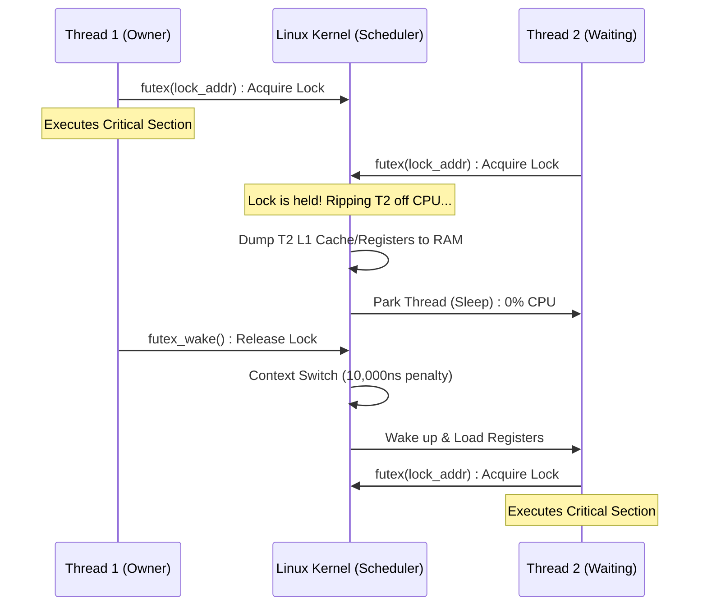
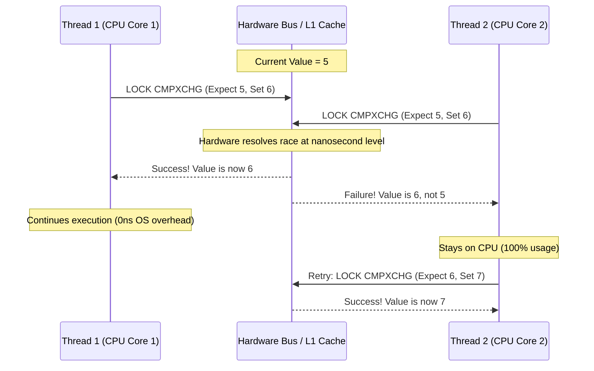

**Navigation**: [< Previous](Ch15_Concurrency_Core.md) | [Back to Index](../00_MASTER_INDEX.md)
🧠 **Mental Model**: See [Production Debugging Thinking](../14_Mental_Models/18_Production_Debugging_Thinking.md) — debugging concurrency in prod

---

# ⚡ Java Concurrency — Advanced (ExecutorService, CompletableFuture, Virtual Threads)

---

# PART 8: EXECUTOR FRAMEWORK — Thread Pools

```
┌─────────────────────────────────────────────────────────────────────────────────┐
│  WHY THREAD POOLS?                                                              │
│                                                                                 │
│  Creating a thread = ~1ms + ~512KB stack memory                                 │
│  If 10,000 requests → 10,000 threads → 5GB just for stacks!                     │
│                                                                                 │
│  Thread pool: Create N threads once, reuse them for millions of tasks.          │
│                                                                                 │
│  ┌──── Thread Pool (size=4) ────┐         ┌── Task Queue ──┐                    │
│  │  [T1] [T2] [T3] [T4]        │ ◄────── │ Task5, Task6.. │                     │
│  │   ↓    ↓    ↓    ↓          │         └─────────────────┘                    │
│  │  Idle  Working Idle Working  │                                               │
│  └──────────────────────────────┘                                               │
│                                                                                 │
│  T1 finishes → grabs Task5 from queue → starts working                          │
│  No new thread created! Just reused.                                            │
└─────────────────────────────────────────────────────────────────────────────────┘
```

## Thread Pool Types

```java
import java.util.concurrent.*;

// 1. Fixed Thread Pool — known workload
ExecutorService fixed = Executors.newFixedThreadPool(4);
// 4 threads. Extra tasks wait in unbounded queue.
// USE: CPU-bound tasks, web server request handling

// 2. Cached Thread Pool — unpredictable spikes
ExecutorService cached = Executors.newCachedThreadPool();
// Creates threads as needed, reuses idle threads (60s timeout)
// DANGER: Can create unlimited threads if tasks pile up!
// USE: Short-lived tasks with variable load

// 3. Single Thread Executor — sequential processing
ExecutorService single = Executors.newSingleThreadExecutor();
// One thread. Tasks execute in order.
// USE: Logging, sequential file writing, event processing

// 4. Scheduled Thread Pool — timed/recurring tasks
ScheduledExecutorService scheduled = Executors.newScheduledThreadPool(2);
scheduled.scheduleAtFixedRate(() -> cleanup(), 0, 1, TimeUnit.HOURS);
// USE: Cron-like tasks, heartbeat checks, cache eviction

// PRODUCTION BEST PRACTICE: Configure ThreadPoolExecutor directly
ThreadPoolExecutor production = new ThreadPoolExecutor(
    4,                    // corePoolSize — always keep 4 threads alive
    16,                   // maxPoolSize — scale up to 16 under load
    60, TimeUnit.SECONDS, // idle threads die after 60s
    new LinkedBlockingQueue<>(1000),  // Bounded queue (prevents OOM!)
    new ThreadPoolExecutor.CallerRunsPolicy()  // Backpressure policy
);
```

```
┌─────────────────────────────────────────────────────────────────────────────────┐
│  REJECTION POLICIES (when queue is full AND max threads reached):               │
│                                                                                 │
│  AbortPolicy (default) — throws RejectedExecutionException                      │
│  CallerRunsPolicy      — caller thread runs the task (natural backpressure)     │
│  DiscardPolicy         — silently drops the task (dangerous!)                   │
│  DiscardOldestPolicy   — drops oldest queued task, retries new one              │
│                                                                                 │
│  PRODUCTION RULE: Almost always use CallerRunsPolicy                            │
│  → Slows down the producer naturally when system is overloaded                  │
└─────────────────────────────────────────────────────────────────────────────────┘
```

## Submitting Tasks — Runnable vs Callable

```java
ExecutorService executor = Executors.newFixedThreadPool(4);

// Runnable — no return value, no checked exception
executor.execute(() -> System.out.println("Fire and forget"));

// Callable — returns a value via Future
Future<Integer> future = executor.submit(() -> {
    Thread.sleep(1000);
    return 42;
});

// Get result (blocks until done)
int result = future.get();                     // Blocks indefinitely
int result = future.get(5, TimeUnit.SECONDS);  // Blocks with timeout

// Check status
future.isDone();       // Non-blocking check
future.isCancelled();
future.cancel(true);   // Attempt to cancel (interrupts if running)

// ALWAYS SHUT DOWN EXECUTORS
executor.shutdown();            // No new tasks, finish existing
executor.shutdownNow();         // Interrupt all running tasks
executor.awaitTermination(10, TimeUnit.SECONDS);
```

---

🔬 **Section Challenge — Executor Framework & Thread Pools**

**Challenge 1 (Design):** Your service processes 1000 HTTP requests/sec, each taking ~200ms I/O. How many threads do you size your pool to? Show the formula.

<details><summary>Answer</summary>

Formula: `Threads = CPU cores × (1 + Wait time/Compute time)`. I/O-bound: wait=200ms, compute≈5ms → ratio=40. On a 4-core machine: `4 × (1 + 40) = 164 threads`. Start with this and load-test. Also needs a bounded queue to handle traffic spikes without OOM.

</details>

**Challenge 2 (Bug Hunt):** `Executors.newCachedThreadPool()` is used to submit 50,000 tasks that each make a database call. What disaster happens?

<details><summary>Answer</summary>

`newCachedThreadPool()` creates a new thread for every task if no idle thread is available (unbounded). 50,000 tasks → potentially 50,000 threads → ~50GB stack memory → `OutOfMemoryError`. Fix: `new ThreadPoolExecutor(50, 200, 60s, LinkedBlockingQueue(10000), CallerRunsPolicy)` — bounded threads + bounded queue + backpressure.

</details>

**Challenge 3 (Reasoning):** `submit(Runnable)` vs `execute(Runnable)` — when does the choice matter for exception handling?

<details><summary>Answer</summary>

`execute()`: uncaught exception → `UncaughtExceptionHandler` → then thread dies. `submit()`: exception is captured in the returned `Future` — silently swallowed unless `future.get()` is called. In practice: if you discard the Future from `submit()`, exceptions disappear. Always either: use `execute()` + set UncaughtExceptionHandler, OR use `submit()` + call `future.get()` (possibly in `.whenComplete()`).

</details>

# PART 9: COMPLETABLEFUTURE — Async Programming

```
┌─────────────────────────────────────────────────────────────────────────────────┐
│  Future PROBLEMS:                                                               │
│  • get() blocks the calling thread                                              │
│  • Can't chain multiple async operations                                        │
│  • No way to combine futures                                                    │
│  • No callback support                                                          │
│                                                                                 │
│  CompletableFuture SOLVES ALL OF THESE.                                         │
│  It's Java's Promise (like JavaScript Promise).                                 │
│                                                                                 │
│  Pattern: Start async → Chain transformations → Handle errors → Combine         │
└─────────────────────────────────────────────────────────────────────────────────┘
```

```java
import java.util.concurrent.CompletableFuture;

// ═══════ CREATING ═══════
// Run async with no return value
CompletableFuture<Void> cf1 = CompletableFuture.runAsync(() -> {
    System.out.println("Running in: " + Thread.currentThread().getName());
    // Uses ForkJoinPool.commonPool() by default
});

// Run async WITH return value
CompletableFuture<String> cf2 = CompletableFuture.supplyAsync(() -> {
    return fetchFromDatabase();  // Returns String
});

// ═══════ CHAINING (thenApply = map, thenCompose = flatMap) ═══════
CompletableFuture<String> pipeline = CompletableFuture
    .supplyAsync(() -> fetchUserId())           // Step 1: Get user ID
    .thenApply(id -> fetchUser(id))             // Step 2: Get user (sync transform)
    .thenApply(user -> user.getName())          // Step 3: Extract name
    .thenApply(name -> "Hello, " + name);       // Step 4: Format greeting

// thenCompose — when step returns another CompletableFuture (flatMap)
CompletableFuture<Order> orderFuture = CompletableFuture
    .supplyAsync(() -> findUser("john"))
    .thenCompose(user -> findLatestOrder(user));  // findLatestOrder returns CF<Order>

// thenAccept — consume result, no return
cf2.thenAccept(result -> System.out.println("Got: " + result));

// thenRun — run after completion, no access to result
cf2.thenRun(() -> System.out.println("Done!"));
```

## Combining Futures

```java
// ═══════ COMBINING TWO FUTURES ═══════
CompletableFuture<String> userFuture = fetchUserAsync();
CompletableFuture<List<Order>> ordersFuture = fetchOrdersAsync();

// thenCombine — when BOTH complete, combine results
CompletableFuture<String> combined = userFuture.thenCombine(
    ordersFuture,
    (user, orders) -> user.getName() + " has " + orders.size() + " orders"
);

// ═══════ COMBINING MANY FUTURES ═══════
List<CompletableFuture<Price>> priceFutures = suppliers.stream()
    .map(s -> CompletableFuture.supplyAsync(() -> s.getPrice()))
    .toList();

// allOf — wait for ALL to complete
CompletableFuture<Void> all = CompletableFuture.allOf(
    priceFutures.toArray(new CompletableFuture[0])
);
// Then collect results
all.thenApply(v -> priceFutures.stream()
    .map(CompletableFuture::join)
    .min(Comparator.naturalOrder())
    .orElseThrow()
);

// anyOf — wait for FIRST to complete (racing)
CompletableFuture<Object> fastest = CompletableFuture.anyOf(
    fetchFromCacheAsync(),
    fetchFromDatabaseAsync(),
    fetchFromApiAsync()
);
```

🔬 **Section Challenge — CompletableFuture Combining**

**Challenge 1 (Reasoning):** `thenApply(fn)` vs `thenApplyAsync(fn)` — you chain 3 `thenApply()` calls. Which thread executes each one?

<details><summary>Answer</summary>

`thenApply()` runs the function on WHICHEVER thread completed the previous stage (could be the common pool, a custom executor, or the calling thread if the future was already complete). All 3 `thenApply()` calls may run on the SAME thread sequentially. `thenApplyAsync()` always submits to the ForkJoinPool (or specified executor) — guaranteeing async execution even if the previous stage is already complete. Use `async` variants when the transformation is I/O-bound or CPU-heavy.

</details>

**Challenge 2 (Design):** Load a user profile + order history + recommendations concurrently (3 independent calls), then combine them into a response. Write it with `CompletableFuture`.

<details><summary>Answer</summary>

```java
CompletableFuture<User> userF = CompletableFuture.supplyAsync(() -> fetchUser(id));
CompletableFuture<Orders> ordersF = CompletableFuture.supplyAsync(() -> fetchOrders(id));
CompletableFuture<Recs> recsF = CompletableFuture.supplyAsync(() -> fetchRecs(id));

CompletableFuture.allOf(userF, ordersF, recsF).thenRun(() -> {
    Dashboard d = new Dashboard(userF.join(), ordersF.join(), recsF.join());
    sendResponse(d);
});
```

`allOf()` waits for all 3. `join()` is safe here because we know all futures are complete.

</details>

## Error Handling

```java
CompletableFuture<String> robust = CompletableFuture
    .supplyAsync(() -> riskyOperation())
    .exceptionally(ex -> {
        log.error("Failed", ex);
        return "default value";    // Fallback
    });

// handle — access both result AND exception
CompletableFuture<String> handled = CompletableFuture
    .supplyAsync(() -> riskyOperation())
    .handle((result, ex) -> {
        if (ex != null) return "fallback";
        return result.toUpperCase();
    });

// whenComplete — observe (don't transform) result/exception
CompletableFuture<String> logged = CompletableFuture
    .supplyAsync(() -> riskyOperation())
    .whenComplete((result, ex) -> {
        if (ex != null) log.error("Failed", ex);
        else log.info("Success: {}", result);
    });
```

```
┌─────────────────────────────────────────────────────────────────────────────────┐
│  COMPLETABLEFUTURE CHEAT SHEET                                                  │
│                                                                                 │
│  ┌─────────────────────┬──────────────────────────────────────────────┐         │
│  │ Operation           │ Description                                  │         │
│  ├─────────────────────┼──────────────────────────────────────────────┤         │
│  │ supplyAsync()       │ Start async with return value                │         │
│  │ runAsync()          │ Start async, no return value                 │         │
│  │ thenApply()         │ Transform result (sync)                      │         │
│  │ thenApplyAsync()    │ Transform result (async, different thread)   │         │
│  │ thenCompose()       │ Chain another CF (flatMap)                   │         │
│  │ thenAccept()        │ Consume result, return void                  │         │
│  │ thenRun()           │ Run after, ignore result                     │         │
│  │ thenCombine()       │ Combine two CFs                              │         │
│  │ allOf()             │ Wait for all                                 │         │
│  │ anyOf()             │ Wait for first                               │         │
│  │ exceptionally()     │ Handle exception, provide fallback           │         │
│  │ handle()            │ Access result + exception                    │         │
│  │ whenComplete()      │ Observe result + exception (no transform)   │          │
│  │ join()              │ Block and get result (unchecked exception)   │         │
│  └─────────────────────┴──────────────────────────────────────────────┘         │
│                                                                                 │
│  PRODUCTION PATTERN — Custom Executor:                                          │
│  ExecutorService myPool = Executors.newFixedThreadPool(10);                     │
│  CompletableFuture.supplyAsync(() -> work(), myPool);                           │
│  // DON'T use common pool in prod — it's shared across JVM!                     │
└─────────────────────────────────────────────────────────────────────────────────┘
```

---

# PART 10: java.util.concurrent LOCKS (The Physics of Mutex vs CAS)

> _"There are exactly two ways to prevent thread collisions: Pessimistic OS Locking and Optimistic CPU Locking. `java.util.concurrent.locks` provides the mechanical abstractions to interact directly with the OS Scheduler and the CPU's atomic instruction sets."_

### 10.1 The Hardware Reality: Pessimistic Mutexes vs Optimistic CAS

Before using `ReentrantLock` or `AtomicInteger`, you must understand the physical hardware cost of locking.

**1. Pessimistic Locking (The OS Mutex / `ReentrantLock`)**
When multiple threads contend for a `ReentrantLock` or a `synchronized` block that has escalated to a "Fat Lock":

1. The JVM makes an OS System Call (e.g., `futex` on Linux).
2. The OS Scheduler physically rips the competing threads off the CPU core.
3. The OS places them in a Wait Queue and dumps their L1 cache registers to RAM.
4. When the lock is released, the OS wakes up a thread, triggering a violently expensive **Context Switch** (~10,000 nanoseconds).
   _Rule:_ Pessimistic locks assume contention will be high. They sacrifice massive overhead to prevent the CPU from spinning wastefully.



**2. Optimistic Locking (The CPU CAS / `AtomicInteger`)**
When multiple threads contend for an `AtomicInteger`:

1. The JVM issues a hardware-level instruction: **Compare-And-Swap (CAS)** (e.g., `LOCK CMPXCHG` on x86).
2. The CPU locks the memory bus (or just the Cache Line via MESI) for a single clock cycle.
3. Thread A checks if the value is exactly what it expects. If yes, it updates it.
4. If Thread B tries to update it at the exact same nanosecond, the CPU hardware itself rejects Thread B.
5. Thread B does _not_ go to sleep. It stays on the CPU core and immediately retries the operation in a tight `while` loop (Spin Lock).
   _Rule:_ Optimistic locks assume contention will be low. They avoid the 10,000ns OS Context Switch, but if contention is high, they burn 100% CPU cycles spinning in an infinite retry loop.



---

```java
import java.util.concurrent.locks.*;

// ReentrantLock — more flexible than synchronized
ReentrantLock lock = new ReentrantLock();

lock.lock();
try {
    // Critical section
} finally {
    lock.unlock();  // ALWAYS in finally! synchronized does this automatically.
}

// tryLock — non-blocking attempt
if (lock.tryLock(1, TimeUnit.SECONDS)) {
    try {
        // Got the lock within 1 second
    } finally {
        lock.unlock();
    }
} else {
    // Couldn't get lock, do something else (avoids deadlock!)
}

// ReadWriteLock — multiple readers OR one writer
ReadWriteLock rwLock = new ReentrantReadWriteLock();

// Readers can read simultaneously
rwLock.readLock().lock();    // Multiple threads can hold read lock
try { return cache.get(key); }
finally { rwLock.readLock().unlock(); }

// Writer gets exclusive access
rwLock.writeLock().lock();   // Blocks until ALL readers AND writers release
try { cache.put(key, value); }
finally { rwLock.writeLock().unlock(); }

// StampedLock (Java 8+) — optimistic reading (fastest for read-heavy)
StampedLock sl = new StampedLock();
long stamp = sl.tryOptimisticRead();
int x = this.x, y = this.y;
if (!sl.validate(stamp)) {    // Check if a write happened
    stamp = sl.readLock();     // Fallback to pessimistic read
    try { x = this.x; y = this.y; }
    finally { sl.unlockRead(stamp); }
}
```

```
┌─────────────────────────────────────────────────────────────────────────────────┐
│  synchronized vs ReentrantLock                                                  │
│                                                                                 │
│  ┌─────────────────────┬──────────────────┬──────────────────────┐              │
│  │ Feature             │ synchronized     │ ReentrantLock         │             │
│  ├─────────────────────┼──────────────────┼──────────────────────┤              │
│  │ Auto-release        │ ✅ Yes           │ ❌ Manual (finally)  │             │
│  │ tryLock             │ ❌ No            │ ✅ Yes               │             │
│  │ Fairness            │ ❌ No            │ ✅ new RL(true)      │             │
│  │ Multiple conditions │ ❌ 1 wait set    │ ✅ newCondition()    │             │
│  │ Interruptible       │ ❌ No            │ ✅ lockInterruptibly │             │
│  │ Performance         │ Similar          │ Similar              │              │
│  │ Simplicity          │ ✅ Simpler       │ ❌ More verbose      │             │
│  └─────────────────────┴──────────────────┴──────────────────────┘              │
│                                                                                 │
│  RULE: Use synchronized by default.                                             │
│        Use ReentrantLock when you NEED tryLock, fairness, or conditions.        │
└─────────────────────────────────────────────────────────────────────────────────┘
```

---

🔬 **Section Challenge — ReentrantLock**

**Challenge 1 (Bug Hunt):** What's wrong with this `ReentrantLock` usage?

```java
lock.lock();
processData();
lock.unlock();
```

<details><summary>Answer</summary>

If `processData()` throws an exception, `lock.unlock()` is never called — the lock is held forever, causing all other threads trying to acquire it to block indefinitely. **Always** use try-finally:

```java
lock.lock();
try { processData(); }
finally { lock.unlock(); } // guaranteed regardless of exception
```

</details>

**Challenge 2 (Design):** A cache that allows unlimited concurrent reads but exclusive writes. Which lock type and which methods?

<details><summary>Answer</summary>

`ReentrantReadWriteLock`. `readLock().lock()` for reads (multiple simultaneous readers allowed). `writeLock().lock()` for writes (exclusive — waits for all readers to finish and blocks new readers). Pattern:

```java
ReadWriteLock rwLock = new ReentrantReadWriteLock();
// reads: rwLock.readLock().lock() / unlock()
// writes: rwLock.writeLock().lock() / unlock()
```

</details>

**Challenge 3 (Reasoning):** `tryLock()` returns false. Should you retry immediately, back off, or give up? Design the policy.

<details><summary>Answer</summary>

Depends on context: (1) **Deadlock prevention**: retry with exponential backoff + jitter (prevents thundering herd). (2) **Best-effort (skip if busy)**: return immediately if `tryLock()` fails — don't block. (3) **Bounded wait**: `tryLock(100, MILLISECONDS)` — throw `TooManyRequestsException` if still fails. Immediate retry without backoff = spin — wastes CPU and increases contention. Always add jitter in distributed retry.

</details>

# PART 11: VIRTUAL THREADS (Java 21 — Project Loom)

```
┌─────────────────────────────────────────────────────────────────────────────────┐
│  THE PROBLEM VIRTUAL THREADS SOLVE                                              │
│                                                                                 │
│  Platform thread: 1 Java thread = 1 OS thread                                   │
│    - Each costs ~1MB of stack memory                                            │
│    - OS can handle ~10,000 threads before struggling                            │
│    - Most time spent WAITING (I/O, network, DB)                                 │
│                                                                                 │
│  Virtual thread: Lightweight, JVM-managed                                       │
│    - ~1KB of stack (grows as needed)                                            │
│    - Can run MILLIONS of virtual threads                                        │
│    - When blocked on I/O → JVM unmounts from carrier thread                     │
│    - Carrier thread picks up another virtual thread                             │
│                                                                                 │
│  Platform threads:     Virtual threads:                                         │
│  ┌────┐ ┌────┐         ┌──┐┌──┐┌──┐┌──┐┌──┐┌──┐                                 │
│  │ T1 │ │ T2 │         │v1││v2││v3││v4││v5││v6│                                 │
│  └──┬─┘ └──┬─┘         └─┬┘└─┬┘└─┬┘└─┬┘└─┬┘└─┬┘                                 │
│     │      │              └───┴───┼───┘   │   │                                 │
│     │      │                      │       └───┘                                 │
│  ┌──┴──┐┌──┴──┐           ┌──────┴─────┐┌────┴──┐                               │
│  │OS T1││OS T2│           │ Carrier T1  ││Car T2 │                              │
│  └─────┘└─────┘           └────────────┘└────────┘                              │
│  2 OS threads              2 OS threads carry 6 virtual threads                 │
└─────────────────────────────────────────────────────────────────────────────────┘
```

```java
// Creating virtual threads (Java 21+)

// Simple — start and forget
Thread.startVirtualThread(() -> {
    System.out.println("I'm a virtual thread!");
});

// With builder
Thread vt = Thread.ofVirtual()
    .name("my-vthread")
    .start(() -> handleRequest());

// Virtual thread executor — the game changer for servers
try (var executor = Executors.newVirtualThreadPerTaskExecutor()) {
    // Each task gets its own virtual thread — millions possible!
    for (int i = 0; i < 1_000_000; i++) {
        executor.submit(() -> {
            // Do I/O-bound work — DB call, HTTP request, file read
            String data = httpClient.get("https://api.example.com/data");
            database.save(data);
            return data;
        });
    }
}  // Waits for all tasks to complete

// Spring Boot 3.2+ with virtual threads:
// application.properties:
// spring.threads.virtual.enabled=true
// That's it! All request handling uses virtual threads automatically.
```

```
┌─────────────────────────────────────────────────────────────────────────────────┐
│  VIRTUAL THREADS — WHEN TO USE                                                  │
│                                                                                 │
│  ✅ USE for:                           ❌ DON'T USE for:                          │
│  • I/O-bound tasks (HTTP, DB, files)  • CPU-bound computation                   │
│  • High-concurrency servers           • Tasks with long synchronized blocks     │
│  • Replacing thread-per-request model • Tasks needing thread-local state        │
│  • Replacing reactive (WebFlux) for   • When you need precise thread control    │
│    simpler I/O-bound concurrent code                                            │
│                                                                                 │
│  GOTCHAS:                                                                       │
│  • Don't pool virtual threads (they're cheap, just create new ones)             │
│  • synchronized blocks PIN the carrier thread (use ReentrantLock instead)       │
│  • ThreadLocal works but costs more memory per virtual thread                   │
│  • Not faster for CPU work — only for I/O waiting                               │
│                                                                                 │
│  STRUCTURED CONCURRENCY (Preview, Java 21+):                                    │
│  try (var scope = new StructuredTaskScope.ShutdownOnFailure()) {                │
│      var user  = scope.fork(() -> fetchUser(id));                               │
│      var order = scope.fork(() -> fetchOrder(id));                              │
│      scope.join().throwIfFailed();                                              │
│      return new UserOrder(user.get(), order.get());                             │
│  }                                                                              │
│  // If either fails → both cancelled automatically!                             │
└─────────────────────────────────────────────────────────────────────────────────┘
```

---

🔬 **Section Challenge — Virtual Threads**

**Challenge 1 (Reasoning):** You migrate a Spring Boot app to virtual threads. Performance gets WORSE for batch data processing. Why?

<details><summary>Answer</summary>

Virtual threads only help I/O-bound tasks (where a thread is mostly blocked waiting). CPU-bound batch processing (sorting, transforming millions of records) keeps threads continuously RUNNING — no I/O blocking — so virtual threads provide zero benefit (carrier thread is always occupied). You still need the same number of physical CPU cores. Use `ForkJoinPool` with work-stealing for CPU-bound parallel work instead.

</details>

**Challenge 2 (Bug Hunt):** This code causes virtual thread pinning. Identify and fix:

```java
synchronized(dbPool) {
    Connection conn = dbPool.borrow();
    conn.query("SELECT ..."); // I/O call while holding synchronized lock
}
```

<details><summary>Answer</summary>

`synchronized` block + I/O = **carrier thread is pinned** — the virtual thread cannot be unmounted from the carrier during the I/O wait. This defeats the purpose of virtual threads. Fix:

```java
ReentrantLock lock = new ReentrantLock(); // ← not synchronized
lock.lock();
try {
    Connection conn = dbPool.borrow();
    conn.query("SELECT ..."); // VT can now unmount during I/O!
} finally { lock.unlock(); }
```

Always replace `synchronized` with `ReentrantLock` before switching to virtual threads.

</details>

**Challenge 3 (Design):** Should you use a thread pool with virtual threads? `Executors.newVirtualThreadPerTaskExecutor()` vs `Executors.newFixedThreadPool(200)`?

<details><summary>Answer</summary>

For I/O-bound: `newVirtualThreadPerTaskExecutor()` — create a new virtual thread per task, no pooling needed (virtual threads are cheap: ~few hundred bytes vs ~1MB for platform threads). The JVM manages carrier thread reuse internally. Thread POOLING of virtual threads is an anti-pattern — it defeats their purpose. Remove any thread-pool size caps from your I/O tasks. For CPU-bound: still use `newFixedThreadPool(N_CPU_CORES)` — more threads won't help.

</details>

# 🎨 Part 12: Concurrency Patterns in Production

```java
// PATTERN 1: Thread-Safe Singleton (Double-Checked Locking)
class DatabaseConnection {
    private static volatile DatabaseConnection instance;  // volatile required!

    static DatabaseConnection getInstance() {
        if (instance == null) {                    // First check (no lock)
            synchronized (DatabaseConnection.class) {
                if (instance == null) {            // Second check (with lock)
                    instance = new DatabaseConnection();
                }
            }
        }
        return instance;
    }
    // Better alternative: Use enum singleton or static holder pattern
}

// PATTERN 2: CountDownLatch — wait for N events
CountDownLatch latch = new CountDownLatch(3);  // Wait for 3 services

executor.submit(() -> { initDB();    latch.countDown(); });
executor.submit(() -> { initCache(); latch.countDown(); });
executor.submit(() -> { initQueue(); latch.countDown(); });

latch.await();  // Blocks until count reaches 0
System.out.println("All services initialized!");

// PATTERN 3: CyclicBarrier — threads wait for each other
CyclicBarrier barrier = new CyclicBarrier(3, () -> {
    System.out.println("All threads reached barrier, proceeding!");
});
// Each thread: barrier.await(); // Blocks until all 3 arrive

// PATTERN 4: Semaphore — rate limiting / resource pooling
Semaphore dbPool = new Semaphore(10);  // Max 10 concurrent DB connections

dbPool.acquire();       // Get a permit (blocks if none available)
try {
    queryDatabase();
} finally {
    dbPool.release();   // Return the permit
}

// PATTERN 5: CompletionService — process results as they arrive
ExecutorCompletionService<Result> completionService =
    new ExecutorCompletionService<>(executor);

for (Task task : tasks) {
    completionService.submit(task);
}

for (int i = 0; i < tasks.size(); i++) {
    Result result = completionService.take().get();  // Gets FASTEST result first
    process(result);
}
```

```
┌─────────────────────────────────────────────────────────────────────────────────┐
│  PRODUCTION CONCURRENCY CHECKLIST                                               │
│                                                                                 │
│  □ Use ThreadPoolExecutor (not raw Executors factory methods)                   │
│  □ Set bounded queues (prevent OOM)                                             │
│  □ Name your threads (ThreadFactory with meaningful names)                      │
│  □ Always handle InterruptedException properly                                  │
│  □ Use try-finally for lock.unlock()                                            │
│  □ Prefer concurrent collections over synchronized wrappers                     │
│  □ Use CompletableFuture over raw Future                                        │
│  □ Set timeouts on all blocking calls                                           │
│  □ Use virtual threads for I/O-bound work (Java 21+)                            │
│  □ Monitor thread pool metrics (queue size, active count, rejection count)      │
│  □ Implement graceful shutdown (shutdown + awaitTermination)                    │
│  □ Log thread name in every log statement                                       │
└─────────────────────────────────────────────────────────────────────────────────┘
```

---

---

# 🔴 PART 13: THREAD POOL SIZING — The Science Behind the Number

One of the most common interview questions AND real production mistakes: "How many threads should my pool have?"

```
╔══════════════════════════════════════════════════════════════════╗
║  THE RESTAURANT KITCHEN ANALOGY                                  ║
║                                                                  ║
║  CPU-bound tasks = A chef who never leaves the kitchen           ║
║  → The chef is ALWAYS actively cooking (100% CPU busy)           ║
║  → Having MORE chefs than burners = they just get in each other's║
║    way (context switching overhead, no extra throughput)         ║
║  → Optimal: # chefs = # burners (CPU cores)                      ║
║                                                                  ║
║  I/O-bound tasks = A chef who frequently leaves to get ingredients║
║  → Chef is cooking for 5 min, then WAITS 25 min for delivery     ║
║  → While waiting, the burner is FREE!                            ║
║  → Fill that idle time: bring in more chefs                      ║
║  → Optimal: more chefs than burners (more threads than cores)    ║
╚══════════════════════════════════════════════════════════════════╝
```

## The Formula

```
┌─────────────────────────────────────────────────────────────────────────────────┐
│  OPTIMAL THREAD COUNT FORMULA (Amdahl / Little's Law):                          │
│                                                                                 │
│  CPU-BOUND tasks:                                                               │
│  threads = CPU_CORES + 1                                                        │
│  (+1 for when a thread is paused by OS preemption or page fault)               │
│                                                                                 │
│  I/O-BOUND tasks:                                                               │
│  threads = CPU_CORES × (1 + wait_time / processing_time)                       │
│                                                                                 │
│  EXAMPLE — Database queries:                                                    │
│  - 8 CPU cores                                                                  │
│  - DB query: 1ms CPU processing, 9ms waiting for DB response                   │
│  - wait/process ratio = 9                                                       │
│  - threads = 8 × (1 + 9) = 8 × 10 = 80 threads                                │
│                                                                                 │
│  EXAMPLE — Image compression (CPU-bound):                                       │
│  - 8 CPU cores                                                                  │
│  - threads = 8 + 1 = 9 threads                                                 │
│                                                                                 │
│  WHY NOT MORE? Beyond optimal: threads compete for CPU → more                  │
│  context switches → each context switch = ~1-10μs overhead                    │
│  → Paradox: more threads → LESS throughput                                     │
└─────────────────────────────────────────────────────────────────────────────────┘
```

```java
// In code: discover your CPU count and size accordingly
int cpuCores = Runtime.getRuntime().availableProcessors();

// CPU-bound pool (compression, encryption, computation)
ExecutorService cpuPool = Executors.newFixedThreadPool(cpuCores + 1);

// I/O-bound pool (DB queries, HTTP calls, file I/O)
// Assume 90% wait time: ratio = 9, multiply by cores
int ioThreads = cpuCores * 10;  // Conservative for 90% wait ratio
ExecutorService ioPool = new ThreadPoolExecutor(
    ioThreads,          // core
    ioThreads * 2,      // max (headroom for bursts)
    60, TimeUnit.SECONDS,
    new LinkedBlockingQueue<>(1000),    // bounded queue = backpressure
    new ThreadPoolExecutor.CallerRunsPolicy()
);

// PRODUCTION INSIGHT:
// Measure first with profiling tools (JFR, Micrometer, Java Flight Recorder)
// Start with cpuCores*2 for I/O-bound, adjust based on metrics
// Watch: CPU utilization, queue depth, rejection rate, latency percentiles
```

---

# 🔴 PART 14: thenApply vs thenApplyAsync — The Thread Model

This is a subtle but critical distinction that causes hard-to-reproduce bugs in production.

```
╔══════════════════════════════════════════════════════════════════╗
║  THE RELAY RACE ANALOGY                                          ║
║                                                                  ║
║  thenApply() = Same runner keeps going                           ║
║  → Runner A finishes, doesn't hand off baton                     ║
║  → Runner A themselves sprints the next leg too                  ║
║  → ONE thread does everything                                    ║
║                                                                  ║
║  thenApplyAsync() = New runner takes the baton                   ║
║  → Runner A finishes, hands off baton to                         ║
║  → Runner B from ForkJoinPool.commonPool() runs next leg         ║
║  → DIFFERENT thread handles the transformation                   ║
║                                                                  ║
║  WHY DOES IT MATTER?                                             ║
║  → If step completes before .thenApply() is called:              ║
║     The thread calling .thenApply() runs the callback! (main?)   ║
║  → This can accidentally block your main/request thread!         ║
╚══════════════════════════════════════════════════════════════════╝
```

```java
CompletableFuture<String> cf = CompletableFuture
    .supplyAsync(() -> fetchFromDB())   // Runs in ForkJoinPool thread

    // thenApply: runs in SAME thread that completed the previous stage
    // Could be: ForkJoinPool thread, your main thread, or ANY thread
    .thenApply(data -> transform(data))

    // thenApplyAsync: ALWAYS runs in ForkJoinPool.commonPool() (or your executor)
    // Guarantees async execution — NEVER blocks the completing thread
    .thenApplyAsync(data -> expensiveTransform(data))

    // thenApplyAsync with custom pool: best for production
    .thenApplyAsync(data -> dbWrite(data), myDedicatedPool);

// PRODUCTION RULE:
// thenApply()      → cheap, fast transformations (mapping, string concat)
// thenApplyAsync() → slow operations (DB calls, HTTP requests, blocking I/O)

// ❌ DANGER — accidentally blocking ForkJoin threads:
CompletableFuture.supplyAsync(() -> fetchUser())
    .thenApply(user -> {
        // This runs in ForkJoinPool thread
        return repository.save(user);  // ← blocking DB call inside thenApply!
        // ForkJoinPool thread is now BLOCKED waiting for DB
        // ForkJoinPool has limited threads — now one is stuck!
        // Under load: ALL ForkJoinPool threads blocked → app hang
    });

// ✅ CORRECT:
CompletableFuture.supplyAsync(() -> fetchUser())
    .thenApplyAsync(user -> repository.save(user), dbPool);  // Proper async pool
```

---

# 🔴 PART 15: ForkJoinPool — Work Stealing for Parallel Problems

```
╔══════════════════════════════════════════════════════════════════╗
║  THE WAREHOUSE WORK-STEALING ANALOGY                             ║
║                                                                  ║
║  Normal thread pool = Each worker has a shared task queue        ║
║  → All workers fight for tasks from ONE queue                    ║
║  → Queue contention = bottleneck under high parallelism          ║
║                                                                  ║
║  ForkJoinPool = Each worker has their OWN queue                  ║
║  → Worker finishes their tasks? STEAL from a busy worker's queue ║
║  → From the BACK of their queue (LIFO) → better cache locality   ║
║  → No shared queue → no central contention                       ║
║  → PERFECT for divide-and-conquer (fork = divide, join = merge)  ║
╚══════════════════════════════════════════════════════════════════╝
```

```java
// ForkJoinPool — built for recursive divide-and-conquer
// Java's Stream.parallel() uses ForkJoinPool.commonPool() internally!

// Example: Parallel merge sort
class MergeSortTask extends RecursiveAction {
    int[] array;
    int left, right;

    MergeSortTask(int[] array, int left, int right) {
        this.array = array;
        this.left = left;
        this.right = right;
    }

    @Override
    protected void compute() {
        if (right - left < 1000) {
            // Base case: small enough, sort sequentially
            Arrays.sort(array, left, right + 1);
            return;
        }
        int mid = (left + right) / 2;

        // FORK: Split into two sub-problems
        MergeSortTask leftTask = new MergeSortTask(array, left, mid);
        MergeSortTask rightTask = new MergeSortTask(array, mid + 1, right);
        leftTask.fork();    // Schedule left task (pushed to this worker's deque)
        rightTask.compute(); // Current thread does right half
        leftTask.join();    // Wait for left (another worker may steal and do it!)

        // JOIN: Merge results
        merge(array, left, mid, right);
    }
}

// Use it:
ForkJoinPool pool = new ForkJoinPool();  // Uses availableProcessors() threads
pool.invoke(new MergeSortTask(array, 0, array.length - 1));

// The commonPool (used by parallelStream and CompletableFuture.supplyAsync):
ForkJoinPool.commonPool().getParallelism();  // = availableProcessors() - 1

// ✅ PRODUCTION: Don't use commonPool for blocking I/O!
// Create a dedicated pool for I/O:
ForkJoinPool ioForkJoinPool = new ForkJoinPool(100);  // 100 worker threads
```

```
┌─────────────────────────────────────────────────────────────────────────────────┐
│  WORK-STEALING MECHANISM — SEQUENCE DIAGRAM                                     │
│                                                                                 │
│  ┌─────────────────────────────────────────────────────────────────────────┐    │
│  │  STEP 1: Fork (Divide)                                                   │    │
│  │  Main Thread                                                             │    │
│  │  ─────────                                                               │    │
│  │  leftTask.fork()  ──────────────────────────────────────────►  Thread 1  │    │
│  │                             Push to Thread 1's deque (LEFT side)        │    │
│  │  rightTask.compute()  ───────────────────────────────────►  Thread 1    │    │
│  │                             Work on RIGHT half immediately               │    │
│  └─────────────────────────────────────────────────────────────────────────┘    │
│                                   │                                              │
│                                   ▼                                              │
│  ┌─────────────────────────────────────────────────────────────────────────┐    │
│  │  STEP 2: Thread 1 Dequeue Operations                                     │    │
│  │                                                                          │    │
│  │  Thread 1 deque: [Task1, Task2, Task3]  ← LEFT: push/pop (this worker) │    │
│  │                              ────────────────────────────────────────    │    │
│  │                              RIGHT: steal target (other workers)        │    │
│  │                                                                          │    │
│  │  Thread 1 (working from LEFT):                                          │    │
│  │  pop() Task3 ──► execute() ──► Task3 done                               │    │
│  │  pop() Task2 ──► execute() ──► Task2 done                               │    │
│  │  ...                                                                     │    │
│  └─────────────────────────────────────────────────────────────────────────┘    │
│                                   │                                              │
│                                   ▼                                              │
│  ┌─────────────────────────────────────────────────────────────────────────┐    │
│  │  STEP 3: Work Stealing (When deque is empty)                            │    │
│  │                                                                          │    │
│  │  Thread 1 deque: []           Thread 2 deque: [A, B, C, D, E, F]        │    │
│  │  (empty, goes to steal)       (busy!)                                   │    │
│  │                                                                          │    │
│  │  Thread 1 ──► Steal from Thread 2's RIGHT:                              │    │
│  │              take() F ──► execute()  ← OLDEST task (largest sub-prob)  │    │
│  │                                                                          │    │
│  │  WHY RIGHT SIDE?                                                         │    │
│  │  ─────────────────                                                       │    │
│  │  • Right = OLDER tasks = LARGER sub-problems (better load balance)      │    │
│  │  • Left  = NEWER tasks = SMALLER sub-problems (better cache locality)   │    │
│  │  • Owner pops from LEFT (small), stealer pops from RIGHT (large)        │    │
│  │  • Rarely same end = minimal synchronization!                           │    │
│  └─────────────────────────────────────────────────────────────────────────┘    │
│                                   │                                              │
│                                   ▼                                              │
│  ┌─────────────────────────────────────────────────────────────────────────┐    │
│  │  STEP 4: Join (Merge)                                                   │    │
│  │                                                                          │    │
│  │  leftTask.join()  ─────────────────────────────────────►  Wait for done │    │
│  │                                      (Another worker may STEAL leftTask!)│    │
│  │                                                                          │    │
│  │  Result: Thread 1 has both halves sorted                                 │    │
│  │  merge(array, left, mid, right)  ──► Final sorted result               │    │
│  └─────────────────────────────────────────────────────────────────────────┘    │
│                                                                                 │
│  ╔═══════════════════════════════════════════════════════════════════════╗   │
│  ║  KEY INSIGHT: No shared queue = no lock contention!                   ║   │
│  ║  Each worker owns their deque. Only stealing needs synchronization.   ║   │
│  ║  LIFO on worker's side (cache-friendly) + FIFO on steal side         ║   │
│  ╚═══════════════════════════════════════════════════════════════════════╝   │
└─────────────────────────────────────────────────────────────────────────────────┘
```

---

# 🔴 PART 16: Virtual Thread Pinning — The Critical Gotcha

Virtual threads are NOT magic. One specific pattern completely breaks them: `synchronized` blocks.

```mermaid
flowchart LR
    %% Virtual Thread Pinning Physics
    subgraph "Virtual Thread (VT1) Execution"
        SYNC["Enters: synchronized(obj)"]
        IO["Executes: Network I/O (Wait)"]

    subgraph "JVM Carrier Thread (OS Thread)"
        MOUNT["VT1 Mounted"]
        PINNED["Carrier Pinned!\nCannot unmount VT1"]

    subgraph "Other Virtual Threads"
        VT2["VT2: Ready"]
        VT3["VT3: Ready"]
        STARVE["Starvation\n(Waiting for Carrier)"]

    MOUNT --> SYNC
    SYNC --> IO
    IO -.->|JVM attempts unmount| PINNED
    PINNED -->|Blocks| STARVE
    VT2 --> STARVE
    VT3 --> STARVE

```

```java
// ❌ PINNING — synchronized blocks PREVENT virtual thread mounting
Thread.startVirtualThread(() -> {
    synchronized (someObject) {        // ← Virtual thread is now PINNED
        Thread.sleep(1000);            // ← Carrier thread is STUCK too!
        // This defeats the purpose of virtual threads completely
        // The OS thread cannot run other virtual threads
    }
});

// ✅ FIX: Replace synchronized with ReentrantLock
Thread.startVirtualThread(() -> {
    lock.lock();                       // ← Virtual thread acquires lock
    try {
        Thread.sleep(1000);            // ← Virtual thread UNMOUNTS from carrier!
        // Carrier thread picks up another virtual thread during this sleep
        // Virtual thread remounts when sleep is done
    } finally {
        lock.unlock();
    }
});

// WHEN PINNING IS A PROBLEM:
// 1. synchronized block + I/O/sleep inside → destroys scalability
// 2. synchronized block + native method call → pinned (always)

// DETECT PINNING: JVM flag to log pinning events
// -Djdk.tracePinnedThreads=full

// POPULAR LIBRARIES AND PINNING:
// → Most database drivers (JDBC): synchronized internally → PINS virtual threads!
// → Solution: Use drivers updated for virtual threads (async JDBC, R2DBC)
//             OR: use Platform threads for DB pool, virtual threads for routing

// STRUCTURED CONCURRENCY (Java 21+ Preview):
// Groups virtual threads into a "scope" — all succeed or all cancel
try (var scope = new StructuredTaskScope.ShutdownOnFailure()) {
    Subtask<User>  user  = scope.fork(() -> fetchUser(id));     // Virtual thread 1
    Subtask<Order> order = scope.fork(() -> fetchOrder(id));    // Virtual thread 2

    scope.join();             // Wait for all
    scope.throwIfFailed();    // If either failed, throws the exception

    return new Dashboard(user.get(), order.get());
}
// If fetchUser fails → fetchOrder is CANCELLED automatically
// No orphaned threads, no manual cleanup needed
// This is "structured" — threads don't outlive their scope
```

```
┌─────────────────────────────────────────────────────────────────────────────────┐
│  VIRTUAL THREADS DECISION GUIDE                                                  │
│                                                                                 │
│  Scenario                              Recommendation                           │
│  ──────────────────────────────────── ─────────────────────────────            │
│  Existing app on Java 21+, I/O bound   Enable spring.threads.virtual.enabled    │
│  New microservice with HTTP calls      Virtual threads = great fit              │
│  CPU-bound processing (ML, crypto)     Platform threads (virtual = no gain)     │
│  Code uses synchronized + I/O inside  Fix to ReentrantLock first, THEN switch  │
│  Legacy JDBC driver                    Check for pinning, may need async driver  │
│  Testing: "Will virtual threads help?" Use -Djdk.tracePinnedThreads=full        │
└─────────────────────────────────────────────────────────────────────────────────┘
```

---

**Previous**: [Part 1 — Thread Fundamentals, synchronized, Atomic, Collections ←](Ch15_Concurrency_Core.md)


---

## Reality Check

**"ReentrantLock is always better than synchronized"** → `synchronized` is simpler, handled by the JVM, and the JIT aggressively optimises uncontended synchronised blocks (biased locking, lock elision). `ReentrantLock` offers: tryLock() with timeout, interruptible lock acquisition, fairness policy, multiple condition variables. Choose `synchronized` for simple mutual exclusion; `ReentrantLock` when you need these extra features. Don't reach for ReentrantLock by default.

**"CompletableFuture always runs tasks in a new thread"** → By default, `CompletableFuture.supplyAsync(() -> ...)` uses the common ForkJoinPool. Chaining operations with `.thenApply()` (synchronous) may run on the same thread that completed the previous stage — NOT necessarily a new thread. `.thenApplyAsync()` dispatches to the pool. Understanding which thread runs each stage matters when stages must not run on certain threads (e.g., don't block the event loop thread).

**"Atomic classes eliminate all race conditions"** → `AtomicInteger.incrementAndGet()` atomically increments. But a compound operation — read-then-conditionally-modify — is still a race: `if (atomic.get() == 0) atomic.set(1)` is two separate atomic operations with a gap in between. Use `atomic.compareAndSet(0, 1)` for compare-and-swap — one atomic operation. For complex compound operations, explicit synchronization or `synchronized` may still be necessary.

**"The ForkJoinPool is the same as a regular thread pool"** → ForkJoinPool uses *work-stealing*: idle threads steal tasks from the queues of busy threads. This is designed for divide-and-conquer tasks where subtasks are similar in size (parallel merge sort, parallel stream processing). Standard thread pools (Executors.newFixedThreadPool) have a shared queue — better for many independent tasks with unpredictable duration. Misusing ForkJoinPool for blocking I/O work starves the common pool (used by parallel streams and CompletableFuture).

**"CountDownLatch and CyclicBarrier solve the same problem"** → Both synchronise threads at a point. Key difference: `CountDownLatch` counts down to zero and CANNOT be reset — one-time use. `CyclicBarrier` resets after all parties arrive — reusable across multiple rounds (useful in iterative simulations: all threads complete round N before any starts round N+1). CountDownLatch: one event that everyone waits for (e.g., DB initialised). CyclicBarrier: multiple rounds where all parties must reach the same checkpoint.
