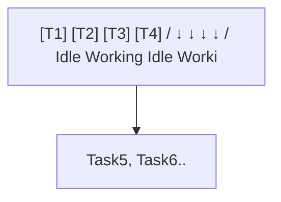
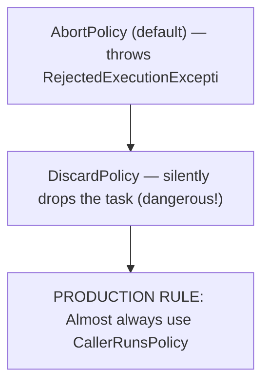
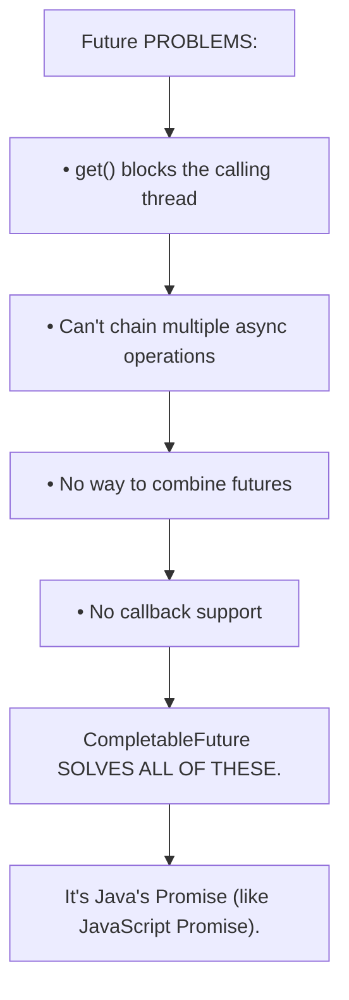
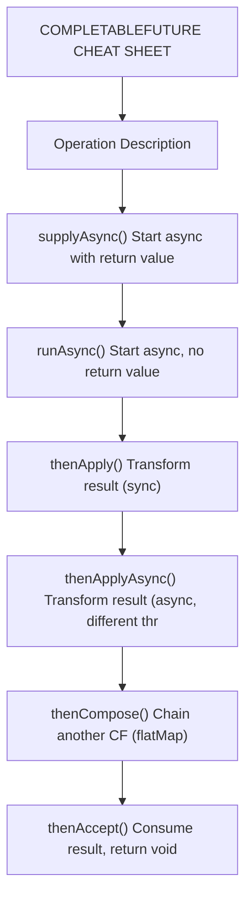
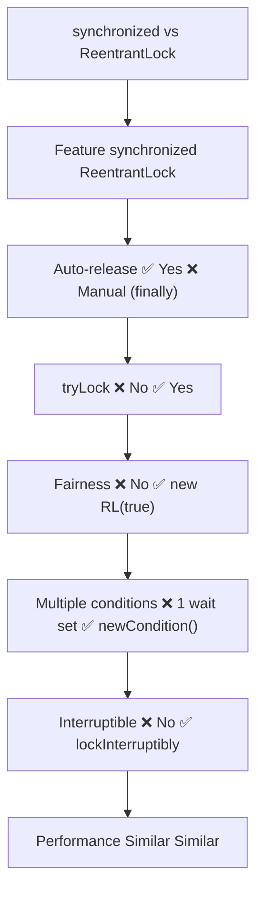
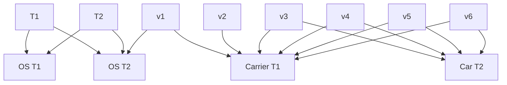
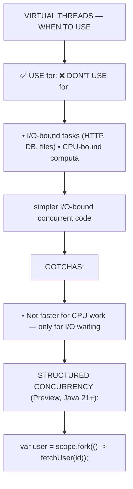
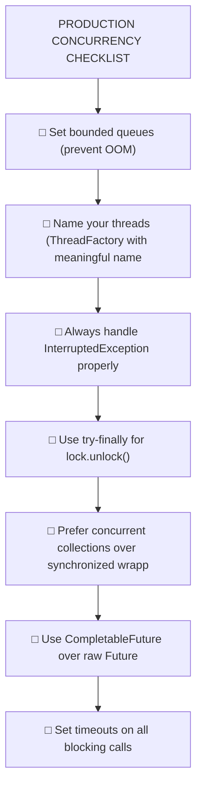

> **Navigation**: [< Previous](Ch15_Concurrency_Core.md) | [Back to Index](../00_MASTER_INDEX.md)
> 🧠 **Mental Model**: See [Production Debugging Thinking](../14_Mental_Models/18_Production_Debugging_Thinking.md) — debugging concurrency in prod

---

# ⚡ Java Concurrency — Advanced (ExecutorService, CompletableFuture, Virtual Threads)

---

# PART 8: EXECUTOR FRAMEWORK — Thread Pools

```
┌─────────────────────────────────────────────────────────────────────────────────┐
│  WHY THREAD POOLS?                                                              │
│                                                                                 │
│  Creating a thread = ~1ms + ~512KB stack memory                                 │
│  If 10,000 requests → 10,000 threads → 5GB just for stacks!                     │
│                                                                                 │
│  Thread pool: Create N threads once, reuse them for millions of tasks.          │
│                                                                                 │
│  ┌──── Thread Pool (size=4) ────┐         ┌── Task Queue ──┐                    │
│  │  [T1] [T2] [T3] [T4]        │ ◄────── │ Task5, Task6.. │                     │
│  │   ↓    ↓    ↓    ↓          │         └─────────────────┘                    │
│  │  Idle  Working Idle Working  │                                               │
│  └──────────────────────────────┘                                               │
│                                                                                 │
│  T1 finishes → grabs Task5 from queue → starts working                          │
│  No new thread created! Just reused.                                            │
└─────────────────────────────────────────────────────────────────────────────────┘
```

> **Flow**: [T1] [T2] [T3] [T4] / ↓ ↓ ↓ ↓ / Idle Working Idle Worki → Task5, Task6..



## Thread Pool Types

```java
import java.util.concurrent.*;

// 1. Fixed Thread Pool — known workload
ExecutorService fixed = Executors.newFixedThreadPool(4);
// 4 threads. Extra tasks wait in unbounded queue.
// USE: CPU-bound tasks, web server request handling

// 2. Cached Thread Pool — unpredictable spikes
ExecutorService cached = Executors.newCachedThreadPool();
// Creates threads as needed, reuses idle threads (60s timeout)
// DANGER: Can create unlimited threads if tasks pile up!
// USE: Short-lived tasks with variable load

// 3. Single Thread Executor — sequential processing
ExecutorService single = Executors.newSingleThreadExecutor();
// One thread. Tasks execute in order.
// USE: Logging, sequential file writing, event processing

// 4. Scheduled Thread Pool — timed/recurring tasks
ScheduledExecutorService scheduled = Executors.newScheduledThreadPool(2);
scheduled.scheduleAtFixedRate(() -> cleanup(), 0, 1, TimeUnit.HOURS);
// USE: Cron-like tasks, heartbeat checks, cache eviction

// PRODUCTION BEST PRACTICE: Configure ThreadPoolExecutor directly
ThreadPoolExecutor production = new ThreadPoolExecutor(
    4,                    // corePoolSize — always keep 4 threads alive
    16,                   // maxPoolSize — scale up to 16 under load
    60, TimeUnit.SECONDS, // idle threads die after 60s
    new LinkedBlockingQueue<>(1000),  // Bounded queue (prevents OOM!)
    new ThreadPoolExecutor.CallerRunsPolicy()  // Backpressure policy
);
```

```
┌─────────────────────────────────────────────────────────────────────────────────┐
│  REJECTION POLICIES (when queue is full AND max threads reached):               │
│                                                                                 │
│  AbortPolicy (default) — throws RejectedExecutionException                      │
│  CallerRunsPolicy      — caller thread runs the task (natural backpressure)     │
│  DiscardPolicy         — silently drops the task (dangerous!)                   │
│  DiscardOldestPolicy   — drops oldest queued task, retries new one              │
│                                                                                 │
│  PRODUCTION RULE: Almost always use CallerRunsPolicy                            │
│  → Slows down the producer naturally when system is overloaded                  │
└─────────────────────────────────────────────────────────────────────────────────┘
```

> **Flow**: AbortPolicy (default) — throws RejectedExecutionExcepti → DiscardPolicy — silently drops the task (dangerous!) | DiscardPolicy — silently drops the task (dangerous!) → PRODUCTION RULE: Almost always use CallerRunsPolicy



## Submitting Tasks — Runnable vs Callable

```java
ExecutorService executor = Executors.newFixedThreadPool(4);

// Runnable — no return value, no checked exception
executor.execute(() -> System.out.println("Fire and forget"));

// Callable — returns a value via Future
Future<Integer> future = executor.submit(() -> {
    Thread.sleep(1000);
    return 42;
});

// Get result (blocks until done)
int result = future.get();                     // Blocks indefinitely
int result = future.get(5, TimeUnit.SECONDS);  // Blocks with timeout

// Check status
future.isDone();       // Non-blocking check
future.isCancelled();
future.cancel(true);   // Attempt to cancel (interrupts if running)

// ALWAYS SHUT DOWN EXECUTORS
executor.shutdown();            // No new tasks, finish existing
executor.shutdownNow();         // Interrupt all running tasks
executor.awaitTermination(10, TimeUnit.SECONDS);
```

---

# PART 9: COMPLETABLEFUTURE — Async Programming

```
┌─────────────────────────────────────────────────────────────────────────────────┐
│  Future PROBLEMS:                                                               │
│  • get() blocks the calling thread                                              │
│  • Can't chain multiple async operations                                        │
│  • No way to combine futures                                                    │
│  • No callback support                                                          │
│                                                                                 │
│  CompletableFuture SOLVES ALL OF THESE.                                         │
│  It's Java's Promise (like JavaScript Promise).                                 │
│                                                                                 │
│  Pattern: Start async → Chain transformations → Handle errors → Combine         │
└─────────────────────────────────────────────────────────────────────────────────┘
```

> **Flow**: Future PROBLEMS: → • get() blocks the calling thread | • get() blocks the calling thread → • Can't chain multiple async operations | • Can't chain multiple async operations → • No way to combine futures | • No way to combine futures → • No callback support | • No callback support → CompletableFuture SOLVES ALL OF THESE. | CompletableFuture SOLVES ALL OF THESE. → It's Java's Promise (like JavaScript Promise).



```java
import java.util.concurrent.CompletableFuture;

// ═══════ CREATING ═══════
// Run async with no return value
CompletableFuture<Void> cf1 = CompletableFuture.runAsync(() -> {
    System.out.println("Running in: " + Thread.currentThread().getName());
    // Uses ForkJoinPool.commonPool() by default
});

// Run async WITH return value
CompletableFuture<String> cf2 = CompletableFuture.supplyAsync(() -> {
    return fetchFromDatabase();  // Returns String
});

// ═══════ CHAINING (thenApply = map, thenCompose = flatMap) ═══════
CompletableFuture<String> pipeline = CompletableFuture
    .supplyAsync(() -> fetchUserId())           // Step 1: Get user ID
    .thenApply(id -> fetchUser(id))             // Step 2: Get user (sync transform)
    .thenApply(user -> user.getName())          // Step 3: Extract name
    .thenApply(name -> "Hello, " + name);       // Step 4: Format greeting

// thenCompose — when step returns another CompletableFuture (flatMap)
CompletableFuture<Order> orderFuture = CompletableFuture
    .supplyAsync(() -> findUser("john"))
    .thenCompose(user -> findLatestOrder(user));  // findLatestOrder returns CF<Order>

// thenAccept — consume result, no return
cf2.thenAccept(result -> System.out.println("Got: " + result));

// thenRun — run after completion, no access to result
cf2.thenRun(() -> System.out.println("Done!"));
```

## Combining Futures

```java
// ═══════ COMBINING TWO FUTURES ═══════
CompletableFuture<String> userFuture = fetchUserAsync();
CompletableFuture<List<Order>> ordersFuture = fetchOrdersAsync();

// thenCombine — when BOTH complete, combine results
CompletableFuture<String> combined = userFuture.thenCombine(
    ordersFuture,
    (user, orders) -> user.getName() + " has " + orders.size() + " orders"
);

// ═══════ COMBINING MANY FUTURES ═══════
List<CompletableFuture<Price>> priceFutures = suppliers.stream()
    .map(s -> CompletableFuture.supplyAsync(() -> s.getPrice()))
    .toList();

// allOf — wait for ALL to complete
CompletableFuture<Void> all = CompletableFuture.allOf(
    priceFutures.toArray(new CompletableFuture[0])
);
// Then collect results
all.thenApply(v -> priceFutures.stream()
    .map(CompletableFuture::join)
    .min(Comparator.naturalOrder())
    .orElseThrow()
);

// anyOf — wait for FIRST to complete (racing)
CompletableFuture<Object> fastest = CompletableFuture.anyOf(
    fetchFromCacheAsync(),
    fetchFromDatabaseAsync(),
    fetchFromApiAsync()
);
```

## Error Handling

```java
CompletableFuture<String> robust = CompletableFuture
    .supplyAsync(() -> riskyOperation())
    .exceptionally(ex -> {
        log.error("Failed", ex);
        return "default value";    // Fallback
    });

// handle — access both result AND exception
CompletableFuture<String> handled = CompletableFuture
    .supplyAsync(() -> riskyOperation())
    .handle((result, ex) -> {
        if (ex != null) return "fallback";
        return result.toUpperCase();
    });

// whenComplete — observe (don't transform) result/exception
CompletableFuture<String> logged = CompletableFuture
    .supplyAsync(() -> riskyOperation())
    .whenComplete((result, ex) -> {
        if (ex != null) log.error("Failed", ex);
        else log.info("Success: {}", result);
    });
```

```
┌─────────────────────────────────────────────────────────────────────────────────┐
│  COMPLETABLEFUTURE CHEAT SHEET                                                  │
│                                                                                 │
│  ┌─────────────────────┬──────────────────────────────────────────────┐         │
│  │ Operation           │ Description                                  │         │
│  ├─────────────────────┼──────────────────────────────────────────────┤         │
│  │ supplyAsync()       │ Start async with return value                │         │
│  │ runAsync()          │ Start async, no return value                 │         │
│  │ thenApply()         │ Transform result (sync)                      │         │
│  │ thenApplyAsync()    │ Transform result (async, different thread)   │         │
│  │ thenCompose()       │ Chain another CF (flatMap)                   │         │
│  │ thenAccept()        │ Consume result, return void                  │         │
│  │ thenRun()           │ Run after, ignore result                     │         │
│  │ thenCombine()       │ Combine two CFs                              │         │
│  │ allOf()             │ Wait for all                                 │         │
│  │ anyOf()             │ Wait for first                               │         │
│  │ exceptionally()     │ Handle exception, provide fallback           │         │
│  │ handle()            │ Access result + exception                    │         │
│  │ whenComplete()      │ Observe result + exception (no transform)   │          │
│  │ join()              │ Block and get result (unchecked exception)   │         │
│  └─────────────────────┴──────────────────────────────────────────────┘         │
│                                                                                 │
│  PRODUCTION PATTERN — Custom Executor:                                          │
│  ExecutorService myPool = Executors.newFixedThreadPool(10);                     │
│  CompletableFuture.supplyAsync(() -> work(), myPool);                           │
│  // DON'T use common pool in prod — it's shared across JVM!                     │
└─────────────────────────────────────────────────────────────────────────────────┘
```

> **Flow**: COMPLETABLEFUTURE CHEAT SHEET → Operation Description | Operation Description → supplyAsync() Start async with return value | supplyAsync() Start async with return value → runAsync() Start async, no return value | runAsync() Start async, no return value → thenApply() Transform result (sync) | thenApply() Transform result (sync) → thenApplyAsync() Transform result (async, different thr | thenApplyAsync() Transform result (async, different thr → thenCompose() Chain another CF (flatMap) | ...+1 more



---

# PART 10: java.util.concurrent LOCKS

```java
import java.util.concurrent.locks.*;

// ReentrantLock — more flexible than synchronized
ReentrantLock lock = new ReentrantLock();

lock.lock();
try {
    // Critical section
} finally {
    lock.unlock();  // ALWAYS in finally! synchronized does this automatically.
}

// tryLock — non-blocking attempt
if (lock.tryLock(1, TimeUnit.SECONDS)) {
    try {
        // Got the lock within 1 second
    } finally {
        lock.unlock();
    }
} else {
    // Couldn't get lock, do something else (avoids deadlock!)
}

// ReadWriteLock — multiple readers OR one writer
ReadWriteLock rwLock = new ReentrantReadWriteLock();

// Readers can read simultaneously
rwLock.readLock().lock();    // Multiple threads can hold read lock
try { return cache.get(key); }
finally { rwLock.readLock().unlock(); }

// Writer gets exclusive access
rwLock.writeLock().lock();   // Blocks until ALL readers AND writers release
try { cache.put(key, value); }
finally { rwLock.writeLock().unlock(); }

// StampedLock (Java 8+) — optimistic reading (fastest for read-heavy)
StampedLock sl = new StampedLock();
long stamp = sl.tryOptimisticRead();
int x = this.x, y = this.y;
if (!sl.validate(stamp)) {    // Check if a write happened
    stamp = sl.readLock();     // Fallback to pessimistic read
    try { x = this.x; y = this.y; }
    finally { sl.unlockRead(stamp); }
}
```

```
┌─────────────────────────────────────────────────────────────────────────────────┐
│  synchronized vs ReentrantLock                                                  │
│                                                                                 │
│  ┌─────────────────────┬──────────────────┬──────────────────────┐              │
│  │ Feature             │ synchronized     │ ReentrantLock         │             │
│  ├─────────────────────┼──────────────────┼──────────────────────┤              │
│  │ Auto-release        │ ✅ Yes           │ ❌ Manual (finally)  │                │
│  │ tryLock             │ ❌ No            │ ✅ Yes               │                │
│  │ Fairness            │ ❌ No            │ ✅ new RL(true)      │                │
│  │ Multiple conditions │ ❌ 1 wait set    │ ✅ newCondition()    │                │
│  │ Interruptible       │ ❌ No            │ ✅ lockInterruptibly │                │
│  │ Performance         │ Similar          │ Similar              │              │
│  │ Simplicity          │ ✅ Simpler       │ ❌ More verbose      │                │
│  └─────────────────────┴──────────────────┴──────────────────────┘              │
│                                                                                 │
│  RULE: Use synchronized by default.                                             │
│        Use ReentrantLock when you NEED tryLock, fairness, or conditions.        │
└─────────────────────────────────────────────────────────────────────────────────┘
```

> **Flow**: synchronized vs ReentrantLock → Feature synchronized ReentrantLock | Feature synchronized ReentrantLock → Auto-release ✅ Yes ❌ Manual (finally) | Auto-release ✅ Yes ❌ Manual (finally) → tryLock ❌ No ✅ Yes | tryLock ❌ No ✅ Yes → Fairness ❌ No ✅ new RL(true) | Fairness ❌ No ✅ new RL(true) → Multiple conditions ❌ 1 wait set ✅ newCondition() | Multiple conditions ❌ 1 wait set ✅ newCondition() → Interruptible ❌ No ✅ lockInterruptibly | ...+1 more



---

# PART 11: VIRTUAL THREADS (Java 21 — Project Loom)

```
┌─────────────────────────────────────────────────────────────────────────────────┐
│  THE PROBLEM VIRTUAL THREADS SOLVE                                              │
│                                                                                 │
│  Platform thread: 1 Java thread = 1 OS thread                                   │
│    - Each costs ~1MB of stack memory                                            │
│    - OS can handle ~10,000 threads before struggling                            │
│    - Most time spent WAITING (I/O, network, DB)                                 │
│                                                                                 │
│  Virtual thread: Lightweight, JVM-managed                                       │
│    - ~1KB of stack (grows as needed)                                            │
│    - Can run MILLIONS of virtual threads                                        │
│    - When blocked on I/O → JVM unmounts from carrier thread                     │
│    - Carrier thread picks up another virtual thread                             │
│                                                                                 │
│  Platform threads:     Virtual threads:                                         │
│  ┌────┐ ┌────┐         ┌──┐┌──┐┌──┐┌──┐┌──┐┌──┐                                 │
│  │ T1 │ │ T2 │         │v1││v2││v3││v4││v5││v6│                                 │
│  └──┬─┘ └──┬─┘         └─┬┘└─┬┘└─┬┘└─┬┘└─┬┘└─┬┘                                 │
│     │      │              └───┴───┼───┘   │   │                                 │
│     │      │                      │       └───┘                                 │
│  ┌──┴──┐┌──┴──┐           ┌──────┴─────┐┌────┴──┐                               │
│  │OS T1││OS T2│           │ Carrier T1  ││Car T2 │                              │
│  └─────┘└─────┘           └────────────┘└────────┘                              │
│  2 OS threads              2 OS threads carry 6 virtual threads                 │
└─────────────────────────────────────────────────────────────────────────────────┘
```

> **Flow**: T1 → OS T1 | T1 → OS T2 | T2 → OS T1 | T2 → OS T2 | v1 → OS T2 | v1 → Carrier T1 | ...+9 more



```java
// Creating virtual threads (Java 21+)

// Simple — start and forget
Thread.startVirtualThread(() -> {
    System.out.println("I'm a virtual thread!");
});

// With builder
Thread vt = Thread.ofVirtual()
    .name("my-vthread")
    .start(() -> handleRequest());

// Virtual thread executor — the game changer for servers
try (var executor = Executors.newVirtualThreadPerTaskExecutor()) {
    // Each task gets its own virtual thread — millions possible!
    for (int i = 0; i < 1_000_000; i++) {
        executor.submit(() -> {
            // Do I/O-bound work — DB call, HTTP request, file read
            String data = httpClient.get("https://api.example.com/data");
            database.save(data);
            return data;
        });
    }
}  // Waits for all tasks to complete

// Spring Boot 3.2+ with virtual threads:
// application.properties:
// spring.threads.virtual.enabled=true
// That's it! All request handling uses virtual threads automatically.
```

```
┌─────────────────────────────────────────────────────────────────────────────────┐
│  VIRTUAL THREADS — WHEN TO USE                                                  │
│                                                                                 │
│  ✅ USE for:                           ❌ DON'T USE for:                          │
│  • I/O-bound tasks (HTTP, DB, files)  • CPU-bound computation                   │
│  • High-concurrency servers           • Tasks with long synchronized blocks     │
│  • Replacing thread-per-request model • Tasks needing thread-local state        │
│  • Replacing reactive (WebFlux) for   • When you need precise thread control    │
│    simpler I/O-bound concurrent code                                            │
│                                                                                 │
│  GOTCHAS:                                                                       │
│  • Don't pool virtual threads (they're cheap, just create new ones)             │
│  • synchronized blocks PIN the carrier thread (use ReentrantLock instead)       │
│  • ThreadLocal works but costs more memory per virtual thread                   │
│  • Not faster for CPU work — only for I/O waiting                               │
│                                                                                 │
│  STRUCTURED CONCURRENCY (Preview, Java 21+):                                    │
│  try (var scope = new StructuredTaskScope.ShutdownOnFailure()) {                │
│      var user  = scope.fork(() -> fetchUser(id));                               │
│      var order = scope.fork(() -> fetchOrder(id));                              │
│      scope.join().throwIfFailed();                                              │
│      return new UserOrder(user.get(), order.get());                             │
│  }                                                                              │
│  // If either fails → both cancelled automatically!                             │
└─────────────────────────────────────────────────────────────────────────────────┘
```

> **Flow**: VIRTUAL THREADS — WHEN TO USE → ✅ USE for: ❌ DON'T USE for: | ✅ USE for: ❌ DON'T USE for: → • I/O-bound tasks (HTTP, DB, files) • CPU-bound computa | • I/O-bound tasks (HTTP, DB, files) • CPU-bound computa → simpler I/O-bound concurrent code | simpler I/O-bound concurrent code → GOTCHAS: | GOTCHAS: → • Not faster for CPU work — only for I/O waiting | • Not faster for CPU work — only for I/O waiting → STRUCTURED CONCURRENCY (Preview, Java 21+): | ...+1 more



---

# 🎨 Part 12: Concurrency Patterns in Production

```java
// PATTERN 1: Thread-Safe Singleton (Double-Checked Locking)
class DatabaseConnection {
    private static volatile DatabaseConnection instance;  // volatile required!
    
    static DatabaseConnection getInstance() {
        if (instance == null) {                    // First check (no lock)
            synchronized (DatabaseConnection.class) {
                if (instance == null) {            // Second check (with lock)
                    instance = new DatabaseConnection();
                }
            }
        }
        return instance;
    }
    // Better alternative: Use enum singleton or static holder pattern
}

// PATTERN 2: CountDownLatch — wait for N events
CountDownLatch latch = new CountDownLatch(3);  // Wait for 3 services

executor.submit(() -> { initDB();    latch.countDown(); });
executor.submit(() -> { initCache(); latch.countDown(); });
executor.submit(() -> { initQueue(); latch.countDown(); });

latch.await();  // Blocks until count reaches 0
System.out.println("All services initialized!");

// PATTERN 3: CyclicBarrier — threads wait for each other
CyclicBarrier barrier = new CyclicBarrier(3, () -> {
    System.out.println("All threads reached barrier, proceeding!");
});
// Each thread: barrier.await(); // Blocks until all 3 arrive

// PATTERN 4: Semaphore — rate limiting / resource pooling
Semaphore dbPool = new Semaphore(10);  // Max 10 concurrent DB connections

dbPool.acquire();       // Get a permit (blocks if none available)
try {
    queryDatabase();
} finally {
    dbPool.release();   // Return the permit
}

// PATTERN 5: CompletionService — process results as they arrive
ExecutorCompletionService<Result> completionService =
    new ExecutorCompletionService<>(executor);

for (Task task : tasks) {
    completionService.submit(task);
}

for (int i = 0; i < tasks.size(); i++) {
    Result result = completionService.take().get();  // Gets FASTEST result first
    process(result);
}
```

```
┌─────────────────────────────────────────────────────────────────────────────────┐
│  PRODUCTION CONCURRENCY CHECKLIST                                               │
│                                                                                 │
│  □ Use ThreadPoolExecutor (not raw Executors factory methods)                   │
│  □ Set bounded queues (prevent OOM)                                             │
│  □ Name your threads (ThreadFactory with meaningful names)                      │
│  □ Always handle InterruptedException properly                                  │
│  □ Use try-finally for lock.unlock()                                            │
│  □ Prefer concurrent collections over synchronized wrappers                     │
│  □ Use CompletableFuture over raw Future                                        │
│  □ Set timeouts on all blocking calls                                           │
│  □ Use virtual threads for I/O-bound work (Java 21+)                            │
│  □ Monitor thread pool metrics (queue size, active count, rejection count)      │
│  □ Implement graceful shutdown (shutdown + awaitTermination)                    │
│  □ Log thread name in every log statement                                       │
└─────────────────────────────────────────────────────────────────────────────────┘
```

> **Flow**: PRODUCTION CONCURRENCY CHECKLIST → □ Set bounded queues (prevent OOM) | □ Set bounded queues (prevent OOM) → □ Name your threads (ThreadFactory with meaningful name | □ Name your threads (ThreadFactory with meaningful name → □ Always handle InterruptedException properly | □ Always handle InterruptedException properly → □ Use try-finally for lock.unlock() | □ Use try-finally for lock.unlock() → □ Prefer concurrent collections over synchronized wrapp | □ Prefer concurrent collections over synchronized wrapp → □ Use CompletableFuture over raw Future | ...+1 more



---

> **Previous**: [Part 1 — Thread Fundamentals, synchronized, Atomic, Collections ←](Ch15_Concurrency_Core.md)


---

> **Navigation**: [< Previous](Ch15_Concurrency_Core.md) | [Back to Index](../00_MASTER_INDEX.md) | [Next >](Ch07_Modern_Java_9to21.md)