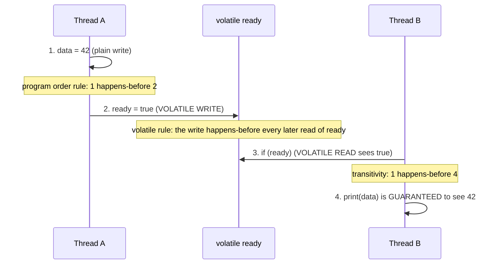
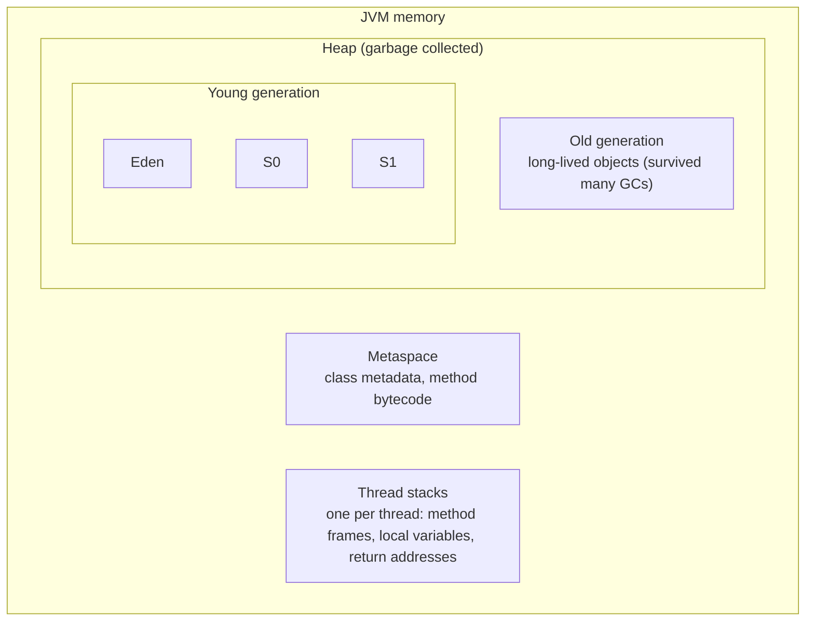
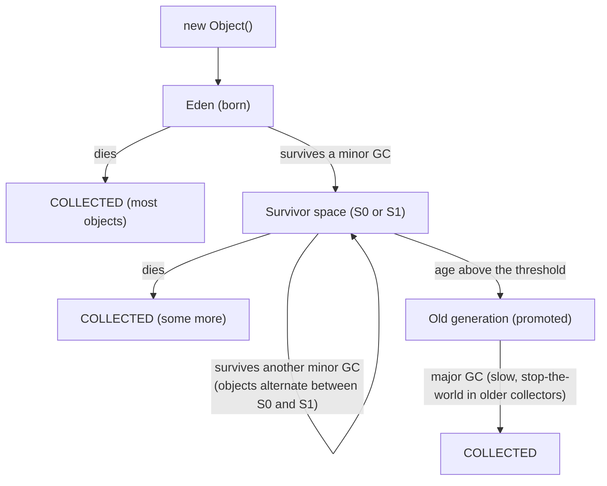
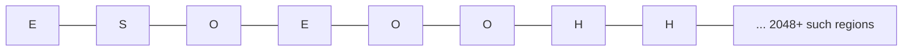
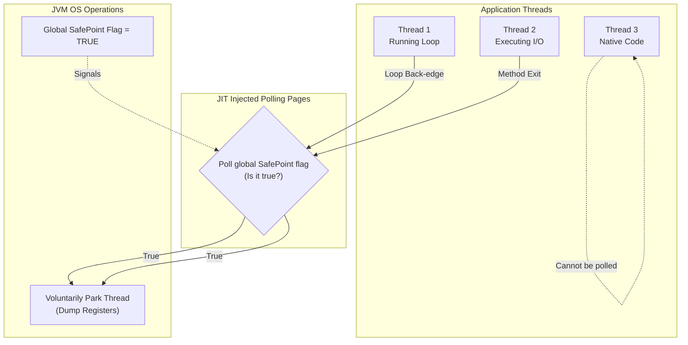
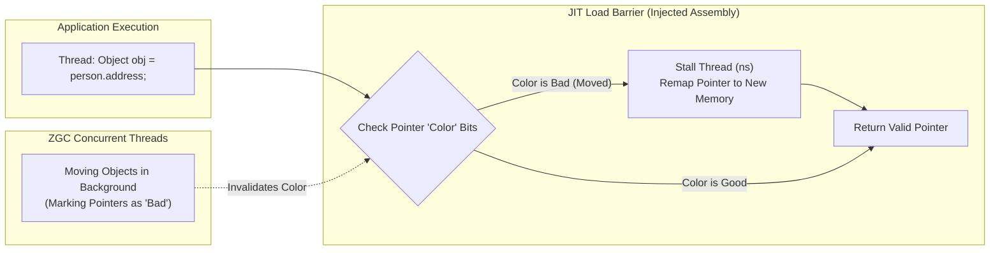
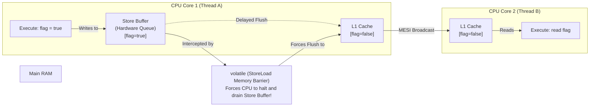

# 54. Java Memory Model & Garbage Collection — Deep Dive

**Navigation**: [< Serialization & I/O](Ch09_Serialization_IO.md) | [Back to Index](../00_MASTER_INDEX.md) | [Strings & Immutability >](Ch02_Strings_Immutability.md)

---

## PART 1: JAVA MEMORY MODEL (JMM)

---

## 🎯 The 5W1H

```text
WHAT = Rules for how threads see each other's writes to memory

WHY  = CPUs have caches. Thread A writes x=5 in its cache.
       Thread B reads x from ITS cache — still sees x=0!
       JMM defines when changes become VISIBLE to other threads

WHEN = ANYTIME two or more threads share mutable data

KEY  = The "happens-before" relationship — if A happens-before
       B, then A's writes are GUARANTEED visible to B
```

---

## 1. The Visibility Problem — Why JMM Exists

```text
Without JMM rules, this can FAIL:

Thread A:                    Thread B:
data = 42;                   while (!ready) { }
ready = true;                System.out.println(data);

Expected output: 42
Possible output: 0!  ← Thread B might see ready=true but data=0

WHY?
1. CPU CACHING: Each CPU core has its own L1/L2 cache.
   Thread A writes data=42 to Core 1's cache.
   Thread B reads data from Core 2's cache — still 0!

2. INSTRUCTION REORDERING: CPU/compiler can reorder operations
   Thread A might execute ready=true BEFORE data=42
   (because they're independent from compiler's perspective)

3. Store buffers: Writes queue in a buffer before reaching cache
```

---

🔬 **Section Challenge — JMM Visibility Problem**

**Challenge 1 (Predict):** Thread A: `data = 42; flag = true;`. Thread B: `while(!flag){}; print(data);` — flag and data are plain fields. Is this guaranteed to print 42?

<details><summary>Answer</summary>

**NO.** Without `volatile` or synchronization, there is no happens-before. Two issues: (1) CPU caching — Thread B may see stale `flag=false` forever (JIT can hoist the read out of the loop). (2) Instruction reordering — the CPU or compiler may execute `flag=true` BEFORE `data=42`. Even if B sees `flag=true`, it might see `data=0`. Fix: make `flag` volatile (creates happens-before for all writes before the volatile write).

</details>

**Challenge 2 (Reasoning):** Why can an infinite spin-loop `while(!flag){}` run forever even when another thread sets `flag=true`?

<details><summary>Answer</summary>

The JIT compiler sees `flag` is never written in the loop body (from this thread's view). It optimizes: read `flag` once into a CPU register, spin on the register — never re-reads from memory. This is valid under JMM when `flag` is not `volatile`. Fix: `volatile boolean flag` forces every read to go to main memory (or at minimum, to flush the cache so the register optimization is disallowed).

</details>

## 2. Happens-Before — The Core Concept

```text
"A happens-before B" means:
  ALL memory writes done in A are GUARANTEED VISIBLE to B

This is NOT about time — it's about VISIBILITY GUARANTEE
```

### The 7 Happens-Before Rules

| # | Rule | What It Means |
| --- | --- | --- |
| 1 | Program Order | In one thread, each line happens-before the next line |
| 2 | Monitor Lock | unlock(m) happens-before every subsequent lock(m) |
| 3 | Volatile Variable | Write to volatile v happens-before every subsequent read of v |
| 4 | Thread Start | thread.start() happens-before any action in the started thread |
| 5 | Thread Join | All actions in a thread happen-before join() returns in another thread |
| 6 | Thread Interrupt | `interrupt()` call happens-before the interrupted thread detects it |
| 7 | Transitivity | If A hb B and B hb C, then A hb C |

---

## 3. volatile — Deep Mechanics

```java
// volatile does TWO things:
// 1. VISIBILITY: Write is immediately flushed from cache to main memory
//                Read always fetches from main memory (not cache)
// 2. ORDERING: Prevents reordering across the volatile access

private volatile boolean ready = false;
private int data = 0;

// Thread A:
data = 42;         // Regular write
ready = true;      // Volatile write — FLUSHES everything before it too!

// Thread B:
if (ready) {            // Volatile read — REFRESHES everything
    System.out.println(data);  // GUARANTEED to see 42!
}

// WHY? Because:
// 1. "data = 42" happens-before "ready = true" (program order in Thread A)
// 2. "ready = true" happens-before "if (ready)" (volatile rule #3)
// 3. By transitivity: "data = 42" happens-before "if (ready)"
// So Thread B MUST see data = 42 when it sees ready = true
```

### What volatile does NOT do

```java
// volatile does NOT make operations atomic!
```

### NEW — Happens-Before Chain Visualization

**Happens-before chain**



**How to read this diagram.** Three rules chain together. Within Thread A, `data = 42` comes before the volatile write (program order). The volatile write happens-before Thread B's read of `ready` that sees it (volatile rule). By transitivity, everything Thread A wrote before the volatile write is visible to Thread B after the read.

> [!NOTE]
> A volatile write acts like a write barrier (StoreStore, and StoreLoad after it), and a volatile read acts like a read barrier (LoadLoad and LoadStore). These are the effects the JIT and CPU must respect.

```java
// volatile does NOT make operations atomic!
private volatile int counter = 0;

// Thread A & B both do:
counter++;  // This is actually: read → increment → write (3 steps!)

// volatile ensures visibility of each individual read/write
// But does NOT prevent: A reads 0, B reads 0, A writes 1, B writes 1
// Result: 1 instead of 2  ← RACE CONDITION!

// For atomic increment, use AtomicInteger:
private AtomicInteger counter = new AtomicInteger(0);
counter.incrementAndGet();  // ✅ Atomic — uses CAS (compare-and-swap)
```

---

🔬 **Section Challenge — volatile**

**Challenge 1 (Bug Hunt):** `volatile int counter = 0; counter++;` — is this thread-safe?

<details><summary>Answer</summary>

**No.** `volatile` guarantees visibility (each read sees the latest write). But `counter++` is three steps: read → increment → write. Two threads can both read `counter=5` at the same time, both increment to 6, both write 6 — one increment lost even with `volatile`. Fix: `AtomicInteger` (CAS-based atomic increment) or `synchronized`.

</details>

**Challenge 2 (Reasoning):** What's the minimum fix for double-checked locking to be safe?

```java
static Singleton instance;
if (instance == null) { synchronized(Singleton.class) { if(instance==null) instance = new Singleton(); } }
```

<details><summary>Answer</summary>

Add `volatile` to `instance`: `static volatile Singleton instance;`. Without it: `new Singleton()` is 3 steps (allocate, initialize, assign). CPU can reorder to assign BEFORE initialize. Another thread sees non-null but partially-constructed object. `volatile` write adds a StoreStore barrier: initialization MUST complete before the reference is visible to other threads.

</details>

## 4. synchronized — Full Memory Fence

```java
// synchronized provides BOTH mutual exclusion AND happens-before

private int sharedData;
private final Object lock = new Object();

// Thread A:
synchronized (lock) {
    sharedData = 42;  // Write under lock
}  // ← UNLOCK happens-before...

// Thread B:
synchronized (lock) {  // ← ...this LOCK
    System.out.println(sharedData);  // GUARANTEED 42
}

// When you exit synchronized: ALL writes are flushed to main memory
// When you enter synchronized: ALL reads come from main memory
// This is called a "full memory fence"
```

---

## 5. Double-Checked Locking — The Classic JMM Problem

```java
// ❌ BROKEN without volatile (before Java 5)
public class Singleton {
    private static Singleton instance;

    public static Singleton getInstance() {
        if (instance == null) {           // First check (no lock)
            synchronized (Singleton.class) {
                if (instance == null) {   // Second check (with lock)
                    instance = new Singleton();
                    // This is actually 3 steps:
                    // 1. Allocate memory
                    // 2. Call constructor
                    // 3. Assign to 'instance'
                    // CPU can REORDER to: 1 → 3 → 2
                    // Thread B sees instance != null but object is not constructed!
                }
            }
        }
        return instance;
    }
}

// ✅ FIXED with volatile
public class Singleton {
    private static volatile Singleton instance;  // volatile prevents reordering!

    public static Singleton getInstance() {
        if (instance == null) {
            synchronized (Singleton.class) {
                if (instance == null) {
                    instance = new Singleton();  // No reordering across volatile write
                }
            }
        }
        return instance;
    }
}

// ✅ BEST: Use enum (simplest, safest)
public enum Singleton {
    INSTANCE;
}
```

---

## 6. False Sharing — CPU Cache Line Contention

```java
// Two unrelated variables sitting in the SAME 64-byte cache line
// When Thread A writes x, it invalidates Thread B's cache line for y too!

// ❌ False sharing:
class SharedData {
    volatile long x;  // Thread A writes this
    volatile long y;  // Thread B writes this — but x and y share a cache line!
}

// ✅ Fix with padding (Java 8+)
class SharedData {
    volatile long x;
    long p1, p2, p3, p4, p5, p6, p7;  // Padding to fill cache line
    volatile long y;  // Now in a different cache line
}

// ✅ Better fix: @Contended annotation (JDK internal, needs --add-opens)
class SharedData {
    @jdk.internal.vm.annotation.Contended
    volatile long x;

    @jdk.internal.vm.annotation.Contended
    volatile long y;
}
```

---

## PART 2: GARBAGE COLLECTION — Memory Management

---

## 7. JVM Memory Layout



**How to read this diagram.** The heap is split into a young generation (Eden plus two survivor spaces) and an old generation. Metaspace and the thread stacks live outside the heap.

---

🔬 **Section Challenge — JVM Memory Layout**

**Challenge 1 (Reasoning):** Your app runs fine locally but gets `OutOfMemoryError: Metaspace` in production. What's happening?

<details><summary>Answer</summary>

Metaspace stores class metadata (loaded class definitions, method bytecode). Common causes of Metaspace exhaustion: (1) **Dynamic class generation**: frameworks like Groovy, CGLIB, ASM, Hibernate proxies generate classes at runtime. If the classloader + generated classes are not garbage-collected, Metaspace grows unboundedly. (2) **ClassLoader leak**: often in hot-deploy scenarios (Tomcat redeployment). Fix: set `-XX:MaxMetaspaceSize=256m` to cap it, enable GC logging to see class unloading, use heap dump analysis to trace classloaders not being GC'd.

</details>

**Challenge 2 (Reasoning):** When does a `StackOverflowError` happen and how would you detect it vs an infinite loop?

<details><summary>Answer</summary>

Each method call pushes a frame onto the thread's stack (~256KB-1MB per thread). Unbounded recursion fills the stack → `StackOverflowError`. Detection: stack trace will show the same method repeated hundreds of times, indicating infinite recursion. Infinite loop: thread stays in RUNNABLE state in the thread dump, always at the same code location. Stack overflow is typically immediate once it starts, loop takes longer. Fix recursion: add a base case, or convert to iterative with an explicit stack.

</details>

## 8. Generational Hypothesis — WHY Young/Old Works

```text
HYPOTHESIS: Most objects die young.

Studies show: ~90% of objects are short-lived (temp variables,
intermediate results, request-scoped data).

So: Divide heap into generations. Collect the Young often
(fast, most garbage), collect Old rarely (slow, less garbage).
```

**Object lifecycle**



**How to read this diagram.** Most objects die in Eden. Survivors bounce between the two survivor spaces on each minor GC, and are promoted to the old generation once they pass the age threshold.

---

## 9. GC Algorithms — What Runs When

| Collector | How It Works |
| --- | --- |
| Serial GC -XX:+UseSerialGC | Single thread, stop-the-world.<br>For: small apps, single-core machines. |
| Parallel GC -XX:+UseParallelGC | Multiple GC threads, stop-the-world.<br>For: throughput-focused apps (batch jobs).<br>Java 8 default. |
| G1 GC -XX:+UseG1GC | Divides heap into regions. Collects<br>"garbage-first" regions. Concurrent.<br>For: balanced latency/throughput.<br>Java 9+ default. |
| ZGC -XX:+UseZGC | Sub-millisecond pauses (<1ms).<br>Concurrent, scalable to TB heaps.<br>For: latency-sensitive apps.<br>Production-ready Java 15+. |
| Shenandoah -XX:+UseShenandoahGC | Similar to ZGC, sub-ms pauses.<br>Concurrent compaction.<br>OpenJDK only (not Oracle JDK). |

---

## 10. GC Roots — What Keeps Objects Alive

```text
An object is ALIVE if it's reachable from a GC Root.
Everything else is garbage.

GC ROOTS are:
1. Local variables on thread stacks
     void method() { User u = new User(); }  ← u is a root

2. Static fields of loaded classes
     static List<User> cache = new ArrayList<>();

3. Active threads themselves (Thread objects)

4. JNI references (native code holding Java refs)

5. Synchronized monitors (objects being locked)

6. System class loader references

Reachability from roots:
GC Root → User → Address → City  ← ALL alive
GC Root → Order → [items]        ← ALL alive
         Product (no path from any root) → GARBAGE, collected
```

---

## 11. Weak, Soft, and Phantom References

```java
// Strong Reference (normal) — object stays alive
Object obj = new Object();  // GC will NEVER collect while obj points to it

// Soft Reference — collected ONLY when memory is low (for caches)
SoftReference<byte[]> cache = new SoftReference<>(new byte[1024 * 1024]);
byte[] data = cache.get();  // Might return null if GC cleared it
// Perfect for: in-memory caches that should shrink under memory pressure

// Weak Reference — collected at NEXT GC (even if memory is fine)
WeakReference<Object> weak = new WeakReference<>(new Object());
Object obj = weak.get();  // Might be null after any GC
// Used by: WeakHashMap (entries auto-removed when key is GC'd)

// Phantom Reference — can't get the object, only notified when it's collected
ReferenceQueue<Object> queue = new ReferenceQueue<>();
PhantomReference<Object> phantom = new PhantomReference<>(obj, queue);
phantom.get();  // ALWAYS returns null
// Used for: cleanup actions (modern replacement for finalize())
```

```
Reference Strength:
Strong > Soft > Weak > Phantom
```

| Type | GC Behavior | get() returns | Use Case |
| --- | --- | --- | --- |
| Strong | Never collected | Always the object | Normal use |
| Soft | When memory low | Object or null | Caches |
| Weak | Next GC cycle | Object or null | WeakHashMap |
| Phantom | After finalization | Always null | Cleanup tasks |

---

🔬 **Section Challenge — Weak/Soft/Phantom References**

**Challenge 1 (Design):** You want to build an image cache that automatically evicts entries under memory pressure without crashing with OOM. Which reference type?

<details><summary>Answer</summary>

`SoftReference<BufferedImage>`. Soft references are cleared by the GC when memory is low (before throwing OOM). Weak references are cleared at the NEXT GC cycle (too aggressive for caching — items get evicted even when memory is ample). Pattern: `Map<String, SoftReference<BufferedImage>> cache`. On `get()`: check if `ref.get() != null`, else reload and store new SoftReference.

</details>

**Challenge 2 (Reasoning):** Why does `WeakHashMap` NOT prevent key objects from being GC'd?

<details><summary>Answer</summary>

`WeakHashMap` stores keys as `WeakReference`s. If the key has no other strong references outside the map, the GC can collect it. When the key is collected, the WeakMap entry is automatically removed via a `ReferenceQueue`. This makes it perfect for caches where the key IS the data (DOM nodes, class instances): if the node is removed from the DOM, the cache entry disappears automatically. Contrast with regular `HashMap`: holding a key in the map IS a strong reference — the key is never GC'd as long as the map exists.

</details>

## 12. Memory Leaks in Java — Common Causes

```java
// Leak 1: Static collections that grow forever
class UserTracker {
    private static final List<User> allUsers = new ArrayList<>();
    public void track(User u) { allUsers.add(u); }  // Never removed!
}

// Leak 2: Unclosed resources
void readFile() {
    InputStream is = new FileInputStream("big.dat");  // Never closed!
    // Fix: try-with-resources
}

// Leak 3: Listeners not removed
button.addActionListener(this);
// If you remove the button but not the listener → this stays alive

// Leak 4: HashMap key with broken equals/hashCode
class BadKey {
    int id;
    // No equals() or hashCode() → entries accumulate, can't be found
}
Map<BadKey, Object> map = new HashMap<>();

// Leak 5: ThreadLocal not cleared
private static final ThreadLocal<byte[]> buffer = new ThreadLocal<>();
buffer.set(new byte[1024 * 1024]);
// In a thread pool: thread is reused, ThreadLocal value persists!
// Fix: always call buffer.remove() in finally block

// Leak 6: Inner class holding outer class reference
class Outer {
    byte[] bigData = new byte[10_000_000];

    class Inner {  // Non-static inner class holds reference to Outer!
        void doSomething() { }
    }
    // If Inner lives longer than Outer, Outer can't be GC'd
    // Fix: use static inner class
}
```

---

## 13. GC Tuning — Production Essentials

```bash
# Key JVM flags
-Xms512m              # Initial heap size
-Xmx2g               # Maximum heap size (set Xms = Xmx for production!)
-XX:+UseG1GC          # Use G1 collector (default Java 9+)
-XX:MaxGCPauseMillis=200  # Target max pause time for G1

# GC Logging (Java 9+)
-Xlog:gc*:file=gc.log:time,level,tags

# Memory analysis
-XX:+HeapDumpOnOutOfMemoryError        # Auto dump on OOM
-XX:HeapDumpPath=/path/to/dump.hprof   # Where to save dump

# Metaspace
-XX:MetaspaceSize=256m          # Initial metaspace
-XX:MaxMetaspaceSize=512m       # Max metaspace (prevent unbounded growth)
```

**TUNING RULES:**

```text
1. Set -Xms = -Xmx (avoid dynamic resizing overhead)
2. Start with G1GC (default, good for most apps)
3. Monitor GC pause times in production
4. If pauses > 200ms consistently → tune MaxGCPauseMillis
5. If pause-sensitive → try ZGC (-XX:+UseZGC)
6. Enable HeapDumpOnOutOfMemoryError ALWAYS
7. Don't over-tune — measure first, tune second
```

---

## 14. Interview Questions & Answers

**Q: What is the Java Memory Model?**
JMM defines rules for when one thread's writes become visible to another thread. Without JMM guarantees, CPU caching and instruction reordering can cause threads to see stale data. The core concept is "happens-before" — a relationship guaranteeing visibility.

**Q: What are the happens-before rules?**
Key rules: (1) Program order within a thread, (2) unlock happens-before subsequent lock on same monitor, (3) volatile write happens-before subsequent volatile read, (4) Thread.start() happens-before actions in started thread, (5) thread actions happen-before join() returns, and (6) transitivity.

**Q: What does volatile guarantee?**
Visibility (writes immediately visible to all threads) and ordering (no reordering across volatile access). It does NOT guarantee atomicity — `volatile int x; x++` is still a race condition because it's read-then-write.

**Q: Explain the generational hypothesis and GC generations.**
Most objects die young (~90%). So the heap is split: Young Generation (Eden + Survivors — collected frequently, fast) and Old Generation (long-lived objects — collected rarely). Minor GC collects Young, Major/Full GC collects Old. This is much faster than scanning the entire heap every time.

**Q: Difference between Soft, Weak, and Phantom references?**
Soft: collected when memory is low (use for caches). Weak: collected at next GC regardless of memory (WeakHashMap). Phantom: always returns null, used only for cleanup notification after object is finalized. Strong > Soft > Weak > Phantom in strength.

**Q: How do you diagnose a memory leak in Java?**
(1) Monitor heap usage over time — if it grows steadily without dropping after GC, there's a leak. (2) Take heap dump (`-XX:+HeapDumpOnOutOfMemoryError`). (3) Analyze with tools like Eclipse MAT or VisualVM. (4) Look for: static collections, unclosed resources, ThreadLocal not cleared, listeners not removed.

---

---

## 15. Safe Publication — How to Share Objects Across Threads

**The Problem**: Creating an object and making it visible to other threads are TWO separate things. You must use the right mechanism or other threads may see partially-constructed objects.

**THE CONSTRUCTION SITE ANALOGY**

```text
Worker A builds a house (object) and puts a sign:
"House ready at address 0x1A2B" (reference published)

WITHOUT safe publication (CPU reordering):
→ CPU publishes the ADDRESS (sign) before finishing the walls!
→ Worker B sees the sign, goes to the address
→ House is half-built! Walls missing! (partially init object)

WITH safe publication (happens-before established):
→ Address only published AFTER construction FULLY complete
→ Worker B sees address → house is 100% built
→ Safe!
```

```java
// ❌ UNSAFE PUBLICATION — other threads may see partially constructed object
class Holder {
    int n;
    Holder(int n) { this.n = n; }
}

// Thread A:
holder = new Holder(42);  // "new" is: 1) allocate memory, 2) construct, 3) assign
// CPU can reorder to: 1) allocate, 3) assign, 2) construct!
// Thread B sees holder != null (step 3 done), but n might still be 0 (step 2 pending)!

// ═══ SAFE PUBLICATION MECHANISMS ═══

// ✅ 1. Static initializer (class loading mechanism guarantees visibility)
static Holder holder = new Holder(42);  // JVM class loading = automatic safe pub

// ✅ 2. volatile field (volatile write happens-before volatile read)
private volatile Holder holder;
// Thread A:  holder = new Holder(42);   ← volatile write
// Thread B:  if (holder != null) use(holder.n);  ← volatile read sees everything

// ✅ 3. synchronized block (monitor unlock happens-before next lock)
synchronized (lock) { holder = new Holder(42); }
// Thread B: synchronized (lock) { use(holder.n); }

// ✅ 4. final fields (Java spec: final fields are visible to all threads
//        after constructor completes)
class SafeHolder {
    final int n;  // ← final!
    SafeHolder(int n) { this.n = n; }
}
// ANY way you publish a SafeHolder — other threads will see correct n

// ✅ 5. AtomicReference
AtomicReference<Holder> ref = new AtomicReference<>();
ref.set(new Holder(42));   // Thread A — CAS ensures ordering
Holder h = ref.get();      // Thread B — guaranteed to see fully constructed Holder
```

**SAFE PUBLICATION CHEAT SHEET**

```text
Method                        Guarantee
─────────────────────────     ──────────────────────────────────────────────
static final field            Class loading is safe pub
volatile field                volatile write happens-before volatile read
synchronized (same lock)      unlock happens-before lock
final fields in constructor   visible after constructor exits (JLS §17.5)
AtomicReference.set/get       CAS provides ordering
BlockingQueue.put/take        internal synchronization provides ordering
Futures/.join()               completion happens-before join() return

IMMUTABLE OBJECTS:
→ If all fields are final and properly initialized in constructor
→ Can be shared WITHOUT synchronization via ANY mechanism!
→ String, Integer, LocalDate — safe to share across threads always
```

---

## 16. Happens-Before Chain — Visual Trace

Let's trace a complete scenario end-to-end to cement happens-before reasoning.

```text
SCENARIO: Thread pool task sees correct data

Main thread:
  lineM1: List<Item> items = populateItems();
  lineM2: future = executor.submit(task);      ← submit() guarantees HB

Worker thread:
  lineW1: List<Item> data = sharedItems.get(); ← sees items from M1?
```

**Happens-before chain**

```text
lineM1 HB lineM2          (Rule 1: Program order in same thread)
lineM2 HB lineW1          (Rule 4: Thread.start / executor.submit HB any action in task)

By TRANSITIVITY (Rule 7):
lineM1 HB lineW1          ✅ Worker WILL see items populated in M1!

WHAT ABOUT:
Main thread:
  map.put("key", value)    ← NO synchronization
  executor.submit(task)

Worker:
  map.get("key")           ← Might see stale/null!

HAPPENS-BEFORE CHAIN:
  put HB submit            (Program order)
  submit HB get            (submit HB task start)
  put HB get               (Transitivity) ✅ This actually IS safe!

BUT ONLY because executor.submit() uses synchronization internally!
The executor's internal LinkedBlockingQueue.put() creates the HB chain.
```

```java
// REASONING EXERCISE: Is this safe?
class Lazy {
    private ExpensiveObject obj;

    // Thread A calls init():
    void init() {
        obj = new ExpensiveObject();  // No sync!
    }

    // Thread B calls get():
    ExpensiveObject get() {
        return obj;  // Safe?
    }
}

// ANSWER: NOT safe! No HB relationship between init() and get()
// Thread B may see obj = null, or see obj reference
// but ExpensiveObject may be PARTIALLY constructed (CPU reordering)

// FIX 1: volatile obj
// FIX 2: synchronized both methods
// FIX 3: Make ExpensiveObject immutable with final fields (safe pub via finals)
// FIX 4: Use AtomicReference<ExpensiveObject>
```

---

## 17. G1GC — Why Regions Change Everything

```text
THE CITY BLOCKS ANALOGY (vs the Classic Farm Analogy)

CLASSIC GC (Parallel/CMS): The Farm
→ Heap split into TWO fixed regions: Young Farm, Old Farm
→ Young Farm collected frequently (cheap, small)
→ Old Farm collected rarely but ENTIRE farm at once (slow!)
→ Problem: As Old farm fills, Full GC pauses entire JVM
            Full GC can pause for SECONDS on large heaps

G1GC: The City of Small Blocks
→ Heap divided into ~2048 equal REGIONS (~1-32MB each)
→ Each region can be: Eden, Survivor, Old, Humongous
→ Regions are NOT fixed: Old region collects, becomes Eden!
→ G1 collects highest-GARBAGE regions FIRST ("Garbage First")
→ Concurrent marking: G1 marks live objects WHILE app runs!
→ Only pauses for evacuation (moving objects to free regions)
→ MaxGCPauseMillis: G1 only collects as many regions as
  fit within the pause budget! Stops, doesn't overshoot.
```

**G1GC HEAP LAYOUT:**



**How to read this diagram.** G1 splits the heap into 2048+ equal regions, each of which plays one role: **E** = Eden, **S** = Survivor, **O** = Old, **H** = Humongous (an object larger than 50% of a region). Roles are assigned per region and can change between cycles.

**G1 collection cycle**

| Phase | What happens | Pause |
| --- | --- | --- |
| 1. Minor GC | Collect Eden + Survivor (young regions) | Stop-the-world |
| 2. Concurrent | Mark live objects in Old regions | NO pause (runs with the app) |
| 3. Mixed GC | Collect Young + some Old regions | Short pause |
| 4. Full GC | Last resort (avoid!) | Long pause, like classic GC |

> [!TIP]
> **Tuning insight:** `-XX:MaxGCPauseMillis=200` (default). G1 collects fewer regions to stay under 200 ms. A lower target means more frequent, shorter pauses; a higher target means fewer, longer pauses. The trade-off is latency vs throughput.

---

## 18. The Physics of Garbage Collection (SafePoints and ZGC)

### 18.1 The Mechanical Reality of "Stop-The-World" (SafePoints)

"Stop-The-World" is not a polite request. It is a physical coordination protocol managed by the JVM using **SafePoints**.

**The SafePoint Mechanism:**
When the JVM decides it needs to perform a Garbage Collection (or a heap dump, or deoptimization), it sets a global `SafePoint` flag in memory.

1. The JVM cannot force a thread to stop immediately (it might be in the middle of a critical native CPU instruction).
2. Instead, the JIT compiler actively injects **polling instructions** (e.g., `test` instructions on a specific memory page) into your compiled code. A thread polls this flag at method exits, loop back-edges, and specific state transitions.
3. When a thread sees the `SafePoint` flag is `true`, it voluntarily suspends itself, dumping its CPU registers and pausing its execution pipeline.
4. The GC thread must wait until **every single application thread** has reached a SafePoint before it can begin sweeping memory. If one thread is stuck in a massive, unrolled `long` loop without a polling instruction, _every other thread is frozen waiting for it_ (this is called "Time to SafePoint" or TTSP latency).

Once the world is stopped, the GC traces **GC Roots** (Thread Stacks, CPU Registers, Static Variables) to build the live object graph.



**How to read this diagram.** Read it as threads polling a flag: the JIT-injected poll points sit at loop back-edges and method exits, and when the JVM sets the global SafePoint flag to TRUE (dashed 'Signals' arrow) every thread that polls and sees true parks itself and dumps its registers. Notice Thread 3 in native code, which cannot be polled - the GC has to wait for every thread to reach a safepoint.

### 18.2 ZGC Physics: Colored Pointers and Load Barriers

ZGC (Z Garbage Collector) achieves sub-millisecond pauses not by eliminating GC, but by performing the tracing and evacuation _while the application threads are still actively modifying the heap_.

**How does ZGC do this without corrupting memory?**
ZGC modifies the physical 64-bit memory pointers themselves (a technique called **Colored Pointers**).

In a 64-bit OS, physical memory addressing rarely uses all 64 bits. ZGC hijacks 4 bits of every object reference pointer in the JVM to store "metadata" colors:

- `Marked0`, `Marked1`, `Remapped`, `Finalizable`.

When an application thread tries to read an object reference, ZGC intercepts the CPU instruction using a **Load Barrier**:

1. Application thread executes: `Object obj = person.address;`
2. The JIT compiler has injected a Load Barrier (a few extra assembly instructions) before every read.
3. The Load Barrier checks the "color" bits of the `address` pointer.
4. If the GC is currently moving the `address` object to a new memory region, the pointer color will be "bad".
5. The Load Barrier physically stalls the application thread for a few nanoseconds, forces the thread to update the pointer to the new memory location (self-healing), and _then_ hands the valid pointer back to the application.

ZGC shifts the burden of memory compaction from a massive Stop-The-World pause to microscopic, localized "Load Barrier" stalls spread across the entire application runtime.



**How to read this diagram.** Follow the application thread's read of `person.address` into the load barrier: the barrier checks the pointer's colour bits, a good colour returns the pointer straight away, and a bad colour (the object was moved) stalls the thread for nanoseconds to remap the pointer before returning it. The dotted arrow shows the background evacuation threads marking pointers bad. Notice that the repair happens inside the reader's own load, not in a global pause.

**GC COMPARISON FOR PRODUCTION DECISIONS:**

```text
Collector    Pause          Throughput  Heap size  Use case
──────────   ─────────────  ──────────  ─────────  ────────────────────────
Serial GC    Long STW       Low         Small      Dev/small apps
Parallel GC  Long STW       Highest     Medium     Batch jobs, offline jobs
G1GC         Short STW      High        Medium-XL  Most web services (default)
ZGC          <1ms           High (95%)  Any (TB!)  Latency-sensitive, real-time
Shenandoah   <1ms           Similar     Any        Same as ZGC (OpenJDK)

COMMON MISTAKES:
1. Xms != Xmx → heap resizing causes extra GC pauses
   FIX: Always set -Xms == -Xmx in production

2. Too much heap → GC pause is longer (more to scan)
   FIX: Scale horizontally (more JVMs) vs vertically (bigger heap)

3. No HeapDumpOnOutOfMemoryError → can't debug OOM
   FIX: ALWAYS set -XX:+HeapDumpOnOutOfMemoryError

4. Finalize() method → delays GC (object survives extra cycle)
   FIX: Use AutoCloseable + try-with-resources instead
```

---

## 19. THE GRAND UNIFIED THEORY OF THE JAVA MEMORY MODEL (Deconstructed)

> _"The Java Memory Model is not a software API. It is a mathematical contract between the Java Compiler, the JIT Compiler, and the physical Intel/AMD hardware. When you type `volatile`, you are literally issuing raw electrical constraints to the CPU's L1 cache and instruction reorder buffer."_

This section strips away the "Visibility" and "Happens-Before" analogies. We will look at exactly what the Silicon is doing when you share variables across threads.

### 19.1 The Abstraction: "Visibility" vs The Reality of CPU Store Buffers

**The Abstraction Taught:** "If you don't use `volatile`, Thread B might not see the changes made by Thread A because Thread A cached the variable in its CPU."

**The Naked Truth:** It is much worse than just caching. Modern CPUs do not write directly to the L1 Cache. They write to a physical hardware queue called the **Store Buffer**.

**The Mechanical Execution (The Visibility Delay):**

1. `Thread A` (running on CPU Core 1) executes `flag = true;`
2. Core 1 does NOT write `true` to main RAM. It does NOT even write `true` to the L1 Cache.
3. Core 1 writes `true` into its local **Store Buffer** (a tiny, ultra-fast queue sitting between the execution unit and the L1 cache). This allows Core 1 to immediately continue executing the next instructions without waiting for the slow L1 cache to acknowledge the write.
4. Meanwhile, `Thread B` (running on CPU Core 2) reads `flag`.
5. Core 2 checks its own L1 Cache and main RAM. It sees `flag = false`.
6. `Thread A` has mathematically executed the code, but the result is physically trapped in the Store Buffer of Core 1. It has not been "drained" into the shared memory hierarchy.

**The Physics Solution (`volatile` and Memory Barriers):**
When you declare `volatile boolean flag;` in Java, the JIT Compiler issues a physical CPU instruction called a **Memory Barrier** (specifically a `StoreLoad` barrier, e.g., the `lock addl` instruction on x86).

1. `Thread A` executes `flag = true;`
2. The CPU hits the Memory Barrier instruction.
3. The CPU physically **HALTS**. It is mathematically forced to drain its entire Store Buffer into the L1 Cache and broadcast the MESI cache-invalidation signal to all other CPU cores before it is allowed to execute the next line of code.
4. `Thread B` is now guaranteed to see `flag = true`.

This is why `volatile` is expensive. It literally stalls the CPU pipeline and forces hardware synchronization.



**How to read this diagram.** Follow Thread A's write `flag = true` into Core 1's store buffer: without a barrier it reaches L1 only after a delayed flush (dashed arrow), so Core 2's L1 still holds flag=false. The volatile StoreLoad barrier intercepts the store buffer and forces the flush to L1, and the MESI broadcast then lets Core 2's L1, and so Thread B, see the new value. Notice the barrier in the middle - that forced halt is what makes volatile expensive.

### 19.2 The Abstraction: "Reordering" vs The Reality of Out-of-Order Execution

**The Abstraction:** "The compiler might reorder your code to make it faster."

**The Naked Truth:** The compiler does reorder your code. But the physical CPU also reorders your code _while it is running_.

**The Mechanical Execution (Tomasulo's Algorithm):**

Modern CPUs use an architecture called **Out-of-Order Execution (OoOE)**.

If the CPU sees these instructions:

```java
int a = 10; // Inst 1
int b = 20; // Inst 2
int c = a + b; // Inst 3
```

If `a = 10` causes a cache miss (taking 100 cycles to fetch from RAM), the CPU will _not_ wait. The CPU's instruction scheduler will dynamically look ahead, see that `b = 20` does not depend on `a`, and execute `b = 20` _before_ `a = 10`.

**The Production Catastrophe (Double-Checked Locking):**
This physical reordering is why naive Singletons crash production systems.

```java
// BROKEN SINGLETON
if (instance == null) {
    synchronized(this) {
        if (instance == null) {
            instance = new Singleton();
        }
    }
}
```

In Java bytecode, `instance = new Singleton()` is not one operation. It is three:

1. Allocate raw memory for the `Singleton` object.
2. Call the constructor `Singleton()` to initialize fields.
3. Point the `instance` reference to the allocated memory.

Because steps 2 and 3 do not depend on each other, the physical CPU or JIT compiler will often reorder them to: `1 -> 3 -> 2`.

1. Thread A allocates memory.
2. Thread A points `instance` to the memory.
3. **CONTEXT SWITCH!** Thread A is paused.
4. Thread B arrives, checks `if (instance == null)`. It evaluates to `false` because the pointer is set!
5. Thread B grabs the `instance` and calls `instance.doWork()`.
6. **NullPointerException / Corrupt Data:** The constructor (Step 2) hasn't run yet! Thread B is operating on a half-baked, uninitialized block of memory.

**The Fix:** Adding `volatile` to the `instance` reference injects a **StoreStore Memory Barrier**. This hardware instruction strictly forbids the CPU from reordering the memory allocation (Step 2) with the pointer assignment (Step 3).

### 19.3 The Exact Cost of Concurrency (The Nanosecond Scale)

If you want to design distributed systems or high-performance financial matching engines, you must memorize the physical latency of Java concurrency operations:

- **L1 Cache Reference:** ~1 ns (The ideal state. Thread local variables live here.)
- **Branch Mispredict:** ~3 ns (What happens when polymorphism breaks.)
- **L2 Cache Reference:** ~4 ns
- **Uncontended CAS (Compare-And-Swap):** ~7 ns (The cost of `AtomicInteger.incrementAndGet()`. Extremely fast because it never leaves user-space.)
- **Main Memory Reference:** ~100 ns (What happens when you trigger False Sharing and ruin the L1 cache.)
- **Volatile Write (Memory Barrier):** ~10-20 ns (The cost of flushing the Store Buffer.)
- **Contended OS Mutex (Fat Lock):** ~1,000 to ~10,000 ns (The cost of `synchronized` when 10 threads fight for it. The thread is parked, requiring a full OS kernel context switch).

**The Master Rule:** Never use OS Mutexes (`synchronized`) if you can use CAS (`AtomicInteger`). Never use CAS if you can use ThreadLocal variables. The closer you stay to the L1 Cache without broadcasting MESI invalidation signals, the faster your Java code will run.

---

**Key Takeaway**: JMM's happens-before is the foundation of correct concurrent
code. Use `volatile` for visibility, `synchronized` for atomicity+visibility.
Safe publication requires an explicit happens-before — final fields, volatile, or sync.
GC is generational because most objects die young. G1 collects "garbage-first"
regions for predictable pauses. ZGC uses read barriers to eliminate STW entirely.
Always set HeapDumpOnOOM and monitor GC pauses in production.


---

## Reality Check

**"The JVM always runs GC when memory is low"** → The JVM runs GC when specific conditions are met (young generation fills up, old generation fills up, explicit `System.gc()` — which is a hint, not a command). There is no guarantee GC runs "when you need it." `System.gc()` is rarely appropriate in application code; calling it can hurt performance by triggering a major GC at the wrong time.

**"GC pauses are always short (milliseconds)"** → Old-generation (major/full) GCs in serial or parallel GC can cause multi-second stop-the-world pauses for large heaps. G1GC aims for configurable pause targets but can exceed them. ZGC and Shenandoah target sub-millisecond pauses by doing most GC work concurrently. Choosing the wrong GC for your latency requirements causes missed SLAs, not crashes.

**"Java has no pointers"** → Java has references, which ARE pointers — they hold memory addresses. The difference: you cannot do arithmetic on Java references (no `ptr + 1`), you cannot access raw memory through them, and the GC can move objects (updating all references automatically — this is transparent to you). Saying "Java has no pointers" is a simplification for beginners, not an accurate statement.

**"The JVM memory model means all threads share the same view of memory"** → The Java Memory Model (JMM) DOES NOT guarantee that all threads see the same values without synchronization. Modern CPUs have per-core L1/L2 caches. A write by Thread A may sit in A's cache without being flushed to shared memory. Thread B may read a stale value from its own cache. `volatile`, `synchronized`, and `java.util.concurrent` constructs create *happens-before* relationships that force memory visibility.

**"Increasing heap size (-Xmx) always improves performance"** → Larger heap = less frequent GC (good) but longer GC pauses when GC does run (bad). A very large heap on G1GC might take 5+ seconds to scan during a full GC. For latency-sensitive services, keep heap size manageable (4-8GB) and tune GC algorithm. Beyond a point, adding RAM to the heap actively worsens tail latency.
