> **Navigation**: [< Previous](Ch23_Streams_Deep_Reasoning.md) | [Back to Index](../00_MASTER_INDEX.md) | [Next >](Ch17_Concurrency_Synchronizers.md)

# Chapter 34 — JVM Object Model Internals: How Java Objects REALLY Live in Memory

> **"Every time you write `new Object()`, the JVM creates a precise memory layout with an object header, klass pointer, and aligned fields. Understanding this turns you from 'I write Java' to 'I understand the machine I'm commanding.'"**

---

## Table of Contents

1. [Object Memory Layout: What `new` Actually Creates](#1-object-memory-layout)
2. [The Mark Word: 64 Bits That Control Everything](#2-the-mark-word)
3. [Klass Pointer: How JVM Knows the Type](#3-klass-pointer)
4. [Field Layout, Padding, and Alignment](#4-field-layout-padding-alignment)
5. [Lock Escalation: Biased → Thin → Fat](#5-lock-escalation)
6. [Method Dispatch: How JVM Calls the Right Method](#6-method-dispatch)
7. [Method Hiding vs Overriding: The Static Method Freeze Moment](#7-method-hiding-vs-overriding)
8. [Best Java Design Strategies: Building Robust Structures](#8-best-java-design-strategies)
9. [Records, Sealed Classes, and Modern Java Object Design](#9-records-sealed-classes)
10. [Quick-Fire Interview Table](#10-quick-fire-table)

---

## 1. Object Memory Layout: What `new` Actually Creates

### The Freeze Question
> "What happens in memory when you write `new Object()`?"

### Deep Reasoning

```
THE PASSPORT ANALOGY

Every Java object is like a passport:

┌──────────────────────────────────────────────┐
│ OBJECT HEADER (passport cover + stamps)      │
│  ┌───────────────────────────────────────┐   │
│  │ Mark Word (8 bytes / 64-bit JVM)      │   │
│  │ → Identity: hashCode                  │   │
│  │ → Age stamp: GC generation age        │   │
│  │ → Lock state: biased/thin/fat         │   │
│  └───────────────────────────────────────┘   │
│  ┌───────────────────────────────────────┐   │
│  │ Klass Pointer (4 bytes compressed)    │   │
│  │ → "What type am I?" → points to       │   │
│  │   class metadata in Metaspace          │  │
│  └───────────────────────────────────────┘   │
├──────────────────────────────────────────────┤
│ INSTANCE DATA (passport pages)               │
│  → Your fields: int age, String name, etc.   │
├──────────────────────────────────────────────┤
│ PADDING (empty pages for alignment)          │
│  → Pad to multiple of 8 bytes                │
└──────────────────────────────────────────────┘

EVERY object has this structure. Even `new Object()`:
Header (12 bytes) + Padding (4 bytes) = 16 bytes minimum
```

**Flow:**
- Mark Word (8 bytes / 64-bit JVM) /
- ↓
- Identity: hashCode
- ↓
- Klass Pointer (4 bytes compressed) /
- ↓
- 'What type am I?

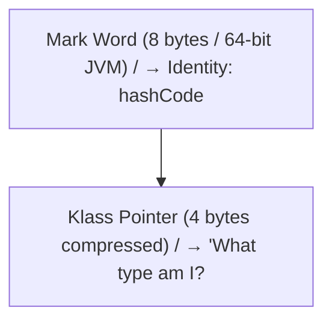

### Visual Memory Layout

```
┌──────────────────────────────────────────────────────────────────┐
│  64-bit JVM with Compressed Oops (default for heap < 32GB)       │
│                                                                  │
│  new Object():                                                   │
│  ┌────────────┬──────────────┬──────────┐                        │
│  │ Mark Word  │ Klass Pointer│ Padding  │ = 16 bytes             │
│  │ (8 bytes)  │ (4 bytes)    │ (4 bytes)│                        │
│  └────────────┴──────────────┴──────────┘                        │
│                                                                  │
│  new int[0]:                                                     │
│  ┌────────────┬──────────────┬────────────┬──────────┐           │
│  │ Mark Word  │ Klass Pointer│ Array Len  │ Padding  │ = 16 bytes│
│  │ (8 bytes)  │ (4 bytes)    │ (4 bytes)  │ (0 bytes)│           │
│  └────────────┴──────────────┴────────────┴──────────┘           │
│                                                                  │
│  class Point { int x; int y; }                                   │
│  ┌────────────┬──────────────┬──────┬──────┐                     │
│  │ Mark Word  │ Klass Pointer│  x   │  y   │ = 24 bytes          │
│  │ (8 bytes)  │ (4 bytes)    │(4 b) │(4 b) │ (header=12+data=8)  │
│  └────────────┴──────────────┴──────┴──────┘   padded to 24      │
│                                                                  │
│  ⚠️ Arrays have an EXTRA 4-byte length field in header           │
│  ⚠️ Everything padded to multiple of 8 bytes (object alignment)  │
└──────────────────────────────────────────────────────────────────┘
```

**Flow:**
- Mark Word Klass Pointer Padding / (8 bytes) (4 bytes) (
- ↓
- Mark Word Klass Pointer Array Len Padding / (8 bytes) (
- ↓
- Mark Word Klass Pointer x y / (8 bytes) (4 bytes) (4 b)

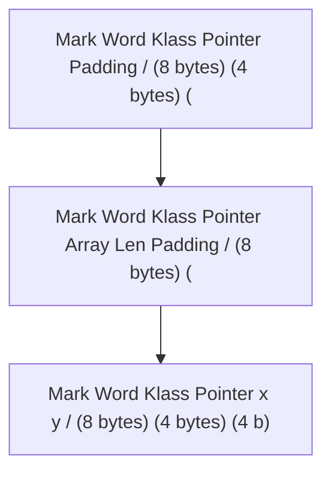

---

## 2. The Mark Word: 64 Bits That Control Everything

### Deep Reasoning

```
THE MOOD RING ANALOGY

The Mark Word is like a mood ring on every object:

The SAME 64 bits mean DIFFERENT things depending on state:

State: NORMAL (no lock)
┌──────────────────┬────────┬────────┬──────────┐
│ identity hashCode│ unused │ GC age │ state    │
│ (31 bits)        │ (1 bit)│ (4 bits)│ (3 bits)│
└──────────────────┴────────┴────────┴──────────┘

State: BIASED LOCK
┌──────────────────┬────────┬────────┬──────────┐
│ thread ID        │ epoch  │ GC age │ state    │
│ (54 bits)        │ (2 bits)│ (4 bits)│(3 bits)│
└──────────────────┴────────┴────────┴──────────┘

State: THIN LOCK (lightweight)
┌──────────────────────────────────────┬─────────┐
│ pointer to lock record on stack      │ state   │
│ (62 bits)                            │ (2 bits)│
└──────────────────────────────────────┴─────────┘

State: FAT LOCK (heavyweight / monitor)
┌──────────────────────────────────────┬─────────┐
│ pointer to ObjectMonitor (OS mutex)  │ state   │
│ (62 bits)                            │ (2 bits)│
└──────────────────────────────────────┴─────────┘

State: GC (marked for garbage collection)
┌──────────────────────────────────────┬─────────┐
│ forwarding pointer                   │ state   │
│ (62 bits)                            │ (2 bits)│
└──────────────────────────────────────┴─────────┘
```

**Flow:**
- identity hashCode unused GC age state / (31 bits) (1 bi
- ↓
- thread ID epoch GC age state / (54 bits) (2 bits) (4 bi
- ↓
- pointer to lock record on stack state / (62 bits) (2 bi
- ↓
- pointer to ObjectMonitor (OS mutex) state / (62 bits) (
- ↓
- forwarding pointer state / (62 bits) (2 bits)

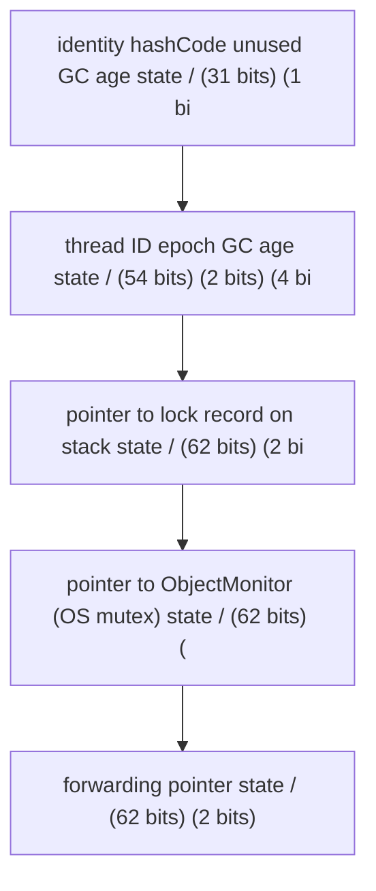

### State Bits Decoding

```
┌────────────────────────────────────────────────────────────────┐
│ Last 3 bits of mark word determine the object's lock state:    │
│                                                                │
│   Bits  │  State              │  What It Means                 │
│  ───────┼─────────────────────┼──────────────────────────────  │
│   001   │  Normal (unlocked)  │  hashCode stored, no lock      │
│   101   │  Biased             │  One thread owns it cheaply    │
│   00    │  Thin Lock          │  CAS-based lightweight lock    │
│   10    │  Fat Lock           │  OS mutex (heavyweight)        │
│   11    │  GC marked          │  Being garbage collected       │
│                                                                │
│ ⚠️ Notice: biased locking was DEPRECATED in Java 15            │
│    and REMOVED in Java 18+ (JEP 374)                           │
│    Reason: complexity didn't justify the small performance gain│
│    for modern workloads with many short-lived objects          │
└────────────────────────────────────────────────────────────────┘
```

**Flow:**
- Last 3 bits of mark word determine the object's lock st
- ↓
- Bits State What It Means
- ↓
- 001 Normal (unlocked) hashCode stored, no lock
- ↓
- 101 Biased One thread owns it cheaply
- ↓
- 00 Thin Lock CAS-based lightweight lock
- ↓
- 10 Fat Lock OS mutex (heavyweight)
- ↓
- 11 GC marked Being garbage collected

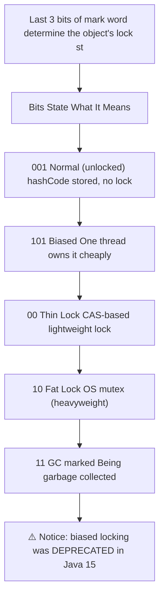

### Identity HashCode Deep Reasoning

```java
// When you call System.identityHashCode() or Object.hashCode() (if not overridden):
Object obj = new Object();
int hash = obj.hashCode();

// The hash is COMPUTED ONCE and STORED in the mark word (31 bits).
// This means:
//   1. Once hashCode() is called, the object CANNOT be biased-locked anymore
//      (hashCode bits overlap with thread ID bits)
//   2. The identity hashCode is NOT the memory address (common myth!)
//      It's a pseudo-random number stored in the header
//   3. Even if GC moves the object, the hashCode stays the same
//      (it's stored in the header, moves with the object)

// CONSEQUENCE for locking:
synchronized(obj) {
    // If obj.hashCode() was called BEFORE this:
    //   → Cannot use biased locking (hashCode took those bits)
    //   → Goes directly to thin lock
    // If obj.hashCode() was NOT called:
    //   → Can use biased locking (hashCode bits = thread ID)
}
```

---

## 3. Klass Pointer: How JVM Knows the Type

### Deep Reasoning

```
╔═══════════════════════════════════════════════════════════════════╗
║  THE EMPLOYEE ID BADGE ANALOGY                                    ║
║                                                                   ║
║  Klass Pointer = ID badge that says "I work in Department X"      ║
║                                                                   ║
║  Object in heap: "I am a String"                                  ║
║        │                                                          ║
║        └──→ Klass Pointer ──→ String.class metadata               ║
║                                  (in Metaspace, NOT heap)         ║
║                                  Contains:                        ║
║                                    → vtable (virtual method table)║
║                                    → field offsets                ║
║                                    → interface table (itable)     ║
║                                    → class hierarchy info         ║
║                                    → access flags                 ║
║                                                                   ║
║  With Compressed Oops (heap < 32GB):                              ║
║    Klass pointer = 4 bytes (shifted by 3 bits, like zip codes)    ║
║    Actual address = compressed_pointer << 3                       ║
║                                                                   ║
║  Without Compressed Oops (heap ≥ 32GB):                           ║
║    Klass pointer = 8 bytes (full 64-bit address)                  ║
║    Every object header grows by 4 bytes!                          ║
╚═══════════════════════════════════════════════════════════════════╝
```

**Flow:**
- THE EMPLOYEE ID BADGE ANALOGY
- ↓
- Klass Pointer = ID badge that says 'I work in Departmen
- ↓
- Object in heap: 'I am a String'
- ↓
- Klass Pointer
- ↓
- String.class metadata
- ↓
- Klass Pointer
- ↓
- String.class metadata
- ↓
- (in Metaspace, NOT heap)
- ↓
- Contains:
- ↓
- vtable (virtual method table)

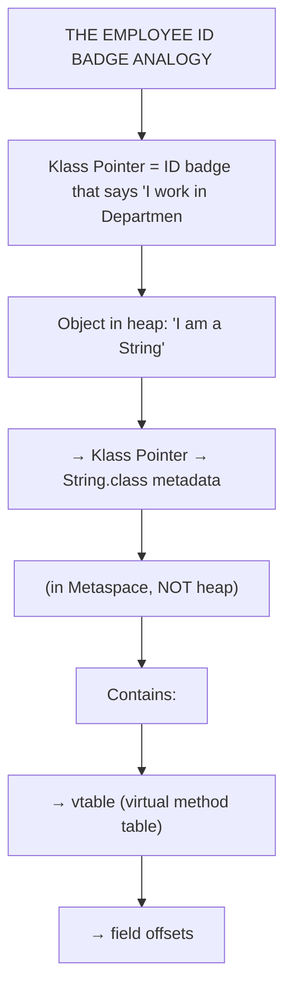

### Why This Matters: `instanceof` Performance

```java
// instanceof checks the klass pointer → traverses class hierarchy
if (obj instanceof String) { ... }

// JVM implementation:
// 1. Read klass pointer from obj header
// 2. Check if it points to String.class metadata
// 3. If not, walk superclass chain: String → Object → null
// 4. Also check interface table (itable) for interface checks

// This is why:
// - instanceof concrete class = FAST (direct klass pointer match)
// - instanceof interface = SLIGHTLY SLOWER (must check itable)
// - Deep hierarchy = more hops (but JVM caches common checks)

// Pattern matching (Java 16+) compiles to the same mechanism:
if (obj instanceof String s) {
    // s is already cast — JVM does instancecheck + cast in one op
    // This is ZERO extra cost over traditional instanceof + cast
}
```

---

## 4. Field Layout, Padding, and Alignment

### Deep Reasoning

```
╔══════════════════════════════════════════════════════════════════╗
║  THE BOOKSHELF ANALOGY                                           ║
║                                                                  ║
║  CPU reads memory in aligned chunks (like shelves of fixed width)║
║                                                                  ║
║  If a `long` (8 bytes) starts at address 5:                      ║
║  → CPU must do TWO reads (bytes 0-7 and bytes 8-15)              ║
║  → Then combine them = SLOW                                      ║
║                                                                  ║
║  If a `long` starts at address 8 (aligned):                      ║
║  → CPU does ONE read = FAST                                      ║
║                                                                  ║
║  JVM RULES for field ordering:                                   ║
║  1. Fields are NOT laid out in declaration order                 ║
║  2. JVM reorders to minimize padding                             ║
║  3. Larger fields first: longs, doubles → ints → shorts → bytes  ║
║  4. Object references grouped together (for GC card marking)     ║
║  5. Final padding to 8-byte boundary                             ║
╚══════════════════════════════════════════════════════════════════╝
```

**Flow:**
- THE BOOKSHELF ANALOGY
- ↓
- If a `long` (8 bytes) starts at address 5:
- ↓
- CPU must do TWO reads (bytes 0-7 and bytes 8-15)
- ↓
- Then combine them = SLOW
- ↓
- If a `long` starts at address 8 (aligned):
- ↓
- CPU does ONE read = FAST
- ↓
- JVM RULES for field ordering:

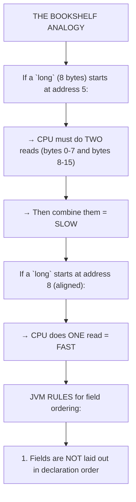

### Code Proof — Field Reordering

```java
// YOU WRITE:
class BadLayout {
    boolean a;    // 1 byte
    long b;       // 8 bytes
    boolean c;    // 1 byte
    int d;        // 4 bytes
}

// NAIVE LAYOUT (if JVM followed declaration order):
// Offset 0-11:  Header (12 bytes)
// Offset 12:    boolean a (1 byte)
// Offset 13-19: PADDING (7 bytes to align long!)
// Offset 20-27: long b (8 bytes)
// Offset 28:    boolean c (1 byte)
// Offset 29-31: PADDING (3 bytes to align int!)
// Offset 32-35: int d (4 bytes)
// Offset 36-39: PADDING (4 bytes to align object to 8)
// Total: 40 bytes (16 bytes wasted on padding!)

// ACTUAL JVM LAYOUT (reordered):
// Offset 0-11:  Header (12 bytes)
// Offset 12-15: int d (4 bytes — fills header gap perfectly)
// Offset 16-23: long b (8 bytes — aligned at 8)
// Offset 24:    boolean a (1 byte)
// Offset 25:    boolean c (1 byte)
// Offset 26-31: PADDING (6 bytes to 8-byte boundary)
// Total: 32 bytes (only 6 bytes wasted!)

// You can verify with JOL (Java Object Layout):
// import org.openjdk.jol.info.ClassLayout;
// System.out.println(ClassLayout.parseClass(BadLayout.class).toPrintable());
```

### Memory Cost of Common Objects

```
┌──────────────────────────────────────────────────────────────┐
│  Object                    │  Actual Size  │  "Useful" Data  │
│ ───────────────────────────┼───────────────┼─────────────────│
│  new Object()              │  16 bytes     │  0 bytes (!)    │
│  new Integer(42)           │  16 bytes     │  4 bytes (int)  │
│  new Long(42L)             │  24 bytes     │  8 bytes (long) │
│  new Boolean(true)         │  16 bytes     │  1 byte (!)     │
│  "" (empty String)         │  40 bytes     │  0 chars (!)    │
│  "Hello" (5 chars)         │  ~56 bytes    │  10 bytes       │
│  new int[0]                │  16 bytes     │  0 bytes (!)    │
│  new int[10]               │  56 bytes     │  40 bytes       │
│  new HashMap<>()           │  ~128 bytes   │  0 entries      │
│  new ArrayList<>()         │  ~64 bytes    │  0 elements     │
│                                                              │
│  LESSON: Boxing int→Integer costs 12 extra bytes (300%!)     │
│  This is why IntStream exists — avoids boxing overhead.      │
└──────────────────────────────────────────────────────────────┘
```

**Flow:**
- Object Actual Size 'Useful' Data
- ↓
- new Object() 16 bytes 0 bytes (!)
- ↓
- new Integer(42) 16 bytes 4 bytes (int)
- ↓
- new Long(42L) 24 bytes 8 bytes (long)
- ↓
- new Boolean(true) 16 bytes 1 byte (!)
- ↓
- '' (empty String) 40 bytes 0 chars (!)
- ↓
- 'Hello' (5 chars) ~56 bytes 10 bytes

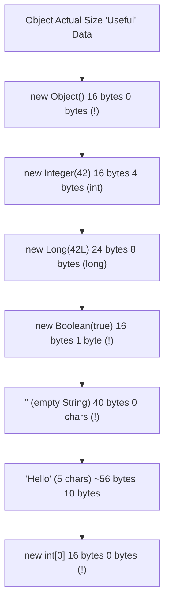

---

## 5. Lock Escalation: Biased → Thin → Fat

### The Freeze Question
> "What happens inside the JVM when you use `synchronized`?"

### Deep Reasoning

```
╔══════════════════════════════════════════════════════════════════╗
║  THE BATHROOM LOCK ANALOGY                                       ║
║                                                                  ║
║  BIASED LOCK (you live alone):                                   ║
║  → Bathroom door has your name on it permanently                 ║
║  → You walk in without checking — ZERO cost                      ║
║  → If a guest arrives, name must be erased (revoke bias)         ║
║  → Cost: ~0 for single thread, expensive revocation              ║
║                                                                  ║
║  THIN LOCK (you have a roommate):                                ║
║  → Bathroom has a sign you flip: "OCCUPIED" / "FREE"             ║
║  → Quick check (CAS operation) — done in user-space              ║
║  → If sign is stuck, you spin (try again a few times)            ║
║  → Cost: one CAS instruction (~10-20 nanoseconds)                ║
║                                                                  ║
║  FAT LOCK (it's a public bathroom):                              ║
║  → Bathroom has a full queue management system (OS mutex)        ║
║  → You take a number, sit and wait (thread parked / blocked)     ║
║  → OS kernel involved: context switch = expensive                ║
║  → Cost: ~1-10 microseconds (100-1000x more than thin lock!)     ║
║                                                                  ║
║  ESCALATION PATH (only goes UP, never back down):                ║
║  Biased ──[contention]──→ Thin ──[spinning fails]──→ Fat         ║
╚══════════════════════════════════════════════════════════════════╝
```

**Flow:**
- THE BATHROOM LOCK ANALOGY
- ↓
- BIASED LOCK (you live alone):
- ↓
- Bathroom door has your name on it permanently
- ↓
- You walk in without checking — ZERO cost
- ↓
- If a guest arrives, name must be erased (revoke bias)
- ↓
- Cost: ~0 for single thread, expensive revocation
- ↓
- THIN LOCK (you have a roommate):

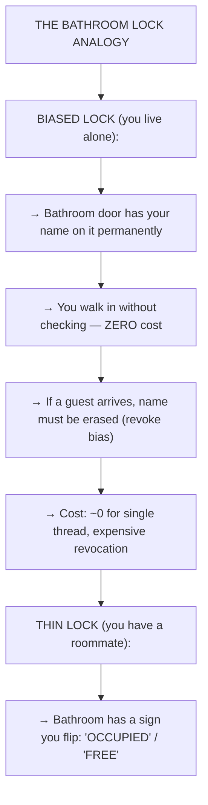

### Lock Escalation Steps

```
┌─────────────────────────────────────────────────────────────────┐
│  Step-by-step lock escalation:                                  │
│                                                                 │
│  1. NEW OBJECT → Mark word: unlocked (state bits = 001)         │
│                                                                 │
│  2. First synchronized(obj) by Thread A:                        │
│     → JVM sets biased lock (write thread A's ID into mark word) │
│     → Future locks by Thread A: check ID match → FREE!          │
│     → Mark word state bits: 101 (biased)                        │
│                                                                 │
│  3. Thread B tries synchronized(obj):                           │
│     → Thread A's bias must be REVOKED (stop-the-world pause!)   │
│     → Escalate to thin lock (CAS-based)                         │
│     → Mark word now points to lock record on stack              │
│     → State bits: 00 (thin/lightweight)                         │
│                                                                 │
│  4. Thread B spins (retries CAS) but Thread A holds too long:   │
│     → JVM decides: "spinning is wasting CPU"                    │
│     → Escalate to fat lock (OS mutex, ObjectMonitor)            │
│     → Thread B is PARKED (sleeping, no CPU usage)               │
│     → State bits: 10 (heavyweight)                              │
│                                                                 │
│  5. Thread A releases → OS wakes Thread B → Thread B acquires   │
│                                                                 │
│  ⚠️ Once inflated to fat lock, it stays fat for that object!    │
│  (Deflation is possible but rare — implementation-dependent)    │
└─────────────────────────────────────────────────────────────────┘
```

**Flow:**
- Step-by-step lock escalation:
- ↓
- 1. NEW OBJECT
- ↓
- Mark word: unlocked (state bits = 001)
- ↓
- 1. NEW OBJECT
- ↓
- Mark word: unlocked (state bits = 001)
- ↓
- 2. First synchronized(obj) by Thread A:
- ↓
- JVM sets biased lock (write thread A's ID into mark w
- ↓
- Future locks by Thread A: check ID match
- ↓
- FREE!
- ↓
- Future locks by Thread A: check ID match
- ↓
- FREE!
- ↓
- Mark word state bits: 101 (biased)
- ↓
- 3. Thread B tries synchronized(obj):

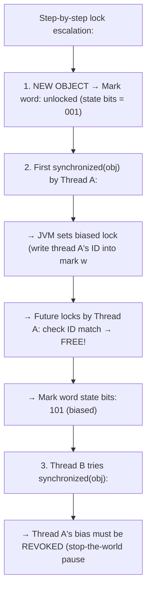

---

## 6. Method Dispatch: How JVM Calls the Right Method

### The Freeze Question
> "When you call `animal.makeSound()`, how does the JVM know to call Dog's version?"

### Deep Reasoning

```
╔══════════════════════════════════════════════════════════════════╗
║  THE PHONE DIRECTORY ANALOGY (vtable)                            ║
║                                                                  ║
║  Every class has a VIRTUAL METHOD TABLE (vtable):                ║
║  Like a phone directory listing methods and their addresses      ║
║                                                                  ║
║  class Animal:                                                   ║
║    vtable = [ eat → Animal.eat, makeSound → Animal.makeSound ]   ║
║                                                                  ║
║  class Dog extends Animal:                                       ║
║    vtable = [ eat → Animal.eat, makeSound → Dog.makeSound ]      ║
║                     ↑ inherited          ↑ OVERRIDDEN            ║
║                                                                  ║
║  When JVM executes: animal.makeSound()                           ║
║  1. Read animal's klass pointer → Dog.class metadata             ║
║  2. Look at vtable index for makeSound() → slot #1               ║
║  3. Find: Dog.makeSound (address: 0x1A2B3C)                      ║
║  4. Jump to 0x1A2B3C → execute Dog.makeSound()                   ║
║                                                                  ║
║  This is called VIRTUAL DISPATCH (invokevirtual bytecode)        ║
║  → Runtime cost: 1 pointer dereference + 1 table lookup          ║
║  → JIT compiler often INLINES this to zero cost!                 ║
╚══════════════════════════════════════════════════════════════════╝
```

**Flow:**
- THE PHONE DIRECTORY ANALOGY (vtable)
- ↓
- Every class has a VIRTUAL METHOD TABLE (vtable):
- ↓
- Like a phone directory listing methods and their addres
- ↓
- class Animal:
- ↓
- vtable = [ eat
- ↓
- Animal.eat, makeSound
- ↓
- Animal.makeSou
- ↓
- vtable = [ eat
- ↓
- Animal.eat, makeSound
- ↓
- Animal.makeSou
- ↓
- class Dog extends Animal:
- ↓
- vtable = [ eat
- ↓
- Animal.eat, makeSound
- ↓
- Dog.makeSound

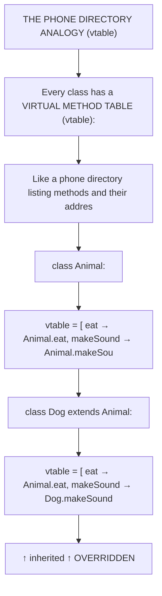

### The 5 Bytecode Invoke Instructions

```
┌────────────────────────────────────────────────────────────────────┐
│  Bytecode        │ When Used              │ Dispatch Method        │
│ ─────────────────┼────────────────────────┼───────────────────     │
│ invokevirtual    │ Normal instance methods │ vtable lookup         │
│ invokeinterface  │ Interface methods       │ itable lookup (slower)│
│ invokespecial    │ Constructors, super,    │ STATIC binding        │
│                  │ private methods         │ (no lookup needed)    │
│ invokestatic     │ Static methods          │ STATIC binding        │
│ invokedynamic    │ Lambdas, string concat  │ Bootstrap method      │
│                  │ (Java 7+)              │ (resolved once)        │
│                                                                    │
│ PERFORMANCE HIERARCHY:                                             │
│ invokestatic ≈ invokespecial > invokevirtual > invokeinterface     │
│ (direct call)                  (vtable)        (itable search)     │
│                                                                    │
│ BUT: JIT compiler makes this nearly irrelevant in practice.        │
│ Monomorphic calls (only one type ever seen) are INLINED.           │
└────────────────────────────────────────────────────────────────────┘
```

**Flow:**
- Bytecode When Used Dispatch Method
- ↓
- invokevirtual Normal instance methods vtable lookup
- ↓
- invokeinterface Interface methods itable lookup (slower
- ↓
- invokespecial Constructors, super, STATIC binding
- ↓
- private methods (no lookup needed)
- ↓
- invokestatic Static methods STATIC binding
- ↓
- invokedynamic Lambdas, string concat Bootstrap method

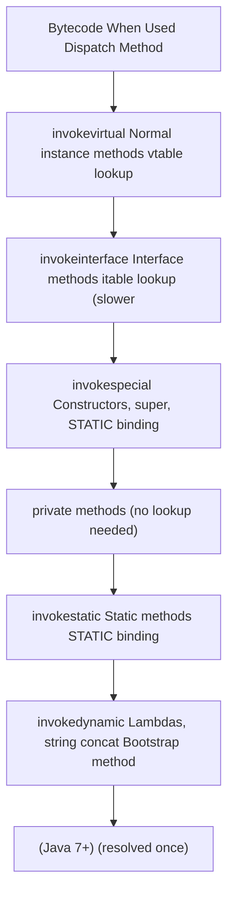

### Why Interface Calls Are Slightly Slower

```java
// With class hierarchy:
Animal animal = new Dog();
animal.makeSound();  // invokevirtual → vtable[1] → FAST (fixed index)

// With interface:
Soundable s = new Dog();
s.makeSound();      // invokeinterface → must search itable!
// Why? A class can implement MULTIPLE interfaces.
// The method might be at itable[0] for Dog but itable[3] for Cat.
// JVM must search: "Where is makeSound() in Dog's itable?"
// Optimization: JVM caches the last lookup (inline cache).
```

---

## 7. Method Hiding vs Overriding: The Static Method Freeze Moment

### The Freeze Question
> "What happens when a child class has a static method with the same signature as the parent?"

### Deep Reasoning

```
╔══════════════════════════════════════════════════════════════════╗
║  THE NAME TAG vs EMPLOYEE BADGE ANALOGY                          ║
║                                                                  ║
║  OVERRIDING (instance methods) = Employee Badge                  ║
║  → Machine reads your badge (runtime type) to decide access      ║
║  → You ARE a Dog, so Dog.makeSound() runs, regardless of         ║
║    whether someone labeled you "Animal"                          ║
║  → Dynamic dispatch: "What type IS this object?"                 ║
║                                                                  ║
║  HIDING (static methods) = Name Tag                              ║
║  → People read the name tag (compile-time type) on your desk     ║
║  → Your desk says "Animal", so Animal.staticMethod() runs        ║
║  → Even if there's a newer "Dog.staticMethod()"                  ║
║  → Static dispatch: "What type does the VARIABLE say?"           ║
║                                                                  ║
║  WHY? Static methods belong to the CLASS, not the OBJECT.        ║
║  There IS no object to check at runtime → no polymorphism.       ║
╚══════════════════════════════════════════════════════════════════╝
```

**Flow:**
- THE NAME TAG vs EMPLOYEE BADGE ANALOGY
- ↓
- OVERRIDING (instance methods) = Employee Badge
- ↓
- Machine reads your badge (runtime type) to decide acc
- ↓
- You ARE a Dog, so Dog.makeSound() runs, regardless of
- ↓
- whether someone labeled you 'Animal'
- ↓
- Dynamic dispatch: 'What type IS this object?'
- ↓
- HIDING (static methods) = Name Tag

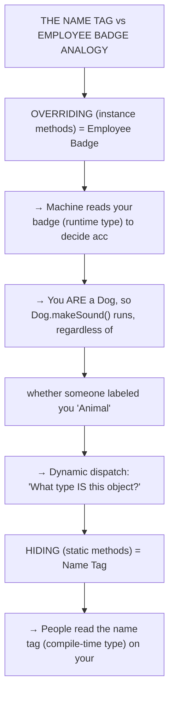

### Code Proof — This Confuses 90% of Java Developers

```java
class Parent {
    static void greet() { System.out.println("Parent static"); }
    void hello()        { System.out.println("Parent instance"); }
}

class Child extends Parent {
    static void greet() { System.out.println("Child static"); }  // HIDING
    @Override
    void hello()        { System.out.println("Child instance"); } // OVERRIDING
}

public class Test {
    public static void main(String[] args) {
        Parent obj = new Child();  // Reference type: Parent, Object type: Child

        obj.hello();   // "Child instance"  ← OVERRIDING works (runtime type)
        obj.greet();   // "Parent static"   ← HIDING! (compile-time type wins)

        // WHY "Parent static"?
        // obj.greet() compiles to → Parent.greet()
        // Because obj's DECLARED type is Parent.
        // Static methods don't go through vtable — no polymorphism!

        // If we change the reference type:
        Child child = new Child();
        child.greet();  // "Child static" ← now Child is the declared type
    }
}
```

### The Full Comparison

```
┌───────────────────┬─────────────────────────┬─────────────────────────┐
│ Feature           │ Overriding              │ Hiding                  │
├───────────────────┼─────────────────────────┼─────────────────────────┤
│ Applies to        │ Instance methods        │ Static methods          │
│ Dispatch          │ Runtime (dynamic)       │ Compile-time (static)   │
│ @Override         │ ✅ Compiler checks      │ ❌ Not applicable         │
│ Polymorphism      │ ✅ Yes                  │ ❌ No                     │
│ Bytecode          │ invokevirtual (vtable)  │ invokestatic (direct)   │
│ Binding           │ Late binding            │ Early binding           │
│ Which runs?       │ Object's actual type    │ Variable's declared type│
│ Can change access │ Same or WIDER           │ Same or WIDER           │
│ Can change return │ Covariant (subtype)     │ Must match exactly      │
│ fields?           │ Fields are HIDDEN too!  │ Fields are HIDDEN too!  │
└───────────────────┴─────────────────────────┴─────────────────────────┘
```

**Flow:**
- Feature Overriding Hiding
- ↓
- Applies to Instance methods Static methods
- ↓
- Dispatch Runtime (dynamic) Compile-time (static)
- ↓
- @Override ✅ Compiler checks ❌ Not applicable
- ↓
- Polymorphism ✅ Yes ❌ No
- ↓
- Bytecode invokevirtual (vtable) invokestatic (direct)
- ↓
- Binding Late binding Early binding

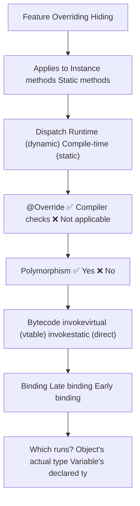

### Field Hiding Too!

```java
class Parent { int x = 10; }
class Child extends Parent { int x = 20; }

Parent obj = new Child();
System.out.println(obj.x);     // 10 (Parent's x — field hiding!)
System.out.println(((Child) obj).x);  // 20 (Child's x — need cast!)

// Fields are ALWAYS resolved at compile time.
// There is no "field overriding" in Java. Period.
// Both x fields EXIST in the Child object — side by side in memory.
```

---

## 8. Best Java Design Strategies: Building Robust Structures

### Strategy 1: Immutable Objects — The Default Choice

```
╔══════════════════════════════════════════════════════════════════╗
║  WHY IMMUTABLE BY DEFAULT?                                       ║
║                                                                  ║
║  Mutable object = A whiteboard anyone can erase and rewrite      ║
║  Immutable object = A printed document — read it, can't change   ║
║                                                                  ║
║  Benefits:                                                       ║
║  → Thread-safe WITHOUT synchronization (nothing to corrupt)      ║
║  → Safe as HashMap key (hashCode never changes)                  ║
║  → Safe to share references (no defensive copies needed)         ║
║  → Easier to reason about (predictable state)                    ║
║  → Cacheable (String pool, Integer cache work this way)          ║
║                                                                  ║
║  The 5 rules of immutability (Effective Java Item 17):           ║
║  1. Don't provide mutators (setters)                             ║
║  2. Make class final (prevent subclass from adding mutability)   ║
║  3. Make all fields final                                        ║
║  4. Make all fields private                                      ║
║  5. Ensure exclusive access to mutable components                ║
║     (defensive copy mutable fields in constructor AND getter)    ║
╚══════════════════════════════════════════════════════════════════╝
```

**Flow:**
- WHY IMMUTABLE BY DEFAULT?
- ↓
- Mutable object = A whiteboard anyone can erase and rewr
- ↓
- Benefits:
- ↓
- Thread-safe WITHOUT synchronization (nothing to corru
- ↓
- Safe as HashMap key (hashCode never changes)
- ↓
- Safe to share references (no defensive copies needed)
- ↓
- Easier to reason about (predictable state)

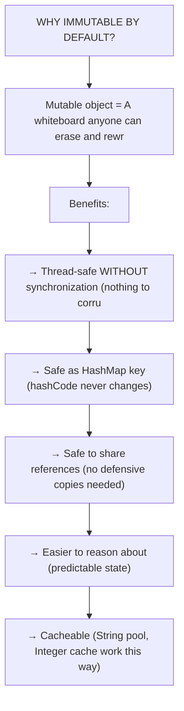

```java
// The BULLETPROOF immutable class:
public final class Money {
    private final BigDecimal amount;
    private final Currency currency;

    public Money(BigDecimal amount, Currency currency) {
        this.amount = Objects.requireNonNull(amount);
        this.currency = Objects.requireNonNull(currency);
    }

    public BigDecimal amount()   { return amount; }
    public Currency currency()   { return currency; }

    public Money add(Money other) {
        if (!this.currency.equals(other.currency))
            throw new IllegalArgumentException("Currency mismatch");
        return new Money(this.amount.add(other.amount), this.currency);
    }

    // equals, hashCode, toString...
}

// Or with Java 16+ records (instant immutability):
public record Money(BigDecimal amount, Currency currency) {
    public Money {  // compact constructor for validation
        Objects.requireNonNull(amount);
        Objects.requireNonNull(currency);
    }

    public Money add(Money other) {
        if (!this.currency.equals(other.currency))
            throw new IllegalArgumentException("Currency mismatch");
        return new Money(this.amount.add(other.amount), this.currency);
    }
}
```

### Strategy 2: Builder Pattern — When Constructors Get Complex

```java
// Problem: 8-parameter constructor — which is which?
new User("Alice", "Smith", "alice@example.com", 25, true, false, "NYC", "US");
//                                                ↑    ↑     ↑
//                                              age? active? verified? CONFUSING!

// Solution: Builder pattern (Effective Java Item 2)
User user = User.builder()
    .firstName("Alice")
    .lastName("Smith")
    .email("alice@example.com")
    .age(25)
    .active(true)
    .verified(false)
    .city("NYC")
    .country("US")
    .build();  // Validates ALL required fields

// WHY NOT telescoping constructors?
// User(name), User(name, email), User(name, email, age)...
// → 2^n combinations = unmanageable
// → Easy to swap same-type parameters (two Strings, two ints)

// WHY NOT setters?
// → Object in inconsistent state between setter calls
// → Not thread-safe during construction
// → Can't enforce required fields at compile time
```

### Strategy 3: Favor Composition Over Inheritance

```java
// ❌ Inheritance abuse:
class Stack<E> extends ArrayList<E> {
    public E push(E item) { add(item); return item; }
    public E pop() { return remove(size() - 1); }
    // But stack.add(0, element) inserts at bottom! Broken Stack contract.
    // remove(index) also available — stack shouldn't allow arbitrary removal.
}

// ✅ Composition:
class Stack<E> {
    private final List<E> elements = new ArrayList<>();  // HAS-A, not IS-A

    public void push(E item) { elements.add(item); }
    public E pop() {
        if (elements.isEmpty()) throw new EmptyStackException();
        return elements.remove(elements.size() - 1);
    }
    public E peek() { return elements.get(elements.size() - 1); }
    public int size() { return elements.size(); }
    // Only Stack operations exposed. No add(index) leak.
}
```

### Strategy 4: Effective Use of Interfaces

```java
// Program to the interface, not the implementation:
// ❌ ArrayList<String> names = new ArrayList<>(); // Tied to ArrayList
// ✅ List<String> names = new ArrayList<>();      // Can swap to LinkedList

// Java 8+ interfaces: use default methods for shared behavior
interface Loggable {
    default void log(String message) {
        System.out.println("[" + getClass().getSimpleName() + "] " + message);
    }
}

// Sealed interfaces (Java 17+): control the hierarchy
sealed interface Shape permits Circle, Rectangle, Triangle {
    double area();
}
// No one else can implement Shape — exhaustive pattern matching!
```

---

## 9. Records, Sealed Classes, and Modern Java Object Design

### Records (Java 16+) — The 80% Solution

```
╔══════════════════════════════════════════════════════════════════╗
║  record = "I'm just data. Give me equals, hashCode, toString."   ║
║                                                                  ║
║  WHAT YOU GET FREE:                                              ║
║  → final class (can't extend, only implement interfaces)         ║
║  → private final fields                                          ║
║  → All-args constructor                                          ║
║  → Accessor methods (name(), not getName())                      ║
║  → equals() based on ALL fields                                  ║
║  → hashCode() based on ALL fields                                ║
║  → toString() with field names and values                        ║
║                                                                  ║
║  WHAT YOU CAN CUSTOMIZE:                                         ║
║  → Compact constructor (for validation)                          ║
║  → Additional methods                                            ║
║  → Additional static methods                                     ║
║  → Implement interfaces                                          ║
║                                                                  ║
║  WHAT YOU CANNOT DO:                                             ║
║  → Extend another class (records extend Record implicitly)       ║
║  → Add instance fields (only the record components)              ║
║  → Make fields mutable (always final)                            ║
╚══════════════════════════════════════════════════════════════════╝
```

**Flow:**
- WHAT YOU GET FREE:
- ↓
- final class (can't extend, only implement interfaces)
- ↓
- private final fields
- ↓
- All-args constructor
- ↓
- Accessor methods (name(), not getName())
- ↓
- equals() based on ALL fields
- ↓
- hashCode() based on ALL fields

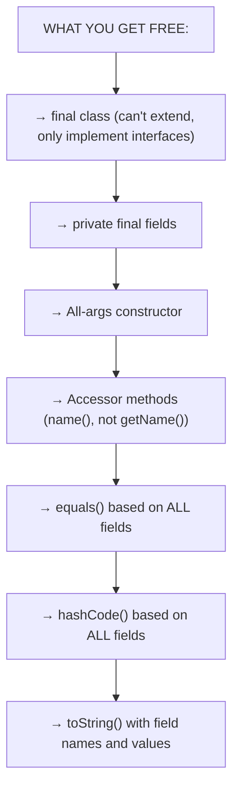

### Sealed Classes (Java 17+) — Controlled Hierarchies

```java
// The power of sealed + records + pattern matching:
sealed interface Expr permits Literal, Add, Multiply {
    // exhaustive — compiler knows ALL subtypes
}

record Literal(double value) implements Expr {}
record Add(Expr left, Expr right) implements Expr {}
record Multiply(Expr left, Expr right) implements Expr {}

// Evaluate with pattern matching (Java 21+):
double eval(Expr expr) {
    return switch (expr) {
        case Literal(var v)       -> v;
        case Add(var l, var r)    -> eval(l) + eval(r);
        case Multiply(var l, var r) -> eval(l) * eval(r);
        // No default needed! Compiler knows these are ALL cases.
    };
}

// WHY THIS MATTERS:
// If someone adds a new Expr subtype, the compiler FORCES them
// to update every switch statement. No "forgotten case" bugs.
```

---

## 10. Quick-Fire Table

| Interview Question | One-Line Senior Answer |
|---|---|
| "What's in an object header?" | Mark word (8 bytes: hashCode/lock/GC age) + klass pointer (4 bytes compressed). 12 bytes minimum header. |
| "What is the mark word?" | 64 bits whose meaning changes based on lock state: stores hashCode when unlocked, thread ID when biased, lock pointer when locked. |
| "Minimum object size?" | 16 bytes (12 header + 4 padding). Even `new Object()` costs 16 bytes. |
| "How does synchronized work internally?" | Lock escalation: biased (zero-cost single thread) → thin (CAS spin) → fat (OS mutex). Mark word tracks the state. |
| "Why was biased locking removed?" | JEP 374: The complexity of revoking biased locks at safepoints outweighed benefits for modern workloads with short-lived objects. |
| "Overriding vs hiding?" | Overriding = instance methods, dynamic dispatch (runtime type). Hiding = static methods, static dispatch (compile-time declared type). |
| "What's a vtable?" | Virtual method table — array of method pointers per class. JVM indexes into it for `invokevirtual`. Overridden methods replace parent's pointer at same index. |
| "Why are interface calls slower?" | Interface methods use itable search (must find the right interface), not fixed vtable index. JVM caches this with inline caches. |
| "What are compressed oops?" | For heaps < 32GB, JVM stores 4-byte references shifted by 3 bits instead of full 8-byte pointers. Saves ~40% heap on 64-bit JVMs. |
| "Why make objects immutable?" | Thread-safe without synchronization, safe as map keys, cacheable, shareable, predictable. Default to immutable, use records. |
| "When to use Builder?" | 4+ constructor parameters, especially with same types (two Strings). Prevents parameter-order bugs, enforces required fields, readable API. |
| "Record vs class?" | Record = immutable data carrier with auto-generated equals/hashCode/toString/accessors. Use when your type IS its data. |
| "Sealed class purpose?" | Restricts which classes can extend/implement. Enables exhaustive pattern matching — compiler ensures no case forgotten. |

---

> **Navigation**: [< Streams Deep Reasoning](Ch23_Streams_Deep_Reasoning.md) | [Back to Index](../00_MASTER_INDEX.md) | [Concurrency Synchronizers >](Ch17_Concurrency_Synchronizers.md)
