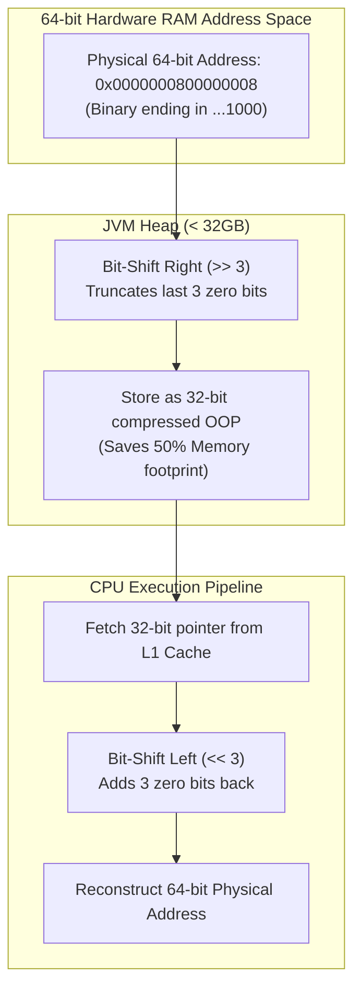
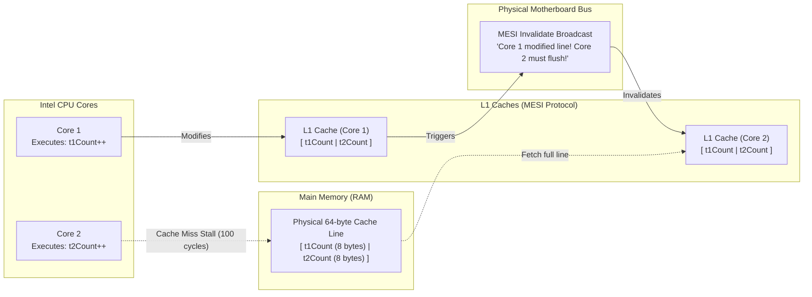

**Navigation**: [< Previous](Ch23_Streams_Deep_Reasoning.md) | [Back to Index](../00_MASTER_INDEX.md) | [Next >](Ch17_Concurrency_Synchronizers.md)

# Chapter 34 — JVM Object Model Internals: How Java Objects REALLY Live in Memory

**"Every time you write `new Object()`, the JVM creates a precise memory layout with an object header, klass pointer, and aligned fields. Understanding this turns you from 'I write Java' to 'I understand the machine I'm commanding.'"**

---

## Table of Contents

1. [Object Memory Layout: What `new` Actually Creates](#1-object-memory-layout)
2. [The Mark Word: 64 Bits That Control Everything](#2-the-mark-word)
3. [Klass Pointer: How JVM Knows the Type](#3-klass-pointer)
4. [Field Layout, Padding, and Alignment](#4-field-layout-padding-alignment)
5. [Lock Escalation: Biased → Thin → Fat](#5-lock-escalation)
6. [Method Dispatch: How JVM Calls the Right Method](#6-method-dispatch)
7. [Method Hiding vs Overriding: The Static Method Freeze Moment](#7-method-hiding-vs-overriding)
8. [Best Java Design Strategies: Building Robust Structures](#8-best-java-design-strategies)
9. [Records, Sealed Classes, and Modern Java Object Design](#9-records-sealed-classes)
10. [Quick-Fire Interview Table](#10-quick-fire-table)

---

## 1. Object Memory Layout: What `new` Actually Creates

### The Freeze Question

"What happens in memory when you write `new Object()`?"

### Deep Reasoning

**The passport analogy.** Every Java object is like a passport:

| Part of the object | Passport analogy | Contents |
| --- | --- | --- |
| **Object header: mark word** (8 bytes on a 64-bit JVM) | Passport cover and stamps | Identity hash code, GC age, lock state (thin or fat lock; biased locking was removed in JDK 18) |
| **Object header: klass pointer** (4 bytes, compressed) | "What type am I?" | Points to the class metadata in Metaspace |
| **Instance data** | Passport pages | Your fields: `int age`, `String name`, and so on |
| **Padding** | Empty pages for alignment | Pads the object to a multiple of 8 bytes |

EVERY object has this structure. Even `new Object()` is header (12 bytes) + padding (4 bytes) = 16 bytes minimum.

### Visual Memory Layout

**64-bit JVM with compressed oops** (the default for heaps under about 32 GB)

| Object | Mark word | Klass pointer | Other | Padding | Total |
| --- | --- | --- | --- | --- | --- |
| `new Object()` | 8 bytes | 4 bytes | none | 4 bytes | 16 bytes |
| `new int[0]` | 8 bytes | 4 bytes | array length: 4 bytes | 0 bytes | 16 bytes |
| `class Point { int x; int y; }` | 8 bytes | 4 bytes | `x`: 4 bytes, `y`: 4 bytes | 4 bytes (header 12 + data 8 = 20, padded to 24) | 24 bytes |

> [!NOTE]
> - Arrays have an extra 4-byte length field in the header.
> - Everything is padded to a multiple of 8 bytes (object alignment).

---

## 2. The Mark Word: 64 Bits That Control Everything

### Deep Reasoning

THE MOOD RING ANALOGY

The Mark Word is like a mood ring on every object:

The SAME 64 bits mean DIFFERENT things depending on state:

State: NORMAL (no lock)

| identity hashCode | unused | GC age | state |
| --- | --- | --- | --- |
| (31 bits) | (1 bit) | (4 bits) | (3 bits) |

State: BIASED LOCK

| thread ID | epoch | GC age | state |
| --- | --- | --- | --- |
| (54 bits) | (2 bits) | (4 bits) | (3 bits) |

State: THIN LOCK (lightweight)

| pointer to lock record on stack | state |
| --- | --- |
| (62 bits) | (2 bits) |

State: FAT LOCK (heavyweight / monitor)

| pointer to ObjectMonitor (OS mutex) | state |
| --- | --- |
| (62 bits) | (2 bits) |

State: GC (marked for garbage collection)

| forwarding pointer | state |
| --- | --- |
| (62 bits) | (2 bits) |

### State Bits Decoding

**Last 3 bits of mark word determine the object's lock state:**

| Bits | State | What it means |
| --- | --- | --- |
| `001` | Normal (unlocked) | hashCode stored, no lock |
| `101` | Biased | One thread owns it cheaply |
| `00` | Thin lock | CAS-based lightweight lock |
| `10` | Fat lock | OS mutex (heavyweight) |
| `11` | GC marked | Being garbage collected |

> [!WARNING]
> Biased locking was DEPRECATED in Java 15 and REMOVED in Java 18+ (JEP 374). The complexity didn't justify the small performance gain for modern workloads with many short-lived objects.

### Identity HashCode Deep Reasoning

```java
// When you call System.identityHashCode() or Object.hashCode() (if not overridden):
Object obj = new Object();
int hash = obj.hashCode();

// The hash is COMPUTED ONCE and STORED in the mark word (31 bits).
// This means:
//   1. Once hashCode() is called, the object CANNOT be biased-locked anymore
//      (hashCode bits overlap with thread ID bits)
//   2. The identity hashCode is NOT the memory address (common myth!)
//      It's a pseudo-random number stored in the header
//   3. Even if GC moves the object, the hashCode stays the same
//      (it's stored in the header, moves with the object)

// CONSEQUENCE for locking:
synchronized(obj) {
    // If obj.hashCode() was called BEFORE this:
    //   → Cannot use biased locking (hashCode took those bits)
    //   → Goes directly to thin lock
    // If obj.hashCode() was NOT called:
    //   → Can use biased locking (hashCode bits = thread ID)
}
```

---

🔬 **Section Challenge — 2. The Mark Word: 64 Bits That Control Everything**

**Challenge 1 (Diagnostic - Who/What/When):** A developer implements a custom caching framework that calls `System.identityHashCode(obj)` on every object before caching it. They notice that the application's synchronization performance severely degrades. **Who** controls the lock state? **What** did the hash code call overwrite, and **When** does the JVM now escalate the lock?

<details><summary>Answer</summary>

**Who controls lock state:** The Mark Word in the object header. **What was overwritten:** The identity hash code and the thread ID for biased locking share the exact same bits in the Mark Word. By computing the identity hash code, the JVM irreversibly writes that hash into those bits, making the object permanently ineligible for biased locking. **When it escalates:** The very next time a thread tries to `synchronized` on that object, the JVM must skip biased locking and immediately escalate to a lightweight (thin) lock (or a fat lock if contended), causing a performance drop.

</details>

## 3. Klass Pointer: How JVM Knows the Type

### Deep Reasoning

**THE EMPLOYEE ID BADGE ANALOGY**

```text
Klass Pointer = ID badge that says "I work in Department X"

Object in heap: "I am a String"
      │
      └──→ Klass Pointer ──→ String.class metadata
                                (in Metaspace, NOT heap)
                                Contains:
                                  → vtable (virtual method table)
                                  → field offsets
                                  → interface table (itable)
                                  → class hierarchy info
                                  → access flags

With Compressed Oops (heap < 32GB):
  Klass pointer = 4 bytes (shifted by 3 bits, like zip codes)
  Actual address = compressed_pointer << 3

Without Compressed Oops (heap ≥ 32GB):
  Klass pointer = 8 bytes (full 64-bit address)
  Every object header grows by 4 bytes!
```

### Why This Matters: `instanceof` Performance

```java
// instanceof checks the klass pointer → traverses class hierarchy
if (obj instanceof String) { ... }

// JVM implementation:
// 1. Read klass pointer from obj header
// 2. Check if it points to String.class metadata
// 3. If not, walk superclass chain: String → Object → null
// 4. Also check interface table (itable) for interface checks

// This is why:
// - instanceof concrete class = FAST (direct klass pointer match)
// - instanceof interface = SLIGHTLY SLOWER (must check itable)
// - Deep hierarchy = more hops (but JVM caches common checks)

// Pattern matching (Java 16+) compiles to the same mechanism:
if (obj instanceof String s) {
    // s is already cast — JVM does instancecheck + cast in one op
    // This is ZERO extra cost over traditional instanceof + cast
}
```

---

🔬 **Section Challenge — 3. Klass Pointer: How JVM Knows the Type**

**Challenge 1 (Trace — Who/When/What):** `Animal a = new Dog(); a.speak()` — **who** resolves `speak()` to `Dog.speak()`? **When** at runtime? **What** data structure in the JVM makes this possible?

<details><summary>Answer</summary>

**Who resolves?** The JVM's virtual dispatch mechanism via the Klass pointer. **When?** At the `invokevirtual` bytecode instruction — not at compile time. **What data structure?** The vtable (virtual method table) embedded in the Klass (C++ object in JVM metadata). Each class's vtable is an array of method pointers. `Dog`'s vtable entry for `speak` points to `Dog.speak()`. When `a.speak()` executes: (1) Load object ref `a`. (2) Follow Klass pointer (compressed, in object header). (3) Look up `speak()` in the vtable at a fixed index. (4) Call the resolved method pointer. This entire dispatch costs ~1 ns — significantly faster than reflection which bypasses this and does hash-map lookups.

</details>

**Challenge 2 (Bug Hunt):** A method returns `(T) jsonDeserialize(json)` where T is a generic type param. When does the `ClassCastException` actually occur?

<details><summary>Answer</summary>

NOT at the cast — the unchecked cast compiles to nothing at runtime (erasure). The CCE occurs when the calling code tries to USE the returned value as a specific type. This makes debugging hard: the error appears far from the actual source. Use `Class<T> clazz` parameter to do safe `clazz.cast(...)` instead.

</details>

## 4. Field Layout, Padding, and Alignment

### Deep Reasoning

**THE BOOKSHELF ANALOGY**

```text
CPU reads memory in aligned chunks (like shelves of fixed width)

If a `long` (8 bytes) starts at address 5:
→ CPU must do TWO reads (bytes 0-7 and bytes 8-15)
→ Then combine them = SLOW

If a `long` starts at address 8 (aligned):
→ CPU does ONE read = FAST

JVM RULES for field ordering:
1. Fields are NOT laid out in declaration order
2. JVM reorders to minimize padding
3. Larger fields first: longs, doubles → ints → shorts → bytes
4. Object references grouped together (for GC card marking)
5. Final padding to 8-byte boundary
```

### Code Proof — Field Reordering

```java
// YOU WRITE:
class BadLayout {
    boolean a;    // 1 byte
    long b;       // 8 bytes
    boolean c;    // 1 byte
    int d;        // 4 bytes
}

// NAIVE LAYOUT (if JVM followed declaration order):
// Offset 0-11:  Header (12 bytes)
// Offset 12:    boolean a (1 byte)
// Offset 13-19: PADDING (7 bytes to align long!)
// Offset 20-27: long b (8 bytes)
// Offset 28:    boolean c (1 byte)
// Offset 29-31: PADDING (3 bytes to align int!)
// Offset 32-35: int d (4 bytes)
// Offset 36-39: PADDING (4 bytes to align object to 8)
// Total: 40 bytes (16 bytes wasted on padding!)

// ACTUAL JVM LAYOUT (reordered):
// Offset 0-11:  Header (12 bytes)
// Offset 12-15: int d (4 bytes — fills header gap perfectly)
// Offset 16-23: long b (8 bytes — aligned at 8)
// Offset 24:    boolean a (1 byte)
// Offset 25:    boolean c (1 byte)
// Offset 26-31: PADDING (6 bytes to 8-byte boundary)
// Total: 32 bytes (only 6 bytes wasted!)

// You can verify with JOL (Java Object Layout):
// import org.openjdk.jol.info.ClassLayout;
// System.out.println(ClassLayout.parseClass(BadLayout.class).toPrintable());
```

### Memory Cost of Common Objects

| Object | Actual size | "Useful" data |
| --- | --- | --- |
| `new Object()` | 16 bytes | 0 bytes (!) |
| `new Integer(42)` | 16 bytes | 4 bytes (int) |
| `new Long(42L)` | 24 bytes | 8 bytes (long) |
| `new Boolean(true)` | 16 bytes | 1 byte (!) |
| `""` (empty String) | 40 bytes | 0 chars (!) |
| `"Hello"` (5 chars) | ~56 bytes | 10 bytes |
| `new int[0]` | 16 bytes | 0 bytes (!) |
| `new int[10]` | 56 bytes | 40 bytes |
| `new HashMap<>()` | ~128 bytes | 0 entries |
| `new ArrayList<>()` | ~64 bytes | 0 elements |

> [!NOTE]
> **Lesson:** boxing `int` → `Integer` costs 12 extra bytes (300%). This is why `IntStream` exists: it avoids boxing overhead.

---

🔬 **Section Challenge — 4. Field Layout, Padding, and Alignment**

**Challenge 1 (Reasoning):** Why does a simple `boolean` field (1 bit of data) in a Java object actually consume 16 bytes of memory in the JVM?

<details><summary>Answer</summary>

Object Header and Padding (Alignment). Every Java object has a 12-byte Object Header (Mark Word + Klass Pointer). If you add a 1-byte `boolean` field, the total size is 13 bytes. However, modern CPUs fetch memory in 8-byte chunks. To ensure fast CPU access, the JVM pads all objects to a multiple of 8 bytes (8-byte alignment). Therefore, the 13 bytes are padded with 3 bytes of empty space, resulting in a 16-byte object footprint for a single boolean.

</details>

## 5. Lock Escalation: Biased → Thin → Fat

### The Freeze Question

"What happens inside the JVM when you use `synchronized`?"

### Deep Reasoning

**THE BATHROOM LOCK ANALOGY**

```text
BIASED LOCK (you live alone):
→ Bathroom door has your name on it permanently
→ You walk in without checking — ZERO cost
→ If a guest arrives, name must be erased (revoke bias)
→ Cost: ~0 for single thread, expensive revocation

THIN LOCK (you have a roommate):
→ Bathroom has a sign you flip: "OCCUPIED" / "FREE"
→ Quick check (CAS operation) — done in user-space
→ If sign is stuck, you spin (try again a few times)
→ Cost: one CAS instruction (~10-20 nanoseconds)

FAT LOCK (it's a public bathroom):
→ Bathroom has a full queue management system (OS mutex)
→ You take a number, sit and wait (thread parked / blocked)
→ OS kernel involved: context switch = expensive
→ Cost: ~1-10 microseconds (100-1000x more than thin lock!)

ESCALATION PATH (only goes UP, never back down):
Biased ──[contention]──→ Thin ──[spinning fails]──→ Fat
```

### Lock Escalation Steps

```text
Step-by-step lock escalation:

1. NEW OBJECT → Mark word: unlocked (state bits = 001)

2. First synchronized(obj) by Thread A:
   → JVM sets biased lock (write thread A's ID into mark word)
   → Future locks by Thread A: check ID match → FREE!
   → Mark word state bits: 101 (biased)

3. Thread B tries synchronized(obj):
   → Thread A's bias must be REVOKED (stop-the-world pause!)
   → Escalate to thin lock (CAS-based)
   → Mark word now points to lock record on stack
   → State bits: 00 (thin/lightweight)

4. Thread B spins (retries CAS) but Thread A holds too long:
   → JVM decides: "spinning is wasting CPU"
   → Escalate to fat lock (OS mutex, ObjectMonitor)
   → Thread B is PARKED (sleeping, no CPU usage)
   → State bits: 10 (heavyweight)

5. Thread A releases → OS wakes Thread B → Thread B acquires

⚠️ Once inflated to fat lock, it stays fat for that object!
(Deflation is possible but rare — implementation-dependent)
```

---

🔬 **Section Challenge — 5. Lock Escalation: Biased → Thin → Fat**

**Challenge 1 (Diagnostic - What/Where/Why):** Two threads repeatedly contend for a `synchronized` block on the same object. The JVM escalates the lock. **What** state does the lock enter? **Where** does the object's Mark Word now point, and **Why** does this state persist even after the threads finish?

<details><summary>Answer</summary>

**What state:** It enters the "Fat Lock" (heavyweight monitor) state. **Where it points:** The Mark Word changes to point to a heavyweight `ObjectMonitor` object allocated in native memory (C++ level), which interfaces with the OS mutex/thread-parking primitives. **Why it persists:** Lock escalation is a one-way street in traditional JVMs. Once an object's lock inflates to a Fat Lock due to contention, it remains a Fat Lock for the rest of that object's lifetime to avoid the massive overhead of repeatedly inflating and deflating the monitor.

</details>

## 6. Method Dispatch: How JVM Calls the Right Method

### The Freeze Question

"When you call `animal.makeSound()`, how does the JVM know to call Dog's version?"

### Deep Reasoning

```text
THE PHONE DIRECTORY ANALOGY (vtable)

Every class has a VIRTUAL METHOD TABLE (vtable):
Like a phone directory listing methods and their addresses

class Animal:
  vtable = [ eat → Animal.eat, makeSound → Animal.makeSound ]

class Dog extends Animal:
  vtable = [ eat → Animal.eat, makeSound → Dog.makeSound ]
                   ↑ inherited          ↑ OVERRIDDEN

When JVM executes: animal.makeSound()
1. Read animal's klass pointer → Dog.class metadata
2. Look at vtable index for makeSound() → slot #1
3. Find: Dog.makeSound (address: 0x1A2B3C)
4. Jump to 0x1A2B3C → execute Dog.makeSound()

This is called VIRTUAL DISPATCH (invokevirtual bytecode)
→ Runtime cost: 1 pointer dereference + 1 table lookup
→ JIT compiler often INLINES this to zero cost!
```

### The 5 Bytecode Invoke Instructions

| Bytecode | When used | Dispatch method |
| --- | --- | --- |
| `invokevirtual` | Normal instance methods | vtable lookup |
| `invokeinterface` | Interface methods | itable lookup (slower) |
| `invokespecial` | Constructors, `super`, private methods | STATIC binding (no lookup needed) |
| `invokestatic` | Static methods | STATIC binding |
| `invokedynamic` | Lambdas (Java 8), string concat (Java 9+) | Bootstrap method (resolved once) |

**Performance hierarchy:** `invokestatic` ≈ `invokespecial` (direct call) > `invokevirtual` (vtable) > `invokeinterface` (itable search).

> [!NOTE]
> The JIT compiler makes this nearly irrelevant in practice. Monomorphic calls (only one type ever seen) are INLINED.

### Why Interface Calls Are Slightly Slower

```java
// With class hierarchy:
Animal animal = new Dog();
animal.makeSound();  // invokevirtual → vtable[1] → FAST (fixed index)

// With interface:
Soundable s = new Dog();
s.makeSound();      // invokeinterface → must search itable!
// Why? A class can implement MULTIPLE interfaces.
// The method might be at itable[0] for Dog but itable[3] for Cat.
// JVM must search: "Where is makeSound() in Dog's itable?"
// Optimization: JVM caches the last lookup (inline cache).
```

---

## 7. Method Hiding vs Overriding: The Static Method Freeze Moment

### The Freeze Question

"What happens when a child class has a static method with the same signature as the parent?"

### Deep Reasoning

```text
THE NAME TAG vs EMPLOYEE BADGE ANALOGY

OVERRIDING (instance methods) = Employee Badge
→ Machine reads your badge (runtime type) to decide access
→ You ARE a Dog, so Dog.makeSound() runs, regardless of
  whether someone labeled you "Animal"
→ Dynamic dispatch: "What type IS this object?"

HIDING (static methods) = Name Tag
→ People read the name tag (compile-time type) on your desk
→ Your desk says "Animal", so Animal.staticMethod() runs
→ Even if there's a newer "Dog.staticMethod()"
→ Static dispatch: "What type does the VARIABLE say?"

WHY? Static methods belong to the CLASS, not the OBJECT.
There IS no object to check at runtime → no polymorphism.
```

### Code Proof — This Confuses 90% of Java Developers

```java
class Parent {
    static void greet() { System.out.println("Parent static"); }
    void hello()        { System.out.println("Parent instance"); }
}

class Child extends Parent {
    static void greet() { System.out.println("Child static"); }  // HIDING
    @Override
    void hello()        { System.out.println("Child instance"); } // OVERRIDING
}

public class Test {
    public static void main(String[] args) {
        Parent obj = new Child();  // Reference type: Parent, Object type: Child

        obj.hello();   // "Child instance"  ← OVERRIDING works (runtime type)
        obj.greet();   // "Parent static"   ← HIDING! (compile-time type wins)

        // WHY "Parent static"?
        // obj.greet() compiles to → Parent.greet()
        // Because obj's DECLARED type is Parent.
        // Static methods don't go through vtable — no polymorphism!

        // If we change the reference type:
        Child child = new Child();
        child.greet();  // "Child static" ← now Child is the declared type
    }
}
```

### The Full Comparison

| Feature | Overriding | Hiding |
| --- | --- | --- |
| Applies to | Instance methods | Static methods |
| Dispatch | Runtime (dynamic) | Compile-time (static) |
| @Override | ✅ Compiler checks | ❌ Not applicable |
| Polymorphism | ✅ Yes | ❌ No |
| Bytecode | invokevirtual (vtable) | invokestatic (direct) |
| Binding | Late binding | Early binding |
| Which runs? | Object's actual type | Variable's declared type |
| Can change access | Same or WIDER | Same or WIDER |
| Can change return | Covariant (subtype) | Must match exactly |
| fields? | Fields are HIDDEN too! | Fields are HIDDEN too! |

### Field Hiding Too!

```java
class Parent { int x = 10; }
class Child extends Parent { int x = 20; }

Parent obj = new Child();
System.out.println(obj.x);     // 10 (Parent's x — field hiding!)
System.out.println(((Child) obj).x);  // 20 (Child's x — need cast!)

// Fields are ALWAYS resolved at compile time.
// There is no "field overriding" in Java. Period.
// Both x fields EXIST in the Child object — side by side in memory.
```

---

🔬 **Section Challenge — 7. Method Hiding vs Overriding: The Static Method Freeze Moment**

**Challenge 1 (Bug Hunt - Who/What/How):** A junior developer writes a static `getInstance()` method in a `Vehicle` parent class and a static `getInstance()` method in a `Car` child class. They call `Vehicle v = new Car(); v.getInstance();` expecting the `Car` version. **Who** actually executes? **What** bytecode instruction makes this happen, and **How** should this be fixed?

<details><summary>Answer</summary>

**Who executes:** The `Vehicle.getInstance()` method executes. This is Method Hiding, not Overriding. **What bytecode:** The compiler generates an `invokestatic` instruction, which binds _statically_ at compile-time to the declared type of the reference (`Vehicle`), completely ignoring the runtime object type (`Car`). **How to fix:** Static methods cannot be polymorphic. If you need polymorphic behavior based on the object type, you must use an instance method. If it must be a factory, use the Factory/Builder pattern or pass a `Class<T>` token.

</details>

## 8. Best Java Design Strategies: Building Robust Structures

### Strategy 1: Immutable Objects — The Default Choice

```text
WHY IMMUTABLE BY DEFAULT?

Mutable object = A whiteboard anyone can erase and rewrite
Immutable object = A printed document — read it, can't change

Benefits:
→ Thread-safe WITHOUT synchronization (nothing to corrupt)
→ Safe as HashMap key (hashCode never changes)
→ Safe to share references (no defensive copies needed)
→ Easier to reason about (predictable state)
→ Cacheable (String pool, Integer cache work this way)

The 5 rules of immutability (Effective Java Item 17):
1. Don't provide mutators (setters)
2. Make class final (prevent subclass from adding mutability)
3. Make all fields final
4. Make all fields private
5. Ensure exclusive access to mutable components
   (defensive copy mutable fields in constructor AND getter)
```

```java
// The BULLETPROOF immutable class:
public final class Money {
    private final BigDecimal amount;
    private final Currency currency;

    public Money(BigDecimal amount, Currency currency) {
        this.amount = Objects.requireNonNull(amount);
        this.currency = Objects.requireNonNull(currency);
    }

    public BigDecimal amount()   { return amount; }
    public Currency currency()   { return currency; }

    public Money add(Money other) {
        if (!this.currency.equals(other.currency))
            throw new IllegalArgumentException("Currency mismatch");
        return new Money(this.amount.add(other.amount), this.currency);
    }

    // equals, hashCode, toString...
}

// Or with Java 16+ records (instant immutability):
public record Money(BigDecimal amount, Currency currency) {
    public Money {  // compact constructor for validation
        Objects.requireNonNull(amount);
        Objects.requireNonNull(currency);
    }

    public Money add(Money other) {
        if (!this.currency.equals(other.currency))
            throw new IllegalArgumentException("Currency mismatch");
        return new Money(this.amount.add(other.amount), this.currency);
    }
}
```

### Strategy 2: Builder Pattern — When Constructors Get Complex

```java
// Problem: 8-parameter constructor — which is which?
new User("Alice", "Smith", "alice@example.com", 25, true, false, "NYC", "US");
//                                                ↑    ↑     ↑
//                                              age? active? verified? CONFUSING!

// Solution: Builder pattern (Effective Java Item 2)
User user = User.builder()
    .firstName("Alice")
    .lastName("Smith")
    .email("alice@example.com")
    .age(25)
    .active(true)
    .verified(false)
    .city("NYC")
    .country("US")
    .build();  // Validates ALL required fields

// WHY NOT telescoping constructors?
// User(name), User(name, email), User(name, email, age)...
// → 2^n combinations = unmanageable
// → Easy to swap same-type parameters (two Strings, two ints)

// WHY NOT setters?
// → Object in inconsistent state between setter calls
// → Not thread-safe during construction
// → Can't enforce required fields at compile time
```

### Strategy 3: Favor Composition Over Inheritance

```java
// ❌ Inheritance abuse:
class Stack<E> extends ArrayList<E> {
    public E push(E item) { add(item); return item; }
    public E pop() { return remove(size() - 1); }
    // But stack.add(0, element) inserts at bottom! Broken Stack contract.
    // remove(index) also available — stack shouldn't allow arbitrary removal.
}

// ✅ Composition:
class Stack<E> {
    private final List<E> elements = new ArrayList<>();  // HAS-A, not IS-A

    public void push(E item) { elements.add(item); }
    public E pop() {
        if (elements.isEmpty()) throw new EmptyStackException();
        return elements.remove(elements.size() - 1);
    }
    public E peek() { return elements.get(elements.size() - 1); }
    public int size() { return elements.size(); }
    // Only Stack operations exposed. No add(index) leak.
}
```

### Strategy 4: Effective Use of Interfaces

```java
// Program to the interface, not the implementation:
// ❌ ArrayList<String> names = new ArrayList<>(); // Tied to ArrayList
// ✅ List<String> names = new ArrayList<>();      // Can swap to LinkedList

// Java 8+ interfaces: use default methods for shared behavior
interface Loggable {
    default void log(String message) {
        System.out.println("[" + getClass().getSimpleName() + "] " + message);
    }
}

// Sealed interfaces (Java 17+): control the hierarchy
sealed interface Shape permits Circle, Rectangle, Triangle {
    double area();
}
// No one else can implement Shape — exhaustive pattern matching!
```

---

🔬 **Section Challenge — 8. Best Java Design Strategies: Building Robust Structures**

**Challenge 1 (Design - Why/How/What):** A developer wants to use a `User` object as a key in a `HashMap`. **Why** must the object be immutable? **How** should defensive copying be applied if `User` contains a `Date` field, and **What** happens if the `Date` is modified after insertion?

<details><summary>Answer</summary>

**Why immutable:** A `HashMap` relies on the key's `hashCode()` remaining constant. If the object changes and its hash code changes, it will be lost in the wrong hash bucket forever. **How to copy:** The constructor must `new Date(date.getTime())` to clone the incoming date, and the getter must return a clone, preventing external mutation. **What happens:** If the `Date` mutates after insertion (and the hash code depends on it), future `map.get(user)` calls will look in the wrong bucket and return `null`, causing a severe memory leak as the original entry can never be retrieved or removed.

</details>

## 9. Records, Sealed Classes, and Modern Java Object Design

### Records (Java 16+) — The 80% Solution

```text
record = "I'm just data. Give me equals, hashCode, toString."

WHAT YOU GET FREE:
→ final class (can't extend, only implement interfaces)
→ private final fields
→ All-args constructor
→ Accessor methods (name(), not getName())
→ equals() based on ALL fields
→ hashCode() based on ALL fields
→ toString() with field names and values

WHAT YOU CAN CUSTOMIZE:
→ Compact constructor (for validation)
→ Additional methods
→ Additional static methods
→ Implement interfaces

WHAT YOU CANNOT DO:
→ Extend another class (records extend Record implicitly)
→ Add instance fields (only the record components)
→ Make fields mutable (always final)
```

### Sealed Classes (Java 17+) — Controlled Hierarchies

```java
// The power of sealed + records + pattern matching:
sealed interface Expr permits Literal, Add, Multiply {
    // exhaustive — compiler knows ALL subtypes
}

record Literal(double value) implements Expr {}
record Add(Expr left, Expr right) implements Expr {}
record Multiply(Expr left, Expr right) implements Expr {}

// Evaluate with pattern matching (Java 21+):
double eval(Expr expr) {
    return switch (expr) {
        case Literal(var v)       -> v;
        case Add(var l, var r)    -> eval(l) + eval(r);
        case Multiply(var l, var r) -> eval(l) * eval(r);
        // No default needed! Compiler knows these are ALL cases.
    };
}

// WHY THIS MATTERS:
// If someone adds a new Expr subtype, the compiler FORCES them
// to update every switch statement. No "forgotten case" bugs.
```

---

---

# PART 11: THE GRAND UNIFIED THEORY OF JVM MEMORY PHYSICS (Deconstructed)

> _"Java is not a software abstraction. It is a highly engineered C++ program (the HotSpot JVM) designed to map high-level object-oriented syntax directly onto Intel x86-64 CPU registers, L1 caches, and RAM pipelines. If you do not understand Cache Lines, False Sharing, and OOP Compression mathematics, you do not understand Java."_

This section strips away the "Passport" and "Bookshelf" analogies. We will look at exactly what the Silicon is doing when you instantiate an object, align memory, and execute virtual methods.

---

## 11.1 The Abstraction: "Object References" vs The Reality of Compressed OOPs

**The Abstraction Taught:** "In Java, everything is an Object, and variables hold references (memory addresses) to those objects."

**The Naked Truth:** A 64-bit CPU naturally uses 64-bit (8-byte) pointers for memory addresses. If Java used raw 64-bit pointers for every object reference, the heap size would instantly bloat by 50% compared to a 32-bit system. Furthermore, larger pointers mean fewer objects fit into the CPU's ultra-fast L1 cache, causing **Cache Misses** (which stall the CPU for 100+ clock cycles while fetching from main RAM).

**The Mechanical Execution (Compressed OOPs):**

To solve this, the JVM uses a mathematical trick called **Compressed Ordinary Object Pointers (Oops)**.

If your heap is smaller than 32GB, the JVM does _not_ store real 64-bit memory addresses. It stores **32-bit integers**.

1. **The Alignment Physics:** The JVM forces EVERY object to be aligned to an 8-byte boundary. This means object addresses always end in three binary zeros (e.g., `0x1000`, `0x1008`, `0x1010`).
2. **The Compression Algorithm:** Because the last 3 bits are _always_ zero, they are mathematically redundant. When the JVM saves an object reference, it takes the 64-bit RAM address and **bit-shifts it right by 3** (`address >> 3`). This truncates the address down to 32 bits, saving 50% of the pointer memory.
3. **The Decompression Pipeline:** When you run `System.out.println(user.name)`, the CPU fetches the 32-bit compressed pointer, **bit-shifts it left by 3** (`pointer << 3`), adding three zeros back to the end to reconstruct the actual 64-bit hardware RAM address.
4. **The 32GB Limit:** A 32-bit integer can address $2^{32}$ (4 Billion) distinct locations. Because each location represents an 8-byte block (thanks to the shift), $4 \text{ Billion} \times 8 \text{ Bytes} = 32 \text{ Gigabytes}$.
   If you allocate 33GB to your Java Heap (`-Xmx33G`), the math breaks. The JVM is forced to disable Compressed OOPs and revert to raw 64-bit pointers. **A 33GB heap can actually hold LESS usable data than a 31GB heap because of pointer bloat.**



**How to read this diagram.** Read top to bottom: the 64-bit address is shifted right by 3 (dropping the three always-zero bits) and stored as a 32-bit compressed OOP; on a read, the CPU fetches the 32-bit pointer, shifts it left by 3, and reconstructs the 64-bit address. Notice the 50% pointer saving - it works only because objects are 8-byte aligned and the heap stays under 32GB.

---

## 11.2 The Abstraction: "Object Padding" vs The Reality of Cache Line False Sharing

**The Abstraction:** "The JVM pads objects to 8-byte boundaries just to keep memory neat."

**The Naked Truth:** The JVM pads objects because the CPU does not read individual bytes from RAM. The CPU memory controller reads RAM in chunks called **Cache Lines**, which are exactly 64 bytes wide.

**The Mechanical Execution (CPU Caching):**
When Thread A wants to read `obj.field1`, the CPU does not fetch just `field1`. It fetches a 64-byte block surrounding `field1` and places it in the L1 Cache.

**The Catastrophe (False Sharing):**
Imagine you build a high-performance multithreaded counter:

```java
class GlobalCounter {
    volatile long thread1Count; // 8 bytes
    volatile long thread2Count; // 8 bytes
}
```

1. `thread1Count` and `thread2Count` are placed adjacently in RAM by the JVM.
2. They physically occupy the exact same 64-byte Cache Line.
3. Thread 1 (running on CPU Core 1) increments `thread1Count`.
4. **The MESI Protocol:** Because Core 1 modified a variable in the Cache Line, the Intel CPU's MESI cache-coherence protocol broadcasts a signal across the motherboard bus: _"I have modified this Cache Line. Any other core holding this line must INVALIDIATE it."_
5. Thread 2 (running on CPU Core 2) tries to increment `thread2Count`. But its L1 Cache was just invalidated by Core 1. Core 2 is physically forced to stall, go all the way out to main RAM, and fetch the Cache Line again.
6. Thread 1 and Thread 2 enter a death spiral of constantly invalidating each other's L1 cache, degrading performance by 1000x, even though they are operating on _completely different variables_. This is **False Sharing**.

**The Physics Solution (`@Contended`):**

To fix this, high-performance Java (like the `LongAdder` or `ConcurrentHashMap`) uses the `@jdk.internal.vm.annotation.Contended` annotation.

This tells the JVM: _"Physically inject 64 bytes of dead padding (zeros) between `thread1Count` and `thread2Count` in the Object Layout."_

Now, `thread1Count` lives in Cache Line A, and `thread2Count` lives in Cache Line B. Thread 1 and Thread 2 can increment their counters billions of times per second without ever triggering MESI invalidation across the CPU cores.



**How to read this diagram.** Follow the arrows: Core 1 modifies `t1Count` in its L1 cache, which triggers a MESI invalidate broadcast that invalidates Core 2's copy of the same line, so Core 2 stalls on a cache miss (about 100 cycles) and refetches the line from RAM. Notice that `t1Count` and `t2Count` share one 64-byte cache line, so Core 2 pays for a variable it never touched - this is false sharing.

---

## 11.3 The Abstraction: "Virtual Methods" vs The Reality of CPU Branch Prediction

**The Abstraction:** "Polymorphism lets `animal.speak()` automatically resolve to `Dog.speak()` at runtime."

**The Naked Truth:** Polymorphism physically breaks CPU execution pipelines.

**The Mechanical Execution:**

Modern CPUs execute instructions using a Pipeline (Fetch, Decode, Execute). To keep the pipeline full, the CPU tries to guess the outcome of `if` statements and function calls before they happen (**Branch Prediction**).

If you have a loop calling `animal.speak()`:

1. **Monomorphic Call Site:** If every single object in the loop is a `Dog`, the CPU's branch predictor learns the pattern. It preemptively loads the `Dog.speak()` machine code into the L1 Instruction Cache. Furthermore, the HotSpot JVM's C2 JIT Compiler will actually **Inline** the code, completely deleting the `invokevirtual` dispatch overhead.
2. **Megamorphic Call Site:** If your list is `[Dog, Cat, Bird, Dog, Fish]`, the CPU's branch predictor completely fails. It guesses wrong on every iteration.
3. **The Pipeline Flush:** Every time the CPU guesses wrong, it must dump its entire instruction pipeline (a 20-cycle penalty), follow the Object Header Klass Pointer, jump to the Metaspace, scan the Virtual Method Table (vtable) array to find the pointer to `speak()`, and finally jump to the memory address of the specific implementation.

**The Production Lesson:** In high-frequency algorithmic trading systems written in Java, developers intentionally avoid deep interface hierarchies and polymorphism in the hot path. They use `final` classes and concrete types to guarantee Monomorphic Call Sites, allowing the JVM to aggressively inline methods and keep the CPU execution pipeline saturated.

---

## 10. Quick-Fire Table

| Interview Question                       | One-Line Senior Answer                                                                                                                                         |
| ---------------------------------------- | -------------------------------------------------------------------------------------------------------------------------------------------------------------- |
| "What's in an object header?"            | Mark word (8 bytes: hashCode/lock/GC age) + klass pointer (4 bytes compressed). 12 bytes minimum header.                                                       |
| "What is the mark word?"                 | 64 bits whose meaning changes based on lock state: stores hashCode when unlocked, thread ID when biased, lock pointer when locked.                             |
| "Minimum object size?"                   | 16 bytes (12 header + 4 padding). Even `new Object()` costs 16 bytes.                                                                                          |
| "How does synchronized work internally?" | Lock escalation: biased (zero-cost single thread) → thin (CAS spin) → fat (OS mutex). Mark word tracks the state.                                              |
| "Why was biased locking removed?"        | JEP 374: The complexity of revoking biased locks at safepoints outweighed benefits for modern workloads with short-lived objects.                              |
| "Overriding vs hiding?"                  | Overriding = instance methods, dynamic dispatch (runtime type). Hiding = static methods, static dispatch (compile-time declared type).                         |
| "What's a vtable?"                       | Virtual method table — array of method pointers per class. JVM indexes into it for `invokevirtual`. Overridden methods replace parent's pointer at same index. |
| "Why are interface calls slower?"        | Interface methods use itable search (must find the right interface), not fixed vtable index. JVM caches this with inline caches.                               |
| "What are compressed oops?"              | For heaps < 32GB, JVM stores 4-byte references shifted by 3 bits instead of full 8-byte pointers. Saves ~40% heap on 64-bit JVMs.                              |
| "Why make objects immutable?"            | Thread-safe without synchronization, safe as map keys, cacheable, shareable, predictable. Default to immutable, use records.                                   |
| "When to use Builder?"                   | 4+ constructor parameters, especially with same types (two Strings). Prevents parameter-order bugs, enforces required fields, readable API.                    |
| "Record vs class?"                       | Record = immutable data carrier with auto-generated equals/hashCode/toString/accessors. Use when your type IS its data.                                        |
| "Sealed class purpose?"                  | Restricts which classes can extend/implement. Enables exhaustive pattern matching — compiler ensures no case forgotten.                                        |

---

**Navigation**: [< Streams Deep Reasoning](Ch23_Streams_Deep_Reasoning.md) | [Back to Index](../00_MASTER_INDEX.md) | [Concurrency Synchronizers >](Ch17_Concurrency_Synchronizers.md)


---

## Reality Check

**"Every object in Java has the same memory overhead"** → Java object header: 12 bytes (JVM with compressed oops, the default for heap < 32GB) or 16 bytes. Every object pays this overhead, regardless of size. A `Boolean` object: 12-byte header + 1-byte field = 13 bytes → padded to 16 bytes (8-byte alignment). An int[] of 1 element: 12-byte header + 4-byte length + 4-byte element = 20 bytes → padded to 24 bytes. For millions of small objects, this overhead dominates. This is why Java primitive arrays beat boxed arrays for numeric computation.

**"Object layout in Java matches declaration order"** → JVM reorders fields to minimise padding. Fields are ordered: object references (8 bytes), doubles (8), longs (8), ints (4), floats (4), shorts (2), chars (2), bytes (1), booleans (1). Subclass fields follow parent fields. The declared order in source code is not the memory layout order. Tools to inspect layout: Java Object Layout (JOL) library. Layout matters for cache line sharing: two longs that are logically independent but in the same object share a 64-byte cache line — false sharing in concurrent access causes cache thrashing.

**"instanceof is always a runtime check"** → `instanceof` is a runtime type check — it asks the JVM "is this object an instance of this class/interface?" Java 16+ pattern matching for instanceof: `if (obj instanceof String s) { ... }` combines the check and cast. Java 21 pattern matching in switch: `switch (obj) { case Integer i -> ...; case String s -> ...; }`. These reduce boilerplate but are still runtime checks. The compiler can sometimes eliminate the check via type narrowing (after an if-instanceof branch, the type is known). JIT can also devirtualize calls if the runtime type can be proven.

**"String interning is always beneficial for memory"** → String interning stores the string in the JVM's string pool (PermGen before Java 8, Metaspace/heap after). Interning allows == comparison instead of .equals(). Benefits: reduced memory for many equal strings, faster equality checks. Costs: the intern pool itself takes memory, `intern()` has overhead (hash table lookup), interns are held for the JVM lifetime (GC cannot collect them until Metaspace is full). For a fixed set of strings (enum-like values appearing millions of times): intern. For user-generated strings of unbounded variety: don't intern — you'll fill Metaspace.

**"Weak, Soft, and Phantom references are all just weaker versions of regular references"** → They serve distinct purposes: WeakReference — GC can collect the referent at ANY time (used for caches where entries should not prevent GC, `WeakHashMap` key-value pairs). SoftReference — GC collects when memory is tight (better for caches you want to keep as long as memory allows). PhantomReference — referent has already been finalized; used for post-finalization cleanup (replacing `finalize()` which is deprecated). Using the wrong type: WeakReference for a cache gets too aggressive GC; SoftReference for a canonicalization map prevents memory-pressure GC.
