> **Navigation**: [Back to Index](../00_MASTER_INDEX.md) | [Next Chapter >](Ch21_AlgoEng_Advanced.md)

---

# 🧠 Algorithm Combining & Engineering Mindset Guide

## How to Think Like Top Engineers and Craft Your Own Solutions

---

# 📚 Part 0: Complete Understanding + the Creator's Mindset

## ⭐ The Fundamental Shift - Fixed Vs Growth Mindset ⭐

FIXED MINDSET (Consumer):
- "I need to memorize all algorithms"
- "If I don't know the pattern, I can't solve it"
- "Smart people just know the answers"
- "This problem is too hard for me"
- "I'll never be as good as competitive programmers"
GROWTH MINDSET (Creator):
- "I can figure out any algorithm from first principles"
- "Patterns are tools I can CREATE, not just USE"
- "Every expert started where I am now"
- "Difficulty means I'm about to learn something new"
- "My thinking muscles grow stronger with each problem"

**Key Realization**:
Dijkstra INVENTED his algorithm because GPS didn't exist!
Kadane CREATED his algorithm by observing patterns!
Google's PageRank was INVENTED by two PhD students!
THEY WERE NOT BORN KNOWING THESE - THEY CREATED THEM!
AND YOU CAN CREATE NEW ALGORITHMS TOO!
## What Is An "Engineering Mindset"?


**Definition**: A way of thinking that approaches problems SYSTEMATICALLY,
understands TRADE-OFFS, and CREATES solutions rather than just applying
memorized patterns.

**Evolution Of Engineering Thinking**:
- 1940s-50s: "Programming is typing code"
- 1960s: "Programming is following instructions"
- 1970s: "Programming is structured problem-solving" (Dijkstra)
- 1980s: "Programming is managing complexity" (Brooks)
- 1990s: "Programming is designing systems" (Gang of Four)
- 2000s: "Programming is engineering solutions" (Agile)
- TODAY: "Programming is CREATING VALUE through computation"

**The Core Of Engineering Mindset**:
1. DECOMPOSITION: Break complex → simple pieces
2. PATTERN RECOGNITION: See similarities across domains
3. ABSTRACTION: Hide complexity, expose simplicity
4. TRADE-OFF ANALYSIS: Understand costs of choices
5. ITERATION: Improve through feedback
## ⭐⭐⭐ How To Create Your Own Algorithm - Step By Step ⭐⭐⭐

STEP 1: UNDERSTAND THE PROBLEM DEEPLY
Don't just read - INTERROGATE the problem!
Questions to ask:
- What EXACTLY is the input? (type, size, range, constraints)
- What EXACTLY is the output? (format, precision, ordering)
- What makes a solution CORRECT? (definition of "answer")
- What are the EDGE CASES? (empty, single, max, negative, duplicate)

**Example**: "Find two numbers in array that sum to target"

**Interrogate**:
- Can numbers repeat? (affects which technique works)
- Return indices or values? (affects what we track)
- Multiple valid answers? (affects when to stop)
- Negative numbers? (affects sorting approaches)
STEP 2: SOLVE IT THE DUMBEST WAY POSSIBLE (BRUTE FORCE)
This is CRUCIAL! Don't skip this step!
WHY BRUTE FORCE FIRST?
- Ensures you UNDERSTAND the problem
- Gives you a WORKING solution to compare against
- Reveals the STRUCTURE of the problem
- Shows you WHERE the inefficiency is

**Example**: Two Sum
Brute Force: Check every pair → O(n²)
for i in range(n):
for j in range(i+1, n):
if arr[i] + arr[j] == target: return [i, j]
STEP 3: IDENTIFY THE WASTE
Look at your brute force and ask:
"What work am I doing REPEATEDLY that I could do ONCE?"

**Common Types Of Waste**:
- SEARCH waste: Looking for same thing multiple times
→ FIX: Use HashMap for O(1) lookup
- COMPARISON waste: Comparing things in wrong order
→ FIX: Sort first, then compare smartly
- COMPUTATION waste: Calculating same thing repeatedly
→ FIX: Precompute (prefix sums, memoization)
- TRAVERSAL waste: Walking same path multiple times
→ FIX: Sliding window, two pointers

**Example**: Two Sum

**Waste**: For each arr[i], I'm SEARCHING for target-arr[i]
Each search is O(n) → Total O(n²)

**Fix**: Store values in HashMap, search becomes O(1)
Total: O(n)!
STEP 4: APPLY OR INVENT THE FIX
Once you identify the waste, the fix often suggests itself!
WASTE TYPE         →    TYPICAL FIX
Repeated search    →    HashMap / HashSet
Check all pairs    →    Sort + Two Pointers
Recompute sums     →    Prefix Sums
Recompute ranges   →    Sliding Window
Recalculate same   →    Memoization / DP
Check all subsets  →    Bitmask / Backtrack + Pruning
Check entire space →    Binary Search
IF NO KNOWN FIX EXISTS → YOU INVENT ONE!
STEP 5: VERIFY AND OPTIMIZE
- Test with edge cases
- Analyze complexity (time & space)
- Ask: "Can this be even better?"
- Document your reasoning for future you!
## ⭐⭐⭐ How To Create Your Own Data Structure ⭐⭐⭐

DATA STRUCTURES ARE JUST ALGORITHMS + ORGANIZATION!

**The Creation Process**:
1. LIST THE OPERATIONS YOU NEED
- What operations must be fast? (insert, delete, search, min, max?)
- What complexity is acceptable?
2. FIND EXISTING DS THAT PARTIALLY SOLVE IT
- HashMap: O(1) lookup
- LinkedList: O(1) insert/delete at ends
- Heap: O(1) min/max
- Stack: O(1) LIFO
- Queue: O(1) FIFO
- Tree: O(log n) everything
3. COMBINE THEM TO GET ALL OPERATIONS
Most custom DS are COMBINATIONS of existing ones!
EXAMPLE 1: Create MinStack (Stack with O(1) getMin)

**Operations Needed**:
- push(x)  → O(1)
- pop()    → O(1)
- top()    → O(1)
- getMin() → O(1)  ← This is the challenge!

**Analysis**:
- Stack gives O(1) push/pop/top
- But tracking min across changes?

**Insight**: What if I track min AT EACH LEVEL of stack?

**Solution**: Use TWO stacks!
- Main stack: actual values
- Min stack: minimum value at each point
push(5): main=[5], min=[5]
push(3): main=[5,3], min=[5,3]
push(7): main=[5,3,7], min=[5,3,3]  ← min stays 3
pop():   main=[5,3], min=[5,3]
getMin(): return min.peek() → 3
YOU JUST CREATED A NEW DATA STRUCTURE! 🎉
EXAMPLE 2: Create LRU Cache (O(1) get and put with capacity limit)

**Operations Needed**:
- get(key)     → O(1), and mark as recently used
- put(key,val) → O(1), and if full, remove LEAST recent

**Analysis**:
- HashMap: O(1) get/put for values
- But tracking "least recently used"?

**Insight**: Need ordering that can change dynamically
+ O(1) move-to-front and remove-from-back

**Solution**: HashMap + DoublyLinkedList!
- HashMap: key → node in list
- List: maintains order (front = recent, back = least recent)
get(key):
1. Find node in HashMap → O(1)
2. Move node to front of list → O(1)
put(key, val):
1. If exists: update + move to front
2. If new: add to front
3. If over capacity: remove from back
ANOTHER NEW DATA STRUCTURE! 🎉
EXAMPLE 3: Create MaxQueue (Queue with O(1) getMax)
YOUR TURN! Try to design this before reading:

**Hint**: Think about what information you lose when you dequeue...

**Hint**: Can you use a structure that maintains candidates for max?

**Solution**: Queue + Monotonic Deque!
- Main queue: actual values
- Deque: maintains potential max candidates (decreasing order)
enqueue(x):
1. Add to main queue
2. Remove from back of deque while back < x
3. Add x to back of deque
dequeue():
1. Remove from main queue
2. If removed value == front of deque, remove from deque too
getMax(): return front of deque

**Why It Works**: Deque only keeps "candidates" that could be max!
## Combining Algorithms + Data Structures (Advanced Technique)


**Formula For Innovation**:
NEW SOLUTION = (ALGORITHM A) + (ALGORITHM B) + (DATA STRUCTURE C)

**Powerful Combinations**:
- Binary Search + Greedy = Optimization Problems
"Binary search on the answer, greedy to validate"
- DFS + Memoization = Tree/Graph DP
"Explore recursively, cache results"
- Sliding Window + HashMap = Substring Problems
"Window tracks range, map tracks counts"
- Two Pointers + Sorting = Pair/Triplet Problems
"Sort to enable smart pointer movement"
- BFS + Priority Queue = Shortest Path
"Explore level by level, prioritize by cost"
- Union-Find + Edge Processing = Connected Components
"Process edges, unify components"
REAL-WORLD EXAMPLE: Autocomplete System
Components:
- Trie: Stores words efficiently
- Priority Queue: Ranks suggestions
- Caching: Remembers recent queries
Algorithm: Trie traversal + PQ ranking + LRU caching
## The Practice Framework For Growth

DELIBERATE PRACTICE (not just solving more problems):
1. AFTER SOLVING ANY PROBLEM:
□ Write down WHY your solution works
□ Identify WHAT PATTERN it uses
□ Think of 2 OTHER problems this pattern solves
□ What if constraints changed? Would solution change?
2. WHEN STUCK ON A PROBLEM:
□ Write brute force FIRST
□ Identify the WASTE
□ Look at hints ONLY after 20 min of real trying
□ After seeing solution, RECREATE it from memory
□ Solve 3 similar problems to reinforce
3. WEEKLY REVIEW:
□ What patterns did I learn this week?
□ What connections between patterns did I discover?
□ What problems challenged me most? Why?
□ Can I explain each solution to a beginner?
4. CREATIVE CHALLENGES:
□ Take a solved problem → Add a constraint → Re-solve
□ Combine two problems into one
□ Create your own problem and solve it
□ Optimize an existing solution further

**Progress Metrics**:
- Not: "How many problems did I solve?"
- But: "How many patterns can I explain and apply?"
"How often can I solve problems I haven't seen before?"
"How quickly do I identify the right approach?"
## Expected Outcomes

- ✅ CONFIDENCE: "I can figure out problems I've never seen"
- ✅ CREATIVITY: "I can combine patterns in new ways"
- ✅ ANALYSIS: "I understand WHY solutions work"
- ✅ OPTIMIZATION: "I know how to improve any brute force"
- ✅ CREATION: "I can design new algorithms and data structures"
- ✅ TRANSFER: "I can apply knowledge across domains"
- ✅ COMMUNICATION: "I can explain complex ideas simply"

**The Ultimate Transformation**:

**From**: "I need to learn all the algorithms"

**To**: "I can CREATE algorithms when needed"

**From**: "This problem needs a data structure I don't know"

**To**: "I'll COMBINE existing structures to solve this"

**From**: "Smart people just know the answers"

**To**: "I have a PROCESS to find answers"

---

# 📌 Part 1: the Engineering Mindset

## What Separates Good Engineers from Great Engineers

```
GOOD ENGINEER:
- Knows patterns
- Applies correct solution
- Gets job done

GREAT ENGINEER:
- Understands WHY patterns work
- COMBINES patterns creatively
- Creates NEW patterns when needed
- Sees connections others miss
- Designs systems, not just code

"Anyone can learn to code. Few learn to THINK."
```

## The Three Pillars of Engineering Thinking

```
            FIRST PRINCIPLES
                  ▲
                 /|\
                / | \
               /  |  \
              /   |   \
             /    |    \
        PATTERN      SYSTEMS
       RECOGNITION   THINKING

1. FIRST PRINCIPLES: Break problem to fundamental truths
2. PATTERN RECOGNITION: See structures across domains
3. SYSTEMS THINKING: Understand interactions and trade-offs
```

**Flow:**
- FIRST PRINCIPLES
- ↓
- PATTERN SYSTEMS
- ↓
- RECOGNITION THINKING
- ↓
- 1. FIRST PRINCIPLES: Break problem to fundamental truth
- ↓
- 2. PATTERN RECOGNITION: See structures across domains
- ↓
- 3. SYSTEMS THINKING: Understand interactions and trade-

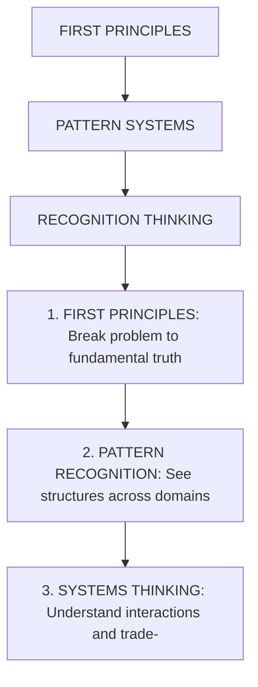

---

# 💭 Part 2: First Principles Thinking

## The "5 Whys" Technique

```
PROBLEM: "I need to find if array has duplicates"

WHY do I need to find duplicates?
  → To ensure data integrity

WHY does data need integrity?
  → Because duplicates cause incorrect calculations

WHY are calculations incorrect?
  → Because we're counting unique items

WHY are we counting unique items?
  → To track inventory

AHA! The REAL problem is inventory tracking, not duplicate finding!
     Maybe a Set or HashMap from the start would prevent duplicates
     instead of finding them after.

LESSON: Solve the ROOT problem, not the SYMPTOM.
```

**Flow:**
- PROBLEM: 'I need to find if array has duplicates'
- ↓
- WHY do I need to find duplicates?
- ↓
- To ensure data integrity
- ↓
- WHY does data need integrity?
- ↓
- Because duplicates cause incorrect calculations
- ↓
- WHY are calculations incorrect?
- ↓
- Because we're counting unique items

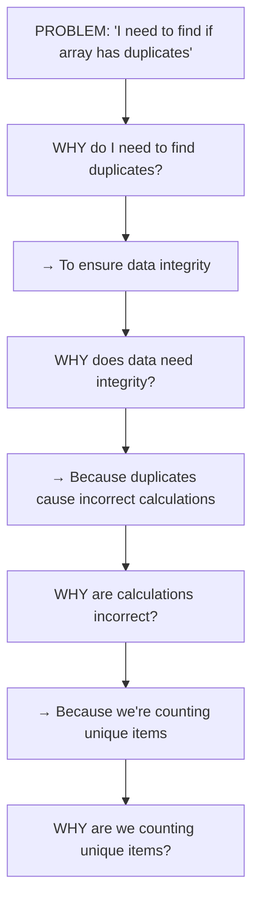

## Decomposition Framework

```
ANY PROBLEM can be broken into:

┌─────────────────────────────────────────────────────────┐
│                    THE PROBLEM                          │
├─────────────────────────────────────────────────────────┤
│ INPUT  │ What data do I have? What's its structure?     │
│ OUTPUT │ What do I need to produce? Exact format?       │
│ CONSTRAINTS │ Size limits? Time limits? Space limits?   │
│ EDGE CASES │ Empty? Single? Max? Negative? Duplicates?  │
└─────────────────────────────────────────────────────────┘

Then ask:
1. What's the SIMPLEST way to solve this? (Brute force)
2. WHERE is the inefficiency?
3. WHAT information am I computing repeatedly?
4. CAN I trade space for time? (or vice versa)
```

**Flow:**
- ANY PROBLEM can be broken into:
- ↓
- THE PROBLEM
- ↓
- INPUT What data do I have? What's its structure?
- ↓
- OUTPUT What do I need to produce? Exact format?
- ↓
- CONSTRAINTS Size limits? Time limits? Space limits?
- ↓
- EDGE CASES Empty? Single? Max? Negative? Duplicates?
- ↓
- Then ask:

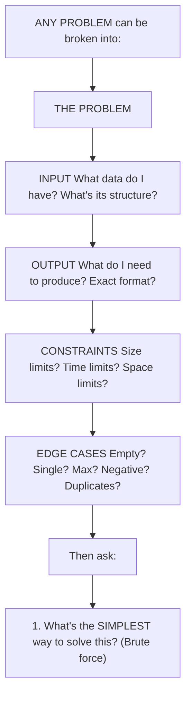

---

# 🎨 Part 3: Pattern Combination Strategies

## The Combination Matrix

```
SINGLE PATTERNS are Level 1.
COMBINED PATTERNS are Level 2-3.
CREATED PATTERNS are Level 4.

COMMON COMBINATIONS:
┌───────────────────┬────────────────────┬──────────────────────────────┐
│ Pattern 1         │ Pattern 2          │ Creates                      │
├───────────────────┼────────────────────┼──────────────────────────────┤
│ Binary Search     │ Greedy             │ Optimization problems        │
│ Two Pointers      │ Sorting            │ 3Sum, Container problems     │
│ BFS/DFS           │ Memoization        │ Graph DP                     │
│ Sliding Window    │ HashMap            │ Substring problems           │
│ Recursion         │ Binary Search      │ Divide & Conquer             │
│ Union-Find        │ Sorting            │ Kruskal's MST                │
│ Trie              │ DFS                │ Word Search problems         │
│ Segment Tree      │ Lazy Propagation   │ Range update queries         │
│ DP                │ Bitmask            │ TSP, Subset enumeration      │
└───────────────────┴────────────────────┴──────────────────────────────┘
```

**Flow:**
- SINGLE PATTERNS are Level 1.
- ↓
- COMBINED PATTERNS are Level 2-3.
- ↓
- CREATED PATTERNS are Level 4.
- ↓
- COMMON COMBINATIONS:
- ↓
- Pattern 1 Pattern 2 Creates
- ↓
- Binary Search Greedy Optimization problems
- ↓
- Two Pointers Sorting 3Sum, Container problems

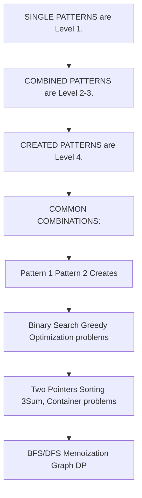

## Example: Building a Complex Solution

```
PROBLEM: Find longest substring with at most k distinct characters

STEP 1: IDENTIFY BASE PATTERNS
- "Substring" → Sliding Window
- "At most k" → Counting → HashMap
- "Longest" → Track maximum

STEP 2: COMBINE
- Window expands: Add character to HashMap
- Window shrinks: Remove when distinct > k
- Track max window size

STEP 3: IMPLEMENT COMBINATION
```

**Flow:**
- - 'Substring'
- ↓
- Sliding Window
- ↓
- - 'At most k'
- ↓
- Counting
- ↓
- HashMap
- ↓
- - 'Longest'
- ↓
- Track maximum

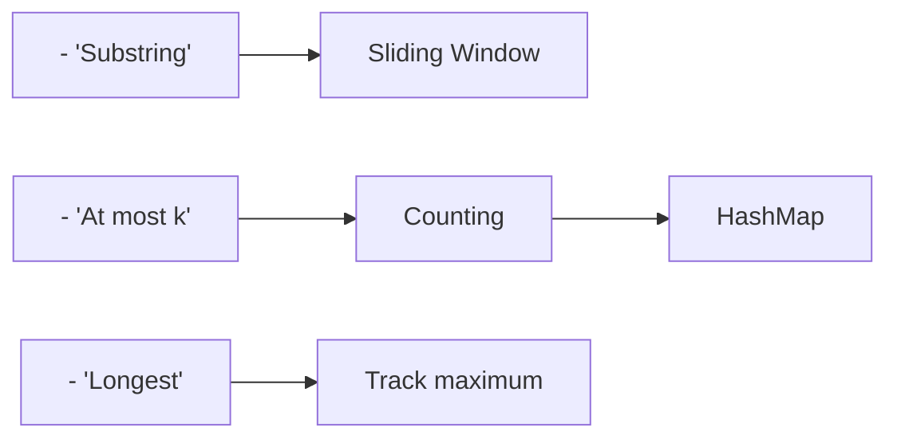

```java
public int lengthOfLongestSubstringKDistinct(String s, int k) {
    if (k == 0 || s.isEmpty()) return 0;

    // COMBINATION: Sliding Window + HashMap
    Map<Character, Integer> count = new HashMap<>();
    int left = 0, maxLen = 0;

    for (int right = 0; right < s.length(); right++) {
        // EXPAND: Sliding Window pattern
        char c = s.charAt(right);
        count.put(c, count.getOrDefault(c, 0) + 1);

        // SHRINK: Maintain constraint (HashMap tracking)
        while (count.size() > k) {
            char leftChar = s.charAt(left);
            count.put(leftChar, count.get(leftChar) - 1);
            if (count.get(leftChar) == 0) {
                count.remove(leftChar);
            }
            left++;
        }

        // TRACK: Maximum (optimization goal)
        maxLen = Math.max(maxLen, right - left + 1);
    }

    return maxLen;
}
```

---

# 🎨 Part 4: the Art of Creating New Patterns

## Observation → Insight → Pattern

```
GREAT PATTERNS come from OBSERVATIONS:

OBSERVATION: "I keep recomputing the same values"
INSIGHT: Store computed values
PATTERN: Memoization / DP

OBSERVATION: "I need min/max of changing set"
INSIGHT: Maintain sorted structure
PATTERN: Heap / TreeSet

OBSERVATION: "I'm searching in sorted data"
INSIGHT: Can eliminate half each time
PATTERN: Binary Search

OBSERVATION: "I need to track ranges/intervals"
INSIGHT: Sort by start, merge overlaps
PATTERN: Interval Merging

YOUR JOB: Make observations → Extract insights → Create patterns
```

**Flow:**
- YOUR JOB: Make observations
- ↓
- Extract insights
- ↓
- Create patterns

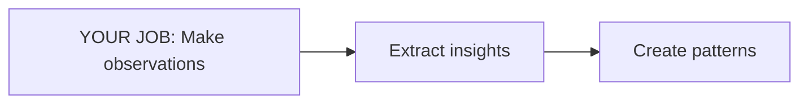

## The Pattern Creation Framework

```
TO CREATE A NEW PATTERN:

1. SOLVE many problems in a domain
2. NOTICE recurring structures
3. ABSTRACT the common elements
4. NAME the pattern
5. IDENTIFY when to apply it
6. DOCUMENT the template

EXAMPLE - Creating "Monotonic Stack" pattern:

Problems solved:
- Next Greater Element
- Daily Temperatures
- Largest Rectangle in Histogram
- Trapping Rain Water

Observation:
- All involve finding "next/previous greater/smaller"
- All use a stack
- Stack maintains monotonic order

Abstraction:
- Maintain stack in increasing/decreasing order
- When new element breaks order, pop and process
- This reveals relationships between elements

Pattern Created: MONOTONIC STACK
- Use when: Need next/previous greater/smaller
- Template: while (stack not empty && current breaks order) process
```

---

# ⚙️ Part 5: Systems Thinking for Algorithms

## Understanding Trade-offs

```
EVERY DECISION has TRADE-OFFS:

TIME vs SPACE:
- HashMap: O(1) access, O(n) space
- Binary Search: O(log n) access, O(1) space
- Precompute answers: O(1) query, O(n²) preprocess

SIMPLICITY vs EFFICIENCY:
- Brute force: Easy to code, slow
- Optimized: Complex to code, fast

CORRECTNESS vs SPEED:
- Exact algorithm: Always correct, may be slow
- Approximation: Fast, possibly wrong

ENGINEER'S JOB: Choose the RIGHT trade-off for the CONTEXT
```

## The Decision Tree

```
WHEN FACING A PROBLEM:

Is it about SEARCHING?
├── Sorted data? → Binary Search
├── Graph/Tree? → BFS/DFS
└── Optimization? → Maybe DP

Is it about OPTIMIZATION?
├── Can build solution greedily? → Greedy
├── Overlapping subproblems? → DP
└── Need to try all possibilities? → Backtracking

Is it about COUNTING/FREQUENCY?
├── Fixed window? → Array/Map
├── Variable window? → Sliding Window + Map
└── Prefix sums useful? → Cumulative sum

Is it about ORDERING?
├── Partial order matters? → Topological Sort
├── Need sorted output? → Sort + Process
└── Need k-th element? → Heap / Quick Select
```

**Flow:**
- Sorted data?
- ↓
- Binary Search
- ↓
- Graph/Tree?
- ↓
- BFS/DFS
- ↓
- Can build solution greedily?
- ↓
- Greedy
- ↓
- Overlapping subproblems?
- ↓
- DP
- ↓
- Fixed window?
- ↓
- Array/Map
- ↓
- Variable window?
- ↓
- Sliding Window + Map

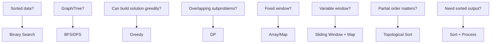

---

# 📌 Part 6: Practical Combination Examples

## Example 1: Binary Search + Two Pointers

```
PROBLEM: Find pair with sum closest to target in sorted array

INSIGHT: Binary Search finds exact, Two Pointers find range
COMBINATION: Use Two Pointers, track closest

public int[] closestPairSum(int[] arr, int target) {
    int left = 0, right = arr.length - 1;
    int closestSum = Integer.MAX_VALUE;
    int[] result = new int[2];

    while (left < right) {
        int sum = arr[left] + arr[right];

        if (Math.abs(sum - target) < Math.abs(closestSum - target)) {
            closestSum = sum;
            result[0] = arr[left];
            result[1] = arr[right];
        }

        if (sum < target) left++;
        else if (sum > target) right--;
        else break;  // Exact match
    }

    return result;
}
```

## Example 2: DFS + Memoization (Tree DP)

```
PROBLEM: Maximum path sum in binary tree

INSIGHT: DFS explores all paths, Memoization avoids recomputation
COMBINATION: DFS with state caching

int maxSum;

public int maxPathSum(TreeNode root) {
    maxSum = Integer.MIN_VALUE;
    dfs(root);
    return maxSum;
}

private int dfs(TreeNode node) {
    if (node == null) return 0;

    // Max gain from left/right (ignore negative paths)
    int leftGain = Math.max(dfs(node.left), 0);
    int rightGain = Math.max(dfs(node.right), 0);

    // Path through current node
    int pathSum = node.val + leftGain + rightGain;
    maxSum = Math.max(maxSum, pathSum);

    // Return max gain if continuing path through parent
    return node.val + Math.max(leftGain, rightGain);
}
```

## Example 3: Trie + DFS (Word Search II)

```
PROBLEM: Find all words from dictionary in a board

INSIGHT: Trie for efficient prefix lookup, DFS for board exploration
COMBINATION: Build Trie from words, DFS with Trie navigation

class TrieNode {
    TrieNode[] children = new TrieNode[26];
    String word = null;  // Store complete word at end
}

public List<String> findWords(char[][] board, String[] words) {
    // Build Trie
    TrieNode root = new TrieNode();
    for (String word : words) {
        TrieNode node = root;
        for (char c : word.toCharArray()) {
            int idx = c - 'a';
            if (node.children[idx] == null) {
                node.children[idx] = new TrieNode();
            }
            node = node.children[idx];
        }
        node.word = word;
    }

    List<String> result = new ArrayList<>();

    // DFS from each cell
    for (int i = 0; i < board.length; i++) {
        for (int j = 0; j < board[0].length; j++) {
            dfs(board, i, j, root, result);
        }
    }

    return result;
}

private void dfs(char[][] board, int i, int j, TrieNode node, List<String> result) {
    if (i < 0 || i >= board.length || j < 0 || j >= board[0].length) return;

    char c = board[i][j];
    if (c == '#' || node.children[c - 'a'] == null) return;

    node = node.children[c - 'a'];

    if (node.word != null) {
        result.add(node.word);
        node.word = null;  // Avoid duplicates
    }

    board[i][j] = '#';  // Mark visited

    dfs(board, i + 1, j, node, result);
    dfs(board, i - 1, j, node, result);
    dfs(board, i, j + 1, node, result);
    dfs(board, i, j - 1, node, result);

    board[i][j] = c;  // Restore
}
```

## Example 4: Union-Find + Binary Search

```
PROBLEM: Find minimum cost to connect all cities, but can only
         use roads with cost ≤ some threshold.
         What's the minimum threshold?

INSIGHT: Binary Search for threshold, Union-Find to check connectivity
COMBINATION: Binary Search on answer space, validate with Union-Find

public int minCostToConnect(int n, int[][] edges) {
    int[] costs = new int[edges.length];
    for (int i = 0; i < edges.length; i++) {
        costs[i] = edges[i][2];
    }
    Arrays.sort(costs);

    int left = 0, right = costs.length - 1;

    while (left < right) {
        int mid = left + (right - left) / 2;

        if (canConnect(n, edges, costs[mid])) {
            right = mid;  // Try smaller threshold
        } else {
            left = mid + 1;  // Need larger threshold
        }
    }

    return costs[left];
}

private boolean canConnect(int n, int[][] edges, int maxCost) {
    DisjointSet ds = new DisjointSet(n);

    for (int[] edge : edges) {
        if (edge[2] <= maxCost) {
            ds.union(edge[0], edge[1]);
        }
    }

    return ds.countSets() == 1;  // All connected
}
```

---

# 🧩 Part 7: Mental Models for Problem Solving

## The IDEAL Framework

```
I - IDENTIFY the problem type
D - DEFINE the constraints and edge cases
E - EXPLORE possible approaches
A - ANALYZE complexity of each
L - LEVERAGE the best approach

EXAMPLE:
I: This is a "find all paths" problem → likely DFS/backtracking
D: Can visit each cell once, need to collect all paths
E: DFS with backtracking, BFS won't give all paths easily
A: DFS is O(4^(m*n)) worst case, but with pruning much better
L: Use DFS with visited marking and backtracking
```

**Flow:**
- I: This is a 'find all paths' problem
- ↓
- likely DFS/backtracking

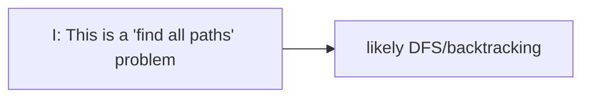

## The Constraint Analysis Method

```
CONSTRAINTS REVEAL THE APPROACH:

n ≤ 10:        O(n!), O(2^n) ok → Brute force, backtracking
n ≤ 20:        O(2^n) ok → Bitmask DP, backtracking with pruning
n ≤ 100:       O(n³) ok → Floyd-Warshall, 3D DP
n ≤ 1000:      O(n²) ok → Simple DP, nested loops
n ≤ 10^5:      O(n log n) ok → Sorting, Binary search, Heap
n ≤ 10^6:      O(n) required → Linear scan, Two pointers
n ≤ 10^8:      O(log n) or O(1) required → Math formula, Binary search

USE THIS TO ELIMINATE APPROACHES QUICKLY!
```

**Flow:**
- n ≤ 10: O(n!), O(2^n) ok
- ↓
- Brute force, backtracking
- ↓
- n ≤ 20: O(2^n) ok
- ↓
- Bitmask DP, backtracking with pruning
- ↓
- n ≤ 100: O(n³) ok
- ↓
- Floyd-Warshall, 3D DP
- ↓
- n ≤ 1000: O(n²) ok
- ↓
- Simple DP, nested loops
- ↓
- n ≤ 10^5: O(n log n) ok
- ↓
- Sorting, Binary search, Heap
- ↓
- n ≤ 10^6: O(n) required
- ↓
- Linear scan, Two pointers

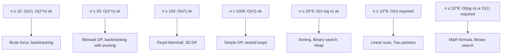

## The "What Changes?" Technique

```
ASK: What CHANGES between subproblems?

EXAMPLE: Sliding window problems
- Window moves → Add new element, remove old element
- INSIGHT: Only 2 elements change, not entire window!
- RESULT: O(1) per window movement

EXAMPLE: DP problems
- State changes → Track what's different
- INSIGHT: Often only 1-2 dimensions change
- RESULT: Minimize state space

EXAMPLE: Recursion problems
- Subproblem changes → What's reduced?
- INSIGHT: Often size/range reduces
- RESULT: Termination condition clear
```

**Flow:**
- - Window moves
- ↓
- Add new element, remove old element
- ↓
- - State changes
- ↓
- Track what's different
- ↓
- - Subproblem changes
- ↓
- What's reduced?

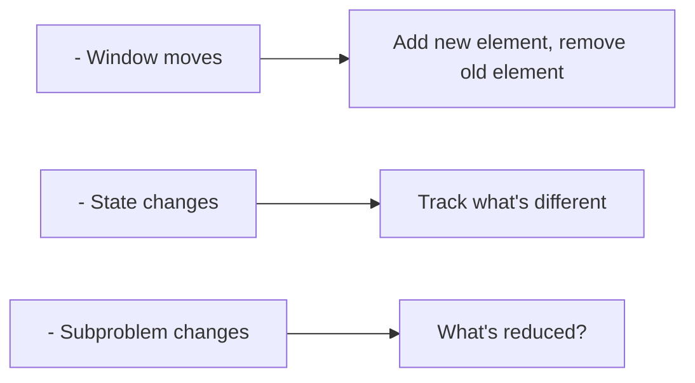

---

# 📌 Part 8: Creating Your Own Algorithms

## The Algorithm Design Process

```
STEP 1: UNDERSTAND DEEPLY
- What exactly is being asked?
- What are ALL the constraints?
- What's a trivial example? Complex example?

STEP 2: BRUTE FORCE FIRST
- Write the obvious solution
- Understand why it works
- Identify what makes it slow

STEP 3: OPTIMIZE
- What computation is repeated?
- What information can be precomputed?
- Can we use a different data structure?

STEP 4: VERIFY
- Does it handle edge cases?
- Prove correctness (or at least convince yourself)
- Analyze final complexity

STEP 5: REFINE
- Clean up the code
- Simplify where possible
- Document the approach
```

## Case Study: Creating an Algorithm

```
PROBLEM: Given array, find maximum sum of non-adjacent elements

STEP 1: UNDERSTAND
- Array of integers (positive AND negative)
- Can't pick adjacent elements
- Maximize sum

STEP 2: BRUTE FORCE
- Try all subsets where no two are adjacent
- O(2^n) subsets to check

STEP 3: OPTIMIZE - My Thought Process:

"At each element, I have a choice: take it or skip it"

If I TAKE element i:
  - Can't take i-1
  - Best I can do is arr[i] + best ending at i-2

If I SKIP element i:
  - Best I can do is best ending at i-1

AHA! This is DP!
State: dp[i] = max sum considering elements 0 to i
Transition: dp[i] = max(dp[i-1], dp[i-2] + arr[i])

STEP 4: VERIFY
- Base: dp[0] = arr[0], dp[1] = max(arr[0], arr[1])
- Edge: Empty array → 0, single element → that element
- Negative numbers → handled by max operation

STEP 5: REFINE
- Only need dp[i-1] and dp[i-2] → O(1) space!
```

**Flow:**
- - Edge: Empty array
- ↓
- 0, single element
- ↓
- that element
- ↓
- - Negative numbers
- ↓
- handled by max operation
- ↓
- - Only need dp[i-1] and dp[i-2]
- ↓
- O(1) space!

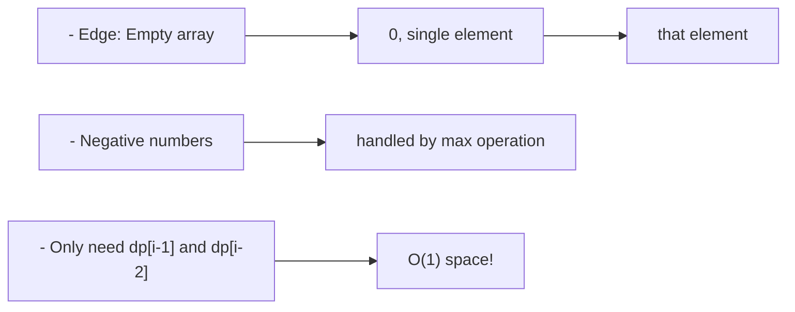

```java
public int maxNonAdjacentSum(int[] arr) {
    if (arr.length == 0) return 0;
    if (arr.length == 1) return arr[0];

    int prevPrev = arr[0];
    int prev = Math.max(arr[0], arr[1]);

    for (int i = 2; i < arr.length; i++) {
        int curr = Math.max(prev, prevPrev + arr[i]);
        prevPrev = prev;
        prev = curr;
    }

    return prev;
}
```

---

# 📌 Part 9: the Engineer's Toolkit

## Questions to Ask Yourself

```
BEFORE CODING:
□ Do I truly understand the problem?
□ What are the constraints?
□ What patterns might apply?
□ What data structure fits best?
□ What's my approach in plain English?

WHILE CODING:
□ Am I handling edge cases?
□ Is my variable naming clear?
□ Can this logic be simplified?
□ Am I avoiding repeated computation?

AFTER CODING:
□ Does it pass simple examples?
□ Does it pass edge cases?
□ Is the complexity acceptable?
□ Can I explain this to someone?
```

**Flow:**
- BEFORE CODING:
- ↓
- □ Do I truly understand the problem?
- ↓
- □ What are the constraints?
- ↓
- □ What patterns might apply?
- ↓
- □ What data structure fits best?
- ↓
- □ What's my approach in plain English?
- ↓
- WHILE CODING:

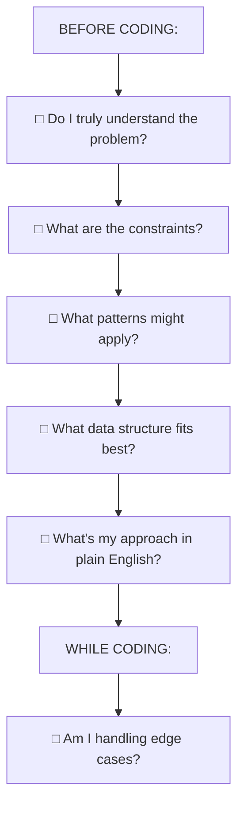

## The "Rubber Duck" Method

```
EXPLAIN YOUR SOLUTION OUT LOUD:

"I'm solving the two-sum problem.
I need to find two numbers that add to target.

I'll use a HashMap because...
- Lookup is O(1)
- I can store what I've seen

For each number, I check if (target - number) exists in map.
If yes, I found my pair!
If no, I add current number to map.

This works because..."

If you can't explain it, you don't understand it!
```

---

# 🚀 Part 10: Advanced Techniques

## Amortized Analysis Thinking

```
SOME OPERATIONS are expensive occasionally but cheap overall.

EXAMPLE: Dynamic Array (ArrayList)
- Most appends: O(1)
- Occasional resize: O(n)
- AMORTIZED: O(1) per append

WHY DOES THIS MATTER?
- Don't optimize what's already amortized!
- Understand the true cost

ENGINEER'S INSIGHT:
Expensive operations that happen rarely = OK
Expensive operations that happen often = Problem
```

## Invariant Maintenance

```
INVARIANT: Property that ALWAYS remains true

EXAMPLE: Binary Search
Invariant: Answer is always in range [left, right]
Maintenance: Move left OR right, never lose the answer

EXAMPLE: Two Pointers
Invariant: Haven't missed any valid pair
Maintenance: Only skip pairs that can't be answer

EXAMPLE: Sliding Window
Invariant: Window always satisfies constraint (or being fixed)
Maintenance: Shrink when constraint violated

USE INVARIANTS TO:
- Prove correctness
- Debug errors
- Design algorithms
```

## Problem Transformation

```
SOMETIMES: Transform problem to something you know!

EXAMPLE: Meeting Rooms II (minimum rooms needed)
Transform → "Maximum overlapping intervals at any point"
Transform → "Start = +1, End = -1, find max running sum"

EXAMPLE: Word Ladder (transform word to another)
Transform → Graph problem! Words are nodes, edge if differ by 1 char
Solve → BFS for shortest path

EXAMPLE: Skyline Problem
Transform → Events: building start = +height, end = -height
Solve → Process events, track max height at each point

THE SKILL: See the UNDERLYING structure
```

**Flow:**
- Transform
- ↓
- 'Maximum overlapping intervals at any point'
- ↓
- Transform
- ↓
- 'Start = +1, End = -1, find max running sum'
- ↓
- Transform
- ↓
- Graph problem! Words are nodes, edge if differ by
- ↓
- Solve
- ↓
- BFS for shortest path
- ↓
- Transform
- ↓
- Events: building start = +height, end = -height
- ↓
- Solve
- ↓
- Process events, track max height at each point

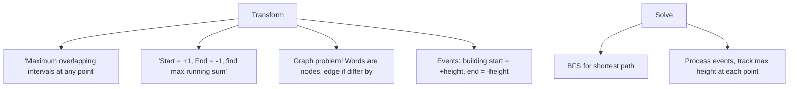

---

# 💪 Part 11: Practice Exercises

## Exercise 1: Combine Two Patterns

```
PROBLEM: Find longest increasing path in a matrix

YOUR TASK:
1. Identify the patterns involved
2. Design the combination
3. Implement it

HINTS:
- Each cell can start a path
- Need to explore all directions
- Same cell might be computed multiple times
```

## Exercise 2: Design New Pattern

```
PROBLEM: Multiple problems involve "next element" relationships

- Next Greater Element
- Stock Span Problem
- Daily Temperatures

YOUR TASK:
1. Solve all three
2. Find commonality
3. Abstract the pattern
4. Name and document it
```

## Exercise 3: First Principles

```
PROBLEM: Design an algorithm to serialize and deserialize a binary tree

YOUR TASK:
1. Break down what "serialize" means
2. Break down what "deserialize" needs
3. Find the minimal information needed
4. Design your algorithm from scratch
```

---

# 📌 Part 12: Key Takeaways

```
THE ENGINEERING MINDSET CHECKLIST:

☑ Understand before solving
☑ Brute force before optimizing
☑ Know your patterns
☑ Combine patterns creatively
☑ Create patterns from observations
☑ Think in trade-offs
☑ Prove correctness
☑ Explain clearly
☑ Practice deliberately
☑ Learn from every problem

"The best engineers don't just solve problems.
They understand problems so deeply that
the solution becomes obvious."
```

---

_Think like an engineer. Build like an artist. Solve like a scientist._ 🧠⚡

---

> **Navigation**: [< Previous](Ch06_Functional_Programming.md) | [Back to Index](../00_MASTER_INDEX.md) | [Next >](Ch26_Pre_Spring_Part1.md)