> **Navigation**: [< Previous Chapter](Ch20_AlgoEng_Core.md) | [Back to Index](../00_MASTER_INDEX.md)

---

# 📌 Part 13: the Elite Engineer's Mindset 🎯

## Reality → Systems Translation Engine

```
THE CORE SKILL OF ENGINEERING:
Translating messy human problems into elegant digital systems.

YOU ARE NOT JUST A CODER. YOU ARE:
┌─────────────────────────────────────────────────────────────────┐
│ 🔬 A Computer Scientist    - Understanding computation limits    │
│ 🏗️ A System Architect      - Designing scalable structures      │
│ 🎨 A Product Engineer      - Building what users truly need      │
│ 🧠 A UX Thinker            - Feeling the user's pain             │
│ ⚙️ A DevOps Pragmatist     - Keeping systems alive              │
│ 💭 A Philosophy Engineer   - Asking WHY before HOW               │
└─────────────────────────────────────────────────────────────────┘

YOUR THINKING CHAIN:
Data → Behavior → Scale → Failure → Human Experience → Cost → Time → Evolution
```

> **Flow**: THE CORE SKILL OF ENGINEERING: → YOU ARE NOT JUST A CODER. YOU ARE: | YOU ARE NOT JUST A CODER. YOU ARE: → 🔬 A Computer Scientist - Understanding computation limi | 🔬 A Computer Scientist - Understanding computation limi → 🏗️ A System Architect - Designing scalable structures | 🏗️ A System Architect - Designing scalable structures → 🎨 A Product Engineer - Building what users truly need | 🎨 A Product Engineer - Building what users truly need → 🧠 A UX Thinker - Feeling the user's pain | 🧠 A UX Thinker - Feeling the user's pain → ⚙️ A DevOps Pragmatist - Keeping systems alive | ...+1 more

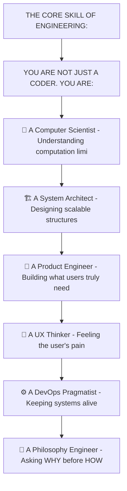

## The Engineer's Translation Engine

```
FOR EVERY FEATURE REQUEST, FOLLOW THIS:

STEP 1 — HUMAN INTENT
┌─────────────────────────────────────────────────────┐
│ What does the user EMOTIONALLY want?                │
│ "I want to find my friends" ≠ "I want a search box" │
│ "App feels slow" ≠ "Add a loading spinner"          │
└─────────────────────────────────────────────────────┘

STEP 2 — SYSTEM REQUIREMENTS
┌─────────────────────────────────────────────────────┐
│ What must exist DIGITALLY?                          │
│ • Data to store                                     │
│ • Operations to perform                             │
│ • Responses to return                               │
│ • Failures to handle                                │
└─────────────────────────────────────────────────────┘

STEP 3 — DATA MODEL
┌─────────────────────────────────────────────────────┐
│ What are the ENTITIES and RELATIONSHIPS?            │
│ • Users have Friends (Many-to-Many)                 │
│ • Messages belong to Conversations                  │
│ • Orders contain Items                              │
└─────────────────────────────────────────────────────┘

STEP 4 — SCALE MODEL
┌─────────────────────────────────────────────────────┐
│ What BREAKS at scale?                               │
│ • 10x users: Database queries slow                  │
│ • 100x users: Single server can't handle            │
│ • 1M users: Need distributed architecture           │
│ • 10M users: Need sharding, caching layers          │
└─────────────────────────────────────────────────────┘

STEP 5 — DSA MAPPING
┌─────────────────────────────────────────────────────┐
│ Which DATA STRUCTURES power each part?              │
│ • User search → Trie / Inverted Index               │
│ • Friend suggestions → Graph + Heap                 │
│ • Message history → B-Tree Index                    │
│ • Real-time updates → Queue + Pub/Sub               │
└─────────────────────────────────────────────────────┘

STEP 6 — FAILURE DESIGN
┌─────────────────────────────────────────────────────┐
│ What happens when things BREAK?                     │
│ • Server dies → Failover, Replication               │
│ • Network drops → Retry, Circuit breaker            │
│ • Cache corrupts → Invalidation strategy            │
│ • Data races → Locks, Atomic operations             │
└─────────────────────────────────────────────────────┘
```

> **Flow**: What does the user EMOTIONALLY want? / 'I want to find  → What must exist DIGITALLY? / • Data to store / • Operat | What must exist DIGITALLY? / • Data to store / • Operat → What are the ENTITIES and RELATIONSHIPS? / • Users have | What are the ENTITIES and RELATIONSHIPS? / • Users have → What BREAKS at scale? / • 10x users: Database queries s | What BREAKS at scale? / • 10x users: Database queries s → Which DATA STRUCTURES power each part? / • User search  | Which DATA STRUCTURES power each part? / • User search  → What happens when things BREAK? / • Server dies → Failo

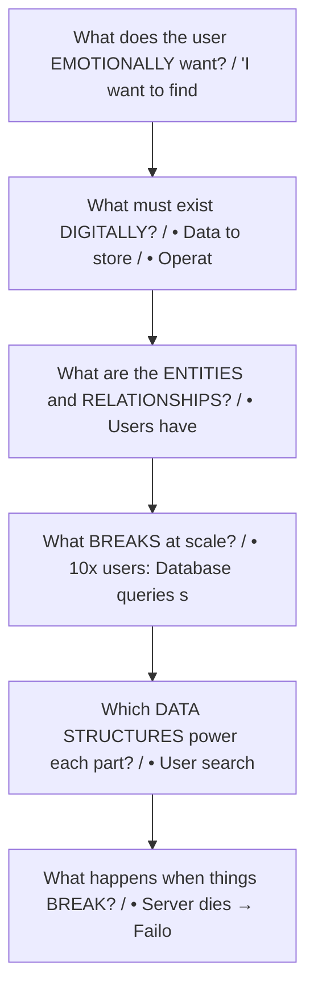

---

# 📌 Part 14: Data Structures As Shapes of Thought

## Seeing DS as Reality Models, Not Just Containers

```
DON'T THINK:                    THINK:
"Array stores data"        →    "Array models SEQUENCE in time/space"
"HashMap is fast lookup"   →    "HashMap models ASSOCIATION between things"
"Tree has nodes"           →    "Tree models HIERARCHY and relationships"
"Graph has edges"          →    "Graph models CONNECTIONS in complex systems"
"Queue is FIFO"            →    "Queue models FAIRNESS and ordering"
"Stack is LIFO"            →    "Stack models CONTEXT and undoing"
"Heap gives min/max"       →    "Heap models PRIORITY and importance"
```

> **Flow**: 'Array stores data' → 'Array models SEQUENCE in time/space' | 'HashMap is fast lookup' → 'HashMap models ASSOCIATION between things' | 'Tree has nodes' → 'Tree models HIERARCHY and relationships' | 'Graph has edges' → 'Graph models CONNECTIONS in complex systems' | 'Queue is FIFO' → 'Queue models FAIRNESS and ordering' | 'Stack is LIFO' → 'Stack models CONTEXT and undoing' | ...+1 more

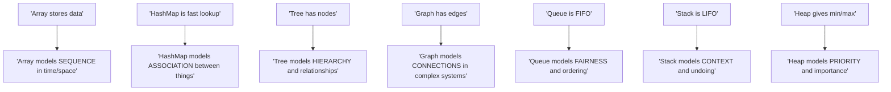

## The Complete DS Reality Map

```
DATA STRUCTURE          REAL-WORLD MODEL           PRODUCTION SYSTEM
─────────────────────────────────────────────────────────────────────
Array                   Timeline, Sequence         Time-series DB
Dynamic Array           Growing history            Event logs
Linked List             Chain of events            Blockchain
HashMap                 Dictionary, Index          Cache, Session store
Stack                   Undo history               Call stack, Parsers
Queue                   Waiting line               Message queue, BFS
Priority Queue          Emergency room             Task scheduler
BST                     Sorted phonebook           Database index
AVL/Red-Black           Self-balancing book        Database internals
B-Tree                  Library catalog            Disk-based DB index
Trie                    Autocomplete               Search suggestions
Segment Tree            Range statistics           Analytics queries
Graph                   Social network             Recommendation engine
DAG                     Dependencies               Build systems, CI/CD
Bloom Filter            Quick membership check     Spam filter, Cache
Skip List               Express lanes              Redis internals
LSM Tree                Write-optimized storage    Cassandra, RocksDB
Inverted Index          Book index                 Search engines
Ring Buffer             Circular log               Streaming systems
QuadTree/KD-Tree        Spatial partitioning       Maps, Game collision
```

> **Flow**: DATA STRUCTURE REAL-WORLD MODEL PRODUCTION SYSTEM → Array Timeline, Sequence Time-series DB | Array Timeline, Sequence Time-series DB → Dynamic Array Growing history Event logs | Dynamic Array Growing history Event logs → Linked List Chain of events Blockchain | Linked List Chain of events Blockchain → HashMap Dictionary, Index Cache, Session store | HashMap Dictionary, Index Cache, Session store → Stack Undo history Call stack, Parsers | Stack Undo history Call stack, Parsers → Queue Waiting line Message queue, BFS | ...+1 more

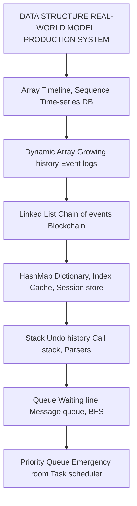

## For Each DS, Always Know:

```
┌────────────────────────────────────────────────────────────────────┐
│ 1. MEMORY BEHAVIOR                                                 │
│    - Contiguous or scattered?                                      │
│    - Cache-friendly?                                               │
│    - Memory overhead per element?                                  │
│                                                                    │
│ 2. TIME TRADEOFFS                                                  │
│    - Best/Worst/Average case?                                      │
│    - Amortized analysis?                                           │
│                                                                    │
│ 3. CONCURRENCY IMPLICATIONS                                        │
│    - Thread-safe operations?                                       │
│    - Lock granularity?                                             │
│    - Lock-free alternatives?                                       │
│                                                                    │
│ 4. DISTRIBUTED SYSTEM USAGE                                        │
│    - Partition tolerance?                                          │
│    - Replication strategy?                                         │
│    - Consistency guarantees?                                       │
│                                                                    │
│ 5. FAILURE MODES                                                   │
│    - What happens on overflow?                                     │
│    - Recovery strategies?                                          │
│    - Data corruption handling?                                     │
└────────────────────────────────────────────────────────────────────┘
```

> **Flow**: 1. MEMORY BEHAVIOR → - Contiguous or scattered? | - Contiguous or scattered? → - Cache-friendly? | - Cache-friendly? → - Memory overhead per element? | - Memory overhead per element? → 2. TIME TRADEOFFS | 2. TIME TRADEOFFS → - Best/Worst/Average case? | - Best/Worst/Average case? → - Amortized analysis? | ...+1 more

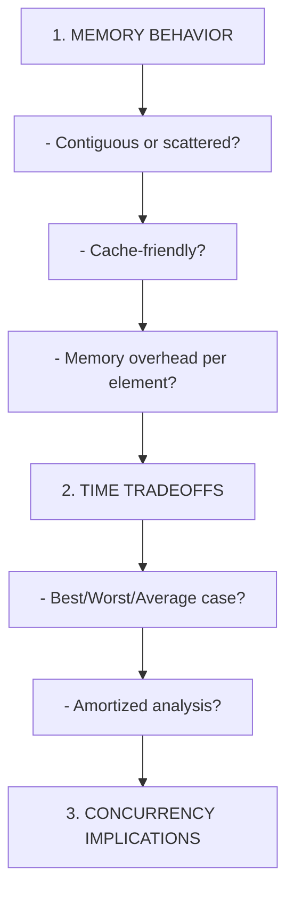

---

# ⚙️ Part 15: Algorithms As System Behaviors

## Every Algorithm Connects To Real Systems

```
ALGORITHM               BACKEND           UI             NETWORK         COST
────────────────────────────────────────────────────────────────────────────
Binary Search           DB queries        Instant search  Reduce API      Less compute
Sorting                 Report gen        Table display   Batch transfer  Memory usage
BFS/DFS                 Crawlers          Navigation      Routing         Bandwidth
Dynamic Programming     Optimization      Prediction      Caching         Storage
Greedy                  Scheduling        Quick decisions Load balancing  Resource alloc
Graph Algorithms        Social features   Recommendations CDN routing     Network cost
String Algorithms       Search            Autocomplete    Compression     Transfer cost
Streaming Algorithms    Real-time stats   Live updates    Data reduction  Memory limits
Probabilistic           Deduplication     Personalization Quick checks    Accuracy vs cost
```

> **Flow**: ALGORITHM BACKEND UI NETWORK COST → BFS/DFS Crawlers Navigation Routing Bandwidth | BFS/DFS Crawlers Navigation Routing Bandwidth → Dynamic Programming Optimization Prediction Caching Sto

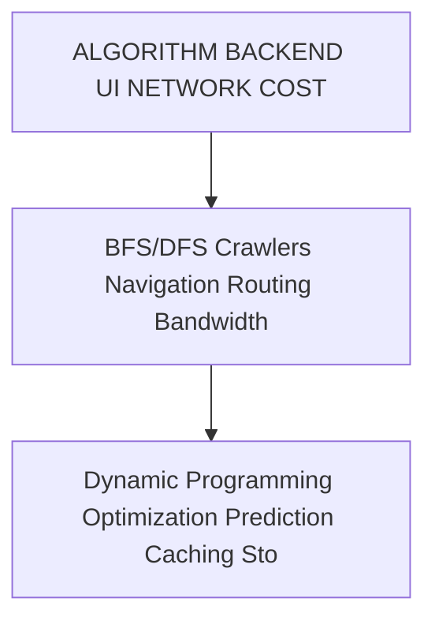

---

# 🎨 Part 16: DSA Fusion Patterns (production Systems)

## How Real Systems Combine Data Structures

```
SYSTEM                     DSA FUSION                 WHY IT WORKS
─────────────────────────────────────────────────────────────────────────────
Rate Limiter               HashMap + Queue            Track requests in window
Recommendation Engine      Graph + Heap               Find top-k similar items
Search Engine              Trie + Inverted Index      Fast prefix + full search
CI/CD Pipeline             DAG + Priority Queue       Dependency order + priority
High-Scale API             Cache + Bloom Filter       Fast negative lookups
Real-Time Analytics        Segment Tree + HashMap     Range queries + grouping
Message Queue              Ring Buffer + HashMap      Circular storage + lookup
LRU Cache                  HashMap + Doubly LL        O(1) access + ordering
Autocomplete               Trie + Heap                Prefix match + top results
Fraud Detection            Graph + Streaming Algo     Pattern detection in flow
```

> **Flow**: SYSTEM DSA FUSION WHY IT WORKS → Rate Limiter HashMap + Queue Track requests in window | Rate Limiter HashMap + Queue Track requests in window → Recommendation Engine Graph + Heap Find top-k similar i | Recommendation Engine Graph + Heap Find top-k similar i → High-Scale API Cache + Bloom Filter Fast negative looku | High-Scale API Cache + Bloom Filter Fast negative looku → LRU Cache HashMap + Doubly LL O(1) access + ordering | LRU Cache HashMap + Doubly LL O(1) access + ordering → Autocomplete Trie + Heap Prefix match + top results

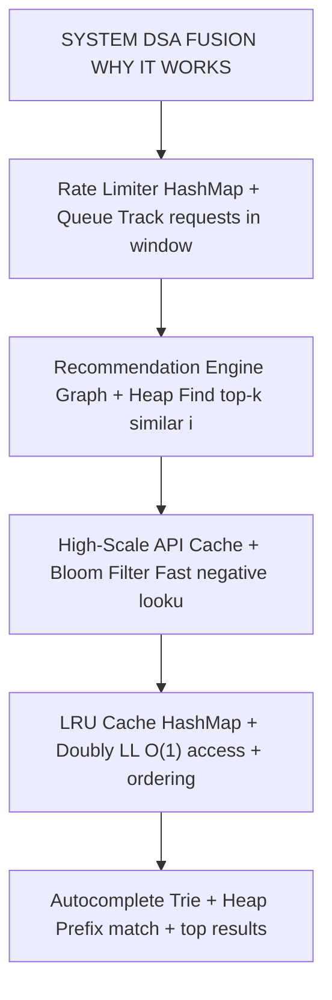

## Building a Rate Limiter (Complete Example)

```
PROBLEM: Limit user to 100 requests per minute

HUMAN INTENT: Prevent abuse, ensure fair usage

DSA ANALYSIS:
- Need to track: User ID → Request timestamps
- Need to count: Requests in last 60 seconds
- Need to expire: Old requests

FUSION DESIGN:
┌─────────────────────────────────────────────────────────────────┐
│                     RATE LIMITER                                │
│                                                                 │
│   HashMap<UserId, Queue<Timestamp>>                             │
│                                                                 │
│   User123 → [T-50s, T-30s, T-10s, T-5s, T-2s, NOW]              │
│                                                                 │
│   Algorithm:                                                    │
│   1. Remove timestamps older than 60s (dequeue)                 │
│   2. Count remaining timestamps                                 │
│   3. If count < 100: Allow, add current timestamp               │
│   4. If count >= 100: Reject                                    │
└─────────────────────────────────────────────────────────────────┘
```

> **Flow**: PROBLEM: Limit user to 100 requests per minute → HUMAN INTENT: Prevent abuse, ensure fair usage | HUMAN INTENT: Prevent abuse, ensure fair usage → DSA ANALYSIS: | DSA ANALYSIS: → - Need to track: User ID → Request timestamps | - Need to track: User ID → Request timestamps → - Need to count: Requests in last 60 seconds | - Need to count: Requests in last 60 seconds → - Need to expire: Old requests | - Need to expire: Old requests → FUSION DESIGN: | ...+1 more

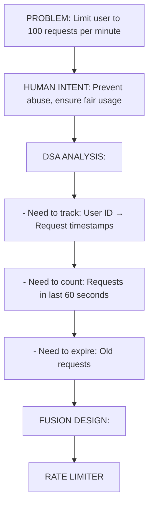

```java
class RateLimiter {
    private final int maxRequests;
    private final long windowMs;
    private final Map<String, Deque<Long>> userRequests = new ConcurrentHashMap<>();

    public RateLimiter(int maxRequests, long windowMs) {
        this.maxRequests = maxRequests;
        this.windowMs = windowMs;
    }

    public boolean allowRequest(String userId) {
        long now = System.currentTimeMillis();
        long windowStart = now - windowMs;

        userRequests.putIfAbsent(userId, new ConcurrentLinkedDeque<>());
        Deque<Long> timestamps = userRequests.get(userId);

        // Remove expired timestamps (Sliding Window)
        while (!timestamps.isEmpty() && timestamps.peekFirst() < windowStart) {
            timestamps.pollFirst();
        }

        // Check limit
        if (timestamps.size() < maxRequests) {
            timestamps.addLast(now);
            return true;  // ALLOWED
        }

        return false;  // RATE LIMITED
    }
}

// SCALE CONSIDERATION:
// - Single server: Above works
// - Multiple servers: Need Redis with ZSET (sorted set)
// - High traffic: Use sliding window counter algorithm
```

---

# 📌 Part 17: the 10 Questions Every Engineer Asks

## Before Writing Any Code

```
MEMORIZE THESE. ASK THEM ALWAYS.

 1. What grows UNBOUNDED?
    → Memory leaks, infinite loops, data accumulation

 2. What must be INSTANT?
    → User interactions, health checks, critical paths

 3. What can be EVENTUALLY correct?
    → Analytics, recommendations, logs

 4. What costs MONEY at scale?
    → Compute, storage, bandwidth, API calls

 5. What BREAKS under pressure?
    → Synchronous calls, single points of failure

 6. What CHANGES frequently?
    → Configuration, feature flags, business rules

 7. What needs HISTORY?
    → Audit logs, versioning, undo capability

 8. What needs REAL-TIME?
    → Notifications, alerts, live data

 9. What can be CACHED?
    → Repeated queries, static content, computed results

10. What must be CONSISTENT?
    → Financial data, inventory, user state
```

> **Flow**: MEMORIZE THESE. ASK THEM ALWAYS. → 1. What grows UNBOUNDED? | 1. What grows UNBOUNDED? → → Memory leaks, infinite loops, data accumulation | → Memory leaks, infinite loops, data accumulation → 2. What must be INSTANT? | 2. What must be INSTANT? → → User interactions, health checks, critical paths | → User interactions, health checks, critical paths → 3. What can be EVENTUALLY correct? | 3. What can be EVENTUALLY correct? → → Analytics, recommendations, logs | ...+1 more

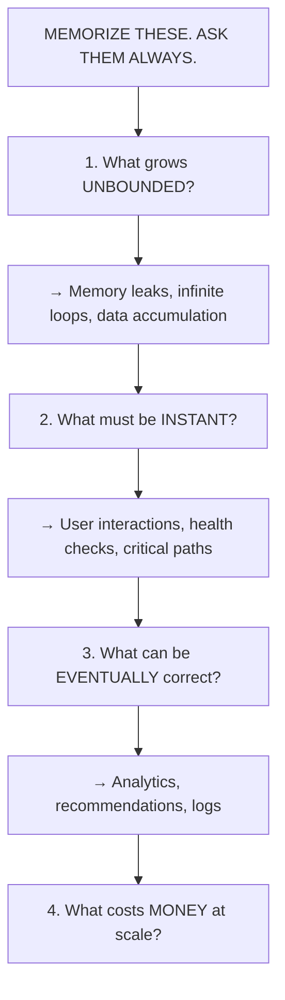

---

# 📌 Part 18: Feature Engineering Mode

## Translating Vague Requests into System Design

```
USER SAYS: "The app feels slow"

JUNIOR DEVELOPER THINKS:
"Add a loading spinner"

ELITE ENGINEER EXTRACTS:

┌─────────────────────────────────────────────────────────────────┐
│ LATENCY SOURCES                                                 │
├─────────────────────────────────────────────────────────────────┤
│ • Frontend rendering time                                       │
│ • API response time                                             │
│ • Database query time                                           │
│ • Network round-trip time                                       │
│ • Third-party API calls                                         │
└─────────────────────────────────────────────────────────────────┘

┌─────────────────────────────────────────────────────────────────┐
│ DATA FLOW ANALYSIS                                              │
├─────────────────────────────────────────────────────────────────┤
│ User Click → Frontend → API Gateway → Service → DB → Response   │
│                                                                 │
│ Where are the bottlenecks?                                      │
│ • N+1 queries? → Batch or JOIN                                  │
│ • Missing index? → Add B-Tree index                             │
│ • No caching? → Add Redis layer                                 │
│ • Sync calls? → Make async                                      │
└─────────────────────────────────────────────────────────────────┘

┌─────────────────────────────────────────────────────────────────┐
│ DSA BOTTLENECKS                                                 │
├─────────────────────────────────────────────────────────────────┤
│ • Linear search where binary search possible?                   │
│ • Recomputing what could be cached?                             │
│ • Sorting repeatedly instead of maintaining heap?               │
│ • Full scan where index could help?                             │
└─────────────────────────────────────────────────────────────────┘

┌─────────────────────────────────────────────────────────────────┐
│ UX BOTTLENECKS                                                  │
├─────────────────────────────────────────────────────────────────┤
│ • Blocking UI during computation?                               │
│ • Not showing progress?                                         │
│ • Loading too much data upfront?                                │
│ • Not paginating results?                                       │
└─────────────────────────────────────────────────────────────────┘
```

> **Flow**: LATENCY SOURCES / • Frontend rendering time / • API res → DATA FLOW ANALYSIS / User Click → Frontend → API Gatewa | DATA FLOW ANALYSIS / User Click → Frontend → API Gatewa → DSA BOTTLENECKS / • Linear search where binary search p | DSA BOTTLENECKS / • Linear search where binary search p → UX BOTTLENECKS / • Blocking UI during computation? / • 

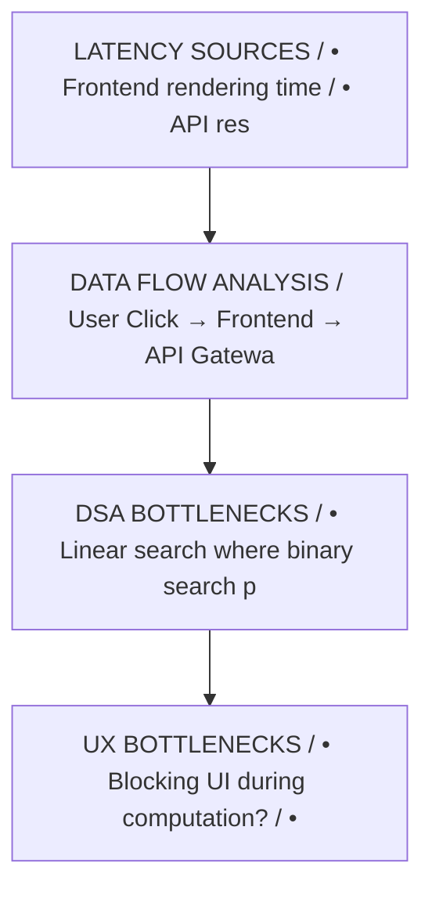

---

# 📌 Part 19: Production Failure Stories

## Learning from Real System Failures

```
STORY 1: THE UNBOUNDED QUEUE
─────────────────────────────────────────────────────────
System: E-commerce checkout
Problem: Queue grew unbounded during flash sale
Root Cause: Producer faster than consumer, no backpressure
DSA Lesson: Always bound your queues, implement backpressure
Fix: Ring buffer with overflow handling

STORY 2: THE MISSING INDEX
─────────────────────────────────────────────────────────
System: Social media feed
Problem: Page load went from 200ms to 30 seconds
Root Cause: Table grew, full scan instead of index lookup
DSA Lesson: B-Tree index turns O(n) to O(log n)
Fix: Added composite index on (user_id, created_at)

STORY 3: THE CACHE STAMPEDE
─────────────────────────────────────────────────────────
System: Product catalog
Problem: Cache expired, 10,000 requests hit database
Root Cause: All caches expired simultaneously
DSA Lesson: Probabilistic early expiration, jittered TTL
Fix: Cache with random TTL variance + lock for refresh

STORY 4: THE GRAPH EXPLOSION
─────────────────────────────────────────────────────────
System: Recommendation engine
Problem: Friend-of-friend query took 30 seconds
Root Cause: BFS explored entire graph (no depth limit)
DSA Lesson: Always limit graph traversal depth
Fix: BFS with max_depth=3, result limit

STORY 5: THE MEMORY LEAK
─────────────────────────────────────────────────────────
System: Real-time analytics
Problem: Server crashed every 24 hours
Root Cause: HashMap held references to expired sessions
DSA Lesson: Use WeakHashMap or explicit cleanup
Fix: TTL-based eviction policy
```

> **Flow**: STORY 1: THE UNBOUNDED QUEUE → System: E-commerce checkout | System: E-commerce checkout → Problem: Queue grew unbounded during flash sale | Problem: Queue grew unbounded during flash sale → Root Cause: Producer faster than consumer, no backpress | Root Cause: Producer faster than consumer, no backpress → Fix: Ring buffer with overflow handling | Fix: Ring buffer with overflow handling → STORY 2: THE MISSING INDEX | STORY 2: THE MISSING INDEX → System: Social media feed | ...+1 more

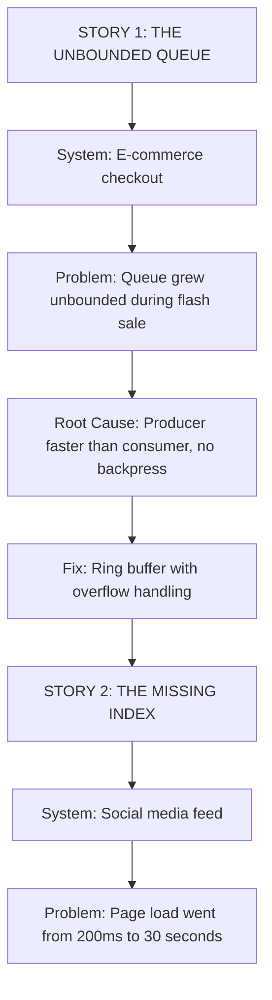

---

# 🏗️ Part 20: Build Real Systems (project Ideas)

## Each Project Maps DSA to Production

```
PROJECT 1: REAL-TIME CHAT SYSTEM
┌─────────────────────────────────────────────────────────────────┐
│ Components:                                                     │
│ • Message Queue (Ring Buffer)                                   │
│ • User Sessions (HashMap)                                       │
│ • Message History (B-Tree indexed DB)                           │
│ • Online Status (Bloom Filter for quick check)                  │
│ • Typing Indicators (TTL HashMap)                               │
│                                                                 │
│ Scale Challenge: 1M concurrent users                            │
│ Failure Mode: What if message server dies?                      │
└─────────────────────────────────────────────────────────────────┘

PROJECT 2: SEARCH ENGINE
┌─────────────────────────────────────────────────────────────────┐
│ Components:                                                     │
│ • Inverted Index (HashMap of word → documents)                  │
│ • Autocomplete (Trie)                                           │
│ • Ranking (Heap for top-k)                                      │
│ • Spell Correction (Edit Distance DP)                           │
│ • Crawling Queue (Priority Queue)                               │
│                                                                 │
│ Scale Challenge: 1B documents                                   │
│ Failure Mode: Index corruption?                                 │
└─────────────────────────────────────────────────────────────────┘

PROJECT 3: ANALYTICS PIPELINE
┌─────────────────────────────────────────────────────────────────┐
│ Components:                                                     │
│ • Event Stream (Ring Buffer)                                    │
│ • Aggregations (Segment Tree)                                   │
│ • Unique Counts (HyperLogLog)                                   │
│ • Time Windows (Sliding Window)                                 │
│ • Storage (LSM Tree)                                            │
│                                                                 │
│ Scale Challenge: 1M events/second                               │
│ Failure Mode: Data loss during spike?                           │
└─────────────────────────────────────────────────────────────────┘
```

> **Flow**: Components: / • Message Queue (Ring Buffer) / • User Se → Components: / • Inverted Index (HashMap of word → docum | Components: / • Inverted Index (HashMap of word → docum → Components: / • Event Stream (Ring Buffer) / • Aggregat

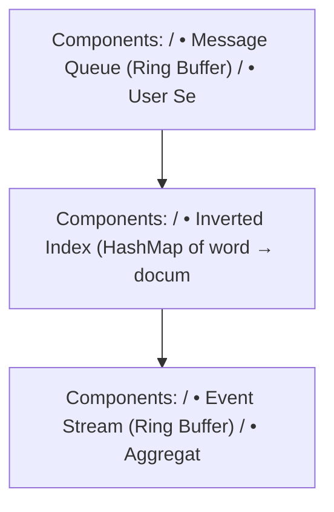

---

# 💪 Part 21: the Engineer's Daily Practice

## Questions to Ask Every Day

```
MORNING (Before Coding):
□ What system am I building/improving today?
□ What data structures are involved?
□ What could break?

DURING CODING:
□ Am I creating unbounded growth?
□ Is this O(n²) hidden somewhere?
□ What happens at 10x load?

EVENING (Reflection):
□ What algorithm was hiding in today's work?
□ What failure mode did I prevent?
□ What would I do differently at scale?

WEEKLY:
□ Read one production failure postmortem
□ Study one new data structure deeply
□ Connect one algorithm to a real system
```

> **Flow**: MORNING (Before Coding): → □ What system am I building/improving today? | □ What system am I building/improving today? → □ What data structures are involved? | □ What data structures are involved? → □ What could break? | □ What could break? → DURING CODING: | DURING CODING: → □ Am I creating unbounded growth? | □ Am I creating unbounded growth? → □ Is this O(n²) hidden somewhere? | ...+1 more

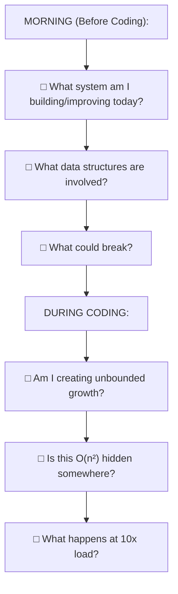

---

# 📌 Part 22: Final Mindset Installation

```
╔═══════════════════════════════════════════════════════════════════════╗
║                                                                       ║
║   YOU ARE NOT PREPARING FOR INTERVIEWS.                               ║
║   YOU ARE PREPARING FOR SYSTEMS THAT CANNOT FAIL QUIETLY.             ║
║                                                                       ║
║   Every algorithm is a tool for CONTROLLING CHAOS.                    ║
║   Every data structure is a SHAPE OF THOUGHT.                         ║
║   Every system you build is a TRANSLATION OF HUMAN NEED.              ║
║                                                                       ║
║   The goal is not to memorize patterns.                               ║
║   The goal is to SEE THE INVISIBLE ALGORITHMS                         ║
║   running inside the world itself.                                    ║
║                                                                       ║
║   Walk into any codebase, any startup, any infrastructure —           ║
║   and understand what's REALLY happening beneath the surface.         ║
║                                                                       ║
╚═══════════════════════════════════════════════════════════════════════╝
```

> **Flow**: YOU ARE NOT PREPARING FOR INTERVIEWS. → YOU ARE PREPARING FOR SYSTEMS THAT CANNOT FAIL QUIETLY. | YOU ARE PREPARING FOR SYSTEMS THAT CANNOT FAIL QUIETLY. → Every algorithm is a tool for CONTROLLING CHAOS. | Every algorithm is a tool for CONTROLLING CHAOS. → Every data structure is a SHAPE OF THOUGHT. | Every data structure is a SHAPE OF THOUGHT. → Every system you build is a TRANSLATION OF HUMAN NEED. | Every system you build is a TRANSLATION OF HUMAN NEED. → The goal is not to memorize patterns. | The goal is not to memorize patterns. → The goal is to SEE THE INVISIBLE ALGORITHMS | ...+1 more

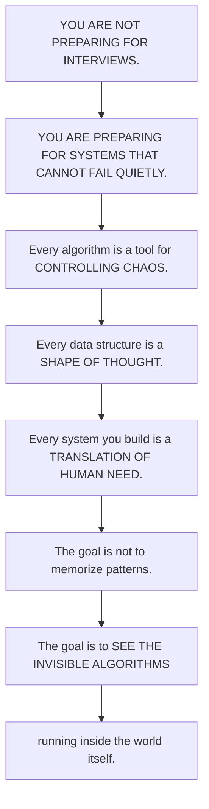

---

_"Anyone can learn to code. Few learn to see systems. Become the few."_ 🌟

---

# 🏗️ Part 23: Complete System Design Examples

## Example 1: Building a URL Shortener (Like bit.ly)

```
USER STORY: "I want to convert long URLs to short ones"

STEP 1 — HUMAN INTENT
┌─────────────────────────────────────────────────────────────────┐
│ User wants to:                                                  │
│ • Share links easily (Twitter character limit)                  │
│ • Track click analytics                                         │
│ • Have memorable links                                          │
│ • Links should work forever                                     │
└─────────────────────────────────────────────────────────────────┘

STEP 2 — SYSTEM REQUIREMENTS
┌─────────────────────────────────────────────────────────────────┐
│ Functional:                                                     │
│ • shorten(longUrl) → shortUrl                                   │
│ • redirect(shortUrl) → longUrl                                  │
│ • getStats(shortUrl) → click count, referrers                   │
│                                                                 │
│ Non-Functional:                                                 │
│ • 100M URLs created/month                                       │
│ • 10B redirects/month                                           │
│ • 99.99% availability                                           │
│ • < 100ms redirect latency                                      │
└─────────────────────────────────────────────────────────────────┘

STEP 3 — DATA MODEL
┌─────────────────────────────────────────────────────────────────┐
│ URL Table:                                                      │
│ ┌──────────────────────────────────────────────────────────┐    │
│ │ short_code (PK) │ long_url │ created_at │ user_id │ ttl │     │
│ ├──────────────────────────────────────────────────────────┤    │
│ │ abc123          │ https://... │ 2024-01-01 │ u1 │ null  │     │
│ └──────────────────────────────────────────────────────────┘    │
│                                                                 │
│ Analytics Table:                                                │
│ ┌──────────────────────────────────────────────────────────┐    │
│ │ short_code │ timestamp │ referrer │ country │ device    │     │
│ └──────────────────────────────────────────────────────────┘    │
└─────────────────────────────────────────────────────────────────┘

STEP 4 — DSA MAPPING
┌─────────────────────────────────────────────────────────────────┐
│ Short Code Generation:                                          │
│ • Base62 encoding (a-z, A-Z, 0-9) = 62 chars                    │
│ • 6 chars = 62^6 = 56 billion combinations                      │
│ • Algorithm: Counter → Base62 conversion                        │
│                                                                 │
│ Storage:                                                        │
│ • HashMap for O(1) lookups                                      │
│ • B-Tree index for database                                     │
│ • Bloom filter for quick "not exists" check                     │
│                                                                 │
│ Caching:                                                        │
│ • LRU Cache for hot URLs (20% URLs get 80% traffic)             │
│ • Cache redirect destination                                    │
│                                                                 │
│ Analytics:                                                      │
│ • Ring Buffer for recent events                                 │
│ • HyperLogLog for unique visitor count                          │
│ • Segment Tree for time-range queries                           │
└─────────────────────────────────────────────────────────────────┘

STEP 5 — ARCHITECTURE
┌─────────────────────────────────────────────────────────────────┐
│                                                                 │
│    Client                                                       │
│      │                                                          │
│      ▼                                                          │
│  [Load Balancer]                                                │
│      │                                                          │
│      ├──────────────────┬──────────────────┐                    │
│      ▼                  ▼                  ▼                    │
│  [API Server 1]    [API Server 2]    [API Server N]             │
│      │                  │                  │                    │
│      └──────────────────┼──────────────────┘                    │
│                         │                                       │
│                    [Redis Cache]                                │
│                         │                                       │
│              ┌──────────┴──────────┐                            │
│              ▼                     ▼                            │
│      [PostgreSQL Master]    [PostgreSQL Replica]                │
│                                                                 │
│  Async: [Kafka] → [Analytics Service] → [ClickHouse]            │
│                                                                 │
└─────────────────────────────────────────────────────────────────┘
```

```java
// Core implementation with DSA
public class URLShortener {
    private static final String BASE62 =
        "0123456789abcdefghijklmnopqrstuvwxyzABCDEFGHIJKLMNOPQRSTUVWXYZ";

    private AtomicLong counter = new AtomicLong(1000000);  // Start point
    private Map<String, String> shortToLong = new ConcurrentHashMap<>();
    private Map<String, String> longToShort = new ConcurrentHashMap<>();
    private LRUCache<String, String> cache = new LRUCache<>(10000);
    private BloomFilter<String> bloomFilter = new BloomFilter<>(1000000, 0.01);

    // O(1) - Generate short code
    public String shorten(String longUrl) {
        // Check if already shortened
        if (longToShort.containsKey(longUrl)) {
            return longToShort.get(longUrl);
        }

        // Generate new short code using Base62
        long id = counter.getAndIncrement();
        String shortCode = toBase62(id);

        // Store mappings
        shortToLong.put(shortCode, longUrl);
        longToShort.put(longUrl, shortCode);
        bloomFilter.add(shortCode);

        return "https://short.url/" + shortCode;
    }

    // O(1) - Redirect
    public String redirect(String shortCode) {
        // Check cache first
        String cached = cache.get(shortCode);
        if (cached != null) return cached;

        // Quick check with bloom filter
        if (!bloomFilter.mightContain(shortCode)) {
            return null;  // Definitely doesn't exist
        }

        // Database lookup
        String longUrl = shortToLong.get(shortCode);
        if (longUrl != null) {
            cache.put(shortCode, longUrl);
        }

        return longUrl;
    }

    // Base62 encoding: O(log n) where n is the number
    private String toBase62(long num) {
        StringBuilder sb = new StringBuilder();
        while (num > 0) {
            sb.insert(0, BASE62.charAt((int)(num % 62)));
            num /= 62;
        }
        // Pad to 6 characters
        while (sb.length() < 6) {
            sb.insert(0, '0');
        }
        return sb.toString();
    }
}
```

---

## Example 2: Building a Real-Time Leaderboard

```
USER STORY: "Show top 100 players in real-time for my game"

REQUIREMENTS:
• 10M players total
• 1000 score updates/second
• Get top K players: O(K)
• Get player rank: O(log N)
• Handle ties correctly

DSA ANALYSIS:
┌─────────────────────────────────────────────────────────────────┐
│ Option 1: Sorted Array                                          │
│ • Get top K: O(K) ✓                                             │
│ • Update score: O(N) ✗ - too slow for 1000/sec                  │
│                                                                 │
│ Option 2: Heap                                                  │
│ • Get top K: O(K log N) - need to extract K times               │
│ • Update score: O(N) - need to find element first ✗             │
│                                                                 │
│ Option 3: Skip List + HashMap                                   │
│ • Get top K: O(K) ✓                                             │
│ • Update score: O(log N) ✓                                      │
│ • Get rank: O(log N) ✓                                          │
│                                                                 │
│ Option 4: Segment Tree (Score → Count)                          │
│ • Get top K: O(K log M) where M = max score                     │
│ • Update score: O(log M) ✓                                      │
│ • Get rank: O(log M) ✓                                          │
│                                                                 │
│ WINNER: Skip List for flexibility + Redis Sorted Set            │
└─────────────────────────────────────────────────────────────────┘
```

> **Flow**: USER STORY: 'Show top 100 players in real-time for my g → REQUIREMENTS: | REQUIREMENTS: → • 10M players total | • 10M players total → • 1000 score updates/second | • 1000 score updates/second → • Get top K players: O(K) | • Get top K players: O(K) → • Get player rank: O(log N) | • Get player rank: O(log N) → • Handle ties correctly | ...+1 more

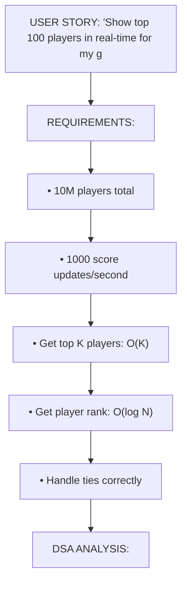

```java
// Leaderboard using Skip List concept (Redis ZSET style)
public class Leaderboard {
    // TreeMap: score -> set of player IDs (handles ties)
    private TreeMap<Long, LinkedHashSet<String>> scoreToPlayers = new TreeMap<>(Collections.reverseOrder());
    // HashMap: player -> score (for O(1) lookup)
    private Map<String, Long> playerToScore = new HashMap<>();
    // Running count for rank calculation
    private TreeMap<Long, Integer> scoreToRank = new TreeMap<>(Collections.reverseOrder());

    // Update score: O(log N)
    public void updateScore(String playerId, long newScore) {
        Long oldScore = playerToScore.get(playerId);

        // Remove old score
        if (oldScore != null) {
            LinkedHashSet<String> players = scoreToPlayers.get(oldScore);
            players.remove(playerId);
            if (players.isEmpty()) {
                scoreToPlayers.remove(oldScore);
            }
            updateRanks(oldScore, -1);
        }

        // Add new score
        playerToScore.put(playerId, newScore);
        scoreToPlayers.computeIfAbsent(newScore, k -> new LinkedHashSet<>()).add(playerId);
        updateRanks(newScore, 1);
    }

    // Get top K: O(K)
    public List<PlayerScore> getTopK(int k) {
        List<PlayerScore> result = new ArrayList<>();

        for (Map.Entry<Long, LinkedHashSet<String>> entry : scoreToPlayers.entrySet()) {
            for (String playerId : entry.getValue()) {
                result.add(new PlayerScore(playerId, entry.getKey()));
                if (result.size() >= k) return result;
            }
        }

        return result;
    }

    // Get rank: O(log N)
    public int getRank(String playerId) {
        Long score = playerToScore.get(playerId);
        if (score == null) return -1;

        int rank = 1;
        for (Map.Entry<Long, LinkedHashSet<String>> entry : scoreToPlayers.entrySet()) {
            if (entry.getKey() > score) {
                rank += entry.getValue().size();
            } else if (entry.getKey().equals(score)) {
                // Find position within same score (by insertion order)
                for (String p : entry.getValue()) {
                    if (p.equals(playerId)) break;
                    rank++;
                }
                break;
            }
        }

        return rank;
    }

    // Get players around a player: O(K log N)
    public List<PlayerScore> getAroundPlayer(String playerId, int countAbove, int countBelow) {
        // Useful for showing "You are here" with context
        // Implementation: Find player, then traverse up and down
        // ...
    }
}

// PRODUCTION: Use Redis Sorted Set (ZSET)
// ZADD leaderboard 1000 "player1"   // O(log N)
// ZREVRANK leaderboard "player1"    // O(log N)
// ZREVRANGE leaderboard 0 99        // O(K + log N)
```

---

## Example 3: Building an Autocomplete System

```
USER STORY: "Show suggestions as user types in search box"

REQUIREMENTS:
• 1M unique search terms
• Return top 5 suggestions
• < 50ms response time
• Handle prefix matching
• Rank by popularity

DSA MAPPING:
┌─────────────────────────────────────────────────────────────────┐
│                                                                 │
│   User types: "pro"                                             │
│                                                                 │
│   TRIE traversal to "pro":                                      │
│                                                                 │
│              (root)                                             │
│                |                                                │
│                p                                                │
│                |                                                │
│                r                                                │
│                |                                                │
│                o ← We are here                                  │
│              / | \                                              │
│             d  g  f                                             │
│             |  |  |                                             │
│             u  r  i                                             │
│             |  |  |                                             │
│             c  a  l                                             │
│             |  |  |                                             │
│             t  m  e                                             │
│             |  |                                                │
│             *  *                                                │
│                                                                 │
│   At each node, we need TOP K by popularity                     │
│   Solution: Store top 5 at each node (precomputed)              │
│                                                                 │
│   "pro" node stores: [("programming", 10K), ("profile", 8K),    │
│                       ("product", 5K), ("problem", 3K),         │
│                       ("process", 2K)]                          │
│                                                                 │
└─────────────────────────────────────────────────────────────────┘
```

> **Flow**: USER STORY: 'Show suggestions as user types in search b → REQUIREMENTS: | REQUIREMENTS: → • 1M unique search terms | • 1M unique search terms → • Return top 5 suggestions | • Return top 5 suggestions → • &lt; 50ms response time | • &lt; 50ms response time → • Handle prefix matching | • Handle prefix matching → • Rank by popularity | ...+1 more

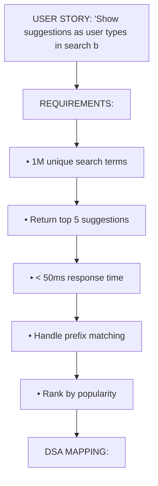

```java
class AutocompleteSystem {

    class TrieNode {
        Map<Character, TrieNode> children = new HashMap<>();
        // Store top suggestions at this prefix (precomputed)
        List<Suggestion> topSuggestions = new ArrayList<>();
        boolean isEnd = false;
        int frequency = 0;  // If this is a complete word
    }

    class Suggestion implements Comparable<Suggestion> {
        String term;
        int frequency;

        public int compareTo(Suggestion other) {
            if (this.frequency != other.frequency) {
                return other.frequency - this.frequency;  // Higher first
            }
            return this.term.compareTo(other.term);  // Alphabetical for ties
        }
    }

    private TrieNode root = new TrieNode();
    private static final int TOP_K = 5;

    // Insert term with frequency: O(m * k) where m = term length
    public void insert(String term, int frequency) {
        TrieNode node = root;

        for (char c : term.toCharArray()) {
            node.children.putIfAbsent(c, new TrieNode());
            node = node.children.get(c);

            // Update top suggestions at this prefix
            updateTopSuggestions(node, term, frequency);
        }

        node.isEnd = true;
        node.frequency = frequency;
    }

    private void updateTopSuggestions(TrieNode node, String term, int frequency) {
        // Remove old entry if exists
        node.topSuggestions.removeIf(s -> s.term.equals(term));

        // Add new entry
        Suggestion newSugg = new Suggestion();
        newSugg.term = term;
        newSugg.frequency = frequency;
        node.topSuggestions.add(newSugg);

        // Sort and keep top K
        Collections.sort(node.topSuggestions);
        if (node.topSuggestions.size() > TOP_K) {
            node.topSuggestions = new ArrayList<>(node.topSuggestions.subList(0, TOP_K));
        }
    }

    // Get suggestions: O(m) - just traverse to prefix!
    public List<String> getSuggestions(String prefix) {
        TrieNode node = root;

        // Traverse to prefix
        for (char c : prefix.toCharArray()) {
            if (!node.children.containsKey(c)) {
                return Collections.emptyList();  // No matches
            }
            node = node.children.get(c);
        }

        // Return precomputed top suggestions
        return node.topSuggestions.stream()
                   .map(s -> s.term)
                   .collect(Collectors.toList());
    }

    // Record a search (update frequencies)
    public void recordSearch(String term) {
        // In production: Send to Kafka → Batch process → Update Trie
        // This keeps the autocomplete responsive
    }
}

// PRODUCTION ENHANCEMENTS:
// 1. Fuzzy matching: Use BK-Tree for edit distance
// 2. Personalization: User-specific Trie layer
// 3. Trending: Time-decayed frequencies
// 4. Distributed: Shard by first character
```

---

# 🧩 Part 24: Interview Problem → System Design Mapping

```
LEETCODE PROBLEMS AND THEIR PRODUCTION COUNTERPARTS:

┌─────────────────────────────────────────────────────────────────────────────┐
│ LC Problem                 │ Real System Application                        │
├─────────────────────────────────────────────────────────────────────────────┤
│ Two Sum                    │ Finding matching orders in trading systems     │
│ LRU Cache                  │ Caching layer in any web service               │
│ Merge Intervals            │ Calendar scheduling, resource allocation       │
│ Word Search II             │ Search engine indexing, plagiarism detection   │
│ Design Twitter             │ Social media feed generation                   │
│ Meeting Rooms II           │ Resource scheduling, server allocation         │
│ Sliding Window Maximum     │ Real-time streaming analytics                  │
│ Serialize Binary Tree      │ Database replication, data transmission        │
│ Rate Limiter               │ API gateway, DDoS protection                   │
│ Top K Frequent             │ Analytics dashboards, trending topics          │
│ Find Median Stream         │ Real-time percentile monitoring                │
│ Alien Dictionary           │ Dependency resolution, build systems           │
│ Course Schedule            │ Task scheduling, CI/CD pipelines               │
│ Word Ladder                │ Spell correction, recommendation systems       │
│ Trapping Rain Water        │ Resource allocation, load balancing            │
│ Min Stack                  │ Undo functionality, version control            │
│ Validate BST               │ Database constraint checking                   │
│ Clone Graph                │ Social network analysis, web crawling          │
│ Number of Islands          │ Image processing, connected component analysis │
│ Longest Palindrome         │ DNA sequence analysis, data compression        │
└─────────────────────────────────────────────────────────────────────────────┘
```

> **Flow**: LEETCODE PROBLEMS AND THEIR PRODUCTION COUNTERPARTS: → LC Problem Real System Application | LC Problem Real System Application → Two Sum Finding matching orders in trading systems | Two Sum Finding matching orders in trading systems → LRU Cache Caching layer in any web service | LRU Cache Caching layer in any web service → Merge Intervals Calendar scheduling, resource allocatio | Merge Intervals Calendar scheduling, resource allocatio → Word Search II Search engine indexing, plagiarism detec | Word Search II Search engine indexing, plagiarism detec → Design Twitter Social media feed generation | ...+1 more

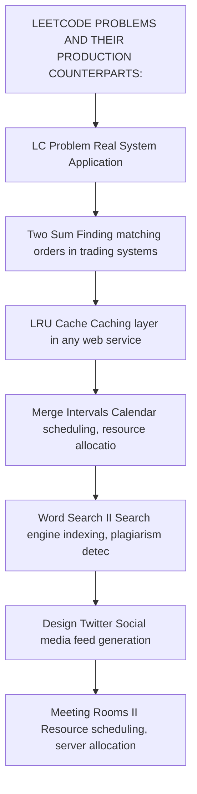

---

# ⚙️ Part 25: Debugging Production Systems

## The Systematic Debugging Framework

```
WHEN SYSTEM IS SLOW:

1. MEASURE FIRST
   └── "Where is time spent?"

2. CHECK DATA VOLUME
   └── "Did data size change?"

3. CHECK DATA SHAPE
   └── "Did data distribution change?"

4. CHECK CODE CHANGES
   └── "What was deployed recently?"

5. CHECK EXTERNAL DEPENDENCIES
   └── "Are third-party services slow?"

DEBUGGING FLOWCHART:
┌─────────────────────────────────────────────────────────────────┐
│                                                                 │
│   System is slow                                                │
│         │                                                       │
│         ▼                                                       │
│   ┌─────────────────┐                                           │
│   │ Check latency   │                                           │
│   │ percentiles     │                                           │
│   └────────┬────────┘                                           │
│            │                                                    │
│     ┌──────┴──────┐                                             │
│     ▼             ▼                                             │
│  P99 high     P50 high                                          │
│     │             │                                             │
│     ▼             ▼                                             │
│  Edge cases    Everything                                       │
│  are slow      is slow                                          │
│     │             │                                             │
│     ▼             ▼                                             │
│  Check for:    Check for:                                       │
│  - Large data  - Database                                       │
│  - Bad input   - Network                                        │
│  - Missing     - CPU/Memory                                     │
│    index       - Resource                                       │
│                  contention                                     │
│                                                                 │
└─────────────────────────────────────────────────────────────────┘

DSA-RELATED PERFORMANCE ISSUES:

1. O(n²) HIDDEN IN LOOPS
   for (item : list) {
       if (otherList.contains(item))  // O(n) lookup!
   }
   FIX: Convert otherList to HashSet → O(1) lookup

2. REPEATED STRING CONCATENATION
   String result = "";
   for (s : strings) {
       result += s;  // O(n²) total!
   }
   FIX: Use StringBuilder → O(n) total

3. N+1 QUERY PROBLEM
   for (user : users) {
       orders = db.query("SELECT * FROM orders WHERE user_id = ?", user.id)
   }
   FIX: JOIN or batch query → 1 query instead of N

4. MISSING CACHE
   for (request : requests) {
       result = expensiveComputation(request.param);  // Same param repeated!
   }
   FIX: Memoization / Cache → O(1) for repeated params

5. SORTING REPEATEDLY
   for (request : requests) {
       sorted = Arrays.sort(data.clone());  // O(n log n) each time!
   }
   FIX: Sort once, maintain sorted structure
```

> **Flow**: WHEN SYSTEM IS SLOW: / 1. MEASURE FIRST / 'Where is tim → Check latency / percentiles | Check latency / percentiles → P99 high P50 high | P99 high P50 high → Edge cases Everything / are slow is slow | Edge cases Everything / are slow is slow → Check for: Check for: / - Large data - Database / - Bad

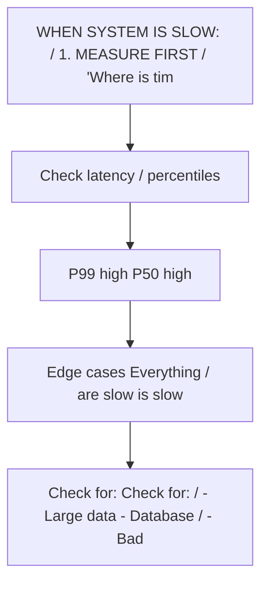

---

# 📌 Part 26: Code Review Checklist (DSA Focus)

```
BEFORE APPROVING ANY CODE, CHECK:

□ COMPLEXITY ANALYSIS
  □ Time complexity documented?
  □ Space complexity reasonable?
  □ Any hidden O(n²)?

□ DATA STRUCTURE CHOICE
  □ Right structure for operations performed?
  □ ArrayList vs LinkedList justified?
  □ HashMap vs TreeMap decision explained?

□ ALGORITHMIC PATTERNS
  □ Early termination where possible?
  □ Avoiding repeated computation?
  □ Using appropriate caching?

□ EDGE CASES
  □ Empty input handled?
  □ Single element handled?
  □ Maximum size considered?
  □ Negative numbers handled?
  □ Overflow checked?

□ CONCURRENCY
  □ Thread safety required?
  □ Appropriate synchronization?
  □ No race conditions?

□ MEMORY
  □ No memory leaks?
  □ Resources closed?
  □ Large collections managed?

COMPLEXITY RED FLAGS:

🚩 nested loops → O(n²) or worse
🚩 recursion without memoization → exponential
🚩 .contains() in a loop on List → O(n²)
🚩 string concatenation in loop → O(n²)
🚩 sorting in a loop → O(n² log n)
🚩 regex compilation in loop → O(n × regex)
🚩 database query in loop → N+1 problem
```

> **Flow**: 🚩 nested loops → O(n²) or worse | 🚩 recursion without memoization → exponential | 🚩 .contains() in a loop on List → O(n²) | 🚩 string concatenation in loop → O(n²) | 🚩 sorting in a loop → O(n² log n) | 🚩 regex compilation in loop → O(n × regex) | ...+1 more

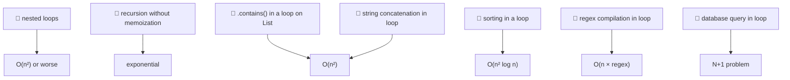

---

# 📌 Part 27: the 50 Algorithms Every Engineer Must Know

```
FUNDAMENTAL (Know cold):
 1. Binary Search
 2. Two Pointers
 3. Sliding Window
 4. BFS (Breadth-First Search)
 5. DFS (Depth-First Search)
 6. Merge Sort
 7. Quick Sort
 8. Heap Operations
 9. Hash Table Operations
10. Binary Tree Traversals

INTERMEDIATE (Know well):
11. Dijkstra's Algorithm
12. Union-Find
13. Topological Sort
14. Trie Operations
15. KMP String Matching
16. Kadane's Algorithm (Max Subarray)
17. Floyd's Cycle Detection
18. Quick Select
19. Counting Sort
20. Radix Sort

ADVANCED (Understand deeply):
21. A* Search Algorithm
22. Bellman-Ford
23. Floyd-Warshall
24. Segment Tree
25. Fenwick Tree
26. Suffix Array/Trie
27. Aho-Corasick
28. Rabin-Karp
29. Manacher's Algorithm
30. Z-Algorithm

DYNAMIC PROGRAMMING:
31. 0/1 Knapsack
32. Unbounded Knapsack
33. Longest Common Subsequence
34. Longest Increasing Subsequence
35. Edit Distance
36. Matrix Chain Multiplication
37. Coin Change
38. Partition Problem
39. Rod Cutting
40. Egg Drop

GRAPH ALGORITHMS:
41. Kruskal's MST
42. Prim's MST
43. Tarjan's SCC
44. Kosaraju's SCC
45. Articulation Points
46. Bridges in Graph
47. Eulerian Path
48. Hamiltonian Path
49. Maximum Bipartite Matching
50. Network Flow (Ford-Fulkerson)

FOR EACH ALGORITHM, KNOW:
├── When to use it
├── Time complexity
├── Space complexity
├── Implementation
├── Common variations
└── Real-world applications
```

> **Flow**: FOR EACH ALGORITHM, KNOW: → When to use it | FOR EACH ALGORITHM, KNOW: → Time complexity | FOR EACH ALGORITHM, KNOW: → Space complexity | FOR EACH ALGORITHM, KNOW: → Implementation | FOR EACH ALGORITHM, KNOW: → Common variations | FOR EACH ALGORITHM, KNOW: → Real-world applications

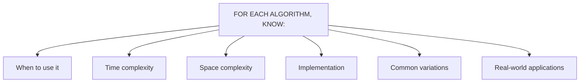

---

# 📌 Part 28: Weekly Learning Challenges

```
WEEK 1: ARRAYS & HASHING
├── Implement HashMap from scratch
├── Solve: Two Sum, Contains Duplicate, Group Anagrams
├── Build: In-memory key-value store
└── Study: Hash collision resolution strategies

WEEK 2: TWO POINTERS & SLIDING WINDOW
├── Implement: Sliding window template
├── Solve: 3Sum, Container With Most Water, Minimum Window Substring
├── Build: Real-time moving average calculator
└── Study: When to use which pointer technique

WEEK 3: STACKS & QUEUES
├── Implement: Min Stack, Monotonic Stack
├── Solve: Valid Parentheses, Daily Temperatures, Largest Rectangle
├── Build: Expression evaluator (calculator)
└── Study: When monotonic stack helps

WEEK 4: BINARY SEARCH
├── Implement: All binary search variants
├── Solve: Search Rotated Array, Find Peak, Median of Two Sorted
├── Build: Rate limiter with binary search
└── Study: Binary search on answer space

WEEK 5: TREES
├── Implement: BST, AVL tree
├── Solve: Validate BST, LCA, Serialize/Deserialize
├── Build: Simple database index
└── Study: Tree balancing techniques

WEEK 6: GRAPHS
├── Implement: Graph representations, BFS, DFS
├── Solve: Number of Islands, Clone Graph, Course Schedule
├── Build: Social network friend suggestion
└── Study: When BFS vs DFS

WEEK 7: HEAPS & PRIORITY QUEUES
├── Implement: Min/Max heap from scratch
├── Solve: Merge K Lists, Top K, Find Median
├── Build: Task scheduler with priorities
└── Study: Heap applications in system design

WEEK 8: DYNAMIC PROGRAMMING
├── Master: 1D DP, 2D DP patterns
├── Solve: Climbing Stairs, Coin Change, LCS, Edit Distance
├── Build: Spell checker with edit distance
└── Study: DP state design

WEEK 9: TRIES & ADVANCED DS
├── Implement: Trie, Segment Tree
├── Solve: Word Search II, Autocomplete, Range Sum Query
├── Build: Search autocomplete system
└── Study: When to use advanced DS

WEEK 10: SYSTEM DESIGN
├── Study: URL Shortener, Twitter, Chat System
├── Practice: Design discussions
├── Build: Simple distributed cache
└── Study: Trade-offs in system design
```

> **Flow**: WEEK 1: ARRAYS & HASHING → Implement HashMap from scratch | WEEK 1: ARRAYS & HASHING → Solve: Two Sum, Contains Duplicate, Group Anagrams | WEEK 1: ARRAYS & HASHING → Build: In-memory key-value store | WEEK 1: ARRAYS & HASHING → Study: Hash collision resolution strategies | WEEK 2: TWO POINTERS & SLIDING WINDOW → Implement: Sliding window template | WEEK 2: TWO POINTERS & SLIDING WINDOW → Solve: 3Sum, Container With Most Water, Minimum Window | ...+34 more

```mermaid
flowchart TD
    N1["WEEK 1: ARRAYS & HASHING"]
    N2["Implement HashMap from scratch"]
    N3["Solve: Two Sum, Contains Duplicate, Group Anagrams"]
    N4["Build: In-memory key-value store"]
    N5["Study: Hash collision resolution strategies"]
    N6["WEEK 2: TWO POINTERS & SLIDING WINDOW"]
    N7["Implement: Sliding window template"]
    N8["Solve: 3Sum, Container With Most Water, Minimum Window"]
    N9["Build: Real-time moving average calculator"]
    N10["Study: When to use which pointer technique"]
    N11["WEEK 3: STACKS & QUEUES"]
    N12["Implement: Min Stack, Monotonic Stack"]
    N13["Solve: Valid Parentheses, Daily Temperatures, Largest R"]
    N14["Build: Expression evaluator (calculator)"]
    N15["Study: When monotonic stack helps"]
    N16["WEEK 4: BINARY SEARCH"]
    N17["Implement: All binary search variants"]
    N18["Solve: Search Rotated Array, Find Peak, Median of Two S"]
    N19["Build: Rate limiter with binary search"]
    N20["Study: Binary search on answer space"]
    N21["WEEK 5: TREES"]
    N22["Implement: BST, AVL tree"]
    N23["Solve: Validate BST, LCA, Serialize/Deserialize"]
    N24["Build: Simple database index"]
    N25["Study: Tree balancing techniques"]
    N26["WEEK 6: GRAPHS"]
    N27["Implement: Graph representations, BFS, DFS"]
    N28["Solve: Number of Islands, Clone Graph, Course Schedule"]
    N29["Build: Social network friend suggestion"]
    N30["Study: When BFS vs DFS"]
    N31["WEEK 7: HEAPS & PRIORITY QUEUES"]
    N32["Implement: Min/Max heap from scratch"]
    N33["Solve: Merge K Lists, Top K, Find Median"]
    N34["Build: Task scheduler with priorities"]
    N35["Study: Heap applications in system design"]
    N36["WEEK 8: DYNAMIC PROGRAMMING"]
    N37["Master: 1D DP, 2D DP patterns"]
    N38["Solve: Climbing Stairs, Coin Change, LCS, Edit Distance"]
    N39["Build: Spell checker with edit distance"]
    N40["Study: DP state design"]
    N41["WEEK 9: TRIES & ADVANCED DS"]
    N42["Implement: Trie, Segment Tree"]
    N43["Solve: Word Search II, Autocomplete, Range Sum Query"]
    N44["Build: Search autocomplete system"]
    N45["Study: When to use advanced DS"]
    N46["WEEK 10: SYSTEM DESIGN"]
    N47["Study: URL Shortener, Twitter, Chat System"]
    N48["Practice: Design discussions"]
    N49["Build: Simple distributed cache"]
    N50["Study: Trade-offs in system design"]
    N1 --> N2
    N1 --> N3
    N1 --> N4
    N1 --> N5
    N6 --> N7
    N6 --> N8
    N6 --> N9
    N6 --> N10
    N11 --> N12
    N11 --> N13
    N11 --> N14
    N11 --> N15
    N16 --> N17
    N16 --> N18
    N16 --> N19
    N16 --> N20
    N21 --> N22
    N21 --> N23
    N21 --> N24
    N21 --> N25
    N26 --> N27
    N26 --> N28
    N26 --> N29
    N26 --> N30
    N31 --> N32
    N31 --> N33
    N31 --> N34
    N31 --> N35
    N36 --> N37
    N36 --> N38
    N36 --> N39
    N36 --> N40
    N41 --> N42
    N41 --> N43
    N41 --> N44
    N41 --> N45
    N46 --> N47
    N46 --> N48
    N46 --> N49
    N46 --> N50
```

---

_"The journey of a thousand algorithms begins with a single data structure."_ 🌟✨


---

> **Navigation**: [< Previous](Ch27_Pre_Spring_Part2.md) | [Back to Index](../00_MASTER_INDEX.md) | [Next >](Ch31_SB_Core_Part1.md)