**Navigation**: [< Previous](Ch58_SB_Deep_Reasoning.md) | [Back to Index](../00_MASTER_INDEX.md) | [Next >](Ch19_JVM_Object_Model.md)

# Chapter 33 — Java Streams Deep Reasoning: WHY They Work the Way They Do

**"Anyone can write `.filter().map().collect()`. The senior engineer explains WHY streams are lazy, WHAT happens when you use `parallelStream()` on a LinkedList, and HOW `reduce()` actually accumulates — not just that it does."**

---

## Table of Contents

1. [WHY Are Streams Lazy? The Assembly Line Analogy](#1-why-are-streams-lazy)
2. [Stream vs Collection: They Are NOT The Same Thing](#2-stream-vs-collection)
3. [Intermediate vs Terminal: When Code Actually Runs](#3-intermediate-vs-terminal)
4. [map() vs flatMap(): The Box-Inside-Box Problem](#4-map-vs-flatmap)
5. [reduce() Internals: The Accumulator Pattern](#5-reduce-internals)
6. [Collector Internals: What Collectors.toList() Actually Does](#6-collector-internals)
7. [parallelStream() Traps: Where It HURTS Performance](#7-parallelstream-traps)
8. [Stream Pipeline Fusion: How JVM Optimizes](#8-stream-pipeline-fusion)
9. [Optional Deep Reasoning: Why It Exists And When NOT to Use It](#9-optional-deep-reasoning)
10. [Method References: Not Just Syntactic Sugar](#10-method-references)
11. [Real-World Stream Patterns: Production Code That Senior Engineers Write](#11-real-world-stream-patterns)
12. [Quick-Fire Interview Table](#12-quick-fire-table)

---

## 1. WHY Are Streams Lazy?

### The Freeze Question
"Why are streams lazy? What does that actually mean?"

### Surface Answer (Junior)
"Streams don't process until a terminal operation is called."

### Deep Reasoning


THE SUSHI CONVEYOR BELT ANALOGY

Imagine a sushi restaurant with a conveyor belt:

EAGER approach (old Java loops):
→ Chef makes ALL 100 sushi plates first
→ Puts them ALL on the belt
→ You pick the 3 you want
→ 97 plates WASTED

LAZY approach (streams):
→ Chef waits for your ORDER (terminal operation)
→ Makes one plate at a time
→ You take it, inspect it (filter), modify it (map)
→ Stop when you have 3 (limit)
→ Chef stops. Only 3 plates made.

WHY THIS MATTERS:
- findFirst() on 1 million items? Only processes until found
- limit(5) on infinite stream? Processes exactly 5 items
- filter().map().collect()? SINGLE PASS, not 3 separate loops


### Code Proof — Laziness in Action

```java
// This proves laziness — watch the print order
List<String> names = List.of("Alice", "Bob", "Charlie", "Dave", "Eve");

List<String> result = names.stream()
    .filter(name -> {
        System.out.println("  filter: " + name);
        return name.length() > 3;
    })
    .map(name -> {
        System.out.println("  map: " + name);
        return name.toUpperCase();
    })
    .limit(2)
    .collect(Collectors.toList());

// OUTPUT (note: processes one element through ENTIRE pipeline before next):
//   filter: Alice       ← Alice passes filter
//   map: Alice          ← Alice goes through map (count: 1)
//   filter: Bob         ← Bob fails filter (length 3, not > 3)
//   filter: Charlie     ← Charlie passes filter
//   map: Charlie        ← Charlie goes through map (count: 2 → STOP!)
//   Dave and Eve NEVER processed!

// CONTRAST with eager approach:
// Eager would: filter ALL 5 → get [Alice, Charlie, Dave, Eve]
//              map ALL 4 → get [ALICE, CHARLIE, DAVE, EVE]
//              limit 2 → get [ALICE, CHARLIE]
// That's 9 operations. Lazy did only 5.
```

### The Short-Circuiting Principle

```
┌─────────────────────────────────────────────────────────────────┐
│  SHORT-CIRCUITING OPERATIONS:                                   │
│                                                                 │
│  Terminal:     findFirst(), findAny(), anyMatch(),              │
│                allMatch(), noneMatch()                          │
│                                                                 │
│  Intermediate: limit(), takeWhile() (Java 9+)                   │
│                                                                 │
│  These can STOP the entire pipeline early:                      │
│                                                                 │
│  // On 10 million records — finds first match, stops            │
│  users.stream()                                                 │
│      .filter(u -> u.getAge() > 65)                              │
│      .findFirst();  // Might check only 100 users               │
│                                                                 │
│  // Infinite stream — no problem!                               │
│  Stream.iterate(1, n -> n + 1)  // infinite: 1, 2, 3, 4...      │
│      .filter(n -> n % 7 == 0)   // multiples of 7               │
│      .limit(5)                   // take first 5                │
│      .forEach(System.out::println);  // 7, 14, 21, 28, 35       │
└─────────────────────────────────────────────────────────────────┘
```

**Flow:**
1. SHORT-CIRCUITING OPERATIONS:
2. Terminal: findFirst(), findAny(), anyMatch(),
3. allMatch(), noneMatch()
4. Intermediate: limit(), takeWhile() (Java 9+)
5. These can STOP the entire pipeline early:
6. users.stream()
7. .filter(u -> u.getAge() > 65)

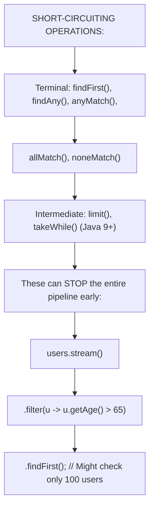

### Follow-Up Trap
"If streams are lazy, what happens if you never call a terminal operation?"

**Nothing executes.** The intermediate operations return a new Stream object with instructions recorded, but zero computation happens. It's like writing a recipe but never cooking.

```java
// This does NOTHING — no terminal operation
names.stream()
    .filter(n -> {
        System.out.println("filtering " + n);  // NEVER prints!
        return n.length() > 3;
    })
    .map(String::toUpperCase);
// No output. No filtering. No mapping. Nothing happened.
```

---


🔬 **Section Challenge — 1. WHY Are Streams Lazy?**

**Challenge 1 (Reasoning):** `list.stream().filter().map().collect()` — at which point does data actually start flowing through the pipeline?
<details><summary>Answer</summary>

Not until `collect()` (or any terminal operation). `filter()` and `map()` are LAZY — they build a pipeline description but process nothing. When the terminal operation is called, the pipeline pulls elements through lazily: one element passes through the entire pipeline before the next is processed. This means: early termination with `findFirst()` is O(1) if the first element matches, not O(N).
</details>

**Challenge 2 (Bug Hunt):** You call `stream.filter(...).collect(...)` twice on the same stream. What happens?
<details><summary>Answer</summary>

`IllegalStateException: stream has already been operated upon or closed`. Streams are single-use. Once a terminal operation is called, the stream is consumed. Fix: create a new stream from the source each time, or collect to a `List` first and stream the list repeatedly.
</details>


## 2. Stream vs Collection: They Are NOT The Same Thing

### The Freeze Question
"What's the difference between a Stream and a Collection?"

### Deep Reasoning

```
╔══════════════════════════════════════════════════════════════════╗
║  THE DVD vs NETFLIX ANALOGY                                      ║
║                                                                  ║
║  Collection = DVD collection on your shelf                       ║
║  → All data IN MEMORY right now                                  ║
║  → You can pick any DVD (random access)                          ║
║  → You can count them (size)                                     ║
║  → You can add/remove DVDs (mutable)                             ║
║  → Same DVDs, watch as many times as you want (reusable)         ║
║                                                                  ║
║  Stream = Netflix                                                ║
║  → Data comes ON DEMAND (lazy, possibly from database)           ║
║  → You watch in order (sequential processing)                    ║
║  → You don't know total count until you watch all                ║
║  → You can't rewind (consumed once)                              ║
║  → You describe WHAT you want, Netflix figures out HOW           ║
║                                                                  ║
║  KEY DISTINCTION:                                                ║
║  Collection = data structure (stores data)                       ║
║  Stream = computation description (processes data)               ║
╚══════════════════════════════════════════════════════════════════╝
```

**Flow:**
1. THE DVD vs NETFLIX ANALOGY
2. Collection = DVD collection on your shelf
3. All data IN MEMORY right now
4. You can pick any DVD (random access)
5. You can count them (size)
6. You can add/remove DVDs (mutable)
7. Same DVDs, watch as many times as you want (reusable)

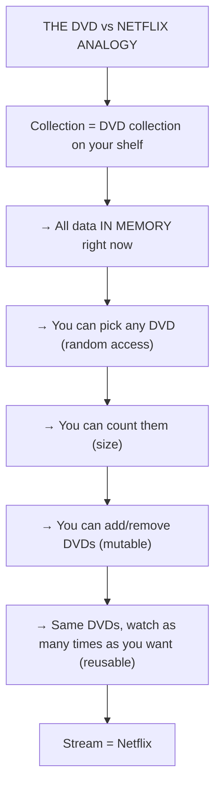

### The "Used Once" Rule — Code Proof

```java
Stream<String> stream = names.stream().filter(n -> n.length() > 3);

// First use — works fine
stream.forEach(System.out::println);

// Second use — CRASH!
stream.forEach(System.out::println);
// IllegalStateException: stream has already been operated upon or closed

// WHY? A stream is a pipeline, not a container.
// Once water flows through a pipe, it's gone.
// You need to create a new stream from the source.
```

### Critical Difference Table

```
┌────────────────────┬───────────────────────┬──────────────────────┐
│ Feature            │ Collection            │ Stream               │
├────────────────────┼───────────────────────┼──────────────────────┤
│ When computed      │ Eagerly (all at once) │ Lazily (on demand)   │
│ Reusable           │ ✅ Yes                │ ❌ Once only           │
│ Mutable            │ ✅ add/remove         │ ❌ Immutable pipe      │
│ Size               │ Known (.size())       │ May be infinite      │
│ Random access      │ ✅ list.get(i)        │ ❌ Sequential only     │
│ Can store data     │ ✅ Primary purpose    │ ❌ Passes through      │
│ External iteration │ ✅ for-each           │ ❌ Internal only       │
│ Source of data     │ IS the data           │ Wraps a data source  │
└────────────────────┴───────────────────────┴──────────────────────┘
```

**Flow:**
1. Feature Collection Stream
2. When computed Eagerly (all at once) Lazily (on demand)
3. Reusable ✅ Yes ❌ Once only
4. Mutable ✅ add/remove ❌ Immutable pipe
5. Size Known (.size()) May be infinite
6. Random access ✅ list.get(i) ❌ Sequential only
7. Can store data ✅ Primary purpose ❌ Passes through

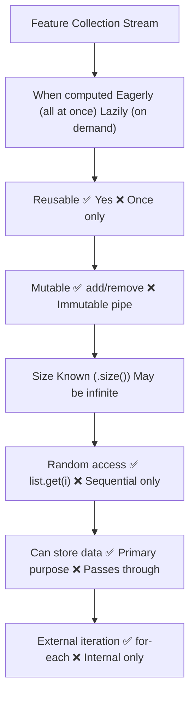

---


🔬 **Section Challenge — 2. Stream vs Collection: They Are NOT The Same Thing**

**Challenge 1 (Reasoning):** `list.stream().filter().map().collect()` — at which point does data actually start flowing through the pipeline?
<details><summary>Answer</summary>

Not until `collect()` (or any terminal operation). `filter()` and `map()` are LAZY — they build a pipeline description but process nothing. When the terminal operation is called, the pipeline pulls elements through lazily: one element passes through the entire pipeline before the next is processed. This means: early termination with `findFirst()` is O(1) if the first element matches, not O(N).
</details>

**Challenge 2 (Bug Hunt):** You call `stream.filter(...).collect(...)` twice on the same stream. What happens?
<details><summary>Answer</summary>

`IllegalStateException: stream has already been operated upon or closed`. Streams are single-use. Once a terminal operation is called, the stream is consumed. Fix: create a new stream from the source each time, or collect to a `List` first and stream the list repeatedly.
</details>


## 3. Intermediate vs Terminal: When Code Actually Runs

### Deep Reasoning

```
╔══════════════════════════════════════════════════════════════════╗
║  THE RESTAURANT ORDER ANALOGY                                    ║
║                                                                  ║
║  Intermediate Operations = Adding items to your order            ║
║  → "I'd like the salad..." (filter)                              ║
║  → "...with dressing on the side..." (map)                       ║
║  → "...and only the first 3..." (limit)                          ║
║  → Nothing is being prepared yet!                                ║
║                                                                  ║
║  Terminal Operation = Saying "That's my order" (submit)          ║
║  → collect() = "Bring it all on one plate"                       ║
║  → forEach() = "Feed me one bite at a time"                      ║
║  → reduce() = "Blend it all into one smoothie"                   ║
║  → count() = "Just tell me how many items"                       ║
║  → findFirst() = "Just bring the first one"                      ║
║                                                                  ║
║  THE KITCHEN STARTS ONLY WHEN YOU SUBMIT THE ORDER               ║
╚══════════════════════════════════════════════════════════════════╝
```

**Flow:**
1. THE RESTAURANT ORDER ANALOGY
2. Intermediate Operations = Adding items to your order
3. 'I'd like the salad...' (filter)
4. '...with dressing on the side...' (map)
5. '...and only the first 3...' (limit)
6. Nothing is being prepared yet!
7. Terminal Operation = Saying 'That's my order' (submit)

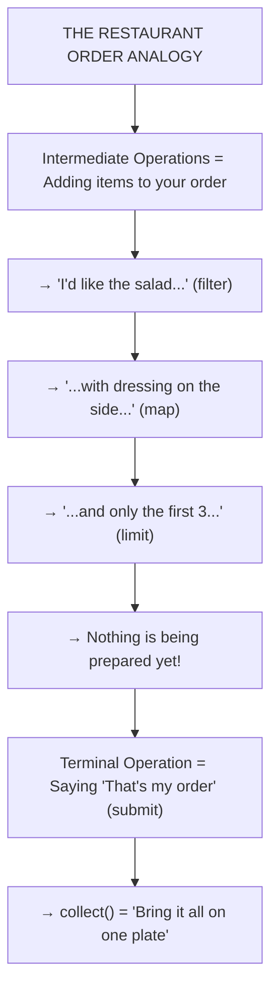

### Classification

```
┌─────────────────────────────────────────────────────────────────┐
│  INTERMEDIATE (returns Stream — lazy, chainable):               │
│                                                                 │
│  Stateless (no memory between elements):                        │
│    filter(), map(), flatMap(), peek(), mapToInt/Long/Double()   │
│                                                                 │
│  Stateful (must see all/some elements first):                   │
│    sorted()  ← must see ALL elements to sort                    │
│    distinct() ← must remember what it's seen (HashSet)          │
│    skip(n)   ← must count n elements to skip                    │
│    limit(n)  ← must count (but short-circuits)                  │
│                                                                 │
│  ⚠️ sorted() BREAKS laziness — forces buffering all elements!   │
│                                                                 │
│  TERMINAL (returns result — triggers execution):                │
│    collect(), forEach(), reduce(), count(), min(), max(),       │
│    toArray(), findFirst(), findAny(),                           │
│    anyMatch(), allMatch(), noneMatch()                          │
└─────────────────────────────────────────────────────────────────┘
```

**Flow:**
1. INTERMEDIATE (returns Stream — lazy, chainable):
2. Stateless (no memory between elements):
3. Stateful (must see all/some elements first):
4. sorted() ← must see ALL elements to sort
5. distinct() ← must remember what it's seen (HashSet)
6. skip(n) ← must count n elements to skip
7. limit(n) ← must count (but short-circuits)

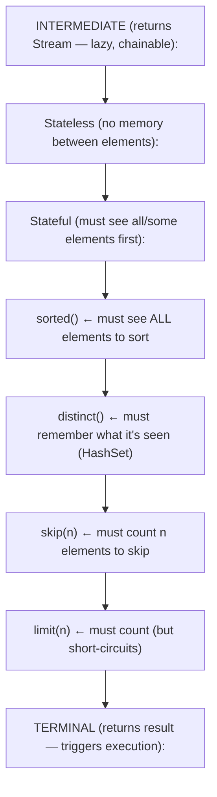

### The sorted() Trap

```java
// sorted() is a "barrier" — laziness pauses here
Stream.iterate(1, n -> n + 1)
    .limit(1_000_000)
    .sorted()               // Must buffer ALL 1 million in memory!
    .findFirst();           // Only wanted first, but sorted ALL

// Better: sort BEFORE streaming if possible
list.sort(Comparator.naturalOrder());  // In-place sort
list.stream().findFirst();              // No buffering needed
```

---


🔬 **Section Challenge — 3. Intermediate vs Terminal: When Code Actually Runs**

**Challenge 1 (Reasoning):** `ExecutorService.submit(task)` — the task throws a `RuntimeException`. Nobody calls `future.get()`. What happens to the exception?
<details><summary>Answer</summary>

It's silently swallowed. The exception is stored in the `Future` object. Without `future.get()` or `.whenComplete()`, no one ever sees it. The thread pool thread resets and picks up the next task as if nothing happened. This is one of the most dangerous production bugs. Fix: always attach `future.whenComplete((r,ex) -> { if(ex!=null) log.error("Task failed",ex); })` or use `execute()` + `UncaughtExceptionHandler`.
</details>


## 4. map() vs flatMap(): The Box-Inside-Box Problem

### The Freeze Question
"What's the difference between `map()` and `flatMap()`?"

### Deep Reasoning

```
╔══════════════════════════════════════════════════════════════════╗
║  THE GIFT BOX ANALOGY                                            ║
║                                                                  ║
║  You have 3 gift boxes, each containing smaller boxes:           ║
║                                                                  ║
║  Box1 → [candy, toy]                                             ║
║  Box2 → [book]                                                   ║
║  Box3 → [pen, eraser, ruler]                                     ║
║                                                                  ║
║  map() = "Open each box and look inside"                         ║
║  Result: [ [candy,toy], [book], [pen,eraser,ruler] ]             ║
║  → You get a Stream<List<Item>> — boxes within boxes!            ║
║                                                                  ║
║  flatMap() = "Open each box AND dump everything on the table"    ║
║  Result: [candy, toy, book, pen, eraser, ruler]                  ║
║  → You get a Stream<Item> — flat, no nesting!                    ║
║                                                                  ║
║  map():     1-to-1 transformation (same structure)               ║
║  flatMap(): 1-to-many + flatten (removes one nesting level)      ║
╚══════════════════════════════════════════════════════════════════╝
```

**Flow:**
1. THE GIFT BOX ANALOGY
2. You have 3 gift boxes, each containing smaller boxes:
3. Box1
4. [candy, toy]
5. Box1
6. [candy, toy]
7. Box2
8. [book]
9. Box2
10. [book]
11. Box3
12. [pen, eraser, ruler]
13. Box3
14. [pen, eraser, ruler]
15. map() = 'Open each box and look inside'
16. Result: [ [candy,toy], [book], [pen,eraser,ruler] ]

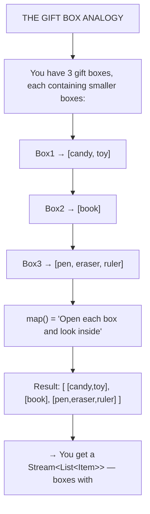

### Code Proof

```java
List<List<String>> departments = List.of(
    List.of("Alice", "Bob"),        // Engineering
    List.of("Charlie"),              // Design
    List.of("Dave", "Eve", "Frank") // Marketing
);

// map() — still nested
departments.stream()
    .map(dept -> dept.stream())  // Stream<Stream<String>> 😩
    .forEach(System.out::println);
// Output: java.util.stream.ReferencePipeline$Head@...
//         java.util.stream.ReferencePipeline$Head@...
//         java.util.stream.ReferencePipeline$Head@...

// flatMap() — flattened!
departments.stream()
    .flatMap(dept -> dept.stream())  // Stream<String> 🎯
    .forEach(System.out::println);
// Output: Alice, Bob, Charlie, Dave, Eve, Frank

// Real-world: get all order items from all customers
customers.stream()
    .flatMap(customer -> customer.getOrders().stream())
    .flatMap(order -> order.getItems().stream())
    .filter(item -> item.getPrice() > 100)
    .collect(Collectors.toList());
```

### When to Use Which

```
┌─────────────────────────────────────────────────────────────────┐
│  DECISION:                                                      │
│                                                                 │
│  Your function returns ONE thing?     → map()                   │
│    name → name.toUpperCase()         (String → String)          │
│    user → user.getAge()              (User → Integer)           │
│                                                                 │
│  Your function returns a COLLECTION?  → flatMap()               │
│    user → user.getOrders()           (User → List<Order>)       │
│    line → Arrays.asList(line.split(" "))  (String → List)       │
│    optional → optional.stream()      (Optional → Stream)        │
│                                                                 │
│  Your function returns an OPTIONAL?   → flatMap() (Java 9+)     │
│    Stream<Optional<T>> → flatMap(Optional::stream) → Stream<T>  │
└─────────────────────────────────────────────────────────────────┘
```

**Flow:**
1. DECISION:
2. Your function returns ONE thing?
3. map()
4. Your function returns ONE thing?
5. map()
6. name
7. name.toUpperCase() (String
8. String)
9. name
10. name.toUpperCase() (String
11. String)
12. user
13. user.getAge() (User
14. Integer)
15. user
16. user.getAge() (User
17. Integer)
18. Your function returns a COLLECTION?
19. flatMap()
20. Your function returns a COLLECTION?
21. flatMap()
22. user
23. user.getOrders() (User
24. List<Order>)
25. user
26. user.getOrders() (User
27. List<Order>)
28. line
29. Arrays.asList(line.split(' ')) (String
30. List)

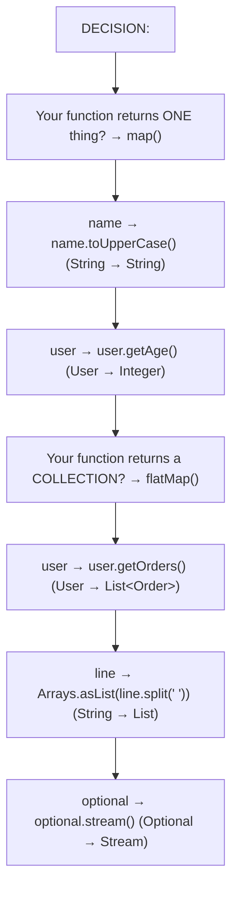

---


🔬 **Section Challenge — 4. map() vs flatMap(): The Box-Inside-Box Problem**

**Challenge 1 (Reasoning):** `ExecutorService.submit(task)` — the task throws a `RuntimeException`. Nobody calls `future.get()`. What happens to the exception?
<details><summary>Answer</summary>

It's silently swallowed. The exception is stored in the `Future` object. Without `future.get()` or `.whenComplete()`, no one ever sees it. The thread pool thread resets and picks up the next task as if nothing happened. This is one of the most dangerous production bugs. Fix: always attach `future.whenComplete((r,ex) -> { if(ex!=null) log.error("Task failed",ex); })` or use `execute()` + `UncaughtExceptionHandler`.
</details>


## 5. reduce() Internals: The Accumulator Pattern

### The Freeze Question
"How does `reduce()` actually work? What's an accumulator?"

### Deep Reasoning

```
╔══════════════════════════════════════════════════════════════════╗
║  THE SNOWBALL ROLLING DOWNHILL ANALOGY                           ║
║                                                                  ║
║  reduce() is like rolling a snowball downhill:                   ║
║                                                                  ║
║  identity (starting snowball) = 0                                ║
║  accumulator (pick up snow as you roll) = (sum, next) -> sum+n   ║
║                                                                  ║
║  Elements: [3, 7, 2, 5]                                          ║
║                                                                  ║
║  Step 1: snowball=0, pick up 3  → snowball=3                     ║
║  Step 2: snowball=3, pick up 7  → snowball=10                    ║
║  Step 3: snowball=10, pick up 2 → snowball=12                    ║
║  Step 4: snowball=12, pick up 5 → snowball=17                    ║
║                                                                  ║
║  Result: 17                                                      ║
║                                                                  ║
║  THREE FORMS:                                                    ║
║  reduce(BinaryOperator)           → Optional<T>                  ║
║  reduce(identity, BinaryOperator) → T                            ║
║  reduce(identity, accumulator, combiner) → U (for parallel)      ║
╚══════════════════════════════════════════════════════════════════╝
```

**Flow:**
1. THE SNOWBALL ROLLING DOWNHILL ANALOGY
2. reduce() is like rolling a snowball downhill:
3. identity (starting snowball) = 0
4. Elements: [3, 7, 2, 5]
5. Step 1: snowball=0, pick up 3
6. snowball=3
7. Step 1: snowball=0, pick up 3
8. snowball=3
9. Step 2: snowball=3, pick up 7
10. snowball=10
11. Step 2: snowball=3, pick up 7
12. snowball=10
13. Step 3: snowball=10, pick up 2
14. snowball=12

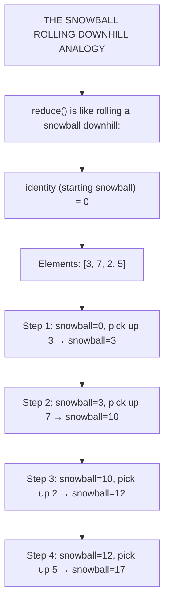

### The Three-Argument reduce() — WHY It Exists

```java
// Two-argument (sequential only):
int sum = numbers.stream()
    .reduce(0, Integer::sum);

// But what about this? DIFFERENT types (Stream<String> → Integer):
int totalLength = words.stream()
    .reduce(0,                          // identity (int)
            (length, word) -> length + word.length(),  // accumulator
            Integer::sum);              // combiner (for parallel)

// WHY the combiner?
// In parallel, the stream splits into chunks:
//   Chunk1: ["Hello", "World"]  → 0 + 5 + 5 = 10
//   Chunk2: ["Java", "Streams"] → 0 + 4 + 7 = 11
//
// The COMBINER merges chunk results: 10 + 11 = 21
//
// Without combiner, parallel reduce can't merge different-type results.

// ⚠️ IDENTITY MUST BE NEUTRAL:
// For sum: identity = 0  (because x + 0 = x)
// For product: identity = 1  (because x * 1 = x)
// For string concat: identity = ""  (because s + "" = s)
// WRONG identity → WRONG parallel results!
```

### reduce() vs collect() — When to Use Which

```
┌────────────────────────────────────────────────────────────────────┐
│  reduce() = combine all into ONE value                             │
│    Sum, product, min, max, concatenation                           │
│    → Creates NEW object each step (immutable accumulation)         │
│                                                                    │
│  collect() = pour all into a MUTABLE CONTAINER                     │
│    List, Map, Set, StringBuilder, custom object                    │
│    → MUTATES the container (mutable accumulation)                  │
│                                                                    │
│  WHY THE DISTINCTION?                                              │
│  reduce() with String concat: "a" + "b" → new "ab" + "c" → "abc"   │
│    → Creates N new String objects = O(n²) for strings!             │
│                                                                    │
│  collect() with StringBuilder: sb.append("a").append("b")...       │
│    → Mutates ONE object = O(n)                                     │
│                                                                    │
│  RULE: Building a collection? Use collect(). Single value? reduce()│
└────────────────────────────────────────────────────────────────────┘
```

**Flow:**
1. reduce() = combine all into ONE value
2. Sum, product, min, max, concatenation
3. Creates NEW object each step (immutable accumulation)
4. collect() = pour all into a MUTABLE CONTAINER
5. List, Map, Set, StringBuilder, custom object
6. MUTATES the container (mutable accumulation)
7. WHY THE DISTINCTION?

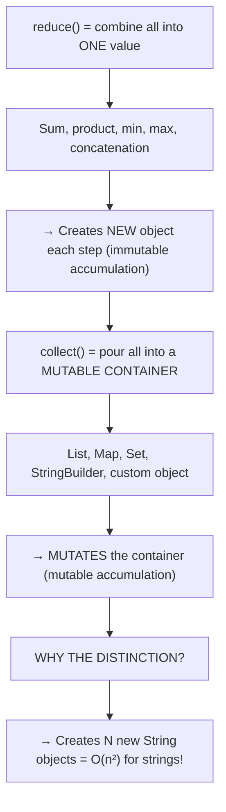

---


🔬 **Section Challenge — 5. reduce() Internals: The Accumulator Pattern**

**Challenge 1 (Reasoning):** `ExecutorService.submit(task)` — the task throws a `RuntimeException`. Nobody calls `future.get()`. What happens to the exception?
<details><summary>Answer</summary>

It's silently swallowed. The exception is stored in the `Future` object. Without `future.get()` or `.whenComplete()`, no one ever sees it. The thread pool thread resets and picks up the next task as if nothing happened. This is one of the most dangerous production bugs. Fix: always attach `future.whenComplete((r,ex) -> { if(ex!=null) log.error("Task failed",ex); })` or use `execute()` + `UncaughtExceptionHandler`.
</details>


## 6. Collector Internals: What Collectors.toList() Actually Does

### The Freeze Question
"What is a Collector? Can you write a custom one?"

### Deep Reasoning

```
╔══════════════════════════════════════════════════════════════════╗
║  THE ASSEMBLY LINE WORKER ANALOGY                                ║
║                                                                  ║
║  A Collector has 4 jobs (like 4 assembly line workers):          ║
║                                                                  ║
║  1. supplier()    → "Bring an empty box"                         ║
║                      () -> new ArrayList<>()                     ║
║                                                                  ║
║  2. accumulator() → "Put each item in the box"                   ║
║                      (list, item) -> list.add(item)              ║
║                                                                  ║
║  3. combiner()    → "Merge two boxes into one" (for parallel)    ║
║                      (list1, list2) -> { list1.addAll(list2); }  ║
║                                                                  ║
║  4. finisher()    → "Seal the box and label it"                  ║
║                      list -> Collections.unmodifiableList(list)  ║
║                                                                  ║
║  + characteristics() → hints: CONCURRENT? UNORDERED? IDENTITY?   ║
╚══════════════════════════════════════════════════════════════════╝
```

**Flow:**
1. THE ASSEMBLY LINE WORKER ANALOGY
2. A Collector has 4 jobs (like 4 assembly line workers):
3. 1. supplier()
4. 'Bring an empty box'
5. 1. supplier()
6. 'Bring an empty box'
7. () -> new ArrayList<>()
8. 2. accumulator()
9. 'Put each item in the box'
10. 2. accumulator()
11. 'Put each item in the box'
12. (list, item) -> list.add(item)
13. 3. combiner()
14. 'Merge two boxes into one' (for paralle

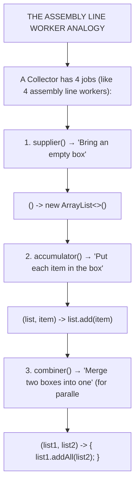

### Writing a Custom Collector

```java
// Custom collector: comma-separated string
Collector<String, StringJoiner, String> commaJoiner =
    Collector.of(
        () -> new StringJoiner(", "),          // supplier
        StringJoiner::add,                      // accumulator
        StringJoiner::merge,                    // combiner
        StringJoiner::toString                  // finisher
    );

String result = names.stream().collect(commaJoiner);
// "Alice, Bob, Charlie"

// Custom collector: frequency map
Collector<String, ?, Map<String, Long>> frequencyCounter =
    Collectors.groupingBy(Function.identity(), Collectors.counting());

Map<String, Long> freq = words.stream().collect(frequencyCounter);
// {hello=3, world=2, java=5}
```

### Built-in Collectors You MUST Know

```java
// GROUP BY — the most powerful collector
Map<String, List<Employee>> byDept = employees.stream()
    .collect(Collectors.groupingBy(Employee::getDepartment));

// GROUP BY with downstream aggregation
Map<String, Double> avgSalaryByDept = employees.stream()
    .collect(Collectors.groupingBy(
        Employee::getDepartment,
        Collectors.averagingDouble(Employee::getSalary)
    ));

// PARTITION BY — split into true/false groups
Map<Boolean, List<Employee>> seniorVsJunior = employees.stream()
    .collect(Collectors.partitioningBy(e -> e.getYears() >= 5));

// toUnmodifiableList() (Java 10+) — immutable result
List<String> immutable = names.stream()
    .filter(n -> n.length() > 3)
    .collect(Collectors.toUnmodifiableList());

// toMap() with merge function (handle duplicates!)
Map<String, Integer> longestNameByDept = employees.stream()
    .collect(Collectors.toMap(
        Employee::getDepartment,
        e -> e.getName().length(),
        Math::max                  // merge: keep longer name
    ));

// Chaining collectors: group by dept, then count per dept
Map<String, Long> countByDept = employees.stream()
    .collect(Collectors.groupingBy(
        Employee::getDepartment,
        Collectors.counting()
    ));
```

---


🔬 **Section Challenge — 6. Collector Internals: What Collectors.toList() Actually Does**

**Challenge 1 (Reasoning):** `ExecutorService.submit(task)` — the task throws a `RuntimeException`. Nobody calls `future.get()`. What happens to the exception?
<details><summary>Answer</summary>

It's silently swallowed. The exception is stored in the `Future` object. Without `future.get()` or `.whenComplete()`, no one ever sees it. The thread pool thread resets and picks up the next task as if nothing happened. This is one of the most dangerous production bugs. Fix: always attach `future.whenComplete((r,ex) -> { if(ex!=null) log.error("Task failed",ex); })` or use `execute()` + `UncaughtExceptionHandler`.
</details>


## 7. parallelStream() Traps: Where It HURTS Performance

### The Freeze Question
"Should I use `parallelStream()` for better performance?"

### Deep Reasoning

```
╔══════════════════════════════════════════════════════════════════╗
║  THE COOKING ANALOGY — When More Chefs HURT                      ║
║                                                                  ║
║  Sequential: 1 chef makes 100 dishes — predictable, orderly      ║
║  Parallel: 10 chefs share 1 kitchen — CHAOS potential!           ║
║                                                                  ║
║  WHEN 10 CHEFS HELP:                                             ║
║  → Independent tasks (each chef has own station)                 ║
║  → CPU-heavy work (chopping, mixing — not waiting)               ║
║  → Large dataset (100+ dishes, not 5)                            ║
║                                                                  ║
║  WHEN 10 CHEFS HURT:                                             ║
║  → Shared equipment (one oven = one bottle neck = contention)    ║
║  → Small tasks (overhead of coordinating > time saved)           ║
║  → IO-bound (everyone waits for the same delivery truck)         ║
║  → Order matters (dish 1 must finish before dish 2 starts)       ║
║  → Shared state mutation (two chefs grabbing same salt = bug)    ║
╚══════════════════════════════════════════════════════════════════╝
```

**Flow:**
1. THE COOKING ANALOGY — When More Chefs HURT
2. Sequential: 1 chef makes 100 dishes — predictable, orde
3. Parallel: 10 chefs share 1 kitchen — CHAOS potential!
4. WHEN 10 CHEFS HELP:
5. Independent tasks (each chef has own station)
6. CPU-heavy work (chopping, mixing — not waiting)
7. Large dataset (100+ dishes, not 5)

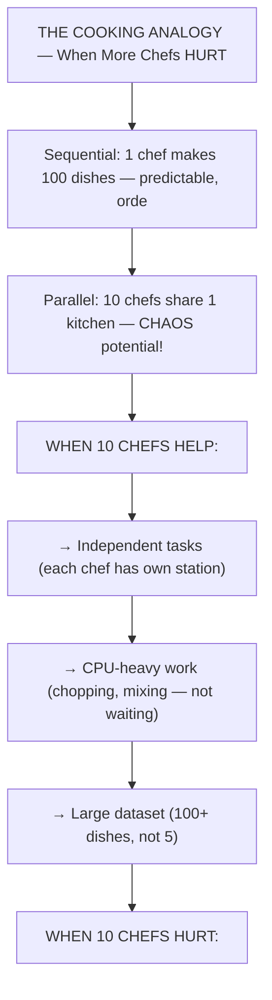

### The 5 Traps of parallelStream()

```java
// TRAP 1: Too small dataset — overhead > benefit
List<Integer> small = List.of(1, 2, 3, 4, 5);
small.parallelStream().map(x -> x * 2).collect(toList());
// Sequential: 0.001ms | Parallel: 0.05ms (50x SLOWER due to ForkJoinPool overhead)

// TRAP 2: Shared mutable state — RACE CONDITION
List<Integer> shared = new ArrayList<>();  // NOT thread-safe!
numbers.parallelStream().forEach(shared::add);  // 💥 ConcurrentModification!
// FIX: .collect(Collectors.toList())  — let the Collector handle thread safety

// TRAP 3: Wrong data structure — LinkedList DISASTER
LinkedList<Integer> linked = new LinkedList<>(/* 1M items */);
linked.parallelStream().filter(x -> x > 500_000);
// LinkedList can't split efficiently! Must traverse to middle = O(n).
// ArrayList splits in O(1) — array[mid].

// TRAP 4: Blocking IO in parallel stream
urls.parallelStream()
    .map(url -> httpClient.get(url))  // Blocks ForkJoinPool threads!
    .collect(toList());
// ForkJoinPool.commonPool() has CPU_CORES - 1 threads.
// If 7 threads all block on HTTP calls, your ENTIRE app's parallel
// streams are starved because they ALL share the common pool!
// FIX: Use CompletableFuture with custom executor for IO.

// TRAP 5: Order-dependent operations
list.parallelStream()
    .forEachOrdered(System.out::println);  // Forces sequential printing!
// forEachOrdered on parallel = WORST of both worlds:
// parallel splitting overhead + sequential execution = slowest
```

### When parallelStream() Actually Helps

```
┌─────────────────────────────────────────────────────────────────┐
│  USE parallelStream() WHEN ALL ARE TRUE:                        │
│                                                                 │
│  ✅ Dataset > 10,000 elements (overhead worth it)                │
│  ✅ CPU-intensive computation per element                        │
│  ✅ Data source splits cheaply (ArrayList, array, IntStream)     │
│  ✅ No shared mutable state                                      │
│  ✅ Order doesn't matter (or you accept ordering overhead)       │
│  ✅ No blocking IO                                               │
│                                                                 │
│  NEVER USE WHEN:                                                │
│  ❌ < 1000 elements (overhead dominates)                         │
│  ❌ LinkedList source (can't split efficiently)                  │
│  ❌ Blocking IO (starves common ForkJoinPool)                    │
│  ❌ Side effects (println, writing to shared list)               │
│  ❌ In a web server (common pool shared across ALL requests!)    │
│                                                                 │
│  CUSTOM POOL WORKAROUND:                                        │
│  ForkJoinPool custom = new ForkJoinPool(4);                     │
│  custom.submit(() ->                                            │
│      list.parallelStream()                                      │
│          .map(heavyComputation)                                 │
│          .collect(toList())                                     │
│  ).get();                                                       │
└─────────────────────────────────────────────────────────────────┘
```

**Flow:**
1. USE parallelStream() WHEN ALL ARE TRUE:
2. ✅ Dataset > 10,000 elements (overhead worth it)
3. ✅ CPU-intensive computation per element
4. ✅ Data source splits cheaply (ArrayList, array, IntStre
5. ✅ No shared mutable state
6. ✅ Order doesn't matter (or you accept ordering overhead
7. ✅ No blocking IO

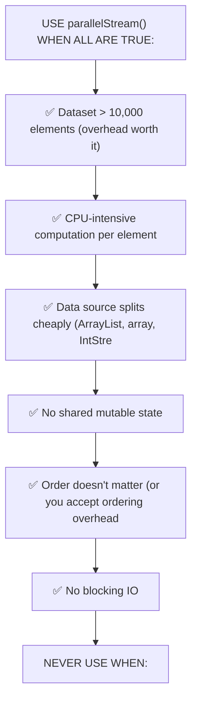

---


🔬 **Section Challenge — 7. parallelStream() Traps: Where It HURTS Performance**

**Challenge 1 (Reasoning):** `list.stream().filter().map().collect()` — at which point does data actually start flowing through the pipeline?
<details><summary>Answer</summary>

Not until `collect()` (or any terminal operation). `filter()` and `map()` are LAZY — they build a pipeline description but process nothing. When the terminal operation is called, the pipeline pulls elements through lazily: one element passes through the entire pipeline before the next is processed. This means: early termination with `findFirst()` is O(1) if the first element matches, not O(N).
</details>

**Challenge 2 (Bug Hunt):** You call `stream.filter(...).collect(...)` twice on the same stream. What happens?
<details><summary>Answer</summary>

`IllegalStateException: stream has already been operated upon or closed`. Streams are single-use. Once a terminal operation is called, the stream is consumed. Fix: create a new stream from the source each time, or collect to a `List` first and stream the list repeatedly.
</details>


## 8. Stream Pipeline Fusion: How JVM Optimizes

### Deep Reasoning

```
╔══════════════════════════════════════════════════════════════════╗
║  HOW THE JVM FUSES OPERATIONS                                    ║
║                                                                  ║
║  Your code:                                                      ║
║    .filter(x -> x > 10).map(x -> x * 2).collect(toList())        ║
║                                                                  ║
║  Naive execution (3 loops):                                      ║
║    Loop 1: filter all → temp list                                ║
║    Loop 2: map all → temp list                                   ║
║    Loop 3: collect → result                                      ║
║                                                                  ║
║  Actual execution (FUSED into 1 loop):                           ║
║    for (int x : source) {                                        ║
║        if (x > 10) {           // filter inline                  ║
║            result.add(x * 2);  // map + collect inline           ║
║        }                                                         ║
║    }                                                             ║
║                                                                  ║
║  This is called LOOP FUSION:                                     ║
║  → No intermediate collections created                           ║
║  → Single pass through data                                      ║
║  → Better cache locality (process each element completely)       ║
║                                                                  ║
║  EXCEPT when a stateful operation (sorted, distinct) appears:    ║
║  → Pipeline splits into segments at each stateful op             ║
║  → Each segment fuses internally, but barriers between them      ║
╚══════════════════════════════════════════════════════════════════╝
```

**Flow:**
1. HOW THE JVM FUSES OPERATIONS
2. Your code:
3. Naive execution (3 loops):
4. Loop 1: filter all
5. temp list
6. Loop 1: filter all
7. temp list
8. Loop 2: map all
9. temp list
10. Loop 2: map all
11. temp list
12. Loop 3: collect
13. result
14. Loop 3: collect
15. result
16. Actual execution (FUSED into 1 loop):

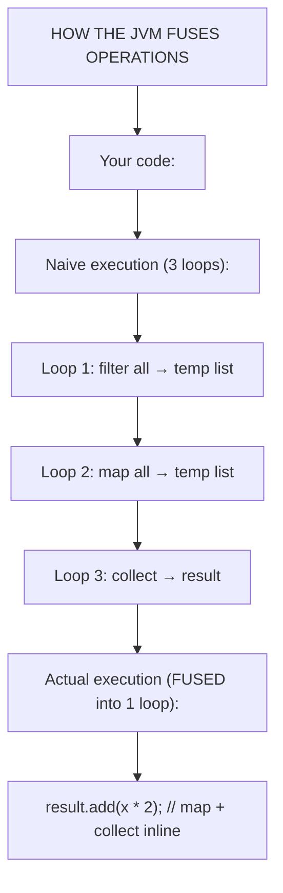

---


🔬 **Section Challenge — 8. Stream Pipeline Fusion: How JVM Optimizes**

**Challenge 1 (Reasoning):** `list.stream().filter().map().collect()` — at which point does data actually start flowing through the pipeline?
<details><summary>Answer</summary>

Not until `collect()` (or any terminal operation). `filter()` and `map()` are LAZY — they build a pipeline description but process nothing. When the terminal operation is called, the pipeline pulls elements through lazily: one element passes through the entire pipeline before the next is processed. This means: early termination with `findFirst()` is O(1) if the first element matches, not O(N).
</details>

**Challenge 2 (Bug Hunt):** You call `stream.filter(...).collect(...)` twice on the same stream. What happens?
<details><summary>Answer</summary>

`IllegalStateException: stream has already been operated upon or closed`. Streams are single-use. Once a terminal operation is called, the stream is consumed. Fix: create a new stream from the source each time, or collect to a `List` first and stream the list repeatedly.
</details>


## 9. Optional Deep Reasoning: Why It Exists And When NOT to Use It

### The Freeze Question
"Why does Optional exist? Isn't it just a null check wrapper?"

### Deep Reasoning

```
╔══════════════════════════════════════════════════════════════════╗
║  THE GIFT BOX vs EMPTY BOX ANALOGY                               ║
║                                                                  ║
║  null = Someone handed you NOTHING and said "here's a thing"     ║
║         You reach for the thing → NPE (you grabbed air)          ║
║                                                                  ║
║  Optional = Someone hands you a box.                             ║
║            → Box might contain a value (Optional.of(value))      ║
║            → Box might be empty (Optional.empty())               ║
║            → The BOX ITSELF is never null                        ║
║            → You MUST check before reaching in                   ║
║                                                                  ║
║  Optional FORCES you to handle the absence case.                 ║
║  null lets you FORGET.                                           ║
╚══════════════════════════════════════════════════════════════════╝
```

**Flow:**
1. THE GIFT BOX vs EMPTY BOX ANALOGY
2. null = Someone handed you NOTHING and said 'here's a th
3. You reach for the thing
4. NPE (you grabbed air)
5. You reach for the thing
6. NPE (you grabbed air)
7. Optional = Someone hands you a box.
8. Box might contain a value (Optional.of(value))
9. Box might be empty (Optional.empty())
10. The BOX ITSELF is never null

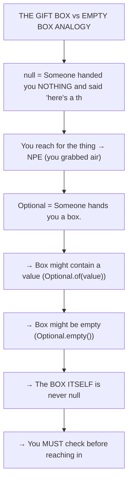

### Good Uses vs Anti-Patterns

```java
// ✅ GOOD: Return type of methods that might not find something
Optional<User> findByEmail(String email);
// Caller MUST handle: findByEmail("x").orElseThrow(() -> new UserNotFound());

// ✅ GOOD: Chaining with map/flatMap
String city = user.getAddress()      // might be null
    .map(Address::getCity)            // chain safely
    .orElse("Unknown");

// ❌ BAD: Method parameter — use overloading instead
void process(Optional<String> name);  // Ugly! Caller might pass null Optional!
void process(String name);            // Better: make non-null
void process();                       // Better: overload without param

// ❌ BAD: Field in a class — Optional is not Serializable!
class User {
    Optional<String> middleName;  // ❌ Breaks serialization
    String middleName;            // ✅ Allow null, document it
}

// ❌ BAD: Optional of collection — empty collection is already "nothing"
Optional<List<String>> getNames();  // ❌ over-engineering
List<String> getNames();            // ✅ return empty list for "nothing"

// ❌ BAD: isPresent() + get() — you just rewrote null check!
if (optional.isPresent()) {     // ❌ Same as if (x != null)
    return optional.get();      // ❌ No benefit over null check
}
// ✅ Use functional style:
return optional.orElse(default);
return optional.map(transform).orElseThrow();
```

---


🔬 **Section Challenge — 9. Optional Deep Reasoning: Why It Exists And When NOT to Use It**

**Challenge 1 (Reasoning):** `Optional.get()` without `isPresent()` check — what's the point of Optional then?
<details><summary>Answer</summary>

`Optional.get()` is a code smell. The right API: `orElse(default)`, `orElseGet(supplier)`, `orElseThrow()`, `map(fn)`, `ifPresent(consumer)`. Optional's value: it makes the ABSENCE of a value explicit in the type signature — callers MUST handle the empty case. Using `get()` defeats this. Rule: never call `get()` unless you've already verified presence through the Optional API.
</details>


## 10. Method References: Not Just Syntactic Sugar

### Deep Reasoning

```
╔══════════════════════════════════════════════════════════════════╗
║  THE 4 TYPES — And Why Each Exists                               ║
║                                                                  ║
║  1. Static method:    ClassName::staticMethod                    ║
║     Lambda:           x -> Math.abs(x)                           ║
║     Reference:        Math::abs                                  ║
║     Think:            "Call this class's static function"        ║
║                                                                  ║
║  2. Instance method (bound):  instance::method                   ║
║     Lambda:           x -> System.out.println(x)                 ║
║     Reference:        System.out::println                        ║
║     Think:            "Call THIS object's method"                ║
║                                                                  ║
║  3. Instance method (unbound):  ClassName::instanceMethod        ║
║     Lambda:           s -> s.toUpperCase()                       ║
║     Reference:        String::toUpperCase                        ║
║     Think:            "Call the method ON the stream element"    ║
║     ⚠️ First param becomes the receiver:                         ║
║        (s) -> s.toUpperCase() == String::toUpperCase             ║
║        (a, b) -> a.compareTo(b) == String::compareTo             ║
║                                                                  ║
║  4. Constructor:      ClassName::new                             ║
║     Lambda:           () -> new ArrayList<>()                    ║
║     Reference:        ArrayList::new                             ║
║     Think:            "Create a new instance"                    ║
╚══════════════════════════════════════════════════════════════════╝
```

**Flow:**
1. THE 4 TYPES — And Why Each Exists
2. 1. Static method: ClassName::staticMethod
3. Lambda: x -> Math.abs(x)
4. Reference: Math::abs
5. Think: 'Call this class's static function'
6. 2. Instance method (bound): instance::method
7. Lambda: x -> System.out.println(x)

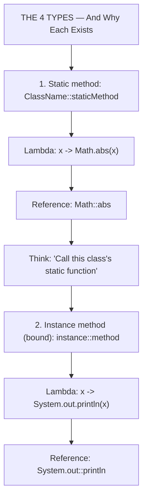

### The "Unbound" Trap — Code Proof

```java
// This confuses EVERYONE:
List<String> names = List.of("alice", "bob", "charlie");

// These are IDENTICAL:
names.stream().map(s -> s.toUpperCase()).collect(toList());
names.stream().map(String::toUpperCase).collect(toList());

// HOW? String::toUpperCase is an UNBOUND reference.
// The stream element (s) becomes the receiver: s.toUpperCase()

// Two-argument version:
// Lambda:    (a, b) -> a.compareToIgnoreCase(b)
// Reference: String::compareToIgnoreCase
// First arg = receiver, second arg = parameter
names.sort(String::compareToIgnoreCase);
```

---

## 11. Real-World Stream Patterns: Production Code That Senior Engineers Write

### Pattern 1: The Pipeline Transaction

```java
// E-commerce: Process order → validate → calculate → save
public OrderResult processOrder(OrderRequest request) {
    return Optional.of(request)
        .map(this::validateInventory)        // Step 1
        .map(this::calculatePricing)          // Step 2
        .map(this::applyDiscounts)            // Step 3
        .map(this::chargePayment)             // Step 4
        .map(this::sendConfirmation)          // Step 5
        .orElseThrow(() -> new OrderFailedException("Pipeline failed"));
}
```

### Pattern 2: Complex Analytics

```java
// Group employees by department, filter seniors, get top 3 earners per dept
Map<String, List<Employee>> topEarnersByDept = employees.stream()
    .filter(e -> e.getYearsOfExperience() >= 5)
    .collect(Collectors.groupingBy(
        Employee::getDepartment,
        Collectors.collectingAndThen(
            Collectors.toList(),
            list -> list.stream()
                .sorted(Comparator.comparingDouble(Employee::getSalary).reversed())
                .limit(3)
                .collect(Collectors.toList())
        )
    ));
```

### Pattern 3: CSV Processing

```java
// Read CSV, parse, validate, transform, write
try (Stream<String> lines = Files.lines(Path.of("data.csv"))) {
    List<Record> valid = lines
        .skip(1)                          // skip header
        .map(line -> line.split(","))     // parse
        .filter(cols -> cols.length == 5) // validate structure
        .map(cols -> new Record(
            cols[0].trim(),
            Integer.parseInt(cols[1].trim()),
            Double.parseDouble(cols[2].trim())
        ))
        .filter(Record::isValid)          // business validation
        .sorted(Comparator.comparing(Record::getName))
        .collect(Collectors.toList());
}
```

### Pattern 4: Avoiding N+1 with Streams

```java
// Bad: N+1 queries hidden in stream
users.stream()
    .map(user -> userRepository.findOrdersFor(user))  // N queries!
    .flatMap(List::stream)
    .collect(toList());

// Good: batch fetch, then stream in-memory
Map<Long, List<Order>> ordersByUser = orderRepository.findByUserIds(userIds);
users.stream()
    .flatMap(user -> ordersByUser.getOrDefault(user.getId(), List.of()).stream())
    .collect(toList());
```

---


🔬 **Section Challenge — 11. Real-World Stream Patterns: Production Code That Senior Engineers Write**

**Challenge 1 (Reasoning):** `list.stream().filter().map().collect()` — at which point does data actually start flowing through the pipeline?
<details><summary>Answer</summary>

Not until `collect()` (or any terminal operation). `filter()` and `map()` are LAZY — they build a pipeline description but process nothing. When the terminal operation is called, the pipeline pulls elements through lazily: one element passes through the entire pipeline before the next is processed. This means: early termination with `findFirst()` is O(1) if the first element matches, not O(N).
</details>

**Challenge 2 (Bug Hunt):** You call `stream.filter(...).collect(...)` twice on the same stream. What happens?
<details><summary>Answer</summary>

`IllegalStateException: stream has already been operated upon or closed`. Streams are single-use. Once a terminal operation is called, the stream is consumed. Fix: create a new stream from the source each time, or collect to a `List` first and stream the list repeatedly.
</details>


## 12. Quick-Fire Table

| Interview Question | One-Line Senior Answer |
|---|---|
| "Are streams lazy or eager?" | Lazy — intermediate ops record instructions, terminal ops trigger execution. Single pass through data via loop fusion. |
| "Can you reuse a stream?" | No. Once a terminal operation runs, the stream is consumed. Create a new stream from the source. |
| "map vs flatMap?" | map = 1→1 transform. flatMap = 1→many + flatten. Use flatMap when your mapper returns a collection/stream. |
| "When to use parallelStream?" | CPU-bound + large dataset (10K+) + ArrayList/array source + no shared mutable state + no IO. |
| "Why does parallelStream use ForkJoinPool?" | ForkJoinPool uses work-stealing: idle threads steal tasks from busy threads' queues. Optimal for recursive divide-and-conquer splitting. |
| "reduce vs collect?" | reduce = combine into ONE immutable value. collect = pour into a MUTABLE container. Use collect for building collections (avoids O(n²) from immutable accumulation). |
| "What is a Collector?" | Four functions: supplier (create container), accumulator (add element), combiner (merge parallel results), finisher (final transform). |
| "toList() vs Collectors.toList()?" | .toList() (Java 16+) returns unmodifiable list. Collectors.toList() returns mutable ArrayList. |
| "peek() — when to use?" | ONLY for debugging. Never for side effects in production — no guarantee it runs in parallel, or with short-circuit ops. |
| "Optional anti-patterns?" | Never as field, never as parameter, never Optional<List> (use empty list), never isPresent+get (use map/orElse). |
| "Stream vs for-loop performance?" | For-loop is ~5-10% faster for simple ops (no boxing overhead). Streams win readability, parallelism, and composability. Use streams unless profiling shows bottleneck. |
| "Infinite streams — safe?" | Only with short-circuit terminal (findFirst, limit, anyMatch). Without them → OutOfMemoryError or infinite loop. |

---

**Navigation**: [< Java Deep Reasoning](Ch22_Java_Deep_Reasoning.md) | [Back to Index](../00_MASTER_INDEX.md) | [JVM Object Model >](Ch19_JVM_Object_Model.md)
