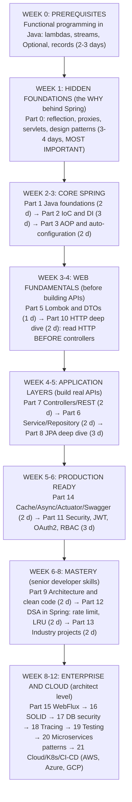
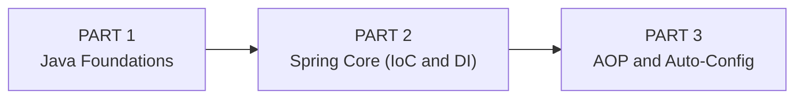
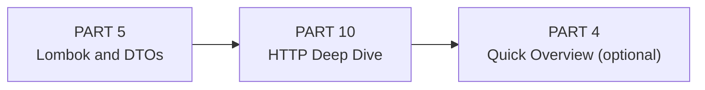
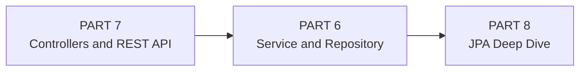
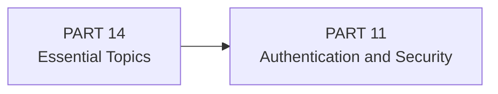
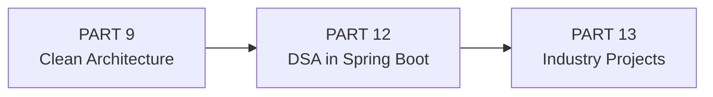
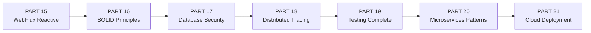

**Navigation**: [Back to Index](../00_MASTER_INDEX.md) | [Next >](Ch06_Functional_Programming.md)

# 🗺️ SPRING BOOT MASTERY ROADMAP

**The Complete Learning Path - From Zero to Industry Expert**
_Follow this sequence for optimal learning_

---

### Historical Evolution

**Inventor / Originator:** Spring Framework by Rod Johnson (2004) — *Expert One-on-One J2EE Design and Development* (Wiley, 2002) spawned Spring as an open-source project. Spring Boot was co-created by Dave Syer, Phillip Webb, and the Spring team at VMware/Pivotal (2014).

**Predecessor context:** Pre-Spring (2002), J2EE/EJBs were heavyweight — each bean required deployment descriptors, interfaces, and a container. Testability was poor. Struts 1.x (2000) simplified web but still required XML configuration. The "XML hell" of early Spring (2004) used `applicationContext.xml` with `<bean>` definitions for every class.

**Evolution narrative:** Spring 1.0 (2004) brought lightweight DI via `BeanFactory`. Spring 2.0 (2006) added custom XML namespaces and AspectJ AOP support. Spring 2.5 (2007) introduced `@Autowired`, `@Component`, and `@Repository` — annotation-based config. Spring 3.0 (2009) brought `@Configuration` Java config (replacing XML), REST support, and `@ResponseBody`. Spring Boot 1.0 (2014) at SpringOne: auto-configuration, embedded servers, starter POMs. Spring Boot 2.0 (2018) added WebFlux reactive stack, Kotlin DSL, and WebClient. Spring Boot 3.0 (2023) switched to Jakarta EE 9+ (jakarta.* namespace), required Java 17 minimum, and added GraalVM native image support.

**Modern practice:** Spring Boot 3.x (2023) with Java 21, Spring Framework 6.x. Use `@SpringBootApplication` + `@Configuration` classes. `spring-boot-starter-*` starters reduce manual dependency management. Spring Boot 3.x generates native images via GraalVM for <100ms startup in serverless.

- **Spring Framework 1.0 — 2004**: Rod Johnson. Lightweight DI. `BeanFactory`. XML configuration.
- **Spring 2.5 — 2007**: Annotation-based DI. `@Autowired`, `@Component`, `@Service`, `@Repository`.
- **Spring 3.1 — 2011**: Java config. `@Configuration` + `@Bean` replaces XML. Environment profiles.
- **Spring Boot 1.0 — 2014**: Dave Syer, Pivotal. Auto-configuration, starters, embedded Tomcat/Jetty.
- **Spring Boot 2.0 — 2018**: WebFlux reactive, Kotlin DSL, `@WebFluxTest`, `WebClient`. Functional routing.
- **Spring Boot 3.0 — 2023**: Jakarta EE 9+ (`jakarta.*`), Java 17 minimum, GraalVM native image.

---

# 📍 VISUAL LEARNING PATH (START HERE!)

**Your complete learning journey**



**How to read this diagram.** Follow the boxes top to bottom, one stage after another. Each box lists the parts to read and the time they take.

**Reference material (use anytime)**

| Part | What it covers |
| --- | --- |
| Part 22: Annotations complete reference | Every annotation explained (JPA, web, security, testing, Lombok). Bookmark it and use it as a quick lookup while coding. |
| Part 23: Missing essential topics | WebSockets, GraphQL, gRPC, Spring Batch, HATEOAS, i18n, multi-tenancy, Spring Boot 3.x, GraalVM, Modulith, rate limiting: 14 topics that complete your Spring Boot mastery. |
| 50-day Spring Boot curriculum | A 10-week study plan, Foundations → Production → Expert. Daily structure: READ + CODE + PRACTICE + NOTES. |
| Part 4: Quick overview | Optional high-level summary. |

---

# 📚 COMPLETE FILE → TOPIC MAPPING

## # File Name Topics

| # | File | Topics |
| --- | --- | --- |
| -- | Ch06_Functional_Programming.md | Lambda, Streams, Optional, Records, var keyword |
| 00 | 02_Spring_Boot_Part0_Hidden_Foundations | Reflection, Proxy, Servlet, Jackson, HikariCP, DevTools |
| 01 | 03_Spring_Boot_Complete_Part1 | JVM, GC, Threads, Memory |
| 02 | 04_Spring_Boot_Complete_Part2 | IoC, DI, Bean Scopes, Lifecycle, Circular Dependencies |
| 03 | 05_Spring_Boot_Complete_Part3 | AOP, Proxies, Auto-Config |
| 04 | 06_Spring_Boot_Complete_Part4 | JPA/Web/Security Overview |
| 05 | 07_Spring_Boot_Part5_Lombok_DTOs | @Data, @Builder, DTO Patterns |
| 06 | 08_Spring_Boot_Part6_Service_Repository | @Service, @Repository, @Query |
| 07 | 09_Spring_Boot_Part7_Controllers_REST | @RestController, @Valid, APIs |
| 08 | 10_Spring_Boot_Part8_JPA_Deep_Dive | Entities, Relations, N+1, Fetch |
| 09 | 11_Spring_Boot_Part9_Architecture_Quality | Clean Code, Package Structure |
| 10 | 12_Spring_Boot_Part10_HTTP_Deep_Dive | HTTP Lifecycle, Headers, REST |
| 11 | 13_Spring_Boot_Part11_Auth_Security | JWT, OAuth2, Spring Security |
| 12 | 14_Spring_Boot_Part12_DSA_Applications | Rate Limiter, LRU, Trie, Graph |
| 13 | 15_Spring_Boot_Part13_Industry_Projects | Notification, Feature Flags |
| 14 | 16_Spring_Boot_Part14_Essential_Topics | Cache, Async, Actuator, Swagger |
| 15 | 17_Spring_Boot_Part15_WebFlux_Reactive | Mono, Flux, WebClient, R2DBC |
| 16 | 18_Spring_Boot_Part16_SOLID_Principles | S.O.L.I.D with Spring Examples |
| 17 | 19_Spring_Boot_Part17_Database_Security | Password Hash, Encryption, RBAC |
| 18 | 20_Spring_Boot_Part18_Distributed_Tracing | Micrometer, Zipkin, Spans |
| 19 | 21_Spring_Boot_Part19_Testing_Complete | JUnit, Mockito, TestContainers |
| 20 | 22_Spring_Boot_Part20_Microservices | Eureka, Gateway, Circuit Breaker |
| 21 | 23_Spring_Boot_Part21_Cloud_Deployment | Docker, K8s, AWS, Azure, CI/CD |
| 22 | 24_Spring_Boot_Part22_Annotations | ALL annotations reference |
| 23 | 25_Spring_Boot_Part23_Missing_Essentials | WebSockets, GraphQL, gRPC, Batch, HATEOAS, i18n, GraalVM |
| -- | 26_Spring_Boot_Curriculum_50Day | 50-day study plan (10 weeks) |

---

# 🔍 How to Use This Roadmap

**LEARNING PHILOSOPHY**

```text
❌ WRONG: Jump to Spring Boot → Get stuck → Don't understand errors
✅ RIGHT: Master foundations → Understand the "magic" → Build confidently

EACH PHASE BUILDS ON THE PREVIOUS ONE
Don't skip phases unless you're already proficient!

⏱️ ESTIMATED TOTAL TIME: 10-14 weeks (2-3 hours/day)
   Including Part 0: Hidden Foundations + Functional Programming

TOTAL GUIDES: 24 Files (Functional Programming + Parts 0-22)
```

---

# 📚 COMPLETE LEARNING SEQUENCE

---

## PREREQUISITES: MODERN JAVA FUNDAMENTALS (Week 0) 🟡

_"You cannot learn Spring Boot without modern Java"_

📄 FUNCTIONAL PROGRAMMING IN JAVA

File: Ch06_Functional_Programming.md

**Topics Covered**:

| A. Lambda Expressions | (x) -> x * 2, concise anonymous functions |
| --- | --- |
| B. Functional Interfaces | Predicate, Function, Consumer, Supplier |
| C. Stream API | filter, map, reduce, collect |
| D. Method References | Class::method shorthand |
| E. Optional | Null-safe value handling |
| F. Local Variable (var) | Type inference: var x = new HashMap<>(); |
| G. Java Records | Immutable data carriers: record User(...) |

⏱️ TIME: 2-3 days

**WHY Read First**:

- Spring Boot uses lambdas EVERYWHERE (WebFlux, configs, callbacks)
- Stream API: 10 lines of loops → 1 elegant line
- Records: Perfect for DTOs (Request/Response objects)
- Interview: "Rewrite this using streams" is a common question

**✅ Ready for Next When YOU CAN**:

- Convert a for-loop to stream pipeline
- Explain what Optional.map() does vs Optional.flatMap()
- Create a record with validation in compact constructor

---

## PHASE 0: HIDDEN FOUNDATIONS (Week 1 - Read First!) ⚫

_"The invisible knowledge that tutorials never teach"_

📄 PART 0: THE HIDDEN FOUNDATIONS

File: Ch26_Pre_Spring_Part1.md

**Topics Covered**:

| A. Java Reflection | How Spring reads @Autowired, @Component |
| --- | --- |
| B. Annotation Processing | How @Getter (Lombok) vs @Autowired differ |
| C. Proxy Patterns | Why @Transactional fails on private methods |
| D. Servlet API | What Spring Boot hides from you |
| E. Jackson Serialization | How JSON ↔ Java conversion works |
| F. Connection Pooling | Why HikariCP matters |
| G. Classloading | How Spring DevTools hot-reload works |
| H. Build Tools | Maven/Gradle phases, scopes, transitive deps |
| I. HTTP Fundamentals | Raw HTTP, status codes, keep-alive |
| J. Design Patterns | Singleton, Factory, Proxy in Spring |
| K. Threads & Executors | How Tomcat handles requests, @Async |
| L. Generics & Type Erasure | Why you can't do new T() |
| M. Bytecode | How Spring Data generates repositories |

- ⚠️ READ THIS FIRST if you want to understand WHY, not just HOW

### Why Part 0 Exists

| What People Say                       | The Reality                                            |
| ------------------------------------- | ------------------------------------------------------ |
| "Just use @Autowired"                 | But HOW does it inject? (Reflection!)                  |
| "@Transactional handles transactions" | But WHY doesn't it work on private methods? (Proxies!) |
| "Add the dependency to pom.xml"       | But what does "provided" scope mean?                   |
| "Jackson converts JSON automatically" | But WHY do I need TypeReference<List<User>>?           |

**This is the knowledge that separates "tutorial followers" from "real engineers"**

---

## PHASE 1: FOUNDATIONS (Week 1-2) 🟢

_"You cannot understand Spring without understanding Java internals"_

**Part 1 → Part 2 → Part 3**



**How to read this diagram.** Read the parts left to right, in order.

**Files**

- `Ch31_SB_Core_Part1.md`
- `Ch32_SB_Data_Part2.md`
- `Ch33_SB_Web_Part3.md`

### Part 1: Java Foundations (PREREQUISITE)

**File:** `Ch31_SB_Core_Part1.md`

| Topic                   | Why It Matters                             |
| ----------------------- | ------------------------------------------ |
| JVM Memory Model        | Understand where Spring Beans live         |
| Garbage Collection      | Know why Singletons are efficient          |
| Class Loading           | Understand how Spring loads configurations |
| Threading & Concurrency | Essential for @Async, @Scheduled           |
| Functional Programming  | Lambda + Streams used everywhere           |

**✅ You're ready for Part 2 when you can answer:**

- Where do Spring singleton beans live in memory?
- What's the difference between Heap and Metaspace?
- How does CompletableFuture work?

---

### Part 2: Spring Core (IoC & DI)

**File:** `Ch32_SB_Data_Part2.md`

| Topic                | Why It Matters                |
| -------------------- | ----------------------------- |
| Inversion of Control | THE core philosophy of Spring |
| Dependency Injection | How Spring wires everything   |
| Bean Scopes          | Singleton, Prototype, Request |
| Bean Lifecycle       | @PostConstruct, @PreDestroy   |
| ApplicationContext   | The IoC Container itself      |
| @Qualifier, @Primary | Resolving multiple beans      |

**✅ You're ready for Part 3 when you can answer:**

- Why is constructor injection preferred over field injection?
- What's the difference between @Component and @Bean?
- When would you use @Qualifier?

---

### Part 3: AOP & Auto-Configuration

**File:** `Ch33_SB_Web_Part3.md`

| Topic                  | Why It Matters                      |
| ---------------------- | ----------------------------------- |
| AOP Concepts           | How @Transactional, @Cacheable work |
| Pointcuts & Advice     | Understand the "magic"              |
| Proxy Types            | JDK vs CGLIB proxies                |
| @SpringBootApplication | What it actually does               |
| Auto-configuration     | How starters work                   |
| Profiles               | Dev/Prod configuration              |

**✅ Phase 1 complete when you can answer:**

- How does @Transactional work behind the scenes?
- What does @EnableAutoConfiguration do?
- Why doesn't @Transactional work on private methods?

---

## PHASE 2: TOOLING & WEB BASICS (Week 2-3) 🟡

_"Learn HTTP before building REST APIs"_

**Part 5 → Part 10 → Part 4 (overview)**



**How to read this diagram.** Read the parts left to right, in order.

**Files**

- `Ch35_SB_Lombok_DTOs.md`
- `Ch42_SB_HTTP_Deep_Dive.md`
- `Ch34_SB_Security_Part4.md (optional overview)`

### Part 5: Lombok & DTOs

**File:** `Ch35_SB_Lombok_DTOs.md`

| Topic                 | Why It Matters               |
| --------------------- | ---------------------------- |
| Lombok Annotations    | Reduce boilerplate massively |
| @Data, @Builder       | Used in every project        |
| DTO Patterns          | Separate entities from API   |
| Request/Response DTOs | Clean API design             |
| MapStruct vs Manual   | DTO mapping strategies       |

---

### Part 10: HTTP Deep Dive ⚠️ READ BEFORE CONTROLLERS!

**File:** `Ch42_SB_HTTP_Deep_Dive.md`

| Topic                      | Why It Matters              |
| -------------------------- | --------------------------- |
| HTTP Request Lifecycle     | DNS → TCP → TLS → HTTP      |
| Request/Response Structure | Headers, Body, Status Codes |
| Path Variables             | /users/{id} - how they work |
| Query Parameters           | ?page=1&size=10             |
| Postman Testing            | Test your APIs              |
| WebSocket, gRPC            | Alternative protocols       |

---

### Part 4: Overview (OPTIONAL - Quick Reference)

**File:** `Ch34_SB_Security_Part4.md`

_High-level overview of JPA, Web, Security, Testing. Read for context, but detailed versions in later parts._

---

🔬 **Section Challenge — PHASE 2: TOOLING & WEB BASICS (Week 2-3) 🟡**

**Challenge 1 (Reasoning):** Why is the standard Spring MVC architecture divided strictly into Controller, Service, and Repository layers? Why not just put all logic in the Controller?

<details><summary>Answer</summary>

Separation of Concerns and Testability. Controllers should only handle HTTP protocol translation (JSON to Java, Status Codes). Repositories should only handle SQL/DB translation. Services contain the pure business logic. If logic is in the Controller, you cannot unit test it without mocking HTTP requests. If it's in the Service, you can instantiate the Service class using `new` and pass mock repositories, completely independent of the web layer.

</details>

## PHASE 3: APPLICATION LAYERS (Week 3-4) 🔵

_"Controller → Service → Repository - The layered architecture"_

**Part 7 → Part 6 → Part 8**



**How to read this diagram.** Read the parts left to right, in order.

**Files**

- `Ch37_SB_Controllers_REST.md`
- `Ch36_SB_Service_Repository.md`
- `Ch40_SB_JPA_Deep_Dive.md`

### Part 7: Controllers & REST API

**File:** `Ch37_SB_Controllers_REST.md`

| Topic                        | Why It Matters                |
| ---------------------------- | ----------------------------- |
| @RestController              | Entry point for HTTP requests |
| @GetMapping, @PostMapping    | HTTP method handlers          |
| @PathVariable, @RequestParam | Extract data from URLs        |
| @RequestBody, @ResponseBody  | JSON serialization            |
| Validation (@Valid)          | Input validation              |
| Exception Handling           | Global error handling         |
| API Versioning               | /api/v1, /api/v2              |

---

### Part 6: Service & Repository Patterns

**File:** `Ch36_SB_Service_Repository.md`

| Topic                 | Why It Matters       |
| --------------------- | -------------------- |
| Service Layer         | Business logic home  |
| @Service patterns     | Best practices       |
| Repository Interface  | Spring Data JPA      |
| Derived Query Methods | findByEmailAndStatus |
| @Query (JPQL/Native)  | Custom queries       |
| Specifications        | Dynamic queries      |

---

### Part 8: JPA & Hibernate Deep Dive

**File:** `Ch40_SB_JPA_Deep_Dive.md`

| Topic               | Why It Matters             |
| ------------------- | -------------------------- |
| Entity Mapping      | @Entity, @Id, @Column      |
| Relationships       | @OneToMany, @ManyToMany    |
| Fetch Strategies    | LAZY vs EAGER, N+1 problem |
| Persistence Context | First-level cache          |
| Cascade Types       | When to use PERSIST, MERGE |
| Transactions        | @Transactional deep dive   |

**✅ Phase 3 complete when you can:**

- Build a complete CRUD REST API
- Write custom repository queries
- Avoid N+1 query problem
- Handle transactions properly

---

## PHASE 4: PRODUCTION FEATURES (Week 4-5) 🟠

_"Features that make your app production-ready"_

**Part 14 → Part 11**



**How to read this diagram.** Read the parts left to right, in order.

**Files**

- `Ch44_SB_Caching_Scheduling.md`
- `Ch43_SB_Auth_Security.md`

### Part 14: Essential Production Topics

**File:** `Ch44_SB_Caching_Scheduling.md`

| Topic                   | Why It Matters           |
| ----------------------- | ------------------------ |
| Caching (@Cacheable)    | Performance optimization |
| Async (@Async)          | Background processing    |
| Scheduling (@Scheduled) | Cron jobs                |
| Actuator                | Health checks, metrics   |
| Swagger/OpenAPI         | API documentation        |
| File Upload/Download    | Multipart handling       |
| Email Sending           | JavaMailSender           |
| Logging                 | SLF4J, Logback, MDC      |
| Flyway                  | Database migrations      |
| Docker                  | Containerization         |
| Kafka/RabbitMQ          | Message queues           |

---

### Part 11: Authentication & Authorization

**File:** `Ch43_SB_Auth_Security.md`

| Topic                 | Why It Matters        |
| --------------------- | --------------------- |
| Spring Security       | Filter chain          |
| JWT Authentication    | Token-based auth      |
| OAuth2 / Social Login | Google, GitHub login  |
| @PreAuthorize         | Method-level security |
| API Key Auth          | Service-to-service    |
| RBAC                  | Role-based access     |

---

## PHASE 5: MASTERY (Week 5-6+) 🔴

_"From developer to architect"_

**Part 9 → Part 12 → Part 13**



**How to read this diagram.** Read the parts left to right, in order.

**Files**

- `Ch41_SB_Architecture_Quality.md`
- `Ch50_SB_DSA_Applications.md`
- `Ch51_SB_Industry_Projects.md`

### Part 9: Clean Architecture & Quality

**File:** `Ch41_SB_Architecture_Quality.md`

| Topic                 | Why It Matters         |
| --------------------- | ---------------------- |
| Layered Architecture  | Proper separation      |
| Package Structure     | Feature vs Layer       |
| Clean Code Principles | SOLID in Spring        |
| Testing Strategy      | Unit, Integration, E2E |
| Error Handling        | Global strategy        |
| Configuration         | Best practices         |

---

### Part 12: DSA in Spring Boot

**File:** `Ch50_SB_DSA_Applications.md`

| Topic          | Real-World Use     |
| -------------- | ------------------ |
| Sliding Window | Rate limiting      |
| Trie           | Auto-complete      |
| LRU Cache      | API caching        |
| Dijkstra       | Route optimization |
| Priority Queue | Task scheduling    |
| TreeMap        | Leaderboards       |

---

### Part 13: Industry Projects

**File:** `Ch51_SB_Industry_Projects.md`

| Project             | What You Learn               |
| ------------------- | ---------------------------- |
| Notification Engine | Queues, Retry logic          |
| Feature Flags       | A/B testing, gradual rollout |
| Analytics Platform  | Real-time aggregations       |
| Workflow Engine     | State machines               |
| Booking System      | Conflict detection           |

---

## PHASE 6: ENTERPRISE & CLOUD (Week 7-10+) 🟣

_"From monolith to microservices, from local to cloud"_

**Part 15 → Part 16 → Part 17 → Part 18 → Part 19 → Part 20 → Part 21**



**How to read this diagram.** Read the parts left to right, in order.

**Files**

- `Ch48_SB_WebFlux_Core.md`
- `Ch38_SB_SOLID_Core.md`
- `Ch46_SB_Database_Design.md`
- `Ch53_SB_Distributed_Tracing.md`
- `Ch59_SB_Testing_Fundamentals.md`
- `Ch61_SB_Microservices_Core.md`
- `Ch63_SB_Cloud_Core.md`

### Part 15: WebFlux & Reactive Programming

**File:** `Ch48_SB_WebFlux_Core.md`

| Topic            | Why It Matters           |
| ---------------- | ------------------------ |
| Reactive Streams | Non-blocking I/O         |
| Mono & Flux      | Core reactive types      |
| WebClient        | Reactive HTTP client     |
| R2DBC            | Reactive database access |
| Backpressure     | Handle overwhelming data |
| Schedulers       | Control threading        |

---

### Part 16: SOLID Principles with Spring

**File:** `Ch38_SB_SOLID_Core.md`

| Topic                 | Spring Example             |
| --------------------- | -------------------------- |
| Single Responsibility | Service layer separation   |
| Open/Closed           | Strategy pattern in Spring |
| Liskov Substitution   | Interface programming      |
| Interface Segregation | Repository interfaces      |
| Dependency Inversion  | @Autowired abstraction     |

---

### Part 17: Database Security

**File:** `Ch46_SB_Database_Design.md`

| Topic             | Why It Matters               |
| ----------------- | ---------------------------- |
| User Management   | Registration, authentication |
| Password Security | BCrypt, Argon2 hashing       |
| Role-Based Access | RBAC implementation          |
| SQL Injection     | Prevention strategies        |
| Data Encryption   | Column-level encryption      |
| Audit Logging     | Track data changes           |

---

### Part 18: Distributed Tracing

**File:** `Ch53_SB_Distributed_Tracing.md`

| Topic                | Why It Matters         |
| -------------------- | ---------------------- |
| Micrometer Tracing   | Observability          |
| Zipkin Integration   | Trace visualization    |
| Span & Trace IDs     | Request correlation    |
| Baggage Propagation  | Cross-service context  |
| Performance Analysis | Latency identification |

---

### Part 19: Testing Complete Guide

**File:** `Ch59_SB_Testing_Fundamentals.md`

| Topic           | Why It Matters            |
| --------------- | ------------------------- |
| JUnit 5         | Modern testing framework  |
| Mockito         | Mocking dependencies      |
| @SpringBootTest | Integration testing       |
| @WebMvcTest     | Controller testing        |
| @DataJpaTest    | Repository testing        |
| TestContainers  | Real database testing     |
| TDD & BDD       | Development methodologies |

---

### Part 20: Microservices Patterns

**File:** `Ch61_SB_Microservices_Core.md`

| Topic             | Why It Matters           |
| ----------------- | ------------------------ |
| Service Discovery | Eureka, Consul           |
| API Gateway       | Spring Cloud Gateway     |
| Circuit Breaker   | Resilience4j             |
| Saga Pattern      | Distributed transactions |
| CQRS              | Read/write separation    |
| Event Sourcing    | Audit and replay         |

---

### Part 21: Cloud Deployment

**File:** `Ch63_SB_Cloud_Core.md`

| Topic              | Why It Matters           |
| ------------------ | ------------------------ |
| Docker             | Containerization         |
| Kubernetes         | Container orchestration  |
| AWS (EKS, S3, SQS) | Amazon cloud services    |
| Azure (AKS, Blob)  | Microsoft cloud services |
| GCP (GKE, Pub/Sub) | Google cloud services    |
| CI/CD Pipelines    | Automated deployments    |
| Terraform          | Infrastructure as Code   |

**✅ Phase 6 complete when you can:**

- Build reactive APIs with WebFlux
- Apply SOLID principles in Spring
- Secure database access properly
- Trace requests across microservices
- Write comprehensive tests
- Design microservice architecture
- Deploy to cloud platforms

---

## APPENDIX: Quick Reference Guides 📖

### Part 22: Annotations Complete Reference

File: Ch28_Annotations_Core.md

A comprehensive reference covering ALL important annotations:

```text
• JPA Lifecycle: @PrePersist, @PostPersist, @PreUpdate, @PostUpdate
• JPA Mapping: @Entity, @Column, @OneToMany, @ManyToOne, @Embedded
• Auditing: @CreatedDate, @LastModifiedDate, @CreatedBy, @Version
• Validation: @NotNull, @NotBlank, @Size, @Email, @Pattern, @Valid
• Spring Core: @Component, @Service, @Autowired, @Qualifier, @Scope
• Web: @GetMapping, @PostMapping, @PathVariable, @RequestBody
• Security: @PreAuthorize, @PostAuthorize, @Secured
• Caching: @Cacheable, @CacheEvict, @CachePut
• Async: @Async, @Scheduled
• Transaction: @Transactional (propagation, isolation, rollback)
• Testing: @SpringBootTest, @MockBean, @DataJpaTest
• Lombok: @Data, @Builder, @Slf4j, @Value
• Hibernate: @Formula, @Where, @BatchSize, @DynamicUpdate
```

⭐ USE AS QUICK REFERENCE - Bookmark this file!

---

# 📋 QUICK REFERENCE: ALL PARTS

**COMPLETE FILE LIST (IN LEARNING ORDER)**

**PHASE 0: HIDDEN FOUNDATIONS (Read First!)**

- 📄 Ch26_Pre_Spring_Part1.md → Reflection, Proxies, etc.

**PHASE 1: FOUNDATIONS**

- 📄 Ch31_SB_Core_Part1.md      → Java Foundations
- 📄 Ch32_SB_Data_Part2.md      → IoC & DI
- 📄 Ch33_SB_Web_Part3.md      → AOP & Auto-Config

**PHASE 2: TOOLING & WEB BASICS**

- 📄 Ch35_SB_Lombok_DTOs.md   → Lombok & DTOs
- 📄 Ch42_SB_HTTP_Deep_Dive.md → HTTP (READ BEFORE PHASE 3!)
- 📄 Ch34_SB_Security_Part4.md      → Overview (Optional)

**PHASE 3: APPLICATION LAYERS**

- 📄 Ch37_SB_Controllers_REST.md → Controllers
- 📄 Ch36_SB_Service_Repository.md → Service Layer
- 📄 Ch40_SB_JPA_Deep_Dive.md → JPA & Hibernate

**PHASE 4: PRODUCTION FEATURES**

- 📄 Ch44_SB_Caching_Scheduling.md → Cache, Async, etc.
- 📄 Ch43_SB_Auth_Security.md → Security

**PHASE 5: MASTERY**

- 📄 Ch41_SB_Architecture_Quality.md → Architecture
- 📄 Ch50_SB_DSA_Applications.md → DSA
- 📄 Ch51_SB_Industry_Projects.md → Projects

**PHASE 6: ENTERPRISE & CLOUD**

- 📄 Ch48_SB_WebFlux_Core.md → Reactive Programming
- 📄 Ch38_SB_SOLID_Core.md → SOLID in Spring
- 📄 Ch46_SB_Database_Design.md → Database Security
- 📄 Ch53_SB_Distributed_Tracing.md → Tracing
- 📄 Ch59_SB_Testing_Fundamentals.md → Testing
- 📄 Ch61_SB_Microservices_Core.md → Microservices
- 📄 Ch63_SB_Cloud_Core.md → Cloud Deployment

**APPENDIX**

- 📄 Ch28_Annotations_Core.md → All Annotations
- 📄 Ch52_SB_WebSocket_GraphQL_gRPC.md → Missing Essentials
- 📄 Ch25_Spring_Boot_50Day_Plan.md → 50-Day Study Plan

**TOTAL: 25 FILES (Part 0-23 + Curriculum)**

---

# 🎯 LEARNING TIPS

## How To Study Effectively

1. DON'T JUST READ - CODE ALONG
   Create a practice project and implement as you learn
2. EACH PART = 1-3 DAYS
   Don't rush. Understanding beats memorization.
3. BUILD SOMETHING AFTER EACH PHASE
   - Phase 1: Simple bean playground
   - Phase 2: REST API skeleton
   - Phase 3: Complete CRUD app
   - Phase 4: Add caching, security
   - Phase 5: Full industry-level project
4. INTERVIEW PREP PRIORITY
   Most asked: IoC/DI, REST, JPA, Transactions, Security
5. REVISIT FOUNDATIONS
   If stuck on advanced topics, re-read Part 2 (IoC) and Part 3 (AOP)

---

# 🚀 QUICK START PATHS (Choose Your Adventure!)

## Learning Paths By Goal


**🎯 PATH A: JOB INTERVIEW PREP (2-3 weeks)**

Functional Prog → Part 0 (key sections) → Part 2 → Part 7 → Part 8 → Part 11

**Focus**: Lambdas, IoC/DI, REST APIs, JPA Basics, Security

**Interview Topics**: "How does @Autowired work?", "Explain @Transactional"

**📚 PATH B: FULL MASTERY (10-14 weeks)**

Functional Prog → Part 0 → Parts 1-22 (all in roadmap order)

**Result**: Complete backend engineer with enterprise knowledge

**⚡ PATH C: ALREADY KNOW JAVA (4-5 weeks)**

Part 0 (review) → Part 2 → Part 10 → Part 7-8 → Part 14 → Part 11 → Part 13

**Skip**: Part 1 (Java basics), Part 5 (if know Lombok)

**Focus**: Spring internals, REST, JPA, Production features

**🔍 PATH D: "I WANT TO REALLY UNDERSTAND SPRING" (Recommended!)**

Part 0 (ALL sections) → Part 2 → Part 3 → Continue in roadmap order

**Why**: Part 0 explains the WHY behind Spring's "magic"

**Result**: Debug any Spring issue, understand any blog post

**☁️ PATH E: MICROSERVICES & CLOUD FOCUS (4-5 weeks)**

Part 15 (WebFlux) → Part 19 (Testing) → Part 20 (Microservices) → Part 21
Add: Part 18 (Distributed Tracing) for observability

**Ideal For**: Senior devs moving to microservices architecture

**🛡️ PATH F: SECURITY SPECIALIST (2-3 weeks)**

Part 11 (Auth/Security) → Part 17 (DB Security) → Part 22 (Security annot.)

**Focus**: JWT, OAuth2, Role-Based Access, SQL Injection Prevention

**🧪 PATH G: TESTING EXPERT (1-2 weeks)**

Part 19 (Testing Complete) → Part 22 (Testing annotations)

**Topics**: JUnit 5, Mockito, @SpringBootTest, TestContainers, TDD/BDD

---

# ✅ PHASE COMPLETION CHECKLIST

## After Each Phase, You Should Be Able To Answer These Questions

**Prerequisites**:
- ☐ What's the difference between map() and flatMap() in Streams?
- ☐ When would you use Optional vs returning null?
- ☐ How do Java Records differ from regular classes?

**PHASE 0 (Hidden Foundations):**

- ☐ How does @Autowired inject dependencies? (Reflection!)
- ☐ Why doesn't @Transactional work on private methods? (Proxies!)
- ☐ What is the Servlet lifecycle?

**PHASE 1 (Core Spring):**

- ☐ What's the difference between @Component and @Bean?
- ☐ Explain constructor injection vs field injection pros/cons
- ☐ What are the different bean scopes?
- ☐ How does AOP work in Spring?

**PHASE 2 (Web Fundamentals):**

- ☐ What HTTP status code for "resource not found" vs "validation error"?
- ☐ When to use @PathVariable vs @RequestParam?
- ☐ What does Content-Type header do?

**PHASE 3 (Application Layers):**

- ☐ Build a complete CRUD REST API from scratch
- ☐ What is the N+1 query problem and how to solve it?
- ☐ Explain LAZY vs EAGER fetch strategies
- ☐ What are transaction propagation levels?

**PHASE 4 (Production Features):**

- ☐ How to implement JWT authentication?
- ☐ What is the Filter Chain in Spring Security?
- ☐ How does @Cacheable work?
- ☐ What endpoints does Actuator expose?

**PHASE 5 (Mastery):**

- ☐ Design a rate limiter using sliding window
- ☐ Implement clean architecture in a Spring Boot app
- ☐ Build a notification engine with retry logic

**PHASE 6 (Enterprise):**

- ☐ Explain Mono vs Flux in WebFlux
- ☐ Implement Circuit Breaker pattern
- ☐ Deploy Spring Boot app to Kubernetes
- ☐ Set up distributed tracing with Zipkin

---

- _Start with Functional Programming if you're weak in modern Java._
- _Start with Part 0 if you want to understand the magic._
- _Start with Part 1 if you're completely new to Java._
- _Trust the process!_ 🚀

---

### Production Reality

Spring Boot fails in production in patterns that are entirely absent from tutorials. These are the named failure modes you will hit — and how to debug them.

**Named failure modes:**

- **`Spring circular dependency`** — Constructor A needs B, B needs A. Spring's `BeanCurrentlyInCreationException` fires during refresh. **Debug workflow:** Enable debug logging: `logging.level.org.springframework.beans=DEBUG`. Look for "Constructor argument ... of bean 'serviceB' needed a bean of 'serviceA' that has been:". Fix by: (1) using `@Lazy` on one constructor argument (`@Lazy @Autowired A a`), (2) using setter injection instead of constructor injection for one side, (3) refactoring to a shared intermediate component. Spring 5.3+ improved the error message to name the cycle explicitly.

- **`BeanDefinitionOverrideException` — duplicate bean** — Two `@Bean` or `@Component` methods/classes produce the same bean name. Spring Boot 2.1+ disallows overriding by default. **Debug workflow:** The exception lists both bean definitions. Fix by renaming one bean or setting `spring.main.allow-bean-definition-overriding=true` (not recommended for production — it hides real naming conflicts). Enable `logging.level.org.springframework.beans.factory.annotation=DEBUG` to see which bean wins.

- **`LazyInitializationException`** — A lazy `@Bean` or `@Configuration` class is accessed outside a Spring-managed thread or after the context is fully initialized, when OSIV (Open Session In View) is disabled. The session/entity manager is not available. **Debug workflow:** Enable `spring.jpa.open-in-view=true` (default) during development, but disable it in production (`false`) and fix the actual lazy loading issue with `JOIN FETCH`. To debug: look for the stack trace containing "LazyInitializationException: could not initialize proxy — no Session". Fix by fetching the lazy association eagerly before returning from the service layer.

- **`NoSuchBeanDefinitionException`** — Component scan missed the package. Typically happens when a dependency adds a configuration class in a sub-package not under `@SpringBootApplication`'s package tree. **Debug workflow:** `logging.level.org.springframework=DEBUG` shows which packages are scanned. Fix by adding `@ComponentScan(basePackages = {"com.example.app", "com.example.lib"})`. Or move the main `Application` class to a parent package of all components.

- **`ConfigurationProperties` validation failure on startup** — Type mismatch or missing required property in `application.yml` causes `BindException` or `ConversionFailedException` at startup, preventing the app from starting. **Debug workflow:** The startup log prints the specific property path that failed. Add `@Validated` to your `@ConfigurationProperties` class and run with `--debug`. Fix by adding the missing property or using `spring.config.import` for optional config files.

- **`@Scheduled` overlapping runs** — `fixedRate` tasks that take longer than the interval run concurrently on the default single-threaded scheduler (one thread). On multi-core, the default scheduler is one thread — so a slow task blocks the next. **Debug workflow:** Add ` ShedLock` (or `@Async` with a dedicated thread pool) to prevent overlaps. Configure `@EnableScheduling(pool.size=X)`. Monitor with Micrometer: `scheduler.tasks.active` gauge. Without this, background jobs silently pile up or drop.

---

### Trade-offs: Spring Boot vs Quarkus vs Micronaut

| Framework | Use Case | Latency | Throughput | Complexity | When to Prefer |
|-----------|----------|---------|------------|------------|----------------|
| **Spring Boot** | Enterprise Java, rich ecosystem | Medium (JVM startup ~2-3s) | Very high (optimized for throughput) | Medium (convention over configuration) | Long-running services; team already knows Spring; need integration with 200+ starters |
| **Quarkus** | Cloud-native, GraalVM native | Very low (<50ms startup) | High (optimized for lower memory) | Medium (Spring-like DI, slightly different) | Kubernetes/serverless; need <100MB memory; want faster reload in dev |
| **Micronaut** | Microservices, compile-time DI | Low (<1s startup) | High (low memory footprint) | Medium-High (newer, less community) | Extreme testability needs; want compile-time AOT (no reflection); microservices with low memory budget |

**Key insight:** Spring Boot wins on ecosystem and team familiarity. Quarkus wins on cold-start performance for serverless. Micronaut wins on testability and compile-time optimization. For most enterprise Java teams, start with Spring Boot; evaluate Quarkus only if serverless cold-start is a proven bottleneck.

---

> **Navigation**: [Back to Index](../00_MASTER_INDEX.md) | [Next >](Ch06_Functional_Programming.md)


---

## Reality Check

**"You need to learn Spring Framework before Spring Boot"** → Spring Boot IS Spring Framework — it is an auto-configuration layer on top, not a different framework. Learning raw Spring first means manually wiring XML configurations and servlet containers that Spring Boot eliminates. Start with Spring Boot, then learn what it auto-configures by peeling back layers.

**"Spring Boot is only for microservices"** → Spring Boot powers monoliths, batch processing with Spring Batch, message consumers with Spring Kafka or RabbitMQ, CLI tools with CommandLineRunner, serverless functions with Spring Cloud Function, and desktop applications. Most enterprise Java shops run monolithic Spring Boot applications. Microservices are one deployment pattern, not the only use case.

**"Knowing Spring Boot annotations is enough"** → Annotations are the WHAT. The real skill is understanding the lifecycle they trigger — @Transactional creates a proxy, @Async spawns a thread from a pool, @Cacheable checks a cache before method invocation. Without understanding proxies, you will write @Transactional on a private method and wonder why rollback does not work because the proxy cannot intercept private methods.

**"Spring Boot auto-configuration means you cannot customize"** → Every auto-configuration class has @ConditionalOnMissingBean — if you define your own bean of the same type, Spring Boot backs off and uses yours. You can override ANY default: provide your own DataSource, ObjectMapper, SecurityFilterChain, or ErrorController. Auto-configuration provides defaults, not mandates.

**"REST APIs are the only way to build web services in Spring Boot"** → Spring Boot supports GraphQL, gRPC, WebSocket, Server-Sent Events via SseEmitter, RSocket, and SOAP via spring-boot-starter-web-services. REST is the most common but choosing it without evaluating alternatives means you might be building request-response where streaming or pub-sub fits better.
