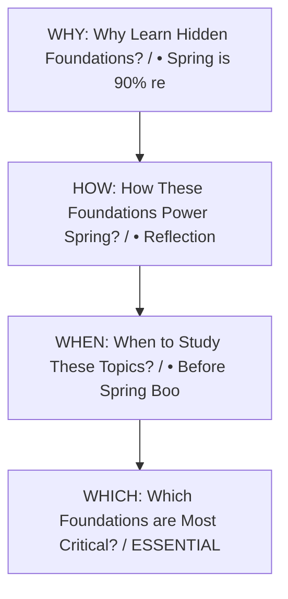
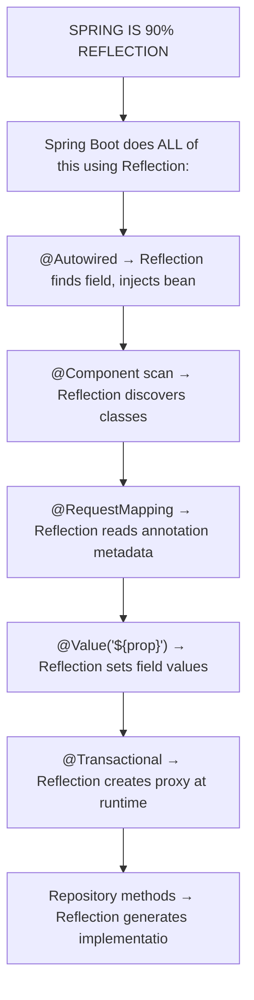
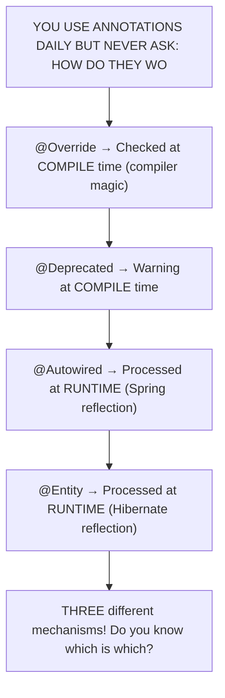
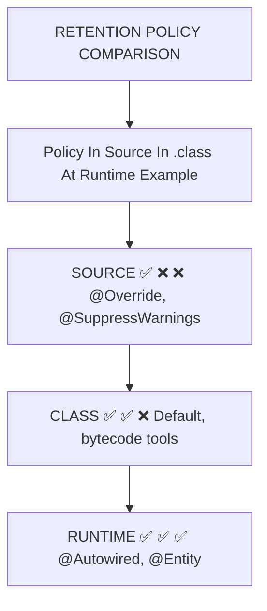
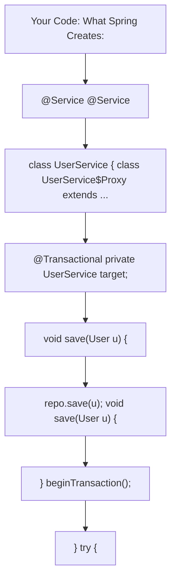
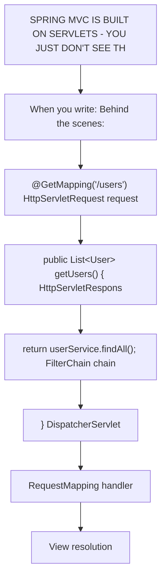
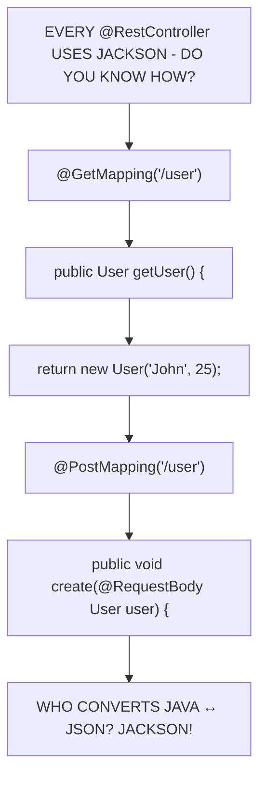

**Navigation**: [Back to Index](../00_MASTER_INDEX.md) | [Next Chapter >](Ch27_Pre_Spring_Part2.md)

---

# 🔮 SPRING BOOT PART 0: THE HIDDEN FOUNDATIONS

**Everything They Assume You Know But Never Teach**
_The "invisible" knowledge gap between tutorials and real understanding_

---

# 🎯 WHY-HOW-WHEN-WHICH FRAMEWORK

```
┌─────────────────────────────────────────────────────────────────────────────────┐
│  WHY: Why Learn Hidden Foundations?                                             │
├─────────────────────────────────────────────────────────────────────────────────┤
│  • Spring is 90% reflection/proxies - without understanding, it's magic         │
│  • Debug faster: Know WHY @Autowired fails, not just WHAT to copy               │
│  • Interview advantage: "Explain how Spring creates beans" - nail it            │
│  • Performance tuning: Understand connection pools, classloading                │
│  • Framework confidence: Build custom starters, understand auto-config          │
└─────────────────────────────────────────────────────────────────────────────────┘

┌─────────────────────────────────────────────────────────────────────────────────┐
│  HOW: How These Foundations Power Spring?                                       │
├─────────────────────────────────────────────────────────────────────────────────┤
│  • Reflection: @Autowired, component scanning, bean creation                    │
│  • Proxies: @Transactional, @Cacheable, @Async - all proxy-based                │
│  • Servlet API: DispatcherServlet, filters, request lifecycle                   │
│  • Jackson: JSON serialization, @JsonIgnore, custom serializers                 │
│  • Connection pools: HikariCP under the hood for database performance           │
└─────────────────────────────────────────────────────────────────────────────────┘

┌─────────────────────────────────────────────────────────────────────────────────┐
│  WHEN: When to Study These Topics?                                              │
├─────────────────────────────────────────────────────────────────────────────────┤
│  • Before Spring Boot: Understand what it's abstracting                         │
│  • When debugging: Proxy issues, injection failures, serialization bugs         │
│  • Interview prep: These are senior-level differentiators                       │
│  • Performance issues: Connection leaks, memory problems, slow startup          │
│  • Building libraries: Custom starters, shared components                       │
└─────────────────────────────────────────────────────────────────────────────────┘

┌─────────────────────────────────────────────────────────────────────────────────┐
│  WHICH: Which Foundations are Most Critical?                                    │
├─────────────────────────────────────────────────────────────────────────────────┤
│  ESSENTIAL:     Reflection, Proxies, Servlet API                                │
│  IMPORTANT:     Jackson, Connection Pooling, Design Patterns                    │
│  ADVANCED:      Classloading, Bytecode, Annotation Processing                   │
└─────────────────────────────────────────────────────────────────────────────────┘
```

**Flow:**
1. WHY: Why Learn Hidden Foundations? / • Spring is 90% re
2. HOW: How These Foundations Power Spring? / • Reflection
3. WHEN: When to Study These Topics? / • Before Spring Boo
4. WHICH: Which Foundations are Most Critical? / ESSENTIAL



---

# 📌 Table of Contents

```
SECTION A: JAVA REFLECTION - THE MAGIC BEHIND SPRING
SECTION B: ANNOTATION PROCESSING - HOW @Annotations ACTUALLY WORK
SECTION C: PROXY PATTERNS - THE REAL SPRING MAGIC
SECTION D: SERVLET API - WHAT SPRING BOOT HIDES FROM YOU
SECTION E: JACKSON & SERIALIZATION - JSON ISN'T MAGIC
SECTION F: CONNECTION POOLING - DATABASE CONNECTIONS AREN'T FREE
SECTION G: CLASSLOADING - HOW YOUR CODE ACTUALLY RUNS
SECTION H: BUILD TOOLS INTERNALS - MAVEN/GRADLE DEEP DIVE
SECTION I: HTTP FUNDAMENTALS - BELOW THE FRAMEWORK
SECTION J: DESIGN PATTERNS IN SPRING - PATTERNS EVERYWHERE
SECTION K: THREADS & EXECUTORS - CONCURRENCY THAT MATTERS
SECTION L: GENERICS & TYPE ERASURE - THE JAVA DARK SECRET
SECTION M: BYTECODE & INSTRUMENTATION - ULTIMATE FOUNDATION
```

## Theory-First Master Lens (Part 1: Reflection to Serialization)

Before diving into snippets, anchor your reasoning in five foundational ideas:

1. Reflection is late binding with metadata.
Spring is not guessing at runtime; it is reading class metadata and applying deterministic container rules.

2. Annotation behavior depends on processing phase.
Some annotations are compile-time only, some are bytecode metadata, and some drive runtime framework behavior.

3. Proxies define cross-cutting boundaries.
Transactions, caching, and async behavior work when calls pass through the proxy boundary, not when methods call themselves internally.

4. Servlet pipeline is the mechanics layer.
Controller methods are only one stage in a larger request flow involving container parsing, filters, dispatcher mapping, and response commit.

5. JSON serialization is API contract design.
Jackson configuration choices directly influence compatibility, client integration, and long-term version evolution.

If you study each section by asking "what metadata is read", "what boundary is intercepted", and "what contract is emitted", the code examples become predictable instead of memorized.

---

# ☕ Section a: Java Reflection — the Magic Behind Spring

## Why This Matters

```
┌─────────────────────────────────────────────────────────────────────────────────┐
│                    SPRING IS 90% REFLECTION                                     │
├─────────────────────────────────────────────────────────────────────────────────┤
│                                                                                 │
│  Spring Boot does ALL of this using Reflection:                                 │
│                                                                                 │
│  @Autowired          → Reflection finds field, injects bean                     │
│  @Component scan     → Reflection discovers classes                             │
│  @RequestMapping     → Reflection reads annotation metadata                     │
│  @Value("${prop}")   → Reflection sets field values                             │
│  @Transactional      → Reflection creates proxy at runtime                      │
│  Repository methods  → Reflection generates implementations!                    │
│                                                                                 │
│  WITHOUT UNDERSTANDING REFLECTION = SPRING IS MAGIC                             │
│  WITH REFLECTION KNOWLEDGE = SPRING IS LOGICAL                                  │
│                                                                                 │
└─────────────────────────────────────────────────────────────────────────────────┘
```

**Flow:**
1. SPRING IS 90% REFLECTION
2. Spring Boot does ALL of this using Reflection:
3. @Autowired
4. Reflection finds field, injects bean
5. @Autowired
6. Reflection finds field, injects bean
7. @Component scan
8. Reflection discovers classes
9. @Component scan
10. Reflection discovers classes
11. @RequestMapping
12. Reflection reads annotation metadata
13. @RequestMapping
14. Reflection reads annotation metadata
15. @Value('${prop}')
16. Reflection sets field values
17. @Value('${prop}')
18. Reflection sets field values
19. @Transactional
20. Reflection creates proxy at runtime



## A.1 What Is Reflection?

```java
// Normal Java: You know the class at COMPILE time
User user = new User();
user.setName("John");

// Reflection: You DON'T know the class at compile time
// You discover and manipulate it at RUNTIME
Class<?> clazz = Class.forName("com.example.User");
Object instance = clazz.getDeclaredConstructor().newInstance();
Method setter = clazz.getMethod("setName", String.class);
setter.invoke(instance, "John");
```

## A.2 The Class Object - Your Entry Point

```java
// EVERY class in Java has a Class object
// THREE WAYS to get it:

// Way 1: From class literal (compile time)
Class<User> clazz1 = User.class;

// Way 2: From instance (runtime)
User user = new User();
Class<?> clazz2 = user.getClass();

// Way 3: From string name (fully dynamic - Spring uses this!)
Class<?> clazz3 = Class.forName("com.example.User");
```

### What Can You Access via Class Object?

```java
Class<User> clazz = User.class;

// Get ALL information about the class
String name = clazz.getName();                    // "com.example.User"
String simpleName = clazz.getSimpleName();        // "User"
Package pkg = clazz.getPackage();                 // package info
Class<?> superclass = clazz.getSuperclass();      // parent class
Class<?>[] interfaces = clazz.getInterfaces();    // implemented interfaces
int modifiers = clazz.getModifiers();             // public, abstract, final, etc.

// Check modifiers
Modifier.isPublic(modifiers);    // true/false
Modifier.isAbstract(modifiers);  // true/false
Modifier.isFinal(modifiers);     // true/false
```


🔬 **Section Challenge — A.2 The Class Object - Your Entry Point**

**Challenge 1 (Reasoning):** `ExecutorService.submit(task)` — the task throws a `RuntimeException`. Nobody calls `future.get()`. What happens to the exception?
<details><summary>Answer</summary>

It's silently swallowed. The exception is stored in the `Future` object. Without `future.get()` or `.whenComplete()`, no one ever sees it. The thread pool thread resets and picks up the next task as if nothing happened. This is one of the most dangerous production bugs. Fix: always attach `future.whenComplete((r,ex) -> { if(ex!=null) log.error("Task failed",ex); })` or use `execute()` + `UncaughtExceptionHandler`.
</details>


## A.3 Field Reflection - How @Autowired Works

```java
public class UserService {
    @Autowired
    private UserRepository userRepository;  // How does Spring set this?!
}
```

### Spring's Secret: Field Injection via Reflection

```java
public class SpringFieldInjector {
    
    public void injectDependencies(Object bean, ApplicationContext context) {
        Class<?> clazz = bean.getClass();
        
        // Get ALL fields (including private!)
        Field[] fields = clazz.getDeclaredFields();
        
        for (Field field : fields) {
            // Check if field has @Autowired
            if (field.isAnnotationPresent(Autowired.class)) {
                
                // Get the type Spring needs to inject
                Class<?> fieldType = field.getType();  // UserRepository.class
                
                // Find a bean of that type
                Object dependency = context.getBean(fieldType);
                
                // THE MAGIC: Make private field accessible!
                field.setAccessible(true);  // Bypass private!
                
                // Inject the dependency
                field.set(bean, dependency);
            }
        }
    }
}
```

### Field Reflection Complete API

```java
Class<User> clazz = User.class;

// Get public fields only (includes inherited)
Field[] publicFields = clazz.getFields();

// Get ALL declared fields (private, protected, public - but NOT inherited)
Field[] allFields = clazz.getDeclaredFields();

// Get specific field by name
Field nameField = clazz.getDeclaredField("name");

// Field information
String fieldName = nameField.getName();           // "name"
Class<?> fieldType = nameField.getType();         // String.class
int modifiers = nameField.getModifiers();         // private, final, etc.

// Read/Write field values
User user = new User();
nameField.setAccessible(true);  // Required for private fields!

// Read
Object value = nameField.get(user);  // Gets user.name

// Write
nameField.set(user, "John");  // Sets user.name = "John"
```

## A.4 Method Reflection - How Controllers Are Called

```java
@RestController
public class UserController {
    
    @GetMapping("/users/{id}")
    public User getUser(@PathVariable Long id) {
        return userService.findById(id);
    }
}

// Question: How does Spring know to call getUser() when /users/123 is hit?
// Answer: REFLECTION!
```

### Spring's Dispatcher Servlet (Simplified)

```java
public class SimpleDispatcher {
    
    private Map<String, MethodHandler> mappings = new HashMap<>();
    
    // At startup: Scan for @RequestMapping
    public void registerController(Object controller) {
        Class<?> clazz = controller.getClass();
        
        for (Method method : clazz.getDeclaredMethods()) {
            // Check for mapping annotations
            GetMapping getMapping = method.getAnnotation(GetMapping.class);
            if (getMapping != null) {
                String path = getMapping.value()[0];  // "/users/{id}"
                mappings.put("GET:" + path, new MethodHandler(controller, method));
            }
        }
    }
    
    // At runtime: When HTTP request comes
    public Object handleRequest(String httpMethod, String path, Object... args) {
        MethodHandler handler = mappings.get(httpMethod + ":" + path);
        
        // REFLECTION: Invoke the method!
        return handler.method.invoke(handler.controller, args);
    }
}
```

### Method Reflection Complete API

```java
Class<UserService> clazz = UserService.class;

// Get public methods (includes inherited from Object!)
Method[] publicMethods = clazz.getMethods();

// Get only declared methods (excludes inherited)
Method[] declaredMethods = clazz.getDeclaredMethods();

// Get specific method by name AND parameter types
Method findById = clazz.getMethod("findById", Long.class);
Method findByName = clazz.getMethod("findByName", String.class, boolean.class);

// Method information
String methodName = findById.getName();                    // "findById"
Class<?> returnType = findById.getReturnType();            // User.class
Class<?>[] paramTypes = findById.getParameterTypes();      // [Long.class]
Class<?>[] exceptions = findById.getExceptionTypes();      // declared throws

// INVOKE the method!
UserService service = new UserService();
Object result = findById.invoke(service, 123L);  // Calls service.findById(123L)

// For private methods
Method privateMethod = clazz.getDeclaredMethod("internalProcess");
privateMethod.setAccessible(true);  // Make it callable
privateMethod.invoke(service);
```

## A.5 Constructor Reflection - How Spring Creates Beans

```java
@Component
public class UserService {
    private final UserRepository repo;
    
    // Spring calls this constructor - but HOW?
    @Autowired
    public UserService(UserRepository repo) {
        this.repo = repo;
    }
}
```

### How Spring Instantiates Beans

```java
public class SpringBeanFactory {
    
    public Object createBean(Class<?> clazz) throws Exception {
        // Find constructors
        Constructor<?>[] constructors = clazz.getDeclaredConstructors();
        
        // Strategy 1: Look for @Autowired constructor
        for (Constructor<?> constructor : constructors) {
            if (constructor.isAnnotationPresent(Autowired.class)) {
                return createWithDependencies(constructor);
            }
        }
        
        // Strategy 2: Use single constructor if only one exists
        if (constructors.length == 1) {
            return createWithDependencies(constructors[0]);
        }
        
        // Strategy 3: Use no-arg constructor
        return clazz.getDeclaredConstructor().newInstance();
    }
    
    private Object createWithDependencies(Constructor<?> constructor) throws Exception {
        Class<?>[] paramTypes = constructor.getParameterTypes();
        Object[] args = new Object[paramTypes.length];
        
        // Resolve each dependency
        for (int i = 0; i < paramTypes.length; i++) {
            args[i] = applicationContext.getBean(paramTypes[i]);
        }
        
        constructor.setAccessible(true);
        return constructor.newInstance(args);
    }
}
```

### Constructor Reflection API

```java
Class<UserService> clazz = UserService.class;

// Get all public constructors
Constructor<?>[] publicConstructors = clazz.getConstructors();

// Get ALL constructors (including private)
Constructor<?>[] allConstructors = clazz.getDeclaredConstructors();

// Get specific constructor by parameter types
Constructor<UserService> noArg = clazz.getDeclaredConstructor();
Constructor<UserService> withRepo = clazz.getDeclaredConstructor(UserRepository.class);

// Constructor info
Class<?>[] paramTypes = withRepo.getParameterTypes();

// Create instance
withRepo.setAccessible(true);  // If private
UserService instance = withRepo.newInstance(repoInstance);
```


🔬 **Section Challenge — A.5 Constructor Reflection - How Spring Creates Beans**

**Challenge 1 (Reasoning):** `ExecutorService.submit(task)` — the task throws a `RuntimeException`. Nobody calls `future.get()`. What happens to the exception?
<details><summary>Answer</summary>

It's silently swallowed. The exception is stored in the `Future` object. Without `future.get()` or `.whenComplete()`, no one ever sees it. The thread pool thread resets and picks up the next task as if nothing happened. This is one of the most dangerous production bugs. Fix: always attach `future.whenComplete((r,ex) -> { if(ex!=null) log.error("Task failed",ex); })` or use `execute()` + `UncaughtExceptionHandler`.
</details>


## A.6 Annotation Reflection - How Spring Reads Configuration

```java
@Service
@Transactional
public class OrderService {
    
    @Autowired
    private OrderRepository repo;
    
    @Cacheable("orders")
    public Order findById(Long id) { ... }
}

// Spring reads EVERY annotation here using reflection!
```

### Reading Annotations

```java
Class<OrderService> clazz = OrderService.class;

// Check if annotation is present
boolean isService = clazz.isAnnotationPresent(Service.class);  // true
boolean isController = clazz.isAnnotationPresent(Controller.class);  // false

// Get specific annotation
Service serviceAnn = clazz.getAnnotation(Service.class);
String beanName = serviceAnn.value();  // Read annotation attributes

// Get ALL annotations
Annotation[] annotations = clazz.getAnnotations();          // Includes inherited
Annotation[] declared = clazz.getDeclaredAnnotations();     // Only on this class

// Annotations on methods
Method method = clazz.getMethod("findById", Long.class);
Cacheable cacheable = method.getAnnotation(Cacheable.class);
String[] cacheNames = cacheable.value();  // ["orders"]

// Annotations on fields
Field field = clazz.getDeclaredField("repo");
Autowired autowired = field.getAnnotation(Autowired.class);
boolean required = autowired.required();  // true by default

// Annotations on parameters
Parameter[] params = method.getParameters();
for (Parameter param : params) {
    if (param.isAnnotationPresent(PathVariable.class)) {
        PathVariable pv = param.getAnnotation(PathVariable.class);
        String varName = pv.value();
    }
}
```


🔬 **Section Challenge — A.6 Annotation Reflection - How Spring Reads Configuration**

**Challenge 1 (Reasoning):** `ExecutorService.submit(task)` — the task throws a `RuntimeException`. Nobody calls `future.get()`. What happens to the exception?
<details><summary>Answer</summary>

It's silently swallowed. The exception is stored in the `Future` object. Without `future.get()` or `.whenComplete()`, no one ever sees it. The thread pool thread resets and picks up the next task as if nothing happened. This is one of the most dangerous production bugs. Fix: always attach `future.whenComplete((r,ex) -> { if(ex!=null) log.error("Task failed",ex); })` or use `execute()` + `UncaughtExceptionHandler`.
</details>


## A.7 Generic Type Information - The Advanced Stuff

```java
// This is how Spring knows UserRepository extends JpaRepository<User, Long>

public interface UserRepository extends JpaRepository<User, Long> { }
```

### Reading Generic Types

```java
Class<UserRepository> clazz = UserRepository.class;

// Get generic interfaces
Type[] genericInterfaces = clazz.getGenericInterfaces();

for (Type type : genericInterfaces) {
    if (type instanceof ParameterizedType) {
        ParameterizedType pType = (ParameterizedType) type;
        
        Type rawType = pType.getRawType();  // JpaRepository
        Type[] typeArgs = pType.getActualTypeArguments();  // [User, Long]
        
        Class<?> entityClass = (Class<?>) typeArgs[0];  // User.class
        Class<?> idClass = (Class<?>) typeArgs[1];      // Long.class
        
        // NOW Spring knows the entity type!
    }
}


🔬 **Section Challenge — A.7 Generic Type Information - The Advanced Stuff**

**Challenge 1 (Reasoning):** You write `List<String> list = new ArrayList<>();`. At runtime, can you check `list instanceof List<String>`?
<details><summary>Answer</summary>

No — `instanceof List<String>` is a compile error. After erasure, it's just `List` at runtime. Use `instanceof List<?>` for an unparameterized check. This is why you can't do `new T()`, `new T[]`, or `T.class` — T doesn't exist at runtime.
</details>

**Challenge 2 (Bug Hunt):** A method returns `(T) jsonDeserialize(json)` where T is a generic type param. When does the `ClassCastException` actually occur?
<details><summary>Answer</summary>

NOT at the cast — the unchecked cast compiles to nothing at runtime (erasure). The CCE occurs when the calling code tries to USE the returned value as a specific type. This makes debugging hard: the error appears far from the actual source. Use `Class<T> clazz` parameter to do safe `clazz.cast(...)` instead.
</details>


## A.8 Performance Considerations

┌─────────────────────────────────────────────────────────────────────────────────┐
│                    REFLECTION PERFORMANCE                                       │
├─────────────────────────────────────────────────────────────────────────────────┤
│                                                                                 │
│  Operation                        │ Speed vs Direct Call                        │
│  ─────────────────────────────────┼───────────────────────────────────────────  │
│  Class.forName()                  │ ~10x slower (but cached)                    │
│  Method.invoke()                  │ ~3-5x slower                                │
│  Field.set/get()                  │ ~3-5x slower                                │
│  Constructor.newInstance()        │ ~3x slower                                  │
│                                                                                 │
│  WHY SPRING IS STILL FAST:                                                      │
│  1. Reflection happens at STARTUP (once)                                        │
│  2. Results are CACHED (bean definitions, mappings)                             │
│  3. Runtime calls use cached references                                         │
│                                                                                 │
└─────────────────────────────────────────────────────────────────────────────────┘
```

### Spring's Caching Strategy

```java
// BAD: Reflection every time
public Object handleRequest(String path) {
    Class<?> clazz = Class.forName("com.example.Controller");  // SLOW!
    Method method = clazz.getMethod("handle");                  // SLOW!
    return method.invoke(clazz.newInstance());                  // SLOW!
}

// GOOD: Cache at startup (Spring's approach)
public class CachedDispatcher {
    private final Map<String, Method> methodCache = new HashMap<>();
    private final Map<String, Object> instanceCache = new HashMap<>();
    
    // Once at startup
    public void init() {
        Class<?> clazz = Class.forName("...");
        Method method = clazz.getMethod("handle");
        Object instance = clazz.newInstance();
        
        methodCache.put("/path", method);
        instanceCache.put("/path", instance);
    }
    
    // Fast at runtime
    public Object handleRequest(String path) {
        Method method = methodCache.get(path);      // O(1) lookup
        Object instance = instanceCache.get(path); // O(1) lookup
        return method.invoke(instance);             // Only this uses reflection
    }
}
```

---

# SECTION B: ANNOTATION PROCESSING - HOW @Annotations WORK

## Why This Matters

```
┌─────────────────────────────────────────────────────────────────────────────────┐
│  YOU USE ANNOTATIONS DAILY BUT NEVER ASK: HOW DO THEY WORK?                     │
├─────────────────────────────────────────────────────────────────────────────────┤
│                                                                                 │
│  @Override          → Checked at COMPILE time (compiler magic)                  │
│  @Deprecated        → Warning at COMPILE time                                   │
│  @Autowired         → Processed at RUNTIME (Spring reflection)                  │
│  @Entity            → Processed at RUNTIME (Hibernate reflection)               │
│  @Getter (Lombok)   → Processed at COMPILE time (code generation!)              │
│                                                                                 │
│  THREE different mechanisms! Do you know which is which?                        │
│                                                                                 │
└─────────────────────────────────────────────────────────────────────────────────┘
```

**Flow:**
1. YOU USE ANNOTATIONS DAILY BUT NEVER ASK: HOW DO THEY WO
2. @Override
3. Checked at COMPILE time (compiler magic)
4. @Override
5. Checked at COMPILE time (compiler magic)
6. @Deprecated
7. Warning at COMPILE time
8. @Deprecated
9. Warning at COMPILE time
10. @Autowired
11. Processed at RUNTIME (Spring reflection)
12. @Autowired
13. Processed at RUNTIME (Spring reflection)
14. @Entity
15. Processed at RUNTIME (Hibernate reflection)
16. @Entity
17. Processed at RUNTIME (Hibernate reflection)
18. THREE different mechanisms! Do you know which is which?



## B.1 Creating Custom Annotations

```java
// Annotations are INTERFACES with special syntax
@Target(ElementType.METHOD)           // Where can this annotation be used?
@Retention(RetentionPolicy.RUNTIME)   // When is it available?
@Documented                           // Include in JavaDoc?
public @interface LogExecutionTime {
    // Annotation elements (like methods that return values)
    String value() default "";
    boolean showArgs() default false;
    LogLevel level() default LogLevel.INFO;
}
```

### @Target Options

```java
@Target({
    ElementType.TYPE,            // Class, interface, enum
    ElementType.FIELD,           // Instance variables
    ElementType.METHOD,          // Methods
    ElementType.PARAMETER,       // Method parameters
    ElementType.CONSTRUCTOR,     // Constructors
    ElementType.LOCAL_VARIABLE,  // Local variables (rarely used - no reflection access)
    ElementType.ANNOTATION_TYPE, // Other annotations (meta-annotations)
    ElementType.PACKAGE,         // package-info.java
    ElementType.TYPE_PARAMETER,  // Generic type parameters <T>
    ElementType.TYPE_USE         // Any type use (Java 8+)
})
public @interface MyAnnotation { }
```

### @Retention - THE CRITICAL ONE

```java
// SOURCE: Discarded by compiler, not in .class file
// Used by: @Override, @SuppressWarnings
// You CANNOT read these at runtime!
@Retention(RetentionPolicy.SOURCE)
public @interface CompileTimeOnly { }

// CLASS: In .class file but NOT available at runtime
// Used by: Default if not specified
// Tools that read bytecode can see these
@Retention(RetentionPolicy.CLASS)
public @interface BytecodeOnly { }

// RUNTIME: Available for reflection at runtime
// Used by: @Autowired, @Entity, @RestController - ALL Spring annotations!
// THIS IS WHAT SPRING NEEDS
@Retention(RetentionPolicy.RUNTIME)
public @interface RuntimeAvailable { }
```

```
┌─────────────────────────────────────────────────────────────────────────────────┐
│                    RETENTION POLICY COMPARISON                                  │
├─────────────────────────────────────────────────────────────────────────────────┤
│                                                                                 │
│  Policy    │ In Source │ In .class │ At Runtime │ Example                       │
│  ──────────┼───────────┼───────────┼────────────┼─────────────────────────────  │
│  SOURCE    │    ✅     │    ❌     │     ❌     │ @Override, @SuppressWarnings     │
│  CLASS     │    ✅     │    ✅     │     ❌     │ Default, bytecode tools          │
│  RUNTIME   │    ✅     │    ✅     │     ✅     │ @Autowired, @Entity              │
│                                                                                 │
│  SPRING REQUIRES RUNTIME - it uses reflection to read annotations!              │
│                                                                                 │
└─────────────────────────────────────────────────────────────────────────────────┘
```

**Flow:**
1. RETENTION POLICY COMPARISON
2. Policy In Source In .class At Runtime Example
3. SOURCE ✅ ❌ ❌ @Override, @SuppressWarnings
4. CLASS ✅ ✅ ❌ Default, bytecode tools
5. RUNTIME ✅ ✅ ✅ @Autowired, @Entity




🔬 **Section Challenge — B.1 Creating Custom Annotations**

**Challenge 1 (Design):** Design a custom exception hierarchy for a payment system. What should the base class extend and what fields must it have?
<details><summary>Answer</summary>

```java
public class PaymentException extends RuntimeException { // unchecked!
    private final String errorCode;
    private final String transactionId;
    public PaymentException(String code, String txId, String msg, Throwable cause) {
        super(msg, cause); this.errorCode=code; this.transactionId=txId;
    }
}
public class InsufficientFundsException extends PaymentException { ... }
public class PaymentGatewayException extends PaymentException { ... }
```
Always chain the original cause. Include domain-relevant context (errorCode, transactionId) for logging/debugging.
</details>


## B.2 Processing Annotations at Runtime (Spring's Way)

```java
// Custom annotation
@Target(ElementType.METHOD)
@Retention(RetentionPolicy.RUNTIME)
public @interface LogExecutionTime {
    String value() default "";
}

// Usage
@Service
public class OrderService {
    
    @LogExecutionTime("order-creation")
    public Order createOrder(OrderRequest request) {
        // business logic
    }
}
```

### Build Your Own Annotation Processor (AOP Style)

```java
@Aspect
@Component
public class LoggingAspect {
    
    // Intercept ALL methods with @LogExecutionTime
    @Around("@annotation(logAnnotation)")
    public Object logTime(ProceedingJoinPoint joinPoint, 
                          LogExecutionTime logAnnotation) throws Throwable {
        
        String label = logAnnotation.value();  // "order-creation"
        
        long start = System.currentTimeMillis();
        try {
            return joinPoint.proceed();  // Execute actual method
        } finally {
            long duration = System.currentTimeMillis() - start;
            log.info("[{}] took {} ms", label, duration);
        }
    }
}
```

### Without AOP - Pure Reflection Processing

```java
public class AnnotationProcessor {
    
    public void processAnnotations(Object bean) {
        Class<?> clazz = bean.getClass();
        
        // Scan all methods
        for (Method method : clazz.getDeclaredMethods()) {
            
            // Check for our annotation
            if (method.isAnnotationPresent(LogExecutionTime.class)) {
                LogExecutionTime annotation = method.getAnnotation(LogExecutionTime.class);
                
                String label = annotation.value();
                boolean showArgs = annotation.showArgs();
                
                // Now we know this method should be logged
                // We could wrap it with a proxy...
            }
        }
    }
}
```


🔬 **Section Challenge — B.2 Processing Annotations at Runtime (Spring's Way)**

**Challenge 1 (Reasoning):** `ExecutorService.submit(task)` — the task throws a `RuntimeException`. Nobody calls `future.get()`. What happens to the exception?
<details><summary>Answer</summary>

It's silently swallowed. The exception is stored in the `Future` object. Without `future.get()` or `.whenComplete()`, no one ever sees it. The thread pool thread resets and picks up the next task as if nothing happened. This is one of the most dangerous production bugs. Fix: always attach `future.whenComplete((r,ex) -> { if(ex!=null) log.error("Task failed",ex); })` or use `execute()` + `UncaughtExceptionHandler`.
</details>


## B.3 Compile-Time Annotation Processing (Lombok's Way)

```java
// Lombok's @Getter doesn't use reflection at runtime
// It generates code at COMPILE time!

@Getter
@Setter
public class User {
    private String name;
}

// Lombok's annotation processor MODIFIES the AST (Abstract Syntax Tree)
// At compile time, it becomes:

public class User {
    private String name;
    
    public String getName() { return this.name; }
    public void setName(String name) { this.name = name; }
}

### How Compile-Time Processing Works

┌─────────────────────────────────────────────────────────────────────────────────┐
│                    COMPILE-TIME PROCESSING FLOW                                 │
├─────────────────────────────────────────────────────────────────────────────────┤
│                                                                                 │
│  Your Code (User.java with @Getter)                                             │
│       │                                                                         │
│       ▼                                                                         │
│  ┌──────────────────┐                                                           │
│  │ Java Compiler    │                                                           │
│  │ (javac)          │                                                           │
│  └────────┬─────────┘                                                           │
│           │                                                                     │
│           │ Finds annotation processor in META-INF/services                     │
│           │ javax.annotation.processing.Processor                               │
│           ▼                                                                     │
│  ┌──────────────────┐                                                           │
│  │ Lombok Processor │ ◄─── Runs DURING compilation                              │
│  │ Generates code   │                                                           │
│  └────────┬─────────┘                                                           │
│           │                                                                     │
│           ▼                                                                     │
│  Modified bytecode (User.class with getName/setName)                            │
│                                                                                 │
│  RESULT: No runtime cost! Methods exist in .class file                          │
│                                                                                 │
└─────────────────────────────────────────────────────────────────────────────────┘
```


🔬 **Section Challenge — B.3 Compile-Time Annotation Processing (Lombok's Way)**

**Challenge 1 (Reasoning):** `ExecutorService.submit(task)` — the task throws a `RuntimeException`. Nobody calls `future.get()`. What happens to the exception?
<details><summary>Answer</summary>

It's silently swallowed. The exception is stored in the `Future` object. Without `future.get()` or `.whenComplete()`, no one ever sees it. The thread pool thread resets and picks up the next task as if nothing happened. This is one of the most dangerous production bugs. Fix: always attach `future.whenComplete((r,ex) -> { if(ex!=null) log.error("Task failed",ex); })` or use `execute()` + `UncaughtExceptionHandler`.
</details>


## B.4 Creating a Compile-Time Annotation Processor

```java
// The annotation
@Target(ElementType.TYPE)
@Retention(RetentionPolicy.SOURCE)  // Only needed at compile time
public @interface GenerateBuilder { }

// The processor
@SupportedAnnotationTypes("com.example.GenerateBuilder")
@SupportedSourceVersion(SourceVersion.RELEASE_17)
public class BuilderProcessor extends AbstractProcessor {
    
    @Override
    public boolean process(Set<? extends TypeElement> annotations, 
                          RoundEnvironment roundEnv) {
        
        for (Element element : roundEnv.getElementsAnnotatedWith(GenerateBuilder.class)) {
            if (element.getKind() == ElementKind.CLASS) {
                TypeElement classElement = (TypeElement) element;
                generateBuilderClass(classElement);
            }
        }
        return true;
    }
    
    private void generateBuilderClass(TypeElement classElement) {
        String className = classElement.getSimpleName() + "Builder";
        
        // Generate new Java file
        try {
            JavaFileObject file = processingEnv.getFiler()
                .createSourceFile(className);
            
            try (PrintWriter writer = new PrintWriter(file.openWriter())) {
                writer.println("public class " + className + " {");
                // Generate builder methods...
                writer.println("}");
            }
        } catch (IOException e) {
            processingEnv.getMessager().printMessage(
                Diagnostic.Kind.ERROR, 
                "Failed to generate builder: " + e.getMessage()
            );
        }
    }
}
```

---


🔬 **Section Challenge — B.4 Creating a Compile-Time Annotation Processor**

**Challenge 1 (Reasoning):** `ExecutorService.submit(task)` — the task throws a `RuntimeException`. Nobody calls `future.get()`. What happens to the exception?
<details><summary>Answer</summary>

It's silently swallowed. The exception is stored in the `Future` object. Without `future.get()` or `.whenComplete()`, no one ever sees it. The thread pool thread resets and picks up the next task as if nothing happened. This is one of the most dangerous production bugs. Fix: always attach `future.whenComplete((r,ex) -> { if(ex!=null) log.error("Task failed",ex); })` or use `execute()` + `UncaughtExceptionHandler`.
</details>


# 🎨 Section C: Proxy Patterns — the Real Spring Magic

## Why Proxies Are THE Most Important Concept

```
┌─────────────────────────────────────────────────────────────────────────────────┐
│  @Transactional DOESN'T MODIFY YOUR CODE - IT WRAPS IT IN A PROXY               │
├─────────────────────────────────────────────────────────────────────────────────┤
│                                                                                 │
│  Your Code:                           What Spring Creates:                      │
│                                                                                 │
│  @Service                             @Service                                  │
│  class UserService {                  class UserService$Proxy extends ... {     │
│      @Transactional                       private UserService target;           │
│      void save(User u) {                                                        │
│          repo.save(u);    ───────►        void save(User u) {                   │
│      }                                        beginTransaction();               │
│  }                                            try {                             │
│                                                   target.save(u);  // YOUR code │
│                                                   commit();                     │
│                                               } catch (Exception e) {           │
│                                                   rollback();                   │
│                                                   throw e;                      │
│                                               }                                 │
│                                           }                                     │
│                                       }                                         │
│                                                                                 │
│  When you @Autowired UserService, you get the PROXY, not your class!            │
│                                                                                 │
└─────────────────────────────────────────────────────────────────────────────────┘
```

**Flow:**
1. Your Code: What Spring Creates:
2. @Service @Service
3. class UserService { class UserService$Proxy extends ...
4. @Transactional private UserService target;
5. void save(User u) {
6. repo.save(u); void save(User u) {
7. } beginTransaction();



## C.1 JDK Dynamic Proxies - Interface-Based

```java
// JDK Proxy requires an INTERFACE

public interface UserService {
    void save(User user);
    User findById(Long id);
}

@Service
public class UserServiceImpl implements UserService {
    public void save(User user) { /* implementation */ }
    public User findById(Long id) { /* implementation */ }
}
```

### Creating a JDK Dynamic Proxy

```java
import java.lang.reflect.InvocationHandler;
import java.lang.reflect.Method;
import java.lang.reflect.Proxy;

public class TransactionProxyFactory {
    
    @SuppressWarnings("unchecked")
    public static <T> T createProxy(T target, Class<T> interfaceType) {
        
        return (T) Proxy.newProxyInstance(
            interfaceType.getClassLoader(),
            new Class<?>[] { interfaceType },
            new TransactionHandler(target)
        );
    }
}

class TransactionHandler implements InvocationHandler {
    private final Object target;
    
    public TransactionHandler(Object target) {
        this.target = target;
    }
    
    @Override
    public Object invoke(Object proxy, Method method, Object[] args) throws Throwable {
        
        // Check if method has @Transactional
        if (method.isAnnotationPresent(Transactional.class)) {
            System.out.println("BEGIN TRANSACTION");
            try {
                Object result = method.invoke(target, args);  // Call real method
                System.out.println("COMMIT");
                return result;
            } catch (Exception e) {
                System.out.println("ROLLBACK");
                throw e;
            }
        }
        
        // No transaction needed
        return method.invoke(target, args);
    }
}
```

### Usage

```java
// Create the real service
UserService realService = new UserServiceImpl();

// Wrap it in transaction proxy
UserService proxiedService = TransactionProxyFactory.createProxy(
    realService, 
    UserService.class
);

// Now every call goes through the proxy
proxiedService.save(new User());  // Prints: BEGIN TRANSACTION, COMMIT
```


🔬 **Section Challenge — C.1 JDK Dynamic Proxies - Interface-Based**

**Challenge 1 (Reasoning):** `ExecutorService.submit(task)` — the task throws a `RuntimeException`. Nobody calls `future.get()`. What happens to the exception?
<details><summary>Answer</summary>

It's silently swallowed. The exception is stored in the `Future` object. Without `future.get()` or `.whenComplete()`, no one ever sees it. The thread pool thread resets and picks up the next task as if nothing happened. This is one of the most dangerous production bugs. Fix: always attach `future.whenComplete((r,ex) -> { if(ex!=null) log.error("Task failed",ex); })` or use `execute()` + `UncaughtExceptionHandler`.
</details>


## C.2 CGLIB Proxies - Class-Based (No Interface Needed)

```java
// CGLIB can proxy classes WITHOUT interfaces
// This is what Spring uses when your @Service doesn't implement an interface

@Service
public class UserService {  // No interface!
    
    @Transactional
    public void save(User user) { /* implementation */ }
}
```

### How CGLIB Works

```java
import org.springframework.cglib.proxy.Enhancer;
import org.springframework.cglib.proxy.MethodInterceptor;
import org.springframework.cglib.proxy.MethodProxy;

public class CglibProxyFactory {
    
    @SuppressWarnings("unchecked")
    public static <T> T createProxy(Class<T> targetClass) {
        
        Enhancer enhancer = new Enhancer();
        enhancer.setSuperclass(targetClass);  // CGLIB SUBCLASSES your class!
        enhancer.setCallback(new TransactionInterceptor());
        
        return (T) enhancer.create();
    }
}

class TransactionInterceptor implements MethodInterceptor {
    
    @Override
    public Object intercept(Object obj, Method method, Object[] args, 
                           MethodProxy proxy) throws Throwable {
        
        if (method.isAnnotationPresent(Transactional.class)) {
            System.out.println("BEGIN TRANSACTION");
            try {
                // Call the REAL method (parent class)
                Object result = proxy.invokeSuper(obj, args);
                System.out.println("COMMIT");
                return result;
            } catch (Exception e) {
                System.out.println("ROLLBACK");
                throw e;
            }
        }
        
        return proxy.invokeSuper(obj, args);
    }
}


🔬 **Section Challenge — C.2 CGLIB Proxies - Class-Based (No Interface Needed)**

**Challenge 1 (Reasoning):** `ExecutorService.submit(task)` — the task throws a `RuntimeException`. Nobody calls `future.get()`. What happens to the exception?
<details><summary>Answer</summary>

It's silently swallowed. The exception is stored in the `Future` object. Without `future.get()` or `.whenComplete()`, no one ever sees it. The thread pool thread resets and picks up the next task as if nothing happened. This is one of the most dangerous production bugs. Fix: always attach `future.whenComplete((r,ex) -> { if(ex!=null) log.error("Task failed",ex); })` or use `execute()` + `UncaughtExceptionHandler`.
</details>


## C.3 JDK vs CGLIB - When Spring Uses Which

┌─────────────────────────────────────────────────────────────────────────────────┐
│                    JDK PROXY vs CGLIB                                           │
├─────────────────────────────────────────────────────────────────────────────────┤
│                                                                                 │
│  Feature              │ JDK Dynamic Proxy       │ CGLIB                         │
│  ─────────────────────┼─────────────────────────┼─────────────────────────────  │
│  Requires interface   │ YES                     │ NO                            │
│  How it works         │ Implements interface    │ Subclasses your class         │
│  Can proxy final class│ N/A (needs interface)  │ NO (can't subclass final)      │
│  Can proxy final method│ N/A                    │ NO (can't override final)     │
│  Performance          │ Slightly faster         │ Slightly slower (bytecode)    │
│  Included in JDK      │ YES                     │ NO (external library)         │
│                                                                                 │
│  SPRING BOOT DEFAULT: Uses CGLIB for all proxies (spring.aop.proxy-target-class=true)
│                                                                                 │
└─────────────────────────────────────────────────────────────────────────────────┘
```


🔬 **Section Challenge — C.3 JDK vs CGLIB - When Spring Uses Which**

**Challenge 1 (Reasoning):** `ExecutorService.submit(task)` — the task throws a `RuntimeException`. Nobody calls `future.get()`. What happens to the exception?
<details><summary>Answer</summary>

It's silently swallowed. The exception is stored in the `Future` object. Without `future.get()` or `.whenComplete()`, no one ever sees it. The thread pool thread resets and picks up the next task as if nothing happened. This is one of the most dangerous production bugs. Fix: always attach `future.whenComplete((r,ex) -> { if(ex!=null) log.error("Task failed",ex); })` or use `execute()` + `UncaughtExceptionHandler`.
</details>


## C.4 The Famous @Transactional Self-Invocation Bug

```java
@Service
public class UserService {
    
    @Transactional
    public void methodA() {
        // Transaction works here
    }
    
    public void methodB() {
        methodA();  // ⚠️ NO TRANSACTION! Why?
    }
}

### Why It Happens

┌─────────────────────────────────────────────────────────────────────────────────┐
│                    SELF-INVOCATION PROBLEM                                      │
├─────────────────────────────────────────────────────────────────────────────────┤
│                                                                                 │
│  External Call (through proxy):                                                 │
│  ┌──────────┐      ┌─────────────────┐      ┌──────────────┐                    │
│  │ Caller   │ ───► │ UserService$Proxy│ ───► │ Real Service │                   │
│  └──────────┘      │ (intercepts!)   │      └──────────────┘                    │
│                    └─────────────────┘                                          │
│                                                                                 │
│  Self-Invocation (BYPASSES proxy!):                                             │
│  ┌─────────────────────────────────────────────────────────────────┐            │
│  │ Real Service                                                     │           │
│  │                                                                   │          │
│  │  methodB() {                                                     │           │
│  │      this.methodA();  ◄─── "this" = Real object, NOT proxy!     │            │
│  │  }                         Transaction interceptor never runs    │           │
│  │                                                                   │          │
│  └─────────────────────────────────────────────────────────────────┘            │
│                                                                                 │
└─────────────────────────────────────────────────────────────────────────────────┘
```

### Solutions

```java
// Solution 1: Inject self (proxy)
@Service
public class UserService {
    
    @Autowired
    private UserService self;  // This is the PROXY!
    
    public void methodB() {
        self.methodA();  // Goes through proxy = transaction works!
    }
}

// Solution 2: Use ApplicationContext
@Service
public class UserService {
    
    @Autowired
    private ApplicationContext context;
    
    public void methodB() {
        context.getBean(UserService.class).methodA();  // Gets proxy
    }
}

// Solution 3: Refactor to separate service
@Service
public class UserServiceA {
    @Transactional
    public void methodA() { }
}

@Service
public class UserServiceB {
    @Autowired
    private UserServiceA serviceA;
    
    public void methodB() {
        serviceA.methodA();  // Calls through proxy
    }
}
```


🔬 **Section Challenge — C.4 The Famous @Transactional Self-Invocation Bug**

**Challenge 1 (Reasoning):** Two transactions T1 and T2 both run `SELECT balance WHERE id=1; UPDATE balance=balance-100 WHERE id=1`. What anomaly occurs at READ COMMITTED and how does REPEATABLE READ fix it?
<details><summary>Answer</summary>

READ COMMITTED: both T1 and T2 read balance=1000. Both compute 900. Both write 900. Final balance: 900 (expected: 800). Lost update! REPEATABLE READ (with locking SELECT FOR UPDATE): first SELECT acquires a read lock. T2's SELECT blocks until T1 commits. After T1 commits (balance=900), T2 reads 900, writes 800. Correct! Alternatively: use `UPDATE ... WHERE balance=1000` (optimistic locking with version check).
</details>


## C.5 Why @Transactional Doesn't Work on Private Methods

```java
@Service
public class UserService {
    
    @Transactional
    private void privateMethod() {  // ⚠️ Transaction NEVER works!
        // ...
    }
}

### The Reason

CGLIB creates a SUBCLASS of your service:

class UserService$CglibProxy extends UserService {
    
    @Override
    public void publicMethod() {  // Can override public
        // Add transaction logic
        super.publicMethod();
    }
    
    // CANNOT override private methods!
    // private methods are not inherited
    // So privateMethod() on proxy calls originalClass.privateMethod() directly
}

RESULT: Private methods bypass the proxy entirely
```

---


🔬 **Section Challenge — C.5 Why @Transactional Doesn't Work on Private Methods**

**Challenge 1 (Reasoning):** Two transactions T1 and T2 both run `SELECT balance WHERE id=1; UPDATE balance=balance-100 WHERE id=1`. What anomaly occurs at READ COMMITTED and how does REPEATABLE READ fix it?
<details><summary>Answer</summary>

READ COMMITTED: both T1 and T2 read balance=1000. Both compute 900. Both write 900. Final balance: 900 (expected: 800). Lost update! REPEATABLE READ (with locking SELECT FOR UPDATE): first SELECT acquires a read lock. T2's SELECT blocks until T1 commits. After T1 commits (balance=900), T2 reads 900, writes 800. Correct! Alternatively: use `UPDATE ... WHERE balance=1000` (optimistic locking with version check).
</details>


# 🌱 Section D: Servlet API — What Spring Boot Hides

## Why This Matters

```
┌─────────────────────────────────────────────────────────────────────────────────┐
│  SPRING MVC IS BUILT ON SERVLETS - YOU JUST DON'T SEE THEM                      │
├─────────────────────────────────────────────────────────────────────────────────┤
│                                                                                 │
│  When you write:                     Behind the scenes:                         │
│                                                                                 │
│  @GetMapping("/users")               HttpServletRequest request                 │
│  public List<User> getUsers() {      HttpServletResponse response               │
│      return userService.findAll();   FilterChain chain                          │
│  }                                   DispatcherServlet                          │
│                                      RequestMapping handler                     │
│                                      View resolution                            │
│                                      ... and more!                              │
│                                                                                 │
│  Understanding Servlets = Understanding Spring MVC deeply                       │
│                                                                                 │
└─────────────────────────────────────────────────────────────────────────────────┘
```

**Flow:**
1. SPRING MVC IS BUILT ON SERVLETS - YOU JUST DON'T SEE TH
2. When you write: Behind the scenes:
3. @GetMapping('/users') HttpServletRequest request
4. public List<User> getUsers() { HttpServletRespons
5. return userService.findAll(); FilterChain chain
6. } DispatcherServlet
7. RequestMapping handler



## D.1 The Servlet Lifecycle

A Servlet is the **original Java web component** — it existed before Spring, before frameworks, before REST APIs. The entire Java web ecosystem was built on Servlets. A servlet is a Java class that the **web container** (Tomcat, Jetty) manages. You don't instantiate it yourself — the container creates it, calls its methods when requests arrive, and destroys it when the application shuts down.

The lifecycle has three phases:
1. **`init()`** — Called **once** when the servlet is first loaded (on first request or at startup). Use this to load configuration, open database connections, or initialize resources.
2. **`service()` / `doGet()` / `doPost()`** — Called for **every request**. This is where your request-handling logic lives. The container creates a new thread for each request, so `doGet()` must be thread-safe.
3. **`destroy()`** — Called **once** when the container shuts down. Use this to release resources, close connections, flush caches.

Spring's `DispatcherServlet` is itself a servlet — it follows this exact lifecycle. Understanding this helps you understand why Spring behaves the way it does at startup and shutdown.

```java
// A Servlet is the ORIGINAL Java web component
public class MyServlet extends HttpServlet {
    
    // Called ONCE when servlet is created
    @Override
    public void init(ServletConfig config) throws ServletException {
        super.init(config);
        // Load resources, initialize state
    }
    
    // Called for EVERY request
    @Override
    protected void doGet(HttpServletRequest request, 
                        HttpServletResponse response) 
            throws ServletException, IOException {
        
        // Read request
        String name = request.getParameter("name");
        
        // Write response
        response.setContentType("text/html");
        response.getWriter().println("<h1>Hello, " + name + "</h1>");
    }
    
    @Override
    protected void doPost(HttpServletRequest request, 
                         HttpServletResponse response) 
            throws ServletException, IOException {
        // Handle POST
    }
    
    // Called ONCE when servlet is destroyed
    @Override
    public void destroy() {
        // Release resources
    }
}
```

## D.2 HttpServletRequest - Everything About the Request

`HttpServletRequest` is the Java object that **wraps the entire HTTP request** — the URL, headers, body, cookies, session, client IP, and more. When Spring's `@GetMapping` method receives a request, Spring has already extracted data from this object for you (via `@RequestParam`, `@PathVariable`, etc.). But sometimes you need direct access — for example, to read custom headers, inspect the client's IP address for rate limiting, or access the raw request body.

Understanding `HttpServletRequest` explains **how Spring's parameter binding works under the hood**: when you write `@RequestParam("page") int page`, Spring is internally calling `request.getParameter("page")` and converting the String to an int.

```java
@GetMapping("/debug")
public void debugRequest(HttpServletRequest request) {
    
    // === URL INFORMATION ===
    String method = request.getMethod();              // "GET", "POST"
    String uri = request.getRequestURI();             // "/api/users"
    String url = request.getRequestURL().toString();  // "http://localhost:8080/api/users"
    String queryString = request.getQueryString();    // "page=1&size=10"
    String contextPath = request.getContextPath();    // "" or "/myapp"
    String servletPath = request.getServletPath();    // "/api/users"
    
    // === PARAMETERS ===
    String page = request.getParameter("page");       // "1" (single value)
    String[] values = request.getParameterValues("ids"); // Multiple values
    Map<String, String[]> allParams = request.getParameterMap();
    
    // === HEADERS ===
    String contentType = request.getHeader("Content-Type");
    String auth = request.getHeader("Authorization");
    Enumeration<String> headerNames = request.getHeaderNames();
    
    // === BODY (for POST/PUT) ===
    BufferedReader reader = request.getReader();      // Text body
    InputStream stream = request.getInputStream();    // Binary body
    
    // === SESSION ===
    HttpSession session = request.getSession();       // Creates if not exists
    HttpSession session2 = request.getSession(false); // Returns null if not exists
    
    // === CLIENT INFO ===
    String remoteAddr = request.getRemoteAddr();      // Client IP
    String remoteHost = request.getRemoteHost();      // Client hostname
    int remotePort = request.getRemotePort();         // Client port
    
    // === ATTRIBUTES (request-scoped storage) ===
    request.setAttribute("user", currentUser);        // Set
    Object user = request.getAttribute("user");       // Get
    request.removeAttribute("user");                  // Remove
}
```


🔬 **Section Challenge — D.2 HttpServletRequest - Everything About the Request**

**Challenge 1 (Reasoning):** `Connection: keep-alive` vs HTTP/2 — what does each one do differently for multiplexing?
<details><summary>Answer</summary>

HTTP/1.1 keep-alive: reuse ONE TCP connection for sequential requests. Still head-of-line blocking — request 2 waits for response 1. HTTP/2: one TCP connection, but requests are multiplexed as frames with stream IDs. Multiple requests in-flight simultaneously. Response frames for different streams are interleaved. HTTP/2 also has header compression (HPACK) and server push. Still has TCP HOL blocking (one lost packet blocks all streams). HTTP/3 (QUIC): uses UDP, per-stream reliability, eliminates TCP HOL blocking entirely.
</details>


## D.3 HttpServletResponse - Controlling the Response

`HttpServletResponse` is the counterpart to `HttpServletRequest` — it lets you **control exactly what is sent back to the client**: the HTTP status code, response headers, cookies, and the response body. Normally, Spring handles this for you — when you return an object from a `@RestController`, Jackson serializes it to JSON, Spring sets the `Content-Type` to `application/json`, and the status code to `200 OK`.

But there are cases where you need direct control: file downloads, setting custom headers (CORS, cache control), redirects, streaming large responses, or sending specific error codes with custom messages.

```java
@GetMapping("/download")
public void customResponse(HttpServletResponse response) throws IOException {
    
    // === STATUS CODE ===
    response.setStatus(HttpServletResponse.SC_OK);           // 200
    response.setStatus(HttpServletResponse.SC_CREATED);      // 201
    response.setStatus(HttpServletResponse.SC_NOT_FOUND);    // 404
    
    // === HEADERS ===
    response.setHeader("X-Custom", "value");          // Set (replaces)
    response.addHeader("X-Custom", "value2");         // Add (appends)
    response.setContentType("application/json");      // Content-Type
    response.setCharacterEncoding("UTF-8");
    
    // === COOKIES ===
    Cookie cookie = new Cookie("session", "abc123");
    cookie.setMaxAge(3600);       // 1 hour
    cookie.setHttpOnly(true);     // Not accessible via JavaScript
    cookie.setSecure(true);       // HTTPS only
    cookie.setPath("/");
    response.addCookie(cookie);
    
    // === BODY ===
    PrintWriter writer = response.getWriter();        // For text
    OutputStream stream = response.getOutputStream(); // For binary
    
    // === REDIRECTS ===
    response.sendRedirect("/other");                  // 302 redirect
    
    // === ERRORS ===
    response.sendError(HttpServletResponse.SC_FORBIDDEN, "Access denied");
}


🔬 **Section Challenge — D.3 HttpServletResponse - Controlling the Response**

**Challenge 1 (Reasoning):** `Connection: keep-alive` vs HTTP/2 — what does each one do differently for multiplexing?
<details><summary>Answer</summary>

HTTP/1.1 keep-alive: reuse ONE TCP connection for sequential requests. Still head-of-line blocking — request 2 waits for response 1. HTTP/2: one TCP connection, but requests are multiplexed as frames with stream IDs. Multiple requests in-flight simultaneously. Response frames for different streams are interleaved. HTTP/2 also has header compression (HPACK) and server push. Still has TCP HOL blocking (one lost packet blocks all streams). HTTP/3 (QUIC): uses UDP, per-stream reliability, eliminates TCP HOL blocking entirely.
</details>


## D.4 Filters - The Pipeline Before Controllers

┌─────────────────────────────────────────────────────────────────────────────────┐
│                    HTTP REQUEST FLOW IN SPRING                                  │
├─────────────────────────────────────────────────────────────────────────────────┤
│                                                                                 │
│  HTTP Request                                                                   │
│       │                                                                         │
│       ▼                                                                         │
│  ┌──────────────────┐                                                           │
│  │ Filter 1         │  ◄── Logging, CORS, Security checks                       │
│  │ (SecurityFilter) │                                                           │
│  └────────┬─────────┘                                                           │
│           │                                                                     │
│           ▼                                                                     │
│  ┌──────────────────┐                                                           │
│  │ Filter 2         │  ◄── Request/Response modification                        │
│  │ (CustomFilter)   │                                                           │
│  └────────┬─────────┘                                                           │
│           │                                                                     │
│           ▼                                                                     │
│  ┌──────────────────┐                                                           │
│  │ DispatcherServlet│  ◄── Spring's main servlet                                │
│  └────────┬─────────┘                                                           │
│           │                                                                     │
│           ▼                                                                     │
│  ┌──────────────────┐                                                           │
│  │ HandlerMapping   │  ◄── Finds the right @Controller                          │
│  └────────┬─────────┘                                                           │
│           │                                                                     │
│           ▼                                                                     │
│  ┌──────────────────┐                                                           │
│  │ @Controller      │  ◄── Your code                                            │
│  │ method           │                                                           │
│  └──────────────────┘                                                           │
│                                                                                 │
└─────────────────────────────────────────────────────────────────────────────────┘
```

### Creating Custom Filters

```java
@Component
@Order(1)  // Lower = earlier in chain
public class RequestLoggingFilter implements Filter {
    
    @Override
    public void doFilter(ServletRequest request, 
                        ServletResponse response, 
                        FilterChain chain) throws IOException, ServletException {
        
        HttpServletRequest httpRequest = (HttpServletRequest) request;
        HttpServletResponse httpResponse = (HttpServletResponse) response;
        
        // BEFORE controller
        long startTime = System.currentTimeMillis();
        String requestId = UUID.randomUUID().toString();
        
        log.info("[{}] {} {} started", 
                requestId, httpRequest.getMethod(), httpRequest.getRequestURI());
        
        // Pass to next filter (or controller)
        chain.doFilter(request, response);
        
        // AFTER controller
        long duration = System.currentTimeMillis() - startTime;
        log.info("[{}] completed in {} ms with status {}", 
                requestId, duration, httpResponse.getStatus());
    }
}

### Filter vs Interceptor vs AOP

┌─────────────────────────────────────────────────────────────────────────────────┐
│                    FILTER vs INTERCEPTOR vs AOP                                 │
├─────────────────────────────────────────────────────────────────────────────────┤
│                                                                                 │
│  Component      │ Level        │ Access To           │ Use Case                 │
│  ───────────────┼──────────────┼─────────────────────┼───────────────────────── │
│  Filter         │ Servlet      │ Request/Response    │ Security, CORS, Logging  │
│  (javax.servlet)│              │ (raw bytes)         │ Request modification     │
│                 │              │                     │                          │
│  Interceptor    │ Spring MVC   │ Handler, Request,   │ Pre/post processing      │
│  (HandlerInter.)│              │ ModelAndView        │ Auth, Validation         │
│                 │              │                     │                          │
│  AOP            │ Spring Bean  │ Method parameters,  │ Transactions, Logging    │
│  (@Aspect)      │              │ Return values       │ Cross-cutting concerns   │
│                 │              │                     │                          │
│  ORDER: Filter → Interceptor → AOP → Controller → AOP → Interceptor → Filter    │
│                                                                                 │
└─────────────────────────────────────────────────────────────────────────────────┘
```


🔬 **Section Challenge — D.4 Filters - The Pipeline Before Controllers**

**Challenge 1 (Reasoning):** `ExecutorService.submit(task)` — the task throws a `RuntimeException`. Nobody calls `future.get()`. What happens to the exception?
<details><summary>Answer</summary>

It's silently swallowed. The exception is stored in the `Future` object. Without `future.get()` or `.whenComplete()`, no one ever sees it. The thread pool thread resets and picks up the next task as if nothing happened. This is one of the most dangerous production bugs. Fix: always attach `future.whenComplete((r,ex) -> { if(ex!=null) log.error("Task failed",ex); })` or use `execute()` + `UncaughtExceptionHandler`.
</details>


## D.5 Understanding DispatcherServlet

The `DispatcherServlet` is the **heart of Spring MVC** — it is the single entry point for all HTTP requests in a Spring web application. It implements the **Front Controller** design pattern: instead of having one servlet per URL (the old way), there is one central servlet that receives **all** requests and dispatches them to the appropriate controller method.

When a request arrives, the `DispatcherServlet` performs these steps:
1. **HandlerMapping** — Consults its registered `HandlerMapping` beans to find which `@Controller` method matches the request URL and HTTP method. Think of this as a routing table.
2. **HandlerAdapter** — Converts the raw `HttpServletRequest` into the method parameters your controller expects (`@RequestParam`, `@PathVariable`, `@RequestBody`), calls your method, and captures the return value.
3. **Interceptors** — Runs any registered `HandlerInterceptor` beans before (`preHandle`) and after (`postHandle`) the controller method — useful for logging, authorization, and audit trails.
4. **View Resolution / Response Writing** — If the controller returns a view name (`@Controller`), the `ViewResolver` finds the template and renders HTML. If it returns an object (`@RestController`), Jackson serializes it to JSON and writes it to the response.

You rarely interact with `DispatcherServlet` directly, but knowing its internals explains why Spring handles request routing, parameter binding, and exception handling the way it does.

```java
// DispatcherServlet is THE single servlet in Spring MVC
// ALL requests go through it

public class DispatcherServlet extends FrameworkServlet {
    
    // Simplified version of what it does
    protected void doDispatch(HttpServletRequest request, 
                             HttpServletResponse response) throws Exception {
        
        // 1. Find handler (controller method) for this request
        HandlerExecutionChain handler = getHandler(request);
        
        // 2. Find adapter for the handler
        HandlerAdapter adapter = getHandlerAdapter(handler.getHandler());
        
        // 3. Run interceptors (preHandle)
        if (!handler.applyPreHandle(request, response)) {
            return;
        }
        
        // 4. Execute controller method
        ModelAndView mv = adapter.handle(request, response, handler.getHandler());
        
        // 5. Run interceptors (postHandle)
        handler.applyPostHandle(request, response, mv);
        
        // 6. Render view (or write JSON response)
        processDispatchResult(request, response, handler, mv);
    }
}
```

---


🔬 **Section Challenge — D.5 Understanding DispatcherServlet**

**Challenge 1 (Reasoning):** `ExecutorService.submit(task)` — the task throws a `RuntimeException`. Nobody calls `future.get()`. What happens to the exception?
<details><summary>Answer</summary>

It's silently swallowed. The exception is stored in the `Future` object. Without `future.get()` or `.whenComplete()`, no one ever sees it. The thread pool thread resets and picks up the next task as if nothing happened. This is one of the most dangerous production bugs. Fix: always attach `future.whenComplete((r,ex) -> { if(ex!=null) log.error("Task failed",ex); })` or use `execute()` + `UncaughtExceptionHandler`.
</details>


# 📌 Section E: Jackson & Serialization — JSON Isn't Magic

## Why This Matters

```
┌─────────────────────────────────────────────────────────────────────────────────┐
│  EVERY @RestController USES JACKSON - DO YOU KNOW HOW?                          │
├─────────────────────────────────────────────────────────────────────────────────┤
│                                                                                 │
│  @GetMapping("/user")                                                           │
│  public User getUser() {                                                        │
│      return new User("John", 25);                                               │
│  }                                                                              │
│                                                                                 │
│  // Response: {"name":"John","age":25}                                          │
│                                                                                 │
│  @PostMapping("/user")                                                          │
│  public void create(@RequestBody User user) {                                   │
│      // user.name = "John", user.age = 25                                       │
│  }                                                                              │
│                                                                                 │
│  WHO CONVERTS JAVA ↔ JSON?  JACKSON!                                            │
│                                                                                 │
└─────────────────────────────────────────────────────────────────────────────────┘
```

**Flow:**
1. EVERY @RestController USES JACKSON - DO YOU KNOW HOW?
2. @GetMapping('/user')
3. public User getUser() {
4. return new User('John', 25);
5. @PostMapping('/user')
6. public void create(@RequestBody User user) {
7. WHO CONVERTS JAVA ↔ JSON? JACKSON!



## E.1 ObjectMapper - The Core Component

`ObjectMapper` is Jackson's central class — it handles both **serialization** (Java object → JSON string) and **deserialization** (JSON string → Java object). Every time you send or receive JSON in a Spring Boot application, an `ObjectMapper` is doing the work behind the scenes.

The key mechanism is **Java Reflection**: Jackson inspects your class at runtime, finds all getter methods (for serialization) or setter methods / constructors (for deserialization), and maps them to JSON field names. For example, `getName()` becomes `"name"` in JSON. This is why your POJOs need getters/setters (or you must use `@JsonProperty` annotations to tell Jackson which fields to include).

Spring Boot auto-configures a global `ObjectMapper` bean with sensible defaults. You can customize it via `application.properties` (e.g., `spring.jackson.date-format`) or by defining your own `ObjectMapper` bean.

```java
// ObjectMapper is Jackson's main class
ObjectMapper mapper = new ObjectMapper();

// Java → JSON (Serialization)
User user = new User("John", 25);
String json = mapper.writeValueAsString(user);
// {"name":"John","age":25}

// JSON → Java (Deserialization)
String json = "{\"name\":\"Jane\",\"age\":30}";
User user = mapper.readValue(json, User.class);

### How Jackson Serializes

┌─────────────────────────────────────────────────────────────────────────────────┐
│                    JACKSON SERIALIZATION PROCESS                                │
├─────────────────────────────────────────────────────────────────────────────────┤
│                                                                                 │
│  User object                                                                    │
│       │                                                                         │
│       ▼                                                                         │
│  ┌──────────────────────────────────────────────────────────────────────┐       │
│  │ 1. INTROSPECTION (Using Reflection!)                                 │       │
│  │    - Finds all getters: getName(), getAge()                          │       │
│  │    - Removes "get" prefix → "name", "age"                            │       │
│  │    - Checks for @JsonProperty annotations                            │       │
│  └────────────────────────────────────────────────────────────────────┬─┘       │
│                                                                        │        │
│                                                                        ▼        │
│  ┌──────────────────────────────────────────────────────────────────────┐       │
│  │ 2. SERIALIZATION                                                      │      │
│  │    - Calls each getter: user.getName() → "John"                      │       │
│  │    - Converts to JSON representation                                  │      │
│  │    - Handles nested objects recursively                              │       │
│  └────────────────────────────────────────────────────────────────────┬─┘       │
│                                                                        │        │
│                                                                        ▼        │
│  {"name":"John","age":25}                                                       │
│                                                                                 │
└─────────────────────────────────────────────────────────────────────────────────┘
```

## E.2 Jackson Annotations

### @JsonProperty - Control the JSON field name

```java
public class User {
    
    @JsonProperty("user_name")  // JSON: {"user_name": "John"}
    private String name;
    
    @JsonProperty(access = Access.READ_ONLY)  // Only in response, ignored in request
    private LocalDateTime createdAt;
    
    @JsonProperty(access = Access.WRITE_ONLY)  // Only in request, hidden in response
    private String password;
}
```

### @JsonIgnore - Exclude fields

```java
public class User {
    private String name;
    
    @JsonIgnore  // Never serialized or deserialized
    private String password;
    
    @JsonIgnore
    private transient String internalState;
}
```

### @JsonFormat - Date/Time formatting

```java
public class Order {
    
    @JsonFormat(pattern = "yyyy-MM-dd HH:mm:ss")
    private LocalDateTime orderDate;
    
    @JsonFormat(shape = JsonFormat.Shape.STRING, pattern = "dd-MM-yyyy")
    private Date birthDate;
    
    @JsonFormat(shape = JsonFormat.Shape.STRING)  // Serialize number as string
    private BigDecimal amount;
}
```

### @JsonInclude - Null handling

```java
@JsonInclude(JsonInclude.Include.NON_NULL)  // Exclude null fields from JSON
public class User {
    private String name;      // Included if not null
    private String email;     // Excluded if null
    private Integer age;      // Excluded if null
}

// If email is null:
// {"name":"John","age":25}  ← No "email" field
```

### @JsonNaming - Property naming strategy

```java
@JsonNaming(PropertyNamingStrategies.SnakeCaseStrategy.class)
public class UserProfile {
    private String firstName;   // → "first_name"
    private String lastName;    // → "last_name"
    private int userAge;        // → "user_age"
}
```

### @JsonCreator & @JsonValue

```java
public enum Status {
    ACTIVE("A"),
    INACTIVE("I");
    
    private String code;
    
    @JsonCreator  // How to deserialize
    public static Status fromCode(String code) {
        return Arrays.stream(values())
            .filter(s -> s.code.equals(code))
            .findFirst()
            .orElseThrow();
    }
    
    @JsonValue  // How to serialize
    public String getCode() {
        return code;
    }
}
// JSON: "A" ↔ Status.ACTIVE
```

## E.3 Custom Serializers & Deserializers

```java
// When annotations aren't enough - full control

public class MoneySerializer extends JsonSerializer<BigDecimal> {
    
    @Override
    public void serialize(BigDecimal value, JsonGenerator gen, 
                         SerializerProvider provider) throws IOException {
        if (value != null) {
            gen.writeString("$" + value.setScale(2, RoundingMode.HALF_UP));
        }
    }
}
```


---

**Navigation**: [< Previous](Ch20_AlgoEng_Core.md) | [Back to Index](../00_MASTER_INDEX.md) | [Next >](Ch27_Pre_Spring_Part2.md)

🔬 **Section Challenge — E.3 Custom Serializers & Deserializers**

**Challenge 1 (Design):** Design a custom exception hierarchy for a payment system. What should the base class extend and what fields must it have?
<details><summary>Answer</summary>

```java
public class PaymentException extends RuntimeException { // unchecked!
    private final String errorCode;
    private final String transactionId;
    public PaymentException(String code, String txId, String msg, Throwable cause) {
        super(msg, cause); this.errorCode=code; this.transactionId=txId;
    }
}
public class InsufficientFundsException extends PaymentException { ... }
public class PaymentGatewayException extends PaymentException { ... }
```
Always chain the original cause. Include domain-relevant context (errorCode, transactionId) for logging/debugging.
</details>


