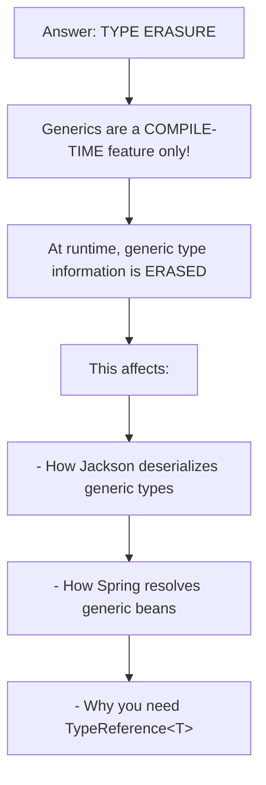
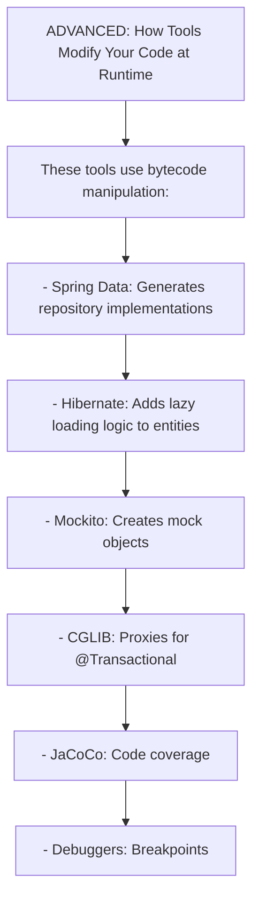
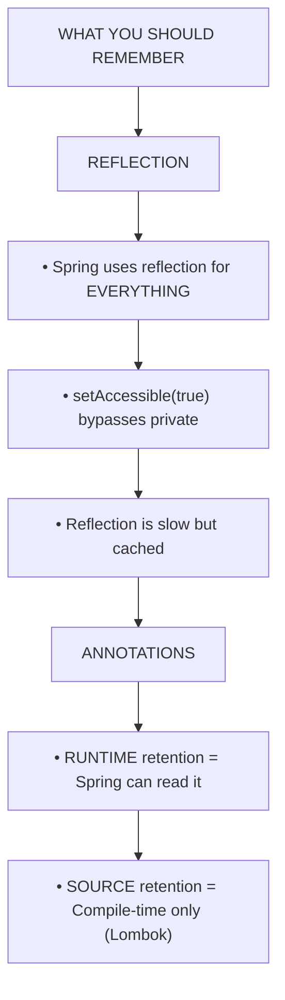

> **Navigation**: [< Previous Chapter](Ch26_Pre_Spring_Part1.md) | [Back to Index](../00_MASTER_INDEX.md)

---

## Theory-First Master Lens (Part 2: Infrastructure to Runtime Behavior)

This part focuses on how production systems behave under load, during build, and inside the JVM runtime.

Use these reasoning anchors while reading:

1. Connection pooling is queue management.
It shifts cost from connection setup to bounded concurrency and wait-time behavior.

2. Classloading is type identity + isolation.
Class name alone is not enough; classloader identity changes runtime compatibility.

3. Build tools are graph resolution engines.
Lifecycle phases and dependency scopes determine final classpath and runtime behavior.

4. HTTP semantics drive reliability.
Correct method, status, and header semantics are prerequisites for stable retries, caching, and gateway behavior.

5. Design patterns are controlled variability.
Spring patterns are mechanisms for change isolation, not interview vocabulary.

6. Threading is resource budgeting.
Thread pools, queues, and blocking points determine tail latency more than average latency.

7. Type erasure and bytecode tooling explain "invisible" framework behavior.
What is not visible in source can still be deterministically explained by runtime metadata and instrumentation phases.

Treat every section as: mechanism -> trade-off -> failure mode -> tuning strategy.


public class MoneyDeserializer extends JsonDeserializer<BigDecimal> {
    
    @Override
    public BigDecimal deserialize(JsonParser p, DeserializationContext ctxt) 
            throws IOException {
        String value = p.getValueAsString();
        if (value != null && value.startsWith("$")) {
            return new BigDecimal(value.substring(1));
        }
        return new BigDecimal(value);
    }
}

// Usage
public class Product {
    @JsonSerialize(using = MoneySerializer.class)
    @JsonDeserialize(using = MoneyDeserializer.class)
    private BigDecimal price;
}
```

## E.4 Polymorphic Type Handling

```java
// When you have inheritance and need to know the actual type

@JsonTypeInfo(
    use = JsonTypeInfo.Id.NAME,
    include = JsonTypeInfo.As.PROPERTY,
    property = "type"
)
@JsonSubTypes({
    @JsonSubTypes.Type(value = Dog.class, name = "dog"),
    @JsonSubTypes.Type(value = Cat.class, name = "cat")
})
public abstract class Animal {
    private String name;
}

public class Dog extends Animal {
    private String breed;
}

public class Cat extends Animal {
    private boolean indoor;
}

// Serialized Dog: {"type":"dog","name":"Rex","breed":"German Shepherd"}
// Jackson knows to create Dog instance when type="dog"
```

## E.5 Configuring ObjectMapper in Spring Boot

```java
@Configuration
public class JacksonConfig {
    
    @Bean
    public ObjectMapper objectMapper() {
        ObjectMapper mapper = new ObjectMapper();
        
        // Don't fail on unknown properties
        mapper.configure(DeserializationFeature.FAIL_ON_UNKNOWN_PROPERTIES, false);
        
        // Include only non-null values
        mapper.setSerializationInclusion(JsonInclude.Include.NON_NULL);
        
        // Pretty print
        mapper.enable(SerializationFeature.INDENT_OUTPUT);
        
        // Date handling
        mapper.registerModule(new JavaTimeModule());
        mapper.disable(SerializationFeature.WRITE_DATES_AS_TIMESTAMPS);
        
        // Snake case
        mapper.setPropertyNamingStrategy(PropertyNamingStrategies.SNAKE_CASE);
        
        return mapper;
    }
}
```

### Via application.yml

```yaml
spring:
  jackson:
    property-naming-strategy: SNAKE_CASE
    serialization:
      indent-output: true
      write-dates-as-timestamps: false
    deserialization:
      fail-on-unknown-properties: false
    default-property-inclusion: non_null
    date-format: yyyy-MM-dd HH:mm:ss
```

---

# SECTION F: CONNECTION POOLING - DATABASE CONNECTIONS AREN'T FREE

## Why This Matters

```
┌──────────────────────────────────────────────────────────────────────────────────┐
│  CREATING A DATABASE CONNECTION IS EXPENSIVE!                                    │
├──────────────────────────────────────────────────────────────────────────────────┤
│                                                                                  │
│  Creating ONE connection:                                                        │
│  1. DNS lookup for database host                                                 │
│  2. TCP handshake (3-way)                                                        │
│  3. TLS handshake (if SSL)                                                       │
│  4. Database authentication                                                      │
│  5. Session initialization                                                       │
│                                                                                  │
│  TIME: 50-200ms PER CONNECTION                                                   │
│                                                                                  │
│  If you create a new connection for every query:                                 │
│  - 10 queries = 500-2000ms just in connection overhead!                          │
│                                                                                  │
│  CONNECTION POOLING: Reuse connections!                                          │
│  - Connection created once at startup                                            │
│  - Borrowed for query, returned to pool                                          │
│  - 10 queries = ~0ms connection overhead                                         │
│                                                                                  │
└──────────────────────────────────────────────────────────────────────────────────┘
```

## F.1 How Connection Pooling Works

```
┌──────────────────────────────────────────────────────────────────────────────────┐
│                    CONNECTION POOL LIFECYCLE                                     │
├──────────────────────────────────────────────────────────────────────────────────┤
│                                                                                  │
│  Application Start:                                                              │
│  ┌────────────────────────────────────────────┐                                  │
│  │ Connection Pool (HikariCP)                 │                                  │
│  │                                            │                                  │
│  │  [Conn1][Conn2][Conn3][Conn4][Conn5]      │ ◄── Minimum idle connections      │
│  │    ↑      ↑      ↑      ↑      ↑          │      created at startup           │
│  │   idle   idle   idle   idle   idle        │                                   │
│  │                                            │                                  │
│  └────────────────────────────────────────────┘                                  │
│                                                                                  │
│  Request comes in:                                                               │
│  ┌────────────────────────────────────────────┐                                  │
│  │ Connection Pool                            │                                  │
│  │                                            │                                  │
│  │  [    ][Conn2][Conn3][Conn4][Conn5]       │                                   │
│  │    ↑                                       │                                  │
│  │   Conn1 borrowed by Thread-1               │                                  │
│  │                                            │                                  │
│  └────────────────────────────────────────────┘                                  │
│                                                                                  │
│  Query completes:                                                                │
│  ┌────────────────────────────────────────────┐                                  │
│  │ Connection Pool                            │                                  │
│  │                                            │                                  │
│  │  [Conn1][Conn2][Conn3][Conn4][Conn5]      │ ◄── Conn1 returned to pool        │
│  │    ↑                                       │      (NOT closed!)               │
│  │   idle again                               │                                  │
│  │                                            │                                  │
│  └────────────────────────────────────────────┘                                  │
│                                                                                  │
└──────────────────────────────────────────────────────────────────────────────────┘
```

## F.2 HikariCP Configuration

```yaml
# HikariCP is Spring Boot's default connection pool

spring:
  datasource:
    url: jdbc:postgresql://localhost:5432/mydb
    username: user
    password: pass
    
    hikari:
      # Pool sizing
      minimum-idle: 5           # Minimum connections to keep in pool
      maximum-pool-size: 10     # Maximum connections in pool
      
      # Timeouts
      connection-timeout: 30000      # Max wait for connection (30s)
      idle-timeout: 600000          # How long idle connection lives (10min)
      max-lifetime: 1800000         # Max age of connection (30min)
      
      # Validation
      validation-timeout: 5000      # Time to validate connection
      
      # Performance
      auto-commit: true
      pool-name: MyHikariPool
```

## F.3 Connection Pool Sizing

```
┌──────────────────────────────────────────────────────────────────────────────────┐
│                    POOL SIZING FORMULA                                           │
├──────────────────────────────────────────────────────────────────────────────────┤
│                                                                                  │
│  connections = ((core_count * 2) + effective_spindle_count)                      │
│                                                                                  │
│  For SSD with 4-core CPU:                                                        │
│  connections = (4 * 2) + 1 = 9-10 connections                                    │
│                                                                                  │
│  IMPORTANT: More connections ≠ Better performance!                               │
│                                                                                  │
│  Why?                                                                            │
│  - Database has limited CPU cores                                                │
│  - More connections = More context switching                                     │
│  - Diminishing returns after optimal point                                       │
│                                                                                  │
│  RULE OF THUMB:                                                                  │
│  - Web app: 10-20 connections per instance                                       │
│  - Batch processing: Higher (dedicated resources)                                │
│                                                                                  │
└──────────────────────────────────────────────────────────────────────────────────┘
```

## F.4 Common Connection Pool Problems

### Problem 1: Connection Leaks

```java
// BAD: Connection never returned to pool!
public void badMethod() {
    Connection conn = dataSource.getConnection();
    Statement stmt = conn.createStatement();
    ResultSet rs = stmt.executeQuery("SELECT * FROM users");
    // Process results...
    // FORGOT to close! Connection leaked!
}

// GOOD: Try-with-resources
public void goodMethod() {
    try (Connection conn = dataSource.getConnection();
         Statement stmt = conn.createStatement();
         ResultSet rs = stmt.executeQuery("SELECT * FROM users")) {
        // Process results...
    }  // Auto-closed, returned to pool
}

// BEST: Use JdbcTemplate or JPA (they manage connections)
@Autowired
private JdbcTemplate jdbcTemplate;

public List<User> getUsers() {
    return jdbcTemplate.query("SELECT * FROM users", userRowMapper);
    // Connection acquired and released automatically
}
```

### Problem 2: Pool Exhaustion

```java
// All connections in use, new requests wait...

// Identify with logging
spring:
  datasource:
    hikari:
      leak-detection-threshold: 60000  # Log if connection held > 60s
      
// In code, check pool stats
@Autowired
private HikariDataSource dataSource;

public void checkPool() {
    HikariPoolMXBean poolProxy = dataSource.getHikariPoolMXBean();
    
    int active = poolProxy.getActiveConnections();
    int idle = poolProxy.getIdleConnections();
    int total = poolProxy.getTotalConnections();
    int waiting = poolProxy.getThreadsAwaitingConnection();
    
    log.info("Active: {}, Idle: {}, Total: {}, Waiting: {}", 
             active, idle, total, waiting);
}
```

### Problem 3: Stale Connections

```java
// Connection seems valid but database closed it (firewall timeout, database restart)

spring:
  datasource:
    hikari:
      connection-test-query: SELECT 1      # For MySQL
      keepalive-time: 300000               # Send keepalive every 5min
      max-lifetime: 1800000                # Recreate before database timeout
```

---

# SECTION G: CLASSLOADING - HOW YOUR CODE RUNS

## Why This Matters

```
┌──────────────────────────────────────────────────────────────────────────────────┐
│  CLASS NOT FOUND? NO CLASS DEF FOUND? CLASS CAST EXCEPTION (SAME CLASS!)?        │
├──────────────────────────────────────────────────────────────────────────────────┤
│                                                                                  │
│  These errors are CLASSLOADER problems!                                          │
│                                                                                  │
│  Understanding classloaders helps you:                                           │
│  - Debug mysterious ClassNotFoundException                                       │
│  - Understand Spring context hierarchies                                         │
│  - Debug "duplicate class" issues                                                │
│  - Understand hot reloading (like Spring DevTools)                               │
│  - Work with modular applications                                                │
│                                                                                  │
└──────────────────────────────────────────────────────────────────────────────────┘
```

## G.1 Classloader Hierarchy

```
┌──────────────────────────────────────────────────────────────────────────────────┐
│                    CLASSLOADER HIERARCHY                                         │
├──────────────────────────────────────────────────────────────────────────────────┤
│                                                                                  │
│                    ┌───────────────────┐                                         │
│                    │ Bootstrap         │ ◄── Loads: java.lang.*, java.util.*     │
│                    │ ClassLoader       │     (rt.jar - core Java)                │
│                    │ (native code)     │                                         │
│                    └─────────┬─────────┘                                         │
│                              │                                                   │
│                              ▼                                                   │
│                    ┌───────────────────┐                                         │
│                    │ Platform          │ ◄── Loads: Java extensions              │
│                    │ ClassLoader       │     (jre/lib/ext)                       │
│                    └─────────┬─────────┘                                         │
│                              │                                                   │
│                              ▼                                                   │
│                    ┌───────────────────┐                                         │
│                    │ Application       │ ◄── Loads: Your code, dependencies      │
│                    │ ClassLoader       │     (classpath)                         │
│                    └─────────┬─────────┘                                         │
│                              │                                                   │
│                              ▼                                                   │
│               ┌──────────────┴──────────────┐                                    │
│               │                              │                                   │
│    ┌──────────────────┐          ┌──────────────────┐                            │
│    │ Custom Loader 1  │          │ Custom Loader 2  │                            │
│    │ (Web App 1)      │          │ (Web App 2)      │                            │
│    └──────────────────┘          └──────────────────┘                            │
│                                                                                  │
│  PARENT DELEGATION: Child asks parent first before loading itself                │
│                                                                                  │
└──────────────────────────────────────────────────────────────────────────────────┘
```

## G.2 Parent Delegation Model

```java
// When you reference a class:

public class MyService {
    User user = new User();  // JVM needs to load User.class
}

// The classloading process:
// 1. Application ClassLoader: "Do I have User.class cached?"
//    - If yes: return it
//    - If no: ask parent
//
// 2. Platform ClassLoader: "Do I have User.class?"
//    - If no: ask parent
//
// 3. Bootstrap ClassLoader: "Do I have User.class?"
//    - If no: return null to child
//
// 4. Platform ClassLoader: "Parent doesn't have it, can I load it?"
//    - If no: return null to child
//
// 5. Application ClassLoader: "Can I load User.class from classpath?"
//    - If yes: load and cache it
//    - If no: throw ClassNotFoundException
```

## G.3 Common Classloading Problems

### Problem 1: ClassNotFoundException

```java
// Class doesn't exist in classpath at ALL
try {
    Class<?> clazz = Class.forName("com.example.NonExistent");
} catch (ClassNotFoundException e) {
    // The .class file is not in any JAR or class directory
}

// FIX: Check your dependencies in pom.xml/build.gradle
```

### Problem 2: NoClassDefFoundError

```java
// Class existed at COMPILE time but not at RUNTIME
public class MyService {
    public void process() {
        SomeClass obj = new SomeClass();  // NoClassDefFoundError!
    }
}

// FIX: The dependency is "provided" or excluded at runtime
// Check: mvn dependency:tree
```

### Problem 3: Same Class, Different Classloaders

```java
// Class loaded by two different classloaders = TWO DIFFERENT CLASSES!

User user1 = classLoader1.loadClass("User").newInstance();
User user2 = classLoader2.loadClass("User").newInstance();

// This FAILS:
user1 = (User) user2;  // ClassCastException!

// Even though it's the "same" User class!
// Because: user1.getClass() != user2.getClass()
// They're loaded by different classloaders
```

## G.4 Spring DevTools Hot Reload

```
┌──────────────────────────────────────────────────────────────────────────────────┐
│                    HOW SPRING DEVTOOLS WORKS                                     │
├──────────────────────────────────────────────────────────────────────────────────┤
│                                                                                  │
│  Without DevTools:                                                               │
│  - Change User.java → Restart entire application → 10-30 seconds                 │
│                                                                                  │
│  With DevTools:                                                                  │
│  - Your code: Loaded by "RestartClassLoader" (custom)                            │
│  - Dependencies: Loaded by base classloader (not reloaded)                       │
│                                                                                  │
│  Change detected:                                                                │
│  1. Only RestartClassLoader is thrown away                                       │
│  2. New RestartClassLoader created                                               │
│  3. Your classes reloaded (fast!)                                                │
│  4. Dependencies stay loaded (not reloaded)                                      │
│                                                                                  │
│  Result: Restart in 1-3 seconds instead of 10-30!                                │
│                                                                                  │
└──────────────────────────────────────────────────────────────────────────────────┘
```

---

# SECTION H: BUILD TOOLS INTERNALS - MAVEN/GRADLE

## Why This Matters

```
┌──────────────────────────────────────────────────────────────────────────────────┐
│  BUILD FAILURES? DEPENDENCY CONFLICTS? UNDERSTANDING LIFECYCLES?                 │
├──────────────────────────────────────────────────────────────────────────────────┤
│                                                                                  │
│  You use Maven/Gradle daily but:                                                 │
│  - "mvn clean install" - what does each word mean?                               │
│  - Why does "provided" scope exist?                                              │
│  - How does transitive dependency resolution work?                               │
│  - What's the difference between compile and runtime?                            │
│                                                                                  │
└──────────────────────────────────────────────────────────────────────────────────┘
```

## H.1 Maven Lifecycle Phases

```
┌──────────────────────────────────────────────────────────────────────────────────┐
│                    MAVEN BUILD LIFECYCLE                                         │
├──────────────────────────────────────────────────────────────────────────────────┤
│                                                                                  │
│  mvn [phase]  →  Runs all phases UP TO AND INCLUDING that phase                  │
│                                                                                  │
│  Phase           │ What It Does                                                  │
│  ────────────────┼────────────────────────────────────────────────────────────   │
│  validate        │ Validate project is correct                                   │
│  compile         │ Compile source code (src/main/java → target/classes)          │
│  test            │ Run unit tests (src/test/java)                                │
│  package         │ Create JAR/WAR file (target/*.jar)                            │
│  verify          │ Run integration tests                                         │
│  install         │ Install to local .m2 repository                               │
│  deploy          │ Upload to remote repository (Nexus, etc.)                     │
│                                                                                  │
│  "mvn install" runs: validate → compile → test → package → verify → install      │
│                                                                                  │
│  OTHER COMMANDS:                                                                 │
│  mvn clean       │ Delete target/ directory                                      │
│  mvn clean install │ Delete target/, then full build                             │
│  mvn package -DskipTests │ Package without running tests                         │
│                                                                                  │
└──────────────────────────────────────────────────────────────────────────────────┘
```

## H.2 Dependency Scopes

```
┌──────────────────────────────────────────────────────────────────────────────────┐
│                    MAVEN DEPENDENCY SCOPES                                       │
├──────────────────────────────────────────────────────────────────────────────────┤
│                                                                                  │
│  Scope      │ Compile │ Test │ Runtime │ Transitive │ Example                    │
│  ───────────┼─────────┼──────┼─────────┼────────────┼────────────────────────    │
│  compile    │   ✅    │  ✅  │   ✅    │    ✅      │ spring-boot-starter            │
│  (default)  │         │      │         │            │                            │
│             │         │      │         │            │                            │
│  provided   │   ✅    │  ✅  │   ❌    │    ❌      │ servlet-api (provided          │
│             │         │      │         │            │ by Tomcat)                 │
│             │         │      │         │            │                            │
│  runtime    │   ❌    │  ✅  │   ✅    │    ✅      │ JDBC drivers (mysql-           │
│             │         │      │         │            │ connector-java)            │
│             │         │      │         │            │                            │
│  test       │   ❌    │  ✅  │   ❌    │    ❌      │ JUnit, Mockito                 │
│             │         │      │         │            │                            │
│  system     │   ✅    │  ✅  │   ✅    │    ❌      │ Local JAR file                 │
│             │         │      │         │            │ (avoid this!)              │
│                                                                                  │
│  COMMON CONFUSION:                                                               │
│  Q: Why is Lombok "provided" in some projects?                                   │
│  A: It generates code at COMPILE time. At runtime, generated code exists,        │
│     no need for Lombok JAR. But usually it's "compile" scope for simplicity.     │
│                                                                                  │
└──────────────────────────────────────────────────────────────────────────────────┘
```

## H.3 Transitive Dependencies

```
┌──────────────────────────────────────────────────────────────────────────────────┐
│                    TRANSITIVE DEPENDENCY RESOLUTION                              │
├──────────────────────────────────────────────────────────────────────────────────┤
│                                                                                  │
│  Your pom.xml:                                                                   │
│  <dependency>                                                                    │
│      <groupId>org.springframework.boot</groupId>                                 │
│      <artifactId>spring-boot-starter-web</artifactId>                            │
│  </dependency>                                                                   │
│                                                                                  │
│  What you actually get:                                                          │
│                                                                                  │
│  spring-boot-starter-web                                                         │
│  ├── spring-boot-starter                                                         │
│  │   ├── spring-boot                                                             │
│  │   ├── spring-boot-autoconfigure                                               │
│  │   └── spring-core                                                             │
│  ├── spring-boot-starter-json                                                    │
│  │   ├── jackson-databind                                                        │
│  │   └── jackson-core                                                            │
│  ├── spring-boot-starter-tomcat                                                  │
│  │   └── tomcat-embed-core                                                       │
│  └── spring-webmvc                                                               │
│      ├── spring-aop                                                              │
│      ├── spring-beans                                                            │
│      └── spring-context                                                          │
│                                                                                  │
│  ONE dependency = 20+ JARs downloaded automatically!                             │
│                                                                                  │
└──────────────────────────────────────────────────────────────────────────────────┘
```

### Viewing Dependencies

```bash
# See all dependencies (including transitive)
mvn dependency:tree

# Find where a specific dependency comes from
mvn dependency:tree -Dincludes=com.fasterxml.jackson.core:jackson-databind
```

## H.4 Dependency Conflicts

```
┌──────────────────────────────────────────────────────────────────────────────────┐
│                    VERSION CONFLICT RESOLUTION                                   │
├──────────────────────────────────────────────────────────────────────────────────┤
│                                                                                  │
│  Your project has:                                                               │
│  - Library A depends on Guava 28.0                                               │
│  - Library B depends on Guava 30.0                                               │
│                                                                                  │
│  MAVEN'S RULE: "Nearest Definition Wins"                                         │
│                                                                                  │
│  your-project                                                                    │
│  ├── library-a                                                                   │
│  │   └── guava:28.0    (depth 2)                                                 │
│  └── library-b                                                                   │
│      └── guava:30.0    (depth 2)                                                 │
│                                                                                  │
│  Same depth? FIRST ONE WINS (order in pom.xml matters!)                          │
│                                                                                  │
│  PROBLEM: What if library-a needs Guava 30 features?                             │
│           → RuntimeException!                                                    │
│                                                                                  │
│  SOLUTION: Explicitly declare version in YOUR pom.xml                            │
│                                                                                  │
│  <dependency>                                                                    │
│      <groupId>com.google.guava</groupId>                                         │
│      <artifactId>guava</artifactId>                                              │
│      <version>30.0-jre</version>  ◄── Your explicit version wins                 │
│  </dependency>                                                                   │
│                                                                                  │
└──────────────────────────────────────────────────────────────────────────────────┘
```

### Excluding Transitive Dependencies

```xml
<dependency>
    <groupId>org.springframework</groupId>
    <artifactId>spring-core</artifactId>
    <exclusions>
        <exclusion>
            <groupId>commons-logging</groupId>
            <artifactId>commons-logging</artifactId>
        </exclusion>
    </exclusions>
</dependency>
```

---

# SECTION I: HTTP FUNDAMENTALS - BELOW THE FRAMEWORK

## Why This Matters

```
┌──────────────────────────────────────────────────────────────────────────────────┐
│  SPRING HIDES ALL HTTP COMPLEXITY - BUT YOU MUST UNDERSTAND IT                   │
├──────────────────────────────────────────────────────────────────────────────────┤
│                                                                                  │
│  When debugging:                                                                 │
│  - Why is my request timing out?                                                 │
│  - Why does the load balancer keep failing health checks?                        │
│  - Why is CORS failing?                                                          │
│  - Why am I getting 502 Bad Gateway?                                             │
│                                                                                  │
│  You need to understand HTTP at the raw level!                                   │
│                                                                                  │
└──────────────────────────────────────────────────────────────────────────────────┘
```

## I.1 HTTP Message Format

```
┌──────────────────────────────────────────────────────────────────────────────────┐
│                    RAW HTTP REQUEST                                              │
├──────────────────────────────────────────────────────────────────────────────────┤
│                                                                                  │
│  POST /api/users HTTP/1.1                 ← Request line                         │
│  Host: api.example.com                    ← Headers start                        │
│  Content-Type: application/json                                                  │
│  Authorization: Bearer eyJhbGc...                                                │
│  Content-Length: 45                                                              │
│  Accept: application/json                                                        │
│                                           ← Empty line (CRLF)                    │
│  {"name":"John","email":"john@test.com"}  ← Body                                 │
│                                                                                  │
└──────────────────────────────────────────────────────────────────────────────────┘

┌──────────────────────────────────────────────────────────────────────────────────┐
│                    RAW HTTP RESPONSE                                             │
├──────────────────────────────────────────────────────────────────────────────────┤
│                                                                                  │
│  HTTP/1.1 201 Created                     ← Status line                          │
│  Content-Type: application/json           ← Headers start                        │
│  Location: /api/users/123                                                        │
│  Content-Length: 67                                                              │
│                                           ← Empty line (CRLF)                    │
│  {"id":123,"name":"John","email":"john@test.com"}  ← Body                        │
│                                                                                  │
└──────────────────────────────────────────────────────────────────────────────────┘
```

## I.2 HTTP Methods - Semantic Meaning

```
┌──────────────────────────────────────────────────────────────────────────────────┐
│                    HTTP METHODS DEEP DIVE                                        │
├──────────────────────────────────────────────────────────────────────────────────┤
│                                                                                  │
│  Method   │ Safe │ Idempotent │ Has Body │ Use Case                              │
│  ─────────┼──────┼────────────┼──────────┼─────────────────────────────────────  │
│  GET      │  ✅  │     ✅     │    ❌    │ Retrieve resource                        │
│  HEAD     │  ✅  │     ✅     │    ❌    │ Like GET but no body (check exists)      │
│  OPTIONS  │  ✅  │     ✅     │    ❌    │ Get allowed methods (CORS preflight)     │
│  POST     │  ❌  │     ❌     │    ✅    │ Create resource (not idempotent!)        │
│  PUT      │  ❌  │     ✅     │    ✅    │ Replace entire resource                  │
│  PATCH    │  ❌  │     ❌     │    ✅    │ Partial update                           │
│  DELETE   │  ❌  │     ✅     │    ❌*   │ Remove resource                          │
│                                                                                  │
│  SAFE: Doesn't modify server state                                               │
│  IDEMPOTENT: Multiple identical requests = same result                           │
│                                                                                  │
│  EXAMPLE:                                                                        │
│  - POST /orders twice = 2 orders created (NOT idempotent)                        │
│  - PUT /orders/1 twice = 1 order (same result each time) (idempotent)            │
│  - DELETE /orders/1 twice = order deleted first time, 404 second time            │
│                           = same final state (idempotent)                        │
│                                                                                  │
└──────────────────────────────────────────────────────────────────────────────────┘
```

## I.3 HTTP Status Codes - Complete Reference

```
┌──────────────────────────────────────────────────────────────────────────────────┐
│                    HTTP STATUS CODES                                             │
├──────────────────────────────────────────────────────────────────────────────────┤
│                                                                                  │
│  1xx INFORMATIONAL                                                               │
│  100 Continue        - Server received headers, send body                        │
│  101 Switching       - Upgrading to WebSocket                                    │
│                                                                                  │
│  2xx SUCCESS                                                                     │
│  200 OK              - Generic success                                           │
│  201 Created         - Resource created (return Location header!)                │
│  202 Accepted        - Request accepted, processing async                        │
│  204 No Content      - Success but no body (DELETE response)                     │
│                                                                                  │
│  3xx REDIRECTION                                                                 │
│  301 Moved Permanently  - URL changed forever (browser caches)                   │
│  302 Found (Temporary)  - Temporary redirect                                     │
│  304 Not Modified       - Use cached version (ETags)                             │
│                                                                                  │
│  4xx CLIENT ERROR                                                                │
│  400 Bad Request     - Malformed request (validation failed)                     │
│  401 Unauthorized    - Not authenticated (no/invalid token)                      │
│  403 Forbidden       - Authenticated but not authorized                          │
│  404 Not Found       - Resource doesn't exist                                    │
│  405 Method Not Allowed - Wrong HTTP method                                      │
│  409 Conflict        - State conflict (duplicate, version mismatch)              │
│  415 Unsupported Media Type - Wrong Content-Type                                 │
│  422 Unprocessable Entity - Semantic errors in body                              │
│  429 Too Many Requests - Rate limited                                            │
│                                                                                  │
│  5xx SERVER ERROR                                                                │
│  500 Internal Server Error - Generic server error                                │
│  502 Bad Gateway     - Proxy got bad response from upstream                      │
│  503 Service Unavailable - Server overloaded or maintenance                      │
│  504 Gateway Timeout - Proxy timeout waiting for upstream                        │
│                                                                                  │
│  SPRING BOOT MAPPINGS:                                                           │
│  - Validation error (@Valid) → 400                                               │
│  - NoHandlerFound → 404                                                          │
│  - MethodNotSupported → 405                                                      │
│  - Unhandled exception → 500                                                     │
│                                                                                  │
└──────────────────────────────────────────────────────────────────────────────────┘
```

## I.4 Keep-Alive and Connection Management

```
┌──────────────────────────────────────────────────────────────────────────────────┐
│                    HTTP/1.1 KEEP-ALIVE                                           │
├──────────────────────────────────────────────────────────────────────────────────┤
│                                                                                  │
│  WITHOUT Keep-Alive (HTTP/1.0 default):                                          │
│                                                                                  │
│  Request 1: [TCP Connect] → [Request] → [Response] → [TCP Close]                 │
│  Request 2: [TCP Connect] → [Request] → [Response] → [TCP Close]                 │
│  Request 3: [TCP Connect] → [Request] → [Response] → [TCP Close]                 │
│                                                                                  │
│  3 requests = 3 TCP handshakes = ~150ms overhead!                                │
│                                                                                  │
│  WITH Keep-Alive (HTTP/1.1 default):                                             │
│                                                                                  │
│  [TCP Connect] → [Request 1] → [Response 1]                                      │
│               → [Request 2] → [Response 2]                                       │
│               → [Request 3] → [Response 3] → [TCP Close]                         │
│                                                                                  │
│  3 requests = 1 TCP handshake = ~50ms overhead!                                  │
│                                                                                  │
│  Headers:                                                                        │
│  Connection: keep-alive                                                          │
│  Keep-Alive: timeout=5, max=100                                                  │
│                                                                                  │
└──────────────────────────────────────────────────────────────────────────────────┘
```

## I.5 Content Negotiation

```java
// How client tells server what format it wants

// Request headers:
Accept: application/json                    // I want JSON
Accept: application/xml                     // I want XML  
Accept: text/html, application/json;q=0.9  // HTML preferred, JSON acceptable
Accept: */*                                 // Anything is fine

// q-factor (quality factor): 0.0 to 1.0, higher = more preferred
Accept: text/html;q=1.0, application/json;q=0.9, */*;q=0.1

// Spring handling:
@GetMapping(value = "/user", produces = {
    MediaType.APPLICATION_JSON_VALUE,
    MediaType.APPLICATION_XML_VALUE
})
public User getUser() {
    return user;  // Spring picks format based on Accept header
}
```

---

# SECTION J: DESIGN PATTERNS IN SPRING

## Why This Matters

```
┌──────────────────────────────────────────────────────────────────────────────────┐
│  SPRING IS A DESIGN PATTERNS SHOWCASE - KNOW THE PATTERNS!                       │
├──────────────────────────────────────────────────────────────────────────────────┤
│                                                                                  │
│  When interviewer asks:                                                          │
│  "What design patterns does Spring use?"                                         │
│                                                                                  │
│  Don't say "I don't know" - SPRING USES THEM ALL!                                │
│                                                                                  │
└──────────────────────────────────────────────────────────────────────────────────┘
```

## J.1 Singleton Pattern

```java
// Spring beans are SINGLETON by default

@Service
public class UserService { }  // One instance in entire application

// Behind the scenes:
public class SingletonBeanFactory {
    private Map<String, Object> singletonCache = new ConcurrentHashMap<>();
    
    public Object getBean(String name, Class<?> type) {
        // Check cache first
        Object singleton = singletonCache.get(name);
        if (singleton != null) {
            return singleton;
        }
        
        // Create and cache
        synchronized(singletonCache) {
            singleton = type.getDeclaredConstructor().newInstance();
            singletonCache.put(name, singleton);
            return singleton;
        }
    }
}

// WHY IT MATTERS:
// - Don't store request-specific state in @Service/@Repository
// - Beans are shared across ALL requests!
```

## J.2 Factory Pattern

```java
// BeanFactory/ApplicationContext = Factory that creates beans

ApplicationContext context = new AnnotationConfigApplicationContext(AppConfig.class);
UserService service = context.getBean(UserService.class);  // Factory creates/returns

// @Bean methods are factory methods
@Configuration
public class AppConfig {
    
    @Bean  // This IS a factory method
    public UserService userService(UserRepository repo) {
        return new UserServiceImpl(repo);
    }
}
```

## J.3 Proxy Pattern

```java
// Already covered in Section C, but the pattern:

// @Transactional creates proxy
@Transactional
public class UserService {
    public void saveUser(User user) { }
}

// UserService$Proxy is created that wraps UserService
// All calls go through proxy first
```

## J.4 Template Method Pattern

```java
// JdbcTemplate, RestTemplate, JmsTemplate...

public abstract class AbstractTemplate {
    // Template method - defines algorithm skeleton
    public final void execute() {
        setup();           // Fixed step
        doSpecificWork();  // Subclass implements
        cleanup();         // Fixed step
    }
    
    protected void setup() { /* default */ }
    protected void cleanup() { /* default */ }
    protected abstract void doSpecificWork();  // Hook for subclass
}

// JdbcTemplate does this:
// 1. Get connection (fixed)
// 2. Execute your query (your code via callback)
// 3. Handle results (your code)
// 4. Close connection (fixed)
```

## J.5 Strategy Pattern

```java
// Spring uses strategies everywhere

// Example: Resource loading strategy
Resource resource1 = new ClassPathResource("file.txt");   // Strategy 1
Resource resource2 = new FileSystemResource("/path/file"); // Strategy 2
Resource resource3 = new UrlResource("http://...");        // Strategy 3

// All implement same interface, different strategy
public interface Resource {
    InputStream getInputStream();
    boolean exists();
    // ...
}

// Transaction management strategies
PlatformTransactionManager jpa = new JpaTransactionManager();
PlatformTransactionManager jdbc = new DataSourceTransactionManager();
```

## J.6 Observer Pattern (Events)

```java
// Spring's event system

// Define event
public class UserCreatedEvent extends ApplicationEvent {
    private final User user;
    
    public UserCreatedEvent(Object source, User user) {
        super(source);
        this.user = user;
    }
}

// Publisher
@Service
public class UserService {
    @Autowired
    private ApplicationEventPublisher publisher;
    
    public User createUser(User user) {
        // Save user...
        publisher.publishEvent(new UserCreatedEvent(this, user));  // Notify observers
        return user;
    }
}

// Observer/Listener
@Component
public class EmailNotificationListener {
    
    @EventListener
    public void onUserCreated(UserCreatedEvent event) {
        // Send welcome email
    }
}

@Component
public class AuditLogListener {
    
    @EventListener
    public void onUserCreated(UserCreatedEvent event) {
        // Log to audit trail
    }
}

// Multiple observers, decoupled from publisher!
```

## J.7 Decorator Pattern

```java
// Spring's BeanPostProcessor = Decorator

@Component
public class LoggingBeanPostProcessor implements BeanPostProcessor {
    
    @Override
    public Object postProcessAfterInitialization(Object bean, String beanName) {
        // Wrap/decorate every bean with logging
        if (bean instanceof SomeService) {
            return createLoggingProxy(bean);  // Return decorated version
        }
        return bean;
    }
}

// Servlet Filters are also decorators:
// Each filter wraps the next, adding behavior
```

## J.8 Chain of Responsibility

```java
// Filter chain, Interceptor chain, Security filter chain

public interface Filter {
    void doFilter(Request req, Response res, FilterChain chain);
}

// Each filter can:
// 1. Process and pass to next: chain.doFilter(req, res)
// 2. Short-circuit: return early without calling chain.doFilter()

// Security filter chain:
// Request → AuthenticationFilter → AuthorizationFilter → ... → Controller
```

---

# SECTION K: THREADS & EXECUTORS

## Why This Matters

```
┌──────────────────────────────────────────────────────────────────────────────────┐
│  EVERY HTTP REQUEST = ONE THREAD (by default)                                    │
├──────────────────────────────────────────────────────────────────────────────────┤
│                                                                                  │
│  Understanding threading:                                                        │
│  - Why does Tomcat have 200 max threads?                                         │
│  - How does @Async work?                                                         │
│  - What happens with CompletableFuture?                                          │
│  - Why is ThreadLocal useful?                                                    │
│                                                                                  │
└──────────────────────────────────────────────────────────────────────────────────┘
```

## K.1 Tomcat Thread Pool

```
┌──────────────────────────────────────────────────────────────────────────────────┐
│                    TOMCAT REQUEST HANDLING                                       │
├──────────────────────────────────────────────────────────────────────────────────┤
│                                                                                  │
│  HTTP Request                                                                    │
│       │                                                                          │
│       ▼                                                                          │
│  ┌──────────────────────────────────────────────────────────────────────┐        │
│  │ Tomcat Thread Pool                                                    │       │
│  │                                                                        │      │
│  │  [Thread-1] [Thread-2] [Thread-3] ... [Thread-200]                   │        │
│  │      │                                                                 │      │
│  │      └──► Assigned to handle this request                            │        │
│  └──────────────────────────────────────────────────────────────────────┘        │
│       │                                                                          │
│       ▼                                                                          │
│  Your Controller executes on Thread-1                                            │
│       │                                                                          │
│       ▼                                                                          │
│  Response sent, Thread-1 returned to pool                                        │
│                                                                                  │
│                                                                                  │
│  DEFAULT: max 200 threads                                                        │
│  RULE: If request takes 100ms, can handle 2000 req/sec                           │
│        If request takes 1s, can only handle 200 req/sec!                         │
│                                                                                  │
└──────────────────────────────────────────────────────────────────────────────────┘
```

```yaml
# Tomcat thread pool configuration
server:
  tomcat:
    threads:
      max: 200        # Maximum worker threads
      min-spare: 10   # Minimum idle threads
    max-connections: 8192    # Max simultaneous connections
    accept-count: 100        # Queue when all threads busy
```

## K.2 ExecutorService Basics

```java
// Creating thread pools

// Fixed size pool
ExecutorService fixedPool = Executors.newFixedThreadPool(10);

// Cached pool (grows/shrinks as needed)
ExecutorService cachedPool = Executors.newCachedThreadPool();

// Single thread (tasks execute sequentially)
ExecutorService singleThread = Executors.newSingleThreadExecutor();

// Scheduled tasks
ScheduledExecutorService scheduler = Executors.newScheduledThreadPool(5);

// Submit tasks
Future<String> future = fixedPool.submit(() -> {
    return "Result";
});

String result = future.get();  // Blocks until complete
```

## K.3 @Async in Spring

```java
@Configuration
@EnableAsync
public class AsyncConfig {
    
    @Bean
    public Executor taskExecutor() {
        ThreadPoolTaskExecutor executor = new ThreadPoolTaskExecutor();
        executor.setCorePoolSize(5);         // Min threads
        executor.setMaxPoolSize(10);         // Max threads
        executor.setQueueCapacity(25);       // Queue size before creating new threads
        executor.setThreadNamePrefix("Async-");
        executor.initialize();
        return executor;
    }
}

@Service
public class EmailService {
    
    @Async  // Runs on separate thread!
    public void sendEmail(String to, String body) {
        // This method returns immediately to caller
        // Email sending happens in background
    }
    
    @Async
    public CompletableFuture<String> sendEmailAsync(String to, String body) {
        // Return a Future if you need the result
        return CompletableFuture.completedFuture("Email sent");
    }
}
```

## K.4 ThreadLocal - Request-Scoped Storage

```java
// ThreadLocal = Variable unique to each thread

public class RequestContext {
    private static final ThreadLocal<User> currentUser = new ThreadLocal<>();
    
    public static void setUser(User user) {
        currentUser.set(user);
    }
    
    public static User getUser() {
        return currentUser.get();
    }
    
    public static void clear() {
        currentUser.remove();  // IMPORTANT: Prevent memory leaks!
    }
}

// Usage in filter:
public class AuthFilter implements Filter {
    
    @Override
    public void doFilter(ServletRequest request, ServletResponse response, 
                        FilterChain chain) throws IOException, ServletException {
        try {
            User user = authenticate(request);
            RequestContext.setUser(user);  // Set for this thread/request
            chain.doFilter(request, response);
        } finally {
            RequestContext.clear();  // ALWAYS clear after request!
        }
    }
}

// Anywhere in your code:
@Service
public class OrderService {
    
    public Order createOrder(OrderRequest request) {
        User user = RequestContext.getUser();  // Get current user
        // No need to pass user through every method!
    }
}
```

### MDC (Mapped Diagnostic Context) - Logging's ThreadLocal

```java
// MDC stores logging context per thread

public class RequestLoggingFilter implements Filter {
    
    public void doFilter(ServletRequest request, ServletResponse response, 
                        FilterChain chain) {
        try {
            String requestId = UUID.randomUUID().toString();
            MDC.put("requestId", requestId);
            MDC.put("userId", getCurrentUserId());
            
            chain.doFilter(request, response);
        } finally {
            MDC.clear();
        }
    }
}

// In logback.xml:
<pattern>%d{HH:mm:ss} [%X{requestId}] [%X{userId}] %msg%n</pattern>

// Now every log line includes requestId and userId automatically!
// 14:32:01 [abc-123] [user-456] Processing order...
```

---

# SECTION L: GENERICS & TYPE ERASURE

## Why This Matters

```
┌──────────────────────────────────────────────────────────────────────────────────┐
│  WHY CAN'T I DO: new T() or T.class or instanceof List<String>?                  │
├──────────────────────────────────────────────────────────────────────────────────┤
│                                                                                  │
│  Answer: TYPE ERASURE                                                            │
│                                                                                  │
│  Generics are a COMPILE-TIME feature only!                                       │
│  At runtime, generic type information is ERASED                                  │
│                                                                                  │
│  This affects:                                                                   │
│  - How Jackson deserializes generic types                                        │
│  - How Spring resolves generic beans                                             │
│  - Why you need TypeReference<T>                                                 │
│                                                                                  │
└──────────────────────────────────────────────────────────────────────────────────┘
```

**Flow:**
- Answer: TYPE ERASURE
- ↓
- Generics are a COMPILE-TIME feature only!
- ↓
- At runtime, generic type information is ERASED
- ↓
- This affects:
- ↓
- - How Jackson deserializes generic types
- ↓
- - How Spring resolves generic beans
- ↓
- - Why you need TypeReference<T>



## L.1 What Is Type Erasure?

```java
// At compile time:
List<String> strings = new ArrayList<>();
List<Integer> numbers = new ArrayList<>();

// At runtime (after erasure):
List strings = new ArrayList();  // No <String>!
List numbers = new ArrayList();  // No <Integer>!

// They're THE SAME TYPE at runtime!
strings.getClass() == numbers.getClass()  // TRUE!

// This FAILS:
if (obj instanceof List<String>) { }  // Compile error!
// Because at runtime, it's just "List"
```

## L.2 Problems Caused by Type Erasure

```java
// Problem 1: Can't create generic type
public class Box<T> {
    private T item;
    
    public void createItem() {
        item = new T();  // COMPILE ERROR! T doesn't exist at runtime
    }
}

// Solution: Pass Class<T>
public class Box<T> {
    private final Class<T> type;
    
    public Box(Class<T> type) {
        this.type = type;
    }
    
    public T createItem() throws Exception {
        return type.getDeclaredConstructor().newInstance();
    }
}

// Problem 2: Can't get generic type at runtime
public <T> void process(List<T> list) {
    Class<T> elementType = ???  // No way to get T!
}
```

## L.3 TypeReference - Jackson's Solution

```java
// Without TypeReference:
String json = "[{\"name\":\"John\"}, {\"name\":\"Jane\"}]";

// This FAILS to get correct type:
List<User> users = objectMapper.readValue(json, List.class);
// users contains LinkedHashMap, not User objects!

// Because at runtime: List.class = List.class (no generic info)

// With TypeReference:
List<User> users = objectMapper.readValue(
    json,
    new TypeReference<List<User>>() {}  // Anonymous class preserves generic!
);

// How it works:
// Anonymous class = new class that extends TypeReference<List<User>>
// Generic superclass type IS preserved in bytecode!
// Jackson reads it via reflection: getGenericSuperclass()
```

## L.4 ResolvableType - Spring's Solution

```java
// Spring can resolve complex generic types

// Get type argument of List<User>
ResolvableType listType = ResolvableType.forClass(UserRepository.class)
    .as(JpaRepository.class)
    .getGeneric(0);  // First generic parameter

Class<?> entityClass = listType.resolve();  // User.class

// Useful for:
// - Determining entity type in generic repositories
// - Resolving event types in @EventListener
// - Auto-wiring generic beans
```

---

# SECTION M: BYTECODE & INSTRUMENTATION

## Why This Matters

```
┌──────────────────────────────────────────────────────────────────────────────────┐
│  ADVANCED: How Tools Modify Your Code at Runtime                                 │
├──────────────────────────────────────────────────────────────────────────────────┤
│                                                                                  │
│  These tools use bytecode manipulation:                                          │
│  - Spring Data: Generates repository implementations                             │
│  - Hibernate: Adds lazy loading logic to entities                                │
│  - Mockito: Creates mock objects                                                 │
│  - CGLIB: Proxies for @Transactional                                             │
│  - JaCoCo: Code coverage                                                         │
│  - Debuggers: Breakpoints                                                        │
│                                                                                  │
└──────────────────────────────────────────────────────────────────────────────────┘
```

**Flow:**
- ADVANCED: How Tools Modify Your Code at Runtime
- ↓
- These tools use bytecode manipulation:
- ↓
- - Spring Data: Generates repository implementations
- ↓
- - Hibernate: Adds lazy loading logic to entities
- ↓
- - Mockito: Creates mock objects
- ↓
- - CGLIB: Proxies for @Transactional
- ↓
- - JaCoCo: Code coverage



## M.1 Java Bytecode Basics

```java
// Your Java code:
public int add(int a, int b) {
    return a + b;
}

// Becomes bytecode (simplified):
// ILOAD 1      - Load first int parameter
// ILOAD 2      - Load second int parameter
// IADD         - Add them
// IRETURN      - Return int result

// View bytecode:
// javap -c MyClass.class
```

## M.2 How Spring Data Generates Repository Implementations

```java
// You write:
public interface UserRepository extends JpaRepository<User, Long> {
    List<User> findByLastName(String lastName);
}

// Spring Data generates AT RUNTIME:
public class UserRepositoryImpl implements UserRepository {
    
    @Override
    public List<User> findByLastName(String lastName) {
        // Generated query execution code
        String jpql = "SELECT u FROM User u WHERE u.lastName = :lastName";
        return entityManager.createQuery(jpql, User.class)
            .setParameter("lastName", lastName)
            .getResultList();
    }
    
    // All JpaRepository methods also implemented...
}

// This is created using:
// 1. java.lang.reflect.Proxy (for interface)
// 2. Method name parsing ("findBy" + "LastName")
// 3. Query generation
```

## M.3 Hibernate Bytecode Enhancement

```java
@Entity
public class User {
    @Id
    private Long id;
    
    @OneToMany(fetch = FetchType.LAZY)
    private List<Order> orders;  // Lazy loaded
}

// Hibernate enhances bytecode to add:
public class User$HibernateProxy extends User {
    private boolean ordersLoaded = false;
    
    @Override
    public List<Order> getOrders() {
        if (!ordersLoaded) {
            // Load from database NOW
            this.orders = loadOrdersFromDb();
            ordersLoaded = true;
        }
        return super.getOrders();
    }
}
```

## M.4 Java Agents

```java
// Java agents can transform classes as they load

// Agent class (requires premain method)
public class MyAgent {
    
    public static void premain(String args, Instrumentation inst) {
        inst.addTransformer(new ClassFileTransformer() {
            @Override
            public byte[] transform(ClassLoader loader, String className,
                                   Class<?> classBeingRedefined,
                                   ProtectionDomain protectionDomain,
                                   byte[] classfileBuffer) {
                // Modify bytecode here!
                return modifiedBytecode;
            }
        });
    }
}

// Run with agent:
// java -javaagent:myagent.jar -jar myapp.jar

// Used by:
// - APM tools (New Relic, Datadog)
// - Code coverage (JaCoCo)
// - Profilers (YourKit)
// - Mocking libraries (PowerMock)
```

---

# 📋 QUICK REFERENCE: KEY TAKEAWAYS

```
┌──────────────────────────────────────────────────────────────────────────────────┐
│                    WHAT YOU SHOULD REMEMBER                                      │
├──────────────────────────────────────────────────────────────────────────────────┤
│                                                                                  │
│  REFLECTION                                                                      │
│  • Spring uses reflection for EVERYTHING                                         │
│  • setAccessible(true) bypasses private                                          │
│  • Reflection is slow but cached                                                 │
│                                                                                  │
│  ANNOTATIONS                                                                     │
│  • RUNTIME retention = Spring can read it                                        │
│  • SOURCE retention = Compile-time only (Lombok)                                 │
│                                                                                  │
│  PROXIES                                                                         │
│  • @Transactional creates proxy, not modifies code                               │
│  • Self-invocation bypasses proxy!                                               │
│  • Private methods can't be proxied                                              │
│                                                                                  │
│  SERVLETS                                                                        │
│  • Spring MVC = Fancy servlet framework                                          │
│  • Filter → Interceptor → Controller → Interceptor → Filter                      │
│                                                                                  │
│  JACKSON                                                                         │
│  • @JsonProperty for naming                                                      │
│  • @JsonIgnore for hiding                                                        │
│  • @JsonFormat for dates                                                         │
│                                                                                  │
│  CONNECTIONS                                                                     │
│  • Connection creation is EXPENSIVE                                              │
│  • Pool reuses connections                                                       │
│  • Don't leak connections (use try-with-resources)                               │
│                                                                                  │
│  CLASSLOADING                                                                    │
│  • Parent delegation: ask parent first                                           │
│  • Different classloader = different class!                                      │
│                                                                                  │
│  BUILD TOOLS                                                                     │
│  • Lifecycle phases run in order                                                 │
│  • Scopes control when dependency is available                                   │
│  • Transitive = dependencies of dependencies                                     │
│                                                                                  │
│  TYPE ERASURE                                                                    │
│  • Generics erased at runtime                                                    │
│  • Use TypeReference for Jackson                                                 │
│  • Can't do: new T() or instanceof List<String>                                  │
│                                                                                  │
└──────────────────────────────────────────────────────────────────────────────────┘
```

**Flow:**
- WHAT YOU SHOULD REMEMBER
- ↓
- REFLECTION
- ↓
- • Spring uses reflection for EVERYTHING
- ↓
- • setAccessible(true) bypasses private
- ↓
- • Reflection is slow but cached
- ↓
- ANNOTATIONS
- ↓
- • RUNTIME retention = Spring can read it



---

# 🎯 INTERVIEW QUESTIONS ON HIDDEN FOUNDATIONS

1. **How does @Autowired work internally?**
   → Reflection: finds field, makes accessible, sets value

2. **Why doesn't @Transactional work on private methods?**
   → CGLIB subclasses, can't override private

3. **What's the difference between Filter and Interceptor?**
   → Filter: Servlet level, raw request/response
   → Interceptor: Spring MVC level, handler info

4. **Why does self-invocation bypass @Transactional?**
   → `this` refers to real object, not proxy

5. **How does Jackson know to serialize getName() as "name"?**
   → Reflection + convention (removes "get", lowercases)

6. **Why is connection pooling important?**
   → Connection creation: 50-200ms overhead per connection

7. **What is type erasure?**
   → Generic types removed at runtime

8. **How does Spring Data generate repository implementations?**
   → JDK Proxy + method name parsing + query generation

---

_This foundation makes Spring LOGICAL instead of MAGICAL!_


---

> **Navigation**: [< Previous](Ch26_Pre_Spring_Part1.md) | [Back to Index](../00_MASTER_INDEX.md) | [Next >](Ch21_AlgoEng_Advanced.md)