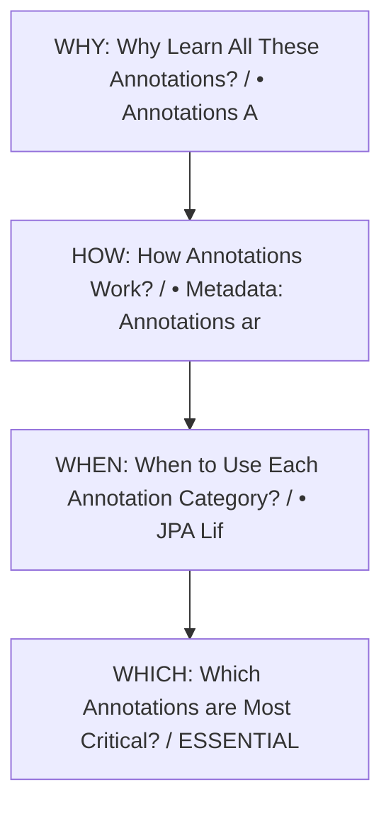
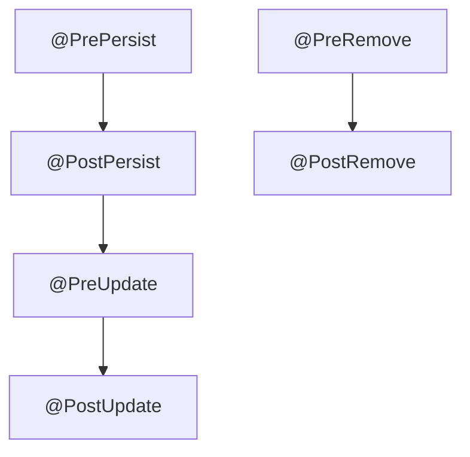

> **Navigation**: [Back to Index](../00_MASTER_INDEX.md) | [Next Chapter >](Ch29_Annotations_Advanced.md)

---

# Spring Boot Part 22: Complete Annotations Reference
## Every Important Annotation You Need to Know

> **"Annotations are the DNA of Spring Boot - they define behavior without boilerplate"**

---

# 🎯 WHY-HOW-WHEN-WHICH FRAMEWORK

```
┌─────────────────────────────────────────────────────────────────────────────────┐
│  WHY: Why Learn All These Annotations?                                          │
├─────────────────────────────────────────────────────────────────────────────────┤
│  • Annotations ARE Spring: Without them, you're writing raw Java                │
│  • Interview questions: "Explain @Transactional propagation"                    │
│  • Debug faster: Know what each annotation does under the hood                  │
│  • Write less code: @PrePersist beats manual timestamp setting                  │
│  • Avoid bugs: Wrong annotation = silent failures in production                 │
└─────────────────────────────────────────────────────────────────────────────────┘

┌─────────────────────────────────────────────────────────────────────────────────┐
│  HOW: How Annotations Work?                                                     │
├─────────────────────────────────────────────────────────────────────────────────┤
│  • Metadata: Annotations are just metadata read at runtime                      │
│  • Reflection: Spring scans classes and reads annotations                       │
│  • Proxies: Many annotations create proxies (@Transactional, @Cacheable)        │
│  • Callbacks: JPA annotations trigger lifecycle methods                         │
│  • Compile-time: Lombok annotations generate code at compile time               │
└─────────────────────────────────────────────────────────────────────────────────┘

┌─────────────────────────────────────────────────────────────────────────────────┐
│  WHEN: When to Use Each Annotation Category?                                    │
├─────────────────────────────────────────────────────────────────────────────────┤
│  • JPA Lifecycle: Auto timestamps, UUID generation, soft deletes                │
│  • Validation: Every DTO that accepts user input                                │
│  • Transaction: Service methods that modify data                                │
│  • Security: Protecting endpoints and methods                                   │
│  • Caching: Expensive operations that return same results                       │
└─────────────────────────────────────────────────────────────────────────────────┘

┌─────────────────────────────────────────────────────────────────────────────────┐
│  WHICH: Which Annotations are Most Critical?                                    │
├─────────────────────────────────────────────────────────────────────────────────┤
│  ESSENTIAL:     @Entity, @RestController, @Service, @Autowired, @Transactional  │
│  IMPORTANT:     @Valid, @PrePersist, @Cacheable, @Async, @PreAuthorize          │
│  ADVANCED:      @EntityListeners, @Formula, @ConditionalOnProperty              │
└─────────────────────────────────────────────────────────────────────────────────┘
```

**Flow:**
- WHY: Why Learn All These Annotations? / • Annotations A
- ↓
- HOW: How Annotations Work? / • Metadata: Annotations ar
- ↓
- WHEN: When to Use Each Annotation Category? / • JPA Lif
- ↓
- WHICH: Which Annotations are Most Critical? / ESSENTIAL



---

## 📚 Table of Contents
1. [JPA Entity Lifecycle Annotations](#jpa-entity-lifecycle-annotations)
2. [JPA Mapping Annotations](#jpa-mapping-annotations)
3. [Spring Data Auditing](#spring-data-auditing)
4. [Validation Annotations](#validation-annotations)
5. [Spring Core Annotations](#spring-core-annotations)
6. [Web & REST Annotations](#web--rest-annotations)
7. [Security Annotations](#security-annotations)
8. [Caching Annotations](#caching-annotations)
9. [Async & Scheduling Annotations](#async--scheduling-annotations)
10. [Transaction Annotations](#transaction-annotations)
11. [Testing Annotations](#testing-annotations)
12. [Lombok Annotations](#lombok-annotations)
13. [Conditional Annotations](#conditional-annotations)
14. [Hibernate-Specific Annotations](#hibernate-specific-annotations)
15. [Interview Questions](#interview-questions)

---

## JPA Entity Lifecycle Annotations

### Lifecycle Callback Methods

```
┌─────────────────────────────────────────────────────────────────┐
│                JPA ENTITY LIFECYCLE CALLBACKS                   │
├─────────────────────────────────────────────────────────────────┤
│                                                                 │
│  NEW ENTITY                                                     │
│      │                                                          │
│      ▼                                                          │
│  ┌─────────────┐                                                │
│  │ @PrePersist │ ──► Before INSERT                              │
│  └─────────────┘                                                │
│      │                                                          │
│      ▼ (em.persist())                                           │
│  ┌──────────────┐                                               │
│  │ @PostPersist │ ──► After INSERT (ID available)               │
│  └──────────────┘                                               │
│                                                                 │
│  MANAGED ENTITY                                                 │
│      │                                                          │
│      ▼                                                          │
│  ┌─────────────┐                                                │
│  │ @PreUpdate  │ ──► Before UPDATE                              │
│  └─────────────┘                                                │
│      │                                                          │
│      ▼ (dirty checking)                                         │
│  ┌──────────────┐                                               │
│  │ @PostUpdate  │ ──► After UPDATE                              │
│  └──────────────┘                                               │
│                                                                 │
│  ┌─────────────┐                                                │
│  │ @PreRemove  │ ──► Before DELETE                              │
│  └─────────────┘                                                │
│      │                                                          │
│      ▼ (em.remove())                                            │
│  ┌──────────────┐                                               │
│  │ @PostRemove  │ ──► After DELETE                              │
│  └──────────────┘                                               │
│                                                                 │
│  LOADING ENTITY                                                 │
│  ┌───────────┐                                                  │
│  │ @PostLoad │ ──► After SELECT (entity loaded from DB)         │
│  └───────────┘                                                  │
│                                                                 │
└─────────────────────────────────────────────────────────────────┘
```

**Flow:**
- @PrePersist
- ↓
- @PostPersist
- ↓
- @PreUpdate
- ↓
- @PostUpdate
- ↓
- @PreRemove
- ↓
- @PostRemove



### Complete Entity Lifecycle Example

```java
@Entity
@Table(name = "users")
public class User {
    
    @Id
    @GeneratedValue(strategy = GenerationType.IDENTITY)
    private Long id;
    
    private String email;
    private String password;
    
    @Column(name = "created_at")
    private LocalDateTime createdAt;
    
    @Column(name = "updated_at")
    private LocalDateTime updatedAt;
    
    @Column(name = "last_login")
    private LocalDateTime lastLogin;
    
    @Transient  // Not persisted to database
    private String fullNameCache;
    
    // ═══════════════════════════════════════════════════════════
    // LIFECYCLE CALLBACKS
    // ═══════════════════════════════════════════════════════════
    
    /**
     * @PrePersist - Called BEFORE entity is inserted
     * 
     * USE CASES:
     * - Set creation timestamp
     * - Generate UUID
     * - Set default values
     * - Encrypt sensitive data
     * - Validate business rules before save
     */
    @PrePersist
    protected void onCreate() {
        this.createdAt = LocalDateTime.now();
        this.updatedAt = LocalDateTime.now();
        
        // Example: Hash password before saving
        if (this.password != null && !this.password.startsWith("$2a$")) {
            this.password = BCrypt.hashpw(this.password, BCrypt.gensalt());
        }
    }
    
    /**
     * @PostPersist - Called AFTER entity is inserted
     * 
     * USE CASES:
     * - Send notification (email, event)
     * - Audit logging
     * - Update related entities
     * - Trigger async processes
     * 
     * NOTE: ID is now available!
     */
    @PostPersist
    protected void afterCreate() {
        System.out.println("User created with ID: " + this.id);
        // Could trigger: eventPublisher.publish(new UserCreatedEvent(this));
    }
    
    /**
     * @PreUpdate - Called BEFORE entity is updated
     * 
     * USE CASES:
     * - Update modification timestamp
     * - Validate changes
     * - Re-encrypt modified fields
     * - Track what changed (for audit)
     */
    @PreUpdate
    protected void onUpdate() {
        this.updatedAt = LocalDateTime.now();
    }
    
    /**
     * @PostUpdate - Called AFTER entity is updated
     * 
     * USE CASES:
     * - Send change notifications
     * - Invalidate caches
     * - Audit logging
     */
    @PostUpdate
    protected void afterUpdate() {
        System.out.println("User " + this.id + " updated at " + this.updatedAt);
    }
    
    /**
     * @PreRemove - Called BEFORE entity is deleted
     * 
     * USE CASES:
     * - Validate deletion is allowed
     * - Clean up related resources (files, etc.)
     * - Soft delete instead of hard delete
     * - Create backup/archive
     */
    @PreRemove
    protected void onDelete() {
        System.out.println("About to delete user: " + this.id);
        // Could throw exception to prevent deletion
        // throw new IllegalStateException("Cannot delete active user");
    }
    
    /**
     * @PostRemove - Called AFTER entity is deleted
     * 
     * USE CASES:
     * - Send deletion notification
     * - Clean up external resources
     * - Audit logging
     */
    @PostRemove
    protected void afterDelete() {
        System.out.println("User " + this.id + " has been deleted");
    }
    
    /**
     * @PostLoad - Called AFTER entity is loaded from database
     * 
     * USE CASES:
     * - Decrypt sensitive data
     * - Calculate transient fields
     * - Initialize lazy-loaded state
     * - Transform stored data format
     */
    @PostLoad
    protected void onLoad() {
        // Calculate transient field after loading
        this.fullNameCache = calculateFullName();
        
        // Could decrypt fields here
        // this.ssn = decrypt(this.encryptedSsn);
    }
    
    private String calculateFullName() {
        return "User: " + this.email;
    }
}
```

### Using @EntityListeners (Recommended Approach)

```java
/**
 * @EntityListeners - Externalize lifecycle logic
 * 
 * WHY USE THIS:
 * - Separation of concerns
 * - Reusable across entities
 * - Cleaner entity classes
 * - Better testability
 */
@Entity
@EntityListeners({AuditingEntityListener.class, CustomEntityListener.class})
public class Order {
    
    @Id
    @GeneratedValue(strategy = GenerationType.IDENTITY)
    private Long id;
    
    private BigDecimal amount;
    
    @CreatedDate
    private LocalDateTime createdAt;
    
    @LastModifiedDate
    private LocalDateTime updatedAt;
}

// Custom Listener
public class CustomEntityListener {
    
    @PrePersist
    public void prePersist(Object entity) {
        System.out.println("About to persist: " + entity.getClass().getSimpleName());
    }
    
    @PostPersist
    public void postPersist(Object entity) {
        // Publish event
        if (entity instanceof Order order) {
            // applicationEventPublisher.publishEvent(new OrderCreatedEvent(order));
        }
    }
    
    @PreUpdate
    public void preUpdate(Object entity) {
        System.out.println("About to update: " + entity.getClass().getSimpleName());
    }
}
```

---


> 🔬 **Section Challenge — JPA Entity Lifecycle Annotations**
>
> **Challenge 1 (Reasoning):** N+1 query problem — explain with a concrete JPA example and show the fix.
> <details><summary>Answer</summary>
>
> ```java
> // N+1: fetches all orders (1 query), then for EACH order fetches customer (N queries)
> List<Order> orders = orderRepo.findAll(); // 1 query
> orders.forEach(o -> System.out.println(o.getCustomer().getName())); // N queries!
>
> // Fix 1: JOIN FETCH
> @Query("SELECT o FROM Order o JOIN FETCH o.customer")
> List<Order> findAllWithCustomer();
>
> // Fix 2: EntityGraph
> @EntityGraph(attributePaths = "customer")
> List<Order> findAll();
> ```
> Both load orders + customers in ONE query (JOIN). Always check Hibernate's SQL log in development.
> </details>
>

## JPA Mapping Annotations

### Entity & Table Annotations

```java
/**
 * @Entity - Marks class as JPA entity
 * @Table - Customizes table mapping
 */
@Entity(name = "UserEntity")  // Entity name for JPQL queries
@Table(
    name = "users",           // Table name
    schema = "public",        // Schema name
    catalog = "mydb",         // Catalog name
    uniqueConstraints = {
        @UniqueConstraint(columnNames = {"email"}),
        @UniqueConstraint(columnNames = {"username", "tenant_id"})
    },
    indexes = {
        @Index(name = "idx_email", columnList = "email"),
        @Index(name = "idx_status_created", columnList = "status, created_at DESC")
    }
)
public class User {
    // ...
}
```

### Primary Key Annotations

```java
@Entity
public class Order {
    
    /**
     * @Id - Marks primary key
     * @GeneratedValue - ID generation strategy
     */
    @Id
    @GeneratedValue(strategy = GenerationType.IDENTITY)  // Auto-increment
    private Long id;
    
    // --- OR ---
    
    @Id
    @GeneratedValue(strategy = GenerationType.SEQUENCE, generator = "order_seq")
    @SequenceGenerator(
        name = "order_seq",
        sequenceName = "order_sequence",
        allocationSize = 50  // Performance: pre-allocate 50 IDs
    )
    private Long id;
    
    // --- OR ---
    
    @Id
    @GeneratedValue(strategy = GenerationType.UUID)  // Java 21+
    private UUID id;
    
    // --- OR for Composite Keys ---
    
    @EmbeddedId
    private OrderItemId id;
}

/**
 * @Embeddable - Composite primary key
 */
@Embeddable
public class OrderItemId implements Serializable {
    
    @Column(name = "order_id")
    private Long orderId;
    
    @Column(name = "product_id")
    private Long productId;
    
    // equals() and hashCode() REQUIRED!
}
```

### Column Annotations

```java
@Entity
public class Product {
    
    @Id
    @GeneratedValue(strategy = GenerationType.IDENTITY)
    private Long id;
    
    /**
     * @Column - Customize column mapping
     */
    @Column(
        name = "product_name",      // Column name
        nullable = false,           // NOT NULL
        unique = true,              // UNIQUE constraint
        length = 255,               // VARCHAR length
        columnDefinition = "TEXT",  // Raw SQL type
        insertable = true,          // Include in INSERT
        updatable = true            // Include in UPDATE
    )
    private String name;
    
    /**
     * @Basic - Basic type mapping (optional for simple types)
     */
    @Basic(fetch = FetchType.LAZY, optional = false)
    @Column(columnDefinition = "TEXT")
    private String description;
    
    /**
     * @Lob - Large Object (BLOB/CLOB)
     */
    @Lob
    @Column(name = "image_data")
    private byte[] image;
    
    /**
     * @Enumerated - Enum mapping
     */
    @Enumerated(EnumType.STRING)  // Store as "ACTIVE", not 0
    @Column(name = "status", length = 20)
    private ProductStatus status;
    
    /**
     * @Temporal - Date/Time mapping (pre-Java 8)
     * NOTE: Not needed for LocalDate, LocalDateTime, Instant
     */
    @Temporal(TemporalType.TIMESTAMP)
    private Date legacyDate;
    
    /**
     * @Transient - NOT persisted to database
     */
    @Transient
    private BigDecimal calculatedDiscount;
    
    /**
     * @Formula - Hibernate: calculated column from SQL
     */
    @Formula("(SELECT COUNT(*) FROM order_items oi WHERE oi.product_id = id)")
    private Integer orderCount;
    
    /**
     * @Generated - Value generated by database
     */
    @Generated(GenerationTime.INSERT)
    @Column(name = "created_at", insertable = false, updatable = false)
    private LocalDateTime createdAt;
}
```

### Relationship Annotations

```java
@Entity
public class Order {
    
    @Id
    @GeneratedValue(strategy = GenerationType.IDENTITY)
    private Long id;
    
    /**
     * @ManyToOne - Many orders belong to one user
     * 
     * FETCH TYPES:
     * - EAGER: Load immediately (default for @ManyToOne)
     * - LAZY: Load when accessed
     */
    @ManyToOne(fetch = FetchType.LAZY)
    @JoinColumn(
        name = "user_id",
        nullable = false,
        foreignKey = @ForeignKey(name = "fk_order_user")
    )
    private User user;
    
    /**
     * @OneToMany - One order has many items
     * 
     * CASCADE TYPES:
     * - PERSIST: Save children when parent saved
     * - MERGE: Update children when parent updated
     * - REMOVE: Delete children when parent deleted
     * - REFRESH: Refresh children when parent refreshed
     * - DETACH: Detach children when parent detached
     * - ALL: All of above
     * 
     * ORPHAN REMOVAL: Delete children removed from collection
     */
    @OneToMany(
        mappedBy = "order",           // Field in OrderItem that owns relationship
        cascade = CascadeType.ALL,
        orphanRemoval = true,
        fetch = FetchType.LAZY        // Default for collections
    )
    @OrderBy("createdAt DESC")        // Default ordering
    private List<OrderItem> items = new ArrayList<>();
    
    /**
     * @OneToOne - One order has one payment
     */
    @OneToOne(
        mappedBy = "order",
        cascade = CascadeType.ALL,
        orphanRemoval = true,
        fetch = FetchType.LAZY
    )
    private Payment payment;
    
    // Helper methods for bidirectional relationship
    public void addItem(OrderItem item) {
        items.add(item);
        item.setOrder(this);
    }
    
    public void removeItem(OrderItem item) {
        items.remove(item);
        item.setOrder(null);
    }
}

@Entity
public class OrderItem {
    
    @Id
    @GeneratedValue(strategy = GenerationType.IDENTITY)
    private Long id;
    
    @ManyToOne(fetch = FetchType.LAZY)
    @JoinColumn(name = "order_id", nullable = false)
    private Order order;
    
    /**
     * @ManyToMany - Many-to-many relationship
     */
    @ManyToMany
    @JoinTable(
        name = "product_categories",
        joinColumns = @JoinColumn(name = "product_id"),
        inverseJoinColumns = @JoinColumn(name = "category_id")
    )
    private Set<Category> categories = new HashSet<>();
}

@Entity
public class Payment {
    
    @Id
    @GeneratedValue(strategy = GenerationType.IDENTITY)
    private Long id;
    
    /**
     * @OneToOne - Owning side with foreign key
     */
    @OneToOne(fetch = FetchType.LAZY)
    @JoinColumn(name = "order_id", unique = true)
    private Order order;
}
```

### Embedded Objects

```java
/**
 * @Embeddable - Component that can be embedded in entities
 */
@Embeddable
public class Address {
    
    @Column(name = "street", length = 200)
    private String street;
    
    @Column(name = "city", length = 100)
    private String city;
    
    @Column(name = "zip_code", length = 20)
    private String zipCode;
    
    @Column(name = "country", length = 50)
    private String country;
}

@Entity
public class Customer {
    
    @Id
    @GeneratedValue(strategy = GenerationType.IDENTITY)
    private Long id;
    
    private String name;
    
    /**
     * @Embedded - Embed the Address component
     */
    @Embedded
    private Address billingAddress;
    
    /**
     * @AttributeOverrides - Customize embedded column names
     * (Required when embedding same type multiple times)
     */
    @Embedded
    @AttributeOverrides({
        @AttributeOverride(name = "street", 
            column = @Column(name = "shipping_street")),
        @AttributeOverride(name = "city", 
            column = @Column(name = "shipping_city")),
        @AttributeOverride(name = "zipCode", 
            column = @Column(name = "shipping_zip")),
        @AttributeOverride(name = "country", 
            column = @Column(name = "shipping_country"))
    })
    private Address shippingAddress;
    
    /**
     * @ElementCollection - Collection of embeddables or basic types
     */
    @ElementCollection
    @CollectionTable(
        name = "customer_phone_numbers",
        joinColumns = @JoinColumn(name = "customer_id")
    )
    @Column(name = "phone_number")
    private Set<String> phoneNumbers = new HashSet<>();
}
```

### Inheritance Annotations

```java
/**
 * @Inheritance - Entity inheritance strategy
 * 
 * STRATEGIES:
 * - SINGLE_TABLE: All classes in one table (default, best performance)
 * - JOINED: Each class has own table with foreign keys
 * - TABLE_PER_CLASS: Each concrete class has complete table
 */
@Entity
@Inheritance(strategy = InheritanceType.SINGLE_TABLE)
@DiscriminatorColumn(
    name = "payment_type",
    discriminatorType = DiscriminatorType.STRING
)
public abstract class Payment {
    
    @Id
    @GeneratedValue(strategy = GenerationType.IDENTITY)
    private Long id;
    
    private BigDecimal amount;
    private LocalDateTime paymentDate;
}

@Entity
@DiscriminatorValue("CREDIT_CARD")
public class CreditCardPayment extends Payment {
    
    @Column(name = "card_number")
    private String cardNumber;
    
    @Column(name = "expiry_date")
    private String expiryDate;
}

@Entity
@DiscriminatorValue("BANK_TRANSFER")
public class BankTransferPayment extends Payment {
    
    @Column(name = "bank_account")
    private String bankAccount;
    
    @Column(name = "routing_number")
    private String routingNumber;
}

// JOINED Strategy Example
@Entity
@Inheritance(strategy = InheritanceType.JOINED)
public abstract class Vehicle {
    @Id
    @GeneratedValue
    private Long id;
    private String manufacturer;
}

@Entity
@PrimaryKeyJoinColumn(name = "vehicle_id")
public class Car extends Vehicle {
    private int numberOfDoors;
}
```

---


> 🔬 **Section Challenge — JPA Mapping Annotations**
>
> **Challenge 1 (Reasoning):** `ExecutorService.submit(task)` — the task throws a `RuntimeException`. Nobody calls `future.get()`. What happens to the exception?
> <details><summary>Answer</summary>
>
> It's silently swallowed. The exception is stored in the `Future` object. Without `future.get()` or `.whenComplete()`, no one ever sees it. The thread pool thread resets and picks up the next task as if nothing happened. This is one of the most dangerous production bugs. Fix: always attach `future.whenComplete((r,ex) -> { if(ex!=null) log.error("Task failed",ex); })` or use `execute()` + `UncaughtExceptionHandler`.
> </details>
>

## Spring Data Auditing

### Setup Auditing

```java
/**
 * @EnableJpaAuditing - Enable Spring Data auditing
 */
@Configuration
@EnableJpaAuditing(auditorAwareRef = "auditorProvider")
public class JpaConfig {
    
    @Bean
    public AuditorAware<String> auditorProvider() {
        return () -> {
            // Get current user from Security Context
            return Optional.ofNullable(SecurityContextHolder.getContext())
                .map(SecurityContext::getAuthentication)
                .filter(Authentication::isAuthenticated)
                .map(Authentication::getName);
        };
    }
}
```

### Auditing Annotations

```java
/**
 * @MappedSuperclass - Base class for auditing
 * (Not an entity itself, just provides fields to children)
 */
@MappedSuperclass
@EntityListeners(AuditingEntityListener.class)
public abstract class Auditable {
    
    /**
     * @CreatedDate - Automatically set on entity creation
     */
    @CreatedDate
    @Column(name = "created_at", nullable = false, updatable = false)
    private LocalDateTime createdAt;
    
    /**
     * @LastModifiedDate - Automatically updated on entity modification
     */
    @LastModifiedDate
    @Column(name = "updated_at")
    private LocalDateTime updatedAt;
    
    /**
     * @CreatedBy - Who created this entity
     */
    @CreatedBy
    @Column(name = "created_by", updatable = false)
    private String createdBy;
    
    /**
     * @LastModifiedBy - Who last modified this entity
     */
    @LastModifiedBy
    @Column(name = "updated_by")
    private String updatedBy;
    
    /**
     * @Version - Optimistic locking
     * Prevents lost updates in concurrent scenarios
     */
    @Version
    @Column(name = "version")
    private Long version;
    
    // Getters and setters
}

// Usage
@Entity
@Table(name = "products")
public class Product extends Auditable {
    
    @Id
    @GeneratedValue(strategy = GenerationType.IDENTITY)
    private Long id;
    
    private String name;
    private BigDecimal price;
    
    // All audit fields inherited!
}
```

---


> 🔬 **Section Challenge — Spring Data Auditing**
>
> **Challenge 1 (Reasoning):** `ExecutorService.submit(task)` — the task throws a `RuntimeException`. Nobody calls `future.get()`. What happens to the exception?
> <details><summary>Answer</summary>
>
> It's silently swallowed. The exception is stored in the `Future` object. Without `future.get()` or `.whenComplete()`, no one ever sees it. The thread pool thread resets and picks up the next task as if nothing happened. This is one of the most dangerous production bugs. Fix: always attach `future.whenComplete((r,ex) -> { if(ex!=null) log.error("Task failed",ex); })` or use `execute()` + `UncaughtExceptionHandler`.
> </details>
>

## Validation Annotations

### Bean Validation (JSR-380)

```java
import jakarta.validation.constraints.*;

@Entity
public class UserRegistration {
    
    // ═══════════════════════════════════════════════════════════
    // NULL CHECKS
    // ═══════════════════════════════════════════════════════════
    
    /**
     * @NotNull - Field cannot be null
     */
    @NotNull(message = "ID is required")
    private Long id;
    
    /**
     * @NotEmpty - Not null AND not empty (for collections, strings)
     */
    @NotEmpty(message = "Roles cannot be empty")
    private List<String> roles;
    
    /**
     * @NotBlank - Not null AND not empty AND not whitespace only
     * Use for business fields that need actual content
     */
    @NotBlank(message = "Name is required")
    private String name;
    
    // ═══════════════════════════════════════════════════════════
    // SIZE CONSTRAINTS
    // ═══════════════════════════════════════════════════════════
    
    /**
     * @Size - String length or collection size
     */
    @Size(min = 3, max = 50, message = "Username must be 3-50 characters")
    private String username;
    
    @Size(min = 8, message = "Password must be at least 8 characters")
    private String password;
    
    /**
     * @Length - Hibernate validator (same as @Size for strings)
     */
    @Length(min = 2, max = 100)
    private String bio;
    
    // ═══════════════════════════════════════════════════════════
    // NUMERIC CONSTRAINTS
    // ═══════════════════════════════════════════════════════════
    
    /**
     * @Min / @Max - Numeric bounds (inclusive)
     */
    @Min(value = 0, message = "Age cannot be negative")
    @Max(value = 150, message = "Age is too high")
    private Integer age;
    
    /**
     * @Positive - Must be > 0
     * @PositiveOrZero - Must be >= 0
     * @Negative - Must be < 0
     * @NegativeOrZero - Must be <= 0
     */
    @Positive(message = "Price must be positive")
    private BigDecimal price;
    
    @PositiveOrZero(message = "Quantity cannot be negative")
    private Integer quantity;
    
    /**
     * @Digits - Digit constraints for decimals
     */
    @Digits(integer = 10, fraction = 2, message = "Invalid amount format")
    private BigDecimal amount;
    
    /**
     * @DecimalMin / @DecimalMax - Decimal bounds
     */
    @DecimalMin(value = "0.01", message = "Minimum price is 0.01")
    @DecimalMax(value = "999999.99", message = "Maximum price exceeded")
    private BigDecimal unitPrice;
    
    // ═══════════════════════════════════════════════════════════
    // STRING PATTERNS
    // ═══════════════════════════════════════════════════════════
    
    /**
     * @Email - Valid email format
     */
    @Email(message = "Invalid email format")
    @NotBlank(message = "Email is required")
    private String email;
    
    /**
     * @Pattern - Regular expression validation
     */
    @Pattern(
        regexp = "^\\+?[1-9]\\d{1,14}$",
        message = "Invalid phone number format"
    )
    private String phoneNumber;
    
    @Pattern(
        regexp = "^[A-Z]{2}[0-9]{6}$",
        message = "Invalid passport format"
    )
    private String passportNumber;
    
    // ═══════════════════════════════════════════════════════════
    // DATE/TIME CONSTRAINTS
    // ═══════════════════════════════════════════════════════════
    
    /**
     * @Past - Must be in the past
     * @PastOrPresent - Must be in past or now
     */
    @Past(message = "Birth date must be in the past")
    private LocalDate birthDate;
    
    @PastOrPresent(message = "Registration date cannot be in future")
    private LocalDateTime registrationDate;
    
    /**
     * @Future - Must be in the future
     * @FutureOrPresent - Must be in future or now
     */
    @Future(message = "Expiry date must be in the future")
    private LocalDate expiryDate;
    
    @FutureOrPresent(message = "Start date cannot be in the past")
    private LocalDateTime startDate;
    
    // ═══════════════════════════════════════════════════════════
    // BOOLEAN CONSTRAINTS
    // ═══════════════════════════════════════════════════════════
    
    /**
     * @AssertTrue - Must be true
     * @AssertFalse - Must be false
     */
    @AssertTrue(message = "You must accept the terms")
    private Boolean termsAccepted;
    
    @AssertFalse(message = "User must not be blocked")
    private Boolean isBlocked;
    
    // ═══════════════════════════════════════════════════════════
    // NESTED/CASCADED VALIDATION
    // ═══════════════════════════════════════════════════════════
    
    /**
     * @Valid - Triggers validation of nested object
     */
    @Valid
    @NotNull(message = "Address is required")
    private Address address;
    
    @Valid
    @NotEmpty(message = "At least one contact is required")
    private List<Contact> contacts;
}
```

### Custom Validators

```java
/**
 * Custom Validation Annotation
 */
@Target({ElementType.FIELD, ElementType.PARAMETER})
@Retention(RetentionPolicy.RUNTIME)
@Constraint(validatedBy = PasswordValidator.class)
@Documented
public @interface ValidPassword {
    String message() default "Password does not meet requirements";
    Class<?>[] groups() default {};
    Class<? extends Payload>[] payload() default {};
}

/**
 * Validator Implementation
 */
public class PasswordValidator implements ConstraintValidator<ValidPassword, String> {
    
    @Override
    public void initialize(ValidPassword constraintAnnotation) {
        // Initialize if needed
    }
    
    @Override
    public boolean isValid(String password, ConstraintValidatorContext context) {
        if (password == null) {
            return false;
        }
        
        // At least 8 chars, 1 uppercase, 1 lowercase, 1 digit, 1 special char
        return password.length() >= 8
            && password.matches(".*[A-Z].*")
            && password.matches(".*[a-z].*")
            && password.matches(".*\\d.*")
            && password.matches(".*[@#$%^&+=!].*");
    }
}

// Usage
public class User {
    
    @ValidPassword
    private String password;
}
```

### Cross-Field Validation

```java
/**
 * Class-level validation for comparing fields
 */
@Target({ElementType.TYPE})
@Retention(RetentionPolicy.RUNTIME)
@Constraint(validatedBy = PasswordMatchValidator.class)
public @interface PasswordMatch {
    String message() default "Passwords do not match";
    Class<?>[] groups() default {};
    Class<? extends Payload>[] payload() default {};
    
    String password();
    String confirmPassword();
}

public class PasswordMatchValidator 
    implements ConstraintValidator<PasswordMatch, Object> {
    
    private String passwordField;
    private String confirmField;
    
    @Override
    public void initialize(PasswordMatch annotation) {
        this.passwordField = annotation.password();
        this.confirmField = annotation.confirmPassword();
    }
    
    @Override
    public boolean isValid(Object obj, ConstraintValidatorContext context) {
        try {
            Object password = BeanUtils.getPropertyDescriptor(obj.getClass(), passwordField)
                .getReadMethod().invoke(obj);
            Object confirm = BeanUtils.getPropertyDescriptor(obj.getClass(), confirmField)
                .getReadMethod().invoke(obj);
            
            return password != null && password.equals(confirm);
        } catch (Exception e) {
            return false;
        }
    }
}

// Usage
@PasswordMatch(password = "password", confirmPassword = "confirmPassword")
public class RegistrationRequest {
    private String password;
    private String confirmPassword;
}
```

### Validation Groups

```java
/**
 * Validation Groups - Different rules for different scenarios
 */
public interface OnCreate {}
public interface OnUpdate {}

public class User {
    
    @Null(groups = OnCreate.class, message = "ID must be null for new users")
    @NotNull(groups = OnUpdate.class, message = "ID is required for updates")
    private Long id;
    
    @NotBlank(groups = {OnCreate.class, OnUpdate.class})
    private String name;
    
    @NotBlank(groups = OnCreate.class, message = "Password required for registration")
    private String password;
}

// Controller usage
@PostMapping
public User create(@Validated(OnCreate.class) @RequestBody User user) {
    return userService.create(user);
}

@PutMapping("/{id}")
public User update(@Validated(OnUpdate.class) @RequestBody User user) {
    return userService.update(user);
}
```

---

## Spring Core Annotations

### Bean Definition

```java
/**
 * @Component - Generic Spring-managed component
 * Scanned automatically by @ComponentScan
 */
@Component
public class EmailHelper {
    // ...
}

/**
 * @Service - Business logic layer
 * Semantically same as @Component, indicates service layer
 */
@Service
public class UserService {
    // ...
}

/**
 * @Repository - Data access layer
 * Also enables exception translation (SQL → DataAccessException)
 */
@Repository
public class UserRepository {
    // ...
}

/**
 * @Controller - Web MVC controller
 * Returns view names
 */
@Controller
public class HomeController {
    // ...
}

/**
 * @RestController - REST API controller
 * = @Controller + @ResponseBody
 */
@RestController
public class UserApiController {
    // ...
}

/**
 * @Configuration - Configuration class
 * Contains @Bean methods
 */
@Configuration
public class AppConfig {
    
    /**
     * @Bean - Method produces a Spring bean
     */
    @Bean
    public ObjectMapper objectMapper() {
        return new ObjectMapper()
            .registerModule(new JavaTimeModule())
            .disable(SerializationFeature.WRITE_DATES_AS_TIMESTAMPS);
    }
    
    /**
     * @Bean with dependencies (injected via method parameters)
     */
    @Bean
    public UserService userService(UserRepository userRepository) {
        return new UserService(userRepository);
    }
}
```

### Dependency Injection

```java
@Service
public class OrderService {
    
    // ═══════════════════════════════════════════════════════════
    // CONSTRUCTOR INJECTION (RECOMMENDED)
    // ═══════════════════════════════════════════════════════════
    
    private final UserRepository userRepository;
    private final OrderRepository orderRepository;
    
    /**
     * @Autowired - Not required on single constructor (Spring 4.3+)
     */
    public OrderService(UserRepository userRepository, 
                        OrderRepository orderRepository) {
        this.userRepository = userRepository;
        this.orderRepository = orderRepository;
    }
    
    // ═══════════════════════════════════════════════════════════
    // FIELD INJECTION (NOT RECOMMENDED for production code)
    // ═══════════════════════════════════════════════════════════
    
    @Autowired
    private EmailService emailService;  // Hard to test!
    
    // ═══════════════════════════════════════════════════════════
    // SETTER INJECTION
    // ═══════════════════════════════════════════════════════════
    
    private NotificationService notificationService;
    
    @Autowired
    public void setNotificationService(NotificationService service) {
        this.notificationService = service;
    }
    
    // ═══════════════════════════════════════════════════════════
    // QUALIFIER & PRIMARY
    // ═══════════════════════════════════════════════════════════
    
    /**
     * @Qualifier - Select specific bean by name
     */
    @Autowired
    @Qualifier("emailNotificationService")
    private NotificationService emailNotification;
    
    /**
     * @Primary - Used on bean definition to make it the default
     */
    // In configuration:
    // @Bean
    // @Primary
    // public NotificationService defaultNotification() { ... }
}
```

### Bean Scope

```java
/**
 * @Scope - Bean lifecycle scope
 */

@Component
@Scope("singleton")  // Default - one instance per context
public class SingletonBean {}

@Component
@Scope("prototype")  // New instance every time requested
public class PrototypeBean {}

@Component
@Scope("request")    // One per HTTP request (web only)
@RequestScope        // Shorthand annotation
public class RequestScopedBean {}

@Component
@Scope("session")    // One per HTTP session (web only)
@SessionScope        // Shorthand annotation
public class SessionScopedBean {}

@Component
@Scope("application")  // One per ServletContext
@ApplicationScope      // Shorthand annotation
public class ApplicationScopedBean {}

/**
 * IMPORTANT: Injecting short-lived beans into long-lived beans
 * Use proxy mode!
 */
@Component
@Scope(value = "request", proxyMode = ScopedProxyMode.TARGET_CLASS)
public class RequestScopedWithProxy {
    // Can now be injected into singleton beans safely
}
```

### Lifecycle Annotations

```java
@Component
public class DatabaseInitializer {
    
    /**
     * @PostConstruct - Called after dependency injection
     * Use for initialization logic
     */
    @PostConstruct
    public void init() {
        System.out.println("Bean initialized, dependencies injected");
        // Initialize resources, validate configuration, etc.
    }
    
    /**
     * @PreDestroy - Called before bean destruction
     * Use for cleanup logic
     */
    @PreDestroy
    public void cleanup() {
        System.out.println("Bean being destroyed");
        // Close connections, release resources, etc.
    }
}
```

### Property Injection

```java
@Component
@ConfigurationProperties(prefix = "app.mail")
public class MailProperties {
    
    private String host;
```


---

> **Navigation**: [< Previous](Ch64_SB_Cloud_Advanced.md) | [Back to Index](../00_MASTER_INDEX.md) | [Next >](Ch29_Annotations_Advanced.md)

> 🔬 **Section Challenge — Spring Core Annotations**
>
> **Challenge 1 (Reasoning):** `ExecutorService.submit(task)` — the task throws a `RuntimeException`. Nobody calls `future.get()`. What happens to the exception?
> <details><summary>Answer</summary>
>
> It's silently swallowed. The exception is stored in the `Future` object. Without `future.get()` or `.whenComplete()`, no one ever sees it. The thread pool thread resets and picks up the next task as if nothing happened. This is one of the most dangerous production bugs. Fix: always attach `future.whenComplete((r,ex) -> { if(ex!=null) log.error("Task failed",ex); })` or use `execute()` + `UncaughtExceptionHandler`.
> </details>
>

