**Navigation**: [< Previous](Ch21_AlgoEng_Advanced.md) | [Back to Index](../00_MASTER_INDEX.md) | [Next >](Ch32_SB_Data_Part2.md)

# 🌱 SPRING BOOT COMPLETE GUIDE - Part 1: Java Foundations

**The WHY-HOW-WHAT Framework for Spring Mastery**
_"You cannot master Spring without mastering these Java internals first"_

---

# 🎯 WHY-HOW-WHEN-WHICH FRAMEWORK

```
┌─────────────────────────────────────────────────────────────────────────────────┐
│  WHY: Why Java Foundations Before Spring?                                       │
├─────────────────────────────────────────────────────────────────────────────────┤
│  • JVM memory model: Debug OutOfMemoryError, optimize heap settings             │
│  • Garbage collection: Understand why GC pauses cause latency                   │
│  • Threads & concurrency: Spring's @Async, thread pools, race conditions        │
│  • Collections internals: Choose right data structure for performance           │
│  • Interview questions: JVM internals are favorite senior topics                │
└─────────────────────────────────────────────────────────────────────────────────┘

┌─────────────────────────────────────────────────────────────────────────────────┐
│  HOW: How JVM Manages Your Spring Application?                                  │
├─────────────────────────────────────────────────────────────────────────────────┤
│  • Heap: Where Spring beans live (Old Gen for singletons)                       │
│  • Metaspace: Class definitions, proxy classes generated by Spring              │
│  • Stack: Method calls, local variables per thread                              │
│  • GC: G1GC default in Java 11+, cleans up request-scoped beans                 │
│  • JIT: HotSpot compiles frequently used code for speed                         │
└─────────────────────────────────────────────────────────────────────────────────┘

┌─────────────────────────────────────────────────────────────────────────────────┐
│  WHEN: When to Deep Dive into JVM Internals?                                    │
├─────────────────────────────────────────────────────────────────────────────────┤
│  • Memory leaks: OutOfMemoryError in production                                 │
│  • Performance issues: High CPU, GC pauses, slow response times                 │
│  • Interview prep: Senior roles require JVM knowledge                           │
│  • Tuning JVM: Setting -Xmx, -Xms, GC algorithm selection                       │
│  • Understanding frameworks: Why Spring Boot needs certain heap sizes           │
└─────────────────────────────────────────────────────────────────────────────────┘

┌─────────────────────────────────────────────────────────────────────────────────┐
│  WHICH: Which JVM Topics to Focus On?                                           │
├─────────────────────────────────────────────────────────────────────────────────┤
│  ESSENTIAL:     Memory model (Heap/Stack), GC basics, Thread fundamentals       │
│  IMPORTANT:     Collections performance, String pool, equals/hashCode           │
│  ADVANCED:      JIT compilation, Memory barriers, Volatile/Synchronized         │
└─────────────────────────────────────────────────────────────────────────────────┘
```

**Flow:**
1. WHY: Why Java Foundations Before Spring? / • JVM memory
2. HOW: How JVM Manages Your Spring Application? / • Heap:
3. WHEN: When to Deep Dive into JVM Internals? / • Memory
4. WHICH: Which JVM Topics to Focus On? / ESSENTIAL: Memor

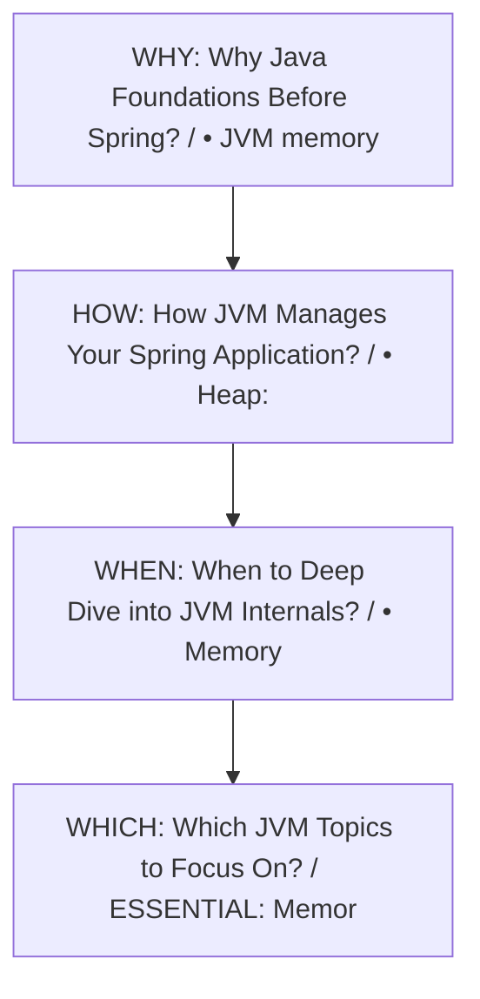

---

# 🎯 LEARNING PHILOSOPHY

```
                  THE SPRING LEARNING HIERARCHY
──────────────────────────────────────────────────

┌──────────────────────────────────────────────────────────────────────────────┐
│ TIER 9: Testing (Professional's Mark)                                        │
├──────────────────────────────────────────────────────────────────────────────┤
│ TIER 8: Microservices & Cloud Native                                         │
├──────────────────────────────────────────────────────────────────────────────┤
│ TIER 7: Spring Security                                                      │
├──────────────────────────────────────────────────────────────────────────────┤
│ TIER 6: Web & REST API                                                       │
├──────────────────────────────────────────────────────────────────────────────┤
│ TIER 5: Data Access (JPA & Hibernate)                                        │
├──────────────────────────────────────────────────────────────────────────────┤
│ TIER 4: Spring Boot (Auto-Pilot)                                             │
├──────────────────────────────────────────────────────────────────────────────┤
│ TIER 3: AOP (Cross-Cutting Concerns)                                         │
├──────────────────────────────────────────────────────────────────────────────┤
│ TIER 2: Spring Core (IoC & DI)                                               │
├──────────────────────────────────────────────────────────────────────────────┤
│ TIER 1: JAVA FOUNDATIONS (NON-NEGOTIABLE) ← START HERE                       │
└──────────────────────────────────────────────────────────────────────────────┘

❌ COMMON MISTAKE: Jumping to Spring Boot without Java internals
✅ RIGHT APPROACH: Master foundations → Understand Spring magic

```

**Flow:**
1. THE SPRING LEARNING HIERARCHY
2. TIER 9: Testing (Professional's Mark)
3. TIER 8: Microservices & Cloud Native
4. TIER 7: Spring Security
5. TIER 6: Web & REST API
6. TIER 5: Data Access (JPA & Hibernate)
7. TIER 4: Spring Boot (Auto-Pilot)

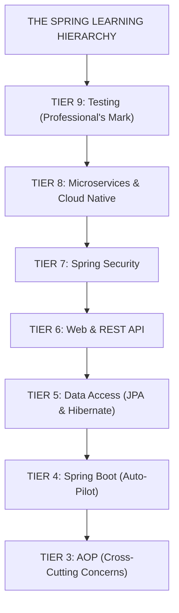

---

# ☕ Tier 1: the Non — Negotiable Java Foundations

---

## Chapter 1: Memory Model & JVM Internals

### 🔵 WHY: Understanding Memory is Understanding Performance


🔬 **Section Challenge — Chapter 1: Memory Model & JVM Internals**

**Challenge 1 (Reasoning):** What is the fundamental difference between `@Component` and `@Bean` when registering beans in the Spring IoC Container?
<details><summary>Answer</summary>

Control over instantiation. `@Component` is a class-level annotation. Spring automatically scans your classpath, finds the class, and calls its constructor to create the bean for you. You use it for classes *you* wrote. `@Bean` is a method-level annotation used inside `@Configuration` classes. You manually write the Java code to instantiate and configure the object, and Spring registers whatever the method returns. You use `@Bean` when you need to register a class from a third-party library (like `ObjectMapper` or `DataSource`) where you cannot add a `@Component` annotation to the source code.
</details>


## Why Jvm Memory Model Matters


**Without This Knowledge**:
- OutOfMemoryError: Metaspace (and you don't know why)
- Memory leaks in production
- GC pauses causing 500ms response times
- "It works on my machine" but crashes in production

**With This Knowledge**:
- Optimize JVM settings for your workload
- Understand why Spring creates proxies in heap
- Debug memory issues confidently
- Pass advanced Java interview questions
🔴 REAL INCIDENT: A startup's Spring Boot app crashed every 2 hours
with OutOfMemoryError: Metaspace. Root cause: Dynamically generated
classes from reflection never got garbage collected.

### 🟢 HOW: JVM Memory Architecture

```
┌─────────────────────────────────────────────────────────────────────────────────┐
│                    JVM MEMORY STRUCTURE                                         │
├─────────────────────────────────────────────────────────────────────────────────┤
│                                                                                 │
│  ┌─────────────────────────────────────────────────────────────────────────┐    │
│  │                         HEAP (Shared - GC Managed)                       │   │
│  │  ┌─────────────────┐  ┌──────────────────────────────────────────────┐  │    │
│  │  │  Young Generation │  │           Old Generation                    │  │   │
│  │  │  ┌─────┐ ┌─────┐ │  │                                              │  │   │
│  │  │  │Eden │ │S0│S1│ │  │  Long-lived objects (survived many GCs)     │  │    │
│  │  │  │     │ │  │  │ │  │                                              │  │   │
│  │  │  │ New │ │Sur│  │ │  │  • Spring Beans (Singletons live here!)    │  │    │
│  │  │  │Obj  │ │viv│  │ │  │  • Cached data                             │  │    │
│  │  │  │     │ │or │  │ │  │  • Application state                       │  │    │
│  │  │  └─────┘ └─────┘ │  │                                              │  │   │
│  │  └─────────────────┘  └──────────────────────────────────────────────┘  │    │
│  │                                                                          │   │
│  │  Objects: new Object(), new ArrayList(), Spring Beans                   │    │
│  └──────────────────────────────────────────────────────────────────────────┘   │
│                                                                                 │
│  ┌───────────────────────────────────────────────────────────────────────────┐  │
│  │                    METASPACE (Native Memory - No GC by default!)         │   │
│  │                                                                           │  │
│  │  • Class metadata (bytecode)                                             │   │
│  │  • Method metadata                                                        │  │
│  │  • Constant pools                                                         │  │
│  │  • Static variables                                                       │  │
│  │                                                                           │  │
│  │  ⚠️ Spring AOP creates CGLIB proxy classes here!                         │   │
│  │  ⚠️ Too many dynamic proxies = OutOfMemoryError: Metaspace               │   │
│  └───────────────────────────────────────────────────────────────────────────┘  │
│                                                                                 │
│  ┌─────────────────────────────────────────────────────────────────────────┐    │
│  │                    STACK (Per Thread - Auto-managed)                     │   │
│  │                                                                          │   │
│  │  Thread 1 Stack    Thread 2 Stack    Thread 3 Stack                     │    │
│  │  ┌──────────┐      ┌──────────┐      ┌──────────┐                       │    │
│  │  │ Frame 3  │      │ Frame 2  │      │ Frame 1  │                       │    │
│  │  ├──────────┤      ├──────────┤      └──────────┘                       │    │
│  │  │ Frame 2  │      │ Frame 1  │                                          │   │
│  │  ├──────────┤      └──────────┘                                          │   │
│  │  │ Frame 1  │                                                            │   │
│  │  └──────────┘                                                            │   │
│  │                                                                          │   │
│  │  Contains: Primitives, Object references, Method calls                  │    │
│  │  Size: -Xss (default 1MB per thread)                                    │    │
│  │                                                                          │   │
│  │  ⚠️ Deep recursion = StackOverflowError                                 │    │
│  │  ⚠️ 1000 threads × 1MB = 1GB just for stacks!                           │    │
│  └──────────────────────────────────────────────────────────────────────────┘   │
│                                                                                 │
└─────────────────────────────────────────────────────────────────────────────────┘
```

**Flow:**
1. HEAP (Shared - GC Managed) / Young Generation Old Gener
2. METASPACE (Native Memory - No GC by default!) / • Class
3. Frame 3 / Frame 2 / Frame 1
4. Frame 2 / Frame 1
5. Frame 1

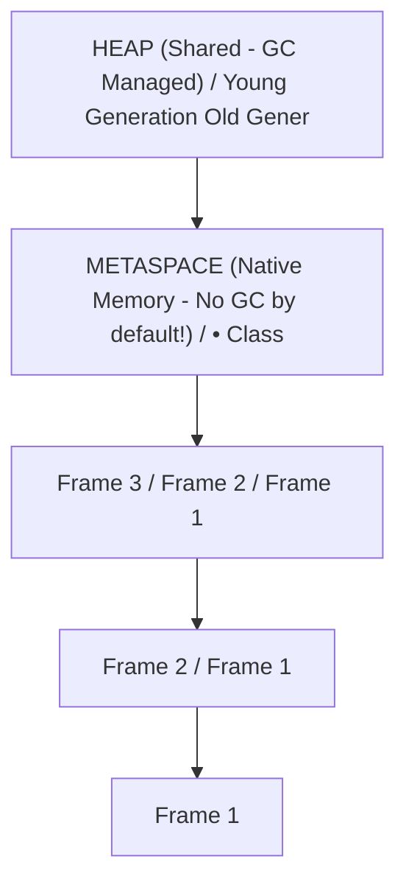

### Stack vs Heap - The Critical Difference

```java
public class MemoryDemo {

    // STATIC: Stored in Metaspace (with class metadata)
    private static final String APP_NAME = "MyApp";  // String literal in String Pool

    // INSTANCE: Reference in Heap, object data in Heap
    private List<String> items = new ArrayList<>();

    public void process() {
        // LOCAL PRIMITIVES: Stored directly on Stack
        int count = 10;           // Stack: 4 bytes
        double price = 99.99;     // Stack: 8 bytes
        boolean active = true;    // Stack: 1 byte (JVM may use 4)

        // LOCAL REFERENCES: Reference on Stack, Object on Heap
        String name = "Product";  // Stack: reference → Heap: String object
        Order order = new Order(); // Stack: reference → Heap: Order object

        // What happens when method ends?
        // - Stack frame is popped (count, price, active, name ref, order ref gone)
        // - Heap objects become eligible for GC (if no other references)
    }

    /*
     * VISUALIZATION:
     *
     *   STACK (process method frame)          HEAP
     *   ┌─────────────────────┐               ┌─────────────────────┐
     *   │ count: 10           │               │ String "Product"    │
     *   │ price: 99.99        │     ──────►   │                     │
     *   │ active: true        │               ├─────────────────────┤
     *   │ name: 0x001         │─────┘         │ Order object        │
     *   │ order: 0x002        │───────────►   │ - id: 0             │
     *   └─────────────────────┘               │ - items: []         │
     *                                         └─────────────────────┘
     */
}
```

### String Constant Pool - Why Strings are Special

```java
public class StringPoolDemo {

    public void demonstrate() {
        // SCENARIO 1: String Literals (Pooled)
        String s1 = "hello";  // Creates in String Pool
        String s2 = "hello";  // Reuses from String Pool
        System.out.println(s1 == s2);  // TRUE! Same reference

        // SCENARIO 2: new String() (Not Pooled by default)
        String s3 = new String("hello");  // Creates on Heap
        String s4 = new String("hello");  // Creates ANOTHER on Heap
        System.out.println(s3 == s4);     // FALSE! Different references
        System.out.println(s3.equals(s4)); // TRUE! Same content

        // SCENARIO 3: intern() - Force into pool
        String s5 = s3.intern();  // Returns pooled version
        System.out.println(s1 == s5);  // TRUE!

        // SCENARIO 4: String concatenation
        String s6 = "hel" + "lo";  // Compile-time constant → Pool
        String s7 = "hel";
        String s8 = s7 + "lo";     // Runtime → Heap (new StringBuilder)
        System.out.println(s1 == s6);  // TRUE
        System.out.println(s1 == s8);  // FALSE

        /*
         * WHY THIS MATTERS FOR SPRING:
         * - @Value("${prop}") injects Strings
         * - Bean names are Strings
         * - Understanding == vs equals() prevents subtle bugs
         */
    }

    /*
     * MEMORY VISUALIZATION:
     *
     *   STRING POOL (part of Heap)            HEAP
     *   ┌─────────────────────┐               ┌─────────────────────┐
     *   │ "hello" (0x100)     │               │ String(0x200)       │
     *   │                     │               │ value: "hello"      │
     *   │ "hel" (0x101)       │               │                     │
     *   │                     │               ├─────────────────────┤
     *   │ "lo" (0x102)        │               │ String(0x201)       │
     *   └─────────────────────┘               │ value: "hello"      │
     *                                         └─────────────────────┘
     *
     *   s1 ──► 0x100 (pool)
     *   s2 ──► 0x100 (pool) ← Same!
     *   s3 ──► 0x200 (heap)
     *   s4 ──► 0x201 (heap) ← Different!
     */
}
```

---

## Chapter 2: Reference Types (Garbage Collection Keys)

### 🔵 WHY: Understanding When Objects Die

```
┌─────────────────────────────────────────────────────────────────────────────────┐
│                    WHY REFERENCE TYPES MATTER                                   │
├─────────────────────────────────────────────────────────────────────────────────┤
│                                                                                 │
│  SCENARIO: Building a cache in Spring                                           │
│                                                                                 │
│  WITHOUT KNOWLEDGE:                                                             │
│  Map<String, User> cache = new HashMap<>();  // MEMORY LEAK!                    │
│  // Users never garbage collected even when not needed                          │
│  // OutOfMemoryError after running for hours                                    │
│                                                                                 │
│  WITH KNOWLEDGE:                                                                │
│  Map<String, SoftReference<User>> cache = new HashMap<>();  // Auto-clears      │
│  // GC clears cache entries when memory is low                                  │
│  // Application survives memory pressure                                        │
│                                                                                 │
│  SPRING USES THESE:                                                             │
│  • WeakHashMap for internal caches                                              │
│  • SoftReference for session data                                               │
│  • PhantomReference for cleanup callbacks                                       │
│                                                                                 │
└─────────────────────────────────────────────────────────────────────────────────┘
```

**Flow:**
1. WHY REFERENCE TYPES MATTER
2. SCENARIO: Building a cache in Spring
3. WITHOUT KNOWLEDGE:
4. Map<String, User> cache = new HashMap<>();
5. WITH KNOWLEDGE:
6. SPRING USES THESE:
7. • WeakHashMap for internal caches

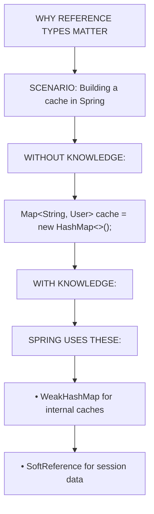

### 🟢 HOW: The Four Reference Types

```java
import java.lang.ref.*;

public class ReferenceTypesDemo {

    // ═══════════════════════════════════════════════════════════════════════════
    // 1. STRONG REFERENCE (Default)
    // ═══════════════════════════════════════════════════════════════════════════
    /*
     * WHEN: Object is NEVER garbage collected while reference exists
     * USE: Normal variables
     */

    public void strongReference() {
        User user = new User("John");  // Strong reference
        // user will NEVER be GC'd while this variable exists

        user = null;  // NOW eligible for GC
    }

    // ═══════════════════════════════════════════════════════════════════════════
    // 2. SOFT REFERENCE (Memory-Sensitive Cache)
    // ═══════════════════════════════════════════════════════════════════════════
    /*
     * WHEN: Cleared ONLY when JVM needs memory (before OutOfMemoryError)
     * USE: Memory-sensitive caches
     */

    public void softReference() {
        User user = new User("John");
        SoftReference<User> softRef = new SoftReference<>(user);
        user = null;  // Remove strong reference

        // Later...
        User cached = softRef.get();
        if (cached != null) {
            // Still in cache! Use it
        } else {
            // GC cleared it due to memory pressure
            // Reload from database
        }
    }

    // PRACTICAL EXAMPLE: Image Cache
    public class ImageCache {
        private Map<String, SoftReference<BufferedImage>> cache = new HashMap<>();

        public BufferedImage getImage(String path) {
            SoftReference<BufferedImage> ref = cache.get(path);
            BufferedImage img = (ref != null) ? ref.get() : null;

            if (img == null) {
                img = loadFromDisk(path);  // Expensive!
                cache.put(path, new SoftReference<>(img));
            }
            return img;
        }
    }

    // ═══════════════════════════════════════════════════════════════════════════
    // 3. WEAK REFERENCE (Temporary Mappings)
    // ═══════════════════════════════════════════════════════════════════════════
    /*
     * WHEN: Cleared on NEXT GC cycle (even if memory is available)
     * USE: WeakHashMap for canonical mappings
     */

    public void weakReference() {
        User user = new User("John");
        WeakReference<User> weakRef = new WeakReference<>(user);
        user = null;  // Remove strong reference

        System.gc();  // Request GC

        User retrieved = weakRef.get();
        // Likely NULL after GC!
    }

    // PRACTICAL EXAMPLE: ThreadLocal cleanup (Spring uses this!)
    public class RequestContext {
        // WeakHashMap: keys are weakly referenced
        // When Thread dies, entry is automatically removed
        private static WeakHashMap<Thread, String> userIds = new WeakHashMap<>();

        public static void setUserId(String userId) {
            userIds.put(Thread.currentThread(), userId);
        }

        public static String getUserId() {
            return userIds.get(Thread.currentThread());
        }
    }

    // ═══════════════════════════════════════════════════════════════════════════
    // 4. PHANTOM REFERENCE (Pre-Death Cleanup)
    // ═══════════════════════════════════════════════════════════════════════════
    /*
     * WHEN: get() ALWAYS returns null! Used only for cleanup notification
     * USE: Cleanup native resources before GC
     */

    public void phantomReference() {
        ReferenceQueue<User> queue = new ReferenceQueue<>();
        User user = new User("John");
        PhantomReference<User> phantomRef = new PhantomReference<>(user, queue);

        user = null;
        System.gc();

        // Check if object was collected
        Reference<?> ref = queue.poll();
        if (ref == phantomRef) {
            // Object is about to be garbage collected!
            // Clean up native resources here
        }
    }
}
```

### Reference Types Summary Table

```
┌────────────────┬───────────────────────┬────────────────────────────────────────┐
│ Type           │ When Collected?       │ Use Case                               │
├────────────────┼───────────────────────┼────────────────────────────────────────┤
│ Strong         │ Never (while exists)  │ Normal variables                       │
│ Soft           │ Memory pressure only  │ Memory-sensitive caches                │
│ Weak           │ Next GC cycle         │ Canonical mappings, WeakHashMap        │
│ Phantom        │ After finalization    │ Pre-mortem cleanup, native resources   │
└────────────────┴───────────────────────┴────────────────────────────────────────┘
```

**Flow:**
1. Type When Collected? Use Case
2. Strong Never (while exists) Normal variables
3. Soft Memory pressure only Memory-sensitive caches
4. Weak Next GC cycle Canonical mappings, WeakHashMap

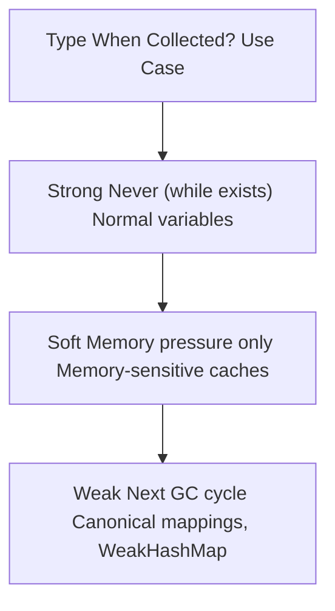

---


🔬 **Section Challenge — Chapter 2: Reference Types (Garbage Collection Keys)**

**Challenge 1 (Reasoning):** You write `List<String> list = new ArrayList<>();`. At runtime, can you check `list instanceof List<String>`?
<details><summary>Answer</summary>

No — `instanceof List<String>` is a compile error. After erasure, it's just `List` at runtime. Use `instanceof List<?>` for an unparameterized check. This is why you can't do `new T()`, `new T[]`, or `T.class` — T doesn't exist at runtime.
</details>

**Challenge 2 (Bug Hunt):** A method returns `(T) jsonDeserialize(json)` where T is a generic type param. When does the `ClassCastException` actually occur?
<details><summary>Answer</summary>

NOT at the cast — the unchecked cast compiles to nothing at runtime (erasure). The CCE occurs when the calling code tries to USE the returned value as a specific type. This makes debugging hard: the error appears far from the actual source. Use `Class<T> clazz` parameter to do safe `clazz.cast(...)` instead.
</details>


## Chapter 3: Garbage Collection Algorithms

### 🔵 WHY: GC Pauses Can Kill Your API Response Times

```
┌─────────────────────────────────────────────────────────────────────────────────┐
│                    GC IMPACT ON SPRING APPLICATIONS                             │
├─────────────────────────────────────────────────────────────────────────────────┤
│                                                                                 │
│  SCENARIO: REST API with 99th percentile SLA of 200ms                           │
│                                                                                 │
│  BAD GC CONFIG:                                                                 │
│  ┌─────────────────────────────────────────────────────────────────────────┐    │
│  │ Request 1: 50ms ✓                                                       │    │
│  │ Request 2: 60ms ✓                                                       │    │
│  │ Request 3: 45ms ✓                                                       │    │
│  │ Request 4: 850ms ✗ ← Full GC! Stop-the-world!                          │     │
│  │ Request 5: 55ms ✓                                                       │    │
│  └─────────────────────────────────────────────────────────────────────────┘    │
│  Result: SLA breached, customer complaints                                      │
│                                                                                 │
│  GOOD GC CONFIG (G1GC with tuning):                                             │
│  ┌─────────────────────────────────────────────────────────────────────────┐    │
│  │ Request 1: 50ms ✓                                                       │    │
│  │ Request 2: 60ms ✓                                                       │    │
│  │ Request 3: 55ms ✓ (GC happened, but concurrent!)                       │     │
│  │ Request 4: 65ms ✓                                                       │    │
│  │ Request 5: 55ms ✓                                                       │    │
│  └─────────────────────────────────────────────────────────────────────────┘    │
│  Result: Consistent latency, happy customers                                    │
│                                                                                 │
└─────────────────────────────────────────────────────────────────────────────────┘
```

**Flow:**
1. Request 1: 50ms ✓ / Request 2: 60ms ✓ / Request 3: 45ms
2. Request 1: 50ms ✓ / Request 2: 60ms ✓ / Request 3: 55ms

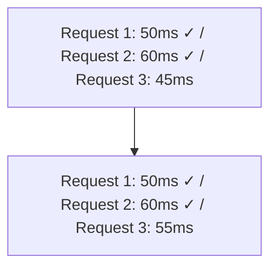

### 🟢 HOW: GC Algorithms Explained

```
┌─────────────────────────────────────────────────────────────────────────────────┐
│                    GARBAGE COLLECTOR COMPARISON                                 │
├─────────────────────────────────────────────────────────────────────────────────┤
│                                                                                 │
│  1. SERIAL GC (-XX:+UseSerialGC)                                                │
│     ┌─────────────────────────────────────────────────────────────────────┐     │
│     │ Application Threads: ████████░░░░░░░░░░░░████████████████████████   │     │
│     │ GC Thread:                   █████████GC█                           │     │
│     └─────────────────────────────────────────────────────────────────────┘     │
│     • Single-threaded, Stop-The-World                                           │
│     • USE: Single CPU, small heaps (<100MB), batch jobs                         │
│                                                                                 │
│  2. PARALLEL GC (-XX:+UseParallelGC) [Java 8 Default]                           │
│     ┌─────────────────────────────────────────────────────────────────────┐     │
│     │ Application Threads: ██████████░░░░░░░░░░░██████████████████████    │     │
│     │ GC Threads:                   ██GC██                                │     │
│     │                               ██GC██                                │     │
│     │                               ██GC██                                │     │
│     └─────────────────────────────────────────────────────────────────────┘     │
│     • Multi-threaded, Stop-The-World                                            │
│     • USE: Throughput priority (batch processing)                               │
│                                                                                 │
│  3. G1GC (-XX:+UseG1GC) [Java 9+ Default]                                       │
│     ┌─────────────────────────────────────────────────────────────────────┐     │
│     │ Application Threads: ████████████████████████████████████████████   │     │
│     │ Concurrent GC:       ░░░░░██░░░░░██░░░░░██░░░░░░░░░░░░░░░░░░░░░░   │      │
│     │ Short STW Pauses:            ▪      ▪      ▪                         │    │
│     └─────────────────────────────────────────────────────────────────────┘     │
│     • Mostly concurrent, short pauses                                           │
│     • USE: Large heaps (4GB+), latency-sensitive apps                           │
│     • PAUSE TARGET: -XX:MaxGCPauseMillis=200                                    │
│                                                                                 │
│  4. ZGC (-XX:+UseZGC) [Java 15+]                                                │
│     ┌─────────────────────────────────────────────────────────────────────┐     │
│     │ Application Threads: ████████████████████████████████████████████   │     │
│     │ Concurrent GC:       ████████████████████████████████████████████   │     │
│     │ Sub-ms Pauses:       ·              ·              ·                │     │
│     └─────────────────────────────────────────────────────────────────────┘     │
│     • Sub-millisecond pauses (<10ms even for TB heaps!)                         │
│     • USE: Ultra-low latency, massive heaps                                     │
│                                                                                 │
│  5. Shenandoah GC (-XX:+UseShenandoahGC) [OpenJDK]                              │
│     • Similar to ZGC, concurrent compaction                                     │
│     • USE: Low latency alternative to ZGC                                       │
│                                                                                 │
└─────────────────────────────────────────────────────────────────────────────────┘
```

**Flow:**
1. Application Threads: ████████░░░░░░░░░░░░██████████████
2. Application Threads: ██████████░░░░░░░░░░░█████████████
3. Application Threads: ██████████████████████████████████

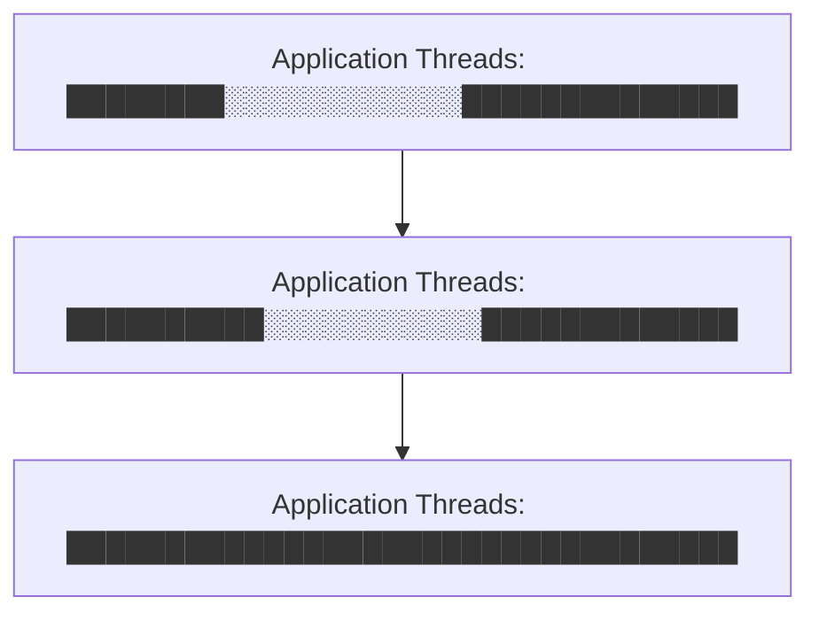

### Practical JVM Tuning for Spring Boot

```bash
# DEVELOPMENT (fast startup)
java -Xms256m -Xmx512m \
     -XX:+UseSerialGC \
     -jar myapp.jar

# SMALL PRODUCTION (< 4GB heap)
java -Xms1g -Xmx1g \
     -XX:+UseG1GC \
     -XX:MaxGCPauseMillis=200 \
     -jar myapp.jar

# LARGE PRODUCTION (4GB+ heap, latency-sensitive)
java -Xms8g -Xmx8g \
     -XX:+UseG1GC \
     -XX:MaxGCPauseMillis=100 \
     -XX:G1HeapRegionSize=16m \
     -XX:+UseStringDeduplication \
     -jar myapp.jar

# ULTRA-LOW LATENCY (Java 17+)
java -Xms8g -Xmx8g \
     -XX:+UseZGC \
     -XX:+ZGenerational \
     -jar myapp.jar

# COMMON FLAGS
-Xms              # Initial heap size
-Xmx              # Maximum heap size (keep Xms = Xmx for no resizing)
-Xss              # Stack size per thread (default 1MB)
-XX:MetaspaceSize # Initial metaspace
-XX:MaxMetaspaceSize # Max metaspace (prevent OOM)
```

---

## Chapter 4: Class Loading Mechanism

### 🔵 WHY: Understanding NoClassDefFoundError vs ClassNotFoundException

```
┌─────────────────────────────────────────────────────────────────────────────────┐
│                    CLASS LOADING ERRORS - THE CRITICAL DIFFERENCE               │
├─────────────────────────────────────────────────────────────────────────────────┤
│                                                                                 │
│  ClassNotFoundException                                                         │
│  ────────────────────────                                                       │
│  WHEN: Class.forName("com.example.MyClass") fails                               │
│  WHY:  .class file not in classpath                                             │
│  FIX:  Add missing JAR/dependency                                               │
│                                                                                 │
│  NoClassDefFoundError                                                           │
│  ───────────────────────                                                        │
│  WHEN: Class was found at compile time but not at runtime                       │
│  WHY:  JAR present during build, missing during run                             │
│  WHY2: Static initializer threw exception (class marked as failed)              │
│  FIX:  Check runtime classpath, check static blocks                             │
│                                                                                 │
│  🔴 REAL INCIDENT:                                                               │
│  Spring Boot app works locally, fails in Docker with NoClassDefFoundError.      │
│  Cause: Local Maven cache had a library that wasn't in pom.xml.                 │
│  Docker build (fresh) didn't have it.                                           │
│                                                                                 │
└─────────────────────────────────────────────────────────────────────────────────┘
```

**Flow:**
1. CLASS LOADING ERRORS - THE CRITICAL DIFFERENCE
2. ClassNotFoundException
3. WHEN: Class.forName('com.example.MyClass') fails
4. WHY: .class file not in classpath
5. FIX: Add missing JAR/dependency
6. NoClassDefFoundError
7. WHEN: Class was found at compile time but not at runtim

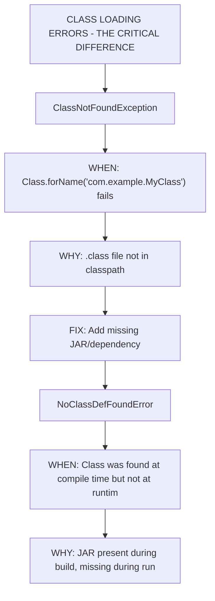

### 🟢 HOW: Class Loader Hierarchy

```
┌─────────────────────────────────────────────────────────────────────────────────┐
│                    CLASS LOADER DELEGATION MODEL                                │
├─────────────────────────────────────────────────────────────────────────────────┤
│                                                                                 │
│                        ┌─────────────────────────────┐                          │
│                        │   Bootstrap ClassLoader      │                         │
│                        │   (Native code - JVM)        │                         │
│                        │   Loads: java.lang.*, etc.   │                         │
│                        │   Path: $JAVA_HOME/lib       │                         │
│                        └──────────────┬──────────────┘                          │
│                                       │ parent                                  │
│                        ┌──────────────▼──────────────┐                          │
│                        │   Platform ClassLoader       │                         │
│                        │   (Java 9+, was Extension)   │                         │
│                        │   Loads: javax.*, java.sql   │                         │
│                        │   Path: $JAVA_HOME/lib/ext   │                         │
│                        └──────────────┬──────────────┘                          │
│                                       │ parent                                  │
│                        ┌──────────────▼──────────────┐                          │
│                        │   Application ClassLoader    │                         │
│                        │   (System ClassLoader)       │                         │
│                        │   Loads: Your code, JARs    │                          │
│                        │   Path: CLASSPATH, -cp      │                          │
│                        └──────────────┬──────────────┘                          │
│                                       │ parent                                  │
│                        ┌──────────────▼──────────────┐                          │
│                        │   Custom ClassLoaders        │                         │
│                        │   (Spring Boot uses this!)   │                         │
│                        │   Loads: Nested JARs        │                          │
│                        └─────────────────────────────┘                          │
│                                                                                 │
│  DELEGATION RULES (Parent-First):                                               │
│  1. Child asks parent first                                                     │
│  2. Parent asks its parent (recursive)                                          │
│  3. If all parents fail, child tries to load                                    │
│  4. If child also fails → ClassNotFoundException                                │
│                                                                                 │
└─────────────────────────────────────────────────────────────────────────────────┘
```

**Flow:**
1. Bootstrap ClassLoader / (Native code - JVM) / Loads: ja
2. Platform ClassLoader / (Java 9+, was Extension) / Loads
3. Application ClassLoader / (System ClassLoader) / Loads:
4. Custom ClassLoaders / (Spring Boot uses this!) / Loads:

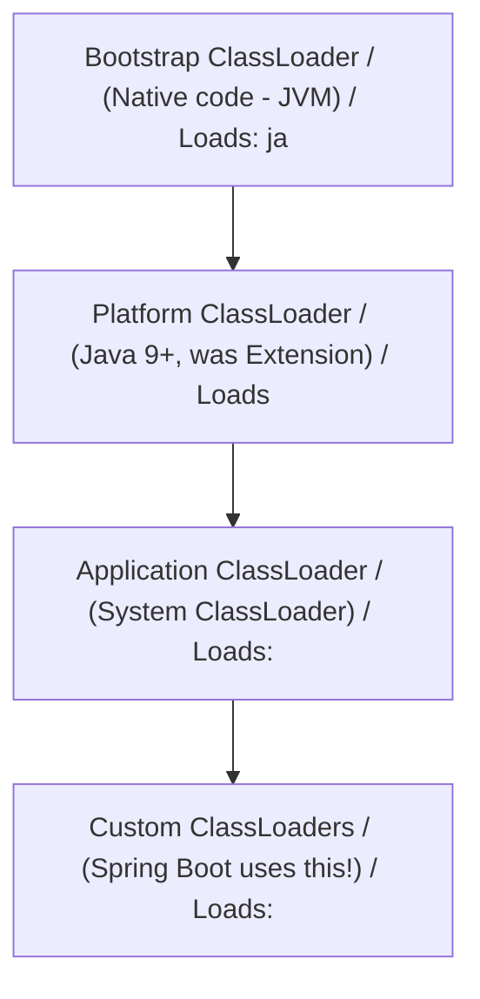

### Spring Boot's Special ClassLoader

```java
/*
 * Spring Boot bundles everything in a single JAR (Fat JAR)
 * Problem: JARs can't contain other JARs (normally)
 * Solution: Custom ClassLoader that reads nested JARs
 *
 * Structure of a Spring Boot Fat JAR:
 *
 * myapp.jar
 * ├── BOOT-INF
 * │   ├── classes          ← Your compiled classes
 * │   │   └── com/...
 * │   └── lib              ← Dependencies (nested JARs!)
 * │       ├── spring-core-5.3.jar
 * │       ├── jackson-2.13.jar
 * │       └── ...
 * ├── META-INF
 * │   └── MANIFEST.MF      ← Main-Class: org.springframework.boot.loader.JarLauncher
 * └── org/springframework/boot/loader
 *     └── JarLauncher.class ← Custom ClassLoader magic!
 */
```

---


🔬 **Section Challenge — Chapter 4: Class Loading Mechanism**

**Challenge 1 (Reasoning):** What is the fundamental difference between `@Component` and `@Bean` when registering beans in the Spring IoC Container?
<details><summary>Answer</summary>

Control over instantiation. `@Component` is a class-level annotation. Spring automatically scans your classpath, finds the class, and calls its constructor to create the bean for you. You use it for classes *you* wrote. `@Bean` is a method-level annotation used inside `@Configuration` classes. You manually write the Java code to instantiate and configure the object, and Spring registers whatever the method returns. You use `@Bean` when you need to register a class from a third-party library (like `ObjectMapper` or `DataSource`) where you cannot add a `@Component` annotation to the source code.
</details>


## Chapter 5: Advanced Threading (Concurrency)

### 🔵 WHY: Spring Web Apps Are Multi-Threaded by Default!

```
┌─────────────────────────────────────────────────────────────────────────────────┐
│                    WHY THREADING MATTERS IN SPRING                              │
├─────────────────────────────────────────────────────────────────────────────────┤
│                                                                                 │
│  HTTP Request Flow in Spring Boot:                                              │
│                                                                                 │
│  Request 1 ──► Thread-1 ──► Controller ──► Service ──► Repository               │
│  Request 2 ──► Thread-2 ──► Controller ──► Service ──► Repository               │
│  Request 3 ──► Thread-3 ──► Controller ──► Service ──► Repository               │
│                                                                                 │
│  ⚠️ 3 threads accessing the SAME Singleton bean!                                │
│                                                                                 │
│  DANGEROUS CODE:                                                                │
│  @Service                                                                       │
│  public class UserService {                                                     │
│      private User currentUser;  // SHARED MUTABLE STATE!                        │
│                                                                                 │
│      public void process(User user) {                                           │
│          this.currentUser = user;  // Thread 1 sets user A                      │
│          // ...                    // Thread 2 sets user B                      │
│          sendEmail(currentUser);   // Thread 1 emails user B! BUG!              │
│      }                                                                          │
│  }                                                                              │
│                                                                                 │
└─────────────────────────────────────────────────────────────────────────────────┘
```

**Flow:**
1. WHY THREADING MATTERS IN SPRING
2. HTTP Request Flow in Spring Boot:
3. Request 1 Thread-1 Controller Service Repository
4. Request 2 Thread-2 Controller Service Repository
5. Request 3 Thread-3 Controller Service Repository
6. ⚠️ 3 threads accessing the SAME Singleton bean!
7. DANGEROUS CODE:

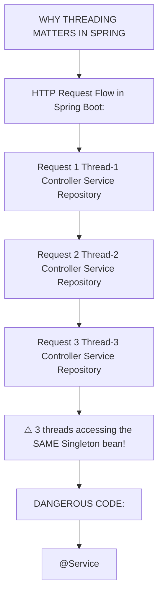

### ThreadLocal - How Spring Stores Request-Scoped Data

```java
/*
 * PROBLEM: How does Spring know which user made the current request?
 *
 * Bad Solution:
 * public void doSomething(User user) { ... }  // Pass everywhere? Tedious!
 *
 * Good Solution: ThreadLocal
 * Each thread has its own copy of the variable
 */

public class SecurityContextHolder {
    // ThreadLocal: Each thread has its own SecurityContext
    private static final ThreadLocal<SecurityContext> contextHolder = new ThreadLocal<>();

    public static void setContext(SecurityContext context) {
        contextHolder.set(context);  // Only affects CURRENT thread
    }

    public static SecurityContext getContext() {
        return contextHolder.get();  // Gets CURRENT thread's context
    }

    public static void clearContext() {
        contextHolder.remove();  // IMPORTANT! Prevent memory leak
    }
}

/*
 * VISUALIZATION:
 *
 * Thread-1                     Thread-2                     Thread-3
 * ┌─────────────────┐          ┌─────────────────┐          ┌─────────────────┐
 * │ ThreadLocalMap  │          │ ThreadLocalMap  │          │ ThreadLocalMap  │
 * │ ┌─────────────┐ │          │ ┌─────────────┐ │          │ ┌─────────────┐ │
 * │ │ context:    │ │          │ │ context:    │ │          │ │ context:    │ │
 * │ │ User: Alice │ │          │ │ User: Bob   │ │          │ │ User: Carol │ │
 * │ └─────────────┘ │          │ └─────────────┘ │          │ └─────────────┘ │
 * └─────────────────┘          └─────────────────┘          └─────────────────┘
 *
 * Each thread sees its OWN user, no conflicts!
 */

// SPRING'S ACTUAL USAGE:
@GetMapping("/profile")
public User getProfile() {
    // How does Spring know which user?
    Authentication auth = SecurityContextHolder.getContext().getAuthentication();
    // ThreadLocal magic! Each request thread has its own context
    return userService.findByUsername(auth.getName());
}
```

### Thread Pools and Executors

```java
import java.util.concurrent.*;

public class ThreadPoolDemo {

    // ═══════════════════════════════════════════════════════════════════════════
    // FIXED THREAD POOL
    // ═══════════════════════════════════════════════════════════════════════════
    /*
     * Fixed number of threads
     * USE: Known workload, database operations (limited connections)
     */
    ExecutorService fixed = Executors.newFixedThreadPool(10);

    // ═══════════════════════════════════════════════════════════════════════════
    // CACHED THREAD POOL
    // ═══════════════════════════════════════════════════════════════════════════
    /*
     * Creates threads as needed, reuses idle threads
     * ⚠️ DANGER: Can create unlimited threads under load!
     * USE: Short-lived async tasks
     */
    ExecutorService cached = Executors.newCachedThreadPool();

    // ═══════════════════════════════════════════════════════════════════════════
    // SCHEDULED THREAD POOL
    // ═══════════════════════════════════════════════════════════════════════════
    /*
     * For scheduled/periodic tasks
     * USE: Cron-like jobs, timeouts
     */
    ScheduledExecutorService scheduled = Executors.newScheduledThreadPool(5);

    // Schedule task to run every 10 seconds
    scheduled.scheduleAtFixedRate(
        () -> System.out.println("Heartbeat"),
        0,        // Initial delay
        10,       // Period
        TimeUnit.SECONDS
    );

    // ═══════════════════════════════════════════════════════════════════════════
    // FORK-JOIN POOL (Work Stealing)
    // ═══════════════════════════════════════════════════════════════════════════
    /*
     * Parallel divide-and-conquer tasks
     * USE: Parallel streams, recursive algorithms
     * Spring @Async uses this by default
     */
    ForkJoinPool forkJoin = ForkJoinPool.commonPool();

    // ═══════════════════════════════════════════════════════════════════════════
    // BEST PRACTICE: Custom ThreadPoolExecutor
    // ═══════════════════════════════════════════════════════════════════════════
    ThreadPoolExecutor custom = new ThreadPoolExecutor(
        5,                      // Core pool size
        20,                     // Max pool size
        60, TimeUnit.SECONDS,   // Keep-alive for idle threads
        new ArrayBlockingQueue<>(100),  // Bounded queue!
        new ThreadPoolExecutor.CallerRunsPolicy()  // What to do when queue full
    );
}
```

### Synchronization Mechanisms

```java
public class SynchronizationDemo {

    // ═══════════════════════════════════════════════════════════════════════════
    // 1. volatile - Visibility guarantee
    // ═══════════════════════════════════════════════════════════════════════════
    private volatile boolean running = true;  // All threads see updates immediately

    public void stop() {
        running = false;  // Other threads will see this change
    }

    // USE: Flags, simple state. NOT for compound operations (i++ is NOT atomic!)

    // ═══════════════════════════════════════════════════════════════════════════
    // 2. synchronized - Mutual exclusion
    // ═══════════════════════════════════════════════════════════════════════════
    private int count = 0;

    // Method-level lock (locks 'this')
    public synchronized void increment() {
        count++;  // Only one thread at a time
    }

    // Block-level lock (more granular)
    public void incrementBlock() {
        synchronized (this) {
            count++;
        }
    }

    // ═══════════════════════════════════════════════════════════════════════════
    // 3. ReentrantLock - More control than synchronized
    // ═══════════════════════════════════════════════════════════════════════════
    private final ReentrantLock lock = new ReentrantLock();

    public void safeOperation() {
        lock.lock();
        try {
            // Critical section
        } finally {
            lock.unlock();  // Always in finally!
        }
    }

    // TryLock - Don't wait forever
    public boolean tryOperation() {
        if (lock.tryLock(5, TimeUnit.SECONDS)) {
            try {
                // Got the lock!
                return true;
            } finally {
                lock.unlock();
            }
        }
        return false;  // Couldn't get lock in 5 seconds
    }

    // ═══════════════════════════════════════════════════════════════════════════
    // 4. Atomic Classes - Lock-free thread safety
    // ═══════════════════════════════════════════════════════════════════════════
    private AtomicInteger atomicCount = new AtomicInteger(0);

    public void atomicIncrement() {
        atomicCount.incrementAndGet();  // Thread-safe, no lock!
    }

    // Compare-and-swap pattern
    public boolean atomicUpdate(int expected, int newValue) {
        return atomicCount.compareAndSet(expected, newValue);
    }
}
```

### CompletableFuture - Async Programming

```java
import java.util.concurrent.*;

public class CompletableFutureDemo {

    public void asyncPipeline() {

        CompletableFuture<User> future = CompletableFuture
            // STEP 1: Async call
            .supplyAsync(() -> userRepository.findById(1L))  // Non-blocking!

            // STEP 2: Transform result
            .thenApply(user -> {
                user.setLastLogin(Instant.now());
                return user;
            })

            // STEP 3: Another async call
            .thenCompose(user ->
                CompletableFuture.supplyAsync(() -> auditService.log(user))
            )

            // STEP 4: Handle errors
            .exceptionally(ex -> {
                log.error("Failed", ex);
                return null;
            });

        // COMBINING MULTIPLE FUTURES
        CompletableFuture<String> future1 = CompletableFuture.supplyAsync(() -> "Hello");
        CompletableFuture<String> future2 = CompletableFuture.supplyAsync(() -> "World");

        // Wait for both
        CompletableFuture<String> combined = future1.thenCombine(future2,
            (s1, s2) -> s1 + " " + s2);

        // Wait for any
        CompletableFuture<Object> anyOf = CompletableFuture.anyOf(future1, future2);

        // Wait for all
        CompletableFuture<Void> allOf = CompletableFuture.allOf(future1, future2);
    }

    // SPRING'S @Async USES CompletableFuture
    @Async
    public CompletableFuture<User> findUserAsync(Long id) {
        User user = userRepository.findById(id);
        return CompletableFuture.completedFuture(user);
    }
}
```

---


🔬 **Section Challenge — Chapter 5: Advanced Threading (Concurrency)**

**Challenge 1 (Reasoning):** What is the fundamental difference between `@Component` and `@Bean` when registering beans in the Spring IoC Container?
<details><summary>Answer</summary>

Control over instantiation. `@Component` is a class-level annotation. Spring automatically scans your classpath, finds the class, and calls its constructor to create the bean for you. You use it for classes *you* wrote. `@Bean` is a method-level annotation used inside `@Configuration` classes. You manually write the Java code to instantiate and configure the object, and Spring registers whatever the method returns. You use `@Bean` when you need to register a class from a third-party library (like `ObjectMapper` or `DataSource`) where you cannot add a `@Component` annotation to the source code.
</details>


## Chapter 6: Functional Java (Lambda & Streams)

### 🔵 WHY: Spring Uses Functional Programming Extensively

```
┌─────────────────────────────────────────────────────────────────────────────────┐
│                    FUNCTIONAL JAVA IN SPRING                                    │
├─────────────────────────────────────────────────────────────────────────────────┤
│                                                                                 │
│  Spring WebFlux (Reactive):                                                     │
│  Flux.fromIterable(users)                                                       │
│      .filter(u -> u.isActive())                                                 │
│      .map(u -> u.getEmail())                                                    │
│      .subscribe(email -> sendNewsletter(email));                                │
│                                                                                 │
│  Spring Data JPA:                                                               │
│  repository.findAll().stream()                                                  │
│      .filter(order -> order.getTotal() > 100)                                   │
│      .collect(Collectors.toList());                                             │
│                                                                                 │
│  Spring Security:                                                               │
│  .authorizeHttpRequests(auth -> auth                                            │
│      .requestMatchers("/api/**").authenticated()                                │
│      .anyRequest().permitAll())                                                 │
│                                                                                 │
│  YOU MUST KNOW: Lambda syntax, method references, Stream operations             │
│                                                                                 │
└─────────────────────────────────────────────────────────────────────────────────┘
```

**Flow:**
1. FUNCTIONAL JAVA IN SPRING
2. Spring WebFlux (Reactive):
3. Flux.fromIterable(users)
4. .filter(u -> u.isActive())
5. .map(u -> u.getEmail())
6. .subscribe(email -> sendNewsletter(email));
7. Spring Data JPA:

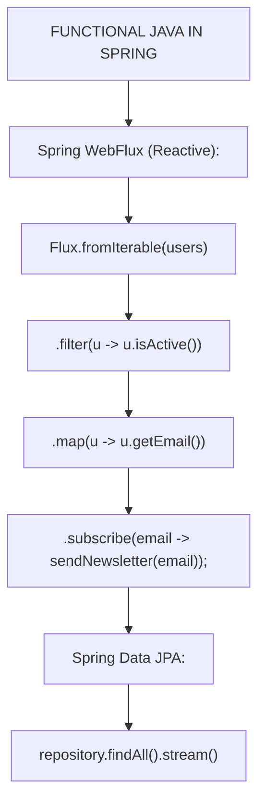

### Lambda Expressions Deep Dive

```java
public class LambdaDemo {

    // ═══════════════════════════════════════════════════════════════════════════
    // LAMBDA SYNTAX VARIATIONS
    // ═══════════════════════════════════════════════════════════════════════════

    // Full syntax
    Comparator<String> comp1 = (String a, String b) -> { return a.compareTo(b); };

    // Type inference
    Comparator<String> comp2 = (a, b) -> { return a.compareTo(b); };

    // Single expression (no return keyword)
    Comparator<String> comp3 = (a, b) -> a.compareTo(b);

    // Single parameter (no parentheses)
    Consumer<String> print = s -> System.out.println(s);

    // No parameters
    Runnable run = () -> System.out.println("Running");

    // ═══════════════════════════════════════════════════════════════════════════
    // METHOD REFERENCES (Shorter than Lambda)
    // ═══════════════════════════════════════════════════════════════════════════

    // Static method reference
    Function<String, Integer> parse1 = s -> Integer.parseInt(s);
    Function<String, Integer> parse2 = Integer::parseInt;  // Same thing!

    // Instance method reference (on specific object)
    String prefix = "Hello, ";
    Function<String, String> greet1 = s -> prefix.concat(s);
    Function<String, String> greet2 = prefix::concat;  // Same!

    // Instance method reference (on parameter)
    Function<String, String> upper1 = s -> s.toUpperCase();
    Function<String, String> upper2 = String::toUpperCase;  // Same!

    // Constructor reference
    Supplier<ArrayList<String>> list1 = () -> new ArrayList<>();
    Supplier<ArrayList<String>> list2 = ArrayList::new;  // Same!

    // ═══════════════════════════════════════════════════════════════════════════
    // EFFECTIVELY FINAL - Closures in Java
    // ═══════════════════════════════════════════════════════════════════════════

    public void closureExample() {
        String message = "Hello";  // Effectively final (never reassigned)

        Runnable r = () -> {
            System.out.println(message);  // Can capture local variable
            // message = "Changed";  // COMPILE ERROR! Can't modify
        };

        // message = "World";  // This would make it NOT effectively final
    }
}
```

### Streams API Mastery

```java
public class StreamsDemo {

    // ═══════════════════════════════════════════════════════════════════════════
    // INTERMEDIATE vs TERMINAL Operations
    // ═══════════════════════════════════════════════════════════════════════════

    /*
     * INTERMEDIATE (return Stream, are LAZY):
     * filter, map, flatMap, distinct, sorted, peek, limit, skip
     *
     * TERMINAL (return result, trigger execution):
     * collect, forEach, reduce, count, anyMatch, allMatch, noneMatch, findFirst, findAny
     */

    public void streamOperations() {
        List<Order> orders = getOrders();

        // LAZY - Nothing happens yet!
        Stream<Order> stream = orders.stream()
            .filter(o -> o.getTotal() > 100)  // Intermediate
            .map(Order::getCustomer)          // Intermediate
            .distinct();                       // Intermediate

        // TERMINAL - NOW it executes!
        List<Customer> customers = stream.collect(Collectors.toList());

        // COMMON MISTAKE: Using stream twice
        Stream<Integer> nums = Stream.of(1, 2, 3);
        nums.forEach(System.out::println);  // OK
        // nums.forEach(System.out::println);  // ERROR! Stream already consumed!
    }

    // ═══════════════════════════════════════════════════════════════════════════
    // PRACTICAL EXAMPLES
    // ═══════════════════════════════════════════════════════════════════════════

    // Filter + Map
    List<String> emails = users.stream()
        .filter(User::isActive)
        .map(User::getEmail)
        .collect(Collectors.toList());

    // FlatMap - Flatten nested collections
    List<Order> allOrders = customers.stream()
        .flatMap(c -> c.getOrders().stream())  // Each customer has multiple orders
        .collect(Collectors.toList());

    // Reduce - Aggregate to single value
    int total = orders.stream()
        .mapToInt(Order::getAmount)
        .reduce(0, Integer::sum);  // Or: .sum()

    // Grouping
    Map<String, List<Order>> byStatus = orders.stream()
        .collect(Collectors.groupingBy(Order::getStatus));

    // Grouping with aggregation
    Map<String, Double> avgByStatus = orders.stream()
        .collect(Collectors.groupingBy(
            Order::getStatus,
            Collectors.averagingDouble(Order::getAmount)
        ));

    // Partitioning (boolean grouping)
    Map<Boolean, List<Order>> partitioned = orders.stream()
        .collect(Collectors.partitioningBy(o -> o.getAmount() > 100));

    // ═══════════════════════════════════════════════════════════════════════════
    // OPTIONAL - Avoid NullPointerException
    // ═══════════════════════════════════════════════════════════════════════════

    // WRONG: Null check everywhere
    User user = repository.findById(id);
    if (user != null) {
        String email = user.getEmail();
        if (email != null) {
            sendEmail(email);
        }
    }

    // RIGHT: Optional chain
    repository.findById(id)                    // Returns Optional<User>
        .map(User::getEmail)                   // Optional<String>
        .ifPresent(this::sendEmail);           // Only if present

    // orElse vs orElseGet
    User user1 = optional.orElse(createDefaultUser());       // createDefaultUser() ALWAYS called
    User user2 = optional.orElseGet(() -> createDefaultUser()); // Only if empty (LAZY)

    // orElseThrow
    User user3 = optional.orElseThrow(() -> new UserNotFoundException(id));
}
```

---


🔬 **Section Challenge — Chapter 6: Functional Java (Lambda & Streams)**

**Challenge 1 (Reasoning):** A lambda captures a local variable. Why must the variable be effectively final?
<details><summary>Answer</summary>

Lambdas are closures — they capture the variable's VALUE at creation time (not a reference to the stack slot, which would be dangerous as the stack frame may be gone). If the variable could change after capture, the lambda would see a stale value. Java enforces 'effectively final' (never reassigned) to make the semantics predictable. Workaround: use an array `int[] counter = {0};` (the array reference is final, its contents can change — though this is not thread-safe).
</details>


# 📋 TIER 1 CHECKLIST

```
MEMORY & JVM:
□ Can explain Stack vs Heap with diagram
□ Understand String Pool and immutability
□ Know all 4 reference types and their GC behavior
□ Can choose appropriate GC for workload
□ Understand Metaspace and class metadata

CLASS LOADING:
□ Know the ClassLoader hierarchy
□ Can debug ClassNotFoundException vs NoClassDefFoundError
□ Understand Spring Boot's fat JAR ClassLoader

THREADING:
□ Can explain ThreadLocal (and why Spring uses it)
□ Know all ExecutorService types and when to use each
□ Understand volatile vs synchronized vs Atomic
□ Can write async code with CompletableFuture

FUNCTIONAL JAVA:
□ Can write lambdas in all syntax forms
□ Know all method reference types (::)
□ Can use all Stream intermediate and terminal operations
□ Understand Optional and avoid orElse antipattern
□ Can explain effectively final variables
```

**Flow:**
1. MEMORY & JVM:
2. □ Can explain Stack vs Heap with diagram
3. □ Understand String Pool and immutability
4. □ Know all 4 reference types and their GC behavior
5. □ Can choose appropriate GC for workload
6. □ Understand Metaspace and class metadata
7. CLASS LOADING:

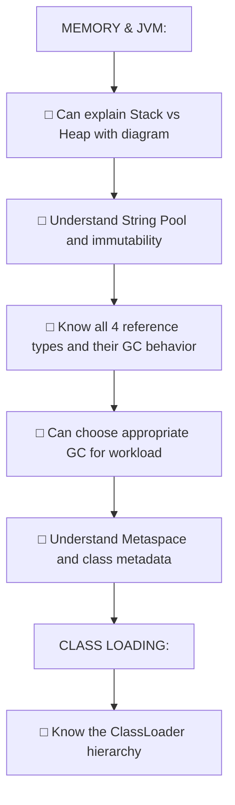

---

_Continue to Part 2: Spring Core (IoC & Dependency Injection)_


---

> **Navigation**: [< Previous](Ch21_AlgoEng_Advanced.md) | [Back to Index](../00_MASTER_INDEX.md) | [Next >](Ch32_SB_Data_Part2.md)