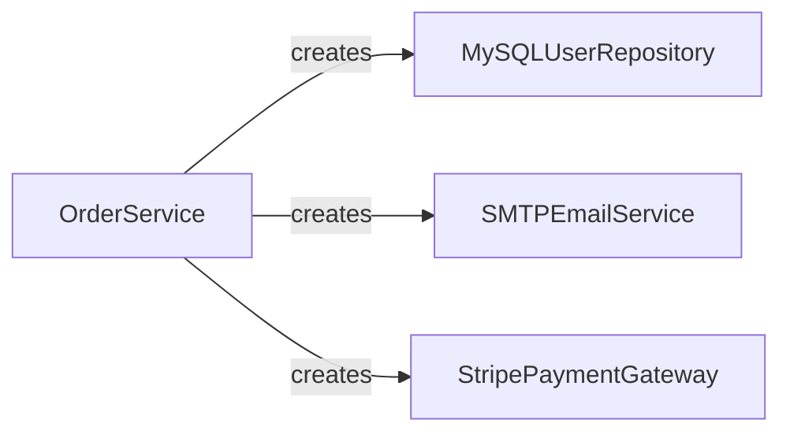
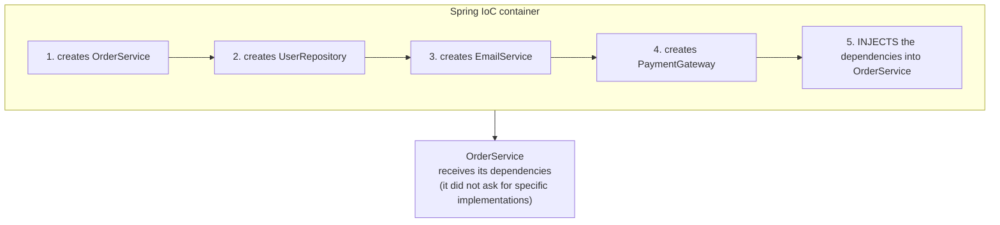
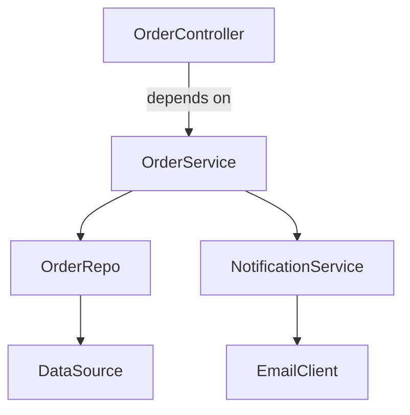
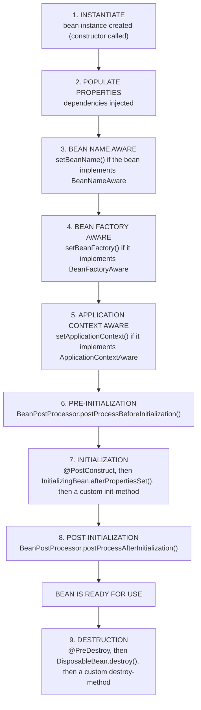
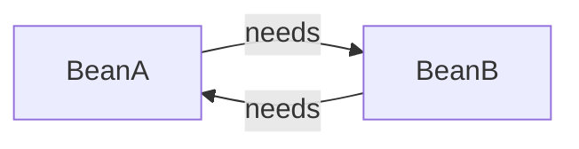
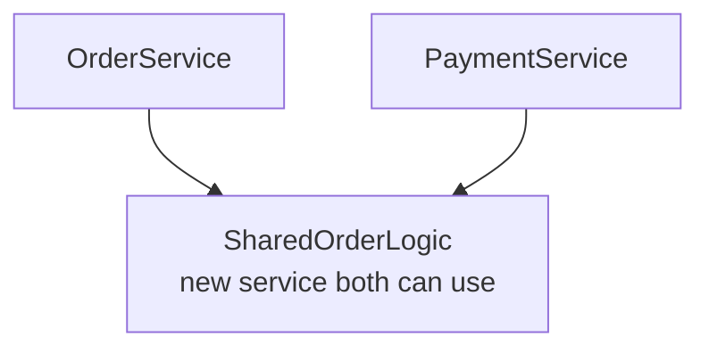

**Navigation**: [< Previous](Ch31_SB_Core_Part1.md) | [Back to Index](../00_MASTER_INDEX.md) | [Next >](Ch33_SB_Web_Part3.md)

# 🌱 SPRING BOOT COMPLETE GUIDE - Part 2: Spring Core (IoC & DI)

**The Heart of Spring - Dependency Injection**
_"Once you understand IoC, everything in Spring makes sense"_

---

# 🎯 WHY-HOW-WHEN-WHICH FRAMEWORK

**WHY: Why IoC & DI are Foundation of Spring?**

```text
• IoC IS Spring: Without it, there's no automatic wiring
• Testability: Mock dependencies easily for unit testing
• Loose coupling: Change implementations without changing classes
• Interview must-know: "Explain @Autowired" asked in every interview
• Configuration flexibility: Switch beans via profiles, conditions
```

**HOW: How DI Works in Spring?**

```text
• IoC Container: ApplicationContext creates and manages beans
• Component Scanning: @Component/@Service/@Repository auto-detected
• Constructor Injection: Preferred - immutable, testable
• Field Injection: @Autowired on fields - avoid (hard to test)
• @Qualifier/@Primary: Resolve multiple implementations of same type
```

**WHEN: When to Use Each Bean Scope?**

```text
• Singleton (default): Stateless services, repositories - most common
• Prototype: Stateful beans, each injection gets new instance
• Request: Per HTTP request - user context, request data
• Session: Per user session - shopping cart, user preferences
• Application: Shared across entire app - config, global state
```

**WHICH: Which DI Concepts to Master?**

```text
ESSENTIAL:     Constructor injection, @Component, @Service, @Autowired
IMPORTANT:     Bean scopes, @Qualifier, @Primary, @Configuration
ADVANCED:      Circular dependency resolution, custom BeanPostProcessors
```

---

# TIER 2: SPRING CORE (IoC & DI)

---

## Chapter 1: Inversion of Control (IoC) - The Philosophy

### 🔵 WHY: The Problem IoC Solves

🔬 **Section Challenge — Chapter 1: Inversion of Control (IoC) - The Philosophy**

**Challenge 1 (Reasoning):** You are writing a query to find users by email: `findByEmail(String email)`. Why is this inherently vulnerable to SQL injection if implemented using native JDBC string concatenation, but completely safe in Spring Data JPA?

<details><summary>Answer</summary>

Prepared Statements. If you concatenate strings (`"SELECT * FROM users WHERE email = '" + email + "'"`), a malicious user can input `' OR 1=1; DROP TABLE users;--` and execute arbitrary SQL. Spring Data JPA automatically compiles the query into a JDBC `PreparedStatement` with bind parameters (`WHERE email = ?`). The database treats the input strictly as literal string data, not executable code, making SQL injection impossible.

</details>

## The Problem: Tight Coupling

WITHOUT IoC (Traditional approach):
```java
public class OrderService {
    // OrderService CREATES its dependencies
    private UserRepository userRepo = new MySQLUserRepository();
    private EmailService email = new SMTPEmailService("smtp.gmail.com");
    private PaymentGateway payment = new StripePaymentGateway("sk_xxx");
    public void processOrder(Order order) {
        // Business logic using hardcoded implementations
    }
}
```

**Problems**:

- ❌ Can't unit test (stuck with real database, real email)
- ❌ Can't switch implementations (MySQL → PostgreSQL = rewrite!)
- ❌ Configuration scattered everywhere (API keys in code!)
- ❌ Every class manages its own dependencies (circular dependencies!)

WITH IoC (Spring approach):

```java
public class OrderService {
    // Dependencies are INJECTED (someone else provides them)
    private final UserRepository userRepo;
    private final EmailService email;
    private final PaymentGateway payment;
    public OrderService(UserRepository userRepo,
                        EmailService email,
                        PaymentGateway payment) {
        this.userRepo = userRepo;
        this.email = email;
        this.payment = payment;
    }
}
```

**Benefits**:

- ✅ Easy unit testing (inject mocks!)
- ✅ Switch implementations without changing code
- ✅ Centralized configuration (application.yml)
- ✅ IoC Container manages object lifecycle

### The Hollywood Principle

**"Don't call us, we'll call you"**

**Traditional control.** `OrderService` is in CONTROL: it creates its own dependencies.



**How to read this diagram.** Read it as one object reaching out for everything it needs: OrderService itself creates a MySQLUserRepository, an SMTPEmailService and a StripePaymentGateway. Notice that OrderService is in control and tied to concrete classes; the inverted-control diagram that follows flips this.

**Inverted control (IoC).** The container controls object creation and wiring.



**How to read these diagrams.** In the first, the service builds what it needs. In the second, the container builds every object and hands the service its dependencies, so control is inverted.

### IoC Container Resolution — Step-by-Step Flow

**IoC container bean resolution process**

**Phase 1: component scanning.** Scan the classpath and find `@Component`, `@Service`, `@Repository` and `@Controller` classes (for example `OrderService`, `OrderRepo`, `OrderController`).

**Phase 2: `BeanDefinition` creation.** Each class becomes a `BeanDefinition` object (metadata about the bean):

```text
BeanDefinition {
  name: "orderService"
  class: OrderService.class
  scope: SINGLETON
  dependencies: [OrderRepo, NotificationService]
}
```

**Phase 3: dependency graph construction.** The container builds a directed graph of who needs whom:



**How to read this diagram.** An arrow means "needs". `OrderController` needs `OrderService`, which needs `OrderRepo` and `NotificationService`, and so on down to the leaves.

**Phase 4: creation order (topological sort).** Leaves first, dependents last:

| Step | Bean | Needs |
| --- | --- | --- |
| 1 | `DataSource` | nothing |
| 2 | `EmailClient` | nothing |
| 3 | `OrderRepo` | `DataSource` ✅ |
| 4 | `NotificationService` | `EmailClient` ✅ |
| 5 | `OrderService` | `OrderRepo` ✅ and `NotificationService` ✅ |
| 6 | `OrderController` | `OrderService` ✅ |

**Phase 5: injection.** The container injects references into the constructor or fields:

```java
new OrderController(
    container.getBean(OrderService.class)  // already created
)
```

> [!WARNING]
> **Circular dependency?** With A → B → A, Spring throws `BeanCurrentlyInCreationException` (since Spring Boot 2.6, circular references are rejected by default for all injection styles). Fix: put `@Lazy` on one side, or redesign and extract the shared logic.

---

🔬 **Section Challenge — The Problem: Tight Coupling**

**Challenge 1 (Singleton Scope Shared State Risk):** The default Spring bean scope is `singleton`. **Who** shares state? **When** does singleton scope cause a concurrency bug? **What** is the fix and which scope should you use?

<details><summary>Answer</summary>

**Who shares state:** ALL callers of the same singleton bean share the SAME instance. In a web server with 100 concurrent requests, all 100 request-handling threads call the same `UserService` bean instance. **When it causes a concurrency bug:** When the singleton bean has MUTABLE INSTANCE FIELDS. `private String currentUser;` set in `processRequest(user)` — Thread 1 sets `currentUser = "Alice"`, Thread 2 sets `currentUser = "Bob"`, Thread 1 reads `currentUser` and gets `"Bob"`. Race condition. **The fix:** (1) Make beans stateless (no mutable instance fields). Business logic only uses method parameters and local variables. (2) If state is needed per-request: use `@Scope("request")` — new instance per HTTP request. `@Scope("prototype")` — new instance per injection point. `@Scope("session")` — new instance per HTTP session. **Production pattern:** Controllers, Services, Repositories — always stateless singleton. Cart contents, user preferences — `@SessionScoped` beans or stored in the database.

</details>
<details><summary>Answer</summary>

Prepared Statements. If you concatenate strings (`"SELECT * FROM users WHERE email = '" + email + "'"`), a malicious user can input `' OR 1=1; DROP TABLE users;--` and execute arbitrary SQL. Spring Data JPA automatically compiles the query into a JDBC `PreparedStatement` with bind parameters (`WHERE email = ?`). The database treats the input strictly as literal string data, not executable code, making SQL injection impossible.

</details>

## Chapter 2: Spring Beans - The Building Blocks

### 🔵 WHAT: What is a Spring Bean?

🔬 **Section Challenge — Chapter 2: Spring Beans - The Building Blocks**

**Challenge 1 (@Component vs @Bean — When to Use Each):** `@Component` annotates a class directly. `@Bean` annotates a method in a `@Configuration` class. **Who** should use `@Bean`? **When** can't you use `@Component`? **What** is the key difference in instantiation control?

<details><summary>Answer</summary>

**Who uses `@Bean`:** Developers registering beans from THIRD-PARTY classes (classes you don't own). You cannot add `@Component` to a class in a library JAR. `@Bean` lets you write: `@Bean public ObjectMapper objectMapper() { ObjectMapper om = new ObjectMapper(); om.configure(...); return om; }`. **When you CAN'T use `@Component`:** (1) External library classes (`Jackson`, `RestTemplate`, `DataSource`). (2) When you need CUSTOM INITIALIZATION logic (multiple constructor arguments, builder patterns). (3) When you need CONDITIONAL creation (`@ConditionalOnProperty`). **Instantiation control difference:** `@Component` — Spring instantiates via reflection using no-arg constructor (or `@Autowired` constructor). You can't control the instantiation chain. `@Bean` — you write the instantiation code directly. Full control: builder patterns, factory methods, static constructors, custom configuration. **`@Configuration` proxy trick:** `@Configuration` classes are CGLIB-proxied. Calling another `@Bean` method within the same config class returns the SAME singleton (intercepted by CGLIB). `@Component` classes are NOT proxied — calling an `@Bean` method directly would create a new instance each time.

</details>
<details><summary>Answer</summary>

Prepared Statements. If you concatenate strings (`"SELECT * FROM users WHERE email = '" + email + "'"`), a malicious user can input `' OR 1=1; DROP TABLE users;--` and execute arbitrary SQL. Spring Data JPA automatically compiles the query into a JDBC `PreparedStatement` with bind parameters (`WHERE email = ?`). The database treats the input strictly as literal string data, not executable code, making SQL injection impossible.

</details>

## Spring Bean Definition

A Spring Bean is simply an object that is:

1. Created by the Spring IoC Container
2. Configured by Spring (dependencies injected)
3. Managed by Spring (lifecycle, scope)

**Plain Java Object**:

```java
User user = new User(); // You create it, you manage it
```

**Spring Bean**:

```java
@Component
public class UserService { ... } // Spring creates and manages it
```

💡 **KEY INSIGHT:**
- Spring Beans are the objects that live in Spring's ApplicationContext
- The container is a big Map<BeanName, Object> (simplified)

### Ways to Define Beans

```java
// ═══════════════════════════════════════════════════════════════════════════════
// METHOD 1: @Component and stereotypes (Most common)
// ═══════════════════════════════════════════════════════════════════════════════

@Component  // Generic component
public class MyComponent { }

@Service    // Business logic (same as @Component, semantic meaning)
public class UserService { }

@Repository // Data access (adds exception translation)
public class UserRepository { }

@Controller // Web controller (handles HTTP requests)
public class UserController { }

@RestController // @Controller + @ResponseBody (returns JSON)
public class UserApiController { }

/*
 * HIERARCHY:
 * @Component (parent)
 *   └── @Service     (business logic)
 *   └── @Repository  (data access + exception translation)
 *   └── @Controller  (web layer)
 */


// ═══════════════════════════════════════════════════════════════════════════════
// METHOD 2: @Bean in @Configuration (For 3rd party classes, custom setup)
// ═══════════════════════════════════════════════════════════════════════════════

@Configuration
public class AppConfig {

    // Can't add @Component to RestTemplate (it's a library class)
    @Bean
    public RestTemplate restTemplate() {
        RestTemplate template = new RestTemplate();
        template.setConnectTimeout(Duration.ofSeconds(5));
        return template;
    }

    // Multiple beans of same type
    @Bean("mysqlDataSource")
    public DataSource mysqlDataSource() {
        return new HikariDataSource(mysqlConfig());
    }

    @Bean("postgresDataSource")
    public DataSource postgresDataSource() {
        return new HikariDataSource(postgresConfig());
    }

    // Bean with dependencies (Spring provides them)
    @Bean
    public UserService userService(UserRepository repo, EmailService email) {
        return new UserService(repo, email);  // Manual construction
    }
}

// ═══════════════════════════════════════════════════════════════════════════════
// METHOD 3: @Import (Programmatic registration)
// ═══════════════════════════════════════════════════════════════════════════════

@Configuration
@Import({SecurityConfig.class, DatabaseConfig.class})
public class AppConfig { }

// ═══════════════════════════════════════════════════════════════════════════════
// METHOD 4: XML Configuration (Legacy, rarely used now)
// ═══════════════════════════════════════════════════════════════════════════════

// beans.xml
<bean id="userService" class="com.example.UserService">
    <constructor-arg ref="userRepository"/>
</bean>
```

---

🔬 **Section Challenge — Spring Bean Definition**

**Challenge 1 (Bean Lifecycle @PostConstruct and @PreDestroy):** A `@Service` bean has `@PostConstruct void init()` and `@PreDestroy void cleanup()`. **Who** calls these? **When** exactly are they invoked relative to dependency injection? **What** happens if `init()` throws an exception?

<details><summary>Answer</summary>

**Who calls them:** The Spring IoC container. After constructing the bean and COMPLETING dependency injection (`@Autowired` fields set), Spring calls `@PostConstruct`. Before destroying the bean (on `ApplicationContext.close()` or JVM shutdown hook), Spring calls `@PreDestroy`. **Exact timing:** (1) Constructor called. (2) Dependency injection completed (all `@Autowired` fields/setters set). (3) `@PostConstruct` called (fully constructed, all dependencies available). This is why `@PostConstruct` is safe to use dependencies — they are guaranteed to be set. **If `@PostConstruct` throws:** Spring aborts the bean initialization. The bean is NOT added to the context. Dependent beans that expected this bean will fail with `NoSuchBeanDefinitionException` or `BeanCreationException`. The application context typically fails to start. **Use cases for @PostConstruct:** Cache warming (load data from DB into cache after DataSource is injected). Connection validation (verify external service is reachable). Thread pool startup. **@PreDestroy use cases:** Close database connections, flush pending writes, stop scheduled tasks. NOT called if JVM is killed with `SIGKILL (-9)` — only for graceful shutdowns.

</details>
<details><summary>Answer</summary>

Prepared Statements. If you concatenate strings (`"SELECT * FROM users WHERE email = '" + email + "'"`), a malicious user can input `' OR 1=1; DROP TABLE users;--` and execute arbitrary SQL. Spring Data JPA automatically compiles the query into a JDBC `PreparedStatement` with bind parameters (`WHERE email = ?`). The database treats the input strictly as literal string data, not executable code, making SQL injection impossible.

</details>

## Chapter 3: Dependency Injection Methods

### 🔵 WHY: Choosing the Right Injection Style

**DEPENDENCY INJECTION TYPES COMPARISON**

| Type | Recommended? | Use case |
| --- | --- | --- |
| Constructor | ✅ YES (default) | Required dependencies |
| Setter | ⚠️ Sometimes | Optional dependencies |
| Field | ❌ NO | Tests only (convenient but bad) |

### 1. Constructor Injection (RECOMMENDED)

```java
@Service
public class OrderService {

    // Dependencies are FINAL (immutable after construction)
    private final UserRepository userRepo;
    private final EmailService emailService;
    private final PaymentGateway paymentGateway;

    // Single constructor = @Autowired not needed (Spring 4.3+)
    public OrderService(UserRepository userRepo,
                        EmailService emailService,
                        PaymentGateway paymentGateway) {
        this.userRepo = userRepo;
        this.emailService = emailService;
        this.paymentGateway = paymentGateway;
    }

    /*
     * WHY CONSTRUCTOR INJECTION IS BEST:
     *
     * 1. IMMUTABILITY: Dependencies can be final
     * 2. REQUIRED DEPS: Impossible to create service without dependencies
     * 3. TESTING: Easy to pass mocks in tests
     * 4. CLARITY: All dependencies visible in one place
     * 5. CIRCULAR DETECTION: Fails fast on circular dependencies
     */
}

// LOMBOK SHORTCUT (Generates constructor for final fields)
@Service
@RequiredArgsConstructor
public class OrderService {
    private final UserRepository userRepo;
    private final EmailService emailService;
    private final PaymentGateway paymentGateway;
    // No explicit constructor needed!
}
```

### 2. Setter Injection (For Optional Dependencies)

```java
@Service
public class ReportService {

    private ReportFormatter formatter;  // Optional, has default

    // Called AFTER bean construction if dependency is available
    @Autowired(required = false)  // Won't fail if not found
    public void setFormatter(ReportFormatter formatter) {
        this.formatter = formatter;
    }

    public String generate() {
        if (formatter != null) {
            return formatter.format(data);
        }
        return defaultFormat(data);  // Fallback
    }

    /*
     * WHEN TO USE SETTER INJECTION:
     *
     * 1. Optional dependencies (not required for bean to work)
     * 2. Reconfigurable dependencies (can change at runtime)
     * 3. Circular dependencies (last resort solution)
     *
     * PROBLEMS:
     * - Bean can be partially initialized
     * - Not thread-safe (can be modified after creation)
     * - Dependencies not visible in constructor
     */
}
```

### 3. Field Injection (AVOID!)

```java
@Service
public class BadService {

    @Autowired  // DON'T DO THIS IN PRODUCTION CODE!
    private UserRepository userRepo;

    @Autowired
    private EmailService emailService;

    /*
     * WHY FIELD INJECTION IS BAD:
     *
     * 1. Can't make fields final
     * 2. Hard to test (need reflection to inject mocks)
     * 3. Hides dependencies (not visible in constructor)
     * 4. Can create partially initialized objects
     * 5. Tight coupling to Spring (service can't exist without DI framework)
     *
     * ONLY ACCEPTABLE IN:
     * - Test classes (@MockBean, @InjectMocks)
     * - Quick prototypes (throw away code)
     */
}

// TESTING PROBLEM WITH FIELD INJECTION:
class BadServiceTest {
    @Test
    void test() {
        // How do I inject a mock UserRepository?
        BadService service = new BadService();  // Dependencies are null!
        // Need Spring test context or reflection - PAINFUL!
    }
}

// VS CONSTRUCTOR INJECTION:
class GoodServiceTest {
    @Test
    void test() {
        UserRepository mockRepo = mock(UserRepository.class);
        EmailService mockEmail = mock(EmailService.class);
        GoodService service = new GoodService(mockRepo, mockEmail);  // Easy!
    }
}
```

---

🔬 **Section Challenge — Chapter 3: Dependency Injection Methods**

**Challenge 1 (Reasoning):** Constructor injection vs field injection (`@Autowired` on field) — which is better and why?

<details><summary>Answer</summary>

Constructor injection is better: (1) Dependencies explicit — you can't create object without them. (2) Immutable — field can be `final`. (3) Testable — inject mocks via constructor, no Spring context needed. (4) Detects circular deps at startup, not at first use. Field injection: shorter code but: hidden dependencies, can't be `final`, requires Spring for test setup, circular deps detected late. Spring itself recommends constructor injection since v4.

</details>

## Chapter 4: Resolving Dependencies (@Qualifier, @Primary)

### 🔵 WHY: When Multiple Beans of Same Type Exist

```java
// SCENARIO: Two DataSources in the application

@Configuration
public class DataSourceConfig {

    @Bean("readDataSource")
    public DataSource readDataSource() {
        return createDataSource("jdbc:mysql://read-replica:3306/mydb");
    }

    @Bean("writeDataSource")
    public DataSource writeDataSource() {
        return createDataSource("jdbc:mysql://primary:3306/mydb");
    }
}

@Service
public class UserService {

    @Autowired
    private DataSource dataSource;  // ERROR! Which one?
    // NoUniqueBeanDefinitionException:
    // expected single matching bean but found 2: readDataSource, writeDataSource
}
```

### Solution 1: @Qualifier (Explicit Selection)

```java
@Service
public class UserService {

    private final DataSource readDataSource;
    private final DataSource writeDataSource;

    public UserService(
            @Qualifier("readDataSource") DataSource readDs,
            @Qualifier("writeDataSource") DataSource writeDs) {
        this.readDataSource = readDs;
        this.writeDataSource = writeDs;
    }
}
```

### Solution 2: @Primary (Default Selection)

```java
@Configuration
public class DataSourceConfig {

    @Bean
    @Primary  // This is the default when no @Qualifier specified
    public DataSource writeDataSource() {
        return createDataSource("jdbc:mysql://primary:3306/mydb");
    }

    @Bean
    public DataSource readDataSource() {
        return createDataSource("jdbc:mysql://read-replica:3306/mydb");
    }
}

@Service
public class UserService {

    // Gets writeDataSource (it's @Primary)
    @Autowired
    private DataSource dataSource;

    // Explicitly asks for readDataSource
    @Autowired
    @Qualifier("readDataSource")
    private DataSource readOnly;
}
```

### Solution 3: Custom Qualifier Annotations

```java
// STEP 1: Define custom qualifier
@Qualifier
@Retention(RetentionPolicy.RUNTIME)
@interface ReadOnly { }

@Qualifier
@Retention(RetentionPolicy.RUNTIME)
@interface Primary { }

// STEP 2: Use on beans
@Configuration
public class DataSourceConfig {

    @Bean
    @ReadOnly
    public DataSource readDataSource() { ... }

    @Bean
    @Primary
    public DataSource writeDataSource() { ... }
}

// STEP 3: Use on injection points
@Service
public class UserService {

    @Autowired
    @ReadOnly
    private DataSource readDataSource;
}
```

---

🔬 **Section Challenge — Chapter 4: Resolving Dependencies (@Qualifier, @Primary)**

**Challenge 1 (@Primary vs @Qualifier Precedence):** Two `PaymentService` implementations: `StripePaymentService` annotated `@Primary` and `PayPalPaymentService`. You inject with `@Autowired @Qualifier("payPalPaymentService")`. **Who** wins? **When** does `@Primary` take effect? **What** if both `@Primary` and `@Qualifier` are present?

<details><summary>Answer</summary>

**Who wins:** `@Qualifier` ALWAYS wins over `@Primary`. `@Qualifier` is an explicit, precise selector. `@Primary` is a default-fallback hint. When `@Qualifier` is specified, Spring ignores `@Primary`. **When `@Primary` takes effect:** Only when there is NO `@Qualifier` and multiple beans of the same type exist. `@Autowired PaymentService ps` — Spring sees `StripePaymentService` (marked `@Primary`) and `PayPalPaymentService`. Injects `StripePaymentService`. **`@Primary` + `@Qualifier` together:** `@Qualifier` takes precedence. The `PayPalPaymentService` is injected, regardless of `@Primary` on `StripePaymentService`. **Interview trap:** `@Qualifier` must match the bean NAME, not the annotation. Default bean name = lowercase first letter of class name: `stripePaymentService`. `@Qualifier("stripePaymentService")` — note the lowercase `s`. Or use named `@Qualifier` annotation on the bean class: `@Qualifier("stripe")`. **When to use each:** `@Primary` — configure once, used everywhere by default (e.g., real `DataSource` vs test `DataSource`). `@Qualifier` — when specific injection points need a specific bean (e.g., one endpoint uses Stripe, another PayPal).

</details>
<details><summary>Answer</summary>

Prepared Statements. If you concatenate strings (`"SELECT * FROM users WHERE email = '" + email + "'"`), a malicious user can input `' OR 1=1; DROP TABLE users;--` and execute arbitrary SQL. Spring Data JPA automatically compiles the query into a JDBC `PreparedStatement` with bind parameters (`WHERE email = ?`). The database treats the input strictly as literal string data, not executable code, making SQL injection impossible.

</details>

## Chapter 5: Bean Scopes

### 🔵 WHY: Understanding When Beans are Created

**BEAN SCOPE COMPARISON**

| Scope | Description |
| --- | --- |
| `singleton` | One instance per container (DEFAULT) |
| `prototype` | New instance every time the bean is requested |
| `request` | One instance per HTTP request (web only) |
| `session` | One instance per HTTP session (web only) |
| `application` | One instance per `ServletContext` (web only) |
| `websocket` | One instance per WebSocket session |

> [!NOTE]
> About 95% of beans are singletons.

### Singleton Scope (Default)

```java
@Service  // Same as @Scope("singleton")
public class UserService {
    // ONE instance shared across entire application
    // Created when application starts
    // Lives until application shuts down

    // ⚠️ WARNING: No mutable state!
    private User currentUser;  // BAD! Shared across all requests!
}

/*
 * VISUALIZATION - Singleton Scope:
 *
 *   Application Context
 *   ┌─────────────────────────────────────────────────────────────────┐
 *   │                                                                  │
 *   │   UserService Instance (0x001)  ←──────┬──────┬──────┐         │
 *   │                                         │      │      │         │
 *   └─────────────────────────────────────────┼──────┼──────┼─────────┘
 *                                             │      │      │
 *   Request 1: orderService.userService ──────┘      │      │
 *   Request 2: cartService.userService  ─────────────┘      │
 *   Request 3: authController.userService ──────────────────┘
 *
 *   ALL point to the SAME instance!
 */
```

### Prototype Scope

```java
@Component
@Scope("prototype")
public class ShoppingCart {
    // NEW instance every time getBean("shoppingCart") is called
    // Each user needs their own cart!

    private List<Item> items = new ArrayList<>();  // OK, not shared

    public void addItem(Item item) {
        items.add(item);
    }
}

/*
 * VISUALIZATION - Prototype Scope:
 *
 *   User 1: context.getBean(ShoppingCart.class) → ShoppingCart@001
 *   User 2: context.getBean(ShoppingCart.class) → ShoppingCart@002
 *   User 3: context.getBean(ShoppingCart.class) → ShoppingCart@003
 *
 *   Each call creates NEW instance!
 *
 * ⚠️ WARNING: Spring does NOT manage lifecycle of prototype beans!
 *   - @PreDestroy won't be called
 *   - You must handle cleanup yourself
 */
```

### Request and Session Scopes (Web)

```java
@Component
@Scope(value = WebApplicationContext.SCOPE_REQUEST, proxyMode = ScopedProxyMode.TARGET_CLASS)
public class RequestContext {
    // NEW instance for each HTTP request
    // Automatically destroyed when request completes

    private String requestId;
    private Instant startTime = Instant.now();

    @PostConstruct
    public void init() {
        this.requestId = UUID.randomUUID().toString();
    }
}

@Component
@Scope(value = WebApplicationContext.SCOPE_SESSION, proxyMode = ScopedProxyMode.TARGET_CLASS)
public class ShoppingCart {
    // ONE instance per user session
    // Lives until session expires or user logs out

    private List<Item> items = new ArrayList<>();
}

/*
 * WHY proxyMode = TARGET_CLASS?
 *
 * Problem: Singleton bean autowires request-scoped bean
 *
 * @Service  // singleton
 * public class OrderService {
 *     @Autowired
 *     private RequestContext ctx;  // Which request? Bean created at startup!
 * }
 *
 * Solution: Proxy that delegates to current request's instance
 *
 * OrderService.ctx → CGLIB Proxy → Thread's RequestContext
 */
```

### Scope Mixup - The Classic Bug

```java
// PROBLEM: Singleton depends on Request-scoped bean

@Service  // Singleton (default)
public class OrderService {

    @Autowired
    private RequestContext requestContext;  // Request-scoped

    // WITHOUT proxy: requestContext is null or wrong!
    // WITH proxy (proxyMode = TARGET_CLASS): Works correctly
}

/*
 * TIMELINE:
 *
 * 1. Application starts
 * 2. OrderService created (singleton)
 * 3. RequestContext... wait, there's no HTTP request yet!
 *
 * WITHOUT PROXY:
 * - Spring injects NULL or throws error
 *
 * WITH PROXY:
 * - Spring injects a PROXY object
 * - When you call requestContext.getRequestId()
 * - Proxy looks up: "What's the current HTTP request's RequestContext?"
 * - Delegates to that instance
 */
```

---

## Chapter 6: Bean Lifecycle

### 🔵 WHY: Control Over Bean Creation and Destruction

**Complete bean lifecycle**



**How to read this diagram.** The bean moves through the steps top to bottom. Steps 3 to 5 only run if the bean implements the matching Aware interface. Note that `@PostConstruct` runs before `afterPropertiesSet()`.

### Lifecycle Callbacks in Code

```java
@Service
public class DatabaseConnectionPool implements InitializingBean, DisposableBean {

    private final DataSourceProperties properties;
    private HikariDataSource dataSource;

    // STEP 1: Constructor (instantiation)
    public DatabaseConnectionPool(DataSourceProperties properties) {
        System.out.println("1. Constructor called");
        this.properties = properties;
    }

    // STEP 2: Dependencies are injected (after constructor)
    @Autowired
    public void setMonitoringService(MonitoringService monitoring) {
        System.out.println("2. Setter injection");
    }

    // STEP 7a: @PostConstruct (after all injection)
    @PostConstruct
    public void init() {
        System.out.println("7a. @PostConstruct");
        // Initialize resources, start connections, validate config
        this.dataSource = new HikariDataSource();
        dataSource.setJdbcUrl(properties.getUrl());
    }

    // STEP 7b: InitializingBean (alternative to @PostConstruct)
    @Override
    public void afterPropertiesSet() throws Exception {
        System.out.println("7b. afterPropertiesSet()");
        // Runs AFTER @PostConstruct
    }

    // STEP 9a: @PreDestroy (on shutdown)
    @PreDestroy
    public void cleanup() {
        System.out.println("9a. @PreDestroy");
        // Close connections, flush buffers, release resources
        if (dataSource != null) {
            dataSource.close();
        }
    }

    // STEP 9b: DisposableBean (alternative to @PreDestroy)
    @Override
    public void destroy() throws Exception {
        System.out.println("9b. destroy()");
        // Runs AFTER @PreDestroy
    }
}

/*
 * Console Output:
 *
 * [STARTUP]
 * 1. Constructor called
 * 2. Setter injection
 * 7a. @PostConstruct
 * 7b. afterPropertiesSet()
 *
 * [SHUTDOWN]
 * 9a. @PreDestroy
 * 9b. destroy()
 */
```

### @PostConstruct Use Cases

```java
@Service
public class CacheService {

    private final ProductRepository productRepo;
    private Map<Long, Product> productCache;

    public CacheService(ProductRepository productRepo) {
        this.productRepo = productRepo;
        // Can't load cache here! productRepo might not be ready
        // (if it's a proxy that needs initialization)
    }

    @PostConstruct
    public void loadCache() {
        // SAFE: All dependencies are fully initialized
        this.productCache = productRepo.findAll()
            .stream()
            .collect(Collectors.toMap(Product::getId, p -> p));
        log.info("Loaded {} products into cache", productCache.size());
    }
}

@Component
public class AppStartupValidator {

    @Autowired
    private DataSource dataSource;

    @Autowired
    private Environment env;

    @PostConstruct
    public void validateConfiguration() {
        // Validate all required configuration at startup
        // Fail fast if something is wrong

        String dbUrl = env.getProperty("spring.datasource.url");
        if (dbUrl == null || !dbUrl.startsWith("jdbc:")) {
            throw new IllegalStateException("Invalid database URL!");
        }

        try (Connection conn = dataSource.getConnection()) {
            log.info("Database connection validated successfully");
        } catch (SQLException e) {
            throw new IllegalStateException("Cannot connect to database!", e);
        }
    }
}
```

### BeanPostProcessor - The Magic Behind AOP

```java
/*
 * BeanPostProcessor is how Spring implements AOP, @Transactional, etc.
 * It can modify or wrap ANY bean after creation
 */

@Component
public class LoggingBeanPostProcessor implements BeanPostProcessor {

    // Called BEFORE @PostConstruct
    @Override
    public Object postProcessBeforeInitialization(Object bean, String beanName) {
        if (bean.getClass().isAnnotationPresent(Loggable.class)) {
            log.info("Initializing @Loggable bean: {}", beanName);
        }
        return bean;  // Return the bean (or a modified version)
    }

    // Called AFTER @PostConstruct - Here's where Spring creates proxies!
    @Override
    public Object postProcessAfterInitialization(Object bean, String beanName) {
        if (bean.getClass().isAnnotationPresent(Loggable.class)) {
            // Return a PROXY that wraps the original bean
            return createLoggingProxy(bean);
        }
        return bean;
    }

    private Object createLoggingProxy(Object bean) {
        return Proxy.newProxyInstance(
            bean.getClass().getClassLoader(),
            bean.getClass().getInterfaces(),
            (proxy, method, args) -> {
                log.info("Before: {}.{}()", bean.getClass().getSimpleName(), method.getName());
                Object result = method.invoke(bean, args);
                log.info("After: {}.{}()", bean.getClass().getSimpleName(), method.getName());
                return result;
            }
        );
    }
}

/*
 * THIS IS EXACTLY HOW @Transactional WORKS!
 *
 * TransactionInterceptor wraps your bean in a proxy:
 *
 * YourService (Original)
 *        │
 *   BeanPostProcessor
 *        │
 *        ▼
 * TransactionProxy (wraps YourService)
 *   - Before method: Start transaction
 *   - Invoke original method
 *   - After method: Commit/rollback
 */
```

---

## Chapter 7: ApplicationContext - The IoC Container

### 🔵 WHAT: Where All Beans Live

```java
// ApplicationContext is the Spring IoC Container
// It holds all beans and provides DI

// Types of ApplicationContext:
// 1. AnnotationConfigApplicationContext - For @Configuration classes
// 2. ClassPathXmlApplicationContext - For XML configs (legacy)
// 3. GenericWebApplicationContext - For web applications
// 4. SpringApplication (Boot) - Creates appropriate context automatically

// Manual Context Creation (rarely needed)
public class ManualContextDemo {

    public static void main(String[] args) {
        // Create context from @Configuration classes
        ApplicationContext ctx = new AnnotationConfigApplicationContext(
            AppConfig.class,
            DatabaseConfig.class
        );

        // Get beans by type
        UserService userService = ctx.getBean(UserService.class);

        // Get beans by name
        DataSource ds = (DataSource) ctx.getBean("mysqlDataSource");

        // Get beans by type and name
        DataSource ds2 = ctx.getBean("postgresDataSource", DataSource.class);

        // Get all beans of a type
        Map<String, DataSource> allDataSources = ctx.getBeansOfType(DataSource.class);

        // Check if bean exists
        boolean exists = ctx.containsBean("userService");
    }
}
```

### Accessing ApplicationContext from Beans

```java
// METHOD 1: ApplicationContextAware (traditional)
@Component
public class MyBean implements ApplicationContextAware {

    private ApplicationContext ctx;

    @Override
    public void setApplicationContext(ApplicationContext ctx) {
        this.ctx = ctx;
    }

    public void doSomething() {
        // Can get other beans dynamically
        UserService service = ctx.getBean(UserService.class);
    }
}

// METHOD 2: @Autowired (simpler, preferred)
@Component
public class MyBean {

    @Autowired
    private ApplicationContext ctx;

    // Or via constructor
    public MyBean(ApplicationContext ctx) {
        this.ctx = ctx;
    }
}

// METHOD 3: Static Access (use with caution)
@Component
public class SpringContextHolder implements ApplicationContextAware {

    private static ApplicationContext context;

    @Override
    public void setApplicationContext(ApplicationContext ctx) {
        context = ctx;
    }

    public static <T> T getBean(Class<T> type) {
        return context.getBean(type);
    }
}

// Usage: SpringContextHolder.getBean(UserService.class)
// ⚠️ Only for places where DI is not possible (static methods, legacy code)
```

---

🔬 **Section Challenge — Chapter 7: ApplicationContext - The IoC Container**

**Challenge 1 (Trace — Who/When/What):** You call `new SpringApplication(App.class).run(args)`. **Who** creates the `ApplicationContext`? **When** does bean initialization happen relative to your `main()` completing? **What** is the exact order: `@Configuration` parsing → `@Bean` method execution → `@PostConstruct` → `CommandLineRunner`?

<details><summary>Answer</summary>

**Who?** `SpringApplication.run()` delegates to `AnnotationConfigServletWebServerApplicationContext` (for web apps) or `AnnotationConfigApplicationContext` (non-web). **Order:** (1) Parse `@Configuration` classes → build `BeanDefinition` map (metadata only, no instantiation yet). (2) Instantiate non-lazy singleton beans → call `@Bean` methods, constructor injection. (3) Call `@PostConstruct` methods on each bean after injection complete. (4) Publish `ApplicationReadyEvent`. (5) Execute `CommandLineRunner`/`ApplicationRunner` beans. **When does main() finish?** `run()` blocks until all runners complete, then returns. In an embedded server app, `run()` keeps the thread alive via Tomcat's accept loop. **Key insight:** `@Lazy` beans skip step 2 entirely — they initialize on first `getBean()` call, which can cause startup-time injection failures to appear only at runtime.

</details>

## Chapter 8: Profiles and Conditional Beans

### 🔵 WHY: Different Configurations for Different Environments

```java
@Configuration
public class DatabaseConfig {

    // DEVELOPMENT: Use H2 in-memory database
    @Bean
    @Profile("dev")
    public DataSource devDataSource() {
        return new EmbeddedDatabaseBuilder()
            .setType(EmbeddedDatabaseType.H2)
            .build();
    }

    // PRODUCTION: Use MySQL with connection pooling
    @Bean
    @Profile("prod")
    public DataSource prodDataSource(DataSourceProperties props) {
        HikariDataSource ds = new HikariDataSource();
        ds.setJdbcUrl(props.getUrl());
        ds.setUsername(props.getUsername());
        ds.setPassword(props.getPassword());
        ds.setMaximumPoolSize(20);
        return ds;
    }

    // TESTING: Mock database
    @Bean
    @Profile("test")
    public DataSource testDataSource() {
        return mock(DataSource.class);
    }
}

// Activate profile:
// 1. application.properties: spring.profiles.active=dev
// 2. Command line: java -jar app.jar --spring.profiles.active=prod
// 3. Environment variable: SPRING_PROFILES_ACTIVE=prod
// 4. Code: SpringApplication.setAdditionalProfiles("dev")
```

### @Conditional - Advanced Bean Registration

```java
// CONDITIONAL ON PROPERTY
@Bean
@ConditionalOnProperty(name = "cache.enabled", havingValue = "true")
public CacheManager cacheManager() {
    return new RedisCacheManager();
}

// CONDITIONAL ON CLASS (class exists in classpath)
@Bean
@ConditionalOnClass(name = "io.lettuce.core.RedisClient")
public RedisConnectionFactory redisConnectionFactory() {
    return new LettuceConnectionFactory();
}

// CONDITIONAL ON MISSING BEAN (only if not already defined)
@Bean
@ConditionalOnMissingBean(DataSource.class)
public DataSource defaultDataSource() {
    return new HikariDataSource();  // Fallback
}

// CONDITIONAL ON BEAN (only if another bean exists)
@Bean
@ConditionalOnBean(SecurityConfiguration.class)
public SecurityAuditLogger securityAuditLogger() {
    return new SecurityAuditLogger();
}

// CONDITIONAL ON EXPRESSION (SpEL)
@Bean
@ConditionalOnExpression("${feature.enabled:false} and ${env.production:false}")
public AdvancedFeature advancedFeature() {
    return new AdvancedFeature();
}

// CUSTOM CONDITION
public class OnLinuxCondition implements Condition {
    @Override
    public boolean matches(ConditionContext ctx, AnnotatedTypeMetadata meta) {
        return System.getProperty("os.name").toLowerCase().contains("linux");
    }
}

@Bean
@Conditional(OnLinuxCondition.class)
public FileWatcher linuxFileWatcher() {
    return new InotifyFileWatcher();
}
```

---

## Chapter 9: Events - Decoupled Communication

### 🔵 WHY: Loose Coupling Between Components

```java
// SCENARIO: After user registration, multiple things need to happen:
// - Send welcome email
// - Initialize user preferences
// - Notify admin
// - Log to analytics

// BAD: Tight coupling
@Service
public class UserService {
    private final EmailService email;
    private final PreferenceService prefs;
    private final AdminNotifier admin;
    private final AnalyticsService analytics;

    public void register(User user) {
        userRepo.save(user);
        email.sendWelcome(user);      // What if email fails? User not registered?
        prefs.initDefaults(user);
        admin.notifyNewUser(user);
        analytics.trackSignup(user);   // Adding new action = modify this service
    }
}

// GOOD: Event-driven (loose coupling)
@Service
public class UserService {
    private final ApplicationEventPublisher eventPublisher;

    public void register(User user) {
        userRepo.save(user);
        eventPublisher.publishEvent(new UserRegisteredEvent(user));
        // Done! Listeners handle the rest
    }
}
```

### Implementing Events

```java
// STEP 1: Define Event
public class UserRegisteredEvent extends ApplicationEvent {

    private final User user;

    public UserRegisteredEvent(Object source, User user) {
        super(source);
        this.user = user;
    }

    public User getUser() {
        return user;
    }
}

// Or simpler (Spring 4.2+):
public record UserRegisteredEvent(User user) { }

// STEP 2: Publish Event
@Service
public class UserService {

    private final ApplicationEventPublisher publisher;

    public void register(User user) {
        userRepo.save(user);
        publisher.publishEvent(new UserRegisteredEvent(user));
    }
}

// STEP 3: Listen to Events
@Component
public class EmailListener {

    @EventListener
    public void handleUserRegistered(UserRegisteredEvent event) {
        emailService.sendWelcome(event.user());
    }
}

@Component
public class AnalyticsListener {

    @EventListener
    public void handleUserRegistered(UserRegisteredEvent event) {
        analytics.trackSignup(event.user());
    }

    // Conditional listener (only for premium users)
    @EventListener(condition = "#event.user.isPremium()")
    public void handlePremiumRegistration(UserRegisteredEvent event) {
        analytics.trackPremiumConversion(event.user());
    }
}

// ASYNC LISTENER (non-blocking)
@Component
public class SlowProcessingListener {

    @Async
    @EventListener
    public void handleUserRegistered(UserRegisteredEvent event) {
        // This runs in separate thread
        // Won't block the registration process
        generateUserReport(event.user());
    }
}

// ORDERED LISTENERS
@Component
public class FirstListener {

    @EventListener
    @Order(1)  // Runs first
    public void handleFirst(UserRegisteredEvent event) { }
}

@Component
public class SecondListener {

    @EventListener
    @Order(2)  // Runs second
    public void handleSecond(UserRegisteredEvent event) { }
}
```

---

# 📚 Chapter 10: Circular Dependencies — Complete Guide

**Circular dependencies in Spring**

**What is a circular dependency?** Bean A depends on Bean B, and Bean B depends on Bean A.



**How to read this diagram.** Each bean needs the other.

**The problem:** to create A, Spring needs B. But to create B, Spring needs A. Neither can be created first.

**Example of a circular dependency**

```java
// This code FAILS with BeanCurrentlyInCreationException

@Service
public class OrderService {
    private final PaymentService paymentService;

    @Autowired
    public OrderService(PaymentService paymentService) {  // Needs PaymentService
        this.paymentService = paymentService;
    }
}

@Service
public class PaymentService {
    private final OrderService orderService;

    @Autowired
    public PaymentService(OrderService orderService) {  // Needs OrderService
        this.orderService = orderService;
    }
}

// Spring Boot 2.6+ throws by default:
// BeanCurrentlyInCreationException: Error creating bean 'orderService':
// Requested bean is currently in creation: Is there an unresolvable circular reference?
```

**Solutions to circular dependencies**

**Solution 1: redesign (the best approach).** Extract the shared logic into a third service that both can use.



**How to read this diagram.** OrderService and PaymentService both point down to a new shared service instead of at each other. Notice that no arrow runs between the two original services, so the cycle is gone.

**Solution 2: `@Lazy`**

```java
@Service
public class OrderService {
    private final PaymentService paymentService;

    @Autowired
    public OrderService(@Lazy PaymentService paymentService) {  // @Lazy here!
        this.paymentService = paymentService;
    }
}

// HOW @Lazy WORKS:
// Instead of the real PaymentService, Spring injects a PROXY.
// The proxy delays creation until the first method call.
// By then, OrderService is fully created, which breaks the cycle.
```

**Solution 3: setter injection (not recommended)**

```java
@Service
public class OrderService {
    private PaymentService paymentService;

    @Autowired
    public void setPaymentService(PaymentService paymentService) {
        this.paymentService = paymentService;
    }
}

// WHY IT WORKS: the bean is created first (empty), then its dependencies are injected later.
// WHY NOT RECOMMENDED: it hides the design problem, and the object can be used in an invalid state.
```

**Solution 4: application events (when appropriate)**

```java
// Instead of calling orderService.getOrder() from PaymentService, use an event:

@Service
public class PaymentService {
    @EventListener
    public void onOrderCreated(OrderCreatedEvent event) {
        // React to order events without a direct dependency
    }
}
```

**Solution 5: allow circular references (last resort)**

```properties
# application.properties (Spring Boot 2.6+)
spring.main.allow-circular-references=true
```

> [!WARNING]
> This is a WORKAROUND, not a solution. You are just hiding the design problem.

**Detecting circular dependencies early**

| When | How |
| --- | --- |
| Build time | Use ArchUnit tests (see below) |
| Runtime | Spring throws `BeanCurrentlyInCreationException` (the default since Spring Boot 2.6) |
| Design time | Apply SOLID: services that do too much tend to be circular (Single Responsibility), and depending on abstractions helps (Dependency Inversion) |

```java
@Test
void noCircularDependencies() {
    slices().matching("com.app.(*)..")
        .should().beFreeOfCycles()
        .check(classes);
}
```

> [!TIP]
> **Interview tip:** "I prefer redesigning to remove the cycle rather than using `@Lazy`, because circular dependencies usually indicate poor design."

---

# 📋 TIER 2 CHECKLIST

```
IoC & DI CONCEPTS:
□ Can explain Inversion of Control vs traditional control
□ Know the difference: BeanFactory vs ApplicationContext
□ Understand the Hollywood Principle

BEAN DEFINITION:
□ Know all ways to define beans (@Component, @Bean, @Import)
□ Understand @Component stereotype hierarchy
□ Can configure third-party classes as beans

DEPENDENCY INJECTION:
□ Know all 3 injection types and their trade-offs
□ Always use constructor injection for required deps
□ Can resolve multiple beans (@Qualifier, @Primary)

BEAN SCOPES:
□ Know all scopes and when to use each
□ Understand proxy mode for mixing scopes
□ Know prototype limitations (no @PreDestroy)

LIFECYCLE:
□ Can draw full bean lifecycle (9 steps)
□ Know @PostConstruct vs InitializingBean
□ Understand BeanPostProcessor (AOP foundation)

PROFILES & CONDITIONALS:
□ Can configure environment-specific beans
□ Know all @ConditionalOn* annotations
□ Can write custom Condition

EVENTS:
□ Can implement event-driven communication
□ Know @EventListener options (async, conditional, ordered)
□ Understand when to use events vs direct calls
```

---

_Continue to Part 3: AOP (Aspect-Oriented Programming)_

---

> **Navigation**: [< Previous](Ch31_SB_Core_Part1.md) | [Back to Index](../00_MASTER_INDEX.md) | [Next >](Ch33_SB_Web_Part3.md)


---

## Reality Check

**"Spring Data JPA findAll() is safe for any entity"** → `findAll()` fetches every row in the table. For a 10-million-row table, this loads all 10 million objects into memory. Always use: `findAll(Pageable pageable)` for pagination, `findAll(Specification spec)` for filtered queries, or write a custom JPQL/native query. Blindly calling `findAll()` is a common performance disaster in growing applications. Add logging (`spring.jpa.show-sql=true`) and see what SQL `findAll()` actually generates before using it in production paths.

**"@Query with nativeQuery=true is always faster than JPQL"** → Native queries bypass Hibernate's query parser and hit the DB directly. But: native queries don't participate in Hibernate's second-level cache, can't return managed entities without a result mapping, and are database-specific (breaking portability). JPQL is translated to SQL by Hibernate — the resulting SQL is often identical to hand-written SQL for simple queries. Profile before assuming native is faster. Use native queries for: DB-specific features (PostgreSQL's `UNNEST`, window functions), bulk operations, or when JPQL translation produces suboptimal SQL.

**"Spring Data's Specification API replaces all custom query methods"** → Specifications (based on JPA Criteria API) are dynamic — build queries at runtime by combining predicates. They're verbose and hard to read but solve: dynamic search forms (user can filter by any combination of fields), query generation from programmatic criteria. They're NOT a replacement for static named queries (prefer `@Query` or repository method naming for static, known queries). Specifications shine for search UIs; they're overkill for "find by status where status is always known at coding time."

**"Connection leak is impossible with Spring's @Transactional"** → `@Transactional` manages transaction boundaries and connection release. But: if you acquire a connection outside a `@Transactional` context (direct `EntityManager` injection without a transaction, `@PersistenceContext` accessed in a non-transactional method), the connection may not be released promptly. HikariCP's `leakDetectionThreshold` setting logs when a connection is held longer than expected — enable this in development. Connection pool exhaustion (all connections in use) manifests as the application hanging on new requests — all waiting for a connection.

**"@Transactional(readOnly = true) is just a hint with no real effect"** → `readOnly = true` effects: Hibernate flushes no dirty checking at transaction end (skips the overhead of detecting entity changes), the underlying JDBC driver may optimise (e.g., Oracle and some drivers skip redo log generation), Spring routes to a read replica if you configure a routing DataSource. For high-traffic read endpoints, the flush-skipping alone provides meaningful performance improvement. Use `readOnly = true` on every `@Transactional` method that only reads data.
