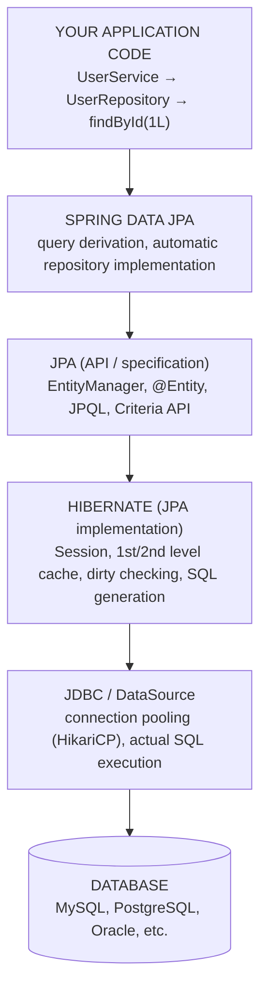
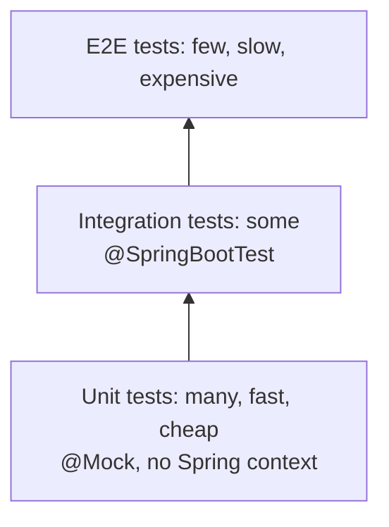

**Navigation**: [< Previous](Ch33_SB_Web_Part3.md) | [Back to Index](../00_MASTER_INDEX.md) | [Next >](Ch35_SB_Lombok_DTOs.md)

# 🌱 SPRING BOOT COMPLETE GUIDE - Part 4: Data Access, Web, Security & Testing

**The Practical Tiers - Building Real Applications**
_"JPA, REST APIs, Security, and Testing - the tools you use daily"_

---

### Historical Evolution

**Inventor / Originator:** Spring Security by Ben Alex and the Spring team (2004) — originally Acegi Security for Spring 1.0, integrated into Spring portfolio as Spring Security.

**Predecessor context:** Pre-Spring Security, Java EE used `j2eesecurity` (JAAS — Java Authentication and Authorization Service) with declarative `web.xml` security. JAAS was verbose, XML-heavy, and not Spring-friendly. Application-level security was implemented with `HttpServletRequest.isUserInRole()` checks scattered throughout code.

**Evolution narrative:** Acegi Security (2004, Ben Alex) was the first comprehensive security framework for Spring — declarative security via `FilterChainProxy`, `SecurityEnabler`, and `AuthenticationManager`. It was renamed Spring Security 2.0 (2007) with improved namespace support (`<http>`, `<authentication-manager>`). Spring Security 3.0 (2009) migrated to Spring 3.0 and added method-level security (`@PreAuthorize`). Spring Security 4.0 (2015) introduced CSRF protection by default, `<csrf>` namespace, and WebSocket security. Spring Security 5.0 (2017) added OAuth 2.0 Client support and reactive security (`Reactor Security`). Spring Security 6.0 (2022) removed legacy code, deprecated `WebSecurityConfigurerAdapter`, and streamlined lambda-based configuration.

**Modern practice:** Spring Security 6.x with Java 17+. Use `SecurityFilterChain` `@Bean` with lambda DSL instead of `WebSecurityConfigurerAdapter`. OAuth 2.0 Resource Server with JWT (`spring-boot-starter-oauth2-resource-server`). CSRF only disabled for stateless REST APIs (`csrf(csrf -> csrf.disable())`). `@PreAuthorize`, `@Secured`, and `@RolesAllowed` for method security.

- **Acegi Security — 2004**: Ben Alex. First Spring security framework. Filter-based. XML configuration.
- **Spring Security 2.0 — 2007**: Renamed. Namespace support (`<http>`, `<intercept-url>`).
- **Spring Security 3.0 — 2009**: Spring 3.0. Method security. `@PreAuthorize`, `@Secured`.
- **Spring Security 4.0 — 2015**: CSRF by default. SpEL in `@PreAuthorize`. WebSocket security.
- **Spring Security 5.0 — 2017**: OAuth 2.0 client, reactive security (Spring WebFlux integration).
- **Spring Security 6.0 — 2022**: Deprecated `WebSecurityConfigurerAdapter`. Lambda DSL. Removed legacy filters.

---

# 🎯 WHY-HOW-WHEN-WHICH FRAMEWORK

**WHY: Why JPA/Hibernate is Essential?**

```text
• ORM magic: Map Java objects to database tables automatically
• Type-safe queries: No more SQL string errors at runtime
• Database-agnostic: Switch MySQL/PostgreSQL without code changes
• Interview essential: "Explain lazy loading" asked in every interview
• N+1 problem: Understanding it prevents production nightmares
```

**HOW: How JPA Maps Objects to Database?**

```text
• @Entity: Class → Table, Fields → Columns
• Relationships: @OneToMany, @ManyToOne, @ManyToMany
• Spring Data: findByX() methods auto-implemented
• @Query: Custom JPQL or native SQL when needed
• Transactions: @Transactional manages commit/rollback
```

**WHEN: When to Use Different Query Strategies?**

```text
• findByX(): Simple lookups (findByEmail, findByStatus)
• @Query JPQL: Complex joins, aggregations
• Native SQL: Database-specific features, performance
• Specifications: Dynamic queries with many optional filters
• Projections: Return only needed columns for performance
```

**WHICH: Which JPA Concepts to Master?**

```text
ESSENTIAL:     @Entity, relationships, JpaRepository, @Transactional
IMPORTANT:     Lazy/Eager loading, N+1 problem, @Query, cascading
ADVANCED:      Specifications, EntityManager, second-level cache
```

---

# 📌 Tier 5: Data Access (JPA & Hibernate)

---

## Chapter 1: Understanding JPA Architecture

### 🔵 WHY: The Problem with Raw JDBC

🔬 **Section Challenge — Chapter 1: Understanding JPA Architecture**

**Challenge 1 (Reasoning):** In Spring Security, why must you always prefix role names with `ROLE_` when using `hasRole('ADMIN')` in `@PreAuthorize`?

<details><summary>Answer</summary>

Hardcoded framework convention. `hasRole('ADMIN')` internally calls a method that automatically prepends the `ROLE_` prefix before checking the `GrantedAuthority` list. If your database simply stores `ADMIN`, the check `ROLE_ADMIN == ADMIN` will fail, and access will be denied. You must either store authorities as `ROLE_ADMIN` in the database, or use `hasAuthority('ADMIN')` instead, which performs an exact string match without adding prefixes.

</details>

## Jdbc Vs Jpa Comparison

RAW JDBC (Boilerplate hell):

```java
public User findById(Long id) {
    String sql = "SELECT * FROM users WHERE id = ?";
    try (Connection conn = dataSource.getConnection();
            PreparedStatement ps = conn.prepareStatement(sql)) {
        ps.setLong(1, id);
        ResultSet rs = ps.executeQuery();
        if (rs.next()) {
            User user = new User();
            user.setId(rs.getLong("id"));
            user.setName(rs.getString("name"));
            user.setEmail(rs.getString("email"));
            // ... 20 more fields
            return user;
        }
        return null;
    }
}
```

JPA (Clean and simple):

```java
public User findById(Long id) {
    return entityManager.find(User.class, id); // One line!
}
```

OR with Spring Data JPA:

```java
public interface UserRepository extends JpaRepository<User, Long> {
    // findById() is automatic! No implementation needed!
}
```

### JPA Architecture Stack

**The JPA stack**



**How to read this diagram.** A call from your code travels down through each layer until it reaches the database. Each layer hides the one below it.

---

🔬 **Section Challenge — Jdbc Vs Jpa Comparison**

**Challenge 1 (Connection Pool Exhaustion):** Your service uses JDBC with HikariCP default pool size (10 connections). Under 20 concurrent requests, some requests hang indefinitely. **Who** is waiting? **When** does the connection timeout? **What** two config properties fix pool sizing?

<details><summary>Answer</summary>

**Who is waiting:** The 11th-20th concurrent requests. Each request acquires a JDBC connection from HikariCP's pool. With 10 connections, the first 10 requests proceed. Requests 11-20 BLOCK waiting for a free connection in the pool. **When it times out:** After `spring.datasource.hikari.connection-timeout` milliseconds (default 30,000ms = 30 seconds). If no connection becomes available within 30s, `SQLTransientConnectionException: Unable to acquire JDBC Connection` is thrown. **Two config properties:** (1) `spring.datasource.hikari.maximum-pool-size=50` — increase the pool for I/O-bound services (DB connections are cheap relative to I/O wait time). (2) `spring.datasource.hikari.connection-timeout=5000` — fail fast (5s) rather than letting the caller hang for 30s. **Sizing formula:** `pool_size = (core_count * 2) + effective_spindle_count` (HikariCP's recommendation for OLTP). For a 4-core server: (4 \* 2) + 1 = 9 connections. BUT: if your service has many concurrent threads, size for concurrent users, not CPU count. Monitor `hikari.connections.active` via Actuator metrics.

</details>
<details><summary>Answer</summary>

```java
// N+1: fetches all orders (1 query), then for EACH order fetches customer (N queries)
List<Order> orders = orderRepo.findAll(); // 1 query
orders.forEach(o -> System.out.println(o.getCustomer().getName())); // N queries!

// Fix 1: JOIN FETCH
@Query("SELECT o FROM Order o JOIN FETCH o.customer")
List<Order> findAllWithCustomer();

// Fix 2: EntityGraph
@EntityGraph(attributePaths = "customer")
List<Order> findAll();
```

Both load orders + customers in ONE query (JOIN). Always check Hibernate's SQL log in development.

</details>

## Chapter 2: Entity Mapping

### 🟢 HOW: Mapping Classes to Tables

```java
@Entity
@Table(name = "users")  // Optional if table name = class name
public class User {

    // ═══════════════════════════════════════════════════════════════════════════
    // PRIMARY KEY
    // ═══════════════════════════════════════════════════════════════════════════
    @Id
    @GeneratedValue(strategy = GenerationType.IDENTITY)  // Auto-increment
    private Long id;

    /*
     * GenerationType options:
     * - IDENTITY: Database auto-increment (MySQL, PostgreSQL)
     * - SEQUENCE: Database sequence (Oracle, PostgreSQL)
     * - TABLE: Separate table for IDs (portable but slower)
     * - AUTO: Let Hibernate decide
     */

    // ═══════════════════════════════════════════════════════════════════════════
    // COLUMN MAPPINGS
    // ═══════════════════════════════════════════════════════════════════════════
    @Column(name = "user_name", nullable = false, length = 100)
    private String username;

    @Column(unique = true, nullable = false)
    private String email;

    @Column(columnDefinition = "TEXT")  // Large text field
    private String bio;

    // ═══════════════════════════════════════════════════════════════════════════
    // TIMESTAMPS
    // ═══════════════════════════════════════════════════════════════════════════
    @CreationTimestamp  // Auto-set on insert
    @Column(updatable = false)
    private LocalDateTime createdAt;

    @UpdateTimestamp  // Auto-update on every change
    private LocalDateTime updatedAt;

    // ═══════════════════════════════════════════════════════════════════════════
    // ENUMS
    // ═══════════════════════════════════════════════════════════════════════════
    @Enumerated(EnumType.STRING)  // Store "ADMIN", not 0
    private Role role;

    /*
     * EnumType options:
     * - STRING: Stores enum name (recommended - survives refactoring)
     * - ORDINAL: Stores ordinal number (dangerous - changes if enum order changes)
     */

    // ═══════════════════════════════════════════════════════════════════════════
    // EMBEDDED OBJECTS
    // ═══════════════════════════════════════════════════════════════════════════
    @Embedded
    private Address address;  // Columns flattened into user table

    // ═══════════════════════════════════════════════════════════════════════════
    // TRANSIENT FIELDS (Not persisted)
    // ═══════════════════════════════════════════════════════════════════════════
    @Transient
    private String tempPassword;  // Not stored in DB

    // Constructors, getters, setters...
}

@Embeddable
public class Address {
    private String street;
    private String city;
    private String country;

    @Column(name = "zip_code")
    private String zipCode;
}
```

---

🔬 **Section Challenge — Chapter 2: Entity Mapping**

**Challenge 1 (@OneToMany Fetch Type Trap):** You have `@OneToMany(fetch = FetchType.EAGER) List<Order> orders` on `User`. You load 100 users. **Who** fires how many SQL queries? **When** does EAGER fetching cause `OutOfMemoryError`? **What** is the production-safe pattern?

<details><summary>Answer</summary>

**Who fires how many SQL queries:** The JPA EntityManager via Hibernate. With EAGER fetch on `@OneToMany`, Hibernate loads ALL orders for EVERY user immediately. This fires: 1 query for `SELECT * FROM users` + 100 queries for `SELECT * FROM orders WHERE user_id = ?` = **101 queries** (classic N+1). But with JOIN FETCH, just 1 query. **When EAGER causes OOM:** If a User has 10,000 orders and you load 100 users, Hibernate loads 1,000,000 Order objects into the first-level cache (EntityManager session). The Hibernate session holds all these in memory until the session closes. High-traffic APIs can fill heap quickly. **Production-safe pattern:** (1) Always use `FetchType.LAZY` on `@OneToMany` (it's actually the JPA default, but Hibernate's default for `@OneToMany` is LAZY anyway). (2) Use `JOIN FETCH` only in specific JPQL queries where you need the collection: `SELECT DISTINCT u FROM User u JOIN FETCH u.orders WHERE u.id IN :ids`. (3) Use `@EntityGraph` on repository methods to declare which associations to fetch per use case — different queries can fetch different associations.

</details>
<details><summary>Answer</summary>

Hardcoded framework convention. `hasRole('ADMIN')` internally calls a method that automatically prepends the `ROLE_` prefix before checking the `GrantedAuthority` list. If your database simply stores `ADMIN`, the check `ROLE_ADMIN == ADMIN` will fail, and access will be denied. You must either store authorities as `ROLE_ADMIN` in the database, or use `hasAuthority('ADMIN')` instead, which performs an exact string match without adding prefixes.

</details>

## Chapter 3: Entity Relationships

### 🔵 WHY: Modeling Real-World Data

```java
// ═══════════════════════════════════════════════════════════════════════════════
// ONE-TO-MANY / MANY-TO-ONE (Most common)
// ═══════════════════════════════════════════════════════════════════════════════

@Entity
public class User {
    @Id
    @GeneratedValue(strategy = GenerationType.IDENTITY)
    private Long id;

    // One user has many orders
    @OneToMany(mappedBy = "user", cascade = CascadeType.ALL, orphanRemoval = true)
    private List<Order> orders = new ArrayList<>();

    // Helper method to maintain both sides
    public void addOrder(Order order) {
        orders.add(order);
        order.setUser(this);
    }
}

@Entity
@Table(name = "orders")
public class Order {
    @Id
    @GeneratedValue(strategy = GenerationType.IDENTITY)
    private Long id;

    // Many orders belong to one user
    @ManyToOne(fetch = FetchType.LAZY)  // LAZY is critical for performance!
    @JoinColumn(name = "user_id", nullable = false)
    private User user;
}

/*
 * MAPPING EXPLANATION:
 *
 * DATABASE:
 * ┌───────────────┐        ┌───────────────────┐
 * │ users         │        │ orders            │
 * ├───────────────┤        ├───────────────────┤
 * │ id (PK)       │◄───────│ user_id (FK)      │
 * │ name          │        │ id (PK)           │
 * └───────────────┘        │ total             │
 *                          └───────────────────┘
 *
 * OWNERSHIP: Order owns the relationship (has the FK)
 * mappedBy = "user" means: "Look at Order.user to find mapping"
 */


// ═══════════════════════════════════════════════════════════════════════════════
// MANY-TO-MANY
// ═══════════════════════════════════════════════════════════════════════════════

@Entity
public class Student {
    @Id
    private Long id;

    @ManyToMany
    @JoinTable(
        name = "student_courses",  // Junction table
        joinColumns = @JoinColumn(name = "student_id"),
        inverseJoinColumns = @JoinColumn(name = "course_id")
    )
    private Set<Course> courses = new HashSet<>();
}

@Entity
public class Course {
    @Id
    private Long id;

    @ManyToMany(mappedBy = "courses")
    private Set<Student> students = new HashSet<>();
}

/*
 * DATABASE:
 * ┌───────────┐     ┌───────────────────┐     ┌───────────┐
 * │ students  │     │ student_courses   │     │ courses   │
 * ├───────────┤     ├───────────────────┤     ├───────────┤
 * │ id (PK)   │◄────│ student_id (FK)   │     │ id (PK)   │
 * │ name      │     │ course_id (FK)    │────►│ name      │
 * └───────────┘     └───────────────────┘     └───────────┘
 */


// ═══════════════════════════════════════════════════════════════════════════════
// ONE-TO-ONE
// ═══════════════════════════════════════════════════════════════════════════════

@Entity
public class User {
    @Id
    private Long id;

    @OneToOne(mappedBy = "user", cascade = CascadeType.ALL, orphanRemoval = true)
    private UserProfile profile;
}

@Entity
public class UserProfile {
    @Id
    private Long id;

    @OneToOne(fetch = FetchType.LAZY)
    @JoinColumn(name = "user_id", unique = true)
    private User user;
}
```

### Fetch Types: LAZY vs EAGER

```java
/*
 * FETCH TYPES - THE MOST IMPORTANT PERFORMANCE DECISION!
 *
 * EAGER: Load related entities IMMEDIATELY with parent
 * LAZY: Load related entities ONLY when accessed
 */

@Entity
public class User {

    // DEFAULT: EAGER (Bad for collections!)
    @OneToMany(mappedBy = "user")  // Will load ALL orders when loading user
    private List<Order> orders;

    // FIXED: LAZY (Correct!)
    @OneToMany(mappedBy = "user", fetch = FetchType.LAZY)
    private List<Order> orders;  // Orders loaded only when getOrders() called
}

/*
 * DEFAULTS:
 * @OneToMany, @ManyToMany → LAZY (good default)
 * @ManyToOne, @OneToOne   → EAGER (usually change to LAZY!)
 *
 * RULE: Almost always use LAZY, then fetch what you need explicitly
 */


// THE N+1 PROBLEM (Most common JPA performance issue)

// BAD: N+1 queries
List<User> users = userRepository.findAll();  // 1 query
for (User user : users) {
    System.out.println(user.getOrders().size());  // N queries (one per user!)
}

// GOOD: Fetch join (1 query)
@Query("SELECT u FROM User u JOIN FETCH u.orders")
List<User> findAllWithOrders();

// Or using EntityGraph
@EntityGraph(attributePaths = {"orders"})
List<User> findAll();
```

---

## Chapter 4: Spring Data JPA Repositories

### 🟢 HOW: Query Methods

```java
public interface UserRepository extends JpaRepository<User, Long> {

    // ═══════════════════════════════════════════════════════════════════════════
    // DERIVED QUERIES (Spring generates SQL from method name!)
    // ═══════════════════════════════════════════════════════════════════════════

    // Simple finder
    Optional<User> findByEmail(String email);
    // → SELECT * FROM users WHERE email = ?

    // Multiple conditions
    List<User> findByRoleAndActive(Role role, boolean active);
    // → SELECT * FROM users WHERE role = ? AND active = ?

    // LIKE queries
    List<User> findByNameContaining(String name);
    // → SELECT * FROM users WHERE name LIKE '%?%'

    List<User> findByNameStartingWith(String prefix);
    // → SELECT * FROM users WHERE name LIKE '?%'

    // Comparisons
    List<User> findByAgeGreaterThan(int age);
    List<User> findByCreatedAtBetween(LocalDateTime start, LocalDateTime end);

    // IN clause
    List<User> findByRoleIn(Collection<Role> roles);

    // NULL checks
    List<User> findByAddressIsNull();
    List<User> findByAddressIsNotNull();

    // Ordering
    List<User> findByRoleOrderByCreatedAtDesc(Role role);

    // Limiting results
    List<User> findTop10ByOrderByCreatedAtDesc();
    Optional<User> findFirstByRoleOrderByCreatedAtDesc(Role role);

    // Count
    long countByRole(Role role);

    // Exists
    boolean existsByEmail(String email);

    // Delete
    void deleteByEmail(String email);

    // ═══════════════════════════════════════════════════════════════════════════
    // CUSTOM QUERIES WITH @Query
    // ═══════════════════════════════════════════════════════════════════════════

    // JPQL (Java Persistence Query Language)
    @Query("SELECT u FROM User u WHERE u.email LIKE %:domain")
    List<User> findByEmailDomain(@Param("domain") String domain);

    // Native SQL (when JPQL is not enough)
    @Query(value = "SELECT * FROM users WHERE MATCH(name, bio) AGAINST(:term)",
           nativeQuery = true)
    List<User> fullTextSearch(@Param("term") String term);

    // Modifying queries (UPDATE, DELETE)
    @Modifying
    @Query("UPDATE User u SET u.active = false WHERE u.lastLoginAt < :cutoff")
    int deactivateInactiveUsers(@Param("cutoff") LocalDateTime cutoff);

    // ═══════════════════════════════════════════════════════════════════════════
    // PROJECTIONS (Return only needed fields)
    // ═══════════════════════════════════════════════════════════════════════════

    // Interface-based projection
    List<UserSummary> findAllProjectedBy();

    // Class-based projection (DTO)
    @Query("SELECT new com.example.dto.UserDTO(u.id, u.name, u.email) FROM User u")
    List<UserDTO> findAllAsDTO();
}

// Projection interface
public interface UserSummary {
    Long getId();
    String getName();
    String getEmail();
    // Only these fields are loaded from DB!
}

// DTO class
public record UserDTO(Long id, String name, String email) { }
```

### Pagination and Sorting

```java
public interface UserRepository extends JpaRepository<User, Long> {

    // Paginated query
    Page<User> findByRole(Role role, Pageable pageable);

    // Sorted query
    List<User> findByRole(Role role, Sort sort);
}

// Usage:
@Service
public class UserService {

    public Page<User> getUsers(int page, int size) {
        Pageable pageable = PageRequest.of(
            page,
            size,
            Sort.by(Sort.Direction.DESC, "createdAt")
        );
        return userRepository.findAll(pageable);
    }

    public List<User> getUsersSorted() {
        Sort sort = Sort.by(
            Sort.Order.asc("lastName"),
            Sort.Order.desc("firstName")
        );
        return userRepository.findAll(sort);
    }
}
```

---

🔬 **Section Challenge — Chapter 4: Spring Data JPA Repositories**

**Challenge 1 (Derived Query Ambiguity):** You add `List<User> findByFirstNameAndLastName(String first, String last)` to your repository. Spring Data JPA auto-generates the query. **Who** parses the method name? **When** does the derived query break? **What** happens with `findByFirstNameOrLastNameAndActive(boolean active)`?

<details><summary>Answer</summary>

**Who parses the method name:** Spring Data JPA's `PartTree` parser in `QueryCreator`. It splits the method name at AND/OR/Between/LessThan/etc. keywords and maps each part to an entity field. `findByFirstNameAndLastName` → `WHERE first_name = ? AND last_name = ?`. **When derived queries break:** (1) Method name exceeds ~50 chars — becomes unreadable and unmaintainable. (2) Field doesn't exist on the entity — startup exception `No property 'firstName' found for type User` (Spring Data validates at startup, not at query time). (3) Navigation path typo: `findByAddress_CityName` vs `findByAddressCityName`. **`findByFirstNameOrLastNameAndActive` ambiguity:** This is `WHERE first_name=? OR (last_name=? AND active=?)` — AND binds more tightly than OR in Spring Data's parser (same as standard Java operator precedence). This is a SILENT LOGIC BUG — you may intend `(first_name=? OR last_name=?) AND active=?` but get different results. **Fix:** Use `@Query("SELECT u FROM User u WHERE (u.firstName = ?1 OR u.lastName = ?2) AND u.active = ?3")` for any OR+AND combination. Derived queries are only safe for simple, unambiguous predicates.

</details>
<details><summary>Answer</summary>

Hardcoded framework convention. `hasRole('ADMIN')` internally calls a method that automatically prepends the `ROLE_` prefix before checking the `GrantedAuthority` list. If your database simply stores `ADMIN`, the check `ROLE_ADMIN == ADMIN` will fail, and access will be denied. You must either store authorities as `ROLE_ADMIN` in the database, or use `hasAuthority('ADMIN')` instead, which performs an exact string match without adding prefixes.

</details>

## Chapter 5: Transaction Management

### 🔵 WHY: Data Consistency

```java
@Service
public class OrderService {

    private final OrderRepository orderRepo;
    private final InventoryRepository inventoryRepo;
    private final PaymentService paymentService;

    // ═══════════════════════════════════════════════════════════════════════════
    // @Transactional - All or nothing
    // ═══════════════════════════════════════════════════════════════════════════
    @Transactional
    public Order processOrder(OrderRequest request) {
        // 1. Create order
        Order order = orderRepo.save(new Order(request));

        // 2. Reserve inventory
        inventoryRepo.decreaseStock(request.getProductId(), request.getQuantity());

        // 3. Process payment
        paymentService.charge(request.getPaymentDetails());  // If this fails...

        // 4. Confirm order
        order.setStatus(OrderStatus.CONFIRMED);

        return order;
        // If any step fails, ALL changes are rolled back!
    }

    // ═══════════════════════════════════════════════════════════════════════════
    // READ-ONLY TRANSACTIONS (Optimization)
    // ═══════════════════════════════════════════════════════════════════════════
    @Transactional(readOnly = true)  // Hibernate skips dirty checking
    public List<Order> getOrders() {
        return orderRepo.findAll();
    }

    // ═══════════════════════════════════════════════════════════════════════════
    // PROPAGATION - How nested transactions behave
    // ═══════════════════════════════════════════════════════════════════════════

    @Transactional(propagation = Propagation.REQUIRED)  // Default
    public void methodA() {
        // Uses existing transaction or creates new one
    }

    @Transactional(propagation = Propagation.REQUIRES_NEW)
    public void logAudit(String message) {
        // Always creates NEW transaction (suspends existing)
        // Commits independently - audit log saved even if parent fails
    }

    @Transactional(propagation = Propagation.MANDATORY)
    public void mustHaveTransaction() {
        // Throws exception if no existing transaction
    }

    // ═══════════════════════════════════════════════════════════════════════════
    // ROLLBACK RULES
    // ═══════════════════════════════════════════════════════════════════════════

    @Transactional(rollbackFor = Exception.class)  // Rollback on all exceptions
    public void strictMethod() { }

    @Transactional(noRollbackFor = {ValidationException.class})  // Don't rollback for these
    public void lenientMethod() { }

    /*
     * DEFAULT BEHAVIOR:
     * - Rollback: RuntimeException, Error
     * - No Rollback: Checked Exception
     *
     * RECOMMENDATION: Use rollbackFor = Exception.class to catch all
     */

    // ═══════════════════════════════════════════════════════════════════════════
    // ISOLATION LEVELS
    // ═══════════════════════════════════════════════════════════════════════════

    @Transactional(isolation = Isolation.READ_COMMITTED)  // Default for most DBs
    public void normalMethod() { }

    @Transactional(isolation = Isolation.SERIALIZABLE)  // Highest isolation
    public void criticalFinancialMethod() { }

    /*
     * ISOLATION LEVELS (least to most strict):
     * - READ_UNCOMMITTED: See uncommitted changes (dirty reads)
     * - READ_COMMITTED: Only see committed changes
     * - REPEATABLE_READ: Same query returns same results within transaction
     * - SERIALIZABLE: Transactions execute as if sequential
     */
}
```

---

🔬 **Section Challenge — Chapter 5: Transaction Management**

**Challenge 1 (REQUIRES_NEW Gotcha):** `ServiceA.processOrder()` is `@Transactional`. It calls `ServiceB.logAudit()` which is `@Transactional(propagation = REQUIRES_NEW)`. `processOrder()` throws a `RuntimeException` after `logAudit()` returns. **Who** rolls back? **What** is the audit log state after the failure? **When** does this pattern cause data inconsistency?

<details><summary>Answer</summary>

**Who rolls back:** Only `ServiceA`'s transaction. `processOrder()` throws → its transaction (T1) rolls back: the order is NOT saved. `logAudit()` ran in its OWN transaction (T2, `REQUIRES_NEW` suspended T1). T2 COMMITTED when `logAudit()` returned successfully, BEFORE the exception in `processOrder()`. T2's commit is INDEPENDENT of T1. **Audit log state:** The audit log entry IS COMMITTED and visible in the DB even though the order was rolled back. **When this causes data inconsistency:** This is the classic OUTBOX PROBLEM. You have a committed audit entry saying "Order 123 processed" but Order 123 doesn't exist (rolled back). This creates a phantom audit record. **When to use REQUIRES_NEW:** When the inner operation MUST commit regardless of the outer transaction (e.g., logging failures, rate limit counters, sending emails via a transactional outbox). You ACCEPT that the inner and outer are independent. **When NOT to use:** When you need atomicity between the inner and outer operation. If audit logs must only exist when the order exists — use the SAME transaction (default REQUIRED propagation) and log AFTER the business operation succeeds.

</details>
<details><summary>Answer</summary>

READ COMMITTED: both T1 and T2 read balance=1000. Both compute 900. Both write 900. Final balance: 900 (expected: 800). Lost update! REPEATABLE READ (with locking SELECT FOR UPDATE): first SELECT acquires a read lock. T2's SELECT blocks until T1 commits. After T1 commits (balance=900), T2 reads 900, writes 800. Correct! Alternatively: use `UPDATE ... WHERE balance=1000` (optimistic locking with version check).

</details>

# 🔌 Tier 6: Web & REST API

---

## Chapter 6: Building REST APIs

### 🟢 HOW: Controllers and Request Handling

```java
@RestController
@RequestMapping("/api/v1/users")
@RequiredArgsConstructor
public class UserController {

    private final UserService userService;

    // ═══════════════════════════════════════════════════════════════════════════
    // GET - Retrieve resources
    // ═══════════════════════════════════════════════════════════════════════════

    @GetMapping
    public ResponseEntity<List<UserDTO>> getAllUsers(
            @RequestParam(defaultValue = "0") int page,
            @RequestParam(defaultValue = "20") int size) {
        return ResponseEntity.ok(userService.getAllUsers(page, size));
    }

    @GetMapping("/{id}")
    public ResponseEntity<UserDTO> getUser(@PathVariable Long id) {
        return userService.findById(id)
            .map(ResponseEntity::ok)
            .orElse(ResponseEntity.notFound().build());
    }

    @GetMapping("/search")
    public ResponseEntity<List<UserDTO>> searchUsers(
            @RequestParam String query,
            @RequestParam(required = false) Role role) {
        return ResponseEntity.ok(userService.search(query, role));
    }

    // ═══════════════════════════════════════════════════════════════════════════
    // POST - Create resources
    // ═══════════════════════════════════════════════════════════════════════════

    @PostMapping
    public ResponseEntity<UserDTO> createUser(
            @Valid @RequestBody CreateUserRequest request) {
        UserDTO created = userService.create(request);
        URI location = URI.create("/api/v1/users/" + created.id());
        return ResponseEntity.created(location).body(created);
    }

    // ═══════════════════════════════════════════════════════════════════════════
    // PUT - Update entire resource
    // ═══════════════════════════════════════════════════════════════════════════

    @PutMapping("/{id}")
    public ResponseEntity<UserDTO> updateUser(
            @PathVariable Long id,
            @Valid @RequestBody UpdateUserRequest request) {
        return ResponseEntity.ok(userService.update(id, request));
    }

    // ═══════════════════════════════════════════════════════════════════════════
    // PATCH - Partial update
    // ═══════════════════════════════════════════════════════════════════════════

    @PatchMapping("/{id}")
    public ResponseEntity<UserDTO> patchUser(
            @PathVariable Long id,
            @RequestBody Map<String, Object> updates) {
        return ResponseEntity.ok(userService.patch(id, updates));
    }

    // ═══════════════════════════════════════════════════════════════════════════
    // DELETE - Remove resource
    // ═══════════════════════════════════════════════════════════════════════════

    @DeleteMapping("/{id}")
    public ResponseEntity<Void> deleteUser(@PathVariable Long id) {
        userService.delete(id);
        return ResponseEntity.noContent().build();
    }
}
```

### Request Validation

```java
// Request DTO with validation
public record CreateUserRequest(
    @NotBlank(message = "Name is required")
    @Size(min = 2, max = 100)
    String name,

    @NotBlank
    @Email(message = "Invalid email format")
    String email,

    @NotBlank
    @Size(min = 8, message = "Password must be at least 8 characters")
    @Pattern(regexp = ".*[A-Z].*", message = "Password must contain uppercase")
    String password,

    @NotNull
    @Past(message = "Birth date must be in the past")
    LocalDate birthDate
) {}

// Global exception handler
@RestControllerAdvice
public class GlobalExceptionHandler {

    @ExceptionHandler(MethodArgumentNotValidException.class)
    public ResponseEntity<ErrorResponse> handleValidationErrors(
            MethodArgumentNotValidException ex) {
        List<String> errors = ex.getBindingResult()
            .getFieldErrors()
            .stream()
            .map(e -> e.getField() + ": " + e.getDefaultMessage())
            .toList();

        return ResponseEntity.badRequest()
            .body(new ErrorResponse("Validation failed", errors));
    }

    @ExceptionHandler(EntityNotFoundException.class)
    public ResponseEntity<ErrorResponse> handleNotFound(EntityNotFoundException ex) {
        return ResponseEntity.status(HttpStatus.NOT_FOUND)
            .body(new ErrorResponse(ex.getMessage(), List.of()));
    }

    @ExceptionHandler(Exception.class)
    public ResponseEntity<ErrorResponse> handleGenericError(Exception ex) {
        log.error("Unexpected error", ex);
        return ResponseEntity.status(HttpStatus.INTERNAL_SERVER_ERROR)
            .body(new ErrorResponse("Internal server error", List.of()));
    }
}

public record ErrorResponse(String message, List<String> errors) {}
```

---

🔬 **Section Challenge — Chapter 6: Building REST APIs**

**Challenge 1 (HTTP Idempotency):** Your `POST /api/orders` creates an order. A network timeout causes the client to retry the same request. **Who** creates duplicate orders? **When** is POST non-idempotent by definition? **What** pattern prevents duplicates?

<details><summary>Answer</summary>

**Who creates duplicates:** The server. `POST` is NOT idempotent by the HTTP spec. If the first request succeeded (order created, 201 returned) but the network dropped the response before the client received it, the client retries. The server sees a NEW `POST` request and creates another order. The server has no way to know this is a retry without extra logic. **When POST is non-idempotent:** By design. `POST /api/orders` creates a resource — calling it N times should (per HTTP semantics) create N resources. Compare: `PUT /api/orders/123` IS idempotent — calling it N times with the same body results in the same state. **Idempotency key pattern:** Client generates a unique `Idempotency-Key: uuid-abc-123` header. Server stores `(idempotency_key, response)` in a key-value store (Redis/DB) for e.g., 24 hours. On retry: server finds the key — returns the SAME stored response without creating a duplicate. Stripe, PayPal, and most payment APIs use this pattern. **Spring implementation:** `@PostMapping` handler checks: `String key = request.getHeader("Idempotency-Key"); if (redisCache.hasKey(key)) return cachedResponse; // else process and store`.

</details>
<details><summary>Answer</summary>

Hardcoded framework convention. `hasRole('ADMIN')` internally calls a method that automatically prepends the `ROLE_` prefix before checking the `GrantedAuthority` list. If your database simply stores `ADMIN`, the check `ROLE_ADMIN == ADMIN` will fail, and access will be denied. You must either store authorities as `ROLE_ADMIN` in the database, or use `hasAuthority('ADMIN')` instead, which performs an exact string match without adding prefixes.

</details>

# 🌱 Tier 7: Spring Security

---

## Chapter 7: Security Fundamentals

### 🔵 WHY: Authentication vs Authorization

**AUTHENTICATION vs AUTHORIZATION**

**AUTHENTICATION = "WHO are you?"**

```text
• Username/password login
• OAuth2/Social login
• JWT token validation
• Certificate verification
```

**AUTHORIZATION = "WHAT can you do?"**

```text
• Role-based: ADMIN can delete, USER can only read
• Resource-based: User can only edit their OWN posts
• Permission-based: Fine-grained access control

FLOW:
Request → Authentication → Authorization → Controller
```

### 🟢 HOW: Security Configuration

```java
@Configuration
@EnableWebSecurity
public class SecurityConfig {

    @Bean
    public SecurityFilterChain securityFilterChain(HttpSecurity http) throws Exception {
        return http
            // CSRF protection (disable for stateless API)
            .csrf(csrf -> csrf.disable())

            // Session management
            .sessionManagement(session ->
                session.sessionCreationPolicy(SessionCreationPolicy.STATELESS))

            // Authorization rules
            .authorizeHttpRequests(auth -> auth
                // Public endpoints
                .requestMatchers("/api/auth/**").permitAll()
                .requestMatchers("/api/public/**").permitAll()
                .requestMatchers("/health", "/info").permitAll()

                // Role-based access
                .requestMatchers("/api/admin/**").hasRole("ADMIN")
                .requestMatchers(HttpMethod.DELETE, "/api/**").hasRole("ADMIN")

                // Authenticated access
                .requestMatchers("/api/**").authenticated()

                // All other requests
                .anyRequest().denyAll()
            )

            // JWT filter
            .addFilterBefore(jwtAuthFilter(), UsernamePasswordAuthenticationFilter.class)

            // Exception handling
            .exceptionHandling(ex -> ex
                .authenticationEntryPoint((request, response, authEx) ->
                    response.sendError(HttpServletResponse.SC_UNAUTHORIZED))
                .accessDeniedHandler((request, response, accessEx) ->
                    response.sendError(HttpServletResponse.SC_FORBIDDEN)))

            .build();
    }

    @Bean
    public PasswordEncoder passwordEncoder() {
        return new BCryptPasswordEncoder();
    }

    @Bean
    public AuthenticationManager authenticationManager(
            AuthenticationConfiguration config) throws Exception {
        return config.getAuthenticationManager();
    }
}
```

### Method-Level Security

```java
@Configuration
@EnableMethodSecurity  // Enable @PreAuthorize, @PostAuthorize
public class MethodSecurityConfig { }

@Service
public class UserService {

    // Only ADMIN can call this method
    @PreAuthorize("hasRole('ADMIN')")
    public void deleteUser(Long id) { }

    // User can only access their own data
    @PreAuthorize("#userId == authentication.principal.id")
    public User getUser(Long userId) { }

    // Check result before returning
    @PostAuthorize("returnObject.owner == authentication.principal.username")
    public Document getDocument(Long id) { }

    // Complex security expression
    @PreAuthorize("hasRole('ADMIN') or (hasRole('USER') and #user.id == authentication.principal.id)")
    public void updateUser(User user) { }
}
```

---

🔬 **Section Challenge — Chapter 7: Security Fundamentals**

**Challenge 1 (Reasoning):** JWT vs session cookies — what are the tradeoffs for a distributed microservices architecture?

<details><summary>Answer</summary>

JWT: stateless — any service can validate without a DB call (verify signature with public key). No sticky sessions needed. Downside: can't invalidate a token before expiry (no server-side state). Session cookies: stateful — easy to invalidate (delete session). But: need a shared session store (Redis) for multi-instance deployments, or sticky sessions (load balancer routing). Microservices: JWT wins for scalability. Add a token blacklist (Redis) if revocation is needed.

</details>

# 🧪 Tier 9: Testing

---

## Chapter 8: Testing Spring Boot Applications

### 🔵 WHY: Testing Pyramid

**Testing pyramid**

| Level | Volume and cost | Typical tooling |
| --- | --- | --- |
| E2E tests (top) | Few, slow, expensive | Browser or API end-to-end |
| Integration tests (middle) | Some | `@SpringBootTest` |
| Unit tests (base) | Many, fast, cheap | `@Mock`, no Spring context |



**How to read this diagram.** Read from the bottom up. Most of your tests should sit at the base, and the cost per test rises as you move up.

### Unit Tests (No Spring Context)

```java
@ExtendWith(MockitoExtension.class)
class UserServiceTest {

    @Mock
    private UserRepository userRepository;

    @Mock
    private EmailService emailService;

    @InjectMocks  // Inject mocks into this
    private UserService userService;

    @Test
    void createUser_shouldSaveAndSendEmail() {
        // Given
        CreateUserRequest request = new CreateUserRequest("John", "john@test.com", "pass");
        User savedUser = new User(1L, "John", "john@test.com");

        when(userRepository.save(any(User.class))).thenReturn(savedUser);

        // When
        UserDTO result = userService.create(request);

        // Then
        assertThat(result.id()).isEqualTo(1L);
        assertThat(result.name()).isEqualTo("John");

        verify(userRepository).save(any(User.class));
        verify(emailService).sendWelcomeEmail("john@test.com");
        verifyNoMoreInteractions(userRepository, emailService);
    }

    @Test
    void findById_whenNotFound_shouldThrowException() {
        // Given
        when(userRepository.findById(999L)).thenReturn(Optional.empty());

        // When/Then
        assertThatThrownBy(() -> userService.findById(999L))
            .isInstanceOf(UserNotFoundException.class)
            .hasMessage("User not found: 999");
    }
}
```

### Integration Tests (@SpringBootTest)

```java
@SpringBootTest
@ActiveProfiles("test")
@Transactional  // Rollback after each test
class UserServiceIntegrationTest {

    @Autowired
    private UserService userService;

    @Autowired
    private UserRepository userRepository;

    @MockBean  // Replace real bean with mock
    private EmailService emailService;  // Don't send real emails!

    @Test
    void createUser_shouldPersistToDatabase() {
        // Given
        CreateUserRequest request = new CreateUserRequest("John", "john@test.com", "pass");

        // When
        UserDTO result = userService.create(request);

        // Then
        Optional<User> saved = userRepository.findById(result.id());
        assertThat(saved).isPresent();
        assertThat(saved.get().getEmail()).isEqualTo("john@test.com");
    }
}
```

### Web Layer Tests (@WebMvcTest)

```java
@WebMvcTest(UserController.class)  // Only load web layer
class UserControllerTest {

    @Autowired
    private MockMvc mockMvc;

    @MockBean  // Mock service layer
    private UserService userService;

    @Test
    void getUser_shouldReturnUser() throws Exception {
        // Given
        UserDTO user = new UserDTO(1L, "John", "john@test.com");
        when(userService.findById(1L)).thenReturn(Optional.of(user));

        // When/Then
        mockMvc.perform(get("/api/v1/users/1"))
            .andExpect(status().isOk())
            .andExpect(jsonPath("$.id").value(1))
            .andExpect(jsonPath("$.name").value("John"));
    }

    @Test
    void createUser_withInvalidData_shouldReturn400() throws Exception {
        // Given
        String invalidJson = """
            {
                "name": "",
                "email": "not-an-email"
            }
            """;

        // When/Then
        mockMvc.perform(post("/api/v1/users")
                .contentType(MediaType.APPLICATION_JSON)
                .content(invalidJson))
            .andExpect(status().isBadRequest())
            .andExpect(jsonPath("$.errors").isArray());
    }
}
```

### Repository Tests (@DataJpaTest)

```java
@DataJpaTest  // Only load JPA components
@ActiveProfiles("test")
class UserRepositoryTest {

    @Autowired
    private UserRepository userRepository;

    @Autowired
    private TestEntityManager entityManager;

    @Test
    void findByEmail_shouldReturnUser() {
        // Given
        User user = new User("John", "john@test.com");
        entityManager.persistAndFlush(user);

        // When
        Optional<User> found = userRepository.findByEmail("john@test.com");

        // Then
        assertThat(found).isPresent();
        assertThat(found.get().getName()).isEqualTo("John");
    }

    @Test
    void findByRole_shouldReturnMatchingUsers() {
        // Given
        entityManager.persist(new User("Admin", "admin@test.com", Role.ADMIN));
        entityManager.persist(new User("User1", "user1@test.com", Role.USER));
        entityManager.persist(new User("User2", "user2@test.com", Role.USER));
        entityManager.flush();

        // When
        List<User> users = userRepository.findByRole(Role.USER);

        // Then
        assertThat(users).hasSize(2);
        assertThat(users).extracting("name").containsExactlyInAnyOrder("User1", "User2");
    }
}
```

### Test Configuration

```yaml


🔬 **Section Challenge — Chapter 8: Testing Spring Boot Applications**

**Challenge 1 (@MockBean vs @SpyBean):** You use `@MockBean UserRepository userRepo` in a `@SpringBootTest`. **Who** replaces the real bean? **When** does `@SpyBean` prevent you from bypassing real logic? **What** is the precise behavioral difference in a test?

<details><summary>Answer</summary>

**Who replaces:** `@MockBean` creates a FULL MOCKITO MOCK and registers it in the Spring `ApplicationContext`, replacing any existing `UserRepository` bean. ALL methods return null/0/empty by default unless stubbed. **`@SpyBean` behavior:** `@SpyBean` creates a MOCKITO SPY that WRAPS the real bean. Real methods are called by default UNLESS explicitly stubbed. A spy is useful when you want to verify that a real method was called without changing its behavior, or stub only specific methods while letting others run normally. **Precise behavioral difference:** `@MockBean UserRepository repo` — `repo.findById(1L)` returns `Optional.empty()` unless you `when(repo.findById(1L)).thenReturn(Optional.of(user))`. `@SpyBean UserRepository repo` — `repo.findById(1L)` calls the REAL database. To stub: `doReturn(Optional.of(user)).when(repo).findById(1L)` (must use `doReturn` syntax for spies, NOT `when(...).thenReturn` — `when` would call the real method during stubbing setup). **When to use which:** `@MockBean` for external dependencies (Stripe, email service, external APIs). `@SpyBean` for internal services where you want real behavior but need to verify or override specific method calls.

</details>
<details><summary>Answer</summary>

Hardcoded framework convention. `hasRole('ADMIN')` internally calls a method that automatically prepends the `ROLE_` prefix before checking the `GrantedAuthority` list. If your database simply stores `ADMIN`, the check `ROLE_ADMIN == ADMIN` will fail, and access will be denied. You must either store authorities as `ROLE_ADMIN` in the database, or use `hasAuthority('ADMIN')` instead, which performs an exact string match without adding prefixes.
</details>


# application-test.yml
spring:
    datasource:
        url: jdbc:h2:mem:testdb
        driver-class-name: org.h2.Driver
    jpa:
        hibernate:
            ddl-auto: create-drop
        show-sql: true

    # Disable security for tests (optional)
    # security:
    #   enabled: false

logging:
    level:
        org.springframework.test: DEBUG
        org.hibernate.SQL: DEBUG
```

---

# 📋 TIERS 5-9 CHECKLIST

```
JPA & DATA ACCESS:
□ Can map entities with all relationship types
□ Understand LAZY vs EAGER and N+1 problem
□ Can write derived queries and @Query methods
□ Know @Transactional options (propagation, isolation, rollback)
□ Can use projections and pagination

WEB & REST:
□ Can build complete REST API with all HTTP methods
□ Know request validation with JSR-380
□ Can handle exceptions globally with @RestControllerAdvice
□ Understand ResponseEntity and status codes

SECURITY:
□ Know authentication vs authorization
□ Can configure SecurityFilterChain
□ Can secure methods with @PreAuthorize
□ Understand JWT authentication flow

TESTING:
□ Can write unit tests with Mockito (@Mock, @InjectMocks)
□ Can write integration tests (@SpringBootTest)
□ Can test web layer (@WebMvcTest + MockMvc)
□ Can test repository layer (@DataJpaTest)
□ Know when to use @MockBean vs @Mock
```

---

# 🎯 FINAL SUMMARY

**SPRING BOOT MASTERY ROADMAP**

| Tier | Topic | Covers |
| --- | --- | --- |
| 1 | Java foundations | Memory, class loading, threading, functional programming |
| 2 | Spring Core | IoC, DI, beans, lifecycle, events |
| 3 | AOP | Aspects, pointcuts, proxies |
| 4 | Spring Boot | Auto-configuration, properties, profiles |
| 5 | Data access | JPA, Hibernate, transactions |
| 6 | Web | REST APIs, validation, exception handling |
| 7 | Security | Authentication, authorization, JWT |
| 8 | Microservices (advanced) | Service discovery, API gateway, messaging |
| 9 | Testing | Unit, integration, web and repository tests |

> [!TIP]
> **Key principle:** always understand WHY before learning HOW.

---

### Trade-offs: Authentication Strategies

| Strategy | Use Case | Latency | Throughput | Complexity | When to Prefer |
|----------|----------|---------|------------|------------|----------------|
| **JWT (stateless)** | Stateless REST APIs, microservices | <5ms (token validation) | Very high (no session store) | Medium (token generation, signing, rotation) | Microservices needing stateless auth; horizontal scaling without session affinity; mobile/SPA clients |
| **Session + Cookie (stateful)** | Traditional web apps | <2ms (session lookup) | Medium (session store required) | Low (Spring session management) | Server-rendered apps (Thymeleaf, JSP); team unfamiliar with JWT; need "logout all devices" feature |
| **OAuth2 + OIDC** | SSO, third-party login | 50-200ms (external IdP call) | High (token caching) | High (IdP configuration, scopes) | Enterprise SSO (Okta, Auth0); social login (Google, GitHub); need centralized identity across multiple apps |
| **API Keys** | Service-to-service, partner APIs | <1ms (static key check) | Very high (no token processing) | Low (key generation, storage) | Internal service calls; partner API access; simple machine-to-machine auth without identity claims |

**Key insight:** JWT is the default for modern SPA and mobile backends. Session cookies are simpler for traditional server-rendered apps. OAuth2 adds federation complexity but enables SSO. API keys are the simplest for internal service calls.

---

_You now have a complete Spring Boot foundation. Practice with real projects!_

---

> **Navigation**: [< Previous](Ch33_SB_Web_Part3.md) | [Back to Index](../00_MASTER_INDEX.md) | [Next >](Ch35_SB_Lombok_DTOs.md)


---

## Reality Check

**"Spring Security's default login page is production-ready"** → Spring Security's auto-generated login page (`/login`) is a development convenience. In production: you'll have your own branded login page, OAuth2/OIDC login (delegate to an identity provider), or a mobile app that exchanges credentials for JWT tokens (no form login at all). The auto-generated page is useful for getting auth working quickly; disable or replace it before going to production. Also: the auto-generated in-memory user (`spring.security.user.name/password`) must never be deployed to production.

**"permitAll() means the endpoint is publicly accessible without any security"** → `permitAll()` allows all requests to match the URL pattern — including unauthenticated requests. BUT: if a request includes an invalid JWT or expired session cookie, Spring Security may still reject it before reaching your `permitAll()` rule (depending on filter order and error handling). The common case: a request with an invalid `Authorization: Bearer <expired>` header → `401 Unauthorized` even though the path is `permitAll()`. Reason: the JWT filter runs before the authorization check and rejects the request on authentication failure. Configure the JWT filter to ignore missing/invalid tokens for `permitAll()` paths.

**"@PreAuthorize runs before the method and @PostAuthorize after — that's the only difference"** → `@PreAuthorize` checks authorization BEFORE executing the method — the method body runs only if the check passes. `@PostAuthorize` checks AFTER executing the method using the `returnObject` variable — the method DOES execute, but the result is not returned if the check fails. Use `@PostAuthorize` for: "user can only see their own data" checks where the ownership is determined by the result (you had to run the query to find out). But: the side effects of the method already happened if `@PostAuthorize` rejects — don't use it to "undo" write operations.

**"CSRF protection is optional for REST APIs"** → CSRF (Cross-Site Request Forgery) protection is unnecessary for truly stateless REST APIs that use JWT or API key authentication (not cookies). Browsers don't automatically attach JWT headers to cross-origin requests — only to cookies. If your API uses cookie-based sessions, CSRF protection IS needed. Spring Security disables CSRF by default when you configure a custom security filter chain. If you're using Spring Security for a traditional server-rendered web app WITH cookies, enabling CSRF is mandatory.

**"Method security and URL security are equivalent"** → URL-based security (`requestMatchers("/admin/**").hasRole("ADMIN")`) is coarse-grained — it secures endpoints by URL pattern. Method-level security (`@PreAuthorize("hasRole('ADMIN')")`) is fine-grained — secures individual methods regardless of how they're called. Use URL security for: broad access control, public vs authenticated. Use method security for: data-level access (user can only access their own resources), service-layer security that bypasses the controller layer, or when the same method is called from multiple entry points (REST endpoint + message consumer + scheduler).
