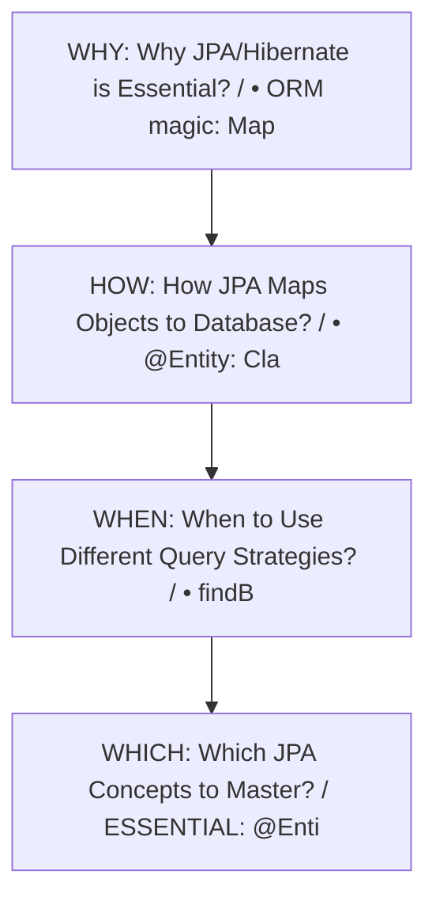
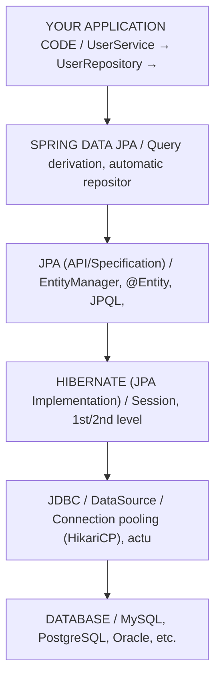
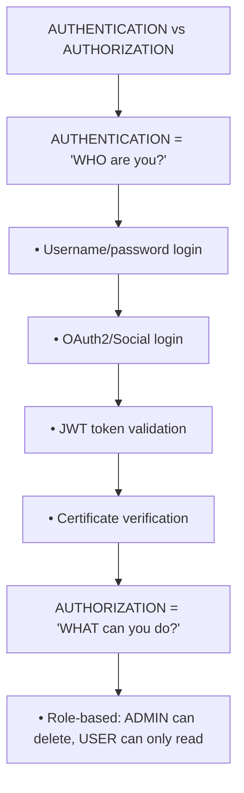
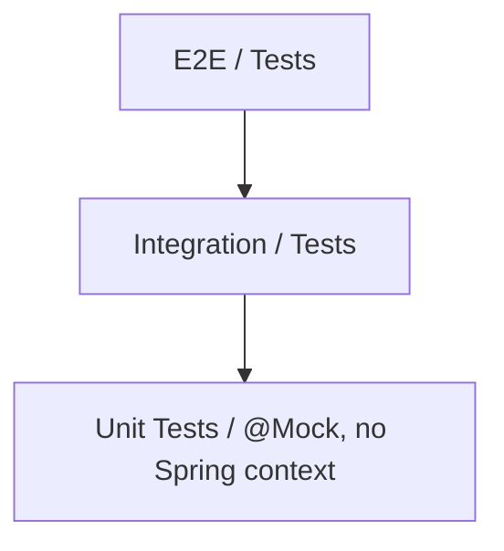
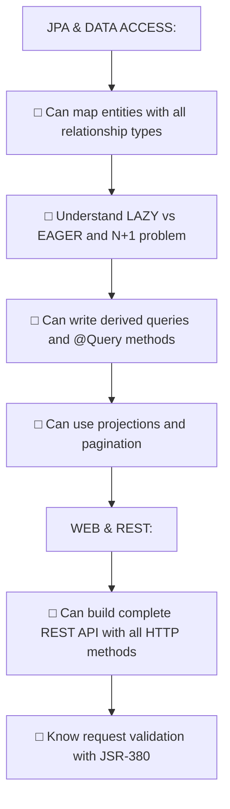
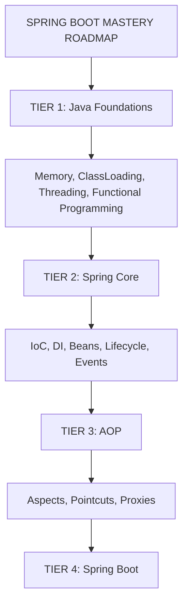

> **Navigation**: [< Previous](Ch33_SB_Web_Part3.md) | [Back to Index](../00_MASTER_INDEX.md) | [Next >](Ch35_SB_Lombok_DTOs.md)

# 🌱 SPRING BOOT COMPLETE GUIDE - Part 4: Data Access, Web, Security & Testing

> **The Practical Tiers - Building Real Applications**
> _"JPA, REST APIs, Security, and Testing - the tools you use daily"_

---

# 🎯 WHY-HOW-WHEN-WHICH FRAMEWORK

```
┌─────────────────────────────────────────────────────────────────────────────────┐
│  WHY: Why JPA/Hibernate is Essential?                                           │
├─────────────────────────────────────────────────────────────────────────────────┤
│  • ORM magic: Map Java objects to database tables automatically                 │
│  • Type-safe queries: No more SQL string errors at runtime                      │
│  • Database-agnostic: Switch MySQL/PostgreSQL without code changes              │
│  • Interview essential: "Explain lazy loading" asked in every interview         │
│  • N+1 problem: Understanding it prevents production nightmares                 │
└─────────────────────────────────────────────────────────────────────────────────┘

┌─────────────────────────────────────────────────────────────────────────────────┐
│  HOW: How JPA Maps Objects to Database?                                         │
├─────────────────────────────────────────────────────────────────────────────────┤
│  • @Entity: Class → Table, Fields → Columns                                     │
│  • Relationships: @OneToMany, @ManyToOne, @ManyToMany                           │
│  • Spring Data: findByX() methods auto-implemented                              │
│  • @Query: Custom JPQL or native SQL when needed                                │
│  • Transactions: @Transactional manages commit/rollback                         │
└─────────────────────────────────────────────────────────────────────────────────┘

┌─────────────────────────────────────────────────────────────────────────────────┐
│  WHEN: When to Use Different Query Strategies?                                  │
├─────────────────────────────────────────────────────────────────────────────────┤
│  • findByX(): Simple lookups (findByEmail, findByStatus)                        │
│  • @Query JPQL: Complex joins, aggregations                                     │
│  • Native SQL: Database-specific features, performance                          │
│  • Specifications: Dynamic queries with many optional filters                   │
│  • Projections: Return only needed columns for performance                      │
└─────────────────────────────────────────────────────────────────────────────────┘

┌─────────────────────────────────────────────────────────────────────────────────┐
│  WHICH: Which JPA Concepts to Master?                                           │
├─────────────────────────────────────────────────────────────────────────────────┤
│  ESSENTIAL:     @Entity, relationships, JpaRepository, @Transactional           │
│  IMPORTANT:     Lazy/Eager loading, N+1 problem, @Query, cascading              │
│  ADVANCED:      Specifications, EntityManager, second-level cache               │
└─────────────────────────────────────────────────────────────────────────────────┘
```

**Flow:**
- WHY: Why JPA/Hibernate is Essential? / • ORM magic: Map
- ↓
- HOW: How JPA Maps Objects to Database? / • @Entity: Cla
- ↓
- WHEN: When to Use Different Query Strategies? / • findB
- ↓
- WHICH: Which JPA Concepts to Master? / ESSENTIAL: @Enti



---

# 📌 Tier 5: Data Access (JPA & Hibernate)

---

## Chapter 1: Understanding JPA Architecture

### 🔵 WHY: The Problem with Raw JDBC


> 🔬 **Section Challenge — Chapter 1: Understanding JPA Architecture**
>
> **Challenge 1 (Reasoning):** `ExecutorService.submit(task)` — the task throws a `RuntimeException`. Nobody calls `future.get()`. What happens to the exception?
> <details><summary>Answer</summary>
>
> It's silently swallowed. The exception is stored in the `Future` object. Without `future.get()` or `.whenComplete()`, no one ever sees it. The thread pool thread resets and picks up the next task as if nothing happened. This is one of the most dangerous production bugs. Fix: always attach `future.whenComplete((r,ex) -> { if(ex!=null) log.error("Task failed",ex); })` or use `execute()` + `UncaughtExceptionHandler`.
> </details>
>

## Jdbc Vs Jpa Comparison

RAW JDBC (Boilerplate hell):
public User findById(Long id) {
String sql = "SELECT * FROM users WHERE id = ?";
try (Connection conn = dataSource.getConnection();
PreparedStatement ps = conn.prepareStatement(sql)) {
ps.setLong(1, id);
ResultSet rs = ps.executeQuery();
if (rs.next()) {
User user = new User();
user.setId(rs.getLong("id"));
user.setName(rs.getString("name"));
user.setEmail(rs.getString("email"));
// ... 20 more fields
return user;
}
return null;
}
}
JPA (Clean and simple):
public User findById(Long id) {
return entityManager.find(User.class, id);  // One line!
}
OR with Spring Data JPA:
public interface UserRepository extends JpaRepository<User, Long> {
// findById() is automatic! No implementation needed!
}

### JPA Architecture Stack

```
┌─────────────────────────────────────────────────────────────────────────────────┐
│                    JPA STACK                                                    │
├─────────────────────────────────────────────────────────────────────────────────┤
│                                                                                 │
│  ┌─────────────────────────────────────────────────────────────────────────┐    │
│  │                     YOUR APPLICATION CODE                                │   │
│  │                                                                          │   │
│  │   UserService → UserRepository → findById(1L)                           │    │
│  └─────────────────────────────────────────────────┬────────────────────────┘   │
│                                                     │                           │
│  ┌─────────────────────────────────────────────────▼────────────────────────┐   │
│  │                     SPRING DATA JPA                                      │   │
│  │                                                                          │   │
│  │   Query derivation, automatic repository implementation                 │    │
│  └─────────────────────────────────────────────────┬────────────────────────┘   │
│                                                     │                           │
│  ┌─────────────────────────────────────────────────▼────────────────────────┐   │
│  │                     JPA (API/Specification)                              │   │
│  │                                                                          │   │
│  │   EntityManager, @Entity, JPQL, Criteria API                            │    │
│  └─────────────────────────────────────────────────┬────────────────────────┘   │
│                                                     │                           │
│  ┌─────────────────────────────────────────────────▼────────────────────────┐   │
│  │                     HIBERNATE (JPA Implementation)                       │   │
│  │                                                                          │   │
│  │   Session, 1st/2nd level cache, dirty checking, SQL generation         │     │
│  └─────────────────────────────────────────────────┬────────────────────────┘   │
│                                                     │                           │
│  ┌─────────────────────────────────────────────────▼────────────────────────┐   │
│  │                     JDBC / DataSource                                    │   │
│  │                                                                          │   │
│  │   Connection pooling (HikariCP), actual SQL execution                   │    │
│  └─────────────────────────────────────────────────┬────────────────────────┘   │
│                                                     │                           │
│  ┌─────────────────────────────────────────────────▼────────────────────────┐   │
│  │                     DATABASE                                             │   │
│  │                                                                          │   │
│  │   MySQL, PostgreSQL, Oracle, etc.                                       │    │
│  └──────────────────────────────────────────────────────────────────────────┘   │
│                                                                                 │
└─────────────────────────────────────────────────────────────────────────────────┘
```

**Flow:**
- YOUR APPLICATION CODE / UserService
- ↓
- UserRepository
- ↓
- SPRING DATA JPA / Query derivation, automatic repositor
- ↓
- JPA (API/Specification) / EntityManager, @Entity, JPQL,
- ↓
- HIBERNATE (JPA Implementation) / Session, 1st/2nd level
- ↓
- JDBC / DataSource / Connection pooling (HikariCP), actu
- ↓
- DATABASE / MySQL, PostgreSQL, Oracle, etc.



---


> 🔬 **Section Challenge — Jdbc Vs Jpa Comparison**
>
> **Challenge 1 (Reasoning):** N+1 query problem — explain with a concrete JPA example and show the fix.
> <details><summary>Answer</summary>
>
> ```java
> // N+1: fetches all orders (1 query), then for EACH order fetches customer (N queries)
> List<Order> orders = orderRepo.findAll(); // 1 query
> orders.forEach(o -> System.out.println(o.getCustomer().getName())); // N queries!
>
> // Fix 1: JOIN FETCH
> @Query("SELECT o FROM Order o JOIN FETCH o.customer")
> List<Order> findAllWithCustomer();
>
> // Fix 2: EntityGraph
> @EntityGraph(attributePaths = "customer")
> List<Order> findAll();
> ```
> Both load orders + customers in ONE query (JOIN). Always check Hibernate's SQL log in development.
> </details>
>

## Chapter 2: Entity Mapping

### 🟢 HOW: Mapping Classes to Tables

```java
@Entity
@Table(name = "users")  // Optional if table name = class name
public class User {

    // ═══════════════════════════════════════════════════════════════════════════
    // PRIMARY KEY
    // ═══════════════════════════════════════════════════════════════════════════
    @Id
    @GeneratedValue(strategy = GenerationType.IDENTITY)  // Auto-increment
    private Long id;

    /*
     * GenerationType options:
     * - IDENTITY: Database auto-increment (MySQL, PostgreSQL)
     * - SEQUENCE: Database sequence (Oracle, PostgreSQL)
     * - TABLE: Separate table for IDs (portable but slower)
     * - AUTO: Let Hibernate decide
     */

    // ═══════════════════════════════════════════════════════════════════════════
    // COLUMN MAPPINGS
    // ═══════════════════════════════════════════════════════════════════════════
    @Column(name = "user_name", nullable = false, length = 100)
    private String username;

    @Column(unique = true, nullable = false)
    private String email;

    @Column(columnDefinition = "TEXT")  // Large text field
    private String bio;

    // ═══════════════════════════════════════════════════════════════════════════
    // TIMESTAMPS
    // ═══════════════════════════════════════════════════════════════════════════
    @CreationTimestamp  // Auto-set on insert
    @Column(updatable = false)
    private LocalDateTime createdAt;

    @UpdateTimestamp  // Auto-update on every change
    private LocalDateTime updatedAt;

    // ═══════════════════════════════════════════════════════════════════════════
    // ENUMS
    // ═══════════════════════════════════════════════════════════════════════════
    @Enumerated(EnumType.STRING)  // Store "ADMIN", not 0
    private Role role;

    /*
     * EnumType options:
     * - STRING: Stores enum name (recommended - survives refactoring)
     * - ORDINAL: Stores ordinal number (dangerous - changes if enum order changes)
     */

    // ═══════════════════════════════════════════════════════════════════════════
    // EMBEDDED OBJECTS
    // ═══════════════════════════════════════════════════════════════════════════
    @Embedded
    private Address address;  // Columns flattened into user table

    // ═══════════════════════════════════════════════════════════════════════════
    // TRANSIENT FIELDS (Not persisted)
    // ═══════════════════════════════════════════════════════════════════════════
    @Transient
    private String tempPassword;  // Not stored in DB

    // Constructors, getters, setters...
}

@Embeddable
public class Address {
    private String street;
    private String city;
    private String country;

    @Column(name = "zip_code")
    private String zipCode;
}
```

---


> 🔬 **Section Challenge — Chapter 2: Entity Mapping**
>
> **Challenge 1 (Reasoning):** `ExecutorService.submit(task)` — the task throws a `RuntimeException`. Nobody calls `future.get()`. What happens to the exception?
> <details><summary>Answer</summary>
>
> It's silently swallowed. The exception is stored in the `Future` object. Without `future.get()` or `.whenComplete()`, no one ever sees it. The thread pool thread resets and picks up the next task as if nothing happened. This is one of the most dangerous production bugs. Fix: always attach `future.whenComplete((r,ex) -> { if(ex!=null) log.error("Task failed",ex); })` or use `execute()` + `UncaughtExceptionHandler`.
> </details>
>

## Chapter 3: Entity Relationships

### 🔵 WHY: Modeling Real-World Data

```java
// ═══════════════════════════════════════════════════════════════════════════════
// ONE-TO-MANY / MANY-TO-ONE (Most common)
// ═══════════════════════════════════════════════════════════════════════════════

@Entity
public class User {
    @Id
    @GeneratedValue(strategy = GenerationType.IDENTITY)
    private Long id;

    // One user has many orders
    @OneToMany(mappedBy = "user", cascade = CascadeType.ALL, orphanRemoval = true)
    private List<Order> orders = new ArrayList<>();

    // Helper method to maintain both sides
    public void addOrder(Order order) {
        orders.add(order);
        order.setUser(this);
    }
}

@Entity
@Table(name = "orders")
public class Order {
    @Id
    @GeneratedValue(strategy = GenerationType.IDENTITY)
    private Long id;

    // Many orders belong to one user
    @ManyToOne(fetch = FetchType.LAZY)  // LAZY is critical for performance!
    @JoinColumn(name = "user_id", nullable = false)
    private User user;
}

/*
 * MAPPING EXPLANATION:
 *
 * DATABASE:
 * ┌───────────────┐        ┌───────────────────┐
 * │ users         │        │ orders            │
 * ├───────────────┤        ├───────────────────┤
 * │ id (PK)       │◄───────│ user_id (FK)      │
 * │ name          │        │ id (PK)           │
 * └───────────────┘        │ total             │
 *                          └───────────────────┘
 *
 * OWNERSHIP: Order owns the relationship (has the FK)
 * mappedBy = "user" means: "Look at Order.user to find mapping"
 */


// ═══════════════════════════════════════════════════════════════════════════════
// MANY-TO-MANY
// ═══════════════════════════════════════════════════════════════════════════════

@Entity
public class Student {
    @Id
    private Long id;

    @ManyToMany
    @JoinTable(
        name = "student_courses",  // Junction table
        joinColumns = @JoinColumn(name = "student_id"),
        inverseJoinColumns = @JoinColumn(name = "course_id")
    )
    private Set<Course> courses = new HashSet<>();
}

@Entity
public class Course {
    @Id
    private Long id;

    @ManyToMany(mappedBy = "courses")
    private Set<Student> students = new HashSet<>();
}

/*
 * DATABASE:
 * ┌───────────┐     ┌───────────────────┐     ┌───────────┐
 * │ students  │     │ student_courses   │     │ courses   │
 * ├───────────┤     ├───────────────────┤     ├───────────┤
 * │ id (PK)   │◄────│ student_id (FK)   │     │ id (PK)   │
 * │ name      │     │ course_id (FK)    │────►│ name      │
 * └───────────┘     └───────────────────┘     └───────────┘
 */


// ═══════════════════════════════════════════════════════════════════════════════
// ONE-TO-ONE
// ═══════════════════════════════════════════════════════════════════════════════

@Entity
public class User {
    @Id
    private Long id;

    @OneToOne(mappedBy = "user", cascade = CascadeType.ALL, orphanRemoval = true)
    private UserProfile profile;
}

@Entity
public class UserProfile {
    @Id
    private Long id;

    @OneToOne(fetch = FetchType.LAZY)
    @JoinColumn(name = "user_id", unique = true)
    private User user;
}
```

### Fetch Types: LAZY vs EAGER

```java
/*
 * FETCH TYPES - THE MOST IMPORTANT PERFORMANCE DECISION!
 *
 * EAGER: Load related entities IMMEDIATELY with parent
 * LAZY: Load related entities ONLY when accessed
 */

@Entity
public class User {

    // DEFAULT: EAGER (Bad for collections!)
    @OneToMany(mappedBy = "user")  // Will load ALL orders when loading user
    private List<Order> orders;

    // FIXED: LAZY (Correct!)
    @OneToMany(mappedBy = "user", fetch = FetchType.LAZY)
    private List<Order> orders;  // Orders loaded only when getOrders() called
}

/*
 * DEFAULTS:
 * @OneToMany, @ManyToMany → LAZY (good default)
 * @ManyToOne, @OneToOne   → EAGER (usually change to LAZY!)
 *
 * RULE: Almost always use LAZY, then fetch what you need explicitly
 */


// THE N+1 PROBLEM (Most common JPA performance issue)

// BAD: N+1 queries
List<User> users = userRepository.findAll();  // 1 query
for (User user : users) {
    System.out.println(user.getOrders().size());  // N queries (one per user!)
}

// GOOD: Fetch join (1 query)
@Query("SELECT u FROM User u JOIN FETCH u.orders")
List<User> findAllWithOrders();

// Or using EntityGraph
@EntityGraph(attributePaths = {"orders"})
List<User> findAll();
```

---

## Chapter 4: Spring Data JPA Repositories

### 🟢 HOW: Query Methods

```java
public interface UserRepository extends JpaRepository<User, Long> {

    // ═══════════════════════════════════════════════════════════════════════════
    // DERIVED QUERIES (Spring generates SQL from method name!)
    // ═══════════════════════════════════════════════════════════════════════════

    // Simple finder
    Optional<User> findByEmail(String email);
    // → SELECT * FROM users WHERE email = ?

    // Multiple conditions
    List<User> findByRoleAndActive(Role role, boolean active);
    // → SELECT * FROM users WHERE role = ? AND active = ?

    // LIKE queries
    List<User> findByNameContaining(String name);
    // → SELECT * FROM users WHERE name LIKE '%?%'

    List<User> findByNameStartingWith(String prefix);
    // → SELECT * FROM users WHERE name LIKE '?%'

    // Comparisons
    List<User> findByAgeGreaterThan(int age);
    List<User> findByCreatedAtBetween(LocalDateTime start, LocalDateTime end);

    // IN clause
    List<User> findByRoleIn(Collection<Role> roles);

    // NULL checks
    List<User> findByAddressIsNull();
    List<User> findByAddressIsNotNull();

    // Ordering
    List<User> findByRoleOrderByCreatedAtDesc(Role role);

    // Limiting results
    List<User> findTop10ByOrderByCreatedAtDesc();
    Optional<User> findFirstByRoleOrderByCreatedAtDesc(Role role);

    // Count
    long countByRole(Role role);

    // Exists
    boolean existsByEmail(String email);

    // Delete
    void deleteByEmail(String email);

    // ═══════════════════════════════════════════════════════════════════════════
    // CUSTOM QUERIES WITH @Query
    // ═══════════════════════════════════════════════════════════════════════════

    // JPQL (Java Persistence Query Language)
    @Query("SELECT u FROM User u WHERE u.email LIKE %:domain")
    List<User> findByEmailDomain(@Param("domain") String domain);

    // Native SQL (when JPQL is not enough)
    @Query(value = "SELECT * FROM users WHERE MATCH(name, bio) AGAINST(:term)",
           nativeQuery = true)
    List<User> fullTextSearch(@Param("term") String term);

    // Modifying queries (UPDATE, DELETE)
    @Modifying
    @Query("UPDATE User u SET u.active = false WHERE u.lastLoginAt < :cutoff")
    int deactivateInactiveUsers(@Param("cutoff") LocalDateTime cutoff);

    // ═══════════════════════════════════════════════════════════════════════════
    // PROJECTIONS (Return only needed fields)
    // ═══════════════════════════════════════════════════════════════════════════

    // Interface-based projection
    List<UserSummary> findAllProjectedBy();

    // Class-based projection (DTO)
    @Query("SELECT new com.example.dto.UserDTO(u.id, u.name, u.email) FROM User u")
    List<UserDTO> findAllAsDTO();
}

// Projection interface
public interface UserSummary {
    Long getId();
    String getName();
    String getEmail();
    // Only these fields are loaded from DB!
}

// DTO class
public record UserDTO(Long id, String name, String email) { }
```

### Pagination and Sorting

```java
public interface UserRepository extends JpaRepository<User, Long> {

    // Paginated query
    Page<User> findByRole(Role role, Pageable pageable);

    // Sorted query
    List<User> findByRole(Role role, Sort sort);
}

// Usage:
@Service
public class UserService {

    public Page<User> getUsers(int page, int size) {
        Pageable pageable = PageRequest.of(
            page,
            size,
            Sort.by(Sort.Direction.DESC, "createdAt")
        );
        return userRepository.findAll(pageable);
    }

    public List<User> getUsersSorted() {
        Sort sort = Sort.by(
            Sort.Order.asc("lastName"),
            Sort.Order.desc("firstName")
        );
        return userRepository.findAll(sort);
    }
}
```

---


> 🔬 **Section Challenge — Chapter 4: Spring Data JPA Repositories**
>
> **Challenge 1 (Reasoning):** `ExecutorService.submit(task)` — the task throws a `RuntimeException`. Nobody calls `future.get()`. What happens to the exception?
> <details><summary>Answer</summary>
>
> It's silently swallowed. The exception is stored in the `Future` object. Without `future.get()` or `.whenComplete()`, no one ever sees it. The thread pool thread resets and picks up the next task as if nothing happened. This is one of the most dangerous production bugs. Fix: always attach `future.whenComplete((r,ex) -> { if(ex!=null) log.error("Task failed",ex); })` or use `execute()` + `UncaughtExceptionHandler`.
> </details>
>

## Chapter 5: Transaction Management

### 🔵 WHY: Data Consistency

```java
@Service
public class OrderService {

    private final OrderRepository orderRepo;
    private final InventoryRepository inventoryRepo;
    private final PaymentService paymentService;

    // ═══════════════════════════════════════════════════════════════════════════
    // @Transactional - All or nothing
    // ═══════════════════════════════════════════════════════════════════════════
    @Transactional
    public Order processOrder(OrderRequest request) {
        // 1. Create order
        Order order = orderRepo.save(new Order(request));

        // 2. Reserve inventory
        inventoryRepo.decreaseStock(request.getProductId(), request.getQuantity());

        // 3. Process payment
        paymentService.charge(request.getPaymentDetails());  // If this fails...

        // 4. Confirm order
        order.setStatus(OrderStatus.CONFIRMED);

        return order;
        // If any step fails, ALL changes are rolled back!
    }

    // ═══════════════════════════════════════════════════════════════════════════
    // READ-ONLY TRANSACTIONS (Optimization)
    // ═══════════════════════════════════════════════════════════════════════════
    @Transactional(readOnly = true)  // Hibernate skips dirty checking
    public List<Order> getOrders() {
        return orderRepo.findAll();
    }

    // ═══════════════════════════════════════════════════════════════════════════
    // PROPAGATION - How nested transactions behave
    // ═══════════════════════════════════════════════════════════════════════════

    @Transactional(propagation = Propagation.REQUIRED)  // Default
    public void methodA() {
        // Uses existing transaction or creates new one
    }

    @Transactional(propagation = Propagation.REQUIRES_NEW)
    public void logAudit(String message) {
        // Always creates NEW transaction (suspends existing)
        // Commits independently - audit log saved even if parent fails
    }

    @Transactional(propagation = Propagation.MANDATORY)
    public void mustHaveTransaction() {
        // Throws exception if no existing transaction
    }

    // ═══════════════════════════════════════════════════════════════════════════
    // ROLLBACK RULES
    // ═══════════════════════════════════════════════════════════════════════════

    @Transactional(rollbackFor = Exception.class)  // Rollback on all exceptions
    public void strictMethod() { }

    @Transactional(noRollbackFor = {ValidationException.class})  // Don't rollback for these
    public void lenientMethod() { }

    /*
     * DEFAULT BEHAVIOR:
     * - Rollback: RuntimeException, Error
     * - No Rollback: Checked Exception
     *
     * RECOMMENDATION: Use rollbackFor = Exception.class to catch all
     */

    // ═══════════════════════════════════════════════════════════════════════════
    // ISOLATION LEVELS
    // ═══════════════════════════════════════════════════════════════════════════

    @Transactional(isolation = Isolation.READ_COMMITTED)  // Default for most DBs
    public void normalMethod() { }

    @Transactional(isolation = Isolation.SERIALIZABLE)  // Highest isolation
    public void criticalFinancialMethod() { }

    /*
     * ISOLATION LEVELS (least to most strict):
     * - READ_UNCOMMITTED: See uncommitted changes (dirty reads)
     * - READ_COMMITTED: Only see committed changes
     * - REPEATABLE_READ: Same query returns same results within transaction
     * - SERIALIZABLE: Transactions execute as if sequential
     */
}
```

---


> 🔬 **Section Challenge — Chapter 5: Transaction Management**
>
> **Challenge 1 (Reasoning):** Two transactions T1 and T2 both run `SELECT balance WHERE id=1; UPDATE balance=balance-100 WHERE id=1`. What anomaly occurs at READ COMMITTED and how does REPEATABLE READ fix it?
> <details><summary>Answer</summary>
>
> READ COMMITTED: both T1 and T2 read balance=1000. Both compute 900. Both write 900. Final balance: 900 (expected: 800). Lost update! REPEATABLE READ (with locking SELECT FOR UPDATE): first SELECT acquires a read lock. T2's SELECT blocks until T1 commits. After T1 commits (balance=900), T2 reads 900, writes 800. Correct! Alternatively: use `UPDATE ... WHERE balance=1000` (optimistic locking with version check).
> </details>
>

# 🔌 Tier 6: Web & REST API

---

## Chapter 6: Building REST APIs

### 🟢 HOW: Controllers and Request Handling

```java
@RestController
@RequestMapping("/api/v1/users")
@RequiredArgsConstructor
public class UserController {

    private final UserService userService;

    // ═══════════════════════════════════════════════════════════════════════════
    // GET - Retrieve resources
    // ═══════════════════════════════════════════════════════════════════════════

    @GetMapping
    public ResponseEntity<List<UserDTO>> getAllUsers(
            @RequestParam(defaultValue = "0") int page,
            @RequestParam(defaultValue = "20") int size) {
        return ResponseEntity.ok(userService.getAllUsers(page, size));
    }

    @GetMapping("/{id}")
    public ResponseEntity<UserDTO> getUser(@PathVariable Long id) {
        return userService.findById(id)
            .map(ResponseEntity::ok)
            .orElse(ResponseEntity.notFound().build());
    }

    @GetMapping("/search")
    public ResponseEntity<List<UserDTO>> searchUsers(
            @RequestParam String query,
            @RequestParam(required = false) Role role) {
        return ResponseEntity.ok(userService.search(query, role));
    }

    // ═══════════════════════════════════════════════════════════════════════════
    // POST - Create resources
    // ═══════════════════════════════════════════════════════════════════════════

    @PostMapping
    public ResponseEntity<UserDTO> createUser(
            @Valid @RequestBody CreateUserRequest request) {
        UserDTO created = userService.create(request);
        URI location = URI.create("/api/v1/users/" + created.id());
        return ResponseEntity.created(location).body(created);
    }

    // ═══════════════════════════════════════════════════════════════════════════
    // PUT - Update entire resource
    // ═══════════════════════════════════════════════════════════════════════════

    @PutMapping("/{id}")
    public ResponseEntity<UserDTO> updateUser(
            @PathVariable Long id,
            @Valid @RequestBody UpdateUserRequest request) {
        return ResponseEntity.ok(userService.update(id, request));
    }

    // ═══════════════════════════════════════════════════════════════════════════
    // PATCH - Partial update
    // ═══════════════════════════════════════════════════════════════════════════

    @PatchMapping("/{id}")
    public ResponseEntity<UserDTO> patchUser(
            @PathVariable Long id,
            @RequestBody Map<String, Object> updates) {
        return ResponseEntity.ok(userService.patch(id, updates));
    }

    // ═══════════════════════════════════════════════════════════════════════════
    // DELETE - Remove resource
    // ═══════════════════════════════════════════════════════════════════════════

    @DeleteMapping("/{id}")
    public ResponseEntity<Void> deleteUser(@PathVariable Long id) {
        userService.delete(id);
        return ResponseEntity.noContent().build();
    }
}
```

### Request Validation

```java
// Request DTO with validation
public record CreateUserRequest(
    @NotBlank(message = "Name is required")
    @Size(min = 2, max = 100)
    String name,

    @NotBlank
    @Email(message = "Invalid email format")
    String email,

    @NotBlank
    @Size(min = 8, message = "Password must be at least 8 characters")
    @Pattern(regexp = ".*[A-Z].*", message = "Password must contain uppercase")
    String password,

    @NotNull
    @Past(message = "Birth date must be in the past")
    LocalDate birthDate
) {}

// Global exception handler
@RestControllerAdvice
public class GlobalExceptionHandler {

    @ExceptionHandler(MethodArgumentNotValidException.class)
    public ResponseEntity<ErrorResponse> handleValidationErrors(
            MethodArgumentNotValidException ex) {
        List<String> errors = ex.getBindingResult()
            .getFieldErrors()
            .stream()
            .map(e -> e.getField() + ": " + e.getDefaultMessage())
            .toList();

        return ResponseEntity.badRequest()
            .body(new ErrorResponse("Validation failed", errors));
    }

    @ExceptionHandler(EntityNotFoundException.class)
    public ResponseEntity<ErrorResponse> handleNotFound(EntityNotFoundException ex) {
        return ResponseEntity.status(HttpStatus.NOT_FOUND)
            .body(new ErrorResponse(ex.getMessage(), List.of()));
    }

    @ExceptionHandler(Exception.class)
    public ResponseEntity<ErrorResponse> handleGenericError(Exception ex) {
        log.error("Unexpected error", ex);
        return ResponseEntity.status(HttpStatus.INTERNAL_SERVER_ERROR)
            .body(new ErrorResponse("Internal server error", List.of()));
    }
}

public record ErrorResponse(String message, List<String> errors) {}
```

---


> 🔬 **Section Challenge — Chapter 6: Building REST APIs**
>
> **Challenge 1 (Reasoning):** `ExecutorService.submit(task)` — the task throws a `RuntimeException`. Nobody calls `future.get()`. What happens to the exception?
> <details><summary>Answer</summary>
>
> It's silently swallowed. The exception is stored in the `Future` object. Without `future.get()` or `.whenComplete()`, no one ever sees it. The thread pool thread resets and picks up the next task as if nothing happened. This is one of the most dangerous production bugs. Fix: always attach `future.whenComplete((r,ex) -> { if(ex!=null) log.error("Task failed",ex); })` or use `execute()` + `UncaughtExceptionHandler`.
> </details>
>

# 🌱 Tier 7: Spring Security

---

## Chapter 7: Security Fundamentals

### 🔵 WHY: Authentication vs Authorization

```
┌─────────────────────────────────────────────────────────────────────────────────┐
│                    AUTHENTICATION vs AUTHORIZATION                              │
├─────────────────────────────────────────────────────────────────────────────────┤
│                                                                                 │
│  AUTHENTICATION = "WHO are you?"                                                │
│  ─────────────────────────────────                                              │
│  • Username/password login                                                      │
│  • OAuth2/Social login                                                          │
│  • JWT token validation                                                         │
│  • Certificate verification                                                     │
│                                                                                 │
│  AUTHORIZATION = "WHAT can you do?"                                             │
│  ───────────────────────────────────                                            │
│  • Role-based: ADMIN can delete, USER can only read                             │
│  • Resource-based: User can only edit their OWN posts                           │
│  • Permission-based: Fine-grained access control                                │
│                                                                                 │
│  FLOW:                                                                          │
│  Request → Authentication → Authorization → Controller                          │
│                                                                                 │
└─────────────────────────────────────────────────────────────────────────────────┘
```

**Flow:**
- AUTHENTICATION vs AUTHORIZATION
- ↓
- AUTHENTICATION = 'WHO are you?'
- ↓
- • Username/password login
- ↓
- • OAuth2/Social login
- ↓
- • JWT token validation
- ↓
- • Certificate verification
- ↓
- AUTHORIZATION = 'WHAT can you do?'



### 🟢 HOW: Security Configuration

```java
@Configuration
@EnableWebSecurity
public class SecurityConfig {

    @Bean
    public SecurityFilterChain securityFilterChain(HttpSecurity http) throws Exception {
        return http
            // CSRF protection (disable for stateless API)
            .csrf(csrf -> csrf.disable())

            // Session management
            .sessionManagement(session ->
                session.sessionCreationPolicy(SessionCreationPolicy.STATELESS))

            // Authorization rules
            .authorizeHttpRequests(auth -> auth
                // Public endpoints
                .requestMatchers("/api/auth/**").permitAll()
                .requestMatchers("/api/public/**").permitAll()
                .requestMatchers("/health", "/info").permitAll()

                // Role-based access
                .requestMatchers("/api/admin/**").hasRole("ADMIN")
                .requestMatchers(HttpMethod.DELETE, "/api/**").hasRole("ADMIN")

                // Authenticated access
                .requestMatchers("/api/**").authenticated()

                // All other requests
                .anyRequest().denyAll()
            )

            // JWT filter
            .addFilterBefore(jwtAuthFilter(), UsernamePasswordAuthenticationFilter.class)

            // Exception handling
            .exceptionHandling(ex -> ex
                .authenticationEntryPoint((request, response, authEx) ->
                    response.sendError(HttpServletResponse.SC_UNAUTHORIZED))
                .accessDeniedHandler((request, response, accessEx) ->
                    response.sendError(HttpServletResponse.SC_FORBIDDEN)))

            .build();
    }

    @Bean
    public PasswordEncoder passwordEncoder() {
        return new BCryptPasswordEncoder();
    }

    @Bean
    public AuthenticationManager authenticationManager(
            AuthenticationConfiguration config) throws Exception {
        return config.getAuthenticationManager();
    }
}
```

### Method-Level Security

```java
@Configuration
@EnableMethodSecurity  // Enable @PreAuthorize, @PostAuthorize
public class MethodSecurityConfig { }

@Service
public class UserService {

    // Only ADMIN can call this method
    @PreAuthorize("hasRole('ADMIN')")
    public void deleteUser(Long id) { }

    // User can only access their own data
    @PreAuthorize("#userId == authentication.principal.id")
    public User getUser(Long userId) { }

    // Check result before returning
    @PostAuthorize("returnObject.owner == authentication.principal.username")
    public Document getDocument(Long id) { }

    // Complex security expression
    @PreAuthorize("hasRole('ADMIN') or (hasRole('USER') and #user.id == authentication.principal.id)")
    public void updateUser(User user) { }
}
```

---


> 🔬 **Section Challenge — Chapter 7: Security Fundamentals**
>
> **Challenge 1 (Reasoning):** JWT vs session cookies — what are the tradeoffs for a distributed microservices architecture?
> <details><summary>Answer</summary>
>
> JWT: stateless — any service can validate without a DB call (verify signature with public key). No sticky sessions needed. Downside: can't invalidate a token before expiry (no server-side state). Session cookies: stateful — easy to invalidate (delete session). But: need a shared session store (Redis) for multi-instance deployments, or sticky sessions (load balancer routing). Microservices: JWT wins for scalability. Add a token blacklist (Redis) if revocation is needed.
> </details>
>

# 🧪 Tier 9: Testing

---

## Chapter 8: Testing Spring Boot Applications

### 🔵 WHY: Testing Pyramid

```
┌─────────────────────────────────────────────────────────────────────────────────┐
│                    TESTING PYRAMID                                              │
├─────────────────────────────────────────────────────────────────────────────────┤
│                                                                                 │
│                          ┌─────────────┐                                        │
│                          │   E2E       │  Few, slow, expensive                  │
│                         /│   Tests     │                                        │
│                        / └─────────────┘                                        │
│                       /                                                         │
│                      /  ┌───────────────────┐                                   │
│                     /   │   Integration      │  Some tests                      │
│                    /    │   Tests            │  @SpringBootTest                 │
│                   /     └───────────────────┘                                   │
│                  /                                                              │
│                 /  ┌─────────────────────────────┐                              │
│                /   │       Unit Tests            │  Many, fast, cheap           │
│               /    │   @Mock, no Spring context  │                              │
│              /     └─────────────────────────────┘                              │
│                                                                                 │
└─────────────────────────────────────────────────────────────────────────────────┘
```

**Flow:**
- E2E / Tests
- ↓
- Integration / Tests
- ↓
- Unit Tests / @Mock, no Spring context



### Unit Tests (No Spring Context)

```java
@ExtendWith(MockitoExtension.class)
class UserServiceTest {

    @Mock
    private UserRepository userRepository;

    @Mock
    private EmailService emailService;

    @InjectMocks  // Inject mocks into this
    private UserService userService;

    @Test
    void createUser_shouldSaveAndSendEmail() {
        // Given
        CreateUserRequest request = new CreateUserRequest("John", "john@test.com", "pass");
        User savedUser = new User(1L, "John", "john@test.com");

        when(userRepository.save(any(User.class))).thenReturn(savedUser);

        // When
        UserDTO result = userService.create(request);

        // Then
        assertThat(result.id()).isEqualTo(1L);
        assertThat(result.name()).isEqualTo("John");

        verify(userRepository).save(any(User.class));
        verify(emailService).sendWelcomeEmail("john@test.com");
        verifyNoMoreInteractions(userRepository, emailService);
    }

    @Test
    void findById_whenNotFound_shouldThrowException() {
        // Given
        when(userRepository.findById(999L)).thenReturn(Optional.empty());

        // When/Then
        assertThatThrownBy(() -> userService.findById(999L))
            .isInstanceOf(UserNotFoundException.class)
            .hasMessage("User not found: 999");
    }
}
```

### Integration Tests (@SpringBootTest)

```java
@SpringBootTest
@ActiveProfiles("test")
@Transactional  // Rollback after each test
class UserServiceIntegrationTest {

    @Autowired
    private UserService userService;

    @Autowired
    private UserRepository userRepository;

    @MockBean  // Replace real bean with mock
    private EmailService emailService;  // Don't send real emails!

    @Test
    void createUser_shouldPersistToDatabase() {
        // Given
        CreateUserRequest request = new CreateUserRequest("John", "john@test.com", "pass");

        // When
        UserDTO result = userService.create(request);

        // Then
        Optional<User> saved = userRepository.findById(result.id());
        assertThat(saved).isPresent();
        assertThat(saved.get().getEmail()).isEqualTo("john@test.com");
    }
}
```

### Web Layer Tests (@WebMvcTest)

```java
@WebMvcTest(UserController.class)  // Only load web layer
class UserControllerTest {

    @Autowired
    private MockMvc mockMvc;

    @MockBean  // Mock service layer
    private UserService userService;

    @Test
    void getUser_shouldReturnUser() throws Exception {
        // Given
        UserDTO user = new UserDTO(1L, "John", "john@test.com");
        when(userService.findById(1L)).thenReturn(Optional.of(user));

        // When/Then
        mockMvc.perform(get("/api/v1/users/1"))
            .andExpect(status().isOk())
            .andExpect(jsonPath("$.id").value(1))
            .andExpect(jsonPath("$.name").value("John"));
    }

    @Test
    void createUser_withInvalidData_shouldReturn400() throws Exception {
        // Given
        String invalidJson = """
            {
                "name": "",
                "email": "not-an-email"
            }
            """;

        // When/Then
        mockMvc.perform(post("/api/v1/users")
                .contentType(MediaType.APPLICATION_JSON)
                .content(invalidJson))
            .andExpect(status().isBadRequest())
            .andExpect(jsonPath("$.errors").isArray());
    }
}
```

### Repository Tests (@DataJpaTest)

```java
@DataJpaTest  // Only load JPA components
@ActiveProfiles("test")
class UserRepositoryTest {

    @Autowired
    private UserRepository userRepository;

    @Autowired
    private TestEntityManager entityManager;

    @Test
    void findByEmail_shouldReturnUser() {
        // Given
        User user = new User("John", "john@test.com");
        entityManager.persistAndFlush(user);

        // When
        Optional<User> found = userRepository.findByEmail("john@test.com");

        // Then
        assertThat(found).isPresent();
        assertThat(found.get().getName()).isEqualTo("John");
    }

    @Test
    void findByRole_shouldReturnMatchingUsers() {
        // Given
        entityManager.persist(new User("Admin", "admin@test.com", Role.ADMIN));
        entityManager.persist(new User("User1", "user1@test.com", Role.USER));
        entityManager.persist(new User("User2", "user2@test.com", Role.USER));
        entityManager.flush();

        // When
        List<User> users = userRepository.findByRole(Role.USER);

        // Then
        assertThat(users).hasSize(2);
        assertThat(users).extracting("name").containsExactlyInAnyOrder("User1", "User2");
    }
}
```

### Test Configuration

```yaml


> 🔬 **Section Challenge — Chapter 8: Testing Spring Boot Applications**
>
> **Challenge 1 (Reasoning):** `ExecutorService.submit(task)` — the task throws a `RuntimeException`. Nobody calls `future.get()`. What happens to the exception?
> <details><summary>Answer</summary>
>
> It's silently swallowed. The exception is stored in the `Future` object. Without `future.get()` or `.whenComplete()`, no one ever sees it. The thread pool thread resets and picks up the next task as if nothing happened. This is one of the most dangerous production bugs. Fix: always attach `future.whenComplete((r,ex) -> { if(ex!=null) log.error("Task failed",ex); })` or use `execute()` + `UncaughtExceptionHandler`.
> </details>
>

# application-test.yml
spring:
    datasource:
        url: jdbc:h2:mem:testdb
        driver-class-name: org.h2.Driver
    jpa:
        hibernate:
            ddl-auto: create-drop
        show-sql: true

    # Disable security for tests (optional)
    # security:
    #   enabled: false

logging:
    level:
        org.springframework.test: DEBUG
        org.hibernate.SQL: DEBUG
```

---

# 📋 TIERS 5-9 CHECKLIST

```
JPA & DATA ACCESS:
□ Can map entities with all relationship types
□ Understand LAZY vs EAGER and N+1 problem
□ Can write derived queries and @Query methods
□ Know @Transactional options (propagation, isolation, rollback)
□ Can use projections and pagination

WEB & REST:
□ Can build complete REST API with all HTTP methods
□ Know request validation with JSR-380
□ Can handle exceptions globally with @RestControllerAdvice
□ Understand ResponseEntity and status codes

SECURITY:
□ Know authentication vs authorization
□ Can configure SecurityFilterChain
□ Can secure methods with @PreAuthorize
□ Understand JWT authentication flow

TESTING:
□ Can write unit tests with Mockito (@Mock, @InjectMocks)
□ Can write integration tests (@SpringBootTest)
□ Can test web layer (@WebMvcTest + MockMvc)
□ Can test repository layer (@DataJpaTest)
□ Know when to use @MockBean vs @Mock
```

**Flow:**
- JPA & DATA ACCESS:
- ↓
- □ Can map entities with all relationship types
- ↓
- □ Understand LAZY vs EAGER and N+1 problem
- ↓
- □ Can write derived queries and @Query methods
- ↓
- □ Can use projections and pagination
- ↓
- WEB & REST:
- ↓
- □ Can build complete REST API with all HTTP methods



---

# 🎯 FINAL SUMMARY

```
┌────────────────────────────────────────────────────────────────────────────────┐
│                    SPRING BOOT MASTERY ROADMAP                                 │
├────────────────────────────────────────────────────────────────────────────────┤
│                                                                                │
│  TIER 1: Java Foundations                                                      │
│  └── Memory, ClassLoading, Threading, Functional Programming                   │
│                                                                                │
│  TIER 2: Spring Core                                                           │
│  └── IoC, DI, Beans, Lifecycle, Events                                         │
│                                                                                │
│  TIER 3: AOP                                                                   │
│  └── Aspects, Pointcuts, Proxies                                               │
│                                                                                │
│  TIER 4: Spring Boot                                                           │
│  └── Auto-Configuration, Properties, Profiles                                  │
│                                                                                │
│  TIER 5: Data Access                                                           │
│  └── JPA, Hibernate, Transactions                                              │
│                                                                                │
│  TIER 6: Web                                                                   │
│  └── REST APIs, Validation, Exception Handling                                 │
│                                                                                │
│  TIER 7: Security                                                              │
│  └── Authentication, Authorization, JWT                                        │
│                                                                                │
│  TIER 8: Microservices (Advanced)                                              │
│  └── Service Discovery, API Gateway, Messaging                                 │
│                                                                                │
│  TIER 9: Testing                                                               │
│  └── Unit, Integration, Web, Repository Tests                                  │
│                                                                                │
├────────────────────────────────────────────────────────────────────────────────┤
│                                                                                │
│  KEY PRINCIPLE: Always understand WHY before learning HOW                      │
│                                                                                │
└────────────────────────────────────────────────────────────────────────────────┘
```

**Flow:**
- SPRING BOOT MASTERY ROADMAP
- ↓
- TIER 1: Java Foundations
- ↓
- Memory, ClassLoading, Threading, Functional Programming
- ↓
- TIER 2: Spring Core
- ↓
- IoC, DI, Beans, Lifecycle, Events
- ↓
- TIER 3: AOP
- ↓
- Aspects, Pointcuts, Proxies



---

_You now have a complete Spring Boot foundation. Practice with real projects!_


---

> **Navigation**: [< Previous](Ch33_SB_Web_Part3.md) | [Back to Index](../00_MASTER_INDEX.md) | [Next >](Ch35_SB_Lombok_DTOs.md)