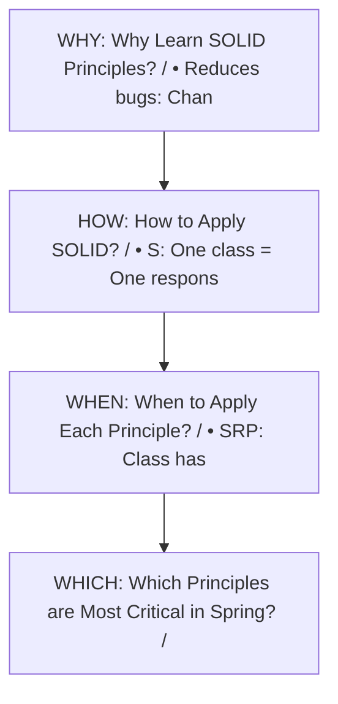
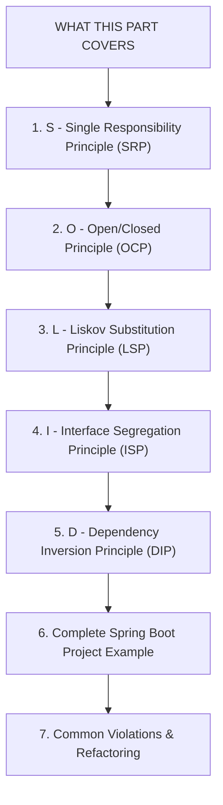
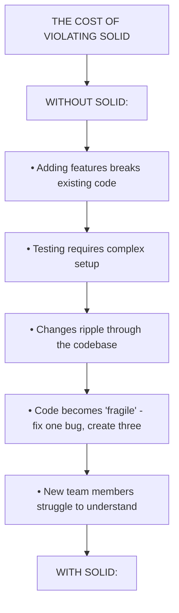
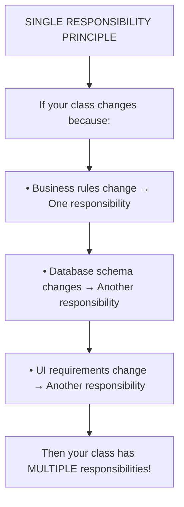
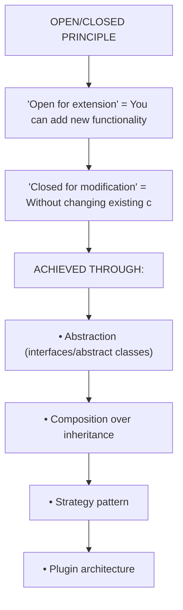
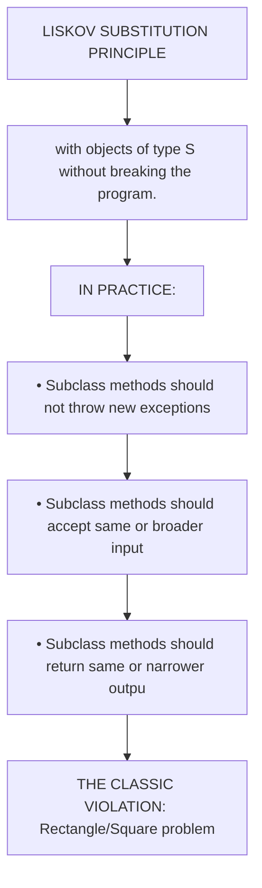

**Navigation**: [Back to Index](../00_MASTER_INDEX.md) | [Next Chapter >](Ch39_SB_SOLID_Advanced.md)

---

# 🏗️ SPRING BOOT MASTERY - Part 16: SOLID Principles Deep Dive

**Object-Oriented Design Principles with Real Spring Examples**
_"Write maintainable, flexible, and robust code"_

---

# 🎯 WHY-HOW-WHEN-WHICH FRAMEWORK

```
┌─────────────────────────────────────────────────────────────────────────────────┐
│  WHY: Why Learn SOLID Principles?                                               │
├─────────────────────────────────────────────────────────────────────────────────┤
│  • Reduces bugs: Changes don't break existing functionality                     │
│  • Interview essential: Asked in every senior Java interview                    │
│  • Spring is built on SOLID (IoC = DIP, @Component = SRP)                       │
│  • Enables testability: Well-designed code is easy to test                      │
│  • Team scalability: Multiple devs can work without conflicts                   │
└─────────────────────────────────────────────────────────────────────────────────┘

┌─────────────────────────────────────────────────────────────────────────────────┐
│  HOW: How to Apply SOLID?                                                       │
├─────────────────────────────────────────────────────────────────────────────────┤
│  • S: One class = One responsibility (UserService only handles users)           │
│  • O: Extend behavior without modifying existing code (Strategy pattern)        │
│  • L: Subtypes must be substitutable for their base types                       │
│  • I: Many specific interfaces > one general interface                          │
│  • D: Depend on abstractions, not concrete implementations                      │
└─────────────────────────────────────────────────────────────────────────────────┘

┌─────────────────────────────────────────────────────────────────────────────────┐
│  WHEN: When to Apply Each Principle?                                            │
├─────────────────────────────────────────────────────────────────────────────────┤
│  • SRP: Class has more than one reason to change → Split it                     │
│  • OCP: Adding feature requires modifying existing code → Use abstraction       │
│  • LSP: Subclass throws exceptions parent doesn't → Redesign hierarchy          │
│  • ISP: Class implements methods it doesn't need → Split interface              │
│  • DIP: Hard to test due to concrete dependencies → Inject interfaces           │
└─────────────────────────────────────────────────────────────────────────────────┘

┌─────────────────────────────────────────────────────────────────────────────────┐
│  WHICH: Which Principles are Most Critical in Spring?                           │
├─────────────────────────────────────────────────────────────────────────────────┤
│  ESSENTIAL:     DIP (entire IoC is based on it), SRP (service layer design)     │
│  IMPORTANT:     OCP (extensible configurations), ISP (repository interfaces)    │
│  ADVANCED:      LSP (exception handling hierarchies)                            │
└─────────────────────────────────────────────────────────────────────────────────┘
```

**Flow:**
1. WHY: Why Learn SOLID Principles? / • Reduces bugs: Chan
2. HOW: How to Apply SOLID? / • S: One class = One respons
3. WHEN: When to Apply Each Principle? / • SRP: Class has
4. WHICH: Which Principles are Most Critical in Spring? /



---

# 📌 Table of Contents

```
┌─────────────────────────────────────────────────────────────────────────────────┐
│              WHAT THIS PART COVERS                                              │
├─────────────────────────────────────────────────────────────────────────────────┤
│                                                                                 │
│  1. S - Single Responsibility Principle (SRP)                                   │
│  2. O - Open/Closed Principle (OCP)                                             │
│  3. L - Liskov Substitution Principle (LSP)                                     │
│  4. I - Interface Segregation Principle (ISP)                                   │
│  5. D - Dependency Inversion Principle (DIP)                                    │
│  6. Complete Spring Boot Project Example                                        │
│  7. Common Violations & Refactoring                                             │
│  8. SOLID in Microservices                                                      │
│                                                                                 │
└─────────────────────────────────────────────────────────────────────────────────┘
```

**Flow:**
1. WHAT THIS PART COVERS
2. 1. S - Single Responsibility Principle (SRP)
3. 2. O - Open/Closed Principle (OCP)
4. 3. L - Liskov Substitution Principle (LSP)
5. 4. I - Interface Segregation Principle (ISP)
6. 5. D - Dependency Inversion Principle (DIP)
7. 6. Complete Spring Boot Project Example



---

# 🏛️ Why SOLID Matters

```
┌─────────────────────────────────────────────────────────────────────────────────┐
│              THE COST OF VIOLATING SOLID                                        │
├─────────────────────────────────────────────────────────────────────────────────┤
│                                                                                 │
│  WITHOUT SOLID:                                                                 │
│  • Adding features breaks existing code                                         │
│  • Testing requires complex setup                                               │
│  • Changes ripple through the codebase                                          │
│  • Code becomes "fragile" - fix one bug, create three                           │
│  • New team members struggle to understand                                      │
│                                                                                 │
│  WITH SOLID:                                                                    │
│  • Features can be added without modifying existing code                        │
│  • Each class can be tested in isolation                                        │
│  • Changes are localized                                                        │
│  • Code is modular and replaceable                                              │
│  • The system is easier to understand                                           │
│                                                                                 │
└─────────────────────────────────────────────────────────────────────────────────┘
```

**Flow:**
1. THE COST OF VIOLATING SOLID
2. WITHOUT SOLID:
3. • Adding features breaks existing code
4. • Testing requires complex setup
5. • Changes ripple through the codebase
6. • Code becomes 'fragile' - fix one bug, create three
7. • New team members struggle to understand



---

# 📐 Section 1: Single Responsibility Principle (srp)

---

## Chapter 1: "A class should have only one reason to change"

```
┌─────────────────────────────────────────────────────────────────────────────────┐
│              SINGLE RESPONSIBILITY PRINCIPLE                                    │
├─────────────────────────────────────────────────────────────────────────────────┤
│                                                                                 │
│  KEY INSIGHT: "One reason to change" = "One actor/stakeholder"                  │
│                                                                                 │
│  If your class changes because:                                                 │
│  • Business rules change → One responsibility                                   │
│  • Database schema changes → Another responsibility                             │
│  • UI requirements change → Another responsibility                              │
│                                                                                 │
│  Then your class has MULTIPLE responsibilities!                                 │
│                                                                                 │
└─────────────────────────────────────────────────────────────────────────────────┘
```

**Flow:**
1. SINGLE RESPONSIBILITY PRINCIPLE
2. If your class changes because:
3. • Business rules change
4. One responsibility
5. • Business rules change
6. One responsibility
7. • Database schema changes
8. Another responsibility
9. • Database schema changes
10. Another responsibility
11. • UI requirements change
12. Another responsibility
13. • UI requirements change
14. Another responsibility
15. Then your class has MULTIPLE responsibilities!



### ❌ VIOLATING SRP

```java
/**
 * VIOLATION: This class has 4 reasons to change:
 * 1. Business rules (calculateTotalPrice)
 * 2. Database logic (saveToDatabase)
 * 3. Notification logic (sendConfirmationEmail)
 * 4. Report generation (generateReport)
 */
@Service
public class OrderService {

    @Autowired
    private JdbcTemplate jdbcTemplate;
    
    @Autowired
    private JavaMailSender mailSender;

    public void processOrder(Order order) {
        // Business logic
        double total = calculateTotalPrice(order);
        order.setTotal(total);
        
        // Database logic
        saveToDatabase(order);
        
        // Notification logic
        sendConfirmationEmail(order);
        
        // Reporting logic
        generateReport(order);
    }
    
    private double calculateTotalPrice(Order order) {
        double subtotal = order.getItems().stream()
            .mapToDouble(item -> item.getPrice() * item.getQuantity())
            .sum();
        double tax = subtotal * 0.1;
        double discount = calculateDiscount(order);
        return subtotal + tax - discount;
    }
    
    private double calculateDiscount(Order order) {
        if (order.getCustomer().isPremium()) {
            return order.getTotal() * 0.15;
        }
        return 0;
    }
    
    private void saveToDatabase(Order order) {
        jdbcTemplate.update(
            "INSERT INTO orders (id, customer_id, total, status) VALUES (?, ?, ?, ?)",
            order.getId(), order.getCustomer().getId(), order.getTotal(), "PENDING"
        );
        
        for (OrderItem item : order.getItems()) {
            jdbcTemplate.update(
                "INSERT INTO order_items (order_id, product_id, quantity, price) VALUES (?, ?, ?, ?)",
                order.getId(), item.getProduct().getId(), item.getQuantity(), item.getPrice()
            );
        }
    }
    
    private void sendConfirmationEmail(Order order) {
        SimpleMailMessage message = new SimpleMailMessage();
        message.setTo(order.getCustomer().getEmail());
        message.setSubject("Order Confirmation #" + order.getId());
        message.setText("Thank you for your order. Total: $" + order.getTotal());
        mailSender.send(message);
    }
    
    private void generateReport(Order order) {
        // Generate PDF report...
        String html = "<html><body><h1>Order Report</h1>...</body></html>";
        // Convert to PDF...
        // Save to filesystem...
    }
}
```

### ✅ APPLYING SRP

```java
// ============== SEPARATED CONCERNS ==============

/**
 * OrderService - ONLY orchestrates the order process
 * Single reason to change: Order processing workflow changes
 */
@Service
@RequiredArgsConstructor
@Slf4j
public class OrderService {

    private final OrderPricingService pricingService;
    private final OrderRepository orderRepository;
    private final NotificationService notificationService;
    private final ReportService reportService;

    @Transactional
    public OrderResponse processOrder(CreateOrderRequest request) {
        log.info("Processing order for customer: {}", request.getCustomerId());
        
        // Delegate to specialized services
        Order order = createOrder(request);
        
        // Calculate pricing (delegated)
        OrderPricing pricing = pricingService.calculatePricing(order);
        order.applyPricing(pricing);
        
        // Persist (delegated)
        Order savedOrder = orderRepository.save(order);
        
        // Notifications (delegated, async)
        notificationService.sendOrderConfirmation(savedOrder);
        
        // Reporting (delegated, async)
        reportService.generateOrderReport(savedOrder);
        
        return OrderResponse.from(savedOrder);
    }
    
    private Order createOrder(CreateOrderRequest request) {
        return Order.builder()
            .customerId(request.getCustomerId())
            .items(request.getItems().stream()
                .map(this::toOrderItem)
                .collect(Collectors.toList()))
            .status(OrderStatus.PENDING)
            .createdAt(LocalDateTime.now())
            .build();
    }
    
    private OrderItem toOrderItem(OrderItemRequest request) {
        return OrderItem.builder()
            .productId(request.getProductId())
            .quantity(request.getQuantity())
            .unitPrice(request.getPrice())
            .build();
    }
}

/**
 * OrderPricingService - ONLY handles pricing calculations
 * Single reason to change: Pricing rules change
 */
@Service
@RequiredArgsConstructor
public class OrderPricingService {

    private final DiscountService discountService;
    private final TaxService taxService;

    public OrderPricing calculatePricing(Order order) {
        BigDecimal subtotal = calculateSubtotal(order);
        BigDecimal discount = discountService.calculateDiscount(order, subtotal);
        BigDecimal tax = taxService.calculateTax(subtotal.subtract(discount));
        BigDecimal total = subtotal.subtract(discount).add(tax);
        
        return OrderPricing.builder()
            .subtotal(subtotal)
            .discount(discount)
            .tax(tax)
            .total(total)
            .build();
    }
    
    private BigDecimal calculateSubtotal(Order order) {
        return order.getItems().stream()
            .map(item -> item.getUnitPrice().multiply(BigDecimal.valueOf(item.getQuantity())))
            .reduce(BigDecimal.ZERO, BigDecimal::add);
    }
}

/**
 * DiscountService - ONLY handles discount calculations
 * Single reason to change: Discount rules change
 */
@Service
@RequiredArgsConstructor
public class DiscountService {

    private final CustomerRepository customerRepository;

    public BigDecimal calculateDiscount(Order order, BigDecimal subtotal) {
        Customer customer = customerRepository.findById(order.getCustomerId())
            .orElseThrow(() -> new CustomerNotFoundException(order.getCustomerId()));
        
        if (customer.getTier() == CustomerTier.PREMIUM) {
            return subtotal.multiply(BigDecimal.valueOf(0.15));
        } else if (customer.getTier() == CustomerTier.GOLD) {
            return subtotal.multiply(BigDecimal.valueOf(0.10));
        }
        
        return BigDecimal.ZERO;
    }
}

/**
 * TaxService - ONLY handles tax calculations
 * Single reason to change: Tax regulations change
 */
@Service
public class TaxService {

    private static final BigDecimal TAX_RATE = BigDecimal.valueOf(0.10);

    public BigDecimal calculateTax(BigDecimal taxableAmount) {
        return taxableAmount.multiply(TAX_RATE);
    }
}

/**
 * NotificationService - ONLY handles notifications
 * Single reason to change: Notification requirements change
 */
@Service
@RequiredArgsConstructor
@Slf4j
public class NotificationService {

    private final EmailService emailService;
    private final SmsService smsService;

    @Async
    public void sendOrderConfirmation(Order order) {
        try {
            emailService.sendOrderConfirmationEmail(order);
            
            if (order.getCustomer().isSmsEnabled()) {
                smsService.sendOrderConfirmationSms(order);
            }
        } catch (Exception e) {
            log.error("Failed to send notification for order: {}", order.getId(), e);
            // Don't fail the order process due to notification failure
        }
    }
}

/**
 * EmailService - ONLY handles email sending
 * Single reason to change: Email infrastructure changes
 */
@Service
@RequiredArgsConstructor
public class EmailService {

    private final JavaMailSender mailSender;
    private final EmailTemplateService templateService;

    public void sendOrderConfirmationEmail(Order order) {
        String body = templateService.generateOrderConfirmationBody(order);
        
        SimpleMailMessage message = new SimpleMailMessage();
        message.setTo(order.getCustomer().getEmail());
        message.setSubject("Order Confirmation #" + order.getId());
        message.setText(body);
        
        mailSender.send(message);
    }
}

/**
 * ReportService - ONLY handles report generation
 * Single reason to change: Report format/requirements change
 */
@Service
@RequiredArgsConstructor
public class ReportService {

    private final PdfGenerator pdfGenerator;
    private final ReportRepository reportRepository;

    @Async
    public void generateOrderReport(Order order) {
        byte[] pdfContent = pdfGenerator.generateOrderReport(order);
        
        Report report = Report.builder()
            .orderId(order.getId())
            .content(pdfContent)
            .generatedAt(LocalDateTime.now())
            .build();
        
        reportRepository.save(report);
    }
}
```

---

# 📐 Section 2: Open/closed Principle (ocp)

---

## Chapter 2: "Open for extension, closed for modification"

```
┌─────────────────────────────────────────────────────────────────────────────────┐
│              OPEN/CLOSED PRINCIPLE                                              │
├─────────────────────────────────────────────────────────────────────────────────┤
│                                                                                 │
│  KEY INSIGHT: Add NEW behavior without changing EXISTING code                   │
│                                                                                 │
│  "Open for extension"    = You can add new functionality                        │
│  "Closed for modification" = Without changing existing code                     │
│                                                                                 │
│  ACHIEVED THROUGH:                                                              │
│  • Abstraction (interfaces/abstract classes)                                    │
│  • Composition over inheritance                                                 │
│  • Strategy pattern                                                             │
│  • Plugin architecture                                                          │
│                                                                                 │
└─────────────────────────────────────────────────────────────────────────────────┘
```

**Flow:**
1. OPEN/CLOSED PRINCIPLE
2. 'Open for extension' = You can add new functionality
3. 'Closed for modification' = Without changing existing c
4. ACHIEVED THROUGH:
5. • Abstraction (interfaces/abstract classes)
6. • Composition over inheritance
7. • Strategy pattern



### ❌ VIOLATING OCP

```java
/**
 * VIOLATION: Adding a new payment method requires modifying this class
 * Every new payment type = another if/else branch
 */
@Service
public class PaymentService {

    @Autowired
    private StripeClient stripeClient;
    
    @Autowired
    private PayPalClient payPalClient;

    public PaymentResult processPayment(Order order, PaymentMethod method) {
        
        if (method == PaymentMethod.CREDIT_CARD) {
            // Credit card logic
            return stripeClient.charge(
                order.getTotal(),
                order.getCreditCardToken()
            );
        } 
        else if (method == PaymentMethod.PAYPAL) {
            // PayPal logic
            return payPalClient.executePayment(
                order.getPayPalPaymentId()
            );
        }
        else if (method == PaymentMethod.BANK_TRANSFER) {
            // Bank transfer logic - ADDED LATER (modified existing code!)
            return processBankTransfer(order);
        }
        else if (method == PaymentMethod.CRYPTO) {
            // Crypto logic - ADDED EVEN LATER (modified again!)
            return processCrypto(order);
        }
        // Every new payment method = more modification!
        
        throw new UnsupportedPaymentMethodException(method);
    }
    
    private PaymentResult processBankTransfer(Order order) { ... }
    private PaymentResult processCrypto(Order order) { ... }
}
```

### ✅ APPLYING OCP - Strategy Pattern

```java
// ============== STRATEGY INTERFACE ==============

/**
 * PaymentProcessor - The abstraction
 * Add new payment methods by ADDING new implementations
 * The PaymentService never needs to change!
 */
public interface PaymentProcessor {
    
    /**
     * @return true if this processor can handle the payment request
     */
    boolean supports(PaymentRequest request);
    
    /**
     * Process the payment
     */
    PaymentResult process(PaymentRequest request);
    
    /**
     * Get the payment method this processor handles
     */
    PaymentMethod getPaymentMethod();
}

// ============== CONCRETE IMPLEMENTATIONS ==============

@Component
@RequiredArgsConstructor
@Slf4j
public class CreditCardPaymentProcessor implements PaymentProcessor {

    private final StripeClient stripeClient;

    @Override
    public boolean supports(PaymentRequest request) {
        return request.getMethod() == PaymentMethod.CREDIT_CARD;
    }

    @Override
    public PaymentResult process(PaymentRequest request) {
        log.info("Processing credit card payment: {}", request.getOrderId());
        
        CreditCardDetails details = (CreditCardDetails) request.getPaymentDetails();
        
        StripeChargeRequest stripeRequest = StripeChargeRequest.builder()
            .amount(request.getAmount())
            .currency(request.getCurrency())
            .token(details.getToken())
            .description("Order #" + request.getOrderId())
            .build();
        
        StripeChargeResponse response = stripeClient.charge(stripeRequest);
        
        return PaymentResult.builder()
            .success(response.isSuccessful())
            .transactionId(response.getChargeId())
            .message(response.getMessage())
            .build();
    }

    @Override
    public PaymentMethod getPaymentMethod() {
        return PaymentMethod.CREDIT_CARD;
    }
}

@Component
@RequiredArgsConstructor
@Slf4j
public class PayPalPaymentProcessor implements PaymentProcessor {

    private final PayPalClient payPalClient;

    @Override
    public boolean supports(PaymentRequest request) {
        return request.getMethod() == PaymentMethod.PAYPAL;
    }

    @Override
    public PaymentResult process(PaymentRequest request) {
        log.info("Processing PayPal payment: {}", request.getOrderId());
        
        PayPalDetails details = (PayPalDetails) request.getPaymentDetails();
        
        PayPalExecuteResponse response = payPalClient.executePayment(
            details.getPaymentId(),
            details.getPayerId()
        );
        
        return PaymentResult.builder()
            .success(response.getState().equals("approved"))
            .transactionId(response.getId())
            .message(response.getState())
            .build();
    }

    @Override
    public PaymentMethod getPaymentMethod() {
        return PaymentMethod.PAYPAL;
    }
}

/**
 * NEW PAYMENT METHOD - Just add a new class!
 * No modification to existing code required
 */
@Component
@RequiredArgsConstructor
@Slf4j
public class CryptoPaymentProcessor implements PaymentProcessor {

    private final CryptoGatewayClient cryptoClient;

    @Override
    public boolean supports(PaymentRequest request) {
        return request.getMethod() == PaymentMethod.CRYPTO;
    }

    @Override
    public PaymentResult process(PaymentRequest request) {
        log.info("Processing crypto payment: {}", request.getOrderId());
        
        CryptoDetails details = (CryptoDetails) request.getPaymentDetails();
        
        CryptoPaymentResponse response = cryptoClient.processPayment(
            details.getWalletAddress(),
            details.getCryptoCurrency(),
            request.getAmount()
        );
        
        return PaymentResult.builder()
            .success(response.isConfirmed())
            .transactionId(response.getTxHash())
            .message(response.getStatus())
            .build();
    }

    @Override
    public PaymentMethod getPaymentMethod() {
        return PaymentMethod.CRYPTO;
    }
}

// ============== PAYMENT SERVICE - CLOSED FOR MODIFICATION ==============

/**
 * PaymentService - Uses all available processors
 * NEVER needs to change when adding new payment methods!
 */
@Service
@RequiredArgsConstructor
@Slf4j
public class PaymentService {

    // Spring automatically injects ALL PaymentProcessor implementations
    private final List<PaymentProcessor> paymentProcessors;

    public PaymentResult processPayment(PaymentRequest request) {
        log.info("Processing payment for order {} with method {}", 
            request.getOrderId(), request.getMethod());
        
        PaymentProcessor processor = findProcessor(request);
        
        return processor.process(request);
    }
    
    private PaymentProcessor findProcessor(PaymentRequest request) {
        return paymentProcessors.stream()
            .filter(p -> p.supports(request))
            .findFirst()
            .orElseThrow(() -> new UnsupportedPaymentMethodException(
                "No processor found for: " + request.getMethod()
            ));
    }
    
    public List<PaymentMethod> getAvailablePaymentMethods() {
        return paymentProcessors.stream()
            .map(PaymentProcessor::getPaymentMethod)
            .collect(Collectors.toList());
    }
}

// ============== SPRING AUTO-DISCOVERY ==============

/**
 * Spring automatically discovers all @Component classes implementing PaymentProcessor
 * Adding a new payment method is as simple as:
 * 1. Create a new class implementing PaymentProcessor
 * 2. Annotate with @Component
 * 3. Done! No other changes needed.
 */
```

### OCP with Decorator Pattern

```java
/**
 * Example: Adding behavior to notifications without modifying existing code
 */

// Base interface
public interface NotificationSender {
    void send(Notification notification);
}

// Base implementation
@Component("emailNotificationSender")
public class EmailNotificationSender implements NotificationSender {
    
    @Override
    public void send(Notification notification) {
        // Send email
        System.out.println("Sending email: " + notification.getMessage());
    }
}

// Decorator - adds logging without modifying EmailNotificationSender
@Component
@Primary
public class LoggingNotificationDecorator implements NotificationSender {

    private final NotificationSender delegate;

    public LoggingNotificationDecorator(
            @Qualifier("emailNotificationSender") NotificationSender delegate) {
        this.delegate = delegate;
    }

    @Override
    public void send(Notification notification) {
        log.info("About to send notification: {}", notification.getId());
        long startTime = System.currentTimeMillis();
        
        delegate.send(notification);
        
        long duration = System.currentTimeMillis() - startTime;
        log.info("Notification sent in {}ms", duration);
    }
}

// Another decorator - adds retry without modifying existing code
@Component
public class RetryableNotificationDecorator implements NotificationSender {

    private final NotificationSender delegate;
    private final int maxRetries = 3;

    public RetryableNotificationDecorator(
            @Qualifier("loggingNotificationDecorator") NotificationSender delegate) {
        this.delegate = delegate;
    }

    @Override
    public void send(Notification notification) {
        int attempts = 0;
        while (attempts < maxRetries) {
            try {
                delegate.send(notification);
                return;
            } catch (Exception e) {
                attempts++;
                if (attempts >= maxRetries) {
                    throw e;
                }
                log.warn("Retry attempt {} for notification {}", attempts, notification.getId());
            }
        }
    }
}
```

---

# 📐 Section 3: Liskov Substitution Principle (lsp)

---

## Chapter 3: "Subtypes must be substitutable for their base types"

```
┌─────────────────────────────────────────────────────────────────────────────────┐
│              LISKOV SUBSTITUTION PRINCIPLE                                      │
├─────────────────────────────────────────────────────────────────────────────────┤
│                                                                                 │
│  If S is a subtype of T, then objects of type T can be replaced                 │
│  with objects of type S without breaking the program.                           │
│                                                                                 │
│  IN PRACTICE:                                                                   │
│  • Subclass methods should not throw new exceptions                             │
│  • Subclass methods should accept same or broader input                         │
│  • Subclass methods should return same or narrower output                       │
│  • Subclass should honor base class contracts (preconditions, postconditions)   │
│                                                                                 │
│  THE CLASSIC VIOLATION: Rectangle/Square problem                                │
│                                                                                 │
└─────────────────────────────────────────────────────────────────────────────────┘
```

**Flow:**
1. LISKOV SUBSTITUTION PRINCIPLE
2. with objects of type S without breaking the program.
3. IN PRACTICE:
4. • Subclass methods should not throw new exceptions
5. • Subclass methods should accept same or broader input
6. • Subclass methods should return same or narrower outpu
7. THE CLASSIC VIOLATION: Rectangle/Square problem



### ❌ CLASSIC LSP VIOLATION

```java
/**
 * VIOLATION: Square is NOT a proper subtype of Rectangle
 * Code that works with Rectangle breaks when given a Square
 */
public class Rectangle {
    protected int width;
    protected int height;
    
    public void setWidth(int width) {
        this.width = width;
    }
    
    public void setHeight(int height) {
        this.height = height;
    }
    
    public int getArea() {
        return width * height;
    }
}

public class Square extends Rectangle {
    
    @Override
    public void setWidth(int width) {
        // Violates LSP - changes behavior unexpectedly
        this.width = width;
        this.height = width;  // Also changes height!
    }
    
    @Override
    public void setHeight(int height) {
        // Violates LSP - changes behavior unexpectedly
        this.width = height;  // Also changes width!
        this.height = height;
    }
}

// This test FAILS with Square but PASSES with Rectangle
public void testRectangle(Rectangle rect) {
    rect.setWidth(5);
    rect.setHeight(4);
    
    // Expected: 20
    // With Rectangle: 20 ✓
    // With Square: 16 ✗ (5*5 then 4*4 = 16)
    assert rect.getArea() == 20;
}
```

### ❌ LSP VIOLATION IN SPRING

```java
/**
 * VIOLATION: ReadOnlyUserRepository breaks UserRepository contract
 */
public interface UserRepository {
    User save(User user);
    Optional<User> findById(Long id);
    void delete(Long id);
}

@Repository
public class JpaUserRepository implements UserRepository {
    
    @Override
    public User save(User user) {
        return entityManager.merge(user);
    }
    
    @Override
    public Optional<User> findById(Long id) {
        return Optional.ofNullable(entityManager.find(User.class, id));
    }
    
    @Override
    public void delete(Long id) {
        User user = entityManager.find(User.class, id);
        if (user != null) {
            entityManager.remove(user);
        }
    }
}

/**
 * VIOLATES LSP!
 * Code using UserRepository expects save() and delete() to work
 * This implementation breaks that expectation
 */
@Repository
public class ReadOnlyUserRepository implements UserRepository {
    
    @Override
    public User save(User user) {
        throw new UnsupportedOperationException("Read-only repository!");
    }
    
    @Override
    public Optional<User> findById(Long id) {
        // This works...
    }
    
    @Override
    public void delete(Long id) {
        throw new UnsupportedOperationException("Read-only repository!");
    }
}

// Any code using UserRepository will break with ReadOnlyUserRepository
public class UserService {
    private final UserRepository userRepository;
    
    public void createUser(User user) {
        userRepository.save(user);  // BOOM! UnsupportedOperationException
    }
}
```

### ✅ APPLYING LSP

```java
// ============== PROPER INTERFACE SEGREGATION ==============

/**
 * SOLUTION: Separate read and write contracts
 */
public interface UserReader {
    Optional<User> findById(Long id);
    List<User> findAll();
    boolean existsById(Long id);
}

public interface UserWriter {
    User save(User user);
    void delete(Long id);
}

// Full repository implements both
public interface UserRepository extends UserReader, UserWriter {
}

@Repository
public class JpaUserRepository implements UserRepository {
    
    @Override
    public User save(User user) {
        return entityManager.merge(user);
    }
    
    @Override
    public Optional<User> findById(Long id) {
        return Optional.ofNullable(entityManager.find(User.class, id));
    }
    
    @Override
    public void delete(Long id) {
        User user = entityManager.find(User.class, id);
        if (user != null) {
            entityManager.remove(user);
        }
    }
    
    @Override
    public List<User> findAll() {
        return entityManager.createQuery("SELECT u FROM User u", User.class)
            .getResultList();
    }
    
    @Override
    public boolean existsById(Long id) {
        return findById(id).isPresent();
    }
}

// Read-only service only depends on UserReader - LSP satisfied!
@Service
public class UserQueryService {
    private final UserReader userReader;  // Only needs read operations
    
    public UserQueryService(UserReader userReader) {
        this.userReader = userReader;
    }
    
    public UserDto findUser(Long id) {
        return userReader.findById(id)
            .map(this::toDto)
            .orElseThrow(() -> new UserNotFoundException(id));
    }
}

// Write service uses full repository
@Service
public class UserCommandService {
    private final UserRepository userRepository;  // Needs both read and write
    
    public UserCommandService(UserRepository userRepository) {
        this.userRepository = userRepository;
    }
    
    @Transactional
    public UserDto createUser(CreateUserRequest request) {
        User user = toEntity(request);
        User saved = userRepository.save(user);
        return toDto(saved);
    }
}
```

### LSP in Exception Handling

```java
/**
 * LSP Rule: Subtypes should not throw new/unexpected exceptions
 */

// ❌ VIOLATION
public interface DataProcessor {
    void process(String data);  // No checked exceptions declared
}

public class FileDataProcessor implements DataProcessor {
    @Override
    public void process(String data) {
        // Forces callers to handle IOException they didn't expect!
        throw new IOException("File error");  // Compile error (checked exception)
    }
}

// ✅ CORRECT - Use runtime exceptions or declare in interface
public interface DataProcessor {
    void process(String data) throws ProcessingException;  // Declared!
}

public class ProcessingException extends RuntimeException {
    public ProcessingException(String message) {
        super(message);
    }
    
    public ProcessingException(String message, Throwable cause) {
        super(message, cause);
    }
}

public class FileDataProcessor implements DataProcessor {
    @Override
    public void process(String data) throws ProcessingException {
        try {
            // File operations...
        } catch (IOException e) {
            throw new ProcessingException("Failed to process file", e);
        }
    }
}

public class DatabaseDataProcessor implements DataProcessor {
    @Override
    public void process(String data) throws ProcessingException {
        try {
            // Database operations...
        } catch (SQLException e) {
            throw new ProcessingException("Failed to process database", e);
        }
    }
}
```

---


---


🔬 **Section Challenge — Chapter 3: "Subtypes must be substitutable for their base types"**

**Challenge 1 (Reasoning):** You write `List<String> list = new ArrayList<>();`. At runtime, can you check `list instanceof List<String>`?
<details><summary>Answer</summary>

No — `instanceof List<String>` is a compile error. After erasure, it's just `List` at runtime. Use `instanceof List<?>` for an unparameterized check. This is why you can't do `new T()`, `new T[]`, or `T.class` — T doesn't exist at runtime.
</details>

**Challenge 2 (Bug Hunt):** A method returns `(T) jsonDeserialize(json)` where T is a generic type param. When does the `ClassCastException` actually occur?
<details><summary>Answer</summary>

NOT at the cast — the unchecked cast compiles to nothing at runtime (erasure). The CCE occurs when the calling code tries to USE the returned value as a specific type. This makes debugging hard: the error appears far from the actual source. Use `Class<T> clazz` parameter to do safe `clazz.cast(...)` instead.
</details>


## 🏋️ Practice & Interview Questions — OOP & Design Patterns

### Predict / Trace
**Q1.** What design pattern does this code follow?
```java
Logger logger = Logger.getInstance();
```
<details><summary>Answer</summary>

**Singleton** — ensures only one Logger instance exists globally.
</details>

**Q2.** What SOLID principle is violated?
```java
class User {
    void login() { ... }
    void logout() { ... }
    void sendEmail() { ... }  // ← ?
    void generateReport() { ... }  // ← ?
}
```
<details><summary>Answer</summary>

**SRP (Single Responsibility)** — User class has 4 responsibilities: authentication, email, reporting. Should be split into: `AuthService`, `EmailService`, `ReportService`.
</details>

### Design Pattern Problems
**Q3.** ⭐ Implement Strategy pattern for payment processing.
<details><summary>Solution</summary>

```java
interface PaymentStrategy { void pay(int amount); }
class CreditCard implements PaymentStrategy { public void pay(int amount){ /*...*/ } }
class PayPal implements PaymentStrategy { public void pay(int amount){ /*...*/ } }
class UPI implements PaymentStrategy { public void pay(int amount){ /*...*/ } }

class PaymentContext {
    private PaymentStrategy strategy;
    void setStrategy(PaymentStrategy s){ this.strategy=s; }
    void processPayment(int amount){ strategy.pay(amount); }
}
// Switch strategy at runtime — open/closed principle!
```
</details>

**Q4.** ⭐⭐ Implement Observer pattern for event notification.
<details><summary>Solution</summary>

```java
interface Observer { void update(String event); }
interface Observable {
    void subscribe(Observer o); void unsubscribe(Observer o); void notify(String event);
}
class EventBus implements Observable {
    List<Observer> observers = new ArrayList<>();
    public void subscribe(Observer o){ observers.add(o); }
    public void unsubscribe(Observer o){ observers.remove(o); }
    public void notify(String event){ observers.forEach(o -> o.update(event)); }
}
```
</details>

**Q5.** ⭐⭐ Builder pattern for a complex configuration object.
<details><summary>Solution</summary>

```java
class ServerConfig {
    private final String host; private final int port; private final int timeout;
    private ServerConfig(Builder b){ host=b.host; port=b.port; timeout=b.timeout; }

    static class Builder {
        String host="localhost"; int port=8080; int timeout=30;
        Builder host(String h){ host=h; return this; }
        Builder port(int p){ port=p; return this; }
        Builder timeout(int t){ timeout=t; return this; }
        ServerConfig build(){ return new ServerConfig(this); }
    }
}
// ServerConfig config = new ServerConfig.Builder().host("prod.com").port(443).build();
```
</details>

### MCQ Rapid Fire
| # | Question | Answer |
|---|---|---|
| 1 | SOLID: O stands for | Open/Closed Principle |
| 2 | Factory vs Abstract Factory | Factory: one product; Abstract Factory: family of products |
| 3 | Composition over inheritance means | Prefer has-a (field) over is-a (extends) for flexibility |
| 4 | Decorator pattern purpose | Add behavior dynamically without subclassing |
| 5 | Facade pattern purpose | Simplified interface to complex subsystem |
| 6 | Proxy pattern types | Virtual, protective, remote, caching |
| 7 | Command pattern encapsulates | Request as an object (supports undo/redo) |
| 8 | Template Method pattern | Defines algorithm skeleton, subclasses fill in steps |


---

## 🧠 Deep Conceptual Questions — OOP, SOLID & Design Patterns

**C1. What is the difference between an interface and an abstract class — when to use each?**
<details><summary>Deep Answer</summary>

**Abstract class**: can have fields, constructors, concrete method implementations. Models IS-A with shared state and behavior. Use when: you have partial implementation to share (template method pattern). Single inheritance: if you extend an abstract class, you can't extend another. **Interface**: pure contract, no state (Java 8+: default methods allowed). Models CAN-DO / role capability. A class can implement unlimited interfaces. Use when: defining a capability across unrelated classes (`Comparable`, `Serializable`, `Runnable`). Rule: prefer interfaces for type definitions. Use abstract class when you need to share implementation code AND all subtypes share the same "IS-A" relationship. In practice: interfaces + composition > abstract class + inheritance.
</details>

**C2. Liskov Substitution Principle: what does it actually mean and how do you violate it?**
<details><summary>Deep Answer</summary>

LSP: if `S extends P`, anywhere you use `P`, you should be able to use `S` without breaking correctness. Violation example: `Square extends Rectangle`. Rectangle behavior: setWidth and setHeight are independent. Square invariant: width must equal height. `Square s = new Square(5); s.setWidth(10);` — now `s.getHeight() == 10` (Square enforced equality) but Rectangle contract says height should still be 5. Code using Rectangle is surprised. Better: Square and Rectangle as siblings under a Shape hierarchy. Another classic: override a method and throw exception for a case the parent method handled → violates LSP. Test: can you run the parent's test suite against the child and pass?
</details>

**C3. Strategy pattern vs. if-else chains: the OCP argument.**
<details><summary>Deep Answer</summary>

```java
// BAD: add new payment type = modify this method = Open for modification (violates OCP)
if(type == "credit") { } else if(type == "paypal") { } else if(type == "crypto") { }

// GOOD: add new payment = new class, zero modification of existing code
interface PaymentStrategy { void pay(int amount); }
// Add Crypto: new CryptoPayment implements PaymentStrategy — no other file touched
```
Open/Closed Principle: open for extension, closed for modification. Each `else if` = a modification to an existing method = risk of breaking existing behavior, requires re-testing the entire method. Strategy = extension by new class = old code untouched = zero regression risk. When if-else is fine: 2-3 fixed cases that never change. When strategy shines: extensible behaviors that vary at runtime.
</details>

**C4. What is the Dependency Inversion Principle and how does it enable testability?**
<details><summary>Deep Answer</summary>

DIP: high-level modules should not depend on low-level modules — both should depend on abstractions. Without DIP: `OrderService` directly creates `MySQLOrderRepository`. To test OrderService: must have MySQL running. With DIP: `OrderService` depends on `OrderRepository` interface. In production: inject `MySQLOrderRepository`. In tests: inject `MockOrderRepository`. The high-level business logic (OrderService) has zero knowledge of the database layer. This makes: unit testing trivial (mock the interface), swapping implementations easy (SQLite, PostgreSQL, in-memory), layer boundaries clear. Dependency INJECTION (DI framework like Spring) is the mechanism that enables DIP at runtime.
</details>

**C5. Observer pattern vs. Event Bus: when does one become the other?**
<details><summary>Deep Answer</summary>

**Observer**: subject holds direct references to observer objects. Subject explicitly notifies each one. Tightly coupled (subject knows about observers). Fine for: small systems, known observers at compile time. Breaks when: observers span different modules, dynamic subscription needed, observers need to be remote. **Event Bus / Message Queue**: publishers and subscribers decoupled. Publisher sends event with a TYPE to the bus. Subscribers register for event types — publisher doesn't know who's listening. De-facto standard in large systems: Spring ApplicationEventPublisher, Kafka, RabbitMQ are all event buses. Rule: Observer for in-process tightly-coupled notification. Event bus for loose coupling, cross-module, or distributed communication.
</details>


> **Navigation**: [< Previous](Ch49_SB_WebFlux_Advanced.md) | [Back to Index](../00_MASTER_INDEX.md) | [Next >](Ch39_SB_SOLID_Advanced.md)