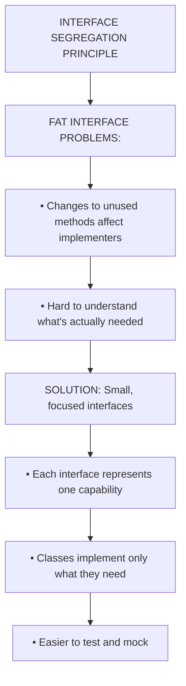
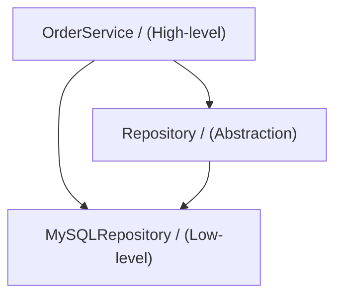
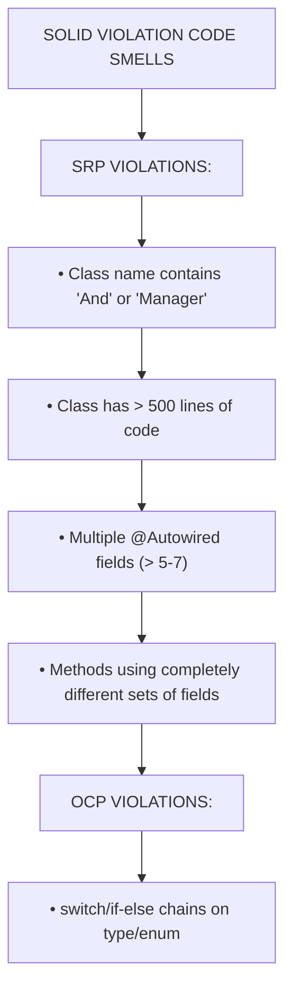

**Navigation**: [< Previous Chapter](Ch38_SB_SOLID_Core.md) | [Back to Index](../00_MASTER_INDEX.md)

---

# 📐 Section 4: Interface Segregation Principle (isp)

---

## Chapter 4: "Clients should not be forced to depend on interfaces they don't use"

```
┌─────────────────────────────────────────────────────────────────────────────────┐
│              INTERFACE SEGREGATION PRINCIPLE                                    │
├─────────────────────────────────────────────────────────────────────────────────┤
│                                                                                 │
│  FAT INTERFACE PROBLEMS:                                                        │
│  • Implementing classes forced to provide dummy implementations                 │
│  • Changes to unused methods affect implementers                                │
│  • Hard to understand what's actually needed                                    │
│                                                                                 │
│  SOLUTION: Small, focused interfaces                                            │
│  • Each interface represents one capability                                     │
│  • Classes implement only what they need                                        │
│  • Easier to test and mock                                                      │
│                                                                                 │
└─────────────────────────────────────────────────────────────────────────────────┘
```

**Flow:**
1. INTERFACE SEGREGATION PRINCIPLE
2. FAT INTERFACE PROBLEMS:
3. • Changes to unused methods affect implementers
4. • Hard to understand what's actually needed
5. SOLUTION: Small, focused interfaces
6. • Each interface represents one capability
7. • Classes implement only what they need



### ❌ VIOLATING ISP - Fat Interface

```java
/**
 * VIOLATION: "Fat" interface forces implementers to provide
 * methods they don't need or support
 */
public interface Worker {
    void work();
    void eat();
    void sleep();
    void attendMeeting();
    void submitTimesheet();
    void codeReview();
    void deployToProduction();
}

// Human worker uses all methods - OK
public class HumanWorker implements Worker {
    @Override public void work() { /* Working */ }
    @Override public void eat() { /* Eating */ }
    @Override public void sleep() { /* Sleeping */ }
    @Override public void attendMeeting() { /* In meeting */ }
    @Override public void submitTimesheet() { /* Submitting */ }
    @Override public void codeReview() { /* Reviewing */ }
    @Override public void deployToProduction() { /* Deploying */ }
}

// Robot worker - forced to implement methods that don't apply!
public class RobotWorker implements Worker {
    @Override public void work() { /* Working */ }
    
    @Override public void eat() { 
        throw new UnsupportedOperationException("Robots don't eat!");
    }
    
    @Override public void sleep() { 
        throw new UnsupportedOperationException("Robots don't sleep!");
    }
    
    @Override public void attendMeeting() {
        throw new UnsupportedOperationException("Robots can't attend meetings!");
    }
    
    @Override public void submitTimesheet() {
        throw new UnsupportedOperationException("Robots don't have timesheets!");
    }
    
    @Override public void codeReview() { /* Can do */ }
    @Override public void deployToProduction() { /* Can do */ }
}
```

### ✅ APPLYING ISP - Segregated Interfaces

```java
// ============== SEGREGATED INTERFACES ==============

/**
 * Small, focused interfaces - each represents one capability
 */
public interface Workable {
    void work();
}

public interface Feedable {
    void eat();
    void sleep();
}

public interface Meetable {
    void attendMeeting();
}

public interface Trackable {
    void submitTimesheet();
}

public interface CodeReviewer {
    void codeReview();
}

public interface Deployer {
    void deployToProduction();
}

// ============== IMPLEMENTATIONS ==============

/**
 * Human implements all relevant interfaces
 */
@Component
public class HumanDeveloper implements 
        Workable, Feedable, Meetable, Trackable, CodeReviewer, Deployer {
    
    @Override public void work() { log.info("Coding..."); }
    @Override public void eat() { log.info("Lunch break"); }
    @Override public void sleep() { log.info("Zzz..."); }
    @Override public void attendMeeting() { log.info("In standup"); }
    @Override public void submitTimesheet() { log.info("Submitted hours"); }
    @Override public void codeReview() { log.info("Reviewing PR"); }
    @Override public void deployToProduction() { log.info("Deploying..."); }
}

/**
 * Robot only implements what it can actually do
 */
@Component
public class RobotWorker implements Workable, CodeReviewer, Deployer {
    
    @Override public void work() { log.info("Automated task running"); }
    @Override public void codeReview() { log.info("Static analysis complete"); }
    @Override public void deployToProduction() { log.info("CI/CD pipeline triggered"); }
}

/**
 * Contractor - implements subset
 */
@Component
public class Contractor implements Workable, Trackable, CodeReviewer {
    
    @Override public void work() { log.info("Working on task"); }
    @Override public void submitTimesheet() { log.info("Invoice submitted"); }
    @Override public void codeReview() { log.info("Reviewing..."); }
}

// ============== SERVICES DEPEND ON SPECIFIC INTERFACES ==============

/**
 * MeetingScheduler only needs Meetable workers
 */
@Service
public class MeetingScheduler {
    private final List<Meetable> meetableWorkers;
    
    public MeetingScheduler(List<Meetable> meetableWorkers) {
        this.meetableWorkers = meetableWorkers;
    }
    
    public void scheduleDailyStandup() {
        meetableWorkers.forEach(Meetable::attendMeeting);
    }
}

/**
 * DeploymentService only needs Deployer capability
 */
@Service
public class DeploymentService {
    private final List<Deployer> deployers;
    
    public DeploymentService(List<Deployer> deployers) {
        this.deployers = deployers;
    }
    
    public void deployAll() {
        deployers.forEach(Deployer::deployToProduction);
    }
}

/**
 * TimesheetService only needs Trackable workers
 */
@Service
public class TimesheetService {
    private final List<Trackable> trackableWorkers;
    
    public TimesheetService(List<Trackable> trackableWorkers) {
        this.trackableWorkers = trackableWorkers;
    }
    
    public void collectTimesheets() {
        trackableWorkers.forEach(Trackable::submitTimesheet);
    }
}
```

### ISP in Spring Data Repositories

```java
/**
 * Spring Data repositories are a GREAT example of ISP
 */

// Base interfaces - segregated by capability
public interface Repository<T, ID> {
    // Marker interface
}

public interface CrudRepository<T, ID> extends Repository<T, ID> {
    <S extends T> S save(S entity);
    Optional<T> findById(ID id);
    Iterable<T> findAll();
    void deleteById(ID id);
    // ... basic CRUD
}

public interface PagingAndSortingRepository<T, ID> extends CrudRepository<T, ID> {
    Page<T> findAll(Pageable pageable);
    Iterable<T> findAll(Sort sort);
}

public interface JpaRepository<T, ID> extends PagingAndSortingRepository<T, ID> {
    void flush();
    <S extends T> S saveAndFlush(S entity);
    void deleteInBatch(Iterable<T> entities);
    // ... JPA-specific methods
}

// You choose the level you need:

// Only need basic CRUD
public interface UserRepository extends CrudRepository<User, Long> {}

// Need paging too
public interface ProductRepository extends PagingAndSortingRepository<Product, Long> {}

// Need all JPA features
public interface OrderRepository extends JpaRepository<Order, Long> {}
```

---


🔬 **Section Challenge — Chapter 4: "Clients should not be forced to depend on interfaces they don't use"**

**Challenge 1 (Reasoning):** `ExecutorService.submit(task)` — the task throws a `RuntimeException`. Nobody calls `future.get()`. What happens to the exception?
<details><summary>Answer</summary>

It's silently swallowed. The exception is stored in the `Future` object. Without `future.get()` or `.whenComplete()`, no one ever sees it. The thread pool thread resets and picks up the next task as if nothing happened. This is one of the most dangerous production bugs. Fix: always attach `future.whenComplete((r,ex) -> { if(ex!=null) log.error("Task failed",ex); })` or use `execute()` + `UncaughtExceptionHandler`.
</details>


# 📐 Section 5: Dependency Inversion Principle (dip)

---

## Chapter 5: "Depend on abstractions, not concretions"

```
┌─────────────────────────────────────────────────────────────────────────────────┐
│              DEPENDENCY INVERSION PRINCIPLE                                     │
├─────────────────────────────────────────────────────────────────────────────────┤
│                                                                                 │
│  HIGH-LEVEL MODULES should not depend on LOW-LEVEL MODULES                      │
│  BOTH should depend on ABSTRACTIONS                                             │
│                                                                                 │
│  ❌ WRONG:                                                                       │
│  ┌──────────────────┐         ┌──────────────────┐                              │
│  │  OrderService    │────────►│  MySQLRepository │                              │
│  │  (High-level)    │         │  (Low-level)     │                              │
│  └──────────────────┘         └──────────────────┘                              │
│                                                                                 │
│  ✅ RIGHT:                                                                       │
│  ┌──────────────────┐         ┌──────────────────┐                              │
│  │  OrderService    │────────►│  Repository      │◄─────────┐                   │
│  │  (High-level)    │         │  (Abstraction)   │          │                   │
│  └──────────────────┘         └──────────────────┘          │                   │
│                                        ▲                     │                  │
│                                        │                     │                  │
│                               ┌────────┴────────┐           │                   │
│                               │ MySQLRepository │           │                   │
│                               │ (Low-level)     │           │                   │
│                               └─────────────────┘           │                   │
│                               ┌─────────────────┐           │                   │
│                               │ PostgresRepo    │───────────┘                   │
│                               └─────────────────┘                               │
│                                                                                 │
└─────────────────────────────────────────────────────────────────────────────────┘
```

**Flow:**
1. OrderService / (High-level)
2. MySQLRepository / (Low-level)
3. OrderService / (High-level)
4. Repository / (Abstraction)
5. MySQLRepository / (Low-level)



### ❌ VIOLATING DIP

```java
/**
 * VIOLATION: High-level OrderService directly depends on low-level MySQL
 */
public class OrderService {

    // Direct dependency on concrete implementation!
    private final MySQLOrderRepository repository = new MySQLOrderRepository();
    
    // Direct dependency on concrete email client!
    private final SmtpEmailClient emailClient = new SmtpEmailClient();
    
    // Direct dependency on concrete payment gateway!
    private final StripePaymentGateway paymentGateway = new StripePaymentGateway();

    public void processOrder(Order order) {
        // Tightly coupled to specific implementations
        // Can't swap MySQL for PostgreSQL
        // Can't swap SMTP for SendGrid
        // Can't swap Stripe for PayPal
        // Can't unit test without real MySQL, SMTP, Stripe!
        
        repository.save(order);
        emailClient.send(order.getCustomerEmail(), "Order confirmed");
        paymentGateway.charge(order.getTotal(), order.getCardToken());
    }
}
```

### ✅ APPLYING DIP with Spring

```java
// ============== ABSTRACTIONS ==============

public interface OrderRepository {
    Order save(Order order);
    Optional<Order> findById(Long id);
    List<Order> findByCustomerId(Long customerId);
}

public interface EmailSender {
    void send(String to, String subject, String body);
}

public interface PaymentGateway {
    PaymentResult charge(BigDecimal amount, PaymentDetails details);
}

// ============== LOW-LEVEL IMPLEMENTATIONS ==============

@Repository
public class JpaOrderRepository implements OrderRepository {
    
    @PersistenceContext
    private EntityManager em;
    
    @Override
    public Order save(Order order) {
        return em.merge(order);
    }
    
    @Override
    public Optional<Order> findById(Long id) {
        return Optional.ofNullable(em.find(Order.class, id));
    }
    
    @Override
    public List<Order> findByCustomerId(Long customerId) {
        return em.createQuery(
            "SELECT o FROM Order o WHERE o.customerId = :customerId", 
            Order.class)
            .setParameter("customerId", customerId)
            .getResultList();
    }
}

@Component
@Profile("sendgrid")  // Use in production
public class SendGridEmailSender implements EmailSender {
    
    private final SendGrid sendGridClient;
    
    @Override
    public void send(String to, String subject, String body) {
        Email from = new Email("noreply@myapp.com");
        Email toEmail = new Email(to);
        Content content = new Content("text/plain", body);
        Mail mail = new Mail(from, subject, toEmail, content);
        
        sendGridClient.api(new Request())
            .method(Method.POST)
            .endpoint("mail/send")
            .body(mail.build());
    }
}

@Component
@Profile("test")  // Use in tests
public class MockEmailSender implements EmailSender {
    
    private final List<SentEmail> sentEmails = new ArrayList<>();
    
    @Override
    public void send(String to, String subject, String body) {
        sentEmails.add(new SentEmail(to, subject, body));
    }
    
    public List<SentEmail> getSentEmails() {
        return sentEmails;
    }
}

@Component
@ConditionalOnProperty(name = "payment.gateway", havingValue = "stripe")
public class StripePaymentGateway implements PaymentGateway {
    
    @Override
    public PaymentResult charge(BigDecimal amount, PaymentDetails details) {
        // Stripe implementation
    }
}

@Component
@ConditionalOnProperty(name = "payment.gateway", havingValue = "paypal")
public class PayPalPaymentGateway implements PaymentGateway {
    
    @Override
    public PaymentResult charge(BigDecimal amount, PaymentDetails details) {
        // PayPal implementation
    }
}

// ============== HIGH-LEVEL SERVICE (DEPENDS ON ABSTRACTIONS) ==============

@Service
@RequiredArgsConstructor
@Slf4j
public class OrderService {

    // Depends on abstractions, not concretions!
    private final OrderRepository orderRepository;
    private final EmailSender emailSender;
    private final PaymentGateway paymentGateway;

    @Transactional
    public OrderResponse processOrder(CreateOrderRequest request) {
        log.info("Processing order for customer: {}", request.getCustomerId());
        
        // Create order
        Order order = createOrderFromRequest(request);
        
        // Charge payment (doesn't know if it's Stripe, PayPal, etc.)
        PaymentResult paymentResult = paymentGateway.charge(
            order.getTotal(),
            request.getPaymentDetails()
        );
        
        if (!paymentResult.isSuccess()) {
            throw new PaymentFailedException(paymentResult.getMessage());
        }
        
        order.setPaymentTransactionId(paymentResult.getTransactionId());
        order.setStatus(OrderStatus.PAID);
        
        // Save (doesn't know if it's MySQL, PostgreSQL, MongoDB, etc.)
        Order savedOrder = orderRepository.save(order);
        
        // Send notification (doesn't know if it's SMTP, SendGrid, etc.)
        emailSender.send(
            request.getCustomerEmail(),
            "Order Confirmation",
            "Your order #" + savedOrder.getId() + " has been confirmed"
        );
        
        return OrderResponse.from(savedOrder);
    }
}

// ============== EASY TESTING ==============

@ExtendWith(MockitoExtension.class)
class OrderServiceTest {

    @Mock
    private OrderRepository orderRepository;
    
    @Mock
    private EmailSender emailSender;
    
    @Mock
    private PaymentGateway paymentGateway;
    
    @InjectMocks
    private OrderService orderService;

    @Test
    void processOrder_Success() {
        // Arrange
        CreateOrderRequest request = createTestRequest();
        Order savedOrder = createTestOrder();
        
        when(paymentGateway.charge(any(), any()))
            .thenReturn(PaymentResult.success("txn-123"));
        when(orderRepository.save(any()))
            .thenReturn(savedOrder);
        
        // Act
        OrderResponse response = orderService.processOrder(request);
        
        // Assert
        assertThat(response.getId()).isEqualTo(savedOrder.getId());
        verify(emailSender).send(anyString(), anyString(), anyString());
    }
    
    @Test
    void processOrder_PaymentFails_ThrowsException() {
        // Arrange
        CreateOrderRequest request = createTestRequest();
        
        when(paymentGateway.charge(any(), any()))
            .thenReturn(PaymentResult.failure("Insufficient funds"));
        
        // Act & Assert
        assertThrows(PaymentFailedException.class, 
            () -> orderService.processOrder(request));
        
        verify(orderRepository, never()).save(any());
        verify(emailSender, never()).send(anyString(), anyString(), anyString());
    }
}
```

### DIP Configuration Example

```java
/**
 * Spring configuration showing how implementations are wired
 */
@Configuration
public class AppConfig {

    // Different implementations for different environments
    
    @Bean
    @Profile("prod")
    public EmailSender prodEmailSender(SendGridProperties properties) {
        return new SendGridEmailSender(properties);
    }
    
    @Bean
    @Profile("dev")
    public EmailSender devEmailSender() {
        return new ConsoleEmailSender();  // Just logs to console
    }
    
    @Bean
    @Profile("test")
    public EmailSender testEmailSender() {
        return new MockEmailSender();  // Captures sent emails
    }
}

// application-prod.yml
payment:
  gateway: stripe
  
// application-dev.yml
payment:
  gateway: mock
```

---

# 🏗️ Section 6: Complete Spring Boot Project Example

---

## Chapter 6: E-Commerce System Following SOLID

```java
// ============== PROJECT STRUCTURE ==============
/*
src/main/java/com/example/ecommerce/
├── domain/                      # Domain entities
│   ├── Order.java
│   ├── OrderItem.java
│   └── OrderStatus.java
├── dto/                         # Data transfer objects
│   ├── request/
│   │   └── CreateOrderRequest.java
│   └── response/
│       └── OrderResponse.java
├── exception/                   # Custom exceptions
│   ├── OrderNotFoundException.java
│   └── PaymentFailedException.java
├── service/                     # Business logic (SRP)
│   ├── OrderService.java
│   ├── PricingService.java
│   ├── InventoryService.java
│   └── NotificationService.java
├── payment/                     # Payment abstraction (OCP, DIP)
│   ├── PaymentProcessor.java   # Interface
│   ├── CreditCardProcessor.java
│   ├── PayPalProcessor.java
│   └── CryptoProcessor.java
├── repository/                  # Data access (ISP)
│   ├── OrderRepository.java
│   └── OrderQueryRepository.java
├── notification/                # Notification abstraction (OCP, DIP)
│   ├── NotificationSender.java # Interface
│   ├── EmailNotificationSender.java
│   └── SmsNotificationSender.java
├── shipping/                    # Shipping abstraction (OCP)
│   ├── ShippingCalculator.java # Interface
│   ├── StandardShipping.java
│   ├── ExpressShipping.java
│   └── FreeShipping.java
└── controller/
    └── OrderController.java
*/

// ============== DOMAIN ==============

@Entity
@Table(name = "orders")
@Data
@NoArgsConstructor
@AllArgsConstructor
@Builder
public class Order {
    
    @Id
    @GeneratedValue(strategy = GenerationType.IDENTITY)
    private Long id;
    
    @Column(nullable = false)
    private Long customerId;
    
    @OneToMany(cascade = CascadeType.ALL, orphanRemoval = true)
    @JoinColumn(name = "order_id")
    private List<OrderItem> items = new ArrayList<>();
    
    @Enumerated(EnumType.STRING)
    private OrderStatus status;
    
    private BigDecimal subtotal;
    private BigDecimal discount;
    private BigDecimal tax;
    private BigDecimal shippingCost;
    private BigDecimal total;
    
    private String paymentTransactionId;
    
    @CreatedDate
    private LocalDateTime createdAt;
    
    @LastModifiedDate
    private LocalDateTime updatedAt;
}

// ============== PAYMENT ABSTRACTION (OCP + DIP) ==============

public interface PaymentProcessor {
    boolean supports(PaymentMethod method);
    PaymentResult process(PaymentRequest request);
}

@Component
@RequiredArgsConstructor
public class CreditCardProcessor implements PaymentProcessor {
    
    private final StripeClient stripeClient;
    
    @Override
    public boolean supports(PaymentMethod method) {
        return method == PaymentMethod.CREDIT_CARD;
    }
    
    @Override
    public PaymentResult process(PaymentRequest request) {
        // Stripe-specific implementation
    }
}

@Component
@RequiredArgsConstructor
public class PayPalProcessor implements PaymentProcessor {
    
    private final PayPalClient payPalClient;
    
    @Override
    public boolean supports(PaymentMethod method) {
        return method == PaymentMethod.PAYPAL;
    }
    
    @Override
    public PaymentResult process(PaymentRequest request) {
        // PayPal-specific implementation
    }
}

// ============== SHIPPING ABSTRACTION (OCP) ==============

public interface ShippingCalculator {
    boolean supports(ShippingMethod method);
    BigDecimal calculate(Order order);
}

@Component
public class StandardShipping implements ShippingCalculator {
    
    private static final BigDecimal RATE_PER_ITEM = BigDecimal.valueOf(2.99);
    
    @Override
    public boolean supports(ShippingMethod method) {
        return method == ShippingMethod.STANDARD;
    }
    
    @Override
    public BigDecimal calculate(Order order) {
        int totalItems = order.getItems().stream()
            .mapToInt(OrderItem::getQuantity)
            .sum();
        return RATE_PER_ITEM.multiply(BigDecimal.valueOf(totalItems));
    }
}

@Component
public class ExpressShipping implements ShippingCalculator {
    
    private static final BigDecimal FLAT_RATE = BigDecimal.valueOf(15.99);
    
    @Override
    public boolean supports(ShippingMethod method) {
        return method == ShippingMethod.EXPRESS;
    }
    
    @Override
    public BigDecimal calculate(Order order) {
        return FLAT_RATE;
    }
}

@Component
public class FreeShipping implements ShippingCalculator {
    
    private static final BigDecimal FREE_SHIPPING_THRESHOLD = BigDecimal.valueOf(100);
    
    @Override
    public boolean supports(ShippingMethod method) {
        return method == ShippingMethod.FREE;
    }
    
    @Override
    public BigDecimal calculate(Order order) {
        if (order.getSubtotal().compareTo(FREE_SHIPPING_THRESHOLD) >= 0) {
            return BigDecimal.ZERO;
        }
        throw new ShippingNotAvailableException(
            "Free shipping requires minimum order of $" + FREE_SHIPPING_THRESHOLD
        );
    }
}

// ============== SERVICES (SRP) ==============

@Service
@RequiredArgsConstructor
public class ShippingService {
    
    private final List<ShippingCalculator> shippingCalculators;
    
    public BigDecimal calculateShipping(Order order, ShippingMethod method) {
        return shippingCalculators.stream()
            .filter(calc -> calc.supports(method))
            .findFirst()
            .map(calc -> calc.calculate(order))
            .orElseThrow(() -> new UnsupportedShippingMethodException(method));
    }
}

@Service
@RequiredArgsConstructor
public class PaymentService {
    
    private final List<PaymentProcessor> paymentProcessors;
    
    public PaymentResult processPayment(PaymentRequest request) {
        return paymentProcessors.stream()
            .filter(p -> p.supports(request.getMethod()))
            .findFirst()
            .map(p -> p.process(request))
            .orElseThrow(() -> new UnsupportedPaymentMethodException(request.getMethod()));
    }
}

@Service
@RequiredArgsConstructor
public class PricingService {
    
    private final DiscountService discountService;
    private final TaxService taxService;
    private final ShippingService shippingService;
    
    public OrderPricing calculatePricing(Order order, ShippingMethod shippingMethod) {
        BigDecimal subtotal = calculateSubtotal(order);
        BigDecimal discount = discountService.calculateDiscount(order);
        BigDecimal taxableAmount = subtotal.subtract(discount);
        BigDecimal tax = taxService.calculateTax(taxableAmount);
        BigDecimal shipping = shippingService.calculateShipping(order, shippingMethod);
        BigDecimal total = taxableAmount.add(tax).add(shipping);
        
        return OrderPricing.builder()
            .subtotal(subtotal)
            .discount(discount)
            .tax(tax)
            .shippingCost(shipping)
            .total(total)
            .build();
    }
    
    private BigDecimal calculateSubtotal(Order order) {
        return order.getItems().stream()
            .map(item -> item.getPrice().multiply(BigDecimal.valueOf(item.getQuantity())))
            .reduce(BigDecimal.ZERO, BigDecimal::add);
    }
}

// ============== MAIN ORDER SERVICE (ORCHESTRATION) ==============

@Service
@RequiredArgsConstructor
@Slf4j
@Transactional
public class OrderService {
    
    private final OrderRepository orderRepository;
    private final InventoryService inventoryService;
    private final PricingService pricingService;
    private final PaymentService paymentService;
    private final NotificationService notificationService;
    private final OrderMapper orderMapper;
    
    public OrderResponse createOrder(CreateOrderRequest request) {
        log.info("Creating order for customer: {}", request.getCustomerId());
        
        // 1. Validate and reserve inventory
        inventoryService.reserveItems(request.getItems());
        
        try {
            // 2. Create order entity
            Order order = orderMapper.toEntity(request);
            
            // 3. Calculate pricing
            OrderPricing pricing = pricingService.calculatePricing(
                order, request.getShippingMethod()
            );
            order.applyPricing(pricing);
            
            // 4. Process payment
            PaymentResult paymentResult = paymentService.processPayment(
                PaymentRequest.builder()
                    .orderId(order.getId())
                    .amount(pricing.getTotal())
                    .method(request.getPaymentMethod())
                    .details(request.getPaymentDetails())
                    .build()
            );
            
            if (!paymentResult.isSuccess()) {
                throw new PaymentFailedException(paymentResult.getMessage());
            }
            
            order.setPaymentTransactionId(paymentResult.getTransactionId());
            order.setStatus(OrderStatus.PAID);
            
            // 5. Save order
            Order savedOrder = orderRepository.save(order);
            
            // 6. Confirm inventory
            inventoryService.confirmReservation(savedOrder.getId());
            
            // 7. Send notifications (async)
            notificationService.sendOrderConfirmation(savedOrder);
            
            return orderMapper.toResponse(savedOrder);
            
        } catch (Exception e) {
            // Release inventory reservation on failure
            inventoryService.releaseReservation(request.getItems());
            throw e;
        }
    }
}

// ============== NOTIFICATION ABSTRACTION (OCP + ISP) ==============

public interface NotificationSender {
    void send(NotificationRequest request);
    NotificationType getType();
}

@Component
@RequiredArgsConstructor
public class EmailNotificationSender implements NotificationSender {
    
    private final JavaMailSender mailSender;
    private final TemplateEngine templateEngine;
    
    @Override
    public void send(NotificationRequest request) {
        // Email implementation
    }
    
    @Override
    public NotificationType getType() {
        return NotificationType.EMAIL;
    }
}

@Component
@RequiredArgsConstructor
public class SmsNotificationSender implements NotificationSender {
    
    private final TwilioClient twilioClient;
    
    @Override
    public void send(NotificationRequest request) {
        // SMS implementation
    }
    
    @Override
    public NotificationType getType() {
        return NotificationType.SMS;
    }
}

@Service
@RequiredArgsConstructor
public class NotificationService {
    
    private final List<NotificationSender> notificationSenders;
    private final CustomerPreferenceRepository preferenceRepository;
    
    @Async
    public void sendOrderConfirmation(Order order) {
        CustomerPreferences prefs = preferenceRepository
            .findByCustomerId(order.getCustomerId())
            .orElse(CustomerPreferences.defaults());
        
        NotificationRequest request = NotificationRequest.builder()
            .customerId(order.getCustomerId())
            .orderId(order.getId())
            .message(buildConfirmationMessage(order))
            .build();
        
        // Send to all enabled channels
        notificationSenders.stream()
            .filter(sender -> prefs.isEnabled(sender.getType()))
            .forEach(sender -> {
                try {
                    sender.send(request);
                } catch (Exception e) {
                    log.error("Failed to send {} notification for order {}", 
                        sender.getType(), order.getId(), e);
                }
            });
    }
}

// ============== REPOSITORY (ISP) ==============

// Basic CRUD operations
public interface OrderRepository extends JpaRepository<Order, Long> {
    List<Order> findByCustomerId(Long customerId);
}

// Read-only queries (separate interface)
public interface OrderQueryRepository {
    List<OrderSummary> findOrderSummaries(Long customerId, LocalDateTime since);
    OrderStatistics getStatistics(Long customerId);
}

@Repository
@RequiredArgsConstructor
public class OrderQueryRepositoryImpl implements OrderQueryRepository {
    
    private final EntityManager em;
    
    @Override
    public List<OrderSummary> findOrderSummaries(Long customerId, LocalDateTime since) {
        // Complex query implementation
    }
    
    @Override
    public OrderStatistics getStatistics(Long customerId) {
        // Statistics query implementation
    }
}
```

---


🔬 **Section Challenge — Chapter 6: E-Commerce System Following SOLID**

**Challenge 1 (Reasoning):** Open/Closed Principle says 'closed for modification'. Does this mean code can NEVER be changed?
<details><summary>Answer</summary>

No — it means don't modify existing, tested behavior to add new features. Add new classes/methods instead. In practice: use interfaces + plugins. Adding a new payment type = new class implementing `PaymentStrategy`. Not modifying `PaymentProcessor`. The existing processor is 'closed' (don't touch tested code). The system is 'open' (easily extend by adding new implementations).
</details>

**Challenge 2 (Design):** A class has 5 public methods but clients only use 1-2. Which SOLID principle is violated and what's the fix?
<details><summary>Answer</summary>

Interface Segregation Principle (ISP): clients shouldn't depend on methods they don't use. Fix: split the class into smaller, focused interfaces. `Printable`, `Scannable`, `FaxMachine` instead of one `AllInOnePrinter`. Each client implements/uses only the interface it needs.
</details>


# 📌 Section 7: Common Violations & Refactoring

---

## Quick Reference: Spotting SOLID Violations

```
┌─────────────────────────────────────────────────────────────────────────────────┐
│              SOLID VIOLATION CODE SMELLS                                        │
├─────────────────────────────────────────────────────────────────────────────────┤
│                                                                                 │
│  SRP VIOLATIONS:                                                                │
│  • Class name contains "And" or "Manager"                                       │
│  • Class has > 500 lines of code                                                │
│  • Multiple @Autowired fields (> 5-7)                                           │
│  • Methods using completely different sets of fields                            │
│                                                                                 │
│  OCP VIOLATIONS:                                                                │
│  • switch/if-else chains on type/enum                                           │
│  • Adding features requires modifying existing classes                          │
│  • "instanceof" checks scattered in code                                        │
│                                                                                 │
│  LSP VIOLATIONS:                                                                │
│  • throw UnsupportedOperationException in subclass                              │
│  • Subclass overrides with empty method body                                    │
│  • Subclass changes method behavior unexpectedly                                │
│                                                                                 │
│  ISP VIOLATIONS:                                                                │
│  • Implementing class has empty/dummy methods                                   │
│  • Interface has > 10 methods                                                   │
│  • Unrelated methods grouped in one interface                                   │
│                                                                                 │
│  DIP VIOLATIONS:                                                                │
│  • "new" keyword for service classes                                            │
│  • Concrete class in constructor parameters                                     │
│  • Hard-coded class names (e.g., MySQLRepository)                               │
│                                                                                 │
└─────────────────────────────────────────────────────────────────────────────────┘
```

**Flow:**
1. SOLID VIOLATION CODE SMELLS
2. SRP VIOLATIONS:
3. • Class name contains 'And' or 'Manager'
4. • Class has > 500 lines of code
5. • Multiple @Autowired fields (> 5-7)
6. • Methods using completely different sets of fields
7. OCP VIOLATIONS:



---


🔬 **Section Challenge — Quick Reference: Spotting SOLID Violations**

**Challenge 1 (Reasoning):** Open/Closed Principle says 'closed for modification'. Does this mean code can NEVER be changed?
<details><summary>Answer</summary>

No — it means don't modify existing, tested behavior to add new features. Add new classes/methods instead. In practice: use interfaces + plugins. Adding a new payment type = new class implementing `PaymentStrategy`. Not modifying `PaymentProcessor`. The existing processor is 'closed' (don't touch tested code). The system is 'open' (easily extend by adding new implementations).
</details>

**Challenge 2 (Design):** A class has 5 public methods but clients only use 1-2. Which SOLID principle is violated and what's the fix?
<details><summary>Answer</summary>

Interface Segregation Principle (ISP): clients shouldn't depend on methods they don't use. Fix: split the class into smaller, focused interfaces. `Printable`, `Scannable`, `FaxMachine` instead of one `AllInOnePrinter`. Each client implements/uses only the interface it needs.
</details>


# 🎤 Interview Questions

```
Q1: Why is SRP important?
A: SRP ensures each class has one reason to change, making code easier to 
   understand, test, and maintain. Changes to one responsibility don't 
   affect others.

Q2: How does Spring help implement DIP?
A: Spring's IoC container manages dependencies through interfaces. We code 
   against abstractions (@Autowired interfaces), and Spring injects concrete 
   implementations. We can swap implementations via configuration without 
   changing business code.

Q3: What's the relationship between OCP and DIP?
A: They work together. DIP says depend on abstractions. OCP says extend 
   through abstractions. By depending on interfaces (DIP), we can add new 
   implementations without modifying existing code (OCP).

Q4: Give an example of ISP in Spring.
A: Spring Data repositories: CrudRepository, PagingRepository, JpaRepository.
   Each adds functionality. You extend only what you need instead of one 
   massive interface.

Q5: How do you test code that follows SOLID?
A: SOLID makes testing easy:
   - SRP: Small classes = simple unit tests
   - OCP: Test new features without changing existing tests
   - LSP: Test base contract, subtypes should pass same tests
   - ISP: Mock small interfaces easily
   - DIP: Inject mocks instead of real dependencies

Q6: What's a code smell for SRP violation?
A: Classes with "And" or "Manager" in the name, many @Autowired fields,
   or methods that use completely different subsets of fields.

Q7: How do you refactor an OCP violation?
A: Replace switch/if-else chains with Strategy pattern. Create an interface
   for the varying behavior, implement it for each case, and use Spring's
   List<Interface> injection to auto-discover implementations.

Q8: What's the difference between LSP and ISP?
A: LSP ensures subtypes can replace base types without breaking code.
   ISP ensures clients aren't forced to depend on methods they don't use.
   LSP is about inheritance hierarchy behavior, ISP is about interface design.
```

---

**END OF PART 16: SOLID PRINCIPLES DEEP DIVE**

➡️ **Next: Part 17 - Database Security (User Management, Roles)**


---


---

## 🏋️ Practice & Interview Questions — OOP & Design Patterns

### Predict / Trace
**Q1.** What design pattern does this code follow?
```java
Logger logger = Logger.getInstance();
```
<details><summary>Answer</summary>

**Singleton** — ensures only one Logger instance exists globally.
</details>

**Q2.** What SOLID principle is violated?
```java
class User {
    void login() { ... }
    void logout() { ... }
    void sendEmail() { ... }  // ← ?
    void generateReport() { ... }  // ← ?
}
```
<details><summary>Answer</summary>

**SRP (Single Responsibility)** — User class has 4 responsibilities: authentication, email, reporting. Should be split into: `AuthService`, `EmailService`, `ReportService`.
</details>

### Design Pattern Problems
**Q3.** ⭐ Implement Strategy pattern for payment processing.
<details><summary>Solution</summary>

```java
interface PaymentStrategy { void pay(int amount); }
class CreditCard implements PaymentStrategy { public void pay(int amount){ /*...*/ } }
class PayPal implements PaymentStrategy { public void pay(int amount){ /*...*/ } }
class UPI implements PaymentStrategy { public void pay(int amount){ /*...*/ } }

class PaymentContext {
    private PaymentStrategy strategy;
    void setStrategy(PaymentStrategy s){ this.strategy=s; }
    void processPayment(int amount){ strategy.pay(amount); }
}
// Switch strategy at runtime — open/closed principle!
```
</details>

**Q4.** ⭐⭐ Implement Observer pattern for event notification.
<details><summary>Solution</summary>

```java
interface Observer { void update(String event); }
interface Observable {
    void subscribe(Observer o); void unsubscribe(Observer o); void notify(String event);
}
class EventBus implements Observable {
    List<Observer> observers = new ArrayList<>();
    public void subscribe(Observer o){ observers.add(o); }
    public void unsubscribe(Observer o){ observers.remove(o); }
    public void notify(String event){ observers.forEach(o -> o.update(event)); }
}
```
</details>

**Q5.** ⭐⭐ Builder pattern for a complex configuration object.
<details><summary>Solution</summary>

```java
class ServerConfig {
    private final String host; private final int port; private final int timeout;
    private ServerConfig(Builder b){ host=b.host; port=b.port; timeout=b.timeout; }

    static class Builder {
        String host="localhost"; int port=8080; int timeout=30;
        Builder host(String h){ host=h; return this; }
        Builder port(int p){ port=p; return this; }
        Builder timeout(int t){ timeout=t; return this; }
        ServerConfig build(){ return new ServerConfig(this); }
    }
}
// ServerConfig config = new ServerConfig.Builder().host("prod.com").port(443).build();
```
</details>

### MCQ Rapid Fire
| # | Question | Answer |
|---|---|---|
| 1 | SOLID: O stands for | Open/Closed Principle |
| 2 | Factory vs Abstract Factory | Factory: one product; Abstract Factory: family of products |
| 3 | Composition over inheritance means | Prefer has-a (field) over is-a (extends) for flexibility |
| 4 | Decorator pattern purpose | Add behavior dynamically without subclassing |
| 5 | Facade pattern purpose | Simplified interface to complex subsystem |
| 6 | Proxy pattern types | Virtual, protective, remote, caching |
| 7 | Command pattern encapsulates | Request as an object (supports undo/redo) |
| 8 | Template Method pattern | Defines algorithm skeleton, subclasses fill in steps |


---

## 🧠 Deep Conceptual Questions — OOP, SOLID & Design Patterns

**C1. What is the difference between an interface and an abstract class — when to use each?**
<details><summary>Deep Answer</summary>

**Abstract class**: can have fields, constructors, concrete method implementations. Models IS-A with shared state and behavior. Use when: you have partial implementation to share (template method pattern). Single inheritance: if you extend an abstract class, you can't extend another. **Interface**: pure contract, no state (Java 8+: default methods allowed). Models CAN-DO / role capability. A class can implement unlimited interfaces. Use when: defining a capability across unrelated classes (`Comparable`, `Serializable`, `Runnable`). Rule: prefer interfaces for type definitions. Use abstract class when you need to share implementation code AND all subtypes share the same "IS-A" relationship. In practice: interfaces + composition > abstract class + inheritance.
</details>

**C2. Liskov Substitution Principle: what does it actually mean and how do you violate it?**
<details><summary>Deep Answer</summary>

LSP: if `S extends P`, anywhere you use `P`, you should be able to use `S` without breaking correctness. Violation example: `Square extends Rectangle`. Rectangle behavior: setWidth and setHeight are independent. Square invariant: width must equal height. `Square s = new Square(5); s.setWidth(10);` — now `s.getHeight() == 10` (Square enforced equality) but Rectangle contract says height should still be 5. Code using Rectangle is surprised. Better: Square and Rectangle as siblings under a Shape hierarchy. Another classic: override a method and throw exception for a case the parent method handled → violates LSP. Test: can you run the parent's test suite against the child and pass?
</details>

**C3. Strategy pattern vs. if-else chains: the OCP argument.**
<details><summary>Deep Answer</summary>

```java
// BAD: add new payment type = modify this method = Open for modification (violates OCP)
if(type == "credit") { } else if(type == "paypal") { } else if(type == "crypto") { }

// GOOD: add new payment = new class, zero modification of existing code
interface PaymentStrategy { void pay(int amount); }
// Add Crypto: new CryptoPayment implements PaymentStrategy — no other file touched
```
Open/Closed Principle: open for extension, closed for modification. Each `else if` = a modification to an existing method = risk of breaking existing behavior, requires re-testing the entire method. Strategy = extension by new class = old code untouched = zero regression risk. When if-else is fine: 2-3 fixed cases that never change. When strategy shines: extensible behaviors that vary at runtime.
</details>

**C4. What is the Dependency Inversion Principle and how does it enable testability?**
<details><summary>Deep Answer</summary>

DIP: high-level modules should not depend on low-level modules — both should depend on abstractions. Without DIP: `OrderService` directly creates `MySQLOrderRepository`. To test OrderService: must have MySQL running. With DIP: `OrderService` depends on `OrderRepository` interface. In production: inject `MySQLOrderRepository`. In tests: inject `MockOrderRepository`. The high-level business logic (OrderService) has zero knowledge of the database layer. This makes: unit testing trivial (mock the interface), swapping implementations easy (SQLite, PostgreSQL, in-memory), layer boundaries clear. Dependency INJECTION (DI framework like Spring) is the mechanism that enables DIP at runtime.
</details>

**C5. Observer pattern vs. Event Bus: when does one become the other?**
<details><summary>Deep Answer</summary>

**Observer**: subject holds direct references to observer objects. Subject explicitly notifies each one. Tightly coupled (subject knows about observers). Fine for: small systems, known observers at compile time. Breaks when: observers span different modules, dynamic subscription needed, observers need to be remote. **Event Bus / Message Queue**: publishers and subscribers decoupled. Publisher sends event with a TYPE to the bus. Subscribers register for event types — publisher doesn't know who's listening. De-facto standard in large systems: Spring ApplicationEventPublisher, Kafka, RabbitMQ are all event buses. Rule: Observer for in-process tightly-coupled notification. Event bus for loose coupling, cross-module, or distributed communication.
</details>


> **Navigation**: [< Previous](Ch38_SB_SOLID_Core.md) | [Back to Index](../00_MASTER_INDEX.md) | [Next >](Ch46_SB_Database_Design.md)