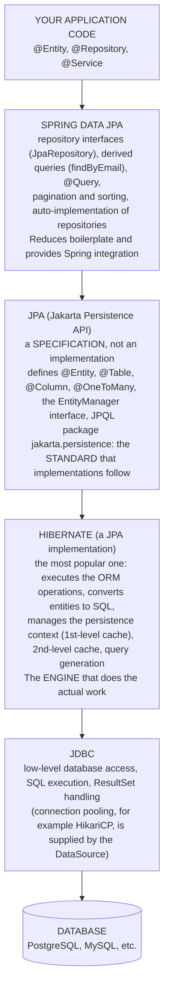
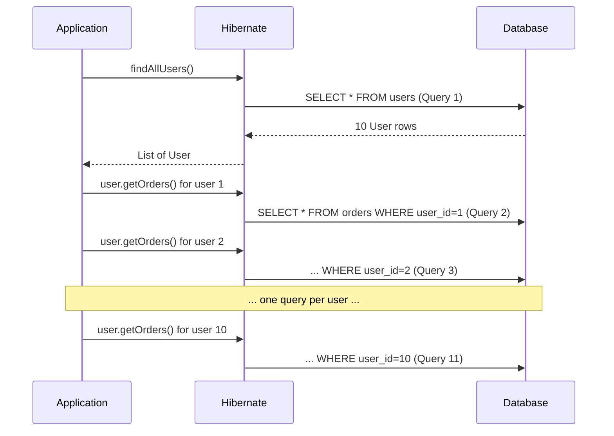
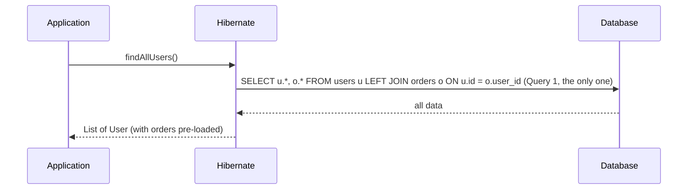
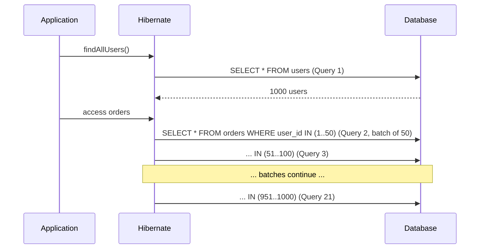
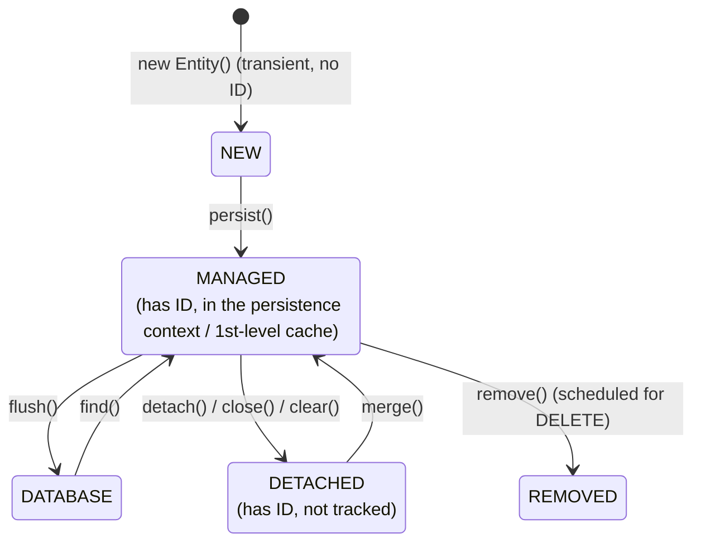

**Navigation**: [< Previous](Ch37_SB_Controllers_REST.md) | [Back to Index](../00_MASTER_INDEX.md) | [Next >](Ch41_SB_Architecture_Quality.md)

# 🌱 SPRING BOOT MASTERY - Part 8: JPA & Hibernate Deep Dive

**Object-Relational Mapping Mastery**
_"Understand the magic behind the annotations"_

---

# 🎯 WHY-HOW-WHEN-WHICH FRAMEWORK

**WHY: Why Deep JPA Knowledge?**

```text
• N+1 queries: #1 performance killer - causes slow APIs in production
• Lazy loading: LazyInitializationException is confusing without knowledge
• Relationship mapping: @OneToMany, cascades - easy to get wrong
• Interview must-know: "Explain lazy vs eager" tested in every interview
• Debug production: Slow queries = understanding execution plans
```

**HOW: How JPA/Hibernate Works Under the Hood?**

```text
• Persistence Context: First-level cache, dirty checking
• Proxy objects: Lazy loading creates proxies (not real entities)
• Session lifecycle: Open session in view vs closed session patterns
• Query translation: JPQL → SQL via Hibernate
• Batch operations: savAll() vs individual save() performance
```

**WHEN: When to Use Different Fetch Strategies?**

```text
• LAZY (default for collections): Load only when accessed
• EAGER: Always load together (use sparingly - causes N+1)
• JOIN FETCH: Load in single query when you know you'll need it
• EntityGraph: Dynamic fetch control per query
• DTO Projection: When you don't need full entity - best performance
```

**WHICH: Which JPA Concepts to Master?**

```text
ESSENTIAL:     Entity lifecycle, relationships, lazy/eager, N+1 problem
IMPORTANT:     Cascade types, orphan removal, inheritance mapping
ADVANCED:      Second-level cache, batch processing, locking strategies
```

---

# 📖 JPA Fundamentals

---

## Chapter 1: JPA vs Hibernate vs Spring Data JPA

**The JPA ecosystem**



**How to read this diagram.** Your code uses Spring Data JPA, which is built on the JPA specification. Hibernate implements that specification and talks to the database through JDBC.

---

🔬 **Section Challenge — Chapter 1: JPA vs Hibernate vs Spring Data JPA**

**Challenge 1 (Reasoning):** N+1 query problem — explain with a concrete JPA example and show the fix.

<details><summary>Answer</summary>

```java
// N+1: fetches all orders (1 query), then for EACH order fetches customer (N queries)
List<Order> orders = orderRepo.findAll(); // 1 query
orders.forEach(o -> System.out.println(o.getCustomer().getName())); // N queries!

// Fix 1: JOIN FETCH
@Query("SELECT o FROM Order o JOIN FETCH o.customer")
List<Order> findAllWithCustomer();

// Fix 2: EntityGraph
@EntityGraph(attributePaths = "customer")
List<Order> findAll();
```

Both load orders + customers in ONE query (JOIN). Always check Hibernate's SQL log in development.

</details>

## Chapter 2: Entity Mapping Deep Dive

### Basic Entity

```java
@Entity  // Marks as JPA entity (required)
@Table(name = "users")  // Table name (optional, defaults to class name)
@Getter @Setter
@NoArgsConstructor
@AllArgsConstructor
@Builder
public class User {

    @Id  // Primary key (required)
    @GeneratedValue(strategy = GenerationType.IDENTITY)  // Auto-increment
    private Long id;

    @Column(name = "email", nullable = false, unique = true, length = 255)
    private String email;

    @Column(name = "first_name")  // Default: firstName → first_name
    private String firstName;

    @Enumerated(EnumType.STRING)  // Store enum as string (ADMIN, USER)
    @Column(nullable = false)
    private Role role;

    @Lob  // Large object (CLOB/BLOB)
    @Column(columnDefinition = "TEXT")
    private String bio;

    // Timestamps
    @CreationTimestamp  // Hibernate-specific
    @Column(name = "created_at", updatable = false)
    private LocalDateTime createdAt;

    @UpdateTimestamp
    @Column(name = "updated_at")
    private LocalDateTime updatedAt;

    // Version for optimistic locking
    @Version
    private Long version;

    // Transient - not persisted
    @Transient
    private String tempCalculation;
}
```

### ID Generation Strategies

```java
// ═══════════════════════════════════════════════════════════════════════════════
// IDENTITY - Database auto-increment (MySQL, PostgreSQL)
// ═══════════════════════════════════════════════════════════════════════════════
@Id
@GeneratedValue(strategy = GenerationType.IDENTITY)
private Long id;
/*
 * Database generates ID on INSERT
 * ✅ Simple, widely supported
 * ❌ Can't batch inserts (need to get ID after each insert)
 * DDL: id BIGINT AUTO_INCREMENT PRIMARY KEY
 */


// ═══════════════════════════════════════════════════════════════════════════════
// SEQUENCE - Database sequence (PostgreSQL, Oracle)
// ═══════════════════════════════════════════════════════════════════════════════
@Id
@GeneratedValue(strategy = GenerationType.SEQUENCE, generator = "user_seq")
@SequenceGenerator(
    name = "user_seq",
    sequenceName = "user_sequence",
    allocationSize = 50  // Pre-allocate 50 IDs at a time
)
private Long id;
/*
 * Hibernate fetches next value from sequence
 * ✅ Allows batch inserts
 * ✅ High performance with allocationSize
 * ❌ Not supported by all databases
 * DDL: CREATE SEQUENCE user_sequence START 1 INCREMENT 50
 */


// ═══════════════════════════════════════════════════════════════════════════════
// TABLE - Uses a table to store next ID (portable but slow)
// ═══════════════════════════════════════════════════════════════════════════════
@Id
@GeneratedValue(strategy = GenerationType.TABLE, generator = "user_table_gen")
@TableGenerator(
    name = "user_table_gen",
    table = "id_generator",
    pkColumnName = "gen_name",
    valueColumnName = "gen_value",
    allocationSize = 50
)
private Long id;
/*
 * ❌ AVOID - Poor performance, row-level locking
 * Use only when sequence not available
 */


// ═══════════════════════════════════════════════════════════════════════════════
// UUID - Universally unique identifier
// ═══════════════════════════════════════════════════════════════════════════════
@Id
@GeneratedValue(strategy = GenerationType.UUID)
private UUID id;
/*
 * Hibernate generates UUID
 * ✅ Globally unique across systems
 * ✅ No database round-trip for ID
 * ✅ Great for distributed systems
 * ❌ Larger size (16 bytes vs 8 for Long)
 * ❌ Harder to debug (not sequential)
 */


// ═══════════════════════════════════════════════════════════════════════════════
// AUTO - Hibernate picks strategy based on database
// ═══════════════════════════════════════════════════════════════════════════════
@Id
@GeneratedValue(strategy = GenerationType.AUTO)  // or just @GeneratedValue
private Long id;
/*
 * Falls back to TABLE in some cases - AVOID
 * Prefer explicit IDENTITY or SEQUENCE
 */
```

### Column Mappings

```java
// ═══════════════════════════════════════════════════════════════════════════════
// @Column OPTIONS
// ═══════════════════════════════════════════════════════════════════════════════

@Column(
    name = "email_address",      // Column name (default: field name in snake_case)
    nullable = false,            // NOT NULL constraint
    unique = true,               // UNIQUE constraint
    length = 255,                // VARCHAR length (default 255)
    insertable = true,           // Include in INSERT (default true)
    updatable = true,            // Include in UPDATE (default true)
    columnDefinition = "TEXT",   // Exact DDL for column
    precision = 10,              // Decimal precision
    scale = 2                    // Decimal scale
)
private String email;


// ═══════════════════════════════════════════════════════════════════════════════
// ENUM MAPPING
// ═══════════════════════════════════════════════════════════════════════════════

// Store as string (RECOMMENDED)
@Enumerated(EnumType.STRING)  // Database stores: 'ADMIN', 'USER', 'GUEST'
@Column(nullable = false)
private Role role;

// Store as ordinal (AVOID - brittle)
@Enumerated(EnumType.ORDINAL)  // Database stores: 0, 1, 2
private Role role;
/*
 * ❌ ORDINAL: If you reorder enum values or add in middle, data corrupts!
 */


// ═══════════════════════════════════════════════════════════════════════════════
// DATE/TIME MAPPING (Java 8+ types - no @Temporal needed!)
// ═══════════════════════════════════════════════════════════════════════════════

private LocalDate birthDate;        // DATE column
private LocalTime startTime;        // TIME column
private LocalDateTime createdAt;    // TIMESTAMP column
private Instant eventTime;          // TIMESTAMP with proper timezone handling
private ZonedDateTime meetingTime;  // TIMESTAMP + timezone info

// Old java.util.Date (needs @Temporal)
@Temporal(TemporalType.TIMESTAMP)
private Date legacyDate;


// ═══════════════════════════════════════════════════════════════════════════════
// LARGE OBJECTS
// ═══════════════════════════════════════════════════════════════════════════════

// Large text (CLOB)
@Lob
@Column(columnDefinition = "TEXT")
private String content;

// Binary data (BLOB)
@Lob
@Basic(fetch = FetchType.LAZY)  // Load only when accessed
private byte[] image;


// ═══════════════════════════════════════════════════════════════════════════════
// JSON COLUMNS (Database-specific)
// ═══════════════════════════════════════════════════════════════════════════════

// PostgreSQL JSONB
@Column(columnDefinition = "jsonb")
@JdbcTypeCode(SqlTypes.JSON)
private Map<String, Object> metadata;

// Or with custom type (Hibernate 6+)
@JdbcTypeCode(SqlTypes.JSON)
private Address address;  // Stored as JSON in single column


// ═══════════════════════════════════════════════════════════════════════════════
// EMBEDDED OBJECTS
// ═══════════════════════════════════════════════════════════════════════════════

@Embedded
@AttributeOverrides({
    @AttributeOverride(name = "street", column = @Column(name = "billing_street")),
    @AttributeOverride(name = "city", column = @Column(name = "billing_city"))
})
private Address billingAddress;

@Embedded
@AttributeOverrides({
    @AttributeOverride(name = "street", column = @Column(name = "shipping_street")),
    @AttributeOverride(name = "city", column = @Column(name = "shipping_city"))
})
private Address shippingAddress;

// Embeddable class
@Embeddable
@Getter @Setter
@NoArgsConstructor
@AllArgsConstructor
public class Address {
    private String street;
    private String city;
    private String state;
    private String zip;
}
```

---

🔬 **Section Challenge — Chapter 2: Entity Mapping Deep Dive**

**Challenge 1 (Reasoning):** You execute a query that returns 100 `Author` entities. Each `Author` has a `@OneToMany` list of `Book` entities. You loop through the authors and call `author.getBooks().size()`. Why does this crash your database performance?

<details><summary>Answer</summary>

The N+1 Query Problem. The initial query fetches 100 Authors (1 query). When you call `getBooks()` on the first author, Hibernate executes a new SQL query to fetch their books. It repeats this for all 100 authors. You just executed 1 + 100 = 101 separate SQL queries instead of a single join. To fix this, you must use a `JOIN FETCH` in your JPQL query or a `@EntityGraph` to load the authors and their books in a single database round-trip.

</details>

## Chapter 3: Entity Relationships

**JPA RELATIONSHIP TYPES**

```text
@OneToOne     User ──────── Address        (One user has one address)

@OneToMany    User ──────<< Order          (One user has many orders)

@ManyToOne    Order >>────── User          (Many orders belong to one user)

@ManyToMany   User >>────<< Role           (Many users have many roles)
```

### One-to-One Relationship

```java
// ═══════════════════════════════════════════════════════════════════════════════
// OPTION 1: Foreign key on one side
// ═══════════════════════════════════════════════════════════════════════════════

@Entity
public class User {
    @Id
    @GeneratedValue(strategy = GenerationType.IDENTITY)
    private Long id;

    @OneToOne(cascade = CascadeType.ALL, fetch = FetchType.LAZY)
    @JoinColumn(name = "profile_id", unique = true)  // FK in users table
    private UserProfile profile;
}

@Entity
public class UserProfile {
    @Id
    @GeneratedValue(strategy = GenerationType.IDENTITY)
    private Long id;

    @OneToOne(mappedBy = "profile")  // Inverse side
    private User user;

    private String bio;
    private String avatarUrl;
}

/*
 * DDL:
 * users: id, profile_id (FK to user_profiles.id, UNIQUE)
 * user_profiles: id, bio, avatar_url
 */


// ═══════════════════════════════════════════════════════════════════════════════
// OPTION 2: Shared primary key (profile_id = user_id)
// ═══════════════════════════════════════════════════════════════════════════════

@Entity
public class User {
    @Id
    @GeneratedValue(strategy = GenerationType.IDENTITY)
    private Long id;

    @OneToOne(mappedBy = "user", cascade = CascadeType.ALL, fetch = FetchType.LAZY)
    @PrimaryKeyJoinColumn
    private UserProfile profile;
}

@Entity
public class UserProfile {
    @Id  // Same ID as User
    private Long id;

    @OneToOne
    @MapsId  // Uses user_id as this entity's ID
    @JoinColumn(name = "user_id")
    private User user;

    private String bio;
}

/*
 * DDL:
 * users: id
 * user_profiles: user_id (PK and FK to users.id), bio
 */
```

### One-to-Many / Many-to-One

```java
// ═══════════════════════════════════════════════════════════════════════════════
// BIDIRECTIONAL (Recommended)
// ═══════════════════════════════════════════════════════════════════════════════

@Entity
@Getter @Setter
@NoArgsConstructor
public class User {
    @Id
    @GeneratedValue(strategy = GenerationType.IDENTITY)
    private Long id;

    private String name;

    // One user has many orders
    @OneToMany(
        mappedBy = "user",           // Points to field in Order
        cascade = CascadeType.ALL,   // Cascade all operations
        orphanRemoval = true,        // Delete orphans
        fetch = FetchType.LAZY       // ALWAYS use LAZY for collections!
    )
    private List<Order> orders = new ArrayList<>();

    // Helper methods to maintain bidirectional consistency
    public void addOrder(Order order) {
        orders.add(order);
        order.setUser(this);
    }

    public void removeOrder(Order order) {
        orders.remove(order);
        order.setUser(null);
    }
}

@Entity
@Getter @Setter
@NoArgsConstructor
public class Order {
    @Id
    @GeneratedValue(strategy = GenerationType.IDENTITY)
    private Long id;

    private BigDecimal total;

    // Many orders belong to one user
    @ManyToOne(fetch = FetchType.LAZY)  // LAZY recommended for @ManyToOne too
    @JoinColumn(name = "user_id", nullable = false)  // FK column
    private User user;
}

/*
 * DDL:
 * users: id, name
 * orders: id, total, user_id (FK to users.id)
 */


// ═══════════════════════════════════════════════════════════════════════════════
// UNIDIRECTIONAL @OneToMany (Avoid if possible)
// ═══════════════════════════════════════════════════════════════════════════════

@Entity
public class User {
    @Id
    @GeneratedValue(strategy = GenerationType.IDENTITY)
    private Long id;

    @OneToMany(cascade = CascadeType.ALL, orphanRemoval = true)
    @JoinColumn(name = "user_id")  // FK in Order table
    private List<Order> orders = new ArrayList<>();
    // Without mappedBy, creates join column or join table
}

/*
 * ❌ AVOID: Generates inefficient SQL (extra UPDATE for FK)
 * Use bidirectional with @ManyToOne as owning side
 */
```

### Many-to-Many

```java
// ═══════════════════════════════════════════════════════════════════════════════
// SIMPLE MANY-TO-MANY (Join table with only FKs)
// ═══════════════════════════════════════════════════════════════════════════════

@Entity
@Getter @Setter
public class User {
    @Id
    @GeneratedValue(strategy = GenerationType.IDENTITY)
    private Long id;

    private String name;

    @ManyToMany(cascade = {CascadeType.PERSIST, CascadeType.MERGE})
    @JoinTable(
        name = "user_roles",                           // Join table name
        joinColumns = @JoinColumn(name = "user_id"),   // FK to User
        inverseJoinColumns = @JoinColumn(name = "role_id")  // FK to Role
    )
    private Set<Role> roles = new HashSet<>();

    // Helper methods
    public void addRole(Role role) {
        roles.add(role);
        role.getUsers().add(this);
    }

    public void removeRole(Role role) {
        roles.remove(role);
        role.getUsers().remove(this);
    }
}

@Entity
@Getter @Setter
public class Role {
    @Id
    @GeneratedValue(strategy = GenerationType.IDENTITY)
    private Long id;

    @Column(unique = true)
    private String name;

    @ManyToMany(mappedBy = "roles")  // Inverse side
    private Set<User> users = new HashSet<>();
}

/*
 * DDL:
 * users: id, name
 * roles: id, name
 * user_roles: user_id (FK), role_id (FK) - composite PK
 */


// ═══════════════════════════════════════════════════════════════════════════════
// MANY-TO-MANY WITH EXTRA COLUMNS (Break into two @ManyToOne)
// ═══════════════════════════════════════════════════════════════════════════════

// When join table needs extra columns (assigned_at, assigned_by, etc.)

@Entity
@Getter @Setter
public class User {
    @Id
    @GeneratedValue(strategy = GenerationType.IDENTITY)
    private Long id;

    @OneToMany(mappedBy = "user", cascade = CascadeType.ALL, orphanRemoval = true)
    private Set<UserRole> userRoles = new HashSet<>();
}

@Entity
@Getter @Setter
public class Role {
    @Id
    @GeneratedValue(strategy = GenerationType.IDENTITY)
    private Long id;

    private String name;

    @OneToMany(mappedBy = "role")
    private Set<UserRole> userRoles = new HashSet<>();
}

// Join entity with extra columns
@Entity
@Table(name = "user_roles")
@Getter @Setter
@NoArgsConstructor
public class UserRole {

    @EmbeddedId
    private UserRoleId id;

    @ManyToOne(fetch = FetchType.LAZY)
    @MapsId("userId")
    @JoinColumn(name = "user_id")
    private User user;

    @ManyToOne(fetch = FetchType.LAZY)
    @MapsId("roleId")
    @JoinColumn(name = "role_id")
    private Role role;

    // Extra columns
    private LocalDateTime assignedAt;
    private String assignedBy;

    public UserRole(User user, Role role, String assignedBy) {
        this.user = user;
        this.role = role;
        this.id = new UserRoleId(user.getId(), role.getId());
        this.assignedAt = LocalDateTime.now();
        this.assignedBy = assignedBy;
    }
}

@Embeddable
@Getter @Setter
@NoArgsConstructor
@AllArgsConstructor
@EqualsAndHashCode
public class UserRoleId implements Serializable {
    private Long userId;
    private Long roleId;
}
```

---

## Chapter 4: Fetch Strategies (N+1 Problem)

### The N+1 Problem

// Loading 10 users and their orders:

```java
List<User> users = userRepository.findAll();  // Query 1: Get users
for (User user : users) {
    user.getOrders().size();  // Query 2-11: Get orders for EACH user
}
```

RESULT: 1 + 10 = 11 queries for just 10 users!  
With 1000 users = 1001 queries! 🔥 DATABASE MELTS

```text
Query 1:  SELECT * FROM users
Query 2:  SELECT * FROM orders WHERE user_id = 1
Query 3:  SELECT * FROM orders WHERE user_id = 2
Query 4:  SELECT * FROM orders WHERE user_id = 3
...
Query 11: SELECT * FROM orders WHERE user_id = 10
```

### N+1 Query Visual Flow — Sequence Diagram

**N+1 problem: visual sequence comparison**

**❌ Bad: N+1 queries (lazy loading)**



**How to read this diagram.** Loading the users takes one query, and then touching each user's lazy `orders` triggers one more query per user. **Total: 1 + 10 = 11 queries for 10 users.** With 1,000 users that is 1,001 round trips, which can overload the database. 🔥

**✅ Good: JOIN FETCH (1 query)**



**How to read this diagram.** One joined query brings back the users and their orders. **Total: 1 query regardless of the user count** ✅.

**✅ Also good: `@BatchSize` (batched)**



**How to read this diagram.** Orders load in batches of 50 users per query. **Total: 1 + 20 = 21 queries** (against 1,001 without batching) ✅.

### Solutions to N+1

```java
// ═══════════════════════════════════════════════════════════════════════════════
// SOLUTION 1: JOIN FETCH (Query-time eager loading)
// ═══════════════════════════════════════════════════════════════════════════════

public interface UserRepository extends JpaRepository<User, Long> {

    // Fetch users with their orders in ONE query
    @Query("SELECT DISTINCT u FROM User u LEFT JOIN FETCH u.orders")
    List<User> findAllWithOrders();

    // With WHERE clause
    @Query("SELECT u FROM User u LEFT JOIN FETCH u.orders WHERE u.id = :id")
    Optional<User> findByIdWithOrders(@Param("id") Long id);
}

/*
 * Generated SQL:
 * SELECT u.*, o.* FROM users u
 * LEFT JOIN orders o ON u.id = o.user_id
 *
 * ONE query for all data!
 */


// ═══════════════════════════════════════════════════════════════════════════════
// SOLUTION 2: @EntityGraph (Declarative fetch plan)
// ═══════════════════════════════════════════════════════════════════════════════

// Define graph on entity
@Entity
@NamedEntityGraph(
    name = "User.withOrdersAndAddress",
    attributeNodes = {
        @NamedAttributeNode("orders"),
        @NamedAttributeNode("address")
    }
)
public class User { }

// Use in repository
public interface UserRepository extends JpaRepository<User, Long> {

    @EntityGraph(attributePaths = {"orders"})
    List<User> findAll();

    @EntityGraph(attributePaths = {"orders", "address"})
    Optional<User> findById(Long id);

    @EntityGraph(value = "User.withOrdersAndAddress")
    List<User> findByActiveTrue();
}


// ═══════════════════════════════════════════════════════════════════════════════
// SOLUTION 3: @BatchSize (Batch lazy loading)
// ═══════════════════════════════════════════════════════════════════════════════

@Entity
public class User {

    @OneToMany(mappedBy = "user", fetch = FetchType.LAZY)
    @BatchSize(size = 25)  // Load 25 collections at a time
    private List<Order> orders;
}

/*
 * Without @BatchSize: N+1 queries
 * With @BatchSize(25): 1 + ceil(N/25) queries
 *
 * 100 users → 1 + 4 = 5 queries instead of 101
 */


// ═══════════════════════════════════════════════════════════════════════════════
// SOLUTION 4: DTO Projection (Best for read-only)
// ═══════════════════════════════════════════════════════════════════════════════

// No N+1 because we're not loading entities at all!
public interface UserRepository extends JpaRepository<User, Long> {

    @Query("""
        SELECT new com.example.dto.UserWithOrderCount(
            u.id, u.name, u.email, COUNT(o)
        )
        FROM User u
        LEFT JOIN u.orders o
        GROUP BY u.id, u.name, u.email
        """)
    List<UserWithOrderCount> findAllWithOrderCount();
}

public record UserWithOrderCount(Long id, String name, String email, Long orderCount) {}
```

### Fetch Type Best Practices

**FETCH TYPE RECOMMENDATIONS**

**Relationship      Default       Recommendation**

```text
@OneToOne         EAGER         → Change to LAZY
@ManyToOne        EAGER         → Change to LAZY
@OneToMany        LAZY          → Keep LAZY ✓
@ManyToMany       LAZY          → Keep LAZY ✓

GOLDEN RULE: Always use LAZY, then fetch what you need explicitly

@ManyToOne(fetch = FetchType.LAZY)  // Override EAGER default!
@OneToOne(fetch = FetchType.LAZY)   // Override EAGER default!

Then fetch when needed:
- JOIN FETCH in JPQL
- @EntityGraph on repository method
- Hibernate.initialize() in service
```

---

## Chapter 5: Entity Lifecycle & Persistence Context

**Entity lifecycle states**



**How to read this diagram.** A new object is not tracked. `persist()` or `find()` makes it MANAGED, and changes are written to the database on `flush()`. Closing or clearing the persistence context detaches it, and `merge()` re-attaches it. `remove()` schedules a DELETE.

### Understanding the States

```java
@Service
@Transactional
public class EntityLifecycleDemo {

    @PersistenceContext
    private EntityManager em;

    public void demonstrateStates() {
        // ═══════════════════════════════════════════════════════════════════════
        // NEW (Transient) - Just created, not associated with persistence context
        // ═══════════════════════════════════════════════════════════════════════
        User user = new User();
        user.setName("John");
        // user.id is null
        // Changes are NOT tracked


        // ═══════════════════════════════════════════════════════════════════════
        // MANAGED - Associated with persistence context
        // ═══════════════════════════════════════════════════════════════════════
        em.persist(user);  // NEW → MANAGED
        // user is now in the persistence context
        // user.id is STILL null (until flush)

        user.setName("Jane");  // Change is AUTOMATICALLY tracked
        // No need to call save() - dirty checking will detect change

        // Or load existing:
        User loaded = em.find(User.class, 1L);  // DATABASE → MANAGED
        loaded.setName("Updated");  // Automatically saved on flush


        // ═══════════════════════════════════════════════════════════════════════
        // DETACHED - Was managed, but no longer tracked
        // ═══════════════════════════════════════════════════════════════════════
        em.detach(user);  // MANAGED → DETACHED
        // or em.clear();  // Detaches ALL entities
        // or transaction ends without @Transactional

        user.setName("Won't be saved");  // Changes NOT tracked!

        // To re-attach:
        User merged = em.merge(user);  // DETACHED → MANAGED (returns new instance!)
        // 'merged' is managed, 'user' is still detached


        // ═══════════════════════════════════════════════════════════════════════
        // REMOVED - Scheduled for deletion
        // ═══════════════════════════════════════════════════════════════════════
        em.remove(loaded);  // MANAGED → REMOVED
        // DELETE will be executed on flush
    }


    // ═══════════════════════════════════════════════════════════════════════════
    // DIRTY CHECKING - Automatic update detection
    // ═══════════════════════════════════════════════════════════════════════════

    @Transactional
    public void updateUser(Long id, String newName) {
        User user = userRepository.findById(id).orElseThrow();  // MANAGED

        user.setName(newName);  // Just modify the managed entity

        // NO save() needed! Hibernate's dirty checking will:
        // 1. Compare current state with snapshot taken at load time
        // 2. Generate UPDATE SQL for changed fields
        // 3. Execute UPDATE on flush (at transaction commit)
    }


    // ═══════════════════════════════════════════════════════════════════════════
    // FLUSH vs COMMIT
    // ═══════════════════════════════════════════════════════════════════════════

    @Transactional
    public void flushVsCommit() {
        User user = new User("John");
        em.persist(user);

        // flush() - Synchronize persistence context with database
        // Executes INSERT but doesn't commit transaction
        em.flush();
        // INSERT executed, user.id now populated
        // But transaction can still be rolled back!

        user.setName("Jane");
        em.flush();
        // UPDATE executed

        // At end of @Transactional method:
        // - commit() is called (by Spring)
        // - Transaction is committed
        // - Changes are permanent
    }
}
```

---

🔬 **Section Challenge — Chapter 5: Entity Lifecycle & Persistence Context**

**Challenge 1 (Debug — Who/When/What):** You load a `User` entity, modify `user.setEmail("new@email.com")`, and DON'T call `entityManager.save()`. The email IS updated in the database. **Who** detected and persisted the change? **When** does flush happen? **What** is the mechanism?

<details><summary>Answer</summary>

**Who?** JPA's **dirty checking** mechanism — the persistence context (first-level cache) stores a snapshot of every managed entity at load time. At flush, it compares current field values against the snapshot. **When flush happens:** By default `FlushModeType.AUTO` — before query execution (to avoid stale reads) and at transaction commit. So your modification is flushed at `@Transactional` method exit → `EntityManager.flush()` → `EntityManager.close()` → `UPDATE` SQL sent. **Mechanism:** Hibernate compares entity field by field (reflective snapshot). If ANY field changed → generates `UPDATE SET field=? WHERE id=?`. **When to be careful:** (1) In `@Transactional` methods — unintended mutations flush automatically. (2) For bulk updates, use JPQL `UPDATE` to bypass dirty checking overhead. (3) Use `entityManager.detach(entity)` to remove from persistence context and prevent dirty check.

</details>

## Chapter 6: Cascade Types

```java
// ═══════════════════════════════════════════════════════════════════════════════
// CASCADE TYPES EXPLAINED
// ═══════════════════════════════════════════════════════════════════════════════

@Entity
public class User {

    @OneToMany(mappedBy = "user", cascade = CascadeType.???)
    private List<Order> orders;
}

/*
 * CascadeType.PERSIST
 * ─────────────────────
 * When User is persisted, also persist associated Orders
 *
 * CascadeType.MERGE
 * ─────────────────────
 * When User is merged, also merge associated Orders
 *
 * CascadeType.REMOVE
 * ─────────────────────
 * When User is removed, also remove associated Orders
 * ⚠️ Use carefully! Can delete more than expected
 *
 * CascadeType.REFRESH
 * ─────────────────────
 * When User is refreshed from DB, also refresh Orders
 *
 * CascadeType.DETACH
 * ─────────────────────
 * When User is detached, also detach Orders
 *
 * CascadeType.ALL
 * ─────────────────────
 * All of the above (PERSIST, MERGE, REMOVE, REFRESH, DETACH)
 */


// ═══════════════════════════════════════════════════════════════════════════════
// ORPHAN REMOVAL
// ═══════════════════════════════════════════════════════════════════════════════

@Entity
public class User {

    @OneToMany(
        mappedBy = "user",
        cascade = CascadeType.ALL,
        orphanRemoval = true  // Delete orders removed from collection
    )
    private List<Order> orders = new ArrayList<>();

    public void removeOrder(Order order) {
        orders.remove(order);  // Order is now "orphan"
        order.setUser(null);
        // With orphanRemoval = true:
        // → Hibernate will DELETE the order from database
    }
}

/*
 * orphanRemoval vs CascadeType.REMOVE
 *
 * CascadeType.REMOVE: Only when PARENT is deleted
 * orphanRemoval: When CHILD is removed from COLLECTION
 */


// ═══════════════════════════════════════════════════════════════════════════════
// BEST PRACTICES
// ═══════════════════════════════════════════════════════════════════════════════

/*
 * Parent-Child (User → Orders owned by user):
 *   cascade = ALL, orphanRemoval = true
 *
 * Shared Reference (User → Roles shared by many users):
 *   cascade = {PERSIST, MERGE} (NO REMOVE!)
 *
 * Lookup/Reference Data (Order → Product):
 *   NO cascade (let Product manage itself)
 */
```

---

🔬 **Section Challenge — Chapter 6: Cascade Types**

**Challenge 1 (Debug — Who/When/What):** `@OneToMany(cascade = CascadeType.ALL)` — you delete a `User` and ALL their `Orders` are deleted. **Who** issues the DELETE statements? **When** relative to the parent DELETE? **What** happens if an Order has FK references from another table?\n\n<details><summary>Answer</summary>\n\n**Who issues?** Hibernate's `DefaultDeleteEventListener`. CascadeType.REMOVE propagates `session.delete()` to each child entity. **When?** Children are deleted BEFORE the parent (to satisfy FK constraints). Hibernate traverses the cascade graph depth-first. **FK from another table?** If `order_items` table has `order_id` FK without `ON DELETE CASCADE`, Hibernate deletes `Order` but `order_items` still reference it → `ConstraintViolationException`. **Fix options:** (1) Add `orphanRemoval = true` + handle items in lifecycle. (2) Set `@OnDelete(action = OnDeleteAction.CASCADE)` on the DB constraint. (3) Remove items first in application code. **Warning:** `CascadeType.ALL` + `CascadeType.REMOVE` are often too aggressive — prefer explicit control of delete cascades.\n\n</details>

**Challenge 2 (Bug Hunt):** A method returns `(T) jsonDeserialize(json)` where T is a generic type param. When does the `ClassCastException` actually occur?

<details><summary>Answer</summary>

NOT at the cast — the unchecked cast compiles to nothing at runtime (erasure). The CCE occurs when the calling code tries to USE the returned value as a specific type. This makes debugging hard: the error appears far from the actual source. Use `Class<T> clazz` parameter to do safe `clazz.cast(...)` instead.

</details>

## Chapter 7: Transactions

```java
// ═══════════════════════════════════════════════════════════════════════════════
// BASIC @TRANSACTIONAL
// ═══════════════════════════════════════════════════════════════════════════════

@Service
@Transactional  // All public methods are transactional
public class UserService {

    // Read-only transaction (optimization)
    @Transactional(readOnly = true)
    public User findById(Long id) {
        return userRepository.findById(id).orElseThrow();
    }

    // Default: read-write transaction
    public void updateUser(Long id, String name) {
        // Transaction starts
        User user = userRepository.findById(id).orElseThrow();
        user.setName(name);
        // Transaction commits (auto-flush, auto-commit)
        // If exception → transaction rolls back
    }
}


// ═══════════════════════════════════════════════════════════════════════════════
// PROPAGATION TYPES
// ═══════════════════════════════════════════════════════════════════════════════

@Service
public class OrderService {

    // REQUIRED (default): Use existing transaction, or create new
    @Transactional(propagation = Propagation.REQUIRED)
    public void createOrder(Order order) { }

    // REQUIRES_NEW: Always create new transaction (suspend existing)
    @Transactional(propagation = Propagation.REQUIRES_NEW)
    public void logAudit(AuditEntry entry) {
        // Commits even if outer transaction rolls back
        // Use for: Audit logs, notifications
    }

    // NESTED: Create savepoint within existing transaction
    @Transactional(propagation = Propagation.NESTED)
    public void processItem(Item item) {
        // Can roll back to savepoint without affecting outer transaction
    }

    // MANDATORY: Must run within existing transaction
    @Transactional(propagation = Propagation.MANDATORY)
    public void requiresTransaction() {
        // Throws exception if no active transaction
    }

    // SUPPORTS: Use transaction if exists, otherwise non-transactional
    @Transactional(propagation = Propagation.SUPPORTS)
    public void optionalTransaction() { }

    // NOT_SUPPORTED: Execute non-transactionally, suspend existing
    @Transactional(propagation = Propagation.NOT_SUPPORTED)
    public void noTransaction() { }

    // NEVER: Must NOT run within transaction
    @Transactional(propagation = Propagation.NEVER)
    public void mustNotHaveTransaction() {
        // Throws exception if active transaction exists
    }
}


// ═══════════════════════════════════════════════════════════════════════════════
// ISOLATION LEVELS
// ═══════════════════════════════════════════════════════════════════════════════

@Service
public class BankService {

    // READ_UNCOMMITTED: See uncommitted changes (dirty reads)
    // Almost never use this
    @Transactional(isolation = Isolation.READ_UNCOMMITTED)
    public void readUncommitted() { }

    // READ_COMMITTED: Only see committed changes
    // Default for most databases (PostgreSQL, Oracle)
    @Transactional(isolation = Isolation.READ_COMMITTED)
    public void readCommitted() { }

    // REPEATABLE_READ: Same query returns same results within transaction
    // Default for MySQL
    @Transactional(isolation = Isolation.REPEATABLE_READ)
    public void repeatableRead() { }

    // SERIALIZABLE: Full isolation, transactions appear sequential
    // Highest isolation, lowest concurrency
    @Transactional(isolation = Isolation.SERIALIZABLE)
    public void transferMoney(Long from, Long to, BigDecimal amount) { }
}


// ═══════════════════════════════════════════════════════════════════════════════
// ROLLBACK BEHAVIOR
// ═══════════════════════════════════════════════════════════════════════════════

@Service
public class PaymentService {

    // Default: Rollback only on RuntimeException & Error
    // Checked exceptions DO NOT trigger rollback!
    @Transactional
    public void defaultBehavior() throws IOException {
        // RuntimeException → ROLLBACK
        // IOException (checked) → COMMIT
    }

    // Rollback on specific exceptions
    @Transactional(rollbackFor = {IOException.class, PaymentException.class})
    public void rollbackOnChecked() throws IOException {
        // IOException → ROLLBACK (due to rollbackFor)
    }

    // Don't rollback on specific exceptions
    @Transactional(noRollbackFor = {DuplicateEmailException.class})
    public void noRollbackForDuplicate() {
        // DuplicateEmailException → COMMIT
    }

    // Rollback on all exceptions
    @Transactional(rollbackFor = Exception.class)
    public void rollbackOnAnyException() throws Exception {
        // Any exception → ROLLBACK
    }
}


// ═══════════════════════════════════════════════════════════════════════════════
// TRANSACTION PITFALLS
// ═══════════════════════════════════════════════════════════════════════════════

@Service
public class BrokenService {

    // ❌ PITFALL 1: @Transactional on private method (doesn't work!)
    @Transactional
    private void privateMethod() {
        // Spring uses proxies - can't intercept private methods
    }

    // ❌ PITFALL 2: Self-invocation (proxy bypass)
    public void outerMethod() {
        innerMethod();  // Calls directly, bypasses proxy!
    }

    @Transactional
    public void innerMethod() {
        // Transaction NOT started if called from outerMethod!
    }

    // ✅ FIX: Inject self or use ApplicationContext
    @Autowired
    private BrokenService self;  // Inject proxy

    public void fixedOuterMethod() {
        self.innerMethod();  // Goes through proxy - transaction works!
    }


    // ❌ PITFALL 3: Catching exception and not re-throwing
    @Transactional
    public void swallowException() {
        try {
            repository.save(entity);
            throw new RuntimeException("Error!");
        } catch (RuntimeException e) {
            log.error("Error", e);
            // NOT re-thrown - transaction will COMMIT!
        }
    }
}
```

---

🔬 **Section Challenge — Chapter 7: Transactions**

**Challenge 1 (Reasoning):** Two transactions T1 and T2 both run `SELECT balance WHERE id=1; UPDATE balance=balance-100 WHERE id=1`. What anomaly occurs at READ COMMITTED and how does REPEATABLE READ fix it?

<details><summary>Answer</summary>

READ COMMITTED: both T1 and T2 read balance=1000. Both compute 900. Both write 900. Final balance: 900 (expected: 800). Lost update! REPEATABLE READ (with locking SELECT FOR UPDATE): first SELECT acquires a read lock. T2's SELECT blocks until T1 commits. After T1 commits (balance=900), T2 reads 900, writes 800. Correct! Alternatively: use `UPDATE ... WHERE balance=1000` (optimistic locking with version check).

</details>

## Chapter 8: JPA Best Practices Summary

**JPA BEST PRACTICES CHECKLIST**

```text
ENTITY DESIGN:
□ Use LAZY fetch for all relationships
□ Override equals/hashCode using only business key or ID
□ Exclude collections from toString to prevent lazy loading
□ Use @Version for optimistic locking
□ Use Set (not List) for @ManyToMany
□ Provide helper methods for bidirectional relationships

ID GENERATION:
□ Use IDENTITY (MySQL) or SEQUENCE (PostgreSQL) - avoid TABLE
□ Consider UUID for distributed systems

QUERYING:
□ Use JOIN FETCH or @EntityGraph to prevent N+1
□ Use DTO projections for read-only queries
□ Use Pageable for large result sets
□ Use @Query for complex queries instead of long method names

TRANSACTIONS:
□ @Transactional on service layer, not repository
□ @Transactional(readOnly = true) for read operations
□ Understand rollback behavior (only RuntimeException by default)
□ Avoid self-invocation (proxy bypass issue)

PERFORMANCE:
□ Enable SQL logging in development: show-sql, format-sql
□ Use @BatchSize for lazy collections
□ Use bulk operations (@Modifying @Query) for batch updates
□ Consider 2nd level cache for read-heavy data
```

---

_Continue to Part 9: Clean Architecture & Quality Code_

---

> **Navigation**: [< Previous](Ch37_SB_Controllers_REST.md) | [Back to Index](../00_MASTER_INDEX.md) | [Next >](Ch41_SB_Architecture_Quality.md)


---

## Reality Check

**"Hibernate/JPA manages the database schema automatically in production"** → `spring.jpa.hibernate.ddl-auto=create-drop` (or `create`) drops and recreates tables on startup — catastrophic in production. Safe production values: `validate` (checks schema matches entities, throws on mismatch) or `none`. Schema migrations should use Flyway or Liquibase, not Hibernate's DDL.

**"@Transactional on a private method works"** → Spring's `@Transactional` uses a proxy (either JDK dynamic proxy or CGLIB). Proxies intercept calls from *outside* the bean. A private method cannot be overridden by a proxy — the annotation is silently ignored. Same for calls from within the same class: `this.doSomething()` bypasses the proxy and the transaction. Call through an injected self-reference or restructure the code.

**"Lazy loading works anywhere in the application"** → Lazy loading (`FetchType.LAZY`, the default for `@OneToMany`) only works within an active Hibernate session. If you access a lazy collection after the session is closed (e.g., in the view layer), you get `LazyInitializationException`. Solutions: use eager fetching (`JOIN FETCH`), keep the session open longer (Open Session in View pattern — controversial), or use DTOs populated within the transaction.

**"@Entity classes should be used directly as API response objects"** → Returning JPA entities from REST controllers exposes your database schema, risks infinite loops (circular JSON from bidirectional relationships), bypasses field-level security, and makes schema changes break the API. Always map to DTOs/projections for API responses. Jackson serialization of lazy-loaded collections causes `LazyInitializationException` or unexpected database queries.

**"JPA merge() and save() are equivalent"** → `EntityManager.merge()` creates a new managed copy of a detached entity — changes to the ORIGINAL (detached) entity after merge are NOT tracked. `save()` in Spring Data JPA calls `persist()` for new entities, `merge()` for detached — but the return value of `save()` is the managed instance. Always use the returned object after save/merge, not the parameter you passed in.
