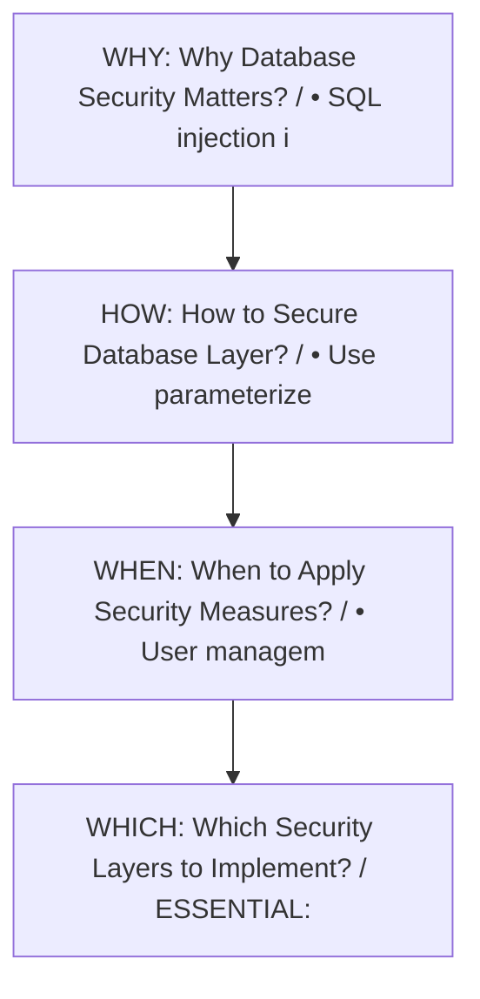
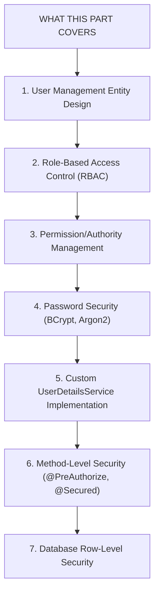
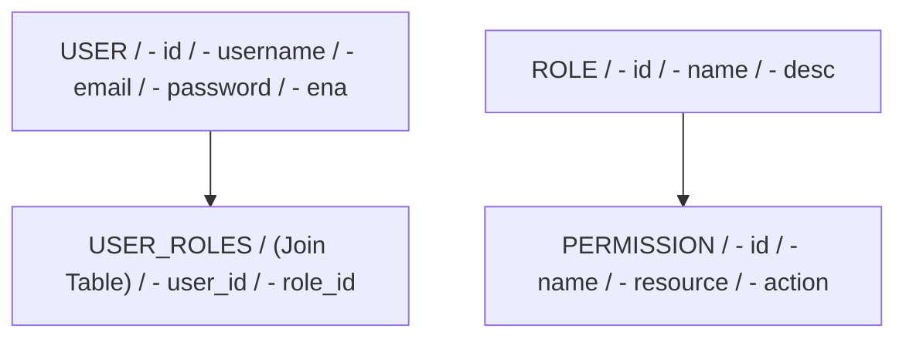

**Navigation**: [Back to Index](../00_MASTER_INDEX.md) | [Next Chapter >](Ch47_SB_Security_Deep.md)

---

# 🔐 SPRING BOOT MASTERY - Part 17: Database Security & User Management

**Complete Guide to User Management, Roles, Permissions, and Database Security**
_"Secure your data from the ground up"_

---

# 🎯 WHY-HOW-WHEN-WHICH FRAMEWORK

```
┌─────────────────────────────────────────────────────────────────────────────────┐
│  WHY: Why Database Security Matters?                                            │
├─────────────────────────────────────────────────────────────────────────────────┤
│  • SQL injection is #1 OWASP vulnerability - costs millions yearly              │
│  • Data breaches destroy companies: reputation, lawsuits, fines                 │
│  • Compliance requirements: GDPR, HIPAA, PCI-DSS mandate security               │
│  • Your API is only as secure as your data layer                                │
│  • Audit trails are legally required in many industries                         │
└─────────────────────────────────────────────────────────────────────────────────┘

┌─────────────────────────────────────────────────────────────────────────────────┐
│  HOW: How to Secure Database Layer?                                             │
├─────────────────────────────────────────────────────────────────────────────────┤
│  • Use parameterized queries (NEVER string concatenation)                       │
│  • Hash passwords with BCrypt/Argon2 (NEVER plain text)                         │
│  • Encrypt sensitive fields (SSN, credit cards) at rest                         │
│  • Implement row-level security for multi-tenant apps                           │
│  • Use connection pooling with encrypted credentials                            │
└─────────────────────────────────────────────────────────────────────────────────┘

┌─────────────────────────────────────────────────────────────────────────────────┐
│  WHEN: When to Apply Security Measures?                                         │
├─────────────────────────────────────────────────────────────────────────────────┤
│  • User management: Any app with authentication                                 │
│  • Row-level security: Multi-tenant, data isolation needed                      │
│  • Encryption: PII, financial data, health records                              │
│  • Audit logging: Compliance requirements, debugging security issues            │
│  • SQL injection prevention: ALWAYS (every app with database)                   │
└─────────────────────────────────────────────────────────────────────────────────┘

┌─────────────────────────────────────────────────────────────────────────────────┐
│  WHICH: Which Security Layers to Implement?                                     │
├─────────────────────────────────────────────────────────────────────────────────┤
│  ESSENTIAL:     Password hashing, SQL injection prevention, RBAC                │
│  IMPORTANT:     Audit logging, method security, connection encryption           │
│  ADVANCED:      Field encryption, row security, multi-tenancy isolation         │
└─────────────────────────────────────────────────────────────────────────────────┘
```

**Flow:**
1. WHY: Why Database Security Matters? / • SQL injection i
2. HOW: How to Secure Database Layer? / • Use parameterize
3. WHEN: When to Apply Security Measures? / • User managem
4. WHICH: Which Security Layers to Implement? / ESSENTIAL:



---

# 📌 Table of Contents

```
┌─────────────────────────────────────────────────────────────────────────────────┐
│              WHAT THIS PART COVERS                                              │
├─────────────────────────────────────────────────────────────────────────────────┤
│                                                                                 │
│  1. User Management Entity Design                                               │
│  2. Role-Based Access Control (RBAC)                                            │
│  3. Permission/Authority Management                                             │
│  4. Password Security (BCrypt, Argon2)                                          │
│  5. Custom UserDetailsService Implementation                                    │
│  6. Method-Level Security (@PreAuthorize, @Secured)                             │
│  7. Database Row-Level Security                                                 │
│  8. Audit Logging (Who did what, when)                                          │
│  9. SQL Injection Prevention                                                    │
│  10. Encrypting Sensitive Data                                                  │
│  11. Database Connection Security                                               │
│  12. Multi-Tenancy Security                                                     │
│                                                                                 │
└─────────────────────────────────────────────────────────────────────────────────┘
```

**Flow:**
1. WHAT THIS PART COVERS
2. 1. User Management Entity Design
3. 2. Role-Based Access Control (RBAC)
4. 3. Permission/Authority Management
5. 4. Password Security (BCrypt, Argon2)
6. 5. Custom UserDetailsService Implementation
7. 6. Method-Level Security (@PreAuthorize, @Secured)



---

# 🏗️ Section 1: User Management Entity Design

---

## Chapter 1: Complete User Entity Model

```
┌─────────────────────────────────────────────────────────────────────────────────┐
│              USER-ROLE-PERMISSION MODEL                                         │
├─────────────────────────────────────────────────────────────────────────────────┤
│                                                                                 │
│  ┌─────────────┐     ┌─────────────────┐     ┌─────────────┐                    │
│  │    USER     │────►│   USER_ROLES    │◄────│    ROLE     │                    │
│  │             │     │  (Join Table)   │     │             │                    │
│  │ - id        │     │ - user_id       │     │ - id        │                    │
│  │ - username  │     │ - role_id       │     │ - name      │                    │
│  │ - email     │     └─────────────────┘     │ - desc      │                    │
│  │ - password  │                              └─────────────┘                   │
│  │ - enabled   │                                     │                          │
│  │ - locked    │                                     │                          │
│  │ - expired   │     ┌─────────────────┐            │                           │
│  └─────────────┘     │ ROLE_PERMISSIONS│◄───────────┘                           │
│                      │  (Join Table)   │                                        │
│                      │ - role_id       │     ┌─────────────┐                    │
│                      │ - permission_id │────►│ PERMISSION  │                    │
│                      └─────────────────┘     │             │                    │
│                                              │ - id        │                    │
│                                              │ - name      │                    │
│                                              │ - resource  │                    │
│                                              │ - action    │                    │
│                                              └─────────────┘                    │
│                                                                                 │
└─────────────────────────────────────────────────────────────────────────────────┘
```

**Flow:**
1. USER / - id / - username / - email / - password / - ena
2. USER_ROLES / (Join Table) / - user_id / - role_id
3. ROLE / - id / - name / - desc
4. PERMISSION / - id / - name / - resource / - action



### Entity Classes

```java
// ==================== USER ENTITY ====================

@Entity
@Table(name = "users", indexes = {
    @Index(name = "idx_users_username", columnList = "username", unique = true),
    @Index(name = "idx_users_email", columnList = "email", unique = true)
})
@Data
@NoArgsConstructor
@AllArgsConstructor
@Builder
public class User implements UserDetails {

    @Id
    @GeneratedValue(strategy = GenerationType.IDENTITY)
    private Long id;

    @Column(nullable = false, unique = true, length = 50)
    private String username;

    @Column(nullable = false, unique = true, length = 100)
    private String email;

    @Column(nullable = false)
    @JsonIgnore  // NEVER expose password in JSON responses
    private String password;

    @Column(name = "first_name", length = 50)
    private String firstName;

    @Column(name = "last_name", length = 50)
    private String lastName;

    @Column(name = "phone_number", length = 20)
    private String phoneNumber;

    // ==================== ACCOUNT STATUS FLAGS ====================
    
    @Column(name = "account_non_expired")
    @Builder.Default
    private boolean accountNonExpired = true;

    @Column(name = "account_non_locked")
    @Builder.Default
    private boolean accountNonLocked = true;

    @Column(name = "credentials_non_expired")
    @Builder.Default
    private boolean credentialsNonExpired = true;

    @Builder.Default
    private boolean enabled = true;

    // ==================== SECURITY TRACKING ====================
    
    @Column(name = "failed_login_attempts")
    @Builder.Default
    private int failedLoginAttempts = 0;

    @Column(name = "lock_time")
    private LocalDateTime lockTime;

    @Column(name = "password_changed_at")
    private LocalDateTime passwordChangedAt;

    @Column(name = "last_login_at")
    private LocalDateTime lastLoginAt;

    @Column(name = "last_login_ip", length = 45)
    private String lastLoginIp;

    // ==================== ROLES ====================
    
    @ManyToMany(fetch = FetchType.EAGER)
    @JoinTable(
        name = "user_roles",
        joinColumns = @JoinColumn(name = "user_id"),
        inverseJoinColumns = @JoinColumn(name = "role_id")
    )
    @Builder.Default
    private Set<Role> roles = new HashSet<>();

    // ==================== AUDIT FIELDS ====================
    
    @CreatedDate
    @Column(name = "created_at", updatable = false)
    private LocalDateTime createdAt;

    @LastModifiedDate
    @Column(name = "updated_at")
    private LocalDateTime updatedAt;

    @CreatedBy
    @Column(name = "created_by", updatable = false)
    private String createdBy;

    @LastModifiedBy
    @Column(name = "updated_by")
    private String updatedBy;

    // ==================== UserDetails Implementation ====================
    
    @Override
    @JsonIgnore
    public Collection<? extends GrantedAuthority> getAuthorities() {
        Set<GrantedAuthority> authorities = new HashSet<>();
        
        // Add roles as authorities (prefixed with ROLE_)
        roles.forEach(role -> {
            authorities.add(new SimpleGrantedAuthority("ROLE_" + role.getName()));
            
            // Add permissions from each role
            role.getPermissions().forEach(permission -> 
                authorities.add(new SimpleGrantedAuthority(permission.getName()))
            );
        });
        
        return authorities;
    }

    @Override
    public boolean isAccountNonExpired() {
        return accountNonExpired;
    }

    @Override
    public boolean isAccountNonLocked() {
        return accountNonLocked;
    }

    @Override
    public boolean isCredentialsNonExpired() {
        return credentialsNonExpired;
    }

    @Override
    public boolean isEnabled() {
        return enabled;
    }

    // ==================== HELPER METHODS ====================
    
    public void incrementFailedLoginAttempts() {
        this.failedLoginAttempts++;
    }

    public void resetFailedLoginAttempts() {
        this.failedLoginAttempts = 0;
        this.lockTime = null;
    }

    public void lockAccount() {
        this.accountNonLocked = false;
        this.lockTime = LocalDateTime.now();
    }

    public void unlockAccount() {
        this.accountNonLocked = true;
        this.lockTime = null;
        this.failedLoginAttempts = 0;
    }

    public boolean hasRole(String roleName) {
        return roles.stream()
            .anyMatch(role -> role.getName().equalsIgnoreCase(roleName));
    }

    public boolean hasPermission(String permissionName) {
        return roles.stream()
            .flatMap(role -> role.getPermissions().stream())
            .anyMatch(perm -> perm.getName().equalsIgnoreCase(permissionName));
    }
}

// ==================== ROLE ENTITY ====================

@Entity
@Table(name = "roles")
@Data
@NoArgsConstructor
@AllArgsConstructor
@Builder
public class Role {

    @Id
    @GeneratedValue(strategy = GenerationType.IDENTITY)
    private Long id;

    @Column(nullable = false, unique = true, length = 50)
    private String name;  // e.g., "ADMIN", "USER", "MODERATOR"

    @Column(length = 200)
    private String description;

    @ManyToMany(fetch = FetchType.EAGER)
    @JoinTable(
        name = "role_permissions",
        joinColumns = @JoinColumn(name = "role_id"),
        inverseJoinColumns = @JoinColumn(name = "permission_id")
    )
    @Builder.Default
    private Set<Permission> permissions = new HashSet<>();

    @ManyToMany(mappedBy = "roles")
    @JsonIgnore
    private Set<User> users = new HashSet<>();

    @CreatedDate
    @Column(name = "created_at", updatable = false)
    private LocalDateTime createdAt;

    // Predefined roles
    public static final String ADMIN = "ADMIN";
    public static final String USER = "USER";
    public static final String MODERATOR = "MODERATOR";
    public static final String MANAGER = "MANAGER";
}

// ==================== PERMISSION ENTITY ====================

@Entity
@Table(name = "permissions", uniqueConstraints = {
    @UniqueConstraint(columnNames = {"resource", "action"})
})
@Data
@NoArgsConstructor
@AllArgsConstructor
@Builder
public class Permission {

    @Id
    @GeneratedValue(strategy = GenerationType.IDENTITY)
    private Long id;

    @Column(nullable = false, unique = true, length = 100)
    private String name;  // e.g., "users:read", "users:write", "orders:delete"

    @Column(nullable = false, length = 50)
    private String resource;  // e.g., "users", "orders", "products"

    @Column(nullable = false, length = 20)
    private String action;  // e.g., "read", "write", "delete", "admin"

    @Column(length = 200)
    private String description;

    @ManyToMany(mappedBy = "permissions")
    @JsonIgnore
    private Set<Role> roles = new HashSet<>();

    // Helper method to create permission name
    public static String createName(String resource, String action) {
        return resource + ":" + action;
    }
    
    // Common permission patterns
    public static final String READ = "read";
    public static final String WRITE = "write";
    public static final String DELETE = "delete";
    public static final String ADMIN = "admin";
}
```

### Database Schema (Flyway Migration)

```sql
-- V1__Create_Security_Tables.sql

-- Users table
CREATE TABLE users (
    id BIGSERIAL PRIMARY KEY,
    username VARCHAR(50) NOT NULL UNIQUE,
    email VARCHAR(100) NOT NULL UNIQUE,
    password VARCHAR(255) NOT NULL,
    first_name VARCHAR(50),
    last_name VARCHAR(50),
    phone_number VARCHAR(20),
    account_non_expired BOOLEAN DEFAULT TRUE,
    account_non_locked BOOLEAN DEFAULT TRUE,
    credentials_non_expired BOOLEAN DEFAULT TRUE,
    enabled BOOLEAN DEFAULT TRUE,
    failed_login_attempts INTEGER DEFAULT 0,
    lock_time TIMESTAMP,
    password_changed_at TIMESTAMP,
    last_login_at TIMESTAMP,
    last_login_ip VARCHAR(45),
    created_at TIMESTAMP DEFAULT CURRENT_TIMESTAMP,
    updated_at TIMESTAMP DEFAULT CURRENT_TIMESTAMP,
    created_by VARCHAR(50),
    updated_by VARCHAR(50)
);

-- Roles table
CREATE TABLE roles (
    id BIGSERIAL PRIMARY KEY,
    name VARCHAR(50) NOT NULL UNIQUE,
    description VARCHAR(200),
    created_at TIMESTAMP DEFAULT CURRENT_TIMESTAMP
);

-- Permissions table
CREATE TABLE permissions (
    id BIGSERIAL PRIMARY KEY,
    name VARCHAR(100) NOT NULL UNIQUE,
    resource VARCHAR(50) NOT NULL,
    action VARCHAR(20) NOT NULL,
    description VARCHAR(200),
    CONSTRAINT uk_permission_resource_action UNIQUE (resource, action)
);

-- User-Roles join table
CREATE TABLE user_roles (
    user_id BIGINT NOT NULL REFERENCES users(id) ON DELETE CASCADE,
    role_id BIGINT NOT NULL REFERENCES roles(id) ON DELETE CASCADE,
    PRIMARY KEY (user_id, role_id)
);

-- Role-Permissions join table
CREATE TABLE role_permissions (
    role_id BIGINT NOT NULL REFERENCES roles(id) ON DELETE CASCADE,
    permission_id BIGINT NOT NULL REFERENCES permissions(id) ON DELETE CASCADE,
    PRIMARY KEY (role_id, permission_id)
);

-- Indexes
CREATE INDEX idx_users_username ON users(username);
CREATE INDEX idx_users_email ON users(email);
CREATE INDEX idx_users_enabled ON users(enabled);

-- Insert default roles
INSERT INTO roles (name, description) VALUES
    ('ADMIN', 'Full system access'),
    ('USER', 'Standard user access'),
    ('MODERATOR', 'Content moderation access'),
    ('MANAGER', 'Team management access');

-- Insert default permissions
INSERT INTO permissions (name, resource, action, description) VALUES
    ('users:read', 'users', 'read', 'View user information'),
    ('users:write', 'users', 'write', 'Create and update users'),
    ('users:delete', 'users', 'delete', 'Delete users'),
    ('users:admin', 'users', 'admin', 'Full user management'),
    ('roles:read', 'roles', 'read', 'View roles'),
    ('roles:write', 'roles', 'write', 'Create and update roles'),
    ('orders:read', 'orders', 'read', 'View orders'),
    ('orders:write', 'orders', 'write', 'Create and update orders'),
    ('orders:delete', 'orders', 'delete', 'Delete orders'),
    ('products:read', 'products', 'read', 'View products'),
    ('products:write', 'products', 'write', 'Create and update products'),
    ('reports:read', 'reports', 'read', 'View reports'),
    ('reports:export', 'reports', 'export', 'Export reports');

-- Assign permissions to roles
INSERT INTO role_permissions (role_id, permission_id)
SELECT r.id, p.id FROM roles r, permissions p WHERE r.name = 'ADMIN';

INSERT INTO role_permissions (role_id, permission_id)
SELECT r.id, p.id FROM roles r, permissions p 
WHERE r.name = 'USER' AND p.name IN ('users:read', 'orders:read', 'orders:write', 'products:read');

INSERT INTO role_permissions (role_id, permission_id)
SELECT r.id, p.id FROM roles r, permissions p 
WHERE r.name = 'MODERATOR' AND p.name IN ('users:read', 'users:write', 'orders:read', 'products:read', 'products:write');
```

---

# SECTION 2: CUSTOM UserDetailsService

---

## Chapter 2: Implementing UserDetailsService

```java
// ==================== CUSTOM USER DETAILS SERVICE ====================

@Service
@RequiredArgsConstructor
@Slf4j
public class CustomUserDetailsService implements UserDetailsService {

    private final UserRepository userRepository;
    private final LoginAttemptService loginAttemptService;

    @Override
    @Transactional(readOnly = true)
    public UserDetails loadUserByUsername(String usernameOrEmail) 
            throws UsernameNotFoundException {
        
        log.debug("Loading user by username or email: {}", usernameOrEmail);
        
        // Check if user is blocked due to too many failed attempts
        if (loginAttemptService.isBlocked(usernameOrEmail)) {
            log.warn("User {} is blocked due to too many failed login attempts", 
                usernameOrEmail);
            throw new LockedException("Account is temporarily locked due to " +
                "too many failed login attempts. Try again later.");
        }
        
        // Find user by username or email
        User user = userRepository.findByUsernameOrEmail(usernameOrEmail, usernameOrEmail)
            .orElseThrow(() -> {
                log.warn("User not found: {}", usernameOrEmail);
                return new UsernameNotFoundException(
                    "User not found with username or email: " + usernameOrEmail
                );
            });
        
        // Check account status
        validateAccountStatus(user);
        
        return user;
    }

    private void validateAccountStatus(User user) {
        if (!user.isEnabled()) {
            throw new DisabledException("Account is disabled. Please contact support.");
        }
        
        if (!user.isAccountNonLocked()) {
            throw new LockedException("Account is locked. Please contact support.");
        }
        
        if (!user.isAccountNonExpired()) {
            throw new AccountExpiredException("Account has expired.");
        }
        
        if (!user.isCredentialsNonExpired()) {
            throw new CredentialsExpiredException("Password has expired. Please reset.");
        }
    }
}

// ==================== LOGIN ATTEMPT SERVICE ====================

@Service
@Slf4j
public class LoginAttemptService {

    private static final int MAX_ATTEMPTS = 5;
    private static final long LOCK_DURATION_MINUTES = 15;

    // Cache for tracking login attempts
    private final LoadingCache<String, Integer> attemptsCache;

    public LoginAttemptService() {
        this.attemptsCache = CacheBuilder.newBuilder()
            .expireAfterWrite(LOCK_DURATION_MINUTES, TimeUnit.MINUTES)
            .build(new CacheLoader<String, Integer>() {
                @Override
                public Integer load(String key) {
                    return 0;
                }
            });
    }

    public void loginSucceeded(String key) {
        attemptsCache.invalidate(key);
    }

    public void loginFailed(String key) {
        int attempts = attemptsCache.getUnchecked(key);
        attempts++;
        attemptsCache.put(key, attempts);
        log.warn("Failed login attempt {} for user: {}", attempts, key);
    }

    public boolean isBlocked(String key) {
        return attemptsCache.getUnchecked(key) >= MAX_ATTEMPTS;
    }

    public int getRemainingAttempts(String key) {
        return Math.max(0, MAX_ATTEMPTS - attemptsCache.getUnchecked(key));
    }
}

// ==================== AUTHENTICATION EVENT LISTENERS ====================

@Component
@RequiredArgsConstructor
@Slf4j
public class AuthenticationEventListener {

    private final LoginAttemptService loginAttemptService;
    private final UserRepository userRepository;

    @EventListener
    public void onAuthenticationSuccess(AuthenticationSuccessEvent event) {
        String username = event.getAuthentication().getName();
        
        log.info("Successful login for user: {}", username);
        loginAttemptService.loginSucceeded(username);
        
        // Update last login info
        userRepository.findByUsername(username).ifPresent(user -> {
            user.resetFailedLoginAttempts();
            user.setLastLoginAt(LocalDateTime.now());
            user.setLastLoginIp(getClientIp());
            userRepository.save(user);
        });
    }

    @EventListener
    public void onAuthenticationFailure(AuthenticationFailureBadCredentialsEvent event) {
        String username = (String) event.getAuthentication().getPrincipal();
        
        log.warn("Failed login attempt for user: {}", username);
        loginAttemptService.loginFailed(username);
        
        // Update failed attempts in database
        userRepository.findByUsername(username).ifPresent(user -> {
            user.incrementFailedLoginAttempts();
            
            if (user.getFailedLoginAttempts() >= 5) {
                user.lockAccount();
                log.warn("Account locked for user: {} after {} failed attempts", 
                    username, user.getFailedLoginAttempts());
            }
            
            userRepository.save(user);
        });
    }

    private String getClientIp() {
        ServletRequestAttributes attributes = 
            (ServletRequestAttributes) RequestContextHolder.getRequestAttributes();
        
        if (attributes != null) {
            HttpServletRequest request = attributes.getRequest();
            String ip = request.getHeader("X-Forwarded-For");
            if (ip == null || ip.isEmpty()) {
                ip = request.getRemoteAddr();
            }
            return ip;
        }
        return "unknown";
    }
}
```

---


🔬 **Section Challenge — Chapter 2: Implementing UserDetailsService**

**Challenge 1 (Reasoning):** `ExecutorService.submit(task)` — the task throws a `RuntimeException`. Nobody calls `future.get()`. What happens to the exception?
<details><summary>Answer</summary>

It's silently swallowed. The exception is stored in the `Future` object. Without `future.get()` or `.whenComplete()`, no one ever sees it. The thread pool thread resets and picks up the next task as if nothing happened. This is one of the most dangerous production bugs. Fix: always attach `future.whenComplete((r,ex) -> { if(ex!=null) log.error("Task failed",ex); })` or use `execute()` + `UncaughtExceptionHandler`.
</details>


# 🔒 Section 3: Password Security

---

## Chapter 3: Password Encoding & Validation

```java
// ==================== PASSWORD CONFIGURATION ====================

@Configuration
public class PasswordConfig {

    /**
     * BCrypt is the recommended default
     * - Adaptive: can increase cost factor over time
     * - Includes salt automatically
     * - Resistant to rainbow table attacks
     */
    @Bean
    public PasswordEncoder passwordEncoder() {
        return new BCryptPasswordEncoder(12);  // Cost factor 12 (2^12 rounds)
    }

    /**
     * For higher security requirements, use Argon2
     * - Winner of Password Hashing Competition (2015)
     * - Memory-hard (harder to attack with GPUs/ASICs)
     */
    @Bean
    @Profile("high-security")
    public PasswordEncoder argon2PasswordEncoder() {
        return new Argon2PasswordEncoder(
            16,      // Salt length
            32,      // Hash length
            1,       // Parallelism
            65536,   // Memory (64MB)
            3        // Iterations
        );
    }

    /**
     * Delegating encoder allows gradual migration between algorithms
     */
    @Bean
    @Profile("migration")
    public PasswordEncoder delegatingPasswordEncoder() {
        String defaultEncoder = "bcrypt";
        
        Map<String, PasswordEncoder> encoders = new HashMap<>();
        encoders.put("bcrypt", new BCryptPasswordEncoder(12));
        encoders.put("argon2", new Argon2PasswordEncoder());
        encoders.put("scrypt", new SCryptPasswordEncoder());
        // Legacy encoders for migration
        encoders.put("sha256", new StandardPasswordEncoder());  // Deprecated
        
        DelegatingPasswordEncoder encoder = 
            new DelegatingPasswordEncoder(defaultEncoder, encoders);
        
        // For encoding passwords without prefix (when upgrading)
        encoder.setDefaultPasswordEncoderForMatches(new BCryptPasswordEncoder(12));
        
        return encoder;
    }
}

// ==================== PASSWORD VALIDATION ====================

@Service
@RequiredArgsConstructor
public class PasswordValidationService {

    private static final int MIN_LENGTH = 8;
    private static final int MAX_LENGTH = 128;

    /**
     * NIST SP 800-63B Guidelines:
     * - Minimum 8 characters
     * - Maximum 128 characters
     * - No composition rules (uppercase, special chars, etc.)
     * - Check against breached password lists
     * - Allow spaces and all printable characters
     */
    public PasswordValidationResult validate(String password, User user) {
        List<String> errors = new ArrayList<>();

        // Length check
        if (password.length() < MIN_LENGTH) {
            errors.add("Password must be at least " + MIN_LENGTH + " characters");
        }
        
        if (password.length() > MAX_LENGTH) {
            errors.add("Password must not exceed " + MAX_LENGTH + " characters");
        }

        // No personal info
        if (containsPersonalInfo(password, user)) {
            errors.add("Password must not contain username, email, or name");
        }

        // Check against common passwords
        if (isCommonPassword(password)) {
            errors.add("Password is too common. Choose a more unique password");
        }

        // Check password history
        if (isInPasswordHistory(password, user)) {
            errors.add("Cannot reuse recent passwords");
        }

        // Check against breached passwords (HaveIBeenPwned)
        if (isBreachedPassword(password)) {
            errors.add("This password has been exposed in data breaches");
        }

        return PasswordValidationResult.builder()
            .valid(errors.isEmpty())
            .errors(errors)
            .build();
    }

    private boolean containsPersonalInfo(String password, User user) {
        String lowerPassword = password.toLowerCase();
        
        return lowerPassword.contains(user.getUsername().toLowerCase()) ||
               lowerPassword.contains(user.getEmail().split("@")[0].toLowerCase()) ||
               (user.getFirstName() != null && 
                lowerPassword.contains(user.getFirstName().toLowerCase())) ||
               (user.getLastName() != null && 
                lowerPassword.contains(user.getLastName().toLowerCase()));
    }

    private boolean isCommonPassword(String password) {
        // Top 10000 common passwords list
        Set<String> commonPasswords = loadCommonPasswords();
        return commonPasswords.contains(password.toLowerCase());
    }

    private boolean isInPasswordHistory(String password, User user) {
        // Check last 5 passwords
        // Requires storing password history in database
        return false;  // Implementation depends on password history storage
    }

    private boolean isBreachedPassword(String password) {
        // Use HaveIBeenPwned API (k-anonymity approach)
        // Only sends first 5 chars of SHA-1 hash
        try {
            String sha1 = DigestUtils.sha1Hex(password).toUpperCase();
            String prefix = sha1.substring(0, 5);
            String suffix = sha1.substring(5);

            // Call HIBP API with prefix
            RestTemplate restTemplate = new RestTemplate();
            String response = restTemplate.getForObject(
                "https://api.pwnedpasswords.com/range/" + prefix,
                String.class
            );

            // Check if suffix exists in response
            return response != null && 
                   Arrays.stream(response.split("\n"))
                       .anyMatch(line -> line.startsWith(suffix));

        } catch (Exception e) {
            // If API fails, don't block registration
            return false;
        }
    }

    private Set<String> loadCommonPasswords() {
        // Load from file or embedded resource
        return Set.of(
            "password", "123456", "password123", "admin", "letmein",
            "welcome", "monkey", "dragon", "master", "qwerty"
            // ... more passwords
        );
    }
}

@Data
@Builder
public class PasswordValidationResult {
    private boolean valid;
    private List<String> errors;
}

// ==================== PASSWORD EXPIRY ====================

@Component
@RequiredArgsConstructor
@Slf4j
public class PasswordExpiryChecker {

    private static final int PASSWORD_EXPIRY_DAYS = 90;

    @Scheduled(cron = "0 0 0 * * ?")  // Run daily at midnight
    public void checkPasswordExpiry() {
        LocalDateTime expiryThreshold = LocalDateTime.now()
            .minusDays(PASSWORD_EXPIRY_DAYS);

        // Find users with expired passwords
        List<User> expiredUsers = userRepository.findByPasswordChangedAtBefore(
            expiryThreshold
        );

        expiredUsers.forEach(user -> {
            user.setCredentialsNonExpired(false);
            userRepository.save(user);
            
            // Send reminder email
            notificationService.sendPasswordExpiryNotification(user);
        });
    }
}
```

---


🔬 **Section Challenge — Chapter 3: Password Encoding & Validation**

**Challenge 1 (Reasoning):** `ExecutorService.submit(task)` — the task throws a `RuntimeException`. Nobody calls `future.get()`. What happens to the exception?
<details><summary>Answer</summary>

It's silently swallowed. The exception is stored in the `Future` object. Without `future.get()` or `.whenComplete()`, no one ever sees it. The thread pool thread resets and picks up the next task as if nothing happened. This is one of the most dangerous production bugs. Fix: always attach `future.whenComplete((r,ex) -> { if(ex!=null) log.error("Task failed",ex); })` or use `execute()` + `UncaughtExceptionHandler`.
</details>


# 🔒 Section 4: Method — Level Security

---

## Chapter 4: @PreAuthorize, @Secured, and Custom Expressions

```java
// ==================== SECURITY CONFIGURATION ====================

@Configuration
@EnableMethodSecurity(
    securedEnabled = true,      // Enable @Secured
    jsr250Enabled = true,       // Enable @RolesAllowed (JSR-250)
    prePostEnabled = true       // Enable @PreAuthorize/@PostAuthorize
)
public class MethodSecurityConfig {
    
    // Custom permission evaluator for complex authorization
    @Bean
    public MethodSecurityExpressionHandler methodSecurityExpressionHandler() {
        DefaultMethodSecurityExpressionHandler handler = 
            new DefaultMethodSecurityExpressionHandler();
        handler.setPermissionEvaluator(new CustomPermissionEvaluator());
        return handler;
    }
}

// ==================== USING @PreAuthorize ====================

@Service
@RequiredArgsConstructor
@Slf4j
public class UserService {

    private final UserRepository userRepository;

    /**
     * Only ADMIN can view all users
     */
    @PreAuthorize("hasRole('ADMIN')")
    public List<UserDto> getAllUsers() {
        return userRepository.findAll().stream()
            .map(this::toDto)
            .collect(Collectors.toList());
    }

    /**
     * Users can view their own profile OR admins can view any profile
     */
    @PreAuthorize("hasRole('ADMIN') or #id == authentication.principal.id")
    public UserDto getUser(Long id) {
        return userRepository.findById(id)
            .map(this::toDto)
            .orElseThrow(() -> new UserNotFoundException(id));
    }

    /**
     * Only users with specific permission can create users
     */
    @PreAuthorize("hasAuthority('users:write')")
    public UserDto createUser(CreateUserRequest request) {
        // Implementation
    }

    /**
     * Users can update themselves OR admins can update anyone
     */
    @PreAuthorize("hasRole('ADMIN') or #id == authentication.principal.id")
    public UserDto updateUser(Long id, UpdateUserRequest request) {
        // Implementation
    }

    /**
     * Only ADMIN can delete users, and cannot delete themselves
     */
    @PreAuthorize("hasRole('ADMIN') and #id != authentication.principal.id")
    public void deleteUser(Long id) {
        userRepository.deleteById(id);
    }

    /**
     * Custom SpEL expression - check if user belongs to same organization
     */
    @PreAuthorize("@securityService.belongsToSameOrganization(#id, authentication)")
    public UserDto getUserInOrganization(Long id) {
        return userRepository.findById(id)
            .map(this::toDto)
            .orElseThrow(() -> new UserNotFoundException(id));
    }

    /**
     * Multiple conditions
     */
    @PreAuthorize("""
        hasRole('ADMIN') or 
        (hasRole('MANAGER') and @securityService.isManager(#departmentId, authentication)) or
        (hasAuthority('users:read') and #departmentId == authentication.principal.departmentId)
    """)
    public List<UserDto> getUsersByDepartment(Long departmentId) {
        return userRepository.findByDepartmentId(departmentId).stream()
            .map(this::toDto)
            .collect(Collectors.toList());
    }
}

// ==================== @PostAuthorize (AFTER execution) ====================

@Service
public class DocumentService {

    /**
     * Filter result AFTER method execution
     * Only return if user owns the document
     */
    @PostAuthorize("returnObject.ownerId == authentication.principal.id or hasRole('ADMIN')")
    public Document getDocument(Long id) {
        return documentRepository.findById(id)
            .orElseThrow(() -> new DocumentNotFoundException(id));
    }

    /**
     * Filter collection after execution
     */
    @PostFilter("filterObject.ownerId == authentication.principal.id or hasRole('ADMIN')")
    public List<Document> getAllDocuments() {
        return documentRepository.findAll();
    }

    /**
     * Filter input collection before execution
     */
    @PreFilter("filterObject.ownerId == authentication.principal.id")
    public void deleteDocuments(List<Document> documents) {
        documentRepository.deleteAll(documents);
    }
}

// ==================== CUSTOM SECURITY SERVICE ====================

@Service("securityService")
@RequiredArgsConstructor
public class SecurityService {

    private final UserRepository userRepository;
    private final OrganizationRepository organizationRepository;

    public boolean belongsToSameOrganization(Long targetUserId, Authentication auth) {
        User currentUser = (User) auth.getPrincipal();
        
        return userRepository.findById(targetUserId)
```


---


---


🔬 **Section Challenge — Chapter 4: @PreAuthorize, @Secured, and Custom Expressions**

**Challenge 1 (Design):** Design a custom exception hierarchy for a payment system. What should the base class extend and what fields must it have?
<details><summary>Answer</summary>

```java
public class PaymentException extends RuntimeException { // unchecked!
    private final String errorCode;
    private final String transactionId;
    public PaymentException(String code, String txId, String msg, Throwable cause) {
        super(msg, cause); this.errorCode=code; this.transactionId=txId;
    }
}
public class InsufficientFundsException extends PaymentException { ... }
public class PaymentGatewayException extends PaymentException { ... }
```
Always chain the original cause. Include domain-relevant context (errorCode, transactionId) for logging/debugging.
</details>


## 🏋️ Practice & Interview Questions — SQL

### Predict / Trace
**Q1.** What's the difference between WHERE and HAVING?
<details><summary>Answer</summary>

`WHERE` filters rows **before** grouping. `HAVING` filters groups **after** `GROUP BY`. You can't use aggregate functions in WHERE. `HAVING COUNT(*) > 5` works, `WHERE COUNT(*) > 5` does not.
</details>

**Q2.** What does this return? `SELECT 1 FROM dual WHERE NULL = NULL`
<details><summary>Answer</summary>

**No rows returned.** NULL is not equal to NULL — use `IS NULL` or `IS NOT NULL`. `NULL = NULL` evaluates to UNKNOWN, not TRUE.
</details>

### Coding Problems
**Q3.** ⭐ Second highest salary — handle the case where it doesn't exist (return NULL).
<details><summary>Solution</summary>

```sql
SELECT MAX(salary) AS SecondHighestSalary
FROM Employee
WHERE salary < (SELECT MAX(salary) FROM Employee);
-- or
SELECT IFNULL((SELECT DISTINCT salary FROM Employee ORDER BY salary DESC LIMIT 1 OFFSET 1), NULL)
```
</details>

**Q4.** ⭐ Find employees earning more than their manager.
<details><summary>Solution</summary>

```sql
SELECT e.name FROM Employee e
JOIN Employee m ON e.managerId = m.id
WHERE e.salary > m.salary;
```
</details>

**Q5.** ⭐ Find duplicate emails.
<details><summary>Solution</summary>

```sql
SELECT email FROM Person GROUP BY email HAVING COUNT(*) > 1;
```
</details>

**Q6.** ⭐⭐ Rank scores without RANK() function.
<details><summary>Solution</summary>

```sql
SELECT s.score,
  (SELECT COUNT(DISTINCT s2.score) FROM Scores s2 WHERE s2.score >= s.score) AS rank
FROM Scores s ORDER BY score DESC;
```
</details>

**Q7.** ⭐⭐ Consecutive numbers — find numbers that appear 3+ times consecutively.
<details><summary>Solution</summary>

```sql
SELECT DISTINCT l1.Num AS ConsecutiveNums
FROM Logs l1, Logs l2, Logs l3
WHERE l1.Id=l2.Id-1 AND l2.Id=l3.Id-1
AND l1.Num=l2.Num AND l2.Num=l3.Num;
-- or use LAG/LEAD window functions
```
</details>

**Q8.** ⭐⭐ Department top 3 salaries (dense rank).
<details><summary>Solution</summary>

```sql
SELECT d.name AS Department, e.name AS Employee, e.salary AS Salary
FROM Employee e JOIN Department d ON e.departmentId = d.id
WHERE (SELECT COUNT(DISTINCT e2.salary) FROM Employee e2
       WHERE e2.departmentId=e.departmentId AND e2.salary>e.salary) < 3;
```
</details>

**Q9.** ⭐⭐ Running total with window function.
<details><summary>Solution</summary>

```sql
SELECT date, amount,
  SUM(amount) OVER (ORDER BY date ROWS BETWEEN UNBOUNDED PRECEDING AND CURRENT ROW) AS running_total
FROM transactions;
```
</details>

**Q10.** ⭐⭐ Pivot rows to columns (conditional aggregation).
<details><summary>Solution</summary>

```sql
SELECT year,
  SUM(CASE WHEN quarter=1 THEN revenue END) AS Q1,
  SUM(CASE WHEN quarter=2 THEN revenue END) AS Q2,
  SUM(CASE WHEN quarter=3 THEN revenue END) AS Q3,
  SUM(CASE WHEN quarter=4 THEN revenue END) AS Q4
FROM sales GROUP BY year;
```
</details>

**Q11.** ⭐⭐⭐ Find the median salary — without MEDIAN() function.
<details><summary>Solution</summary>

```sql
SELECT AVG(salary) AS median
FROM (SELECT salary, ROW_NUMBER() OVER(ORDER BY salary) AS rn, COUNT(*) OVER() AS cnt FROM Employee) t
WHERE rn IN (FLOOR((cnt+1)/2), CEIL((cnt+1)/2));
```
</details>

### Interview Questions
**Q12.** INNER JOIN vs LEFT JOIN — when does LEFT produce more rows?
<details><summary>Answer</summary>

LEFT JOIN includes ALL rows from the left table even if no match in right table (fills NULLs). INNER JOIN only includes rows where both sides have a match. If left table has rows with no match in right: LEFT produces more rows.
</details>

**Q13.** What is a covering index?
<details><summary>Answer</summary>

An index that contains ALL columns needed by a query — the DB can answer from the index alone without touching the table ("index-only scan"). Faster because it avoids the extra heap fetch.
</details>

**Q14.** EXPLAIN shows "Full Table Scan" — how do you fix it?
<details><summary>Answer</summary>

Add an index on the WHERE/JOIN/ORDER BY column. Check if the column has low cardinality (boolean — index may not help). Ensure the query isn't wrapping the column in a function (`WHERE YEAR(date) = 2024` prevents index use — rewrite as `WHERE date BETWEEN '2024-01-01' AND '2024-12-31'`).
</details>

### MCQ Rapid Fire
| # | Question | Answer |
|---|---|---|
| 1 | NULL = NULL evaluates to? | UNKNOWN (use IS NULL) |
| 2 | COUNT(*) vs COUNT(col) | COUNT(*) counts all rows, COUNT(col) skips NULLs |
| 3 | RANK() vs DENSE_RANK() | RANK() skips numbers after ties, DENSE_RANK() doesn't |
| 4 | CROSS JOIN produces | Cartesian product (m × n rows) |
| 5 | Can you ORDER BY in a subquery? | Only when using TOP/LIMIT |
| 6 | TRUNCATE vs DELETE | TRUNCATE: no WHERE, no undo, faster. DELETE: filterable, transactional |
| 7 | What does COALESCE do? | Returns first non-NULL value from its arguments |
| 8 | Index on VARCHAR — what to watch out for? | Case sensitivity, collation, function-based searches bypass index |


---

## 🧠 Deep Conceptual Questions — SQL Internals & Reasoning

**C1. How does a SQL database execute a SELECT query internally?**
<details><summary>Deep Answer</summary>

1. **Parse**: SQL text → AST (syntax tree)
2. **Bind**: resolve table names, column names, types
3. **Optimize**: query planner generates candidate execution plans, estimates costs (based on statistics: row counts, column cardinality, index existence), picks cheapest
4. **Execute**: follow the plan — scan tables, apply filters, join, sort, project

The optimizer transforms: `SELECT ... WHERE ... JOIN ... ORDER BY` into an operator tree (Volcano model): TableScan → Filter → HashJoin → Sort → Project. Each operator is an iterator: `next()` pulls one row from its child. This pull-based model (lazy evaluation) avoids materializing intermediate results.
</details>

**C2. B-Tree index: why is it the default index structure in databases?**
<details><summary>Deep Answer</summary>

B-Tree (not binary tree — B stands for Balanced, not Binary): a self-balancing tree where each node can hold many keys. Properties: (1) height O(log_m N) where m=fan-out (typically 100-1000) → very short tree for millions of rows, (2) all leaf nodes at same depth → guaranteed O(log N) worst case, (3) range scans efficient — leaves linked in sequence, (4) supports equality AND range queries. Hash index: only equality (no range). Sequential scan: no index at all. B+Tree (variant): internal nodes only store keys (no values), leaves store data. All row pointers in leaves → better range scan (follow linked list of leaves).
</details>

**C3. Why does adding an index sometimes SLOW DOWN a query?**
<details><summary>Deep Answer</summary>

1. **Low cardinality**: index on a boolean column — if 50% rows have `active=true`, index gives you 50% of rows. Database may choose full table scan (cheaper: sequential I/O) over index (random I/O for 50% of rows). 
2. **Function on column**: `WHERE YEAR(created_at) = 2024` — index on `created_at` unused. Rewrite: `WHERE created_at >= '2024-01-01' AND created_at < '2025-01-01'`.
3. **Write overhead**: every INSERT/UPDATE/DELETE must update ALL indexes. 5 indexes × N rows = 5× write amplification.
4. **Index not covering**: index exists but the SELECT columns aren't in the index → each index match → separate heap fetch → many random I/O. Solution: covering index (include all needed columns in index).
</details>

**C4. EXPLAIN / query execution plan: what are the key things to look for?**
<details><summary>Deep Answer</summary>

Red flags: (1) **"Full Table Scan" / "Seq Scan"** on a large table → missing index, (2) **high "rows" estimate** in join conditions → cartesian product risk, (3) **"Using filesort"** → ORDER BY can't use index, (4) **"Using temporary"** → intermediate table materialization, (5) **nested loops on large tables** → should be hash join or merge join. Green flags: "Using index" (covering index), "ref" or "eq_ref" access type (index used). Start fixing: add or fix index on WHERE/JOIN/ORDER BY columns, rewrite function-wrapped columns.
</details>

**C5. Window functions vs GROUP BY — when must you use window functions?**
<details><summary>Deep Answer</summary>

`GROUP BY` collapses rows to one per group — individual row data is lost. Window functions compute aggregates but **keep all rows**. Use window when: (1) you need both the aggregate AND the individual row (rank each employee and show their salary), (2) running totals (each row needs sum of all prior rows — GROUP BY can't do this), (3) lag/lead access (compare each row to previous/next — GROUP BY has no row ordering concept), (4) top-N per group (ROW_NUMBER partition — classic GROUP BY can't do this cleanly). Window functions = aggregation without collapsing.
</details>

**C6. Transaction isolation levels — what anomaly does each prevent?**
<details><summary>Deep Answer</summary>

| Level | Dirty Read | Non-repeatable Read | Phantom Read |
|---|---|---|---|
| READ UNCOMMITTED | Possible | Possible | Possible |
| READ COMMITTED | ✅ Prevented | Possible | Possible |
| REPEATABLE READ | ✅ | ✅ | Possible (MySQL InnoDB: prevented!) |
| SERIALIZABLE | ✅ | ✅ | ✅ |

**Dirty read**: read uncommitted data from another transaction (which may rollback). **Non-repeatable**: same query in same transaction returns different row values (another transaction committed update). **Phantom**: same query returns different row COUNT (another transaction inserted/deleted rows). Higher isolation = fewer anomalies but more lock contention. Most production databases use READ COMMITTED or REPEATABLE READ.
</details>

**C7. N+1 query problem: what is it, why does it happen, and how to fix?**
<details><summary>Deep Answer</summary>

**What**: fetching N orders, then for each order making a separate query for the customer = 1 + N queries total. Scales terribly: 1000 orders = 1001 queries. **Why**: ORMs (Hibernate, JPA) with lazy loading — accessing a relationship triggers a new query. **Fix 1**: Eager loading — `JOIN FETCH` or `.fetch()` — load everything in one query. **Fix 2**: Batch loading — fetch all order IDs, then `WHERE customer_id IN (id1, id2, ...)` — 2 queries. **Fix 3**: Projection/DTO query — `SELECT o.id, c.name FROM orders o JOIN customers c` — 1 query. **Detection**: count DB queries in tests (Spring: `@QueryCount`), log slow query warnings.
</details>


> **Navigation**: [< Previous](Ch39_SB_SOLID_Advanced.md) | [Back to Index](../00_MASTER_INDEX.md) | [Next >](Ch47_SB_Security_Deep.md)