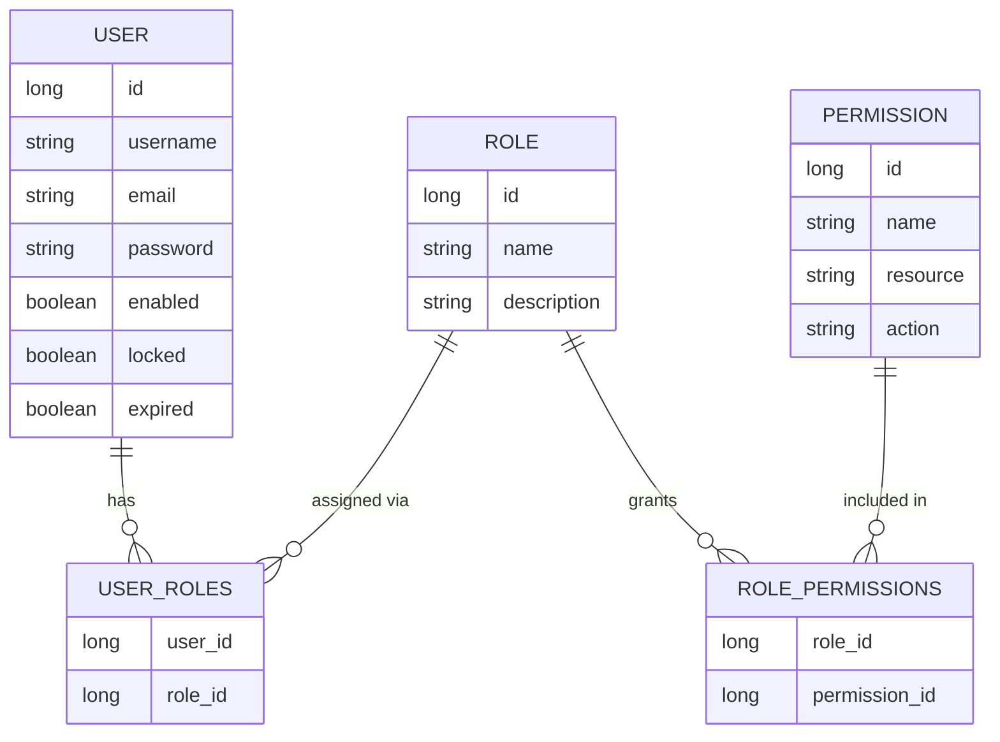

**Navigation**: [Back to Index](../00_MASTER_INDEX.md) | [Next Chapter >](Ch47_SB_Security_Deep.md)

---

# 🔐 SPRING BOOT MASTERY - Part 17: Database Security & User Management

**Complete Guide to User Management, Roles, Permissions, and Database Security**
_"Secure your data from the ground up"_

---

# 🎯 WHY-HOW-WHEN-WHICH FRAMEWORK

**WHY: Why Database Security Matters?**

```text
• SQL injection is #1 OWASP vulnerability - costs millions yearly
• Data breaches destroy companies: reputation, lawsuits, fines
• Compliance requirements: GDPR, HIPAA, PCI-DSS mandate security
• Your API is only as secure as your data layer
• Audit trails are legally required in many industries
```

**HOW: How to Secure Database Layer?**

```text
• Use parameterized queries (NEVER string concatenation)
• Hash passwords with BCrypt/Argon2 (NEVER plain text)
• Encrypt sensitive fields (SSN, credit cards) at rest
• Implement row-level security for multi-tenant apps
• Use connection pooling with encrypted credentials
```

**WHEN: When to Apply Security Measures?**

```text
• User management: Any app with authentication
• Row-level security: Multi-tenant, data isolation needed
• Encryption: PII, financial data, health records
• Audit logging: Compliance requirements, debugging security issues
• SQL injection prevention: ALWAYS (every app with database)
```

**WHICH: Which Security Layers to Implement?**

```text
ESSENTIAL:     Password hashing, SQL injection prevention, RBAC
IMPORTANT:     Audit logging, method security, connection encryption
ADVANCED:      Field encryption, row security, multi-tenancy isolation
```

---

# 📌 Table of Contents

**WHAT THIS PART COVERS**

```text
1. User Management Entity Design
2. Role-Based Access Control (RBAC)
3. Permission/Authority Management
4. Password Security (BCrypt, Argon2)
5. Custom UserDetailsService Implementation
6. Method-Level Security (@PreAuthorize, @Secured)
7. Database Row-Level Security
8. Audit Logging (Who did what, when)
9. SQL Injection Prevention
10. Encrypting Sensitive Data
11. Database Connection Security
12. Multi-Tenancy Security
```

---

# 🏗️ Section 1: User Management Entity Design

---

## Chapter 1: Complete User Entity Model

**User-role-permission model**



**How to read this diagram.** `USER_ROLES` and `ROLE_PERMISSIONS` are join tables that model two many-to-many relationships: a user can have many roles, and a role can grant many permissions.

### Entity Classes

```java
// ==================== USER ENTITY ====================

@Entity
@Table(name = "users", indexes = {
    @Index(name = "idx_users_username", columnList = "username", unique = true),
    @Index(name = "idx_users_email", columnList = "email", unique = true)
})
@Data
@NoArgsConstructor
@AllArgsConstructor
@Builder
public class User implements UserDetails {

    @Id
    @GeneratedValue(strategy = GenerationType.IDENTITY)
    private Long id;

    @Column(nullable = false, unique = true, length = 50)
    private String username;

    @Column(nullable = false, unique = true, length = 100)
    private String email;

    @Column(nullable = false)
    @JsonIgnore  // NEVER expose password in JSON responses
    private String password;

    @Column(name = "first_name", length = 50)
    private String firstName;

    @Column(name = "last_name", length = 50)
    private String lastName;

    @Column(name = "phone_number", length = 20)
    private String phoneNumber;

    // ==================== ACCOUNT STATUS FLAGS ====================

    @Column(name = "account_non_expired")
    @Builder.Default
    private boolean accountNonExpired = true;

    @Column(name = "account_non_locked")
    @Builder.Default
    private boolean accountNonLocked = true;

    @Column(name = "credentials_non_expired")
    @Builder.Default
    private boolean credentialsNonExpired = true;

    @Builder.Default
    private boolean enabled = true;

    // ==================== SECURITY TRACKING ====================

    @Column(name = "failed_login_attempts")
    @Builder.Default
    private int failedLoginAttempts = 0;

    @Column(name = "lock_time")
    private LocalDateTime lockTime;

    @Column(name = "password_changed_at")
    private LocalDateTime passwordChangedAt;

    @Column(name = "last_login_at")
    private LocalDateTime lastLoginAt;

    @Column(name = "last_login_ip", length = 45)
    private String lastLoginIp;

    // ==================== ROLES ====================

    @ManyToMany(fetch = FetchType.EAGER)
    @JoinTable(
        name = "user_roles",
        joinColumns = @JoinColumn(name = "user_id"),
        inverseJoinColumns = @JoinColumn(name = "role_id")
    )
    @Builder.Default
    private Set<Role> roles = new HashSet<>();

    // ==================== AUDIT FIELDS ====================

    @CreatedDate
    @Column(name = "created_at", updatable = false)
    private LocalDateTime createdAt;

    @LastModifiedDate
    @Column(name = "updated_at")
    private LocalDateTime updatedAt;

    @CreatedBy
    @Column(name = "created_by", updatable = false)
    private String createdBy;

    @LastModifiedBy
    @Column(name = "updated_by")
    private String updatedBy;

    // ==================== UserDetails Implementation ====================

    @Override
    @JsonIgnore
    public Collection<? extends GrantedAuthority> getAuthorities() {
        Set<GrantedAuthority> authorities = new HashSet<>();

        // Add roles as authorities (prefixed with ROLE_)
        roles.forEach(role -> {
            authorities.add(new SimpleGrantedAuthority("ROLE_" + role.getName()));

            // Add permissions from each role
            role.getPermissions().forEach(permission ->
                authorities.add(new SimpleGrantedAuthority(permission.getName()))
            );
        });

        return authorities;
    }

    @Override
    public boolean isAccountNonExpired() {
        return accountNonExpired;
    }

    @Override
    public boolean isAccountNonLocked() {
        return accountNonLocked;
    }

    @Override
    public boolean isCredentialsNonExpired() {
        return credentialsNonExpired;
    }

    @Override
    public boolean isEnabled() {
        return enabled;
    }

    // ==================== HELPER METHODS ====================

    public void incrementFailedLoginAttempts() {
        this.failedLoginAttempts++;
    }

    public void resetFailedLoginAttempts() {
        this.failedLoginAttempts = 0;
        this.lockTime = null;
    }

    public void lockAccount() {
        this.accountNonLocked = false;
        this.lockTime = LocalDateTime.now();
    }

    public void unlockAccount() {
        this.accountNonLocked = true;
        this.lockTime = null;
        this.failedLoginAttempts = 0;
    }

    public boolean hasRole(String roleName) {
        return roles.stream()
            .anyMatch(role -> role.getName().equalsIgnoreCase(roleName));
    }

    public boolean hasPermission(String permissionName) {
        return roles.stream()
            .flatMap(role -> role.getPermissions().stream())
            .anyMatch(perm -> perm.getName().equalsIgnoreCase(permissionName));
    }
}

// ==================== ROLE ENTITY ====================

@Entity
@Table(name = "roles")
@Data
@NoArgsConstructor
@AllArgsConstructor
@Builder
public class Role {

    @Id
    @GeneratedValue(strategy = GenerationType.IDENTITY)
    private Long id;

    @Column(nullable = false, unique = true, length = 50)
    private String name;  // e.g., "ADMIN", "USER", "MODERATOR"

    @Column(length = 200)
    private String description;

    @ManyToMany(fetch = FetchType.EAGER)
    @JoinTable(
        name = "role_permissions",
        joinColumns = @JoinColumn(name = "role_id"),
        inverseJoinColumns = @JoinColumn(name = "permission_id")
    )
    @Builder.Default
    private Set<Permission> permissions = new HashSet<>();

    @ManyToMany(mappedBy = "roles")
    @JsonIgnore
    private Set<User> users = new HashSet<>();

    @CreatedDate
    @Column(name = "created_at", updatable = false)
    private LocalDateTime createdAt;

    // Predefined roles
    public static final String ADMIN = "ADMIN";
    public static final String USER = "USER";
    public static final String MODERATOR = "MODERATOR";
    public static final String MANAGER = "MANAGER";
}

// ==================== PERMISSION ENTITY ====================

@Entity
@Table(name = "permissions", uniqueConstraints = {
    @UniqueConstraint(columnNames = {"resource", "action"})
})
@Data
@NoArgsConstructor
@AllArgsConstructor
@Builder
public class Permission {

    @Id
    @GeneratedValue(strategy = GenerationType.IDENTITY)
    private Long id;

    @Column(nullable = false, unique = true, length = 100)
    private String name;  // e.g., "users:read", "users:write", "orders:delete"

    @Column(nullable = false, length = 50)
    private String resource;  // e.g., "users", "orders", "products"

    @Column(nullable = false, length = 20)
    private String action;  // e.g., "read", "write", "delete", "admin"

    @Column(length = 200)
    private String description;

    @ManyToMany(mappedBy = "permissions")
    @JsonIgnore
    private Set<Role> roles = new HashSet<>();

    // Helper method to create permission name
    public static String createName(String resource, String action) {
        return resource + ":" + action;
    }

    // Common permission patterns
    public static final String READ = "read";
    public static final String WRITE = "write";
    public static final String DELETE = "delete";
    public static final String ADMIN = "admin";
}
```

### Database Schema (Flyway Migration)

```sql
-- V1__Create_Security_Tables.sql

-- Users table
CREATE TABLE users (
    id BIGSERIAL PRIMARY KEY,
    username VARCHAR(50) NOT NULL UNIQUE,
    email VARCHAR(100) NOT NULL UNIQUE,
    password VARCHAR(255) NOT NULL,
    first_name VARCHAR(50),
    last_name VARCHAR(50),
    phone_number VARCHAR(20),
    account_non_expired BOOLEAN DEFAULT TRUE,
    account_non_locked BOOLEAN DEFAULT TRUE,
    credentials_non_expired BOOLEAN DEFAULT TRUE,
    enabled BOOLEAN DEFAULT TRUE,
    failed_login_attempts INTEGER DEFAULT 0,
    lock_time TIMESTAMP,
    password_changed_at TIMESTAMP,
    last_login_at TIMESTAMP,
    last_login_ip VARCHAR(45),
    created_at TIMESTAMP DEFAULT CURRENT_TIMESTAMP,
    updated_at TIMESTAMP DEFAULT CURRENT_TIMESTAMP,
    created_by VARCHAR(50),
    updated_by VARCHAR(50)
);

-- Roles table
CREATE TABLE roles (
    id BIGSERIAL PRIMARY KEY,
    name VARCHAR(50) NOT NULL UNIQUE,
    description VARCHAR(200),
    created_at TIMESTAMP DEFAULT CURRENT_TIMESTAMP
);

-- Permissions table
CREATE TABLE permissions (
    id BIGSERIAL PRIMARY KEY,
    name VARCHAR(100) NOT NULL UNIQUE,
    resource VARCHAR(50) NOT NULL,
    action VARCHAR(20) NOT NULL,
    description VARCHAR(200),
    CONSTRAINT uk_permission_resource_action UNIQUE (resource, action)
);

-- User-Roles join table
CREATE TABLE user_roles (
    user_id BIGINT NOT NULL REFERENCES users(id) ON DELETE CASCADE,
    role_id BIGINT NOT NULL REFERENCES roles(id) ON DELETE CASCADE,
    PRIMARY KEY (user_id, role_id)
);

-- Role-Permissions join table
CREATE TABLE role_permissions (
    role_id BIGINT NOT NULL REFERENCES roles(id) ON DELETE CASCADE,
    permission_id BIGINT NOT NULL REFERENCES permissions(id) ON DELETE CASCADE,
    PRIMARY KEY (role_id, permission_id)
);

-- Indexes
CREATE INDEX idx_users_username ON users(username);
CREATE INDEX idx_users_email ON users(email);
CREATE INDEX idx_users_enabled ON users(enabled);

-- Insert default roles
INSERT INTO roles (name, description) VALUES
    ('ADMIN', 'Full system access'),
    ('USER', 'Standard user access'),
    ('MODERATOR', 'Content moderation access'),
    ('MANAGER', 'Team management access');

-- Insert default permissions
INSERT INTO permissions (name, resource, action, description) VALUES
    ('users:read', 'users', 'read', 'View user information'),
    ('users:write', 'users', 'write', 'Create and update users'),
    ('users:delete', 'users', 'delete', 'Delete users'),
    ('users:admin', 'users', 'admin', 'Full user management'),
    ('roles:read', 'roles', 'read', 'View roles'),
    ('roles:write', 'roles', 'write', 'Create and update roles'),
    ('orders:read', 'orders', 'read', 'View orders'),
    ('orders:write', 'orders', 'write', 'Create and update orders'),
    ('orders:delete', 'orders', 'delete', 'Delete orders'),
    ('products:read', 'products', 'read', 'View products'),
    ('products:write', 'products', 'write', 'Create and update products'),
    ('reports:read', 'reports', 'read', 'View reports'),
    ('reports:export', 'reports', 'export', 'Export reports');

-- Assign permissions to roles
INSERT INTO role_permissions (role_id, permission_id)
SELECT r.id, p.id FROM roles r, permissions p WHERE r.name = 'ADMIN';

INSERT INTO role_permissions (role_id, permission_id)
SELECT r.id, p.id FROM roles r, permissions p
WHERE r.name = 'USER' AND p.name IN ('users:read', 'orders:read', 'orders:write', 'products:read');

INSERT INTO role_permissions (role_id, permission_id)
SELECT r.id, p.id FROM roles r, permissions p
WHERE r.name = 'MODERATOR' AND p.name IN ('users:read', 'users:write', 'orders:read', 'products:read', 'products:write');
```

---

# SECTION 2: CUSTOM UserDetailsService

---

## Chapter 2: Implementing UserDetailsService

```java
// ==================== CUSTOM USER DETAILS SERVICE ====================

@Service
@RequiredArgsConstructor
@Slf4j
public class CustomUserDetailsService implements UserDetailsService {

    private final UserRepository userRepository;
    private final LoginAttemptService loginAttemptService;

    @Override
    @Transactional(readOnly = true)
    public UserDetails loadUserByUsername(String usernameOrEmail)
            throws UsernameNotFoundException {

        log.debug("Loading user by username or email: {}", usernameOrEmail);

        // Check if user is blocked due to too many failed attempts
        if (loginAttemptService.isBlocked(usernameOrEmail)) {
            log.warn("User {} is blocked due to too many failed login attempts",
                usernameOrEmail);
            throw new LockedException("Account is temporarily locked due to " +
                "too many failed login attempts. Try again later.");
        }

        // Find user by username or email
        User user = userRepository.findByUsernameOrEmail(usernameOrEmail, usernameOrEmail)
            .orElseThrow(() -> {
                log.warn("User not found: {}", usernameOrEmail);
                return new UsernameNotFoundException(
                    "User not found with username or email: " + usernameOrEmail
                );
            });

        // Check account status
        validateAccountStatus(user);

        return user;
    }

    private void validateAccountStatus(User user) {
        if (!user.isEnabled()) {
            throw new DisabledException("Account is disabled. Please contact support.");
        }

        if (!user.isAccountNonLocked()) {
            throw new LockedException("Account is locked. Please contact support.");
        }

        if (!user.isAccountNonExpired()) {
            throw new AccountExpiredException("Account has expired.");
        }

        if (!user.isCredentialsNonExpired()) {
            throw new CredentialsExpiredException("Password has expired. Please reset.");
        }
    }
}

// ==================== LOGIN ATTEMPT SERVICE ====================

@Service
@Slf4j
public class LoginAttemptService {

    private static final int MAX_ATTEMPTS = 5;
    private static final long LOCK_DURATION_MINUTES = 15;

    // Cache for tracking login attempts
    private final LoadingCache<String, Integer> attemptsCache;

    public LoginAttemptService() {
        this.attemptsCache = CacheBuilder.newBuilder()
            .expireAfterWrite(LOCK_DURATION_MINUTES, TimeUnit.MINUTES)
            .build(new CacheLoader<String, Integer>() {
                @Override
                public Integer load(String key) {
                    return 0;
                }
            });
    }

    public void loginSucceeded(String key) {
        attemptsCache.invalidate(key);
    }

    public void loginFailed(String key) {
        int attempts = attemptsCache.getUnchecked(key);
        attempts++;
        attemptsCache.put(key, attempts);
        log.warn("Failed login attempt {} for user: {}", attempts, key);
    }

    public boolean isBlocked(String key) {
        return attemptsCache.getUnchecked(key) >= MAX_ATTEMPTS;
    }

    public int getRemainingAttempts(String key) {
        return Math.max(0, MAX_ATTEMPTS - attemptsCache.getUnchecked(key));
    }
}

// ==================== AUTHENTICATION EVENT LISTENERS ====================

@Component
@RequiredArgsConstructor
@Slf4j
public class AuthenticationEventListener {

    private final LoginAttemptService loginAttemptService;
    private final UserRepository userRepository;

    @EventListener
    public void onAuthenticationSuccess(AuthenticationSuccessEvent event) {
        String username = event.getAuthentication().getName();

        log.info("Successful login for user: {}", username);
        loginAttemptService.loginSucceeded(username);

        // Update last login info
        userRepository.findByUsername(username).ifPresent(user -> {
            user.resetFailedLoginAttempts();
            user.setLastLoginAt(LocalDateTime.now());
            user.setLastLoginIp(getClientIp());
            userRepository.save(user);
        });
    }

    @EventListener
    public void onAuthenticationFailure(AuthenticationFailureBadCredentialsEvent event) {
        String username = (String) event.getAuthentication().getPrincipal();

        log.warn("Failed login attempt for user: {}", username);
        loginAttemptService.loginFailed(username);

        // Update failed attempts in database
        userRepository.findByUsername(username).ifPresent(user -> {
            user.incrementFailedLoginAttempts();

            if (user.getFailedLoginAttempts() >= 5) {
                user.lockAccount();
                log.warn("Account locked for user: {} after {} failed attempts",
                    username, user.getFailedLoginAttempts());
            }

            userRepository.save(user);
        });
    }

    private String getClientIp() {
        ServletRequestAttributes attributes =
            (ServletRequestAttributes) RequestContextHolder.getRequestAttributes();

        if (attributes != null) {
            HttpServletRequest request = attributes.getRequest();
            String ip = request.getHeader("X-Forwarded-For");
            if (ip == null || ip.isEmpty()) {
                ip = request.getRemoteAddr();
            }
            return ip;
        }
        return "unknown";
    }
}
```

---

🔬 **Section Challenge — Chapter 2: Implementing UserDetailsService**

**Challenge 1 (Reasoning):** Why does indexing a boolean column (e.g., `is_active`) usually result in terrible query performance and a bloated database?

<details><summary>Answer</summary>

Low Cardinality. A B-Tree index is efficient when it can rapidly eliminate large chunks of data (high cardinality, like unique IDs). A boolean column only has two possible values. If 90% of your users are `is_active=true`, the database optimizer will realize the index provides almost no filtering power and will completely ignore it, performing a Full Table Scan anyway. You just wasted disk space and slowed down every `INSERT`/`UPDATE` operation for an index that is never used.

</details>

# 🔒 Section 3: Password Security

---

## Chapter 3: Password Encoding & Validation

```java
// ==================== PASSWORD CONFIGURATION ====================

@Configuration
public class PasswordConfig {

    /**
     * BCrypt is the recommended default
     * - Adaptive: can increase cost factor over time
     * - Includes salt automatically
     * - Resistant to rainbow table attacks
     */
    @Bean
    public PasswordEncoder passwordEncoder() {
        return new BCryptPasswordEncoder(12);  // Cost factor 12 (2^12 rounds)
    }

    /**
     * For higher security requirements, use Argon2
     * - Winner of Password Hashing Competition (2015)
     * - Memory-hard (harder to attack with GPUs/ASICs)
     */
    @Bean
    @Profile("high-security")
    public PasswordEncoder argon2PasswordEncoder() {
        return new Argon2PasswordEncoder(
            16,      // Salt length
            32,      // Hash length
            1,       // Parallelism
            65536,   // Memory (64MB)
            3        // Iterations
        );
    }

    /**
     * Delegating encoder allows gradual migration between algorithms
     */
    @Bean
    @Profile("migration")
    public PasswordEncoder delegatingPasswordEncoder() {
        String defaultEncoder = "bcrypt";

        Map<String, PasswordEncoder> encoders = new HashMap<>();
        encoders.put("bcrypt", new BCryptPasswordEncoder(12));
        encoders.put("argon2", new Argon2PasswordEncoder());
        encoders.put("scrypt", new SCryptPasswordEncoder());
        // Legacy encoders for migration
        encoders.put("sha256", new StandardPasswordEncoder());  // Deprecated

        DelegatingPasswordEncoder encoder =
            new DelegatingPasswordEncoder(defaultEncoder, encoders);

        // For encoding passwords without prefix (when upgrading)
        encoder.setDefaultPasswordEncoderForMatches(new BCryptPasswordEncoder(12));

        return encoder;
    }
}

// ==================== PASSWORD VALIDATION ====================

@Service
@RequiredArgsConstructor
public class PasswordValidationService {

    private static final int MIN_LENGTH = 8;
    private static final int MAX_LENGTH = 128;

    /**
     * NIST SP 800-63B Guidelines:
     * - Minimum 8 characters
     * - Maximum 128 characters
     * - No composition rules (uppercase, special chars, etc.)
     * - Check against breached password lists
     * - Allow spaces and all printable characters
     */
    public PasswordValidationResult validate(String password, User user) {
        List<String> errors = new ArrayList<>();

        // Length check
        if (password.length() < MIN_LENGTH) {
            errors.add("Password must be at least " + MIN_LENGTH + " characters");
        }

        if (password.length() > MAX_LENGTH) {
            errors.add("Password must not exceed " + MAX_LENGTH + " characters");
        }

        // No personal info
        if (containsPersonalInfo(password, user)) {
            errors.add("Password must not contain username, email, or name");
        }

        // Check against common passwords
        if (isCommonPassword(password)) {
            errors.add("Password is too common. Choose a more unique password");
        }

        // Check password history
        if (isInPasswordHistory(password, user)) {
            errors.add("Cannot reuse recent passwords");
        }

        // Check against breached passwords (HaveIBeenPwned)
        if (isBreachedPassword(password)) {
            errors.add("This password has been exposed in data breaches");
        }

        return PasswordValidationResult.builder()
            .valid(errors.isEmpty())
            .errors(errors)
            .build();
    }

    private boolean containsPersonalInfo(String password, User user) {
        String lowerPassword = password.toLowerCase();

        return lowerPassword.contains(user.getUsername().toLowerCase()) ||
               lowerPassword.contains(user.getEmail().split("@")[0].toLowerCase()) ||
               (user.getFirstName() != null &&
                lowerPassword.contains(user.getFirstName().toLowerCase())) ||
               (user.getLastName() != null &&
                lowerPassword.contains(user.getLastName().toLowerCase()));
    }

    private boolean isCommonPassword(String password) {
        // Top 10000 common passwords list
        Set<String> commonPasswords = loadCommonPasswords();
        return commonPasswords.contains(password.toLowerCase());
    }

    private boolean isInPasswordHistory(String password, User user) {
        // Check last 5 passwords
        // Requires storing password history in database
        return false;  // Implementation depends on password history storage
    }

    private boolean isBreachedPassword(String password) {
        // Use HaveIBeenPwned API (k-anonymity approach)
        // Only sends first 5 chars of SHA-1 hash
        try {
            String sha1 = DigestUtils.sha1Hex(password).toUpperCase();
            String prefix = sha1.substring(0, 5);
            String suffix = sha1.substring(5);

            // Call HIBP API with prefix
            RestTemplate restTemplate = new RestTemplate();
            String response = restTemplate.getForObject(
                "https://api.pwnedpasswords.com/range/" + prefix,
                String.class
            );

            // Check if suffix exists in response
            return response != null &&
                   Arrays.stream(response.split("\n"))
                       .anyMatch(line -> line.startsWith(suffix));

        } catch (Exception e) {
            // If API fails, don't block registration
            return false;
        }
    }

    private Set<String> loadCommonPasswords() {
        // Load from file or embedded resource
        return Set.of(
            "password", "123456", "password123", "admin", "letmein",
            "welcome", "monkey", "dragon", "master", "qwerty"
            // ... more passwords
        );
    }
}

@Data
@Builder
public class PasswordValidationResult {
    private boolean valid;
    private List<String> errors;
}

// ==================== PASSWORD EXPIRY ====================

@Component
@RequiredArgsConstructor
@Slf4j
public class PasswordExpiryChecker {

    private static final int PASSWORD_EXPIRY_DAYS = 90;

    @Scheduled(cron = "0 0 0 * * ?")  // Run daily at midnight
    public void checkPasswordExpiry() {
        LocalDateTime expiryThreshold = LocalDateTime.now()
            .minusDays(PASSWORD_EXPIRY_DAYS);

        // Find users with expired passwords
        List<User> expiredUsers = userRepository.findByPasswordChangedAtBefore(
            expiryThreshold
        );

        expiredUsers.forEach(user -> {
            user.setCredentialsNonExpired(false);
            userRepository.save(user);

            // Send reminder email
            notificationService.sendPasswordExpiryNotification(user);
        });
    }
}
```

---

# 🔒 Section 4: Method — Level Security

---

## Chapter 4: @PreAuthorize, @Secured, and Custom Expressions

```java
// ==================== SECURITY CONFIGURATION ====================

@Configuration
@EnableMethodSecurity(
    securedEnabled = true,      // Enable @Secured
    jsr250Enabled = true,       // Enable @RolesAllowed (JSR-250)
    prePostEnabled = true       // Enable @PreAuthorize/@PostAuthorize
)
public class MethodSecurityConfig {

    // Custom permission evaluator for complex authorization
    @Bean
    public MethodSecurityExpressionHandler methodSecurityExpressionHandler() {
        DefaultMethodSecurityExpressionHandler handler =
            new DefaultMethodSecurityExpressionHandler();
        handler.setPermissionEvaluator(new CustomPermissionEvaluator());
        return handler;
    }
}

// ==================== USING @PreAuthorize ====================

@Service
@RequiredArgsConstructor
@Slf4j
public class UserService {

    private final UserRepository userRepository;

    /**
     * Only ADMIN can view all users
     */
    @PreAuthorize("hasRole('ADMIN')")
    public List<UserDto> getAllUsers() {
        return userRepository.findAll().stream()
            .map(this::toDto)
            .collect(Collectors.toList());
    }

    /**
     * Users can view their own profile OR admins can view any profile
     */
    @PreAuthorize("hasRole('ADMIN') or #id == authentication.principal.id")
    public UserDto getUser(Long id) {
        return userRepository.findById(id)
            .map(this::toDto)
            .orElseThrow(() -> new UserNotFoundException(id));
    }

    /**
     * Only users with specific permission can create users
     */
    @PreAuthorize("hasAuthority('users:write')")
    public UserDto createUser(CreateUserRequest request) {
        // Implementation
    }

    /**
     * Users can update themselves OR admins can update anyone
     */
    @PreAuthorize("hasRole('ADMIN') or #id == authentication.principal.id")
    public UserDto updateUser(Long id, UpdateUserRequest request) {
        // Implementation
    }

    /**
     * Only ADMIN can delete users, and cannot delete themselves
     */
    @PreAuthorize("hasRole('ADMIN') and #id != authentication.principal.id")
    public void deleteUser(Long id) {
        userRepository.deleteById(id);
    }

    /**
     * Custom SpEL expression - check if user belongs to same organization
     */
    @PreAuthorize("@securityService.belongsToSameOrganization(#id, authentication)")
    public UserDto getUserInOrganization(Long id) {
        return userRepository.findById(id)
            .map(this::toDto)
            .orElseThrow(() -> new UserNotFoundException(id));
    }

    /**
     * Multiple conditions
     */
    @PreAuthorize("""
        hasRole('ADMIN') or
        (hasRole('MANAGER') and @securityService.isManager(#departmentId, authentication)) or
        (hasAuthority('users:read') and #departmentId == authentication.principal.departmentId)
    """)
    public List<UserDto> getUsersByDepartment(Long departmentId) {
        return userRepository.findByDepartmentId(departmentId).stream()
            .map(this::toDto)
            .collect(Collectors.toList());
    }
}

// ==================== @PostAuthorize (AFTER execution) ====================

@Service
public class DocumentService {

    /**
     * Filter result AFTER method execution
     * Only return if user owns the document
     */
    @PostAuthorize("returnObject.ownerId == authentication.principal.id or hasRole('ADMIN')")
    public Document getDocument(Long id) {
        return documentRepository.findById(id)
            .orElseThrow(() -> new DocumentNotFoundException(id));
    }

    /**
     * Filter collection after execution
     */
    @PostFilter("filterObject.ownerId == authentication.principal.id or hasRole('ADMIN')")
    public List<Document> getAllDocuments() {
        return documentRepository.findAll();
    }

    /**
     * Filter input collection before execution
     */
    @PreFilter("filterObject.ownerId == authentication.principal.id")
    public void deleteDocuments(List<Document> documents) {
        documentRepository.deleteAll(documents);
    }
}

// ==================== CUSTOM SECURITY SERVICE ====================

@Service("securityService")
@RequiredArgsConstructor
public class SecurityService {

    private final UserRepository userRepository;
    private final OrganizationRepository organizationRepository;

    public boolean belongsToSameOrganization(Long targetUserId, Authentication auth) {
        User currentUser = (User) auth.getPrincipal();

        return userRepository.findById(targetUserId)
```

---

---

🔬 **Section Challenge — Chapter 4: @PreAuthorize, @Secured, and Custom Expressions**

**Challenge 2 (Selection):** A method needs row-level access control: admins can update any user, but normal users can update only their own profile. Should you use `@Secured`, plain `hasRole`, or a custom expression?

<details><summary>Trace, Reasoning & Debug</summary>

```java
@PreAuthorize("hasRole('ADMIN') or @authz.isSelf(#userId, authentication)")
public void updateUser(Long userId, UpdateUserRequest request) {
    // business update after authorization passes
}
```

Use `@Secured` for simple role gates only. Use `@PreAuthorize` when the rule depends on method arguments, ownership, tenant, or entity state. Put reusable row-level checks behind `@authz` so controllers/services do not duplicate repository lookups and security logic.

</details>


---

## Reality Check

**"JPA auto-generates good database schemas"** → JPA's ddl-auto=update adds columns and tables but NEVER drops columns, renames fields, or adds indexes. The generated schema has no foreign key names (autogenerated gibberish), no indexes on frequently queried columns, and varchar(255) as the default for every String. Use Flyway or Liquibase for production schema management. JPA schema generation is for prototyping only.

**"N+1 queries are always a performance problem"** → N+1 is a problem when N is large. Loading one Order with 3 OrderItems generates 4 queries — perfectly fine. Loading 1000 Orders with 3 items each generates 1001 queries — that is the problem. The fix depends on access patterns: JOIN FETCH for always-needed associations, @BatchSize for sometimes-needed associations, or projection queries for read-only views.

**"Connection pool size should match thread count"** → HikariCP default is 10 connections. If your application has 200 threads and each holds a connection for 100ms, you need roughly 20 connections (200 threads x 0.1 seconds / 1 second). Over-provisioning connections wastes database resources and can hit database max_connections limits. Under-provisioning causes threads to wait for connections. Formula: connections = (core_count x 2) + disk_spindles, with a maximum around 20-30.

**"UUID primary keys are universally better than auto-increment"** → UUIDs enable distributed ID generation without coordination. But random UUIDs (v4) cause B-tree index fragmentation because inserts scatter across the tree. This degrades INSERT performance by 2-5x on large tables. Use UUID v7 (time-ordered) or ULID for distributed IDs with sequential ordering, or stick with auto-increment for single-database applications.

**"Soft delete with a deleted flag is the correct approach"** → Soft delete adds WHERE deleted = false to EVERY query, including joins. Unique constraints break because you cannot have two active records with the same email, but you also cannot have two soft-deleted records. Foreign keys reference deleted records. Indexes must be partial. Use event sourcing, audit tables, or database-native temporal tables instead of boolean flags for deletion tracking.
